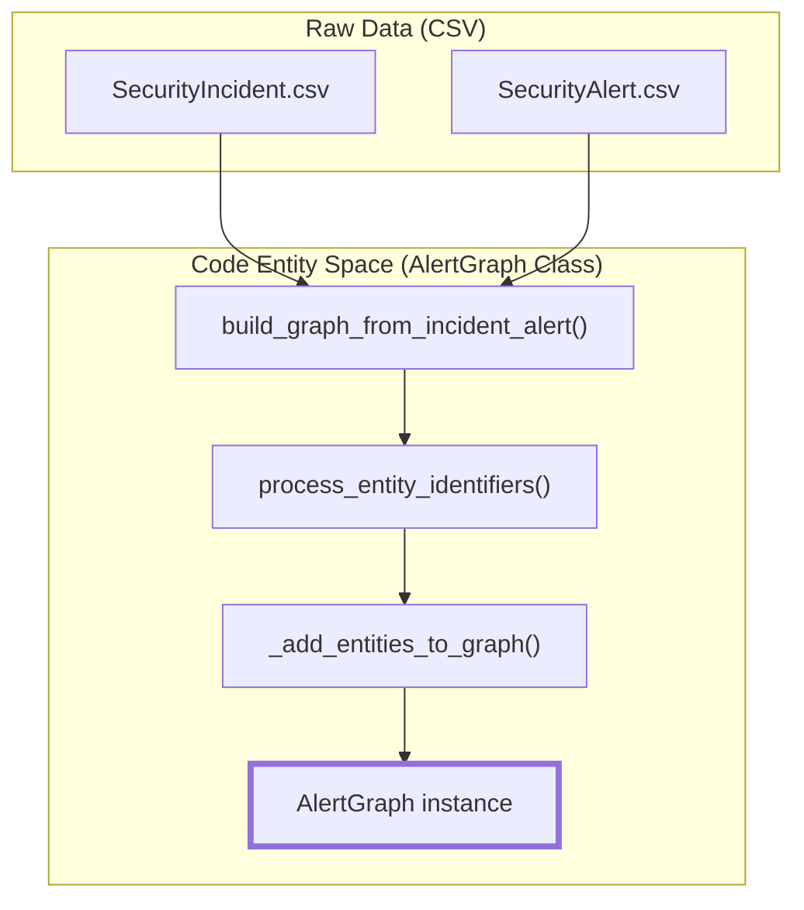
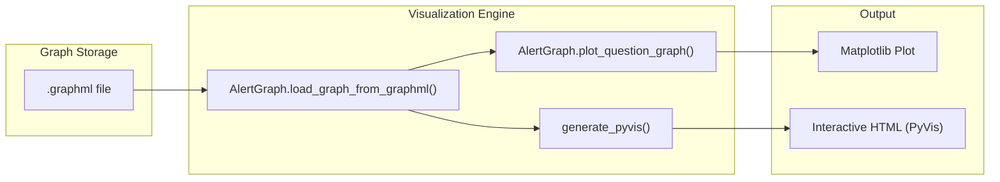

<!-- source: DeepWiki mcp.deepwiki.com · repo microsoft/SecRL · page 7.1 Graph Construction & Exploration Notebooks · fetched 2026-10-26 -->

# Graph Construction & Exploration Notebooks

Relevant source files

The following files were used as context for generating this wiki page:

- [notebooks/explore_graph_questions.ipynb](notebooks/explore_graph_questions.ipynb)
- [notebooks/extract_construct_graph.ipynb](notebooks/extract_construct_graph.ipynb)
- [notebooks/question_split.ipynb](notebooks/question_split.ipynb)
- [notebooks/react_example.ipynb](notebooks/react_example.ipynb)
- [secgym/qagen/alert_graph.py](secgym/qagen/alert_graph.py)
- [secgym/qagen/extracted_alerts.csv](secgym/qagen/extracted_alerts.csv)
- [secgym/qagen/extracted_incidents.csv](secgym/qagen/extracted_incidents.csv)
- [secgym/qagen/qa_gen.py](secgym/qagen/qa_gen.py)
- [secgym/qagen/qa_gen_prompts.py](secgym/qagen/qa_gen_prompts.py)
- [secgym/utils/graph_viz_utils.py](secgym/utils/graph_viz_utils.py)
- [secgym/utils/utils.py](secgym/utils/utils.py)

This page details the specialized Jupyter notebooks used to build, split, and visualize the attack graphs that form the backbone of the ExCyTIn-Bench evaluation framework. These tools bridge the gap between raw telemetry data and the structured graph representation used for synthetic question generation.

## 1. Graph Construction (extract_construct_graph.ipynb)

The `extract_construct_graph.ipynb` notebook is the primary entry point for transforming raw CSV exports of security incidents and alerts into a structured `AlertGraph` object.

### Implementation & Data Flow
The notebook implements a multi-step pipeline to filter and normalize raw security data:
1.  **Data Loading**: It loads `SecurityIncident.csv` and `SecurityAlert.csv` files using a custom separator (`❖`) to avoid conflicts with standard CSV delimiters in log entries [notebooks/extract_construct_graph.ipynb:35-43]().
2.  **Incident Filtering**: It identifies "latest" incidents by parsing the `Labels` JSON column for a `LATEST` tag and filters by specific time ranges (e.g., June to August 2024) [notebooks/extract_construct_graph.ipynb:60-90]().
3.  **Alert Extraction**: For each filtered incident, it extracts the associated alerts by mapping the `AlertIds` list found in the incident record to the global `SecurityAlert` table [notebooks/extract_construct_graph.ipynb:105-124]().
4.  **Graph Instantiation**: It utilizes the `AlertGraph` class to build a NetworkX representation where nodes are either Alerts or Entities (Accounts, Hosts, IPs, etc.) and edges represent the presence of an entity within an alert [secgym/qagen/alert_graph.py:29-59]().

### Code Entity Space Mapping: AlertGraph Construction

The following diagram illustrates how raw CSV data is mapped to the `AlertGraph` code structure.

**Diagram: From CSV to AlertGraph Object**

Sources: [secgym/qagen/alert_graph.py:29-59](), [secgym/utils/utils.py:48-75](), [notebooks/extract_construct_graph.ipynb:114-124]()

## 2. Interactive Exploration (explore_graph_questions.ipynb)

The `explore_graph_questions.ipynb` notebook provides an interactive environment for security researchers to visualize the generated attack graphs and verify the paths used for QA generation.

### Key Functionalities
*   **Graph Loading**: Loads serialized `.graphml` files into the `AlertGraph` class [secgym/qagen/alert_graph.py:68-89]().
*   **Path Visualization**: Uses `matplotlib` to plot specific subgraphs related to a question. The `plot_question_graph` function highlights the "Start Alert", "End Alert", and the "Shortest Alert Path" connecting them [secgym/qagen/alert_graph.py:160-173]().
*   **PyVis Integration**: For complex incidents (like Incident 322), the notebook utilizes `secgym/utils/graph_viz_utils.py` to generate interactive HTML visualizations using `pyvis`.

### Graph Visualization Logic
The visualization logic distinguishes between node types using visual cues:
*   **Alert Nodes**: Rendered as larger squares (Red in PyVis, Light Blue in Matplotlib) [secgym/qagen/alert_graph.py:137-148](), [secgym/utils/graph_viz_utils.py:114-126]().
*   **Entity Nodes**: Rendered as smaller circles (Blue in PyVis, Light Pink in Matplotlib) [secgym/qagen/alert_graph.py:149-156](), [secgym/utils/graph_viz_utils.py:128-139]().

**Diagram: Visualization Data Flow**

Sources: [secgym/qagen/alert_graph.py:68-89](), [secgym/qagen/alert_graph.py:160-173](), [secgym/utils/graph_viz_utils.py:100-165]()

## 3. Path Overlap & Splitting (question_split.ipynb)

This notebook is critical for experimental integrity, ensuring that training and testing questions are sufficiently distinct.

### Implementation Details
*   **Overlap Scoring**: It defines `compute_overlap_score(path1, path2)`, which calculates a score based on shared edges versus unshared edges [notebooks/question_split.ipynb:14-45]().
*   **Split Generation**: The `split_train_test` function performs multiple trials to find splits that minimize or maximize the `compare_score` between sets [notebooks/question_split.ipynb:47-124]().
*   **Split Categories**: It generates three types of splits saved in `experiments/split_files/`:
    *   `low_score`: Minimum overlap between train and test.
    *   `median_score`: Average overlap.
    *   `high_score`: Maximum overlap (testing generalization) [notebooks/question_split.ipynb:140-147]().

| Feature | Code Implementation |
| :--- | :--- |
| **Path Extraction** | `AlertGraph.get_alert_paths()` [secgym/qagen/alert_graph.py:202-210]() |
| **Entity Processing** | `process_entity_identifiers()` [secgym/utils/utils.py:48-170]() |
| **Graph Serialization** | `AlertGraph.save_to_graphml()` [secgym/qagen/alert_graph.py:121-128]() |
| **Visualization Utility** | `generate_pyvis()` [secgym/utils/graph_viz_utils.py:100-108]() |

Sources: [notebooks/question_split.ipynb:14-124](), [secgym/qagen/alert_graph.py:202-210](), [secgym/utils/utils.py:48-170]()

---

