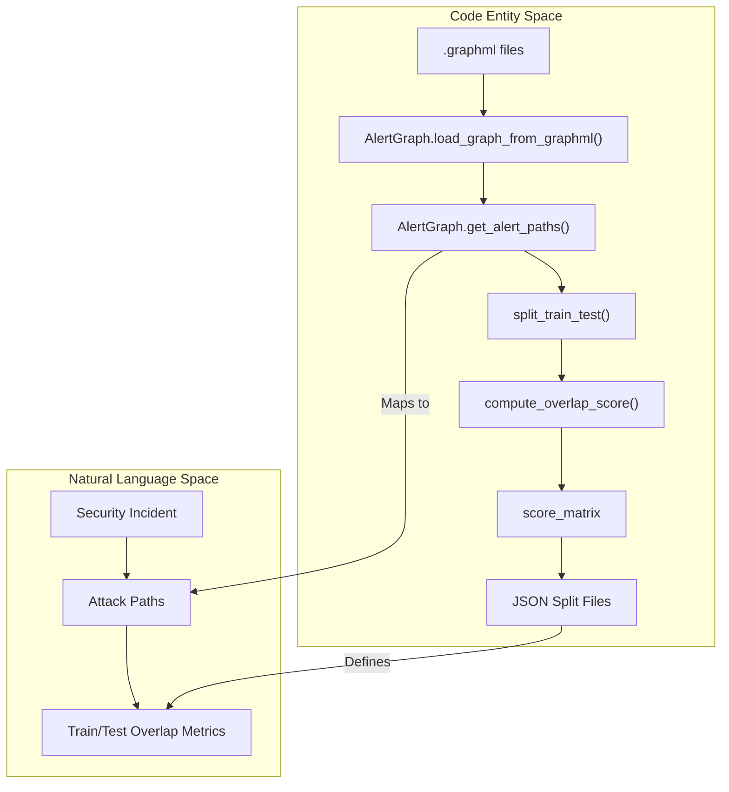
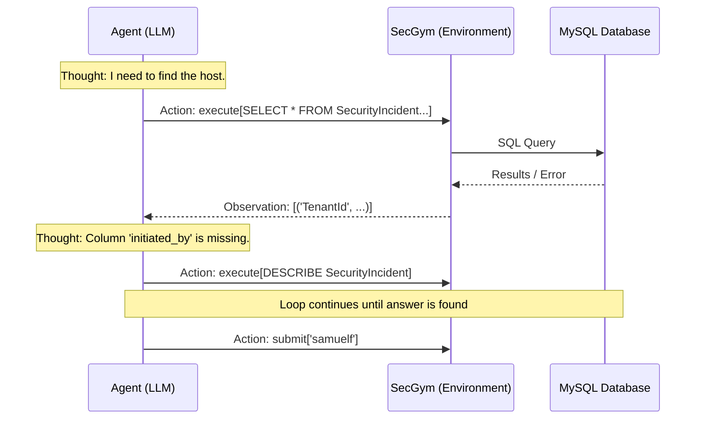

<!-- source: DeepWiki mcp.deepwiki.com · repo microsoft/SecRL · page 7.2 Question Splitting & ReAct Example Notebooks · fetched 2026-10-26 -->

# Question Splitting & ReAct Example Notebooks

Relevant source files

The following files were used as context for generating this wiki page:

- [notebooks/explore_graph_questions.ipynb](notebooks/explore_graph_questions.ipynb)
- [notebooks/extract_construct_graph.ipynb](notebooks/extract_construct_graph.ipynb)
- [notebooks/question_split.ipynb](notebooks/question_split.ipynb)
- [notebooks/react_example.ipynb](notebooks/react_example.ipynb)
- [secgym/agents/agent.py](secgym/agents/agent.py)
- [secgym/agents/react_examples/react_example_1.txt](secgym/agents/react_examples/react_example_1.txt)
- [secgym/agents/react_examples/react_example_2.txt](secgym/agents/react_examples/react_example_2.txt)
- [secgym/agents/react_examples/react_example_3.txt](secgym/agents/react_examples/react_example_3.txt)

This page details the specialized Jupyter notebooks used for managing the question dataset and demonstrating agent interaction. `question_split.ipynb` handles the algorithmic partitioning of generated questions into train and test sets based on graph path similarity. `react_example.ipynb` provides a step-by-step walkthrough of a ReAct agent's reasoning and database interaction process.

## 1. Question Splitting (question_split.ipynb)

The `question_split.ipynb` notebook is responsible for creating the official train/test splits for the ExCyTIn-Bench dataset. Unlike random splitting, this implementation uses a **Path-Relevance-Score** to ensure that the test set contains questions that are sufficiently distinct from the training set, or conversely, to create splits with specific levels of overlap (low, median, high) [notebooks/question_split.ipynb:140-142]().

### 1.1 Implementation Logic
The splitting process relies on the `AlertGraph` class to extract paths between security alerts [notebooks/question_split.ipynb:162-164]().

**Key Functions:**
*   **`compute_overlap_score(path1, path2, alpha=3, beta=1)`**: Calculates the similarity between two alert paths based on shared and unshared edges. Shared edges contribute positively (`alpha`), while unshared edges (differences) penalize the score (`beta`) [notebooks/question_split.ipynb:14-45]().
*   **`split_train_test(all_paths, train_ratio, trials)`**: 
    1.  Calculates a weight for each path based on its length relative to the maximum path length in the incident [notebooks/question_split.ipynb:75-79]().
    2.  Constructs a `score_matrix` to cache overlap scores between all pairs of paths [notebooks/question_split.ipynb:82-95]().
    3.  Performs multiple random split trials. For each trial, it calculates a cumulative "compare_score" representing the total overlap between the proposed training set and test set [notebooks/question_split.ipynb:101-119]().
    4.  Returns a dictionary of splits mapped by their overlap scores.

### 1.2 Data Flow: Graph to Split Files
The notebook iterates through all `.graphml` files in the `secgym/qagen/graph_files` directory, generates the paths, and saves the resulting JSON splits into three categories: `low_score`, `median_score`, and `high_score` [notebooks/question_split.ipynb:133-147]().

**Question Splitting Pipeline**

Sources: [notebooks/question_split.ipynb:9-124](), [notebooks/question_split.ipynb:155-176]()

## 2. ReAct Example Walkthrough (react_example.ipynb)

The `react_example.ipynb` notebook serves as a manual demonstration of the `ReAct` (Reason + Act) paradigm. It simulates the interaction between an LLM agent and the `SecGym` environment [notebooks/react_example.ipynb:9-12]().

### 2.1 Interaction Loop
The notebook illustrates the `Thought-Action-Observation` loop required for successful incident investigation.

| Component | Code Implementation / Example |
| :--- | :--- |
| **System Prompt** | Defines the agent as a "security analyst" and specifies the `Thought: <reasoning>` and `Action: execute[<query>]` format [notebooks/react_example.ipynb:12](). |
| **Action: execute** | Used to run SQL queries against the MySQL backend, such as `SHOW TABLES` or `DESCRIBE SecurityIncident` [notebooks/react_example.ipynb:20-36](). |
| **Observation** | The raw output returned from the database (e.g., list of tuples or error messages) [notebooks/react_example.ipynb:24-40](). |
| **Action: submit** | The final step where the agent provides the answer string [notebooks/react_example.ipynb:55](). |

### 2.2 Error Handling and Schema Exploration
The notebook highlights a critical aspect of the benchmark: the agent must handle schema mismatches. For example, the agent attempts to query a non-existent column `initiated_by`, receives a `ProgrammingError`, and subsequently uses `DESCRIBE` to correct its understanding of the table structure [notebooks/react_example.ipynb:28-40]().

**ReAct Interaction Logic**

Sources: [notebooks/react_example.ipynb:9-55](), [secgym/agents/agent.py:34-41]()

## 3. ReAct Demonstration Examples

The repository includes pre-formatted text files used as few-shot demonstrations for ReAct agents. These examples (found in `secgym/agents/react_examples/`) are structured identically to the notebook walkthroughs.

*   **Example 1**: Focuses on identifying an account associated with a suspicious PowerShell process on a specific host (`vnevado-win10e`) [secgym/agents/react_examples/react_example_1.txt:1-55]().
*   **Example 2**: Demonstrates multi-stage correlation involving `EmailPostDeliveryEvents`, `EmailUrlInfo`, and `ZAP` (Zero-hour Auto Purge) actions to find a malicious URL [secgym/agents/react_examples/react_example_2.txt:1-52]().
*   **Example 3**: Shows how to join `UrlClickEvents` with `DeviceInfo` using IP addresses and `AadDeviceId` to identify a specific hardware host [secgym/agents/react_examples/react_example_3.txt:1-50]().

Sources: [secgym/agents/react_examples/react_example_1.txt:1-55](), [secgym/agents/react_examples/react_example_2.txt:1-52](), [secgym/agents/react_examples/react_example_3.txt:1-50]()

---

