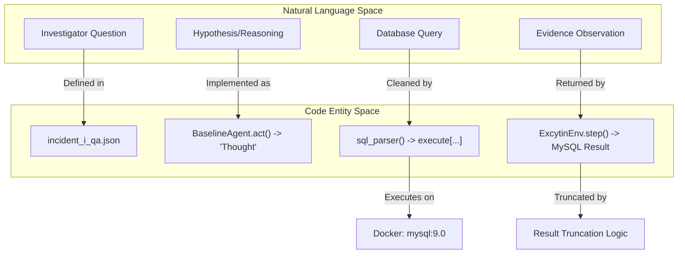
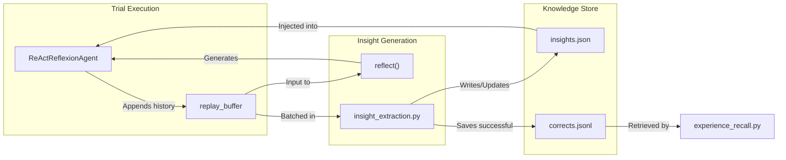

<!-- source: DeepWiki mcp.deepwiki.com · repo microsoft/SecRL · page 8 Glossary · fetched 2026-10-26 -->

# Glossary

Relevant source files

The following files were used as context for generating this wiki page:

- [.gitignore](.gitignore)
- [README.md](README.md)
- [experiments/result_analysis/analysis.py](experiments/result_analysis/analysis.py)
- [latest_experiments/BaselineAgent_gpt-5_c121_alert_level_t0_s25_trial1/agent_incident_134.json](latest_experiments/BaselineAgent_gpt-5_c121_alert_level_t0_s25_trial1/agent_incident_134.json)
- [latest_experiments/BaselineAgent_gpt-5_c121_alert_level_t0_s25_trial1/agent_incident_166.json](latest_experiments/BaselineAgent_gpt-5_c121_alert_level_t0_s25_trial1/agent_incident_166.json)
- [latest_experiments/BaselineAgent_gpt-5_c121_alert_level_t0_s25_trial1/agent_incident_322.json](latest_experiments/BaselineAgent_gpt-5_c121_alert_level_t0_s25_trial1/agent_incident_322.json)
- [latest_experiments/BaselineAgent_o3_c106_alert_level_t0_s25_trial1/agent_incident_5.json](latest_experiments/BaselineAgent_o3_c106_alert_level_t0_s25_trial1/agent_incident_5.json)
- [latest_experiments/BaselineAgent_o3_c106_alert_level_t0_s25_trial1/agent_incident_55.json](latest_experiments/BaselineAgent_o3_c106_alert_level_t0_s25_trial1/agent_incident_55.json)
- [latest_experiments/BaselineAgent_o3_c106_alert_level_t0_s25_trial1/env_incident_134.json](latest_experiments/BaselineAgent_o3_c106_alert_level_t0_s25_trial1/env_incident_134.json)
- [latest_experiments/BaselineAgent_o3_c106_alert_level_t0_s25_trial1/env_incident_166.json](latest_experiments/BaselineAgent_o3_c106_alert_level_t0_s25_trial1/env_incident_166.json)
- [requirements.txt](requirements.txt)
- [secgym/agents/__init__.py](secgym/agents/__init__.py)
- [secgym/agents/agent_utils.py](secgym/agents/agent_utils.py)
- [secgym/agents/baseline_agent.py](secgym/agents/baseline_agent.py)
- [secgym/agents/expel_train/README.md](secgym/agents/expel_train/README.md)
- [secgym/agents/expel_train/__init__.py](secgym/agents/expel_train/__init__.py)
- [secgym/agents/expel_train/experience_recall.py](secgym/agents/expel_train/experience_recall.py)
- [secgym/agents/expel_train/insight_extraction.py](secgym/agents/expel_train/insight_extraction.py)
- [secgym/agents/prompt_sauce_agent.py](secgym/agents/prompt_sauce_agent.py)
- [secgym/agents/prompt_sauce_reflexion_agent.py](secgym/agents/prompt_sauce_reflexion_agent.py)
- [secgym/agents/react_agent.py](secgym/agents/react_agent.py)
- [secgym/agents/react_reflexion_agent.py](secgym/agents/react_reflexion_agent.py)
- [secgym/assets/updated_eval_results_09_25.png](secgym/assets/updated_eval_results_09_25.png)
- [secgym/assets/updated_eval_results_10_25.png](secgym/assets/updated_eval_results_10_25.png)
- [secgym/assets/updated_eval_results_11_25.png](secgym/assets/updated_eval_results_11_25.png)
- [secgym/assets/updated_eval_results_12_25.png](secgym/assets/updated_eval_results_12_25.png)
- [secgym/database/README.md](secgym/database/README.md)
- [secgym/database/process_logs.py](secgym/database/process_logs.py)
- [secgym/excytin_env.py](secgym/excytin_env.py)
- [secgym/myconfig.py](secgym/myconfig.py)
- [secgym/qagen/alert_graph.py](secgym/qagen/alert_graph.py)
- [secgym/qagen/qa_gen.py](secgym/qagen/qa_gen.py)
- [secgym/qagen/qa_gen_prompts.py](secgym/qagen/qa_gen_prompts.py)
- [secgym/utils/graph_viz_utils.py](secgym/utils/graph_viz_utils.py)
- [secgym/utils/utils.py](secgym/utils/utils.py)

This glossary provides definitions for the specialized terminology, architectural components, and domain concepts used throughout the ExCyTIn-Bench codebase. It serves as a technical reference for onboarding engineers to understand the mapping between conceptual threat hunting and the implementation in code.

## Core System Entities

### SecGym (ExcytinEnv)
The core Gymnasium-based environment that facilitates the interaction between an LLM agent and the security data. It manages the lifecycle of the MySQL database connection, executes SQL actions, and returns observations (query results).
*   **Implementation**: `ExcytinEnv` class in [secgym/excytin_env.py]().
*   **Key Function**: `step(action)` which parses the agent's SQL command, interacts with the Dockerized MySQL backend, and returns the next observation.

### AlertGraph
A directed graph representation of a security incident. Nodes represent either security alerts or entities (IPs, Users, Hosts), and edges represent relationships (e.g., an IP address appearing in a specific alert).
*   **Implementation**: `AlertGraph` class in [secgym/qagen/alert_graph.py:14-26]().
*   **Data Structure**: Uses `networkx.Graph` to store incident metadata and node attributes like `node_type` (alert/entity) and `entry` (the raw JSON log) [secgym/qagen/alert_graph.py:48-54]().

### Telemetry Layers
The framework supports different levels of data visibility for the agent, simulating different security stack configurations.
*   **alert_level**: The agent only sees high-level security alerts.
*   **log_level**: The agent has access to raw telemetry (process events, sign-in logs, etc.).
*   **Implementation**: Logic handled in `ExcytinEnv` to restrict table access based on the chosen layer.

---

## Agent Logic & Learning

### Thought-Action-Observation Loop
The fundamental execution pattern for all agents in the benchmark.
1.  **Thought**: LLM reasoning about the current investigation state.
2.  **Action**: Either `execute[SQL]` to query the DB or `submit[Answer]` to provide the final result.
3.  **Observation**: The output from the MySQL database or an error message.
*   **Implementation**: Seen in `BaselineAgent.act()` [secgym/agents/baseline_agent.py:93-124]() and `ReActAgent.act()` [secgym/agents/react_agent.py:126-158]().

### Reflexion / Replay Buffer
A mechanism where the agent reviews its own failed trajectories to generate a "reflection"—a natural language critique used to improve performance in subsequent trials of the same question.
*   **Implementation**: `reflect()` method in `ReActReflexionAgent` [secgym/agents/react_reflexion_agent.py:110-131]().
*   **Storage**: `replay_buffer` list storing message history and rewards [secgym/agents/react_reflexion_agent.py:90]().

### ExPeL (Experience-Based Learning)
A sophisticated learning framework that extracts high-level "insights" from successful and unsuccessful trials across different incidents.
*   **Insight Extraction**: The process of using an LLM to "add", "edit", or "upvote" rules in an `insights.json` file [secgym/agents/expel_train/insight_extraction.py:76-153]().
*   **Experience Recall**: Using vector embeddings to retrieve similar successful trajectories from a `corrects.jsonl` pool to provide as few-shot context.

---

## Data & Question Generation

### Path Relevance Score
A metric used to split questions into training and testing sets. It measures how "central" or "relevant" a specific alert path is to the overall incident graph.
*   **Implementation**: Calculated during the graph processing phase and used in `run_qa_gen.py` to filter paths [secgym/qagen/qa_gen.py:48-59]().

### Solution Path
The "Golden Path" of alerts and entities that connects the starting point of a question to the final answer.
*   **Implementation**: Generated via `shortest_alert_path` in `QAGen` [secgym/qagen/qa_gen.py:104-127]().

---

## Technical Architecture Diagrams

### Investigation Data Flow
The following diagram bridges the natural language investigation process to the specific code entities that handle the data.

**Investigation Flow: Natural Language to Code Entities**

**Sources**: [secgym/excytin_env.py](), [secgym/agents/baseline_agent.py:16-29](), [secgym/agents/agent_utils.py:18-36](), [README.md:33-41]()

### Learning and Feedback Loop
This diagram illustrates how the system transitions from raw execution to refined knowledge using the Reflexion and ExPeL patterns.

**Feedback Loop: Code Implementation**

**Sources**: [secgym/agents/react_reflexion_agent.py:110-131](), [secgym/agents/expel_train/insight_extraction.py:21-53](), [secgym/agents/expel_train/insight_extraction.py:83-153]()

---

## Glossary Table

| Term | Definition | Code Pointer |
| :--- | :--- | :--- |
| **Action Parser** | Regex-based utility to extract SQL from LLM string responses. | [secgym/agents/agent_utils.py:18-36]() |
| **Config List** | A list of dictionaries containing API keys, endpoints, and model tags. | [secgym/myconfig.py:28-45]() |
| **Prompt Sauce** | A domain-specific prompting strategy that injects cybersecurity knowledge (e.g., entity relationships) into the system prompt. | [secgym/agents/prompt_sauce_agent.py:8-27]() |
| **Trial Run** | A limited execution mode (usually 2 questions) to verify environment health. | [experiments/run_exp.py]() |
| **Usage Summary** | A dictionary tracking token consumption (prompt/completion) per model. | [secgym/agents/agent_utils.py:76-93]() |
| **GraphML** | The serialization format used to save and load the `AlertGraph`. | [secgym/qagen/alert_graph.py:121-128]() |

**Sources**: [secgym/agents/agent_utils.py](), [secgym/myconfig.py](), [secgym/agents/prompt_sauce_agent.py](), [secgym/qagen/alert_graph.py]()