# Page: ExCyTIn-Bench Overview

# ExCyTIn-Bench Overview

<details>
<summary>Relevant source files</summary>

The following files were used as context for generating this wiki page:

- [CODE_OF_CONDUCT.md](CODE_OF_CONDUCT.md)
- [CONTRIBUTING.md](CONTRIBUTING.md)
- [ExCyTIn Transparency Note.docx](ExCyTIn Transparency Note.docx)
- [LICENSE](LICENSE)
- [README.md](README.md)
- [SECURITY.md](SECURITY.md)
- [TRANSPARENCY_DOC.md](TRANSPARENCY_DOC.md)
- [requirements.txt](requirements.txt)
- [secgym/assets/eval_results.png](secgym/assets/eval_results.png)
- [secgym/assets/overview.png](secgym/assets/overview.png)
- [secgym/assets/updated_eval_results_09_25.png](secgym/assets/updated_eval_results_09_25.png)
- [secgym/assets/updated_eval_results_10_25.png](secgym/assets/updated_eval_results_10_25.png)
- [secgym/assets/updated_eval_results_11_25.png](secgym/assets/updated_eval_results_11_25.png)
- [secgym/assets/updated_eval_results_12_25.png](secgym/assets/updated_eval_results_12_25.png)
- [secgym/database/README.md](secgym/database/README.md)

</details>


**ExCyTIn-Bench** (Evaluating LLM agents on Cyber Threat Investigation) is the first benchmark framework designed to evaluate Large Language Model (LLM) agents on their ability to perform autonomous cyber threat hunting. The framework provides a simulated environment where agents investigate security incidents by interacting with a structured database of security telemetry, answering complex investigative questions derived from real-world attack scenarios [README.md:1-20]().

The framework bridges the gap between static security knowledge and the dynamic reasoning required for end-to-end incident response.

### Core Architecture

The ExCyTIn-Bench ecosystem is composed of three primary layers that facilitate the interaction between the LLM agent and the investigative environment.

1.  **SecGym Environment**: A [Gymnasium](https://gymnasium.farama.org/)-based interface that mediates all interactions. It handles the "Step-Query-Observation" loop, where agents submit SQL queries and receive filtered telemetry as observations [README.md:18-24]().
2.  **Incident Databases**: A backend consisting of 8 distinct MySQL databases (hosted in Docker containers), each containing telemetry for a specific security incident (e.g., Ransomware, BEC, Phishing). These databases store tables like `SecurityAlert`, `SigninLogs`, and `DeviceProcessEvents` [README.md:33-48]().
3.  **LLM Agents**: Autonomous entities (such as ReAct, Reflexion, or ExPeL agents) that utilize the environment to solve investigative tasks [README.md:89-93]().

#### System Interaction Diagram
This diagram illustrates how natural language questions are translated into technical actions within the codebase entities.

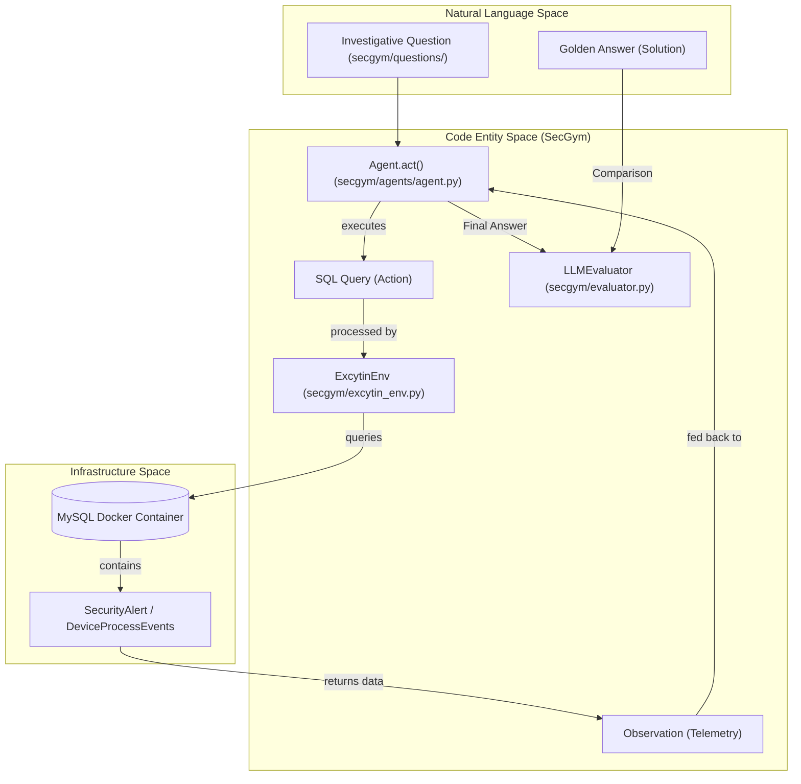
Sources: [README.md:18-24](), [secgym/excytin_env.py:1-50](), [secgym/evaluator.py:1-30]()

### Key Components

#### 1. The SecGym Environment
The core of the framework is the `ExcytinEnv` class. It manages the lifecycle of the investigation, including database connections and result truncation to fit LLM context windows. It supports different "telemetry layers" (e.g., `alert_only`, `log`) to control the difficulty of the task.
*   For details, see [SecGym Environment](#2).

#### 2. Incident Databases & PII Pipeline
The benchmark uses 20.4 GB of security logs [TRANSPARENCY_DOC.md:19](). These logs are processed via `process_logs.py` and anonymized through a PII (Personally Identifiable Information) pipeline to ensure privacy while maintaining investigative utility [secgym/database/README.md:14-18]().
*   For details, see [Database Layer: Setup, Schema & Data Pipeline](#2.2).

#### 3. LLM Agents & Learning Strategies
ExCyTIn-Bench supports multiple agent architectures:
*   **Baseline/ReAct**: Standard reasoning-action loops.
*   **Reflexion**: Agents that learn from failures within a single trial.
*   **ExPeL**: An "Experience-Based Learning" agent that extracts insights from successful trajectories and stores them in an `ExperiencePool` for future use.
*   For details, see [LLM Agents](#3).

#### 4. Question & Attack Graph Generation
Questions are not random; they are generated based on **Attack Graphs** constructed from `SecurityIncident` and `SecurityAlert` logs using `alert_graph.py`. These graphs map the movement of an attacker across entities (Users, IPs, Hosts), and questions are sampled from paths within these graphs [README.md:72-84]().
*   For details, see [Question & Attack Graph Generation](#4).

### Codebase Entity Mapping
This diagram maps high-level system functions to specific files and classes within the repository.

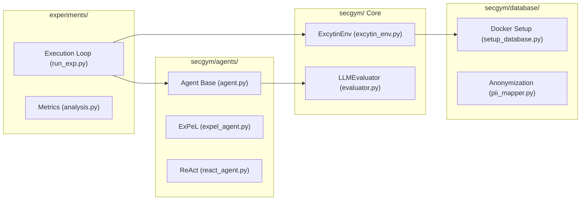
Sources: [README.md:65-88](), [requirements.txt:1-21]()

### Child Pages

Detailed documentation is organized into the following sub-pages:

*   **[Getting Started & Setup](#1.1)**: Installation, API configuration (`myconfig.py`), and Docker setup for the MySQL backend.
*   **[Repository Structure & Key Concepts](#1.2)**: A deep dive into the 8 security incidents, the directory layout, and the "Path Relevance Score" used for splitting training and testing data.

---
**Sources:**
*   [README.md:1-105]()
*   [TRANSPARENCY_DOC.md:1-40]()
*   [secgym/database/README.md:1-20]()
*   [requirements.txt:1-21]()

---

# Page: Getting Started & Setup

# Getting Started & Setup

<details>
<summary>Relevant source files</summary>

The following files were used as context for generating this wiki page:

- [.gitignore](.gitignore)
- [README.md](README.md)
- [experiments/run_qa_gen.py](experiments/run_qa_gen.py)
- [experiments/run_reevaluation.py](experiments/run_reevaluation.py)
- [requirements.txt](requirements.txt)
- [requirements_freeze.txt](requirements_freeze.txt)
- [scripts/setup_alert_only.sh](scripts/setup_alert_only.sh)
- [scripts/setup_docker.sh](scripts/setup_docker.sh)
- [scripts/to_run.sh](scripts/to_run.sh)
- [secgym/agents/expel_agent.py](secgym/agents/expel_agent.py)
- [secgym/assets/updated_eval_results_09_25.png](secgym/assets/updated_eval_results_09_25.png)
- [secgym/assets/updated_eval_results_10_25.png](secgym/assets/updated_eval_results_10_25.png)
- [secgym/assets/updated_eval_results_11_25.png](secgym/assets/updated_eval_results_11_25.png)
- [secgym/assets/updated_eval_results_12_25.png](secgym/assets/updated_eval_results_12_25.png)
- [secgym/database/README.md](secgym/database/README.md)
- [secgym/evaluator.py](secgym/evaluator.py)
- [secgym/myconfig.py](secgym/myconfig.py)
- [setup.py](setup.py)

</details>


This page provides a technical walkthrough for onboarding onto the **ExCyTIn-Bench** framework. The setup involves preparing the Python environment, configuring LLM providers via `AG2` (formerly AutoGen), spinning up the MySQL-based security incident databases using Docker, and verifying the installation with a trial experiment.

## 1. Environment Preparation

The framework requires **Python 3.11** and several data science and security-specific libraries.

### Installation Steps
1. **Clone the repository** and navigate to the root directory.
2. **Create a virtual environment**:
   ```bash
   conda create -n excytin python=3.11
   conda activate excytin
   ```
3. **Install dependencies**: Use the editable install flag to ensure the `secgym` package is discoverable by the experiment scripts.
   ```bash
   pip install -e . --use-pep517
   ```
   *Note: If you encounter version conflicts, a frozen requirement list is available in `requirements_freeze.txt` [README.md:56-56]().*

### Core Dependencies
| Package | Purpose |
| :--- | :--- |
| `gymnasium` | Core RL-style environment interface [requirements.txt:5-5](). |
| `pyautogen` | Unified LLM API calling via the `AG2` wrapper [requirements.txt:9-9](). |
| `mysql-connector-python` | Database connectivity for the `SecGym` environment [requirements.txt:12-12](). |
| `networkx` | Used for building attack graphs from incident logs [requirements.txt:2-2](). |

**Sources:** [README.md:49-57](), [requirements.txt:1-21](), [setup.py:18-31]()

---

## 2. MySQL Incident Database Setup

ExCyTIn-Bench uses Docker containers to host 8 distinct MySQL databases, each representing a specific security incident (e.g., Ransomware, BEC).

### Data Acquisition
The telemetry data must be downloaded from Hugging Face:
1. Download `data_anonymized.tar.gz` from the [ExCyTIn-Bench dataset](https://huggingface.co/datasets/anandmudgerikar/excytin-bench).
2. Extract the contents into `secgym/database/data_anonymized/` [README.md:29-31]().

### Docker Orchestration
The framework uses a `mysql:9.0` image [README.md:35-35](). The setup script `scripts/setup_docker.sh` iterates through the 8 incidents and invokes `secgym/database/setup_database.py` for each.

**Database Initialization Flow:**
The following diagram maps the setup script to the underlying code entities.

**Title: Database Provisioning Workflow**
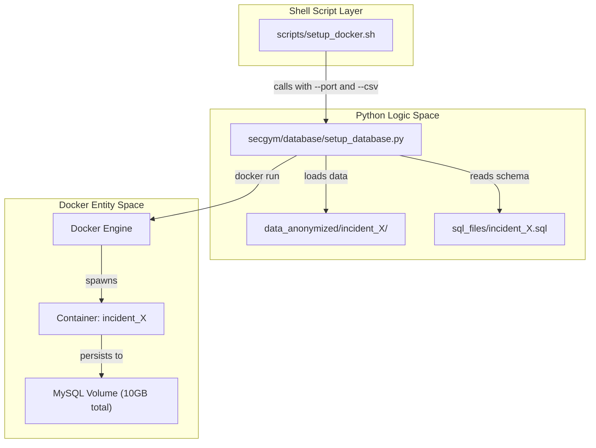
**Sources:** [README.md:33-45](), [scripts/setup_docker.sh:1-73](), [scripts/setup_alert_only.sh:9-72]()

To initialize the environment, run:
```bash
bash scripts/setup_docker.sh
```
This binds local CSV files to the containers. By default, this takes ~10GB of disk space. To create a single database containing all 8 attacks (33GB), modify the flags in `setup_docker.sh` [README.md:44-47]().

---

## 3. LLM Configuration (`myconfig.py`)

ExCyTIn-Bench leverages `AG2` (AutoGen) for provider-agnostic LLM interaction. You must configure your API keys in `secgym/myconfig.py`.

### Configuration Structure
The `CONFIG_LIST` variable stores a list of dictionaries containing model details and credentials. The `tags` key is critical; it is used by the agent registry and experiment scripts to filter which model configuration to use [secgym/myconfig.py:12-25]().

**Example Configuration (`secgym/myconfig.py`):**
```python
CONFIG_LIST = [
    {
        "model": "gpt-4o",
        "api_key": "YOUR_OPENAI_KEY",
        "tags": ["gpt-4o"],
    },
    {
        "model": "claude-3-5-sonnet",
        "api_key": "YOUR_ANTHROPIC_KEY",
        "tags": ["claude-3-5-sonnet"],
    }
]
```
**Sources:** [secgym/myconfig.py:28-45](), [README.md:58-61]()

---

## 4. Verifying the Environment

Once the Python environment is ready and Docker containers are running, you can run a "trial" experiment to verify the end-to-end data flow (Agent -> SecGym -> MySQL).

### Trial Run Execution
The `experiments/run_exp.py` script includes a `--trial_run` flag. This executes only **2 questions from 1 incident** to minimize cost and time during verification [README.md:65-68]().

```bash
python experiments/run_exp.py --trial_run --model gpt-4o
```

### Data Flow during Trial
The following diagram illustrates how the system components interact during a single investigation step.

**Title: Investigation Step Data Flow**
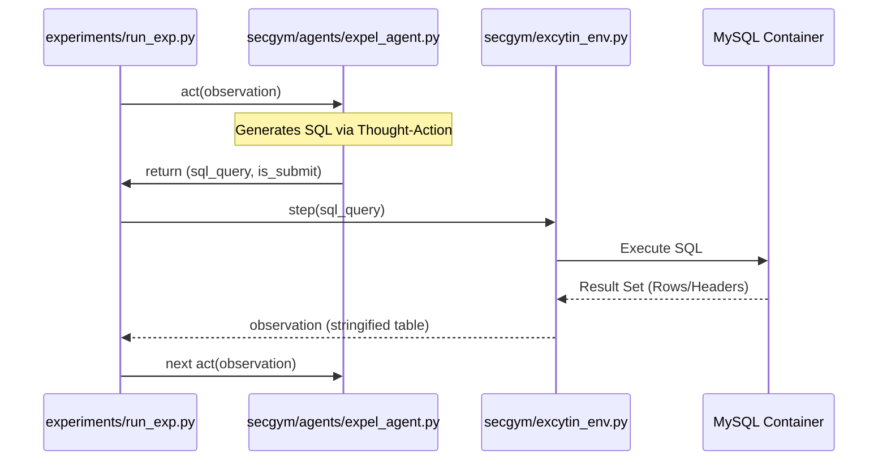
**Sources:** [experiments/run_exp.py:67-67](), [secgym/agents/expel_agent.py:97-129](), [README.md:18-20]()

### Results Output
After the trial, results are saved in the `experiments/final_results` folder [README.md:65-65](). You should see JSON files containing:
1. **Agent Trajectory**: The sequence of thoughts and SQL actions.
2. **Environment Observations**: The data returned by the database.
3. **Rewards**: 0 or 1 based on the `LLMEvaluator`'s assessment of the final answer [secgym/evaluator.py:1-20]().

**Sources:** [README.md:65-68](), [experiments/run_exp.py:1-100]()

---

# Page: Repository Structure & Key Concepts

# Repository Structure & Key Concepts

<details>
<summary>Relevant source files</summary>

The following files were used as context for generating this wiki page:

- [.gitignore](.gitignore)
- [README.md](README.md)
- [requirements.txt](requirements.txt)
- [secgym/assets/updated_eval_results_09_25.png](secgym/assets/updated_eval_results_09_25.png)
- [secgym/assets/updated_eval_results_10_25.png](secgym/assets/updated_eval_results_10_25.png)
- [secgym/assets/updated_eval_results_11_25.png](secgym/assets/updated_eval_results_11_25.png)
- [secgym/assets/updated_eval_results_12_25.png](secgym/assets/updated_eval_results_12_25.png)
- [secgym/database/README.md](secgym/database/README.md)
- [secgym/database/process_logs.py](secgym/database/process_logs.py)
- [secgym/excytin_env.py](secgym/excytin_env.py)
- [secgym/myconfig.py](secgym/myconfig.py)

</details>


This page provides a technical map of the ExCyTIn-Bench repository, details the security incidents used for benchmarking, and defines the core architectural concepts that enable LLM agents to perform threat investigation.

## Repository Layout

The repository is organized into functional modules that separate the environment logic, the agent implementations, the data processing pipeline, and experiment execution.

| Directory | Purpose | Key Components |
| :--- | :--- | :--- |
| `secgym/` | Core framework logic. | `excytin_env.py`, `evaluator.py`, `myconfig.py` |
| `secgym/agents/` | LLM agent architectures. | `baseline_agent.py`, `react_agent.py`, `expel_agent.py` |
| `secgym/database/` | Data ingestion and DB setup. | `setup_database.py`, `process_logs.py`, `pii_anony/` |
| `secgym/questions/` | Benchmark task definitions. | `o1/`, `o3/` (JSON QA pairs) |
| `experiments/` | Execution and analysis. | `run_exp.py`, `run_qa_gen.py`, `result_analysis/` |
| `notebooks/` | Research & exploration. | `extract_construct_graph.ipynb`, `question_split.ipynb` |
| `latest_experiments/` | Official benchmark results. | Full trajectory logs for latest models |
| `incident_reports/` | Ground truth documentation. | LLM-generated summaries of the 8 incidents |

**Sources:** [README.md:18-24](), [README.md:65-68](), [README.md:89-93]()

## Core Terminology

### SecGym
The `SecGym` environment is a specialized [gymnasium](https://gymnasium.farama.org/) interface implemented in `ExcytinEnv` [secgym/excytin_env.py:78-78](). It mediates interactions between an LLM agent and a MySQL database containing security telemetry. It manages the lifecycle of Docker containers for each incident [secgym/excytin_env.py:141-143]() and enforces observation limits like `max_entry_return` and `max_str_len` [secgym/excytin_env.py:97-98]().

### Telemetry Layers
The environment supports different "layers" of visibility, defined by the `--layer` argument in `run_exp.py` [secgym/excytin_env.py:93-94]():
*   **alert**: Access to high-level security alerts and raw telemetry logs.
*   **log**: Access to raw telemetry logs only (simulating proactive hunting).
*   **alert_only**: Access strictly to the alert tables to test initial triage capabilities [secgym/excytin_env.py:128-131]().

### Attack Graph
A directed graph representing the lifecycle of a security incident. Nodes represent entities (Users, IPs, Hosts) and edges represent observed activities (Logons, Process Executions, Network Connections). These graphs are constructed in `notebooks/extract_construct_graph.ipynb` [README.md:74-74]() and used to generate the benchmark questions.

### QA Pairs
The benchmark consists of Question-Answer pairs where the "Question" is a specific investigative prompt and the "Answer" is a set of entities or facts the agent must find. These are stored in `secgym/questions/` [secgym/excytin_env.py:137-138]().

## Security Incidents (The Benchmark)

The framework utilizes 8 specific security incidents derived from the Alpine Ski House dataset. Each incident is hosted in its own Docker container with a dedicated MySQL port.

### Incident Registry
The `ATTACKS` registry in `secgym/excytin_env.py` maps incident IDs to their respective data files and network configurations:

| Incident ID | Port | Container Name | Description |
| :--- | :--- | :--- | :--- |
| `incident_5` | 3306 | `incident_5` | Initial Access / Phishing |
| `incident_38` | 3307 | `incident_38` | Persistence / Credential Access |
| `incident_34` | 3308 | `incident_34` | Lateral Movement |
| `incident_39` | 3309 | `incident_39` | Exfiltration |
| `incident_55` | 3310 | `incident_55` | Command and Control (C2) |
| `incident_134` | 3311 | `incident_134` | Ransomware Deployment |
| `incident_166` | 3312 | `incident_166` | Data Destruction |
| `incident_322` | 3313 | `incident_322` | Privilege Escalation |

**Sources:** [secgym/excytin_env.py:17-58](), [README.md:38-42]()

## System Architecture: Data Flow

The following diagram bridges the high-level benchmark concepts to the specific code entities responsible for the data flow from raw logs to agent evaluation.

### Incident Lifecycle & Evaluation Flow
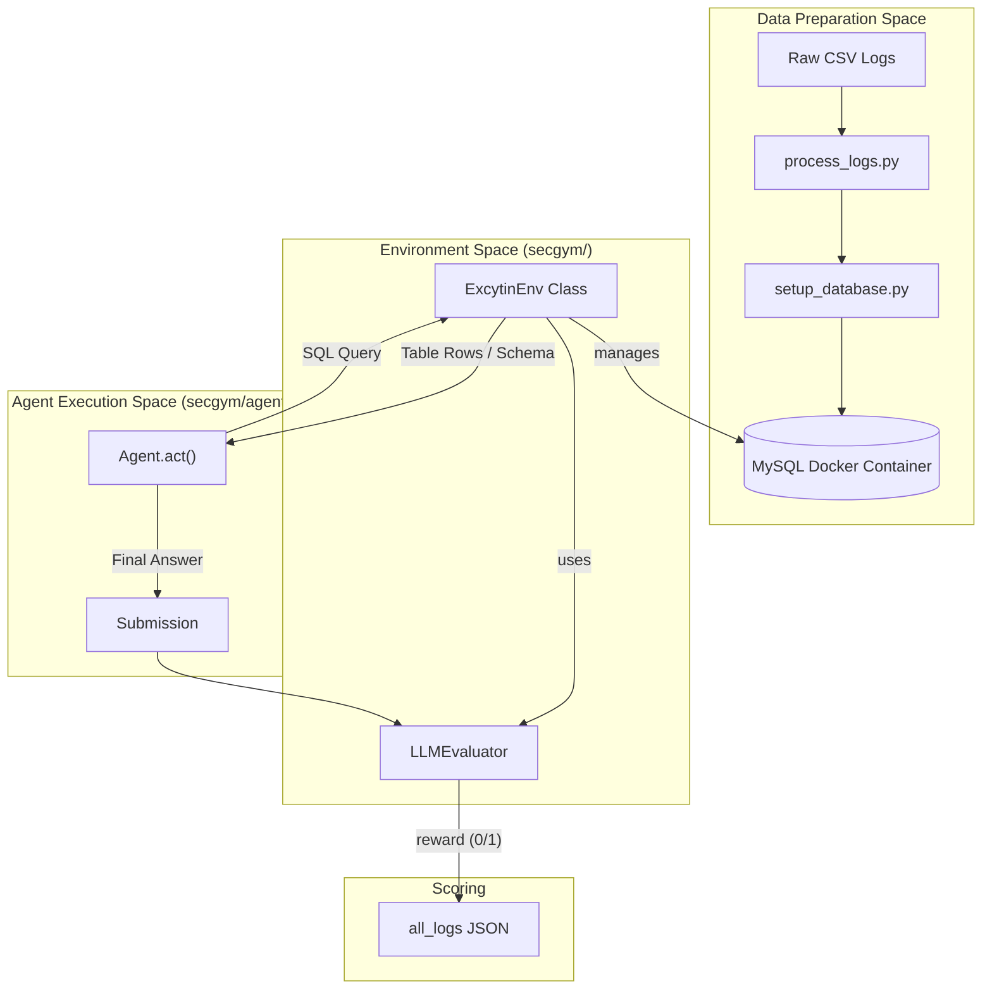
**Sources:** [secgym/excytin_env.py:144-156](), [secgym/database/process_logs.py:9-10](), [README.md:65-68]()

## Database Entity Mapping

The environment interacts with a multi-table schema representing various telemetry sources. Agents must navigate these tables to solve questions.

### Code-to-Schema Relationship
```mermaid
erDiagram
    "ExcytinEnv (cursor)" ||--o{ "SecurityIncident" : "queries"
    "ExcytinEnv (cursor)" ||--o{ "SecurityAlert" : "queries"
    "SecurityAlert" ||--o{ "AlertEvidence" : "links via AlertId"
    "SecurityAlert" ||--o{ "DeviceProcessEvents" : "correlates via DeviceId/Timestamp"
    "SecurityAlert" ||--o{ "SigninLogs" : "correlates via AccountUpn"

    class "ExcytinEnv" {
        mysql_connector connection
        mysql_cursor cursor
        string database_name
    }
```
**Sources:** [secgym/excytin_env.py:144-153](), [secgym/database/process_logs.py:28-30]()

### Key Data Processing Functions
*   `start_container(container_name)`: Uses the `docker` SDK to ensure the target incident's database is reachable [secgym/excytin_env.py:65-75]().
*   `process_csv(csv_folder)`: Handles data normalization, converting dynamic types and handling specific separators like `❖` [secgym/database/process_logs.py:9-42](), [secgym/database/process_logs.py:107-107]().
*   `ExcytinEnv.step(action)`: The primary interface for the agent to submit SQL queries and receive observations [secgym/excytin_env.py:78-78]().

**Sources:** [secgym/excytin_env.py:65-75](), [secgym/database/process_logs.py:107-107]()

---

# Page: SecGym Environment

# SecGym Environment

<details>
<summary>Relevant source files</summary>

The following files were used as context for generating this wiki page:

- [secgym/database/__init__.py](secgym/database/__init__.py)
- [secgym/database/download_logs.py](secgym/database/download_logs.py)
- [secgym/database/pii_anony/pii_col_identify.py](secgym/database/pii_anony/pii_col_identify.py)
- [secgym/database/process_logs.py](secgym/database/process_logs.py)
- [secgym/excytin_env.py](secgym/excytin_env.py)

</details>


The **SecGym Environment** is a specialized [Gymnasium](https://gymnasium.farama.org/)-based interface designed to facilitate autonomous cyber threat hunting. It acts as the intermediary between an LLM agent and a collection of Dockerized MySQL databases containing high-fidelity security telemetry from simulated corporate environments.

The environment manages the lifecycle of database containers, provides a standardized observation space for SQL-based querying, and integrates with an LLM-based evaluator to score agent performance against "golden" answers.

### Architecture Overview

The interaction loop follows the standard Reinforcement Learning (RL) paradigm where the agent issues SQL queries as actions and receives table results or error messages as observations.

**SecGym-to-Code Mapping**
The following diagram illustrates how the logical components of the SecGym environment map to specific entities and files in the codebase.

| Logic Space | Code Entity Space |
| :--- | :--- |
| **Environment Interface** | `ExcytinEnv` class in [secgym/excytin_env.py:78-94]() |
| **Database Registry** | `ATTACKS` dictionary in [secgym/excytin_env.py:17-58]() |
| **Telemetry Access** | `mysql.connector` in [secgym/excytin_env.py:144-155]() |
| **Evaluation Logic** | `LLMEvaluator` class in [secgym/evaluator.py]() |

**Agent-Environment Interaction Flow**
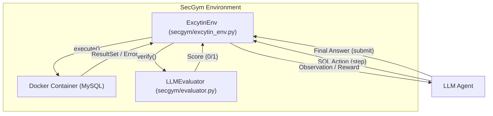
Sources: [secgym/excytin_env.py:78-155](), [secgym/evaluator.py]()

---

### Core Components

The SecGym ecosystem is divided into four primary functional areas, each covered in detail by a dedicated child page.

#### [2.1 ExcytinEnv: The Gymnasium Interface](#)
The `ExcytinEnv` class is the core of the framework. It handles the initialization of the specific security incident (attack) chosen for the trial. It manages the `step-query-observation` loop, truncates database results to fit within LLM context windows, and ensures that the agent stays within the defined telemetry "layer" (e.g., `alert`, `log`, or `alert_only`).
*   **Key File:** [secgym/excytin_env.py]()
*   **Key Function:** `step(action)` [secgym/excytin_env.py:213-250]() (logic for executing SQL and returning observations).

#### [2.2 Database Layer: Setup, Schema & Data Pipeline](#)
The backend consists of MySQL databases running in Docker containers. This layer includes the logic for downloading raw telemetry from Azure Log Analytics, processing CSVs with custom separators (`❖`), and building the multi-table schema (e.g., `SecurityAlert`, `DeviceProcessEvents`, `SigninLogs`).
*   **Key Files:** [secgym/database/download_logs.py](), [secgym/database/process_logs.py]()
*   **Database Config:** Port mapping and container names are defined in the `ATTACKS` registry [secgym/excytin_env.py:17-58]().

#### [2.3 PII Anonymization Pipeline](#)
Before raw logs are ingested into the SecGym environment, they pass through a PII (Personally Identifiable Information) anonymization pipeline. This ensures that sensitive data like IP addresses, usernames, and emails are consistently masked across the entire dataset while maintaining the relational integrity required for investigation.
*   **Key Files:** [secgym/database/pii_anony/pii_col_identify.py](), [secgym/database/pii_anony/pii_mapper.py]()
*   **Process:** Uses LLM-based identification [secgym/database/pii_anony/pii_col_identify.py:21-41]() followed by regex and mapping-based replacement.

#### [2.4 LLM Evaluator](#)
Since security questions often require free-text answers (e.g., "What was the initial entry point?"), a standard exact-match reward is insufficient. The `LLMEvaluator` uses a high-reasoning LLM to compare the agent's submitted answer against a "golden" reference answer to determine if the agent successfully solved the incident.
*   **Key File:** [secgym/evaluator.py]()
*   **Logic:** Scores answers as 0 or 1 based on semantic correctness [secgym/evaluator.py:30-50]().

---

### Environment Configuration

The environment is highly configurable via the `ExcytinEnv` constructor:

| Parameter | Type | Description |
| :--- | :--- | :--- |
| `attack` | `str/int` | The incident ID (e.g., `incident_5`). |
| `layer` | `str` | Filters available tables: `alert`, `log`, or `alert_only`. |
| `max_steps` | `int` | Max queries an agent can make before the episode ends. |
| `max_entry_return` | `int` | Limits the number of rows returned by a SQL query to prevent context overflow. |

Sources: [secgym/excytin_env.py:79-94]()

---

# Page: ExcytinEnv: The Gymnasium Interface

# ExcytinEnv: The Gymnasium Interface

<details>
<summary>Relevant source files</summary>

The following files were used as context for generating this wiki page:

- [latest_experiments/BaselineAgent_o3_c106_alert_level_t0_s25_trial1/agent_incident_5.json](latest_experiments/BaselineAgent_o3_c106_alert_level_t0_s25_trial1/agent_incident_5.json)
- [latest_experiments/BaselineAgent_o3_c106_alert_level_t0_s25_trial1/agent_incident_55.json](latest_experiments/BaselineAgent_o3_c106_alert_level_t0_s25_trial1/agent_incident_55.json)
- [latest_experiments/BaselineAgent_o3_c106_alert_level_t0_s25_trial1/env_incident_134.json](latest_experiments/BaselineAgent_o3_c106_alert_level_t0_s25_trial1/env_incident_134.json)
- [latest_experiments/BaselineAgent_o3_c106_alert_level_t0_s25_trial1/env_incident_166.json](latest_experiments/BaselineAgent_o3_c106_alert_level_t0_s25_trial1/env_incident_166.json)
- [secgym/database/process_logs.py](secgym/database/process_logs.py)
- [secgym/excytin_env.py](secgym/excytin_env.py)

</details>


The `ExcytinEnv` class is the core Gymnasium interface for the ExCyTIn-Bench framework. It mediates the interaction between LLM agents and the containerized MySQL security telemetry databases. It handles the lifecycle of Docker containers, manages SQL query execution, enforces observation limits, and facilitates the evaluation of agent responses against ground-truth answers.

## The ATTACKS Registry

The environment uses a centralized registry, `ATTACKS`, to map incident identifiers to their respective metadata, including question files, network ports, and Docker container names.

| Incident ID | QA File (o1 test) | Port | Container Name |
| :--- | :--- | :--- | :--- |
| `incident_5` | `o1/test/incident_5_qa_incident_o1-ga_c42.json` | 3306 | `incident_5` |
| `incident_38` | `o1/test/incident_38_qa_incident_o1-ga_c42.json` | 3307 | `incident_38` |
| `incident_34` | `o1/test/incident_34_qa_incident_o1-ga_c42.json` | 3308 | `incident_34` |
| `incident_39` | `o1/test/incident_39_qa_incident_o1-ga_c42.json` | 3309 | `incident_39` |
| `incident_55` | `o1/test/incident_55_qa_incident_o1-ga_c42.json` | 3310 | `incident_55` |
| `incident_134` | `o1/test/incident_134_qa_incident_o1-ga_c42.json` | 3311 | `incident_134` |
| `incident_166` | `o1/test/incident_166_qa_incident_o1-ga_c42.json` | 3312 | `incident_166` |
| `incident_322` | `o1/test/incident_322_qa_incident_o1-ga_c42.json` | 3313 | `incident_322` |

Sources: `[secgym/excytin_env.py:17-58]()`

## Environment Initialization and Lifecycle

When `ExcytinEnv` is instantiated, it performs several critical setup tasks:
1.  **Container Management**: It ensures the required Docker container is running via `start_container` `[secgym/excytin_env.py:65-75]()`.
2.  **Database Connection**: It establishes a connection to the MySQL instance using `mysql.connector` `[secgym/excytin_env.py:144-155]()`.
3.  **Question Loading**: It loads the synthetic QA pairs from the path specified in the `ATTACKS` registry based on the chosen `split` `[secgym/excytin_env.py:132-140]()`.
4.  **Layer Validation**: It validates the telemetry layer using `check_layer` to ensure the requested visibility level is supported `[secgym/excytin_env.py:167-167]()`.

### Docker Container Management
The environment utilizes the `docker` Python SDK to manage the backend. If a container is stopped, the `start_container` function restarts it and waits for 3 seconds to allow the MySQL service to initialize `[secgym/excytin_env.py:65-75]()`.

### Telemetry Layers
The `layer` parameter controls the scope of data available to the agent:
*   **alert**: Standard access to the full telemetry database.
*   **log**: Access to raw logs.
*   **alert_only**: Restricts the agent to a specific container version (suffixed with `_alert_only`) that contains limited tables `[secgym/excytin_env.py:128-130]()`.

Sources: `[secgym/excytin_env.py:78-168]()`

## The Step-Query-Observation Loop

The environment follows the standard Gymnasium `step()` pattern. Agents provide an "action" (either a SQL query or a final answer submission), and the environment returns an "observation" (query results or evaluation feedback).

### Execution Flow: Natural Language to SQL
The following diagram illustrates how a natural language question is processed through the `ExcytinEnv` loop.

**Diagram: ExcytinEnv Interaction Flow**
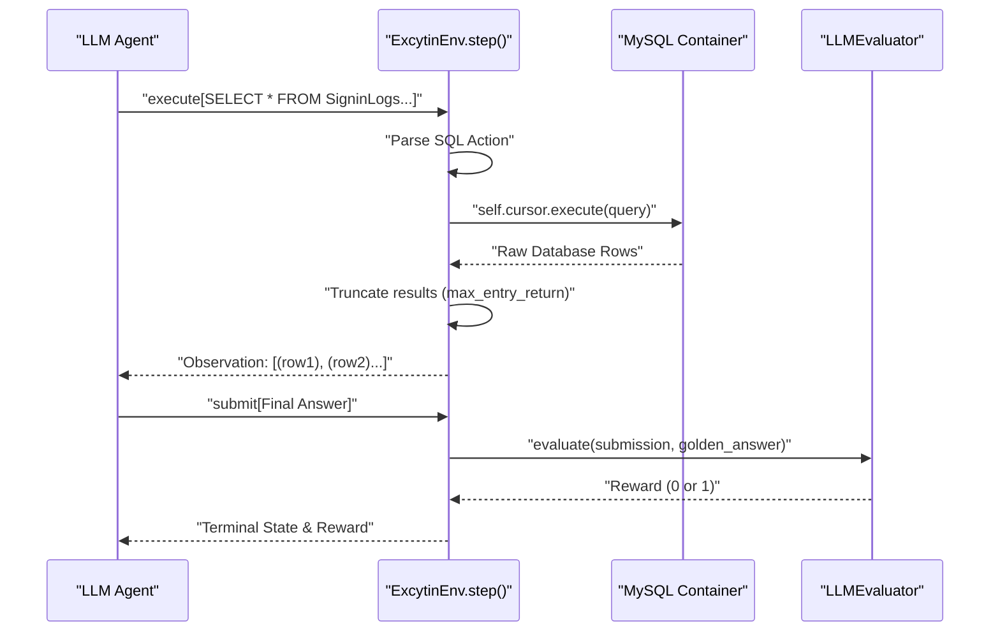
Sources: `[secgym/excytin_env.py:218-280]()`, `[secgym/evaluator.py:15-40]()`

### Result Truncation and Logic
To prevent context window overflow in LLMs, `ExcytinEnv` implements strict truncation logic:
*   **`max_entry_return`**: Limits the number of rows returned from a SQL query (default: 15) `[secgym/excytin_env.py:85-85]()`.
*   **`max_str_len`**: Limits the total character length of the observation string (default: 100,000) `[secgym/excytin_env.py:87-87]()`.

## Data Flow and Schema Validation

The environment ensures that the database schema is consistent with the agent's expectations through the `check_layer` mechanism and internal metadata tracking.

**Diagram: System Entity Mapping**
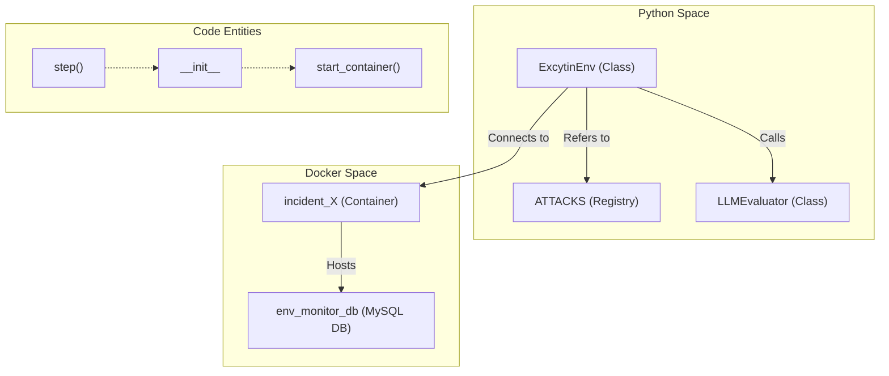
Sources: `[secgym/excytin_env.py:78-168]()`

### Key Functions and Data Members

| Entity | Role | Source |
| :--- | :--- | :--- |
| `self.cursor` | MySQL cursor used to execute queries against the active incident container. | `[secgym/excytin_env.py:151-153]()` |
| `step(action)` | Main loop; handles `execute[]` for SQL and `submit[]` for final answers. | `[secgym/excytin_env.py:218-280]()` |
| `reset()` | Re-initializes the environment for a new question or trial. | `[secgym/excytin_env.py:188-216]()` |
| `check_layer(layer)` | Validates that the provided layer string is within allowed parameters. | `[secgym/excytin_env.py:167-167]()` |
| `get_logging()` | Compiles success metrics, step counts, and query success rates for logging. | `[secgym/excytin_env.py:188-202]()` |

### Observation Format
Observations returned to the agent are strings. For SQL queries, the environment returns a string representation of a list of tuples `[secgym/excytin_env.py:240-250]()`. If a query fails, the environment catches the `mysql.connector.Error` and returns the error message as the observation, allowing the agent to self-correct `[secgym/excytin_env.py:245-255]()`.

Sources: `[secgym/excytin_env.py:218-280]()`, `[latest_experiments/BaselineAgent_o3_c106_alert_level_t0_s25_trial1/env_incident_166.json:30-50]()`

---

# Page: Database Layer: Setup, Schema & Data Pipeline

# Database Layer: Setup, Schema & Data Pipeline

<details>
<summary>Relevant source files</summary>

The following files were used as context for generating this wiki page:

- [requirements_freeze.txt](requirements_freeze.txt)
- [scripts/setup_alert_only.sh](scripts/setup_alert_only.sh)
- [scripts/setup_docker.sh](scripts/setup_docker.sh)
- [scripts/to_run.sh](scripts/to_run.sh)
- [secgym/agents/expel_agent.py](secgym/agents/expel_agent.py)
- [secgym/database/__init__.py](secgym/database/__init__.py)
- [secgym/database/download_logs.py](secgym/database/download_logs.py)
- [secgym/database/pii_anony/pii_col_identify.py](secgym/database/pii_anony/pii_col_identify.py)
- [secgym/database/pii_anony/pii_replace.py](secgym/database/pii_anony/pii_replace.py)
- [secgym/database/process_logs.py](secgym/database/process_logs.py)
- [secgym/database/setup_database.py](secgym/database/setup_database.py)
- [secgym/excytin_env.py](secgym/excytin_env.py)

</details>


The Database Layer provides the foundational telemetry data required for security incident investigation. It manages the full lifecycle of security logs—from ingestion via Azure Monitor to containerized MySQL deployment—enabling LLM agents to perform SQL-based threat hunting.

## Data Lifecycle & Pipeline

The data pipeline consists of three primary stages: downloading raw telemetry, processing/normalizing the data, and initializing the database environment.

### 1. Ingestion (download_logs.py)
Raw logs are pulled from Azure Log Analytics workspaces. The system handles large-scale telemetry by calculating entry sizes and segmenting queries to avoid API limits [secgym/database/download_logs.py:46-97]().
*   **Segmented Querying**: If a table exceeds 60MB or 500,000 rows, the pipeline automatically splits the request into time-based chunks [secgym/database/download_logs.py:128-158]().
*   **Metadata Generation**: Each downloaded table includes a `.meta` file containing column types (e.g., `dynamic` for JSON-like fields), which is later used for SQL schema generation [secgym/database/download_logs.py:107-112]().

### 2. Processing & Normalization (process_logs.py)
Security logs often contain special characters that conflict with standard CSV parsing. 
*   **Separator Handling**: The pipeline uses a unique separator `❖` and quote character `"` to ensure data integrity [secgym/database/process_logs.py:107-108]().
*   **JSON Normalization**: Columns marked as `dynamic` in metadata are pre-processed to ensure empty values are represented as `{}` for consistent SQL loading [secgym/database/process_logs.py:33-38]().

### 3. Setup & Containerization (setup_database.py)
The system uses Docker to provide isolated MySQL environments for each incident.
*   **SQL Generation**: `generate_create_table_sql` and `generate_load_data_sql` dynamically create the schema based on `.meta` files [secgym/database/setup_database.py:171-176]().
*   **Container Lifecycle**: The script `setup_database.py` automates the creation of MySQL 9.0 containers, mounting the processed CSVs into `/var/lib/mysql-files` for high-speed loading via `LOAD DATA INFILE` [secgym/database/setup_database.py:69-92]().

**Sources:** [secgym/database/download_logs.py:1-160](), [secgym/database/process_logs.py:1-121](), [secgym/database/setup_database.py:35-130]().

---

## System Architecture: Data to Code Mapping

The following diagram illustrates how the raw log files and scripts relate to the core `ExcytinEnv` used by agents.

### Data Flow to Environment
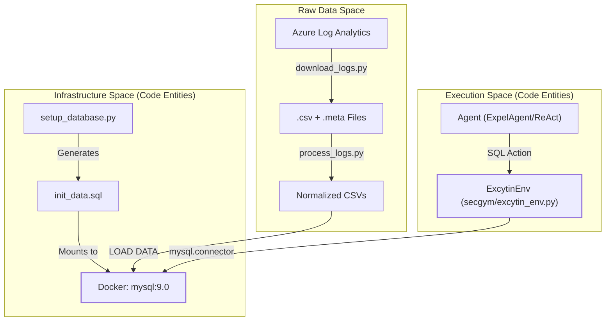
**Sources:** [secgym/database/setup_database.py:69-92](), [secgym/excytin_env.py:142-155](), [secgym/agents/expel_agent.py:125-129]().

---

## Database Schema & Multi-Table Structure

The benchmark utilizes a multi-table schema representing diverse telemetry sources. This allows agents to pivot from an initial alert to deep forensic logs.

### Core Telemetry Tables
| Table Name | Description | Key Columns |
| :--- | :--- | :--- |
| `SecurityIncident` | High-level incident metadata. | `IncidentNumber`, `Title`, `Severity` |
| `SecurityAlert` | Specific alerts within an incident. | `AlertId`, `AlertName`, `Entities` |
| `SigninLogs` | AAD/Identity login attempts. | `UserPrincipalName`, `IPAddress`, `ResultType` |
| `DeviceProcessEvents` | Endpoint process execution logs. | `DeviceName`, `FileName`, `ProcessCommandLine` |
| `OfficeActivity` | O365/SaaS activity logs. | `UserId`, `Operation`, `ClientIP` |
| `EmailEvents` | Mail flow and security logs. | `SenderIPv4`, `RecipientEmailAddress`, `Subject` |

### Database Initialization Logic
The initialization process converts Kusto-derived types into MySQL-compatible types:
*   `datetime` -> `DATETIME(6)`
*   `dynamic` -> `JSON` or `LONGTEXT`
*   `string` -> `LONGTEXT` [secgym/database/setup_database.py:214-228]().

### Database Access Layer
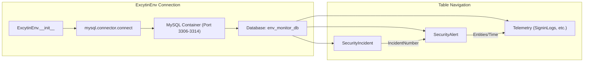
**Sources:** [secgym/excytin_env.py:17-58](), [secgym/excytin_env.py:144-153](), [secgym/database/setup_database.py:214-230]().

---

## Setup Execution

The environment is typically initialized using shell scripts that orchestrate `setup_database.py` across different incident IDs.

### Standard Setup (`setup_docker.sh`)
This script initializes the full telemetry environment for 8 incidents, assigning each to a specific local port (3306 through 3313) [scripts/setup_docker.sh:8-63]().

### Alert-Only Setup (`setup_alert_only.sh`)
For experiments focusing on high-level reasoning without raw log access, this script uses the `--layer alert_only` flag. This restricts the database schema to `SecurityAlert` and `SecurityIncident` tables [scripts/setup_alert_only.sh:9-72]().

### Key Functions in `setup_database.py`
*   `create_container()`: Manages the Docker Python SDK to pull images, set environment variables (`MYSQL_ROOT_PASSWORD`), and mount volumes [secgym/database/setup_database.py:35-118]().
*   `generate_create_table_sql()`: Iterates through the `.meta` JSON to build valid `CREATE TABLE` statements with appropriate MySQL data types [secgym/database/setup_database.py:214-235]().
*   `generate_load_data_sql()`: Formats the `LOAD DATA INFILE` command, specifically handling the `❖` separator and mapping JSON columns [secgym/database/setup_database.py:238-261]().

**Sources:** [secgym/database/setup_database.py:1-261](), [scripts/setup_docker.sh:1-65](), [scripts/setup_alert_only.sh:1-73]().

---

# Page: PII Anonymization Pipeline

# PII Anonymization Pipeline

<details>
<summary>Relevant source files</summary>

The following files were used as context for generating this wiki page:

- [secgym/database/__init__.py](secgym/database/__init__.py)
- [secgym/database/download_logs.py](secgym/database/download_logs.py)
- [secgym/database/pii_anony/pii_col_identify.py](secgym/database/pii_anony/pii_col_identify.py)
- [secgym/database/pii_anony/pii_mapper.py](secgym/database/pii_anony/pii_mapper.py)
- [secgym/database/pii_anony/pii_replace.py](secgym/database/pii_anony/pii_replace.py)
- [secgym/database/pii_anony/pii_replace_per_col.py](secgym/database/pii_anony/pii_replace_per_col.py)
- [secgym/database/setup_database.py](secgym/database/setup_database.py)

</details>


The PII Anonymization Pipeline is a critical preprocessing subsystem designed to protect sensitive information within raw security logs before they are ingested into the SecGym environment. This pipeline automates the identification of Personally Identifiable Information (PII), generates realistic synthetic replacements, and performs large-scale substitution across CSV telemetry files while maintaining data integrity and referential consistency.

## Pipeline Workflow

The anonymization process follows a multi-stage sequence from raw log ingestion to the production of anonymized CSVs ready for database loading.

### 1. Column Identification (`pii_col_identify.py`)
The pipeline first identifies which columns in the telemetry tables contain sensitive data.
- **Sampling**: It takes 5-10 random samples from each column to provide context [secgym/database/pii_anony/pii_col_identify.py:61-72]().
- **LLM Analysis**: It uses a specialized prompt `PII_identify_prompt` to ask an LLM (GPT-4o) if a column contains PII like names, IP addresses, or emails [secgym/database/pii_anony/pii_col_identify.py:21-41]().
- **Structure Detection**: A second pass determines if the column is a flat string or a JSON/dynamic object containing nested PII fields [secgym/database/pii_anony/pii_col_identify.py:153-169]().

### 2. Mapping Generation (`pii_mapper.py`)
Once PII columns are identified, the `PIIAnonymizer` class builds a global replacement map (`hashlist`) to ensure that the same raw value (e.g., a specific username) is replaced by the same synthetic value across all tables.
- **Regex Extraction**: Uses standard patterns to find IPs, UUIDs, MAC addresses, and SIDs [secgym/database/pii_anony/pii_mapper.py:47-86]().
- **Synthetic Generation**:
    - **IPs**: Generated via `generate_ip()` using random octets [secgym/database/pii_anony/pii_mapper.py:44-45]().
    - **Names/Emails**: Uses LLM-based generation via `new_pii_prompt` to create realistic but fake identities [secgym/database/pii_anony/pii_mapper.py:14-42]().
    - **UUIDs**: Generated using `uuid.uuid4()` [secgym/database/pii_anony/pii_mapper.py:69-70]().
- **Exemption List**: Skips common system strings like `.exe`, `.dll`, or service account prefixes to avoid breaking log logic [secgym/database/pii_anony/pii_mapper.py:153]().

### 3. Substitution (`pii_replace.py` & `pii_replace_per_col.py`)
The final stage applies the mapping to the raw data.
- **Global Replace**: `pii_replace.py` performs a bulk text replacement across files using the `hashlist` [secgym/database/pii_anony/pii_replace.py:57-58]().
- **Targeted Replace**: `pii_replace_per_col.py` uses Pandas for more granular control, specifically handling JSON columns by parsing the string and replacing values only within identified PII fields [secgym/database/pii_anony/pii_replace_per_col.py:177-200]().

### Implementation Logic Flow

Title: PII Anonymization Data Flow
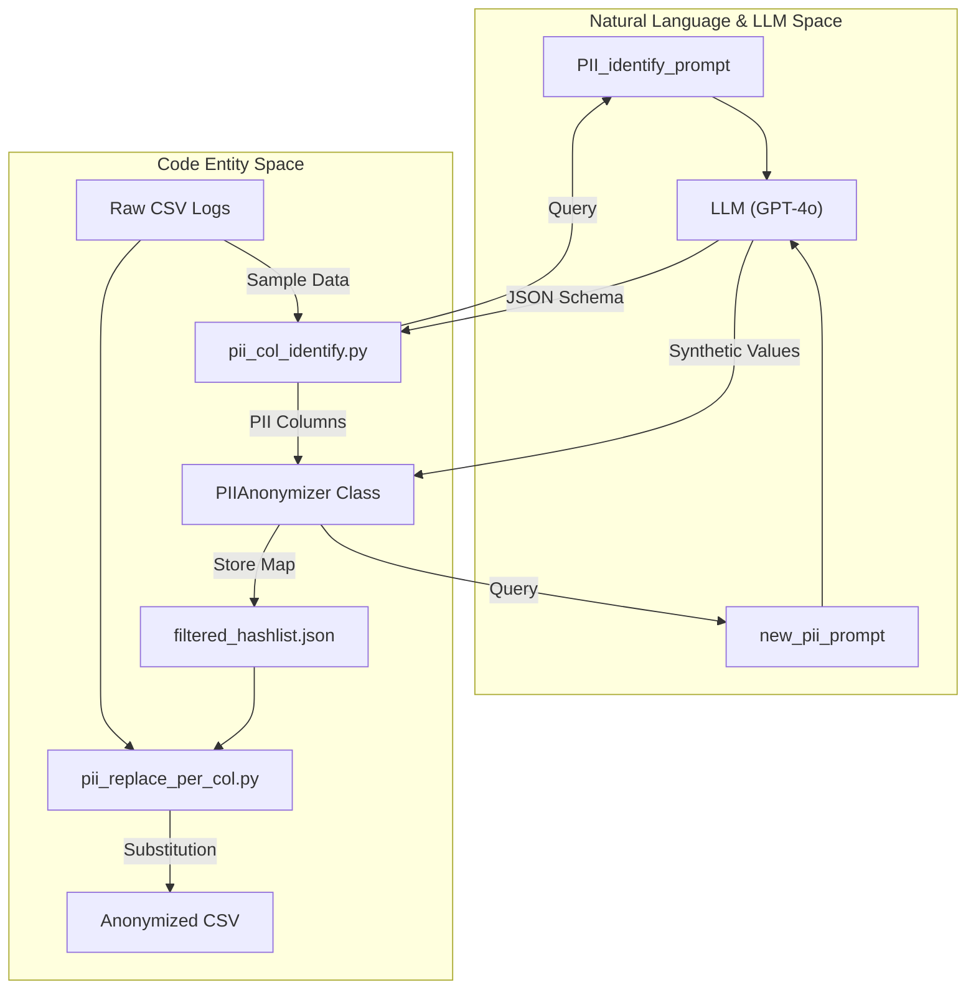
Sources: [secgym/database/pii_anony/pii_col_identify.py:21-41](), [secgym/database/pii_anony/pii_mapper.py:14-42](), [secgym/database/pii_anony/pii_replace_per_col.py:106-121](), [secgym/database/pii_anony/pii_replace.py:93-109]()

## Key Components

### PIIAnonymizer Class
Located in `pii_mapper.py`, this class manages the state of the anonymization session, including the cumulative cost of LLM calls and the reverse mapping to prevent collisions.

| Method | Role |
| :--- | :--- |
| `__init__` | Loads identified PII columns and existing `hashlist` [secgym/database/pii_anony/pii_mapper.py:125-154](). |
| `match_one_csv` | Extracts all unique PII values from a specific CSV file [secgym/database/pii_anony/pii_mapper.py:170-200](). |
| `match_field_dict` | Uses regex to extract values from nested JSON strings based on identified fields [secgym/database/pii_anony/pii_mapper.py:155-167](). |

### Replacement Strategies
The pipeline supports two primary replacement modes to balance performance and precision.

Title: Substitution Logic Mapping
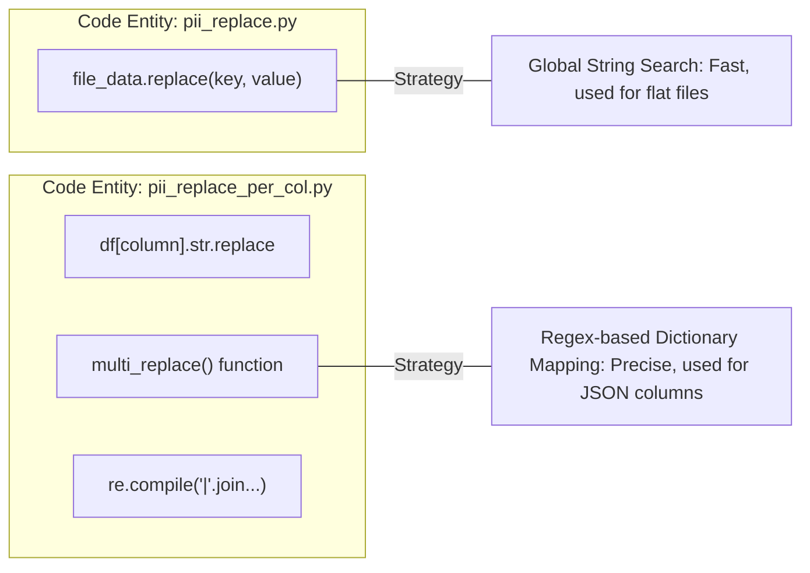
Sources: [secgym/database/pii_anony/pii_replace.py:57-58](), [secgym/database/pii_anony/pii_replace_per_col.py:189-197]()

## Data Formats

### Column Identification Schema
The `pii_col_identify.py` script outputs a JSON structure (e.g., `second_filter.json`) that guides the mapper:
```json
{
    "RemoteIP": {
        "is_dict": false,
        "is_pii": true,
        "pii_fields": []
    },
    "ExtendedProperties": {
        "is_dict": true,
        "is_pii": true,
        "pii_fields": ["UserAccount", "ClientIP"]
    }
}
```
Sources: [secgym/database/pii_anony/pii_col_identify.py:162-169]()

### Anonymization Map (`hashlist`)
The mapping file maintains the relationship between original and synthetic values:
```json
{
    "192.168.1.50": "172.16.254.1",
    "j.doe@company.com": "a.smith@company.com",
    "S-1-5-21-1234": "S-1-5-21-9876"
}
```
Sources: [secgym/database/pii_anony/pii_mapper.py:135-144]()

## Integration with Database Setup
After the anonymization pipeline produces the `data_anonymized/` directory, the files are passed to `setup_database.py`. This script uses the anonymized CSVs to build the MySQL Docker containers [secgym/database/setup_database.py:85-91](). It handles the specific `❖` separator used during the anonymization process to ensure data is correctly loaded into the SQL tables [secgym/database/setup_database.py:15-16]().

Sources: [secgym/database/setup_database.py:35-42](), [secgym/database/pii_anony/pii_replace.py:105-109]()

---

# Page: LLM Evaluator

# LLM Evaluator

<details>
<summary>Relevant source files</summary>

The following files were used as context for generating this wiki page:

- [experiments/run_qa_gen.py](experiments/run_qa_gen.py)
- [experiments/run_reevaluation.py](experiments/run_reevaluation.py)
- [latest_experiments/BaselineAgent_o3_c106_alert_level_t0_s25_trial1/agent_incident_5.json](latest_experiments/BaselineAgent_o3_c106_alert_level_t0_s25_trial1/agent_incident_5.json)
- [latest_experiments/BaselineAgent_o3_c106_alert_level_t0_s25_trial1/agent_incident_55.json](latest_experiments/BaselineAgent_o3_c106_alert_level_t0_s25_trial1/agent_incident_55.json)
- [latest_experiments/BaselineAgent_o3_c106_alert_level_t0_s25_trial1/env_incident_134.json](latest_experiments/BaselineAgent_o3_c106_alert_level_t0_s25_trial1/env_incident_134.json)
- [latest_experiments/BaselineAgent_o3_c106_alert_level_t0_s25_trial1/env_incident_166.json](latest_experiments/BaselineAgent_o3_c106_alert_level_t0_s25_trial1/env_incident_166.json)
- [secgym/database/process_logs.py](secgym/database/process_logs.py)
- [secgym/evaluator.py](secgym/evaluator.py)
- [secgym/excytin_env.py](secgym/excytin_env.py)
- [setup.py](setup.py)

</details>


The LLM Evaluator is a critical component of the SecGym environment responsible for scoring agent submissions against "golden" ground-truth answers. Because security investigation answers often involve complex strings (SIDs, file paths, IP addresses) or descriptive text, the system utilizes a fuzzy matching logic powered by an LLM to determine if an agent's response is semantically correct, even if it is not an exact string match.

### Purpose and Scope
The evaluator ensures that agents are rewarded for finding the correct technical evidence within the MySQL telemetry logs. It handles the transition from the agent's natural language or structured output to a binary reward (0 or 1) used by the Gymnasium environment [secgym/excytin_env.py:101]().

---

### Core Classes and Logic

The evaluation logic is primarily contained within `secgym/evaluator.py`. It uses `OpenAIWrapper` from the `autogen` library to interface with LLMs for decision-making [secgym/evaluator.py:4]().

#### 1. Evaluator Base Class
The `Evaluator` class serves as the interface for checking answers. It defines the `checking` method which takes a question dictionary and a submitted answer, returning a result dictionary containing the reward and the LLM's reasoning [secgym/evaluator.py:117-124]().

#### 2. LLMEvaluator Class
The `LLMEvaluator` is the concrete implementation that uses prompts to perform "fuzzy" checking. It supports several modes:
*   **Fuzzy Check**: Allows for variations in capitalization, trailing slashes in URLs, and additional context [secgym/evaluator.py:16-54]().
*   **Strict Check**: Requires unambiguous matches and penalizes agents that provide multiple possible answers [secgym/evaluator.py:97-109]().
*   **Reflection**: If `ans_check_reflection` is enabled, a second LLM pass reviews the first evaluation to ensure accuracy [secgym/evaluator.py:56-95]().

**Key Prompt Logic (Fuzzy Match):**
The evaluator is instructed to consider the following as **True**:
*   File names missing extensions (e.g., `notepad` vs `notepad.exe`) [secgym/evaluator.py:32-36]().
*   Answers containing the golden answer plus useful context [secgym/evaluator.py:38-43]().
*   Small enumerations (< 10 items) that include the correct answer [secgym/evaluator.py:25]().

It is instructed to consider the following as **False**:
*   Overly large enumerations (> 15 items) that likely result from "dumping" table contents [secgym/evaluator.py:25, 44-48]().

**Sources:** [secgym/evaluator.py:10-115](), [secgym/evaluator.py:117-150]()

---

### Evaluation Data Flow

The following diagram illustrates how an agent's submission is processed by the `ExcytinEnv` and passed to the `LLMEvaluator` to produce a reward.

**Submission Evaluation Pipeline**
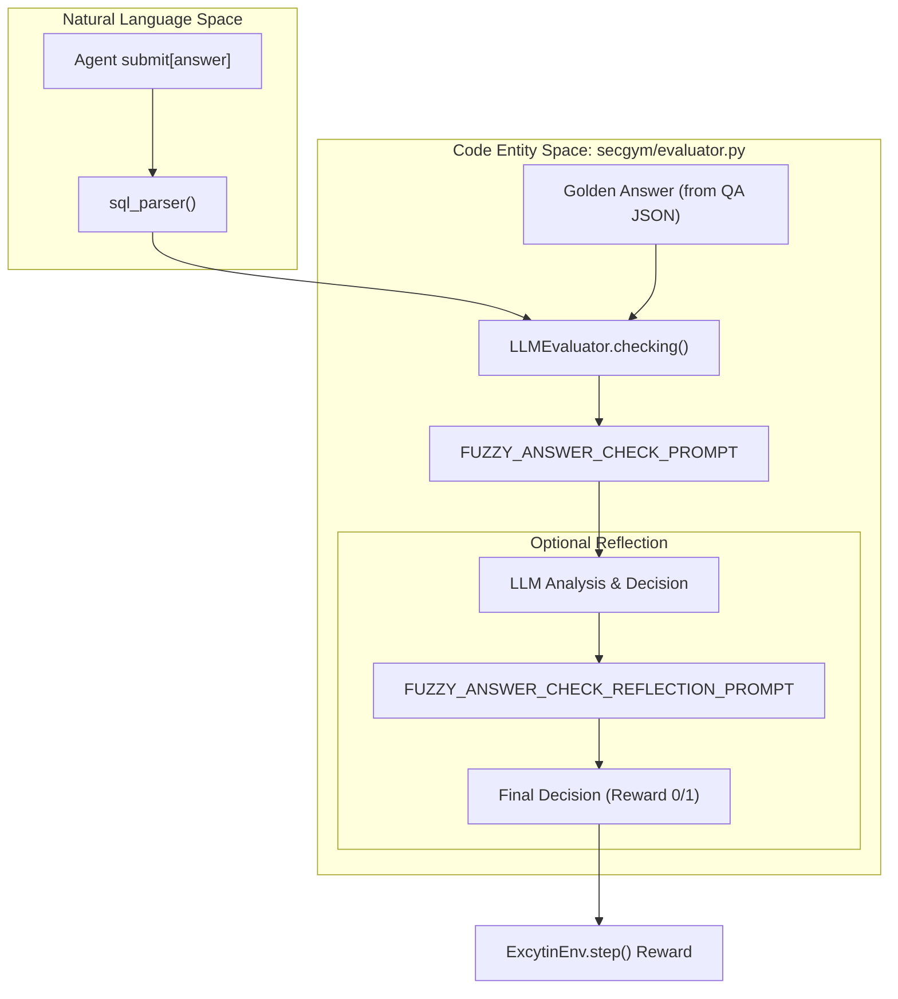
**Sources:** [secgym/evaluator.py:16-95](), [secgym/excytin_env.py:200-210](), [secgym/agents/agent_utils.py:12]()

---

### Re-evaluation Pipeline

The repository provides `run_reevaluation.py` to allow researchers to update scores in existing experiment logs without re-running the entire agent trajectory. This is useful when updating the evaluation model (e.g., moving from GPT-4 to GPT-4o) or refining the evaluation prompts.

#### Workflow of `run_reevaluation.py`:
1.  **Load Logs**: Loads `agent_incident_X.json` and `env_incident_X.json` from a results directory [experiments/run_reevaluation.py:26-30]().
2.  **Match Questions**: Maps agent trajectories to environment logs using the `nodes` identifier (representing the start/end alert IDs in the attack graph) [experiments/run_reevaluation.py:35-48]().
3.  **Execute Check**: Calls `evaluator.checking()` with the original submitted answer and the golden answer [experiments/run_reevaluation.py:66]().
4.  **Update Records**: If the reward changes, it updates the JSON logs and prints the delta for manual review [experiments/run_reevaluation.py:70-97]().

**Re-evaluation Logic Diagram**
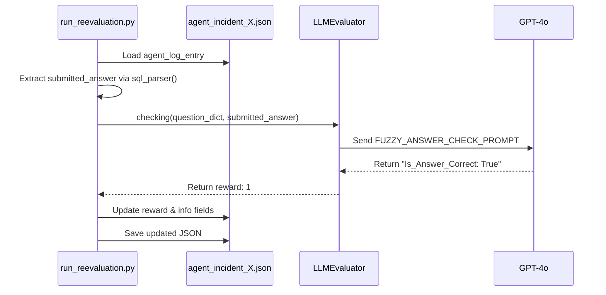
**Sources:** [experiments/run_reevaluation.py:16-107](), [secgym/evaluator.py:117-150]()

---

### Key Evaluation Metrics

When the evaluator processes a submission, it populates an `info` dictionary that is stored in the environment logs. This data is used by analysis scripts to track performance:

| Field | Description |
| :--- | :--- |
| `submitted_answer` | The raw string extracted from the agent's `submit[]` action [experiments/run_reevaluation.py:61](). |
| `check_ans_response` | The raw text analysis from the LLM evaluator explaining its decision [latest_experiments/BaselineAgent_o3_c106_alert_level_t0_s25_trial1/agent_incident_5.json:34](). |
| `check_ans_reflection` | The secondary review analysis (if reflection is enabled) [latest_experiments/BaselineAgent_o3_c106_alert_level_t0_s25_trial1/agent_incident_5.json:36](). |
| `reward` | Binary 1 (Correct) or 0 (Incorrect) [secgym/excytin_env.py:198](). |

**Sources:** [secgym/excytin_env.py:188-205](), [latest_experiments/BaselineAgent_o3_c106_alert_level_t0_s25_trial1/agent_incident_5.json:30-40]()

---

# Page: LLM Agents

# LLM Agents

<details>
<summary>Relevant source files</summary>

The following files were used as context for generating this wiki page:

- [secgym/agents/__init__.py](secgym/agents/__init__.py)
- [secgym/agents/agent.py](secgym/agents/agent.py)
- [secgym/agents/expel_train/README.md](secgym/agents/expel_train/README.md)
- [secgym/agents/expel_train/__init__.py](secgym/agents/expel_train/__init__.py)
- [secgym/agents/expel_train/experience_recall.py](secgym/agents/expel_train/experience_recall.py)
- [secgym/agents/react_examples/react_example_1.txt](secgym/agents/react_examples/react_example_1.txt)
- [secgym/agents/react_examples/react_example_2.txt](secgym/agents/react_examples/react_example_2.txt)
- [secgym/agents/react_examples/react_example_3.txt](secgym/agents/react_examples/react_example_3.txt)

</details>


This page provides a high-level overview of the agent framework within ExCyTIn-Bench. The framework is designed to support various autonomous reasoning strategies—ranging from simple zero-shot prompting to complex iterative reflection and experience-based learning—all operating within the SecGym environment.

The core of the framework is a unified `Agent` base class that defines the contract for the Thought-Action-Observation loop, ensuring that different agent architectures can be evaluated against the same security incidents and telemetry data.

### Agent Framework Architecture

The agent architecture bridges the gap between natural language reasoning and the SQL-based "Code Entity Space" of the security databases. Agents receive observations (SQL query results or error messages) and must generate valid SQL actions to progress their investigation.

**Agent-Environment Interaction Flow**

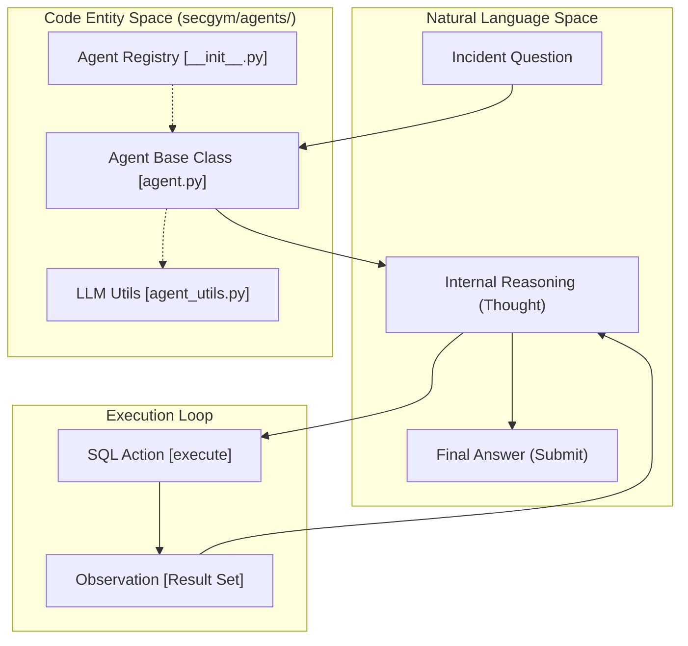
**Sources:** [secgym/agents/agent.py:8-48](), [secgym/agents/agent_utils.py:1-50](), [secgym/agents/__init__.py:4-21]()

---

### Core Components

#### 3.1 Agent Utilities & Base Classes
All agents inherit from the `Agent` class in `secgym/agents/agent.py`. This base class manages the `OpenAIWrapper` for LLM calls, maintains the conversation history in `self.messages`, and tracks token usage. Shared utilities in `agent_utils.py` provide critical functions like `sql_parser` for extracting executable code from LLM strings and `call_llm` for robust API interactions with exponential backoff.

For details, see [Agent Utilities & Base Classes](#3.1).
**Sources:** [secgym/agents/agent.py:8-41](), [secgym/agents/agent_utils.py:5-32]()

#### 3.2 Baseline & PromptSauce Agents
The `BaselineAgent` implements a straightforward loop where the model is prompted to solve the task in a single or multi-step fashion without specific few-shot trajectories. The `PromptSauceAgent` extends this by utilizing domain-specific security knowledge and specialized system prompts (e.g., `O1_PROMPT`, `R1_PROMPT`) tailored for advanced reasoning models like OpenAI's o1 or DeepSeek-R1.

For details, see [BaselineAgent & PromptSauceAgent](#3.2).
**Sources:** [secgym/agents/baseline_agent.py](), [secgym/agents/prompt_sauce_agent.py]()

#### 3.3 ReAct & Reflexion Agents
The `ReActAgent` implements the "Reason + Act" paradigm, using few-shot demonstrations (found in `secgym/agents/react_examples/`) to teach the model how to interleave thoughts and SQL actions. The `ReflexionAgent` variants add an iterative self-correction layer: after a failed trial, the agent calls a `reflect()` method to analyze its mistakes, which is then injected into the system prompt of the next trial.

For details, see [ReAct & Reflexion Agents](#3.3).
**Sources:** [secgym/agents/react_agent.py](), [secgym/agents/react_reflexion_agent.py](), [secgym/agents/react_examples/react_example_1.txt:1-55]()

#### 3.4 ExPeL Agent (Experience-Based Learning)
`ExpelAgent` is the most advanced agent family, implementing a cross-task learning mechanism. It utilizes an `ExperiencePool` to retrieve successful trajectories from previous investigations based on vector similarity (using `HuggingFaceEmbeddings` or `OpenAIEmbeddings`). It also incorporates "Insights"—optimized rules extracted during a training phase—to guide the agent's SQL generation and investigation strategy.

For details, see [ExPeL Agent: Experience-Based Learning](#3.4).
**Sources:** [secgym/agents/expel_agent.py](), [secgym/agents/expel_train/experience_recall.py:25-78]()

---

### Agent Family Comparison

| Agent Family | Strategy | Learning Type | Key Files |
| :--- | :--- | :--- | :--- |
| **Baseline** | Zero-shot / Simple Loop | None | `baseline_agent.py` |
| **PromptSauce** | Domain-specific System Prompts | None | `prompt_sauce_agent.py` |
| **ReAct** | Thought-Action-Observation | Few-shot (Static) | `react_agent.py` |
| **Reflexion** | Self-Correction Loop | Intra-task (Trial-to-Trial) | `react_reflexion_agent.py` |
| **ExPeL** | Experience Retrieval & Insights | Inter-task (Experience Pool) | `expel_agent.py` |

---

### Implementation Class Hierarchy

The following diagram maps the logical agent families to their specific Python class implementations and associated data files.

```mermaid
classDiagram
    class Agent {
        <<Abstract>>
        +config_list
        +messages
        +act(observation)
        +_call_llm(messages)
    }

    class BaselineAgent {
        +act()
    }

    class ReActAgent {
        +examples_path
        +stop_sequences
    }

    class ExpelAgent {
        +experience_pool: ExperiencePool
        +insights: List
    }

    class ExperiencePool {
        +vector_store
        +get_demonstrations(query)
    }

    Agent <|-- BaselineAgent
    Agent <|-- ReActAgent
    Agent <|-- ExpelAgent
    ExpelAgent --> ExperiencePool : uses
    
    style Agent font-style:italic
```
**Sources:** [secgym/agents/agent.py:8-48](), [secgym/agents/expel_train/experience_recall.py:25-52](), [secgym/agents/__init__.py:12-21]()

---

# Page: Agent Utilities & Base Classes

# Agent Utilities & Base Classes

<details>
<summary>Relevant source files</summary>

The following files were used as context for generating this wiki page:

- [secgym/agents/agent.py](secgym/agents/agent.py)
- [secgym/agents/agent_utils.py](secgym/agents/agent_utils.py)
- [secgym/agents/baseline_agent.py](secgym/agents/baseline_agent.py)
- [secgym/agents/prompt_sauce_agent.py](secgym/agents/prompt_sauce_agent.py)
- [secgym/agents/react_agent.py](secgym/agents/react_agent.py)
- [secgym/agents/react_examples/react_example_1.txt](secgym/agents/react_examples/react_example_1.txt)
- [secgym/agents/react_examples/react_example_2.txt](secgym/agents/react_examples/react_example_2.txt)
- [secgym/agents/react_examples/react_example_3.txt](secgym/agents/react_examples/react_example_3.txt)

</details>


This page documents the core agent abstractions and utility functions within the ExCyTIn-Bench framework. It covers the base `Agent` class, the shared Thought-Action-Observation loop contract, and the robust LLM interaction utilities including retry logic, SQL parsing, and token usage tracking.

## 1. Base Agent Abstraction

The `Agent` class in `secgym/agents/agent.py` serves as the abstract foundation for all specific agent implementations (e.g., `BaselineAgent`, `ReActAgent`). It defines the interface required to interact with the `SecGym` environment.

### Key Class Components
- **`__init__`**: Initializes the agent with a configuration list, maximum steps, and retry parameters. It creates an `OpenAIWrapper` client for LLM interactions `[secgym/agents/agent.py:9-24]()`.
- **`act(observation)`**: An abstract method that must be implemented by subclasses. It takes a string observation (database results or error messages) and returns a tuple of `(action_string, is_submit_flag)` `[secgym/agents/agent.py:34-35]()`.
- **`get_logging()`**: Standardizes the extraction of agent trajectories (messages) and cumulative token usage for experiment logging `[secgym/agents/agent.py:37-41]()`.

**Sources:** `[secgym/agents/agent.py:1-50]()`

---

## 2. Shared Thought-Action-Observation Loop

All agents follow a strict contract where they output reasoning followed by a structured action. The environment then provides an observation, closing the loop.

### Loop Data Flow
The diagram below illustrates how the `Agent` subclasses interact with the `agent_utils` and the LLM providers to maintain the stateful investigation.

**Agent-LLM Interaction Flow**
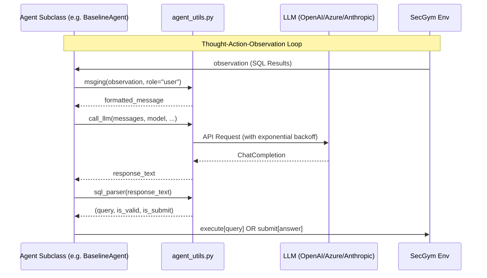
**Sources:** `[secgym/agents/agent.py:30-45]()`, `[secgym/agents/agent_utils.py:15-36]()`, `[secgym/agents/baseline_agent.py:119-158]()`

---

## 3. Agent Utilities (`agent_utils.py`)

The `agent_utils.py` module provides critical helper functions that decouple LLM provider specifics from the agent logic.

### SQL Parsing (`sql_parser`)
This function uses regular expressions to extract SQL queries or final answers from the LLM's raw text output. It supports two primary formats:
1.  **Execution**: Extracts content inside `execute[...]` or ` ```sql ... ``` ` blocks `[secgym/agents/agent_utils.py:25-27]()`.
2.  **Submission**: Extracts content inside `submit[...]` blocks `[secgym/agents/agent_utils.py:21-23]()`.

It handles cleaning (removing backticks) and truncating queries at the first semicolon to prevent multi-statement injection `[secgym/agents/agent_utils.py:18-36]()`.

### LLM Invocation & Robustness
The utilities provide two main entry points for model calls:
- **`call_llm`**: Wraps the `OpenAIWrapper`. It includes specialized handling for different model families:
    - **O1/O3**: Forces the system prompt into a user message role if necessary `[secgym/agents/agent_utils.py:107-111]()`.
    - **Claude**: Enables "thinking" tokens with a specific budget `[secgym/agents/agent_utils.py:115-117]()`.
    - **Retries**: Implements exponential backoff for `OpenAIRateLimitError` and `AnthropicAPIStatusError` `[secgym/agents/agent_utils.py:118-135]()`.
- **`call_llm_foundry`**: A dedicated wrapper for `ChatCompletionsClient` used with Azure AI Foundry endpoints `[secgym/agents/agent_utils.py:38-54]()`.

### Usage Tracking
To facilitate cost analysis, the utilities track token usage across multiple steps and trials:
- **`update_model_usage`**: Aggregates usage statistics (prompt tokens, completion tokens) keyed by model name `[secgym/agents/agent_utils.py:76-93]()`.
- **`update_total_usage`**: A recursive helper that sums nested usage dictionaries `[secgym/agents/agent_utils.py:56-74]()`.

**Sources:** `[secgym/agents/agent_utils.py:1-142]()`

---

## 4. Prompting Contracts

Agents utilize specific system prompts defined in their respective files to enforce the Thought-Action format. 

| Prompt Constant | Target Models | Key Instructions |
| :--- | :--- | :--- |
| `BASE_PROMPT` | GPT-4, standard LLMs | "Your response should always be a thought-action pair" `[secgym/agents/baseline_agent.py:16-29]()` |
| `O1_PROMPT` | o1, o3, Llama-3 | "Only give one thought-action per response... Follow the format exactly" `[secgym/agents/baseline_agent.py:32-49]()` |
| `R1_PROMPT` | DeepSeek R1, Qwen | Reasoning inside `<think>` and action inside `<answer>` tags `[secgym/agents/baseline_agent.py:51-62]()` |

### Code-to-Logic Mapping
The following diagram maps high-level prompting strategies to their specific code entities.

**Prompting Logic Map**
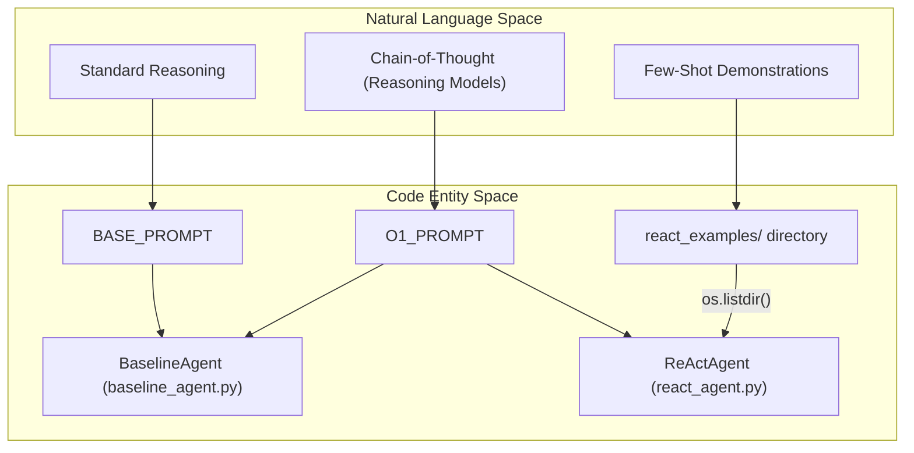
**Sources:** `[secgym/agents/baseline_agent.py:16-62]()`, `[secgym/agents/react_agent.py:11-57]()`

---

## 5. Few-Shot Integration (ReAct)

The `ReActAgent` extends the base utility pattern by dynamically loading demonstrations from `secgym/agents/react_examples/`. 

- **Loading Mechanism**: At initialization, the agent iterates through all files in the `react_examples` directory and appends their content to the `BASE_PROMPT` and `O1_PROMPT` `[secgym/agents/react_agent.py:50-56]()`.
- **Stop Sequences**: During `_call_llm`, it explicitly passes `stop=["Observation:", "observation:"]` to prevent the LLM from hallucinating environment responses `[secgym/agents/react_agent.py:109-120]()`.

**Sources:** `[secgym/agents/react_agent.py:1-125]()`, `[secgym/agents/react_examples/react_example_1.txt:1-55]()`

---

# Page: BaselineAgent & PromptSauceAgent

# BaselineAgent & PromptSauceAgent

<details>
<summary>Relevant source files</summary>

The following files were used as context for generating this wiki page:

- [secgym/agents/__init__.py](secgym/agents/__init__.py)
- [secgym/agents/agent_utils.py](secgym/agents/agent_utils.py)
- [secgym/agents/baseline_agent.py](secgym/agents/baseline_agent.py)
- [secgym/agents/expel_train/README.md](secgym/agents/expel_train/README.md)
- [secgym/agents/expel_train/__init__.py](secgym/agents/expel_train/__init__.py)
- [secgym/agents/expel_train/experience_recall.py](secgym/agents/expel_train/experience_recall.py)
- [secgym/agents/prompt_sauce_agent.py](secgym/agents/prompt_sauce_agent.py)
- [secgym/agents/react_agent.py](secgym/agents/react_agent.py)

</details>


This page documents the core agent implementations within the ExCyTIn-Bench framework: `BaselineAgent` and `PromptSauceAgent`. These agents represent the primary interfaces for LLM-driven security investigation, handling the iterative cycle of reasoning, SQL generation, and result processing.

## Overview and Purpose

The `BaselineAgent` and `PromptSauceAgent` provide a standard "Thought-Action-Observation" loop. They are designed to interact with the `SecGym` environment by generating SQL queries to explore security telemetry and ultimately submitting a final answer to a given security question. While `BaselineAgent` uses a general security analyst persona, `PromptSauceAgent` incorporates domain-specific heuristics regarding how security incidents are structured (e.g., relationship between alerts and entities).

### Key Components
*   **Act Loop**: The primary method `act()` that takes an observation and returns a parsed action [secgym/agents/baseline_agent.py:176-218]().
*   **Prompt Routing**: Dynamic selection of system prompts (e.g., `BASE_PROMPT`, `O1_PROMPT`, `R1_PROMPT`) based on the underlying model's architecture [secgym/agents/baseline_agent.py:97-106]().
*   **LLM Integration**: Support for multiple providers including OpenAI, Azure AI Foundry, Anthropic (Claude), and DeepSeek [secgym/agents/baseline_agent.py:87-95]().
*   **Retry Logic**: Handling malformed model outputs where the "Action" is missing by performing a targeted retry [secgym/agents/baseline_agent.py:191-200]().

---

## Agent Architecture and Data Flow

The following diagram illustrates the interaction between the Agent classes, the LLM providers, and the environment.

### Agent-Environment Interaction Flow
"This diagram shows how BaselineAgent and PromptSauceAgent manage the lifecycle of a single step."

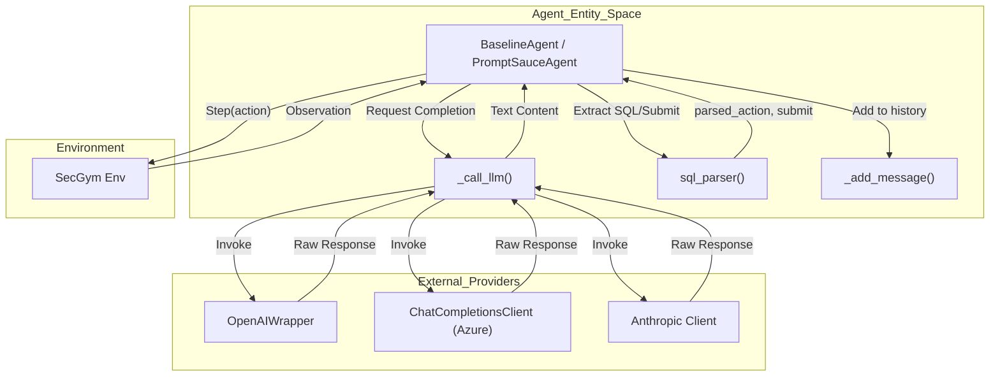
**Sources:** [secgym/agents/baseline_agent.py:119-174](), [secgym/agents/baseline_agent.py:176-218](), [secgym/agents/agent_utils.py:18-36]()

---

## BaselineAgent Implementation

`BaselineAgent` is the fundamental implementation used for zero-shot or basic chain-of-thought evaluations.

### Model-Specific Prompting
The agent detects the model type during initialization and selects the appropriate system prompt to ensure the LLM follows the strict "Thought: ... Action: ..." format required by the parser.

| Prompt Constant | Target Models | Format Characteristics |
| :--- | :--- | :--- |
| `BASE_PROMPT` | Standard GPT-4, GPT-3.5 | Basic "Thought-Action" pair [secgym/agents/baseline_agent.py:16-29](). |
| `O1_PROMPT` | OpenAI o1/o3, Llama, R1 | Explicit instructions not to make assumptions and wait for execution [secgym/agents/baseline_agent.py:32-49](). |
| `R1_PROMPT` | DeepSeek R1, Qwen | Uses `<think>` and `<answer>` tags for reasoning-heavy models [secgym/agents/baseline_agent.py:51-62](). |

### The Act Loop and Retry-Split Logic
The `act()` function in `BaselineAgent` processes the latest observation from the environment [secgym/agents/baseline_agent.py:176](). A critical feature is the **Retry Split Action** logic: if the LLM provides a thought but fails to provide a formatted action (e.g., forgets the `Action:` prefix), the agent detects the failure and makes a second LLM call, appending the partial response to force the completion of the action block [secgym/agents/baseline_agent.py:191-200]().

**Sources:** [secgym/agents/baseline_agent.py:65-114](), [secgym/agents/baseline_agent.py:176-218]()

---

## PromptSauceAgent: Domain-Knowledge Prompting

`PromptSauceAgent` extends the baseline logic but utilizes a specialized `BASE_PROMPT` and `O1_PROMPT` that embed cybersecurity domain knowledge.

### Strategy Injection
The PromptSauce strategy instructs the agent on the hierarchical nature of security logs:
1.  **Incident Centricity**: Start by querying the `SecurityIncident` table to find related alerts [secgym/agents/prompt_sauce_agent.py:15-16]().
2.  **Entity Correlation**: Use entities (IPs, Users, Hosts) shared between alerts to pivot into raw telemetry tables like `DeviceProcessEvents` or `SigninLogs` [secgym/agents/prompt_sauce_agent.py:17-18]().
3.  **Schema Exploration**: Explicitly encourages using `DESCRIBE` or checking example entries due to the 20+ table schema [secgym/agents/prompt_sauce_agent.py:11]().

**Sources:** [secgym/agents/prompt_sauce_agent.py:8-27](), [secgym/agents/prompt_sauce_agent.py:30-52]()

---

## Multi-Provider LLM Integration

The agents utilize `secgym/agents/agent_utils.py` to abstract the complexities of different LLM providers.

### Call Abstraction
*   **`call_llm`**: Handles `OpenAIWrapper` (OpenAI/Azure OpenAI) and Anthropic. It includes exponential backoff for `OpenAIRateLimitError` [secgym/agents/agent_utils.py:95-141]().
*   **`call_llm_foundry`**: Specifically for Azure AI Foundry models using `ChatCompletionsClient` [secgym/agents/agent_utils.py:38-54]().
*   **Usage Tracking**: Both agents maintain a `total_usage` dictionary. `update_model_usage` and `update_total_usage` recursively aggregate token counts across multiple turns [secgym/agents/agent_utils.py:56-93]().

### SQL Parsing
The `sql_parser` function in `agent_utils.py` is the bridge between the LLM's natural language response and the database. It uses regex to extract content within `execute[...]` or `submit[...]` blocks, strips backticks, and handles trailing semicolons [secgym/agents/agent_utils.py:18-36]().

### LLM Call Flow and Usage Tracking
"This diagram maps the code entities involved in the LLM communication and token accounting."

```mermaid
graph LR
    subgraph "secgym/agents/agent_utils.py"
        CU["call_llm()"]
        CF["call_llm_foundry()"]
        UTU["update_total_usage()"]
        UMU["update_model_usage()"]
    end

    subgraph "secgym/agents/baseline_agent.py"
        BA["BaselineAgent._call_llm()"]
    end

    BA -- "Calls" --> CU
    BA -- "Calls" --> CF
    CU -- "Returns Response" --> BA
    CF -- "Returns Response" --> BA
    BA -- "Updates Usage" --> UMU
    UMU -- "Recursive Add" --> UTU
```
**Sources:** [secgym/agents/agent_utils.py:38-141](), [secgym/agents/baseline_agent.py:119-155]()

---

## Technical Details: Class Members

### BaselineAgent Attributes
| Attribute | Description |
| :--- | :--- |
| `self.messages` | List of dictionaries representing the conversation history [secgym/agents/baseline_agent.py:100](). |
| `self.max_steps` | The maximum number of Thought-Action turns allowed (default: 15) [secgym/agents/baseline_agent.py:69](). |
| `self.step_count` | Counter for the current step in the trajectory [secgym/agents/baseline_agent.py:110](). |
| `self.totoal_usage` | Dictionary tracking cumulative token usage by model name [secgym/agents/baseline_agent.py:113](). |

**Sources:** [secgym/agents/baseline_agent.py:66-114](), [secgym/agents/prompt_sauce_agent.py:56-77]()

---

# Page: ReAct & Reflexion Agents

# ReAct & Reflexion Agents

<details>
<summary>Relevant source files</summary>

The following files were used as context for generating this wiki page:

- [experiments/result_analysis/analysis.py](experiments/result_analysis/analysis.py)
- [secgym/agents/agent.py](secgym/agents/agent.py)
- [secgym/agents/agent_utils.py](secgym/agents/agent_utils.py)
- [secgym/agents/baseline_agent.py](secgym/agents/baseline_agent.py)
- [secgym/agents/expel_train/insight_extraction.py](secgym/agents/expel_train/insight_extraction.py)
- [secgym/agents/prompt_sauce_agent.py](secgym/agents/prompt_sauce_agent.py)
- [secgym/agents/prompt_sauce_reflexion_agent.py](secgym/agents/prompt_sauce_reflexion_agent.py)
- [secgym/agents/react_agent.py](secgym/agents/react_agent.py)
- [secgym/agents/react_examples/react_example_1.txt](secgym/agents/react_examples/react_example_1.txt)
- [secgym/agents/react_examples/react_example_2.txt](secgym/agents/react_examples/react_example_2.txt)
- [secgym/agents/react_examples/react_example_3.txt](secgym/agents/react_examples/react_example_3.txt)
- [secgym/agents/react_reflexion_agent.py](secgym/agents/react_reflexion_agent.py)

</details>


This page documents the implementation of advanced reasoning agents within the SecRL framework, specifically focusing on the ReAct (Reason + Act) and Reflexion paradigms. These agents leverage few-shot demonstrations, iterative thought-action loops, and self-reflection mechanisms to solve complex cybersecurity investigation tasks.

## ReAct Architecture

The ReAct agents follow a structured loop where the model generates a "Thought" followed by an "Action". The action is executed against the SecGym environment (typically a SQL query), and the resulting "Observation" is fed back into the prompt for the next iteration [secgym/agents/react_agent.py:126-158]().

### Key Components

*   **Few-Shot Demonstrations**: Unlike baseline agents, ReAct agents include detailed multi-step examples in their system prompt to guide the reasoning process [secgym/agents/react_agent.py:50-56](). These examples are sourced from the `react_examples/` directory.
*   **Stop Sequences**: To prevent the LLM from hallucinating the environment's response, the `_call_llm` method utilizes stop sequences such as `Observation:` and `observation:` [secgym/agents/react_agent.py:109-120]().
*   **Prompt Routing**: The agent selects between `BASE_PROMPT` and `O1_PROMPT` based on the model type (e.g., standard GPT-4o vs. reasoning models like O1/O3) [secgym/agents/react_agent.py:82-86]().

### ReAct Execution Flow

The following diagram illustrates the interaction between the `ReActAgent` and the `ExcytinEnv`.

**Diagram: ReAct Agent Loop**
```mermaid
sequenceDiagram
    participant A as ReActAgent
    participant U as agent_utils.py
    participant E as ExcytinEnv (MySQL)

    A->>A: Load react_examples/*.txt into System Prompt
    Note over A: Start Trial
    loop max_steps
        A->>U: call_llm(messages, stop=["Observation:"])
        U-->>A: Thought + Action (execute[...])
        A->>E: step(parsed_sql)
        E-->>A: Observation (Query Results)
        A->>A: _add_message(Observation, role="user")
    end
    A->>U: call_llm(messages)
    U-->>A: Action (submit[answer])
```
Sources: `[secgym/agents/react_agent.py:50-56]()`, `[secgym/agents/react_agent.py:109-120]()`, `[secgym/agents/react_agent.py:126-158]()`

---

## Reflexion Mechanism

The Reflexion agents (`ReActReflexionAgent` and `PromptSauceReflexionAgent`) extend the ReAct pattern by adding a linguistic self-reflection step between trials. If an agent fails a task, it analyzes its own trajectory to identify errors and creates a plan for the next attempt [secgym/agents/react_reflexion_agent.py:110-131]().

### Implementation Details

1.  **Replay Buffer**: The agent maintains a `replay_buffer` which stores the message history and rewards of previous trials [secgym/agents/react_reflexion_agent.py:90]().
2.  **The `reflect()` Method**: When triggered, this method samples up to 3 previous trials from the buffer. It constructs a `REFLECT_PROMPT` that asks the LLM to diagnose failure reasons (e.g., wrong SQL logic, phrasing discrepancies) and devise a high-level plan [secgym/agents/react_reflexion_agent.py:118-131]().
3.  **Prompt Injection**: The resulting reflection is injected into the system prompt of the subsequent trial to guide the agent away from previous mistakes.

### Comparison of Reflexion Variants

| Feature | ReActReflexionAgent | PromptSauceReflexionAgent |
| :--- | :--- | :--- |
| **Prompt Base** | General ReAct instructions [secgym/agents/react_reflexion_agent.py:12-28]() | Domain-specific security analyst guidance [secgym/agents/prompt_sauce_reflexion_agent.py:9-28]() |
| **Demonstrations** | Uses `react_examples/` [secgym/agents/react_reflexion_agent.py:57-61]() | No few-shot examples (zero-shot + domain knowledge) |
| **Reflection Logic** | Samples from `replay_buffer` [secgym/agents/react_reflexion_agent.py:110]() | Samples from `replay_buffer` [secgym/agents/prompt_sauce_reflexion_agent.py:95]() |

Sources: `[secgym/agents/react_reflexion_agent.py:110-131]()`, `[secgym/agents/prompt_sauce_reflexion_agent.py:95-116]()`

---

## Code Entity & Data Flow

The following diagram maps the logical flow of a Reflexion-based experiment to the specific code entities responsible for each stage.

**Diagram: Reflexion Data Flow and Code Mapping**
```mermaid
graph TD
    subgraph "Natural Language Space"
        Q["Security Question"]
        TH["Thought/Reasoning"]
        REF["Reflection/Diagnosis"]
    end

    subgraph "Code Entity Space (secgym/agents/)"
        RA["react_reflexion_agent.py"]
        AU["agent_utils.py"]
        EP["prompt_sauce_reflexion_agent.py"]
    end

    subgraph "Execution & Persistence"
        ENV["excytin_env.py"]
        BUF["self.replay_buffer"]
        LOG["analysis.py"]
    end

    Q --> RA
    RA -- "calls" --> AU
    AU -- "execute[SQL]" --> ENV
    ENV -- "Observation" --> RA
    RA -- "Trajectory" --> BUF
    BUF -- "reflect()" --> REF
    REF -- "System Prompt Injection" --> RA
    RA -- "get_logging()" --> LOG
```
Sources: `[secgym/agents/react_reflexion_agent.py:90-131]()`, `[secgym/agents/agent_utils.py:18-36]()`, `[experiments/result_analysis/analysis.py:58-125]()`

---

## Demonstration Examples (`react_examples/`)

The few-shot demonstrations provide templates for how the agent should interact with the database. These files (e.g., `react_example_1.txt`) follow a strict pattern:

1.  **Question**: The task description.
2.  **Thought**: The agent's reasoning (e.g., "I will start by listing all the tables").
3.  **Action**: The command (e.g., `execute[SHOW TABLES]`).
4.  **Observation**: The environment output (e.g., `[('SecurityAlert',), ...]`).

These examples teach the agent to handle errors, such as `ProgrammingError: Unknown column`, by inspecting the schema using `DESCRIBE` before re-attempting queries [secgym/agents/react_examples/react_example_1.txt:12-17]().

### Common Patterns in Examples

*   **Schema Discovery**: Using `SHOW TABLES` and `DESCRIBE <table_name>` to understand available telemetry [secgym/agents/react_examples/react_example_2.txt:4-12]().
*   **Correlation**: Joining tables like `EmailPostDeliveryEvents` and `EmailUrlInfo` using identifiers like `NetworkMessageId` [secgym/agents/react_examples/react_example_2.txt:41-49]().
*   **Fuzzy Searching**: Using `LIKE` operators to find relevant alerts when exact names are unknown [secgym/agents/react_examples/react_example_1.txt:29-32]().

Sources: `[secgym/agents/react_examples/react_example_1.txt:1-55]()`, `[secgym/agents/react_examples/react_example_2.txt:1-52]()`

---

# Page: ExPeL Agent: Experience-Based Learning

# ExPeL Agent: Experience-Based Learning

<details>
<summary>Relevant source files</summary>

The following files were used as context for generating this wiki page:

- [experiments/result_analysis/analysis.py](experiments/result_analysis/analysis.py)
- [requirements_freeze.txt](requirements_freeze.txt)
- [scripts/setup_alert_only.sh](scripts/setup_alert_only.sh)
- [scripts/setup_docker.sh](scripts/setup_docker.sh)
- [scripts/to_run.sh](scripts/to_run.sh)
- [secgym/agents/__init__.py](secgym/agents/__init__.py)
- [secgym/agents/expel_agent.py](secgym/agents/expel_agent.py)
- [secgym/agents/expel_train/README.md](secgym/agents/expel_train/README.md)
- [secgym/agents/expel_train/__init__.py](secgym/agents/expel_train/__init__.py)
- [secgym/agents/expel_train/corrects.jsonl](secgym/agents/expel_train/corrects.jsonl)
- [secgym/agents/expel_train/experience_recall.py](secgym/agents/expel_train/experience_recall.py)
- [secgym/agents/expel_train/insight_extraction.py](secgym/agents/expel_train/insight_extraction.py)
- [secgym/agents/expel_train/insights.json](secgym/agents/expel_train/insights.json)
- [secgym/agents/expel_train/logs.json](secgym/agents/expel_train/logs.json)
- [secgym/agents/prompt_sauce_reflexion_agent.py](secgym/agents/prompt_sauce_reflexion_agent.py)
- [secgym/agents/react_reflexion_agent.py](secgym/agents/react_reflexion_agent.py)

</details>


The ExPeL (Experience-Based Learning) framework is an advanced agent architecture designed to improve cybersecurity investigation performance by autonomously extracting and recalling cross-task insights and successful trajectories. Unlike static ReAct agents, ExPeL utilizes a vector-database-backed experience pool and a rule-optimization pipeline to refine its reasoning capabilities over time.

## Overview of ExPeL Architecture

The ExPeL system consists of three primary components:
1.  **ExpelAgent**: The runtime agent that integrates retrieved experiences and global insights into its prompting cycle [secgym/agents/expel_agent.py:43-54]().
2.  **ExperiencePool**: A retrieval-augmented generation (RAG) component that uses vector embeddings to find relevant historical trajectories [secgym/agents/expel_train/experience_recall.py:25-33]().
3.  **Insight Extraction**: An offline training-time process that analyzes successful and failed trials to update a persistent set of investigative rules [secgym/agents/expel_train/insight_extraction.py:21-53]().

### Data Flow: Natural Language to Code Entities

The following diagram illustrates how natural language questions and investigation contexts are transformed into vector embeddings for experience retrieval and eventually into SQL actions.

**ExPeL Knowledge Retrieval and Execution Flow**
```mermaid
graph TD
    subgraph "Natural Language Space"
        Q["Question + Context"]
        I["Insights (insights.json)"]
    end

    subgraph "Code Entity Space"
        EP["ExperiencePool (experience_recall.py)"]
        EA["ExpelAgent (expel_agent.py)"]
        IV["InMemoryVectorStore (LangChain)"]
        SQL["sql_parser (agent_utils.py)"]
    end

    Q -->|get_embed_string| EP
    EP -->|similarity_search| IV
    IV -->|get_demonstrations| EA
    I -->|json.load| EA
    EA -->|act| SQL
    SQL -->|parsed_action| DB[(MySQL Database)]
```
Sources: [secgym/agents/expel_agent.py:75-80](), [secgym/agents/expel_train/experience_recall.py:55-68](), [secgym/agents/agent_utils.py:126-126]()

---

## Experience Retrieval (ExperiencePool)

The `ExperiencePool` class manages the storage and retrieval of "correct" trajectories. These are stored in `corrects.jsonl`, where each entry contains a `key` (the question and context) and a `value` (the full message history of a successful investigation) [secgym/agents/expel_train/experience_recall.py:37-43]().

### Implementation Details
- **Embedding Strategy**: The pool supports three embedding types: `both` (Context + Question), `question`, or `context` [secgym/agents/expel_train/experience_recall.py:55-63]().
- **Vector Store**: Uses `langchain_core.vectorstores.InMemoryVectorStore` with `HuggingFaceEmbeddings` (defaulting to `all-mpnet-base-v2`) [secgym/agents/expel_train/experience_recall.py:31-52]().
- **Demonstration Formatting**: The `format_demonstration` function converts raw JSON trajectories back into a string format that includes `Thought`, `Action`, and truncated `Observation` blocks to fit within LLM context windows [secgym/agents/expel_train/experience_recall.py:70-77]().

Sources: [secgym/agents/expel_train/experience_recall.py:25-77](), [secgym/agents/expel_train/corrects.jsonl:1-1]()

---

## Insight Extraction and Rule Optimization

The `insight_extraction.py` module implements a training-time loop where an "Optimizer LLM" critiques previous agent performances. It maintains a list of global rules in `insights.json` [secgym/agents/expel_train/insight_extraction.py:33-34]().

### Optimization Operations
The optimizer uses a set of tools (`OPTIMIZER_TOOLS`) to modify the rule base [secgym/agents/expel_train/insight_extraction.py:83-153]():
- `add_insight`: Creates a new general rule based on a successful trajectory.
- `edit_insight`: Refines an existing rule for better clarity or accuracy.
- `upvote_insight` / `downvote_insight`: Adjusts the "confidence" or "importance" of a rule based on its utility in a given trial.
- `remove_insight`: Deletes rules that are no longer applicable or have too many downvotes.

### Comparison Logic
The extraction process often uses paired trajectories: one successful and one unsuccessful trial for the same question. The system prompt (`EXPEL_PAIRED_SYSTEM_MESSAGE`) instructs the LLM to contrast these to identify high-level critiques of the failed "Thought" and "Action" sequences [secgym/agents/expel_train/insight_extraction.py:76-79]().

**Insight Optimization Loop**
```mermaid
graph LR
    subgraph "Optimization Loop (insight_extraction.py)"
        L["logs.json (Trajectories)"] --> O["Optimizer LLM"]
        O --> T["OPTIMIZER_TOOLS"]
        T -->|add/edit/upvote| R["insights.json (Rules)"]
        R --> O
    end
    R -.->|Injected into| EA["ExpelAgent Prompt"]
```
Sources: [secgym/agents/expel_train/insight_extraction.py:76-153](), [secgym/agents/expel_train/insights.json:1-10]()

---

## ExpelAgent Execution

At runtime, `ExpelAgent` inherits the standard Thought-Action-Observation loop but modifies the `reset` and `act` phases to incorporate learned knowledge.

### Prompt Injection
When the agent is initialized or reset:
1.  **Insights**: It loads all rules from `insights.json` and appends them to the system prompt as a numbered list [secgym/agents/expel_agent.py:64-67]().
2.  **Experiences**: It queries the `ExperiencePool` for the top-K (usually K=1) most similar successful trajectories based on the current question's context [secgym/agents/expel_agent.py:145-150]().

### Logic and Error Handling
The `act` method handles the interaction with the LLM and the environment [secgym/agents/expel_agent.py:97-129]():
- **Action Parsing**: It uses `sql_parser` to extract SQL queries from the LLM's `Action: execute[...]` block [secgym/agents/expel_agent.py:126-126]().
- **Retry Mechanism**: If the LLM fails to provide a properly formatted `Action` string, the agent performs a "Retry Split Action" by re-prompting the model with the current `Thought` and a forced `Action:` prefix [secgym/agents/expel_agent.py:113-120]().
- **Step Management**: It tracks `step_count` against `max_steps` and can inject a summary prompt if the limit is reached [secgym/agents/expel_agent.py:102-104]().

### Comparison of Agent Prompts
| Prompt Component | ExpelAgent | ReActReflexionAgent |
| :--- | :--- | :--- |
| **System Role** | Security Analyst [secgym/agents/expel_agent.py:8]() | Security Analyst [secgym/agents/react_reflexion_agent.py:12]() |
| **Static Demos** | None (Retrieved dynamically) | Hardcoded in `react_examples/` [secgym/agents/react_reflexion_agent.py:57-60]() |
| **Learning** | Persistent `insights.json` | Ephemeral `replay_buffer` per trial [secgym/agents/react_reflexion_agent.py:110-131]() |

Sources: [secgym/agents/expel_agent.py:43-154](), [secgym/agents/react_reflexion_agent.py:67-131]()

---

## Data Structures

### corrects.jsonl
Stores successful trajectories. Each line is a JSON object:
- `key`: `{"context": "...", "question": "..."}`
- `value`: `{"reward": 1, "messages": [...]}`
- **Source**: [secgym/agents/expel_train/corrects.jsonl:1-1]()

### insights.json
A flat list of strings representing the current rule base. Examples include:
- "Prioritize examining all relevant user-related fields, such as `InitiatingProcessAccountName` and `AccountName`..."
- "Avoid relying solely on identifiers like InternetMessageId... prioritize NetworkMessageId."
- **Source**: [secgym/agents/expel_train/insights.json:1-26]()

### logs.json
Contains the detailed history of the insight extraction process, including which tools were called and the specific trajectories analyzed during training [secgym/agents/expel_train/logs.json:1-1]().

---

# Page: Question & Attack Graph Generation

# Question & Attack Graph Generation

<details>
<summary>Relevant source files</summary>

The following files were used as context for generating this wiki page:

- [notebooks/explore_graph_questions.ipynb](notebooks/explore_graph_questions.ipynb)
- [notebooks/extract_construct_graph.ipynb](notebooks/extract_construct_graph.ipynb)
- [notebooks/question_split.ipynb](notebooks/question_split.ipynb)
- [notebooks/react_example.ipynb](notebooks/react_example.ipynb)
- [secgym/qagen/alert_graph.py](secgym/qagen/alert_graph.py)
- [secgym/qagen/qa_gen.py](secgym/qagen/qa_gen.py)
- [secgym/qagen/qa_gen_prompts.py](secgym/qagen/qa_gen_prompts.py)
- [secgym/utils/graph_viz_utils.py](secgym/utils/graph_viz_utils.py)
- [secgym/utils/utils.py](secgym/utils/utils.py)

</details>


This page provides a high-level overview of the pipeline used to transform raw security incident telemetry into a structured benchmark. The process involves two primary stages: the construction of an **AlertGraph** to map attack propagation and the use of a multi-stage LLM pipeline (**QAGen**) to generate synthetic, verifiable question-answer pairs.

## Pipeline Overview

The generation pipeline ensures that benchmark tasks are grounded in real telemetry while maintaining a clear "ground truth" path for evaluation.

1.  **Graph Construction**: Raw incidents from the `SecurityIncident` and `SecurityAlert` tables are parsed to create a directed graph where nodes are alerts or entities (IPs, Hosts, Users) and edges represent shared attributes [secgym/qagen/alert_graph.py:29-59]().
2.  **Path Extraction**: The framework identifies significant attack paths by finding the farthest connected entities and alerts within the graph [secgym/qagen/alert_graph.py:214-230]().
3.  **QA Generation**: Using the extracted paths as "gold standard" evidence, an LLM generates a natural language question and a deterministic answer [secgym/qagen/qa_gen.py:145-165]().
4.  **Validation & Splitting**: Questions are validated for answer-leakage and split into training/testing sets based on path overlap scores [notebooks/question_split.ipynb:14-45]().

### Data Flow: From Telemetry to Benchmark

The following diagram illustrates how natural language questions are mapped to the underlying code entities and database structures.

**Attack Graph to Code Entity Mapping**
```mermaid
graph TD
    subgraph "Natural Language Space"
        Q["'What process was launched on host X?'"]
        A["'powershell.exe'"]
    end

    subgraph "Code Entity Space (secgym/qagen/)"
        AG["AlertGraph Class"]
        NI["NetworkX Graph Object"]
        QN["QAGen.generate_one_question()"]
    end

    subgraph "Database Space (MySQL)"
        SI["SecurityIncident Table"]
        SA["SecurityAlert Table"]
        DPE["DeviceProcessEvents Table"]
    end

    SI -- "AlertIds" --> SA
    SA -- "Entities JSON" --> AG
    AG -- "build_graph_from_incident_alert()" --> NI
    NI -- "get_alert_paths()" --> QN
    QN -- "LLM Prompting" --> Q
    QN -- "Path Ground Truth" --> A
    Q -- "Agent Query" --> DPE
```
**Sources:** [secgym/qagen/alert_graph.py:29-54](), [secgym/qagen/qa_gen.py:48-59](), [secgym/qagen/qa_gen.py:145-160]().

---

## 4.1 AlertGraph: Incident Graph Construction

The `AlertGraph` class in `secgym/qagen/alert_graph.py` is responsible for modeling the "Attack Surface" of an incident. It uses `networkx` to build a graph where:
*   **Alert Nodes**: Represented by `SystemAlertId`, containing the alert name and description [secgym/qagen/alert_graph.py:48-54]().
*   **Entity Nodes**: Extracted from the `Entities` JSON field in alerts (e.g., Account, Host, IP, FileHash) [secgym/qagen/alert_graph.py:93-112]().
*   **Edges**: Created whenever an alert contains a specific entity, effectively linking different alerts that share the same user, machine, or file [secgym/qagen/alert_graph.py:119-120]().

The graph is pruned to its largest connected component to ensure that all generated questions are solvable through correlation [secgym/qagen/alert_graph.py:61-67]().

For details, see [AlertGraph: Incident Graph Construction](#4.1).

**Sources:** [secgym/qagen/alert_graph.py:14-128](), [secgym/utils/utils.py:48-77]().

---

## 4.2 QAGen: Synthetic Question Generation

The `QAGen` class in `secgym/qagen/qa_gen.py` manages the LLM-based task creation. It takes a path from the `AlertGraph` and uses the `QAGEN_PROMPT_WITH_ENTRY` to generate a JSON object containing a `context`, a `question`, and an `answer` [secgym/qagen/qa_gen.py:10-13](), [secgym/qagen/qa_gen.py:145-165]().

**The Multi-Stage Process:**
1.  **Initial Generation**: LLM creates a question based on a "Start Alert" and asks for an entity found in an "End Alert" [secgym/qagen/qa_gen_prompts.py:5-20]().
2.  **Answer Leakage Check**: The system validates that the answer is not explicitly mentioned in the question or context [secgym/qagen/qa_gen.py:140-143]().
3.  **Solution Generation**: A separate pass generates the "Gold Standard" SQL queries required to reach the answer, ensuring the task is actually solvable within the environment [secgym/qagen/qa_gen.py:22-42]().

For details, see [QAGen: Synthetic Question Generation](#4.2).

**Sources:** [secgym/qagen/qa_gen.py:13-53](), [secgym/qagen/qa_gen_prompts.py:5-46]().

---

## 4.3 Question Dataset & Train/Test Splits

Generated questions are organized in `secgym/questions/`. To prevent the model from simply memorizing incident patterns during training, the dataset is split based on **Path Relevance Scores**.

*   **Logic**: The script `notebooks/question_split.ipynb` calculates the edge overlap between different paths [notebooks/question_split.ipynb:14-45]().
*   **Split Types**: Users can choose between `low_score`, `median_score`, or `high_score` splits, which determine how much "leakage" or similarity exists between the training and testing trajectories [notebooks/question_split.ipynb:140-147]().

For details, see [Question Dataset & Train/Test Splits](#4.3).

**Sources:** [notebooks/question_split.ipynb:47-124]().

---

## Entity Relationship Diagram

This diagram shows how `process_entity_identifiers` maps raw data to the `AlertGraph` structure used for QA generation.

**Telemetry to Graph Entity Mapping**
```mermaid
graph LR
    subgraph "Raw Telemetry (JSON Entities)"
        RE["Account: AadUserId<br/>Host: HostName<br/>IP: Address"]
    end

    subgraph "secgym/utils/utils.py"
        PEI["process_entity_identifiers()"]
    end

    subgraph "secgym/qagen/alert_graph.py"
        AN["Alert Node (Type: alert)"]
        EN["Entity Node (Type: entity)"]
        EDGE["nx.add_edge()"]
    end

    RE --> PEI
    PEI -- "node_type, identifier_fields, value" --> EN
    AN -- "Linked by shared entity" --> EDGE
    EN --> EDGE
```
**Sources:** [secgym/utils/utils.py:48-163](), [secgym/qagen/alert_graph.py:91-120]().

---

# Page: AlertGraph: Incident Graph Construction

# AlertGraph: Incident Graph Construction

<details>
<summary>Relevant source files</summary>

The following files were used as context for generating this wiki page:

- [secgym/qagen/alert_graph.py](secgym/qagen/alert_graph.py)
- [secgym/qagen/extracted_alerts.csv](secgym/qagen/extracted_alerts.csv)
- [secgym/qagen/extracted_incidents.csv](secgym/qagen/extracted_incidents.csv)
- [secgym/qagen/graph_files/incident_134.graphml](secgym/qagen/graph_files/incident_134.graphml)
- [secgym/qagen/graph_files/incident_166.graphml](secgym/qagen/graph_files/incident_166.graphml)
- [secgym/qagen/graph_files/incident_322.graphml](secgym/qagen/graph_files/incident_322.graphml)
- [secgym/qagen/graph_files/incident_34.graphml](secgym/qagen/graph_files/incident_34.graphml)
- [secgym/qagen/graph_files/incident_38.graphml](secgym/qagen/graph_files/incident_38.graphml)
- [secgym/qagen/graph_files/incident_39.graphml](secgym/qagen/graph_files/incident_39.graphml)
- [secgym/qagen/graph_files/incident_5.graphml](secgym/qagen/graph_files/incident_5.graphml)
- [secgym/qagen/graph_files/incident_55.graphml](secgym/qagen/graph_files/incident_55.graphml)
- [secgym/qagen/qa_gen.py](secgym/qagen/qa_gen.py)
- [secgym/qagen/qa_gen_prompts.py](secgym/qagen/qa_gen_prompts.py)
- [secgym/utils/graph_viz_utils.py](secgym/utils/graph_viz_utils.py)
- [secgym/utils/utils.py](secgym/utils/utils.py)

</details>


The **AlertGraph** system is responsible for transforming raw security telemetry—specifically `SecurityIncident` and `SecurityAlert` records—into a structured, navigable graph representation using the NetworkX library. This graph serves as the topological foundation for the synthetic Question-Answer (QA) generation pipeline, allowing the system to identify attack paths and correlate entities across disparate security signals.

## Core Architecture and Data Flow

The construction process maps security alerts and their embedded entities (extracted from JSON strings) into a heterogeneous graph where nodes represent either **Alerts** or **Entities**, and edges represent the association between an alert and the evidence it contains.

### Graph Construction Workflow

1.  **Initialization**: The `AlertGraph` class is initialized, maintaining a `networkx.Graph` and mapping structures to track unique entities [secgym/qagen/alert_graph.py:14-26]().
2.  **Alert Processing**: For each alert in an incident, a node of type `alert` is created. Metadata such as `AlertName`, `Description`, and the full raw `entry` are stored as node attributes [secgym/qagen/alert_graph.py:41-54]().
3.  **Entity Extraction**: The `process_entity_identifiers` utility parses the complex `Entities` JSON field from the alert record [secgym/utils/utils.py:48-77]().
4.  **Normalization**: Entities are normalized based on their type (e.g., Account, Host, IP, File). This ensures that the same physical entity (like a specific `AadUserId`) is represented by a single node across multiple alerts [secgym/utils/utils.py:85-163]().
5.  **Edge Creation**: Edges are drawn between the Alert node and every Entity node extracted from it [secgym/qagen/alert_graph.py:119]().
6.  **Pruning**: To ensure graph traversal is meaningful for QA generation, the graph is pruned to keep only the largest connected component [secgym/qagen/alert_graph.py:60-67]().

### Incident Graph Data Flow
The following diagram illustrates how raw CSV data is transformed into a NetworkX graph structure.

**Data Flow: CSV to AlertGraph**
```mermaid
graph TD
    subgraph "Natural Language & Raw Data Space"
        INC_CSV["extracted_incidents.csv"]
        ALT_CSV["extracted_alerts.csv"]
        ENT_JSON["Alert['Entities'] JSON String"]
    end

    subgraph "Code Entity Space (alert_graph.py)"
        AG_CLASS["AlertGraph Class"]
        BUILD_FUNC["build_graph_from_incident_alert()"]
        NORM_FUNC["process_entity_identifiers()"]
        ADD_ENT["_add_entities_to_graph()"]
    end

    INC_CSV --> AG_CLASS
    ALT_CSV --> BUILD_FUNC
    ENT_JSON --> NORM_FUNC
    NORM_FUNC --> ADD_ENT
    ADD_ENT -->|"nx.add_node / nx.add_edge"| NX_GRAPH[("NetworkX Graph Object")]
```
Sources: [secgym/qagen/alert_graph.py:29-59](), [secgym/utils/utils.py:48-163]()

## Key Implementation Details

### Entity Normalization (`process_entity_identifiers`)
The system uses a sophisticated normalization logic to ensure graph connectivity. Since different security providers might refer to the same entity using different fields, the utility maps them to a consistent `identifier_field` and `value` pair.

| Entity Type | Primary Identifiers Used | Logic |
| :--- | :--- | :--- |
| **Account** | `AadUserId`, `Email`, `Sid`, `Name` | Filters out generic accounts like "system" or "guest" [secgym/utils/utils.py:90-101](). |
| **Host** | `AadDeviceId`, `HostName`, `AzureID` | Maps various cloud and on-prem IDs to a single host node [secgym/utils/utils.py:133-150](). |
| **IP** | `Address` | Excludes loopback (`127.0.0.1`) and broadcast (`0.0.0.0`) addresses [secgym/utils/utils.py:162-163](). |
| **Process** | `ProcessId`, `CommandLine`, `CreationTimeUtc` | Combines fields to create unique process instances [secgym/utils/utils.py:182-187](). |

Sources: [secgym/utils/utils.py:85-200]()

### Graph Topology and Path Finding
The `AlertGraph` provides methods to extract attack trajectories, which are used as the "ground truth" for generating reasoning questions.

*   **`get_alert_paths`**: Identifies paths between alerts. It specifically looks for "farthest" entities—those with the greatest shortest-path distance—to create challenging "Difficulty Ratio" questions [secgym/qagen/alert_graph.py:48-49]().
*   **Path Composition**: A typical path in the graph alternates between nodes: `(Alert A) -> (Entity X) -> (Alert B) -> (Entity Y)`. This structure represents how an attacker moves from one activity to another via a shared asset [secgym/qagen/qa_gen.py:104-127]().

## Serialization and Persistence

Graphs are serialized using the **GraphML** format, which preserves both the topology and the rich attribute dictionaries (JSON-encoded) for each node.

*   **Saving**: `save_to_graphml(filepath)` writes the NetworkX object to disk [secgym/qagen/alert_graph.py:121-127]().
*   **Loading**: `load_graph_from_graphml(filepath)` restores the graph and rebuilds internal maps like `entity_node_map` and `alert_node_ids` [secgym/qagen/alert_graph.py:68-89]().

Stored graphs for the 8 benchmark incidents are located in `secgym/qagen/graph_files/` (e.g., `incident_5.graphml`, `incident_322.graphml`) [secgym/qagen/graph_files/incident_166.graphml:1-11]().

## Visualization Utilities

The codebase includes utilities for both static and interactive visualization of the constructed graphs.

### PyVis Integration
The `secgym/utils/graph_viz_utils.py` module provides `generate_pyvis()`, which creates an interactive HTML representation of the graph.
*   **Alert Nodes**: Rendered as large red squares [secgym/utils/graph_viz_utils.py:114-126]().
*   **Entity Nodes**: Rendered as smaller blue circles [secgym/utils/graph_viz_utils.py:128-139]().
*   **Hover Data**: Displays detailed metadata (IDs, Names, Values) using `get_hover_attributes()` [secgym/utils/graph_viz_utils.py:78-99]().

### Context Extraction
For LLM consumption, the `get_graph_context()` function converts a node's neighborhood into a natural language description using BFS or DFS traversal [secgym/utils/graph_viz_utils.py:51-75]().

**Graph Interaction Architecture**
```mermaid
graph LR
    subgraph "Graph Processing (alert_graph.py)"
        AG[AlertGraph]
        ML["load_graph_from_graphml()"]
    end

    subgraph "Visualization (graph_viz_utils.py)"
        PV["generate_pyvis()"]
        HTML["graph.html"]
        EGO["print_bfs_graph()"]
    end

    subgraph "QA Generation (qa_gen.py)"
        QAG["QAGen Class"]
        PATH["get_alert_paths()"]
    end

    ML --> AG
    AG --> PV
    PV --> HTML
    AG --> EGO
    AG --> PATH
    PATH --> QAG
```
Sources: [secgym/qagen/alert_graph.py:68-89](), [secgym/utils/graph_viz_utils.py:100-165](), [secgym/qagen/qa_gen.py:44-49]()

---

# Page: QAGen: Synthetic Question Generation

# QAGen: Synthetic Question Generation

<details>
<summary>Relevant source files</summary>

The following files were used as context for generating this wiki page:

- [experiments/run_qa_gen.py](experiments/run_qa_gen.py)
- [experiments/run_reevaluation.py](experiments/run_reevaluation.py)
- [secgym/evaluator.py](secgym/evaluator.py)
- [secgym/qagen/alert_graph.py](secgym/qagen/alert_graph.py)
- [secgym/qagen/qa_gen.py](secgym/qagen/qa_gen.py)
- [secgym/qagen/qa_gen_prompts.py](secgym/qagen/qa_gen_prompts.py)
- [secgym/utils/graph_viz_utils.py](secgym/utils/graph_viz_utils.py)
- [secgym/utils/utils.py](secgym/utils/utils.py)
- [setup.py](setup.py)

</details>


The **QAGen** subsystem is responsible for transforming raw security incident data and graph-based attack paths into high-quality, synthetic question-answer pairs. These pairs serve as the benchmark tasks for LLM agents. The pipeline utilizes a multi-stage prompting strategy to ensure that questions are contextually relevant, have deterministic answers, and do not inadvertently leak the solution within the question text.

### Overview and Data Flow

The generation process begins with an `AlertGraph` which provides paths between security alerts and entities. The `QAGen` class orchestrates the interaction with LLMs to produce the final dataset.

#### Synthetic QA Generation Pipeline
"The following diagram illustrates the flow from graph entities to the final JSON-formatted question."

```mermaid
graph TD
    subgraph "Code Entity Space"
        AG["AlertGraph (alert_graph.py)"]
        QGC["QAGen (qa_gen.py)"]
        LC["LLM_call (utils.py)"]
        PROM["Prompts (qa_gen_prompts.py)"]
    end

    subgraph "Data Flow"
        Path["Path Dict (start_alert, end_alert, entities)"]
        Prompt["Formatted Prompt (Context + Start Alert)"]
        RawQA["Raw JSON QA"]
        FinalQA["Validated/Rewritten QA"]
    end

    AG -- "get_alert_paths()" --> Path
    Path -- "qagen_prompt_format()" --> QGC
    QGC -- "TWEAKED_QAGEN_PROMPT_ORIGIN" --> PROM
    PROM --> LC
    LC -- "generate_one_question()" --> RawQA
    RawQA -- "validate_qa_dict()" --> QGC
    QGC -- "REWRITE_PROMPT" --> FinalQA
```
Sources: [secgym/qagen/qa_gen.py:13-53](), [secgym/qagen/qa_gen.py:145-151](), [secgym/qagen/alert_graph.py:220-250](), [secgym/utils/utils.py:25-46]()

---

### Core Implementation: The QAGen Class

The `QAGen` class in `secgym/qagen/qa_gen.py` manages the lifecycle of question generation. It filters configurations for specific models (e.g., GPT-4o or O1) using `autogen.filter_config` [secgym/qagen/qa_gen.py:35-42]() and processes paths extracted from the `AlertGraph`.

#### Key Methods

| Method | Purpose | Source |
| :--- | :--- | :--- |
| `qagen_prompt_format` | Constructs the text prompt by combining incident details, start alerts, and placeholder entities (`???`) for the end alert. | [secgym/qagen/qa_gen.py:96-127]() |
| `generate_one_question` | The primary entry point for generating a single QA pair from a path dictionary. | [secgym/qagen/qa_gen.py:145-151]() |
| `validate_qa_dict` | A static method that enforces the JSON schema, ensuring `context`, `question`, and `answer` fields are present. | [secgym/qagen/qa_gen.py:139-143]() |
| `solution_prompt_format` | Formats the specific path of alerts and entities into a string for solution generation. | [secgym/qagen/qa_gen.py:129-137]() |

Sources: [secgym/qagen/qa_gen.py:13-151]()

---

### Prompting Strategy and JSON Schema

The pipeline uses specialized prompts defined in `secgym/qagen/qa_gen_prompts.py` to guide the LLM. The generation is structured into four distinct phases:

1.  **Initial Generation**: Uses `TWEAKED_QAGEN_PROMPT_ORIGIN` to create a question based on an alert-entity path. It instructs the model to select the "most meaningful entity" as the answer [secgym/qagen/qa_gen_prompts.py:5-20]().
2.  **Answer-Leakage Validation**: The LLM is tasked with ensuring the `answer` is not present in the `context` or `question` fields [secgym/qagen/qa_gen_prompts.py:19]().
3.  **Rewriting**: If the initial output is suboptimal or fails validation, `REWRITE_PROMPT` is used to refine the natural language and clarity [secgym/qagen/qa_gen.py:10]().
4.  **Solution Generation**: `SOLUTIN_GEN_PROMPT` is used to generate the "Golden Answer" and the reasoning path that a human analyst would follow [secgym/qagen/qa_gen.py:10]().

#### Natural Language to Code Entity Mapping
"Mapping of prompt concepts to the underlying data structures."

```mermaid
graph LR
    subgraph "Natural Language Prompt"
        Ctx["'Context'"]
        Que["'Question'"]
        Ans["'Answer'"]
    end

    subgraph "Code Entity Space (qa_gen.py)"
        Fmt["qagen_prompt_format()"]
        Vld["validate_qa_dict()"]
        Sln["solution_prompt_format()"]
    end

    subgraph "Data Attributes"
        Alert["AlertName / Description"]
        Ent["Entity Value / Type"]
    end

    Alert --> Fmt
    Ent --> Fmt
    Fmt --> Ctx
    Vld -- "Schema Check" --> Que
    Sln --> Ans
```
Sources: [secgym/qagen/qa_gen.py:61-94](), [secgym/qagen/qa_gen_prompts.py:13-20]()

---

### CLI Entrypoint: run_qa_gen.py

The script `experiments/run_qa_gen.py` provides a command-line interface to execute the generation pipeline at scale across multiple security incidents.

#### Arguments and Usage
The script supports several flags to customize the generation behavior:
*   `--model (-m)`: Specifies the LLM for QA generation (default: `o1`) [experiments/run_qa_gen.py:17]().
*   `--split`: Determines whether to generate for `train` or `test` sets [experiments/run_qa_gen.py:20]().
*   `--relevant_type`: Filters paths by relevance score (`low`, `high`, `median`) based on pre-computed split files [experiments/run_qa_gen.py:54-61]().
*   `--include_entry`: If set, includes the full raw JSON alert entry in the prompt for more context [experiments/run_qa_gen.py:16]().

#### Execution Flow
The script iterates through a hardcoded list of incident files (e.g., `incident_34.graphml`, `incident_322.graphml`) [experiments/run_qa_gen.py:27-36](). It checks for existing questions in the target directory to support resuming interrupted runs [experiments/run_qa_gen.py:84-89]().

Sources: [experiments/run_qa_gen.py:11-120]()

---

### Evaluation Integration

Generated questions are evaluated using the `LLMEvaluator` in `secgym/evaluator.py`. This component uses `FUZZY_ANSWER_CHECK_PROMPT` to compare an agent's submitted answer against the "Golden Answer" generated by `QAGen`.

The evaluator handles:
*   **Fuzzy Matching**: Allows for minor variations in file extensions or casing [secgym/evaluator.py:23-28]().
*   **Enumeration Limits**: Penalizes "hallucination" or "shotgun" answering where an agent lists more than 15 items [secgym/evaluator.py:25]().
*   **Reflection**: Optionally performs a second pass (`FUZZY_ANSWER_CHECK_REFLECTION_PROMPT`) to double-check the evaluation logic [secgym/evaluator.py:56-95]().

Sources: [secgym/evaluator.py:16-54](), [experiments/run_reevaluation.py:119-127]()

---

# Page: Question Dataset & Train/Test Splits

# Question Dataset & Train/Test Splits

<details>
<summary>Relevant source files</summary>

The following files were used as context for generating this wiki page:

- [notebooks/explore_graph_questions.ipynb](notebooks/explore_graph_questions.ipynb)
- [notebooks/extract_construct_graph.ipynb](notebooks/extract_construct_graph.ipynb)
- [notebooks/question_split.ipynb](notebooks/question_split.ipynb)
- [notebooks/react_example.ipynb](notebooks/react_example.ipynb)
- [secgym/questions/o1/test/incident_134_qa_incident_o1-ga_c42.json](secgym/questions/o1/test/incident_134_qa_incident_o1-ga_c42.json)
- [secgym/questions/o1/test/incident_166_qa_incident_o1-ga_c42.json](secgym/questions/o1/test/incident_166_qa_incident_o1-ga_c42.json)
- [secgym/questions/o1/test/incident_322_qa_incident_o1-ga_c42.json](secgym/questions/o1/test/incident_322_qa_incident_o1-ga_c42.json)
- [secgym/questions/o1/test/incident_34_qa_incident_o1-ga_c42.json](secgym/questions/o1/test/incident_34_qa_incident_o1-ga_c42.json)
- [secgym/questions/o1/test/incident_38_qa_incident_o1-ga_c42.json](secgym/questions/o1/test/incident_38_qa_incident_o1-ga_c42.json)
- [secgym/questions/o1/test/incident_39_qa_incident_o1-ga_c42.json](secgym/questions/o1/test/incident_39_qa_incident_o1-ga_c42.json)
- [secgym/questions/o1/test/incident_55_qa_incident_o1-ga_c42.json](secgym/questions/o1/test/incident_55_qa_incident_o1-ga_c42.json)
- [secgym/questions/o1/test/incident_5_qa_incident_o1-ga_c42.json](secgym/questions/o1/test/incident_5_qa_incident_o1-ga_c42.json)
- [secgym/questions/o1/train/incident_134_qa_incident_o1-ga_c42.json](secgym/questions/o1/train/incident_134_qa_incident_o1-ga_c42.json)
- [secgym/questions/o1/train/incident_166_qa_incident_o1-ga_c42.json](secgym/questions/o1/train/incident_166_qa_incident_o1-ga_c42.json)
- [secgym/questions/o3/test/incident_134_qa_incident_o3_c100.json](secgym/questions/o3/test/incident_134_qa_incident_o3_c100.json)
- [secgym/questions/o3/train/incident_134_qa_incident_o3_c101_train.json](secgym/questions/o3/train/incident_134_qa_incident_o3_c101_train.json)

</details>


This page provides a technical deep dive into the **ExCyTIn-Bench** question dataset and the logic used to partition these questions into training and testing sets. The dataset is derived from 8 distinct security incidents, where questions are synthetically generated based on paths within an attack graph.

## Directory Structure

The questions are stored in `secgym/questions/` and are categorized by the LLM model used for generation (e.g., `o1` or `o3`) and their split assignment.

```text
secgym/questions/
├── o1/
│   ├── train/
│   │   ├── incident_134_qa_incident_o1-ga_c42.json
│   │   ├── incident_166_qa_incident_o1-ga_c42.json
│   │   └── ...
│   └── test/
│       ├── incident_5_qa_incident_o1-ga_c42.json
│       ├── incident_38_qa_incident_o1-ga_c42.json
│       └── ...
└── o3/
    ├── train/ ...
    └── test/ ...
```

### Question Schema
Each JSON file contains a list of question objects. These objects bridge the **Natural Language Space** (Question/Context) with the **Code Entity Space** (Alert IDs/Entities).

| Field | Description |
| :--- | :--- |
| `context` | Background information provided to the agent. |
| `question` | The specific inquiry the agent must answer. |
| `answer` | The golden answer string used for evaluation. |
| `solution` | Step-by-step reasoning used for ground truth. |
| `start_alert` | The `SystemAlertId` where the investigation begins. |
| `end_alert` | The `SystemAlertId` containing the target evidence. |
| `shortest_alert_path` | The sequence of alert IDs connecting the start and end. |

**Sources:** `[secgym/questions/o1/train/incident_134_qa_incident_o1-ga_c42.json:1-40]()`, `[secgym/questions/o1/test/incident_38_qa_incident_o1-ga_c42.json:1-27]()`

---

## Path-Relevance-Score Splitting Logic

To ensure that the test set evaluates the agent's ability to generalize to new attack patterns rather than memorizing training paths, a sophisticated splitting logic is implemented in `notebooks/question_split.ipynb`.

### Overlap Score Computation
The function `compute_overlap_score` calculates how much two paths (sequences of alerts) share in common.

```mermaid
graph TD
    subgraph "Path Overlap Calculation (Code: compute_overlap_score)"
    A["Path 1 (Edges1)"] --> C["Intersection (Shared Edges)"]
    B["Path 2 (Edges2)"] --> C
    A --> D["Symmetric Difference (Unshared Edges)"]
    B --> D
    C -- "Weight: alpha (3.0)" --> E["Raw Score"]
    D -- "Weight: beta (1.0)" --> E
    E --> F["Final Score = (alpha * len(shared)) - (beta * len(unshared) / total_edges)"]
    end
```

**Sources:** `[notebooks/question_split.ipynb:14-46]()`

### Splitting Algorithm
The `split_train_test` function uses a randomized approach to find splits with specific characteristics (Low, Median, or High overlap).

1.  **Path Extraction**: It extracts the `shortest_alert_path` from the generated questions `[notebooks/question_split.ipynb:61-65]()`.
2.  **Length Weighting**: It calculates weights based on path length to ensure a distribution of difficulty `[notebooks/question_split.ipynb:75-80]()`.
3.  **Randomized Trials**: It performs multiple trials (default 50) of random splits `[notebooks/question_split.ipynb:101-122]()`.
4.  **Score Summation**: For each trial, it sums the overlap scores between every pair of (Train Path, Test Path) `[notebooks/question_split.ipynb:114-118]()`.

**Sources:** `[notebooks/question_split.ipynb:47-124]()`, `[notebooks/question_split.ipynb:135-135]()`

---

## Split Types: Low, Median, High

The framework generates three distinct types of splits to test different aspects of agent performance:

| Split Type | Logic | Purpose |
| :--- | :--- | :--- |
| **Low Score** | Minimizes overlap between train and test paths. | Tests generalization to completely novel attack sequences. |
| **Median Score** | Uses a split with a score closest to the median of all trials. | Represents a standard "average" difficulty split. |
| **High Score** | Maximizes overlap between train and test paths. | Tests the agent's ability to apply known patterns to slightly varied contexts. |

The splitting script saves these into `experiments/split_files/` under `low_score/`, `median_score/`, and `high_score/` directories `[notebooks/question_split.ipynb:140-147]()`.

**Sources:** `[notebooks/question_split.ipynb:175-180]()`

---

## Data Flow: From Graph to Dataset

The following diagram illustrates how raw incident data is transformed into the final split dataset used by agents in `run_exp.py`.

```mermaid
sequenceDiagram
    participant D as MySQL (SecurityAlert/Incident)
    participant G as AlertGraph (alert_graph.py)
    participant Q as QAGen (qa_gen.py)
    participant S as Splitter (question_split.ipynb)
    participant A as Agent (run_exp.py)

    D->>G: Load alerts & entities
    G->>G: Build NetworkX Graph
    G->>Q: Provide Alert Paths (get_alert_paths)
    Q->>Q: Generate Questions via LLM
    Q->>S: Raw QA JSON per Incident
    S->>S: Compute Overlap Scores
    S->>A: Final Train/Test JSON Splits
```

### Code Entity Mapping
Questions specifically reference database entities to ground the LLM's natural language understanding in the SQL schema.

*   **Hostnames**: Maps to `DeviceProcessEvents.DeviceName` or `SecurityAlert.ComputerName`.
*   **User IDs**: Maps to `AadUserId` in `SigninLogs` or `IdentityLogonEvents`.
*   **Process IDs**: Maps to `ProcessId` in `DeviceProcessEvents`.
*   **IP Addresses**: Maps to `IPAddress` in `SigninLogs` or `RemoteIP` in `DeviceNetworkEvents`.

**Sources:** `[secgym/questions/o1/test/incident_5_qa_incident_o1-ga_c42.json:3-5]()`, `[secgym/questions/o1/test/incident_322_qa_incident_o1-ga_c42.json:112-114]()`, `[notebooks/extract_construct_graph.ipynb:33-43]()`

---

# Page: Running Experiments

# Running Experiments

<details>
<summary>Relevant source files</summary>

The following files were used as context for generating this wiki page:

- [experiments/run_exp.py](experiments/run_exp.py)
- [requirements_freeze.txt](requirements_freeze.txt)
- [scripts/setup_alert_only.sh](scripts/setup_alert_only.sh)
- [scripts/setup_docker.sh](scripts/setup_docker.sh)
- [scripts/to_run.sh](scripts/to_run.sh)
- [secgym/agents/expel_agent.py](secgym/agents/expel_agent.py)

</details>


The **ExCyTIn-Bench** framework provides a standardized entry point for evaluating LLM agents on cyber threat hunting tasks. This page provides a high-level overview of the experiment lifecycle, from executing the `run_exp.py` entrypoint to managing multi-trial evaluations and logging results.

### Experiment Workflow Overview

Experiments are orchestrated by the `run_experiment()` function, which manages the interaction loop between an agent and the `ExcytinEnv` environment. The system supports various agent architectures, telemetry layers, and iterative trial logic.

#### Experiment Loop Diagram
This diagram illustrates how the `run_exp.py` script bridges the natural language questions with the code-level environment execution.

```mermaid
graph TD
    subgraph "Natural Language Space"
        Q["Question (e.g., 'Find the ransomware entry point')"]
        A["Agent Reasoning (Thoughts)"]
    end

    subgraph "Code Entity Space"
        RE["run_exp.py (run_experiment)"]
        ENV["secgym/excytin_env.py (ExcytinEnv)"]
        AGENT["secgym/agents/ (Agent classes)"]
        LOG["latest_experiments/ (JSON logs)"]
    end

    RE -->|1. Load Question| ENV
    ENV -->|2. Observation| AGENT
    AGENT -->|3. Thought/Action| RE
    RE -->|4. execute[SQL]| ENV
    ENV -->|5. SQL Result| AGENT
    RE -->|6. Save Trajectory| LOG
    
    Q -.->|Defines| ENV
    A -.->|Generated by| AGENT
```
**Sources:** [experiments/run_exp.py:18-154](), [secgym/excytin_env.py:9-10]()

---

### Experiment Execution (run_exp.py)

The primary entry point for all evaluations is `experiments/run_exp.py`. It allows researchers to configure the model, agent type, and environment settings via CLI arguments.

**Key Execution Features:**
*   **Agent Selection:** Supports `baseline`, `react`, `prompt_sauce`, `expel`, and `reflexion` variants [experiments/run_exp.py:158-180]().
*   **Checkpointing:** Automatically detects existing log files to resume experiments from the last completed question, preventing redundant API calls [experiments/run_exp.py:39-46]().
*   **Trial Management:** If a question is not solved in the first attempt, the script can run multiple trials (controlled by `--num_trials`) to test agent consistency or allow for reflection-based learning [experiments/run_exp.py:56-130]().
*   **Rate Limit Handling:** Built-in logic to handle API rate limits (e.g., Anthropic 429 errors) by pausing execution [experiments/run_exp.py:89-95]().

For detailed documentation on CLI arguments and the execution loop, see **[Experiment Execution (run_exp.py)](#5.1)**.

**Sources:** [experiments/run_exp.py:1-180]()

---

### Result Analysis & Benchmarking

Once an experiment completes, the framework produces structured logs used for performance analysis. The evaluation is not just based on binary success (reward 0 or 1), but also on the efficiency and cost of the investigation.

| Metric Type | Description |
| :--- | :--- |
| **Success Rate** | Percentage of questions where the agent found the correct answer. |
| **Query Efficiency** | Analysis of empty results, SQL errors, and query length. |
| **Cost Tracking** | Token usage and financial cost per incident/agent. |
| **Step Count** | Number of actions taken before reaching a conclusion. |

Analysis is performed using `experiments/result_analysis/analysis.py`, which aggregates data across different incidents and telemetry layers.

For details on metrics and plotting, see **[Result Analysis & Benchmarking](#5.2)**.

**Sources:** [experiments/run_exp.py:135-147](), [secgym/agents/expel_agent.py:131-135]()

---

### Experiment Logs & Trajectory Format

The framework generates detailed JSON logs for every experiment run. These logs capture the full "Thought-Action-Observation" trajectory, providing transparency into the agent's reasoning process.

#### Data Flow to Logs
This diagram maps the code entities responsible for generating and storing experiment data.

```mermaid
graph LR
    subgraph "Execution"
        E["run_exp.py"]
        A["Agent.get_logging()"]
        ENV["ExcytinEnv.step()"]
    end

    subgraph "Storage"
        J["agent_incident_X.json"]
        T["trials_dict"]
    end

    E -->|Aggregates| T
    A -->|Provides Messages/Usage| T
    ENV -->|Provides Reward/Info| T
    T -->|Serialized to| J
```
**Sources:** [experiments/run_exp.py:120-146](), [secgym/agents/expel_agent.py:131-135]()

**Log Components:**
*   **`question_dict`**: The original question, start/end alerts, and golden answer.
*   **`trials`**: A dictionary containing the trajectory for each attempt, including LLM messages and usage statistics.
*   **`reward`**: The binary score (0 or 1) assigned by the `LLMEvaluator`.

For a deep dive into the JSON schema and trajectory structure, see **[Experiment Logs & Trajectory Format](#5.3)**.

**Sources:** [experiments/run_exp.py:135-140](), [secgym/agents/expel_agent.py:131-135]()

---

### Convenience Scripts

To simplify large-scale evaluations across all 8 incidents, the repository includes shell scripts for environment setup and batch execution.

*   **`scripts/setup_docker.sh`**: Spins up 8 MySQL Docker containers, one for each security incident [scripts/setup_docker.sh:1-63]().
*   **`scripts/setup_alert_only.sh`**: Configures the environment for the "Alert Only" telemetry layer [scripts/setup_alert_only.sh:1-72]().
*   **`scripts/to_run.sh`**: Contains template commands for running standard benchmark configurations (e.g., GPT-4o with ReAct for 3 trials) [scripts/to_run.sh:1-49]().

**Sources:** [scripts/setup_docker.sh:1-63](), [scripts/to_run.sh:1-49]()

---

# Page: Experiment Execution (run_exp.py)

# Experiment Execution (run_exp.py)

<details>
<summary>Relevant source files</summary>

The following files were used as context for generating this wiki page:

- [.gitignore](.gitignore)
- [experiments/run_exp.py](experiments/run_exp.py)
- [requirements_freeze.txt](requirements_freeze.txt)
- [scripts/setup_alert_only.sh](scripts/setup_alert_only.sh)
- [scripts/setup_docker.sh](scripts/setup_docker.sh)
- [scripts/to_run.sh](scripts/to_run.sh)
- [secgym/agents/expel_agent.py](secgym/agents/expel_agent.py)
- [secgym/myconfig.py](secgym/myconfig.py)

</details>


The `experiments/run_exp.py` script serves as the primary entry point for executing benchmark evaluations within the SecRL framework. It orchestrates the interaction between the selected LLM agent, the `ExcytinEnv` gymnasium environment, and the underlying incident databases to solve generated security questions.

### Execution Flow and Logic

The script implements a nested loop structure to manage multiple security incidents, individual questions within those incidents, and multiple trials per question.

#### Main Experiment Loop
The `run_experiment()` function handles the core execution logic [experiments/run_exp.py:18-26](). For each question in the environment:
1.  **Agent/Environment Reset**: Both the `ExcytinEnv` and the `Agent` (e.g., `ExpelAgent`) are reset to their initial states for the specific question [experiments/run_exp.py:62-66]().
2.  **Trial Iteration**: The script attempts to solve the question across a configurable `num_trials`. If an agent successfully solves a question (reward = 1), it skips subsequent trials for that specific question [experiments/run_exp.py:127-129]().
3.  **Step Execution**: Within each trial, the agent performs a "Thought-Action-Observation" loop for a maximum of `max_steps` (default 15) [experiments/run_exp.py:83-105]().
4.  **Result Logging**: Results, including trajectories, rewards, and LLM usage metadata, are saved to a JSON file after every question to prevent data loss [experiments/run_exp.py:135-146]().

#### Resume-from-Checkpoint
The script supports resuming interrupted experiments. By default, it checks for an existing log file (`save_agent_file`). If found and `overwrite` is false, it loads the previously tested question keys and skips them during the current run [experiments/run_exp.py:39-45]().

**Sources:** [experiments/run_exp.py:18-154]()

### Code Entity Interaction Diagram

The following diagram illustrates how `run_exp.py` bridges high-level experiment configuration with low-level code entities.

**Experiment Execution Architecture**
```mermaid
graph TD
    subgraph "Execution Entry"
        START["run_exp.py"]
        ARGS["get_args()"]
    end

    subgraph "Environment Layer"
        ENV["ExcytinEnv"]
        ATTACKS["ATTACKS Registry"]
    end

    subgraph "Agent Layer"
        AGENT["Agent (e.g., BaselineAgent, ExpelAgent)"]
        ACT["Agent.act(observation)"]
        RESET["Agent.reset()"]
    end

    subgraph "Loop Orchestration"
        LOOP["run_experiment()"]
        STEP["thug_env.step(action, submit)"]
    end

    START --> ARGS
    ARGS --> LOOP
    LOOP --> ENV
    LOOP --> AGENT
    LOOP -- "Iterates Questions" --> RESET
    LOOP -- "Max Steps" --> ACT
    ACT -- "SQL Action" --> STEP
    STEP -- "Observation/Reward" --> ACT
    LOOP -- "Save Results" --> LOG["JSON Log File"]
```
**Sources:** [experiments/run_exp.py:9-14](), [experiments/run_exp.py:18-26](), [experiments/run_exp.py:83-105]()

### CLI Arguments and Configuration

The script uses `argparse` to configure the experimental setup [experiments/run_exp.py:158-185]().

| Argument | Type | Default | Description |
| :--- | :--- | :--- | :--- |
| `--agent` | `str` | `baseline` | Type of agent to run (e.g., `react`, `ps_reflexion`, `expel`). |
| `--model` | `str` | `gpt-4.1-nano` | The LLM model identifier used for the agent. |
| `--num_trials` | `int` | `1` | Number of attempts per question if not solved. |
| `--max_steps` | `int` | `15` | Maximum thought-action pairs allowed per trial. |
| `--layer` | `str` | `alert` | Telemetry layer visibility (`alert`, `log`, `alert_only`). |
| `--trial_run` | `bool` | `False` | If True, runs only 2 questions and enables `overwrite`. |
| `--split` | `str` | `test` | Dataset split to use (`train` or `test`). |
| `--cache_seed` | `int` | `131` | Seed for LLM response caching. |

**Sources:** [experiments/run_exp.py:158-185](), [experiments/run_exp.py:29-30]()

### Error and Rate-Limit Handling

The execution loop includes specific handling for API rate limits. If an `anthropic.RateLimitError` or a status code `429` is detected, the script pauses for 120 seconds before retrying the agent's action [experiments/run_exp.py:88-95](). This ensures that long-running benchmarks involving many questions do not fail due to provider constraints.

**Sources:** [experiments/run_exp.py:88-97]()

### Convenience Scripts (`to_run.sh`)

The `scripts/to_run.sh` file provides a collection of pre-configured commands for common experimental setups used in the benchmark [scripts/to_run.sh:1-49]().

**Common Commands from to_run.sh:**
*   **PromptSauce Evaluation**: `python run_exp.py --agent prompt_sauce --cache_seed 34 --model 4o-mini --num_trials 3` [scripts/to_run.sh:10]()
*   **ReAct Reflexion**: `python run_exp.py --agent react_reflexion --cache_seed 378 --model gpt-4o --num_trials 3` [scripts/to_run.sh:38]()

### Multi-Trial and Reflexion Logic

For agents that support multi-trial learning, such as `ReactReflexionAgent` or `PromptSauceReflexionAgent`, the script manages a `replay_buffer` [experiments/run_exp.py:50-51](). At the end of each trial, the script saves the trajectory (messages), the incident context, and the reward into the agent's memory [experiments/run_exp.py:108-117](). This allows the agent to "reflect" on previous failures when starting a subsequent trial for the same question.

**Sources:** [experiments/run_exp.py:50-51](), [experiments/run_exp.py:108-117]()

### Data Flow: From Question to Reward

The following diagram maps the data flow from the natural language question to the final reward calculation.

**Data Flow Mapping**
```mermaid
graph LR
    subgraph "Natural Language Space"
        Q["Question (NL)"]
        T["Thought (NL)"]
    end

    subgraph "Code Entity Space"
        ENV_DICT["thug_env.curr_question"]
        SQL["SQL Action (Parsed)"]
        OBS["Observation (DB Result)"]
        EVAL["Evaluator.evaluate()"]
    end

    Q --> ENV_DICT
    ENV_DICT -- "Reset" --> T
    T -- "Agent.act()" --> SQL
    SQL -- "thug_env.step()" --> OBS
    OBS -- "Feedback" --> T
    SQL -- "submit[answer]" --> EVAL
    EVAL -- "0 or 1" --> REWARD["Reward Variable"]
```
**Sources:** [experiments/run_exp.py:62](), [experiments/run_exp.py:87](), [experiments/run_exp.py:102](), [secgym/agents/expel_agent.py:126-129]()

---

# Page: Result Analysis & Benchmarking

# Result Analysis & Benchmarking

<details>
<summary>Relevant source files</summary>

The following files were used as context for generating this wiki page:

- [experiments/result_analysis/analysis.py](experiments/result_analysis/analysis.py)
- [experiments/result_analysis/final_plot_costvsreward.ipynb](experiments/result_analysis/final_plot_costvsreward.ipynb)
- [experiments/result_analysis/final_plot_path VS Reward.ipynb](experiments/result_analysis/final_plot_path VS Reward.ipynb)
- [experiments/result_analysis/final_plot_stepvsreward.ipynb](experiments/result_analysis/final_plot_stepvsreward.ipynb)
- [experiments/result_analysis/final_question_examine.ipynb](experiments/result_analysis/final_question_examine.ipynb)
- [experiments/result_analysis/final_result_analysis.ipynb](experiments/result_analysis/final_result_analysis.ipynb)
- [experiments/result_analysis/generate_finetune_data.ipynb](experiments/result_analysis/generate_finetune_data.ipynb)
- [latest_experiments/BaselineAgent_gpt-5_c121_alert_level_t0_s25_trial1/results.txt](latest_experiments/BaselineAgent_gpt-5_c121_alert_level_t0_s25_trial1/results.txt)
- [latest_experiments/BaselineAgent_o3_c106_alert_level_t0_s25_trial1/results.txt](latest_experiments/BaselineAgent_o3_c106_alert_level_t0_s25_trial1/results.txt)
- [secgym/agents/expel_train/insight_extraction.py](secgym/agents/expel_train/insight_extraction.py)
- [secgym/agents/prompt_sauce_reflexion_agent.py](secgym/agents/prompt_sauce_reflexion_agent.py)
- [secgym/agents/react_reflexion_agent.py](secgym/agents/react_reflexion_agent.py)
- [secgym/assets/eval_results.png](secgym/assets/eval_results.png)
- [secgym/assets/overview.png](secgym/assets/overview.png)

</details>


This page provides a technical overview of the evaluation and analysis framework used to benchmark LLM agents within ExCyTIn-Bench. It details the logic for processing agent trajectories, calculating security-specific performance metrics, and visualizing the trade-offs between cost, efficiency, and accuracy.

## Analysis Module (`analysis.py`)

The core logic for interpreting experiment logs resides in `experiments/result_analysis/analysis.py`. This module processes the JSON output from agents and the environment to generate comprehensive performance reports.

### Key Analysis Functions

*   **`analysis(data, verbose, round_cut)`**: The primary entry point for analyzing an agent's log file. It iterates through each question's trajectory and aggregates success rates, costs, and query efficiency [experiments/result_analysis/analysis.py:10-127]().
*   **`analysis_per_level(data, verbose, round_cut)`**: A variant of the analysis function that conditions results based on the difficulty of the task, typically defined by the length of the shortest path in the attack graph [experiments/result_analysis/analysis.py:167-201]().
*   **`get_query_metrics()`**: (Implicitly handled within the analysis loop) Extracts granular data regarding the agent's interaction with the MySQL database, such as the number of `DESCRIBE` vs. `SELECT` queries [experiments/result_analysis/analysis.py:95-102]().

### Performance & Efficiency Metrics

The framework tracks several categories of metrics to provide a multi-dimensional view of agent capability:

| Category | Metric | Description |
| :--- | :--- | :--- |
| **Success** | `total_reward` | Sum of rewards (0 or 1) across all tasks [experiments/result_analysis/analysis.py:137](). |
| | `success_count` | Number of tasks where the agent provided the correct answer [experiments/result_analysis/analysis.py:138](). |
| **Efficiency** | `total_round` | Total number of Thought-Action steps taken [experiments/result_analysis/analysis.py:139](). |
| | `empty_result_rate` | Frequency of queries returning no data (`[]`) [experiments/result_analysis/analysis.py:86-87](). |
| | `error_query_rate` | Frequency of SQL syntax or execution errors [experiments/result_analysis/analysis.py:83-85](). |
| | `very_long_return` | Count of observations exceeding 40,000 characters [experiments/result_analysis/analysis.py:8-91](). |
| **Cost** | `total_cost` | Estimated USD cost based on token usage and model pricing [experiments/result_analysis/analysis.py:144](). |
| | `prompt_tokens` | Total input tokens processed [experiments/result_analysis/analysis.py:145](). |

**Sources:** [experiments/result_analysis/analysis.py:8-165]()

## Experiment Results Structure

Experiments are archived in the `latest_experiments/` directory. Each experiment run creates a unique folder containing detailed logs and a summary file.

### Directory Layout
*   `latest_experiments/AgentName_Model_Layer_Timestamp/`
    *   `agent_incident_X.json`: Contains the Thought-Action-Observation sequence for incident X [experiments/result_analysis/generate_finetune_data.ipynb:40-42]().
    *   `env_incident_X.json`: Detailed environment state transitions.
    *   `results.txt`: A high-level summary of success rates and average rewards per incident [latest_experiments/BaselineAgent_o3_c106_alert_level_t0_s25_trial1/results.txt:1-16]().

### `results.txt` Format
The summary file provides a quick reference for model comparison:
```text
Model: o3, Attack: incident_5, Agent: BaselineAgent, ...
Success: 41/98=0.418, Avg Reward: 0.433
```
**Sources:** [latest_experiments/BaselineAgent_o3_c106_alert_level_t0_s25_trial1/results.txt:1-19](), [latest_experiments/BaselineAgent_gpt-5_c121_alert_level_t0_s25_trial1/results.txt:1-17]()

## Benchmarking Visualizations

Jupyter notebooks in `experiments/result_analysis/` are used to generate standardized plots for research papers and technical reports.

### Data Flow: Log Analysis to Visualization

The following diagram illustrates how raw agent trajectories are transformed into benchmark insights.

Title: Data Analysis Pipeline
```mermaid
graph TD
    subgraph "Natural Language Space (Logs)"
        A["agent_incident_X.json"] --> B["analysis.py: analysis()"]
    end

    subgraph "Code Entity Space (Metrics)"
        B --> C["Usage Summary Object"]
        B --> D["Query Metrics List"]
        B --> E["Reward Aggregator"]
    end

    C --> F["final_plot_costvsreward.ipynb"]
    D --> G["final_plot_stepvsreward.ipynb"]
    E --> H["final_plot_pathVSreward.ipynb"]

    F --> I["Cost vs Accuracy Plot"]
    G --> J["Steps vs Success Plot"]
    H --> K["Difficulty/Path Length Plot"]
```
**Sources:** [experiments/result_analysis/analysis.py:58-127](), [experiments/result_analysis/final_plot_costvsreward.ipynb:21-71](), [experiments/result_analysis/final_plot_stepvsreward.ipynb:29-49]()

### Visualization Modules

*   **Step vs. Reward (`final_plot_stepvsreward.ipynb`)**: Analyzes how agent accuracy improves as the maximum allowed interaction steps (`max_steps`) increase [experiments/result_analysis/final_plot_stepvsreward.ipynb:82-86]().
*   **Cost vs. Reward (`final_plot_costvsreward.ipynb`)**: Maps the accuracy of different models (GPT-4o, O1, Phi-4, etc.) against their estimated financial cost per task [experiments/result_analysis/final_plot_costvsreward.ipynb:21-39]().
*   **Path vs. Reward (`final_plot_path VS Reward.ipynb`)**: Correlates the agent's success rate with the topological complexity of the attack (the number of hops required in the `AlertGraph`) [experiments/result_analysis/analysis.py:196-198]().

**Sources:** [experiments/result_analysis/final_plot_stepvsreward.ipynb:26-86](), [experiments/result_analysis/final_plot_costvsreward.ipynb:15-71]()

## Fine-tuning & Insight Extraction

The analysis framework also supports the generation of data for training improved agents.

### Fine-tuning Data Generation
The notebook `generate_finetune_data.ipynb` extracts "Gold Trajectories"—sequences where the agent achieved a reward of 1—to create training datasets for supervised fine-tuning (SFT) [experiments/result_analysis/generate_finetune_data.ipynb:45-60]().

### Experience-Based Learning (ExPeL) Training
For agents utilizing the ExPeL framework, `secgym/agents/expel_train/insight_extraction.py` processes successful and unsuccessful trajectories to generate high-level "Insights" or "Rules" [secgym/agents/expel_train/insight_extraction.py:76-80]().

Title: Insight Extraction Workflow
```mermaid
graph LR
    subgraph "Trajectory Input"
        Succ["Successful Trajectory"]
        Fail["Unsuccessful Trajectory"]
    end

    subgraph "LLM Optimizer"
        Succ & Fail --> IE["insight_extraction.py"]
        IE --> Tools["OPTIMIZER_TOOLS"]
    end

    subgraph "Knowledge Base"
        Tools --> Add["add_insight"]
        Tools --> Vote["upvote/downvote_insight"]
        Add & Vote --> DB["insights.json"]
    end
```
**Sources:** [secgym/agents/expel_train/insight_extraction.py:76-153]()

---

# Page: Experiment Logs & Trajectory Format

# Experiment Logs & Trajectory Format

<details>
<summary>Relevant source files</summary>

The following files were used as context for generating this wiki page:

- [latest_experiments/BaselineAgent_Qwen3-235B-A22B-Thinking-2507_c131_alert_level_t0_s25_trial1/agent_incident_134.json](latest_experiments/BaselineAgent_Qwen3-235B-A22B-Thinking-2507_c131_alert_level_t0_s25_trial1/agent_incident_134.json)
- [latest_experiments/BaselineAgent_Qwen3-235B-A22B-Thinking-2507_c131_alert_level_t0_s25_trial1/agent_incident_166.json](latest_experiments/BaselineAgent_Qwen3-235B-A22B-Thinking-2507_c131_alert_level_t0_s25_trial1/agent_incident_166.json)
- [latest_experiments/BaselineAgent_Qwen3-235B-A22B-Thinking-2507_c131_alert_level_t0_s25_trial1/agent_incident_322.json](latest_experiments/BaselineAgent_Qwen3-235B-A22B-Thinking-2507_c131_alert_level_t0_s25_trial1/agent_incident_322.json)
- [latest_experiments/BaselineAgent_gpt-5_c121_alert_level_t0_s25_trial1/agent_incident_134.json](latest_experiments/BaselineAgent_gpt-5_c121_alert_level_t0_s25_trial1/agent_incident_134.json)
- [latest_experiments/BaselineAgent_gpt-5_c121_alert_level_t0_s25_trial1/agent_incident_166.json](latest_experiments/BaselineAgent_gpt-5_c121_alert_level_t0_s25_trial1/agent_incident_166.json)
- [latest_experiments/BaselineAgent_gpt-5_c121_alert_level_t0_s25_trial1/agent_incident_322.json](latest_experiments/BaselineAgent_gpt-5_c121_alert_level_t0_s25_trial1/agent_incident_322.json)
- [latest_experiments/BaselineAgent_o3_c106_alert_level_t0_s25_trial1/agent_incident_5.json](latest_experiments/BaselineAgent_o3_c106_alert_level_t0_s25_trial1/agent_incident_5.json)
- [latest_experiments/BaselineAgent_o3_c106_alert_level_t0_s25_trial1/agent_incident_55.json](latest_experiments/BaselineAgent_o3_c106_alert_level_t0_s25_trial1/agent_incident_55.json)
- [latest_experiments/BaselineAgent_o3_c106_alert_level_t0_s25_trial1/env_incident_134.json](latest_experiments/BaselineAgent_o3_c106_alert_level_t0_s25_trial1/env_incident_134.json)
- [latest_experiments/BaselineAgent_o3_c106_alert_level_t0_s25_trial1/env_incident_166.json](latest_experiments/BaselineAgent_o3_c106_alert_level_t0_s25_trial1/env_incident_166.json)

</details>


This page documents the structured JSON logging format used by SecRL to record agent performance and environment interactions. Every experiment execution generates detailed logs that capture the full "Thought-Action-Observation" sequence, allowing for granular analysis of agent reasoning, SQL efficiency, and multi-trial learning progress.

## Overview of Log Files

When an experiment is run via `run_exp.py`, results are stored in a directory within `latest_experiments/` named after the agent, model, and configuration (e.g., `BaselineAgent_o3_c106_alert_level_t0_s25_trial1/`). For each security incident (identified by an ID like 5, 55, or 166), two primary JSON files are created:

1.  **`agent_incident_X.json`**: Contains the agent-centric view, including internal reasoning (Thoughts), the full message history with the LLM, and multi-trial reflection data.
2.  **`env_incident_X.json`**: Contains the environment-centric view, focusing on the trajectory of actions taken, the raw observations returned by the database, and step-by-step reward signals.

### Data Flow: Generation to Analysis

The following diagram illustrates how the `Agent` and `ExcytinEnv` classes collaborate to produce these logs and how they are consumed by the analysis pipeline.

**Log Generation and Consumption Flow**
```mermaid
graph TD
    subgraph "Execution Phase (run_exp.py)"
        A["Agent Class"] -- "Logs Thoughts & Messages" --> B["agent_incident_X.json"]
        C["ExcytinEnv"] -- "Logs Actions & Observations" --> D["env_incident_X.json"]
    end

    subgraph "Analysis Phase (analysis.py)"
        B --> E["analysis() Function"]
        D --> E
        E --> F["query_metrics"]
        E --> G["reward_summary"]
        E --> H["cost_tracking"]
    end

    subgraph "Storage"
        B
        D
    end
```
Sources: [experiments/run_exp.py:1-100](), [experiments/result_analysis/analysis.py:1-50]()

---

## Agent Log Format (`agent_incident_X.json`)

The agent log is a list of objects, where each object represents a specific question/task within the incident. It captures the metadata of the question and the agent's attempts to solve it across one or more trials.

### Key Fields
*   **`question_dict`**: A copy of the source question data, including the natural language `context`, the specific `question`, the `answer` (golden), and the `solution` (step-by-step logic) [latest_experiments/BaselineAgent_o3_c106_alert_level_t0_s25_trial1/agent_incident_5.json:5-29]().
*   **`trials`**: A dictionary where keys are trial indices ("0", "1", etc.).
    *   **`messages`**: The full conversation history sent to the LLM, including the `system` prompt, `user` question, and `assistant` responses [latest_experiments/BaselineAgent_o3_c106_alert_level_t0_s25_trial1/agent_incident_5.json:41-52]().
    *   **`info`**: Metadata about the final submission, including the `submitted_answer` and the `check_ans_response` from the `LLMEvaluator` [latest_experiments/BaselineAgent_o3_c106_alert_level_t0_s25_trial1/agent_incident_5.json:33-40]().
*   **`reward`**: The final score for the incident (typically 0 or 1).

### Example Structure
```json
{
    "question_dict": {
        "question": "What is the IP address associated with the Manatee Tempest activity group?",
        "answer": "198.43.121.209"
    },
    "trials": {
        "0": {
            "reward": 1,
            "info": {
                "check_ans_response": "Analysis: The submitted answer is an exact match...",
                "submitted_answer": "198.43.121.209"
            },
            "messages": [
                {"role": "system", "content": "..."},
                {"role": "user", "content": "..."},
                {"role": "assistant", "content": "Thought: ... Action: execute[...]" }
            ]
        }
    }
}
```
Sources: [latest_experiments/BaselineAgent_o3_c106_alert_level_t0_s25_trial1/agent_incident_5.json:1-60]()

---

## Environment Log Format (`env_incident_X.json`)

The environment log records the external trajectory of the agent. It is used primarily to calculate query efficiency and success rates without needing to parse the LLM's internal dialogue.

### Trajectory Steps
Each entry in the `trajectory` array represents one interaction step with the database:
*   **`action`**: The raw SQL query or submission string extracted from the agent's output [latest_experiments/BaselineAgent_o3_c106_alert_level_t0_s25_trial1/env_incident_166.json:32]().
*   **`observation`**: The string representation of the database result (e.g., a list of tuples or a `ProgrammingError`) [latest_experiments/BaselineAgent_o3_c106_alert_level_t0_s25_trial1/env_incident_166.json:33]().
*   **`info`**: Includes `query_success` (boolean) to track if the SQL was syntactically correct and executed without error [latest_experiments/BaselineAgent_o3_c106_alert_level_t0_s25_trial1/env_incident_166.json:36-39]().

### Summary Metrics
At the top level of each incident object in `env_incident_X.json`:
*   **`success`**: Whether the final answer was correct.
*   **`steps`**: Total number of Thought-Action-Observation cycles.
*   **`success_query_count`**: Number of SQL queries that returned valid data.
*   **`total_query_count`**: Total number of `execute[]` actions attempted.

Sources: [latest_experiments/BaselineAgent_o3_c106_alert_level_t0_s25_trial1/env_incident_166.json:1-40](), [latest_experiments/BaselineAgent_o3_c106_alert_level_t0_s25_trial1/env_incident_134.json:1-10]()

---

## Thought-Action-Observation Pattern

SecRL enforces a strict interaction contract. The logs reflect this structure, which is essential for the `sql_parser` in `agent_utils.py` to function correctly.

**Entity Association: Logic to Log**
```mermaid
classDiagram
    class AgentResponse {
        +String Thought
        +String Action
    }
    class ActionType {
        <<enumeration>>
        execute
        submit
    }
    class EnvObservation {
        +String Result
        +Boolean query_success
    }

    AgentResponse --> ActionType : "contains"
    ActionType --> EnvObservation : "triggers"
    AgentResponse ..> agent_incident_json : "Logged in 'messages'"
    EnvObservation ..> env_incident_json : "Logged in 'trajectory'"
```

### Implementation Details
*   **Thought**: The reasoning process. In the logs, this is found within the `assistant` message content [latest_experiments/BaselineAgent_o3_c106_alert_level_t0_s25_trial1/agent_incident_5.json:52]().
*   **Action**: Extracted using regex by the `Agent` class. It can be `execute[SQL]` or `submit[Answer]`.
*   **Observation**: The output of `ExcytinEnv.step()`. If a result is too large, it is truncated in the logs (e.g., `(truncated 2510636 characters)`) to keep file sizes manageable [latest_experiments/BaselineAgent_o3_c106_alert_level_t0_s25_trial1/env_incident_166.json:53]().

Sources: [secgym/agents/agent_utils.py:1-50](), [latest_experiments/BaselineAgent_o3_c106_alert_level_t0_s25_trial1/env_incident_166.json:53]()

---

## Consumption by Analysis Tools

The `experiments/result_analysis/analysis.py` script iterates through these JSON files to produce the final `results.txt` and performance metrics.

| Metric | Source Field | Logic |
| :--- | :--- | :--- |
| **Success Rate** | `reward` | Percentage of incidents where reward == 1. |
| **Query Error Rate** | `info.query_success` | Ratio of `False` successes to total `execute` actions in `trajectory`. |
| **Step Efficiency** | `steps` | Average steps taken per successful incident. |
| **Cost** | `usage_summary` | Calculated based on token counts in the `agent_incident_X.json` usage field. |

The `analysis_per_level()` function specifically looks at the `question_dict` within these logs to categorize performance by the difficulty level (e.g., alert-level vs. incident-level questions).

Sources: [experiments/result_analysis/analysis.py:50-150](), [latest_experiments/BaselineAgent_Qwen3-235B-A22B-Thinking-2507_c131_alert_level_t0_s25_trial1/agent_incident_322.json:71-72]()

---

# Page: Security Incidents & Incident Reports

# Security Incidents & Incident Reports

<details>
<summary>Relevant source files</summary>

The following files were used as context for generating this wiki page:

- [latest_experiments/BaselineAgent_gpt-5_c121_alert_level_t0_s25_trial1/agent_incident_134.json](latest_experiments/BaselineAgent_gpt-5_c121_alert_level_t0_s25_trial1/agent_incident_134.json)
- [latest_experiments/BaselineAgent_gpt-5_c121_alert_level_t0_s25_trial1/agent_incident_166.json](latest_experiments/BaselineAgent_gpt-5_c121_alert_level_t0_s25_trial1/agent_incident_166.json)
- [latest_experiments/BaselineAgent_gpt-5_c121_alert_level_t0_s25_trial1/agent_incident_322.json](latest_experiments/BaselineAgent_gpt-5_c121_alert_level_t0_s25_trial1/agent_incident_322.json)
- [latest_experiments/BaselineAgent_o3_c106_alert_level_t0_s25_trial1/agent_incident_5.json](latest_experiments/BaselineAgent_o3_c106_alert_level_t0_s25_trial1/agent_incident_5.json)
- [latest_experiments/BaselineAgent_o3_c106_alert_level_t0_s25_trial1/agent_incident_55.json](latest_experiments/BaselineAgent_o3_c106_alert_level_t0_s25_trial1/agent_incident_55.json)
- [latest_experiments/BaselineAgent_o3_c106_alert_level_t0_s25_trial1/env_incident_134.json](latest_experiments/BaselineAgent_o3_c106_alert_level_t0_s25_trial1/env_incident_134.json)
- [latest_experiments/BaselineAgent_o3_c106_alert_level_t0_s25_trial1/env_incident_166.json](latest_experiments/BaselineAgent_o3_c106_alert_level_t0_s25_trial1/env_incident_166.json)

</details>


This page provides a high-level overview of the security incidents that form the core of the ExCyTIn-Bench evaluation framework. It details the nature of the benchmark incidents, the types of attacks they represent, and how these incidents are documented within the repository to support LLM agent training and testing.

ExCyTIn-Bench utilizes 8 specific security incidents (IDs: 5, 34, 38, 39, 55, 134, 166, 322) derived from real-world telemetry patterns. These incidents are stored in a MySQL database named `env_monitor_db`, which agents must query to reconstruct the attack timeline and answer investigative questions.

### Incident Mapping: Natural Language to Code Entities

The following diagram illustrates how a natural language security incident is represented within the codebase, specifically mapping the conceptual "Incident" to the database tables and JSON structures used by the `SecGym` environment.

**Incident Data Representation Architecture**
```mermaid
graph TD
    subgraph "Natural Language Space"
        A["Security Incident (e.g., ID 166: BEC)"]
        B["Incident Report (Human-readable)"]
    end

    subgraph "Code Entity Space (env_monitor_db)"
        C["SecurityIncident Table"]
        D["SecurityAlert Table"]
        E["Telemetry Tables (SigninLogs, OfficeActivity, etc.)"]
    end

    subgraph "Evaluation Entity (experiments/)"
        F["env_incident_166.json"]
        G["Question Dictionary"]
        H["Golden Answer/Solution"]
    end

    A --> B
    A --> C
    C -- "linked by IncidentId" --> D
    D -- "linked by AlertId/Entities" --> E
    A -- "Source for" --> F
    F --> G
    G --> H
```
**Sources:** [latest_experiments/BaselineAgent_o3_c106_alert_level_t0_s25_trial1/env_incident_166.json:1-30](), [latest_experiments/BaselineAgent_o3_c106_alert_level_t0_s25_trial1/env_incident_5.json:1-29]()

---

### Benchmark Incidents & Attack Types

The benchmark covers a diverse range of cyberattack scenarios, ensuring that agents are tested on various forensic artifacts and telemetry sources. Key attack types include:

*   **Business Email Compromise (BEC):** Manipulation of inbox rules and suspicious sign-ins (e.g., Incident 166, 134).
*   **Command and Control (C2):** Detection of malware communicating with remote attackers (e.g., Incident 5).
*   **Phishing & Malicious URLs:** Users clicking on links later identified as malicious by ZAP or Defender (e.g., Incident 55, 322).
*   **Ransomware & Credential Dumping:** Lateral movement and unauthorized access to sensitive credentials.

For a detailed breakdown of each incident's narrative, affected entities (e.g., hostnames like `vnevado-win10r`), and the specific threat actors involved (e.g., **Manatee Tempest**), see [Incident Scenarios & Attack Types](#6.1).

**Sources:** [latest_experiments/BaselineAgent_o3_c106_alert_level_t0_s25_trial1/agent_incident_5.json:6-11](), [latest_experiments/BaselineAgent_o3_c106_alert_level_t0_s25_trial1/env_incident_134.json:9-15]()

---

### Incident Reports & Trajectories

Each incident is accompanied by an "Incident Report" located in the `incident_reports/` directory. These reports provide a ground-truth narrative that agents use to validate their findings. Furthermore, the `experiments/` directory stores the execution trajectories of agents as they investigate these incidents.

The following diagram shows the relationship between the investigation tools (SQL) and the resulting logs.

**Investigation Trajectory Flow**
```mermaid
graph LR
    subgraph "Agent Action"
        SQL["execute[SELECT * FROM SigninLogs]"]
    end

    subgraph "Database Response"
        DB["env_monitor_db Result"]
    end

    subgraph "Log Capture"
        JSON["agent_incident_X.json"]
    end

    SQL --> DB
    DB --> JSON
    JSON -- "contains" --> T["Thought-Action-Observation"]
```
**Sources:** [latest_experiments/BaselineAgent_o3_c106_alert_level_t0_s25_trial1/agent_incident_55.json:41-60](), [latest_experiments/BaselineAgent_gpt-5_c121_alert_level_t0_s25_trial1/agent_incident_322.json:44-65]()

---

### Database Schema for Investigation

To successfully investigate an incident, agents must navigate a complex MySQL schema. The `env_monitor_db` contains over 20 tables, including:
*   **High-level Alerting:** `SecurityIncident`, `SecurityAlert`, `AlertInfo`.
*   **Identity Telemetry:** `SigninLogs`, `AADUserRiskEvents`, `IdentityLogonEvents`.
*   **Endpoint/Office Telemetry:** `DeviceProcessEvents`, `OfficeActivity`, `EmailEvents`.

For a complete reference of all tables, columns, and how they correlate across different stages of an attack, see [Database Schema Reference](#6.2).

**Sources:** [latest_experiments/BaselineAgent_o3_c106_alert_level_t0_s25_trial1/env_incident_166.json:32-33](), [latest_experiments/BaselineAgent_gpt-5_c121_alert_level_t0_s25_trial1/agent_incident_322.json:63-64]()

---

### Summary of Investigation Metrics

When evaluating an agent's performance on these incidents, the framework tracks several key metrics:
1.  **Reward:** Binary (0 or 1) indicating if the submitted answer matches the `golden_answer`.
2.  **Steps:** The number of Thought-Action pairs taken.
3.  **Query Efficiency:** Count of successful vs. failed SQL queries.

| Incident ID | Primary Attack Type | Key Telemetry Source | Example Question |
| :--- | :--- | :--- | :--- |
| 5 | Command & Control | `DeviceProcessEvents` | Identify the IP associated with Manatee Tempest. |
| 134 | BEC / Inbox Rules | `OfficeActivity` | Identify the anonymous IP in the sign-in attempt. |
| 166 | BEC / Risky Session | `SigninLogs` | Identify the SID of the account creating inbox rules. |
| 322 | Phishing / Malicious URL | `UrlClickEvents` | Find the email of the recipient who clicked the URL. |

**Sources:** [latest_experiments/BaselineAgent_o3_c106_alert_level_t0_s25_trial1/agent_incident_5.json:4-11](), [latest_experiments/BaselineAgent_gpt-5_c121_alert_level_t0_s25_trial1/agent_incident_322.json:4-13]()

---

# Page: Incident Scenarios & Attack Types

# Incident Scenarios & Attack Types

<details>
<summary>Relevant source files</summary>

The following files were used as context for generating this wiki page:

- [latest_experiments/BaselineAgent_gpt-5_c121_alert_level_t0_s25_trial1/agent_incident_134.json](latest_experiments/BaselineAgent_gpt-5_c121_alert_level_t0_s25_trial1/agent_incident_134.json)
- [latest_experiments/BaselineAgent_gpt-5_c121_alert_level_t0_s25_trial1/agent_incident_166.json](latest_experiments/BaselineAgent_gpt-5_c121_alert_level_t0_s25_trial1/agent_incident_166.json)
- [latest_experiments/BaselineAgent_gpt-5_c121_alert_level_t0_s25_trial1/agent_incident_322.json](latest_experiments/BaselineAgent_gpt-5_c121_alert_level_t0_s25_trial1/agent_incident_322.json)
- [latest_experiments/BaselineAgent_o3_c106_alert_level_t0_s25_trial1/agent_incident_5.json](latest_experiments/BaselineAgent_o3_c106_alert_level_t0_s25_trial1/agent_incident_5.json)
- [latest_experiments/BaselineAgent_o3_c106_alert_level_t0_s25_trial1/agent_incident_55.json](latest_experiments/BaselineAgent_o3_c106_alert_level_t0_s25_trial1/agent_incident_55.json)
- [latest_experiments/BaselineAgent_o3_c106_alert_level_t0_s25_trial1/env_incident_134.json](latest_experiments/BaselineAgent_o3_c106_alert_level_t0_s25_trial1/env_incident_134.json)
- [latest_experiments/BaselineAgent_o3_c106_alert_level_t0_s25_trial1/env_incident_166.json](latest_experiments/BaselineAgent_o3_c106_alert_level_t0_s25_trial1/env_incident_166.json)
- [secgym/qagen/graph_files/incident_134.graphml](secgym/qagen/graph_files/incident_134.graphml)
- [secgym/qagen/graph_files/incident_166.graphml](secgym/qagen/graph_files/incident_166.graphml)
- [secgym/qagen/graph_files/incident_322.graphml](secgym/qagen/graph_files/incident_322.graphml)
- [secgym/qagen/graph_files/incident_34.graphml](secgym/qagen/graph_files/incident_34.graphml)
- [secgym/qagen/graph_files/incident_38.graphml](secgym/qagen/graph_files/incident_38.graphml)
- [secgym/qagen/graph_files/incident_39.graphml](secgym/qagen/graph_files/incident_39.graphml)
- [secgym/qagen/graph_files/incident_5.graphml](secgym/qagen/graph_files/incident_5.graphml)
- [secgym/qagen/graph_files/incident_55.graphml](secgym/qagen/graph_files/incident_55.graphml)

</details>


This page provides a detailed technical overview of the 8 security incidents that form the core of the ExCyTIn-Bench benchmark. These incidents represent a diverse range of modern cyber threats, including Ransomware, Business Email Compromise (BEC), and Credential Dumping. Each incident is backed by a full telemetry set in the MySQL database, allowing agents to perform multi-step investigations across various log types.

## Incident Overview

The benchmark consists of 8 specific incidents, identified by their unique `IncidentId`. These are derived from real-world attack patterns and mapped into the `SecurityIncident` and `SecurityAlert` tables of the `env_monitor_db` [latest_experiments/BaselineAgent_o3_c106_alert_level_t0_s25_trial1/env_incident_166.json:33]().

### Incident Metadata Table

| Incident ID | Primary Attack Type | Key Threat Actor | Affected Entities | Core Evidence Table |
| :--- | :--- | :--- | :--- | :--- |
| **5** | Ransomware / C2 | Manatee Tempest | `vnevado-win10r`, Grace Chen | `DeviceProcessEvents` |
| **34** | Phishing / Credential Theft | N/A | Multiple Users | `EmailUrlInfo`, `UrlClickEvents` |
| **38** | Password Spray | N/A | Azure AD Accounts | `SigninLogs`, `AADUserRiskEvents` |
| **39** | Credential Dumping | Rubeus Tool | Emma Clark, `PSEXESVC` | `DeviceProcessEvents` |
| **55** | Malicious PowerShell | N/A | `mb-winclient`, bjenkins | `DeviceEvents`, `AlertInfo` |
| **134** | BEC / Inbox Manipulation | N/A | Nina Park | `OfficeActivity`, `EmailEvents` |
| **166** | BEC / Financial Fraud | N/A | Jordan P (laylaw) | `OfficeActivity`, `SigninLogs` |
| **322** | Phishing (ZAP) | N/A | alyssat, Hailey Johnson | `EmailPostDeliveryEvents` |

Sources: [latest_experiments/BaselineAgent_o3_c106_alert_level_t0_s25_trial1/agent_incident_5.json:6-11](), [latest_experiments/BaselineAgent_o3_c106_alert_level_t0_s25_trial1/agent_incident_55.json:6-11](), [latest_experiments/BaselineAgent_o3_c106_alert_level_t0_s25_trial1/env_incident_134.json:9-15](), [secgym/qagen/graph_files/incident_166.graphml:12-60]().

---

## Technical Breakdown of Key Scenarios

### 1. Incident 5: Manatee Tempest Ransomware
This scenario simulates a Command and Control (C2) infection by the **Manatee Tempest** (also known as EvilCorp) group. The attack involves the use of `curl` to reach out to a malicious domain `vectorsandarrows.com` [latest_experiments/BaselineAgent_o3_c106_alert_level_t0_s25_trial1/agent_incident_5.json:6]().

*   **Attack Flow:**
    1.  Initial access facilitated by an access broker.
    2.  Execution of `curl.exe` (PID 1332) on host `vnevado-win10r` [latest_experiments/BaselineAgent_o3_c106_alert_level_t0_s25_trial1/agent_incident_5.json:48]().
    3.  Connection to IP `198.43.121.209` [secgym/qagen/graph_files/incident_5.graphml:24-29]().
*   **Graph Structure:** The `incident_5.graphml` file links the `SecurityAlert` for C2 behavior to the specific process entity and the IP address entity [secgym/qagen/graph_files/incident_5.graphml:12-40]().

### 2. Incident 166: BEC & Financial Fraud
This incident focuses on Business Email Compromise where an attacker manipulates inbox rules to hide fraudulent activities.

*   **Attack Flow:**
    1.  **Initial Access:** Sign-in from anonymous IP `95.202.65.202` (Tor/VPN) [secgym/qagen/graph_files/incident_166.graphml:12-16]().
    2.  **Persistence:** Creation of a "MoveToFolder" inbox rule named "n" for user `laylaw@vnevado.alpineskihouse.co` [secgym/qagen/graph_files/incident_166.graphml:44-46]().
    3.  **Identification:** The agent must correlate the `AadUserId` `89e933b9-5b2e-4bd6-bcdf-033db707ef82` with the SID `S-1-5-21-1740051960-3534030288-108486866-1602` [latest_experiments/BaselineAgent_o3_c106_alert_level_t0_s25_trial1/env_incident_166.json:11-14]().

### 3. Incident 39: Credential Dumping (Rubeus)
Focuses on post-exploitation techniques where an attacker attempts to extract Kerberos tickets.

*   **Attack Flow:**
    1.  Execution of `Rubeus.exe` via `cmd.exe` [secgym/qagen/graph_files/incident_39.graphml:13-17]().
    2.  The command `Rubeus.exe dump /service:xfbzkp /user:lucasb` is captured in `DeviceProcessEvents` [secgym/qagen/graph_files/incident_39.graphml:13]().
    3.  Associated with user Emma Clark (SID: `S-1-5-21-1540151660-3530000288-105586595-1517`) [secgym/qagen/graph_files/incident_39.graphml:2-5]().

---

## Data Flow: From Incident to Question

The following diagram illustrates how raw incident data in the `env_monitor_db` is transformed into the graph representation and eventually into the natural language questions used for agent evaluation.

### Natural Language to Code Entity Space Mapping
Title: Incident Data Transformation Pipeline
```mermaid
graph TD
    subgraph "Database Layer (MySQL)"
        DB_SI["SecurityIncident Table"]
        DB_SA["SecurityAlert Table"]
        DB_AE["AlertEvidence Table"]
    end

    subgraph "Graph Space (NetworkX / GraphML)"
        G_Node_A["Alert Node (Type: alert)"]
        G_Node_E["Entity Node (Type: entity)"]
        G_Edge["Edge (Shared Identifier)"]
    end

    subgraph "QA Space (JSON)"
        Q_Context["Context (NL Description)"]
        Q_Ans["Answer (Golden Truth)"]
        Q_Path["Shortest Alert Path"]
    end

    DB_SI -->|Linked by IncidentId| DB_SA
    DB_SA -->|Processed by alert_graph.py| G_Node_A
    DB_AE -->|Entity Extraction| G_Node_E
    G_Node_A --- G_Edge --- G_Node_E
    
    G_Node_A -->|Input to qa_gen.py| Q_Context
    G_Node_E -->|Identifier Field| Q_Ans
    G_Node_A -.->|Graph Traversal| Q_Path
```
Sources: [secgym/qagen/graph_files/incident_166.graphml:1-10](), [latest_experiments/BaselineAgent_o3_c106_alert_level_t0_s25_trial1/env_incident_166.json:8-28]().

---

## Incident Report Generation

The `incident_reports/` directory contains LLM-generated summaries of these incidents. These are produced via the `generate_reports.py` workflow, which queries the database to synthesize a human-readable narrative of the attack.

### Report Structure and Database Correlation
The following diagram maps the logical components of an incident report back to the specific database tables and columns used to verify the agent's findings.

Title: Incident Report to Database Schema Mapping
```mermaid
graph LR
    subgraph "Incident Report (NL)"
        R_Summary["Attack Summary"]
        R_Timeline["Timeline of Events"]
        R_Entities["Affected Entities"]
    end

    subgraph "Code Entity Space (env_monitor_db)"
        T_SI["SecurityIncident"]
        T_SA["SecurityAlert"]
        T_SL["SigninLogs"]
        T_OA["OfficeActivity"]
        T_DPE["DeviceProcessEvents"]
    end

    R_Summary -->|IncidentId| T_SI
    R_Timeline -->|TimeGenerated| T_SA
    R_Timeline -->|CreationTimeUtc| T_DPE
    R_Entities -->|AadUserId| T_SL
    R_Entities -->|UserId| T_OA
    R_Entities -->|AccountName| T_DPE
```
Sources: [latest_experiments/BaselineAgent_o3_c106_alert_level_t0_s25_trial1/env_incident_166.json:33](), [latest_experiments/BaselineAgent_o3_c106_alert_level_t0_s25_trial1/agent_incident_5.json:64](), [secgym/qagen/graph_files/incident_5.graphml:24-30]().

## Key Threat Actor: Manatee Tempest
Manatee Tempest is a recurring high-sophistication actor in the benchmark (specifically Incident 5).
*   **Tactics:** Drive-by downloads, SocGholish infections, Cobalt Strike beacons, and Ransomware deployment [secgym/qagen/graph_files/incident_5.graphml:17]().
*   **Infrastructure:** Known to use domain fronting and specific IPs like `198.43.121.209` [secgym/qagen/graph_files/incident_5.graphml:24]().
*   **Code Reference:** Agents identify this actor by querying the `Description` or `ExtendedProperties` columns in the `SecurityAlert` table [latest_experiments/BaselineAgent_o3_c106_alert_level_t0_s25_trial1/agent_incident_5.json:64]().

Sources: [secgym/qagen/graph_files/incident_5.graphml:15-20](), [latest_experiments/BaselineAgent_o3_c106_alert_level_t0_s25_trial1/agent_incident_5.json:7-11]().

---

# Page: Database Schema Reference

# Database Schema Reference

<details>
<summary>Relevant source files</summary>

The following files were used as context for generating this wiki page:

- [latest_experiments/BaselineAgent_gpt-5_c121_alert_level_t0_s25_trial1/agent_incident_134.json](latest_experiments/BaselineAgent_gpt-5_c121_alert_level_t0_s25_trial1/agent_incident_134.json)
- [latest_experiments/BaselineAgent_gpt-5_c121_alert_level_t0_s25_trial1/agent_incident_166.json](latest_experiments/BaselineAgent_gpt-5_c121_alert_level_t0_s25_trial1/agent_incident_166.json)
- [latest_experiments/BaselineAgent_gpt-5_c121_alert_level_t0_s25_trial1/agent_incident_322.json](latest_experiments/BaselineAgent_gpt-5_c121_alert_level_t0_s25_trial1/agent_incident_322.json)
- [latest_experiments/BaselineAgent_o3_c106_alert_level_t0_s25_trial1/agent_incident_5.json](latest_experiments/BaselineAgent_o3_c106_alert_level_t0_s25_trial1/agent_incident_5.json)
- [latest_experiments/BaselineAgent_o3_c106_alert_level_t0_s25_trial1/agent_incident_55.json](latest_experiments/BaselineAgent_o3_c106_alert_level_t0_s25_trial1/agent_incident_55.json)
- [latest_experiments/BaselineAgent_o3_c106_alert_level_t0_s25_trial1/env_incident_134.json](latest_experiments/BaselineAgent_o3_c106_alert_level_t0_s25_trial1/env_incident_134.json)
- [latest_experiments/BaselineAgent_o3_c106_alert_level_t0_s25_trial1/env_incident_166.json](latest_experiments/BaselineAgent_o3_c106_alert_level_t0_s25_trial1/env_incident_166.json)
- [secgym/database/process_logs.py](secgym/database/process_logs.py)
- [secgym/excytin_env.py](secgym/excytin_env.py)

</details>


The `env_monitor_db` MySQL schema serves as the primary telemetry source for the ExCyTIn-Bench framework. It replicates a real-world Security Operations Center (SOC) data environment, containing diverse logs ranging from high-level security incidents to low-level system events. Agents interact with this schema using standard SQL queries to perform forensic investigations and correlate evidence across multiple telemetry layers.

### Schema Overview and Data Flow

The database is structured into three logical layers of telemetry:
1.  **Alert Layer**: High-level summaries of detected threats (`SecurityIncident`, `SecurityAlert`, `AlertInfo`).
2.  **Identity & Cloud Layer**: Logs pertaining to user authentication and SaaS activity (`SigninLogs`, `OfficeActivity`, `AADUserRiskEvents`).
3.  **Endpoint & Network Layer**: Detailed host-based and network-level events (`DeviceProcessEvents`, `EmailEvents`, `AZFWDnsQuery`).

#### System-to-Code Mapping
The following diagram illustrates how the `ExcytinEnv` class manages the lifecycle of the MySQL database and how the SQL actions from agents are processed.

**Figure 1: Environment Database Management Flow**
```mermaid
graph TD
    subgraph "Natural Language Space"
        UserQuery["Agent Security Question"]
    end

    subgraph "Code Entity Space (secgym/)"
        Env["ExcytinEnv Class [excytin_env.py:78-94]"]
        DBConn["mysql.connector [excytin_env.py:144-149]"]
        DockerMgr["start_container() [excytin_env.py:65-75]"]
        SQLAction["execute[SQL] [excytin_env.py:223-228]"]
    end

    subgraph "Data Storage (MySQL)"
        Schema["env_monitor_db"]
        Tables["SecurityIncident, SigninLogs, etc."]
    end

    UserQuery --> Env
    Env --> DockerMgr
    DockerMgr --> Schema
    Env --> DBConn
    DBConn --> SQLAction
    SQLAction --> Tables
```
**Sources:** [secgym/excytin_env.py:65-75](), [secgym/excytin_env.py:78-94](), [secgym/excytin_env.py:144-149](), [secgym/excytin_env.py:223-228]()

---

### Core Telemetry Tables

The following tables are central to incident investigation. Agents typically begin by querying `SecurityIncident` or `SecurityAlert` to identify the scope of an attack.

#### 1. Security Alerts and Incidents
These tables provide the entry point for investigations, linking specific alerts to broader incident IDs.

| Table | Key Columns | Purpose |
| :--- | :--- | :--- |
| `SecurityIncident` | `IncidentId`, `Title`, `Severity`, `Status` | Aggregates related alerts into a single case. |
| `SecurityAlert` | `AlertId`, `DisplayName`, `Entities`, `Tactics`, `Techniques` | Individual detections with MITRE ATT&CK mapping [latest_experiments/BaselineAgent_o3_c106_alert_level_t0_s25_trial1/agent_incident_5.json:64-64](). |
| `AlertInfo` | `AlertId`, `Title`, `Category`, `AttackTechniques` | Metadata for specific alerts [latest_experiments/BaselineAgent_o3_c106_alert_level_t0_s25_trial1/agent_incident_55.json:61-61](). |
| `AlertEvidence` | `AlertId`, `EntityType`, `EvidenceRole`, `RemoteIP`, `AccountName` | Maps specific entities (IPs, files, accounts) to an alert [latest_experiments/BaselineAgent_o3_c106_alert_level_t0_s25_trial1/env_incident_166.json:53-53](). |

#### 2. Identity and Access Logs
Crucial for Business Email Compromise (BEC) and lateral movement scenarios.

| Table | Key Columns | Purpose |
| :--- | :--- | :--- |
| `SigninLogs` | `UserPrincipalName`, `IPAddress`, `ResultType`, `AppDisplayName` | Tracks Azure AD sign-in attempts and failures. |
| `AADUserRiskEvents` | `UserPrincipalName`, `RiskLevel`, `RiskEventType`, `IpAddress` | Records risky behavior identified by Azure AD Identity Protection. |
| `IdentityLogonEvents` | `AccountName`, `DeviceName`, `LogonType`, `IPAddress` | On-premises and cloud logon activity correlation. |
| `AADServicePrincipalSignInLogs` | `ServicePrincipalId`, `AppId`, `IPAddress` | Logs for non-human identities/applications. |

#### 3. Endpoint and Network Activity
Used for deep-dive forensics into malware execution and C2 communication.

| Table | Key Columns | Purpose |
| :--- | :--- | :--- |
| `DeviceProcessEvents` | `DeviceName`, `FileName`, `ProcessCommandLine`, `InitiatingProcessCommandLine` | Execution history, including parent/child process relationships. |
| `EmailEvents` | `SenderMailFromAddress`, `RecipientEmailAddress`, `Subject`, `DeliveryAction` | Metadata for sent/received emails. |
| `EmailUrlInfo` | `Url`, `NetworkMessageId` | Mapping of URLs found within specific emails. |
| `UrlClickEvents` | `Url`, `AccountUpn`, `ActionType` | Tracks when a user actually interacts with a link. |
| `AZFWDnsQuery` | `SourceIp`, `QueryName`, `QueryType` | Azure Firewall logs for outbound DNS requests (C2 detection). |

**Sources:** [latest_experiments/BaselineAgent_o3_c106_alert_level_t0_s25_trial1/env_incident_166.json:33-33](), [latest_experiments/BaselineAgent_o3_c106_alert_level_t0_s25_trial1/agent_incident_5.json:56-56](), [latest_experiments/BaselineAgent_gpt-5_c121_alert_level_t0_s25_trial1/agent_incident_322.json:64-64]()

---

### Evidence Correlation and Navigation

Agents navigate the schema by joining tables on common entity identifiers. The `AlertEvidence` table acts as a bridge between the high-level `SecurityAlert` and the low-level log tables.

**Figure 2: Cross-Table Correlation Logic**
```mermaid
graph LR
    subgraph "Alert Layer"
        SI["SecurityIncident"] -- "IncidentId" --> SA["SecurityAlert"]
        SA -- "AlertId" --> AE["AlertEvidence"]
    end

    subgraph "Entity Mapping"
        AE -- "RemoteIP" --> SL["SigninLogs"]
        AE -- "AccountName" --> OA["OfficeActivity"]
        AE -- "FileName" --> DPE["DeviceProcessEvents"]
    end

    subgraph "Deep Logs"
        SL -- "UserPrincipalName" --> AADR["AADUserRiskEvents"]
        OA -- "UserId" --> EUE["EmailUrlInfo"]
        DPE -- "DeviceName" --> DN["DeviceNetworkEvents"]
    end
```
**Sources:** [latest_experiments/BaselineAgent_o3_c106_alert_level_t0_s25_trial1/env_incident_166.json:53-53](), [latest_experiments/BaselineAgent_gpt-5_c121_alert_level_t0_s25_trial1/agent_incident_322.json:64-64]()

#### Key Join Keys for Agents:
*   **User Correlation**: `UserPrincipalName`, `AccountName`, `AadUserId`, `SID`.
*   **Host Correlation**: `DeviceName`, `Computer`, `SourceComputerId`.
*   **Network Correlation**: `RemoteIP`, `SourceIp`, `Url`.
*   **Alert Correlation**: `AlertId`, `SystemAlertId`.

### Data Integrity and Processing

The telemetry data is processed from raw CSVs using `secgym/database/process_logs.py`. 
*   **Separators**: The system uses a unique separator `❖` (stored as `SEPARATOR`) to handle complex security log strings that often contain commas or quotes [secgym/database/process_logs.py:107-108]().
*   **JSON Fields**: Columns marked as "dynamic" in `.meta` files are converted to valid JSON strings (`{}`) if empty to ensure compatibility with the MySQL loader [secgym/database/process_logs.py:24-37]().
*   **Normalization**: The `convert_double_quotes` function ensures that command-line data (often containing nested quotes) is normalized to prevent SQL syntax errors during ingestion [secgym/database/process_logs.py:88-91]().

**Sources:** [secgym/database/process_logs.py:24-37](), [secgym/database/process_logs.py:88-91](), [secgym/database/process_logs.py:107-108]()

---

# Page: Notebooks & Exploratory Tools

# Notebooks & Exploratory Tools

<details>
<summary>Relevant source files</summary>

The following files were used as context for generating this wiki page:

- [notebooks/explore_graph_questions.ipynb](notebooks/explore_graph_questions.ipynb)
- [notebooks/extract_construct_graph.ipynb](notebooks/extract_construct_graph.ipynb)
- [notebooks/question_split.ipynb](notebooks/question_split.ipynb)
- [notebooks/react_example.ipynb](notebooks/react_example.ipynb)
- [secgym/qagen/alert_graph.py](secgym/qagen/alert_graph.py)
- [secgym/qagen/qa_gen.py](secgym/qagen/qa_gen.py)
- [secgym/qagen/qa_gen_prompts.py](secgym/qagen/qa_gen_prompts.py)
- [secgym/utils/graph_viz_utils.py](secgym/utils/graph_viz_utils.py)
- [secgym/utils/utils.py](secgym/utils/utils.py)

</details>


This section documents the Jupyter notebooks and exploratory tools provided in the `notebooks/` directory. These tools are essential for the benchmark's lifecycle, covering everything from the initial construction of attack graphs to the generation of train/test splits and interactive demonstrations of agent behavior.

## Overview of Notebooks

The repository includes several key notebooks used for data engineering, dataset curation, and visualization:

*   **Graph Construction**: `extract_construct_graph.ipynb` is used to filter raw incident data and build the initial `AlertGraph` objects.
*   **QA Exploration**: `explore_graph_questions.ipynb` provides interactive visualization of the generated attack paths and questions.
*   **Dataset Splitting**: `question_split.ipynb` implements the logic for creating balanced train/test splits based on path similarity scores.
*   **Agent Demos**: `react_example.ipynb` provides a step-by-step walkthrough of how a ReAct agent interacts with the `SecGym` environment.

---

## 7.1 Graph Construction & Exploration Notebooks

These notebooks are used to transform raw telemetry data into structured graph representations and provide visual tools for verifying the quality of generated questions.

### Incident Extraction and Graph Building
The `extract_construct_graph.ipynb` notebook serves as the entry point for processing raw anonymized CSVs from the `data_anonymized/` directory [notebooks/extract_construct_graph.ipynb:33-43](). It performs the following technical steps:
1.  **Filtering**: Identifies incidents marked with the `LATEST` label [notebooks/extract_construct_graph.ipynb:60-68]().
2.  **Alert Association**: Maps `SystemAlertId` values from the `SecurityIncident` table to entries in the `SecurityAlert` table [notebooks/extract_construct_graph.ipynb:105-112]().
3.  **Graph Generation**: Utilizes the `AlertGraph` class [secgym/qagen/alert_graph.py:14-26]() to build a NetworkX graph where nodes represent alerts and entities (Accounts, Hosts, IPs), and edges represent shared attributes.

### Interactive Visualization
The `explore_graph_questions.ipynb` notebook utilizes `pyvis` and `matplotlib` to render the attack graphs. It allows developers to:
*   Load `.graphml` files generated during the construction phase [notebooks/explore_graph_questions.ipynb:181-182]().
*   Visualize the "shortest alert path" between a starting entity and a target answer [secgym/qagen/alert_graph.py:160-170]().
*   Inspect node attributes such as `node_type`, `identifier_fields`, and `value` through interactive hover-overs [secgym/utils/graph_viz_utils.py:78-99]().

For details, see [Graph Construction & Exploration Notebooks](#7.1).

**Sources:** [notebooks/extract_construct_graph.ipynb:1-125](), [secgym/qagen/alert_graph.py:14-170](), [secgym/utils/graph_viz_utils.py:78-185]().

---

## 7.2 Question Splitting & ReAct Example Notebooks

These tools focus on the evaluation framework, ensuring that the benchmark questions are partitioned correctly and demonstrating the agentic reasoning loop.

### Path-Relevance Splitting
The `question_split.ipynb` notebook is responsible for generating the `train` and `test` datasets found in `experiments/split_files/`. It implements a sophisticated overlap scoring mechanism to ensure that the test set contains novel challenges.

| Feature | Description |
| :--- | :--- |
| **Overlap Score** | Calculates similarity between two alert paths based on shared vs. unshared edges [notebooks/question_split.ipynb:14-45](). |
| **Split Types** | Generates `low_score`, `median_score`, and `high_score` splits to test agent generalization [notebooks/question_split.ipynb:140-147](). |
| **Length Weighting** | Adjusts split probability based on path length to ensure a mix of simple and complex questions [notebooks/question_split.ipynb:74-80](). |

### Agent Interaction Walkthrough
The `react_example.ipynb` notebook provides a manual trace of the **Thought-Action-Observation** loop used by agents in `SecGym`. It demonstrates:
*   **System Prompting**: How the agent is instructed to use `execute[<query>]` and `submit[<answer>]` [notebooks/react_example.ipynb:9-12]().
*   **Schema Discovery**: The agent's process of calling `SHOW TABLES` and `DESCRIBE <table_name>` to navigate the MySQL backend [notebooks/react_example.ipynb:20-40]().
*   **Error Recovery**: How the agent handles `ProgrammingError` (e.g., unknown columns) by refining its SQL queries [notebooks/react_example.ipynb:28-36]().

For details, see [Question Splitting & ReAct Example Notebooks](#7.2).

**Sources:** [notebooks/question_split.ipynb:1-176](), [notebooks/react_example.ipynb:1-52]().

---

## Mapping Natural Language to Code Entities

The following diagrams illustrate how the exploratory tools bridge the gap between high-level security questions and the underlying code structures.

### Data Flow: From CSV to Interactive Graph
This diagram shows how the notebooks utilize `AlertGraph` and `graph_viz_utils` to process raw telemetry.

```mermaid
graph TD
    subgraph "Natural Language Space"
        INC["Security Incident (e.g. ID 55)"]
        QUEST["Natural Language Question"]
    end

    subgraph "Code Entity Space (secgym/qagen/)"
        CSV["SecurityAlert.csv"] -- "extract_construct_graph.ipynb" --> AG["AlertGraph Object"]
        AG -- "get_alert_paths()" --> PATHS["Alert Paths (list[int])"]
        PATHS -- "qa_gen.py" --> JSON["Question JSON (context, question, answer)"]
    end

    subgraph "Visualization (secgym/utils/)"
        AG -- "generate_pyvis()" --> HTML["Interactive HTML Graph"]
        JSON -- "plot_question_graph()" --> MATPLOT["Matplotlib Subgraph"]
    end

    INC --> CSV
    JSON --> QUEST
```
**Sources:** [secgym/qagen/alert_graph.py:29-58](), [secgym/qagen/qa_gen.py:145-155](), [secgym/utils/graph_viz_utils.py:100-140]().

### Agent Reasoning: ReAct Interaction Loop
This diagram maps the interaction demonstrated in `react_example.ipynb` to the environment's database entities.

```mermaid
graph LR
    subgraph "Agent (secgym/agents/)"
        THOUGHT["Thought: Analyze Schema"]
        ACTION["Action: execute[SELECT...]"]
    end

    subgraph "Environment (secgym/)"
        ENV["ExcytinEnv"]
        DB[("MySQL: env_monitor_db")]
    end

    subgraph "Database Entities"
        SI["SecurityIncident Table"]
        SA["SecurityAlert Table"]
        DPE["DeviceProcessEvents Table"]
    end

    THOUGHT --> ACTION
    ACTION -- "SQL Query" --> ENV
    ENV -- "Query Execution" --> DB
    DB --> SI
    DB --> SA
    DB --> DPE
    SI -- "Observation" --> THOUGHT
```
**Sources:** [notebooks/react_example.ipynb:12-44](), [secgym/utils/utils.py:19-22]().

---

# Page: Graph Construction & Exploration Notebooks

# Graph Construction & Exploration Notebooks

<details>
<summary>Relevant source files</summary>

The following files were used as context for generating this wiki page:

- [notebooks/explore_graph_questions.ipynb](notebooks/explore_graph_questions.ipynb)
- [notebooks/extract_construct_graph.ipynb](notebooks/extract_construct_graph.ipynb)
- [notebooks/question_split.ipynb](notebooks/question_split.ipynb)
- [notebooks/react_example.ipynb](notebooks/react_example.ipynb)
- [secgym/qagen/alert_graph.py](secgym/qagen/alert_graph.py)
- [secgym/qagen/extracted_alerts.csv](secgym/qagen/extracted_alerts.csv)
- [secgym/qagen/extracted_incidents.csv](secgym/qagen/extracted_incidents.csv)
- [secgym/qagen/qa_gen.py](secgym/qagen/qa_gen.py)
- [secgym/qagen/qa_gen_prompts.py](secgym/qagen/qa_gen_prompts.py)
- [secgym/utils/graph_viz_utils.py](secgym/utils/graph_viz_utils.py)
- [secgym/utils/utils.py](secgym/utils/utils.py)

</details>


This page details the specialized Jupyter notebooks used to build, split, and visualize the attack graphs that form the backbone of the ExCyTIn-Bench evaluation framework. These tools bridge the gap between raw telemetry data and the structured graph representation used for synthetic question generation.

## 1. Graph Construction (extract_construct_graph.ipynb)

The `extract_construct_graph.ipynb` notebook is the primary entry point for transforming raw CSV exports of security incidents and alerts into a structured `AlertGraph` object.

### Implementation & Data Flow
The notebook implements a multi-step pipeline to filter and normalize raw security data:
1.  **Data Loading**: It loads `SecurityIncident.csv` and `SecurityAlert.csv` files using a custom separator (`❖`) to avoid conflicts with standard CSV delimiters in log entries [notebooks/extract_construct_graph.ipynb:35-43]().
2.  **Incident Filtering**: It identifies "latest" incidents by parsing the `Labels` JSON column for a `LATEST` tag and filters by specific time ranges (e.g., June to August 2024) [notebooks/extract_construct_graph.ipynb:60-90]().
3.  **Alert Extraction**: For each filtered incident, it extracts the associated alerts by mapping the `AlertIds` list found in the incident record to the global `SecurityAlert` table [notebooks/extract_construct_graph.ipynb:105-124]().
4.  **Graph Instantiation**: It utilizes the `AlertGraph` class to build a NetworkX representation where nodes are either Alerts or Entities (Accounts, Hosts, IPs, etc.) and edges represent the presence of an entity within an alert [secgym/qagen/alert_graph.py:29-59]().

### Code Entity Space Mapping: AlertGraph Construction

The following diagram illustrates how raw CSV data is mapped to the `AlertGraph` code structure.

**Diagram: From CSV to AlertGraph Object**
```mermaid
graph TD
    subgraph "Raw Data (CSV)"
        SI["SecurityIncident.csv"]
        SA["SecurityAlert.csv"]
    end

    subgraph "Code Entity Space (AlertGraph Class)"
        AG["AlertGraph instance"]
        BGFIA["build_graph_from_incident_alert()"]
        AETG["_add_entities_to_graph()"]
        PEI["process_entity_identifiers()"]
    end

    SI --> BGFIA
    SA --> BGFIA
    BGFIA --> PEI
    PEI --> AETG
    AETG --> AG
    
    style AG stroke-width:4px
```
Sources: [secgym/qagen/alert_graph.py:29-59](), [secgym/utils/utils.py:48-75](), [notebooks/extract_construct_graph.ipynb:114-124]()

## 2. Interactive Exploration (explore_graph_questions.ipynb)

The `explore_graph_questions.ipynb` notebook provides an interactive environment for security researchers to visualize the generated attack graphs and verify the paths used for QA generation.

### Key Functionalities
*   **Graph Loading**: Loads serialized `.graphml` files into the `AlertGraph` class [secgym/qagen/alert_graph.py:68-89]().
*   **Path Visualization**: Uses `matplotlib` to plot specific subgraphs related to a question. The `plot_question_graph` function highlights the "Start Alert", "End Alert", and the "Shortest Alert Path" connecting them [secgym/qagen/alert_graph.py:160-173]().
*   **PyVis Integration**: For complex incidents (like Incident 322), the notebook utilizes `secgym/utils/graph_viz_utils.py` to generate interactive HTML visualizations using `pyvis`.

### Graph Visualization Logic
The visualization logic distinguishes between node types using visual cues:
*   **Alert Nodes**: Rendered as larger squares (Red in PyVis, Light Blue in Matplotlib) [secgym/qagen/alert_graph.py:137-148](), [secgym/utils/graph_viz_utils.py:114-126]().
*   **Entity Nodes**: Rendered as smaller circles (Blue in PyVis, Light Pink in Matplotlib) [secgym/qagen/alert_graph.py:149-156](), [secgym/utils/graph_viz_utils.py:128-139]().

**Diagram: Visualization Data Flow**
```mermaid
graph LR
    subgraph "Graph Storage"
        GML[".graphml file"]
    end

    subgraph "Visualization Engine"
        AG_LOAD["AlertGraph.load_graph_from_graphml()"]
        PQG["AlertGraph.plot_question_graph()"]
        GPV["generate_pyvis()"]
    end

    subgraph "Output"
        MPL["Matplotlib Plot"]
        HTML["Interactive HTML (PyVis)"]
    end

    GML --> AG_LOAD
    AG_LOAD --> PQG
    AG_LOAD --> GPV
    PQG --> MPL
    GPV --> HTML
```
Sources: [secgym/qagen/alert_graph.py:68-89](), [secgym/qagen/alert_graph.py:160-173](), [secgym/utils/graph_viz_utils.py:100-165]()

## 3. Path Overlap & Splitting (question_split.ipynb)

This notebook is critical for experimental integrity, ensuring that training and testing questions are sufficiently distinct.

### Implementation Details
*   **Overlap Scoring**: It defines `compute_overlap_score(path1, path2)`, which calculates a score based on shared edges versus unshared edges [notebooks/question_split.ipynb:14-45]().
*   **Split Generation**: The `split_train_test` function performs multiple trials to find splits that minimize or maximize the `compare_score` between sets [notebooks/question_split.ipynb:47-124]().
*   **Split Categories**: It generates three types of splits saved in `experiments/split_files/`:
    *   `low_score`: Minimum overlap between train and test.
    *   `median_score`: Average overlap.
    *   `high_score`: Maximum overlap (testing generalization) [notebooks/question_split.ipynb:140-147]().

| Feature | Code Implementation |
| :--- | :--- |
| **Path Extraction** | `AlertGraph.get_alert_paths()` [secgym/qagen/alert_graph.py:202-210]() |
| **Entity Processing** | `process_entity_identifiers()` [secgym/utils/utils.py:48-170]() |
| **Graph Serialization** | `AlertGraph.save_to_graphml()` [secgym/qagen/alert_graph.py:121-128]() |
| **Visualization Utility** | `generate_pyvis()` [secgym/utils/graph_viz_utils.py:100-108]() |

Sources: [notebooks/question_split.ipynb:14-124](), [secgym/qagen/alert_graph.py:202-210](), [secgym/utils/utils.py:48-170]()

---

# Page: Question Splitting & ReAct Example Notebooks

# Question Splitting & ReAct Example Notebooks

<details>
<summary>Relevant source files</summary>

The following files were used as context for generating this wiki page:

- [notebooks/explore_graph_questions.ipynb](notebooks/explore_graph_questions.ipynb)
- [notebooks/extract_construct_graph.ipynb](notebooks/extract_construct_graph.ipynb)
- [notebooks/question_split.ipynb](notebooks/question_split.ipynb)
- [notebooks/react_example.ipynb](notebooks/react_example.ipynb)
- [secgym/agents/agent.py](secgym/agents/agent.py)
- [secgym/agents/react_examples/react_example_1.txt](secgym/agents/react_examples/react_example_1.txt)
- [secgym/agents/react_examples/react_example_2.txt](secgym/agents/react_examples/react_example_2.txt)
- [secgym/agents/react_examples/react_example_3.txt](secgym/agents/react_examples/react_example_3.txt)

</details>


This page details the specialized Jupyter notebooks used for managing the question dataset and demonstrating agent interaction. `question_split.ipynb` handles the algorithmic partitioning of generated questions into train and test sets based on graph path similarity. `react_example.ipynb` provides a step-by-step walkthrough of a ReAct agent's reasoning and database interaction process.

## 1. Question Splitting (question_split.ipynb)

The `question_split.ipynb` notebook is responsible for creating the official train/test splits for the ExCyTIn-Bench dataset. Unlike random splitting, this implementation uses a **Path-Relevance-Score** to ensure that the test set contains questions that are sufficiently distinct from the training set, or conversely, to create splits with specific levels of overlap (low, median, high) [notebooks/question_split.ipynb:140-142]().

### 1.1 Implementation Logic
The splitting process relies on the `AlertGraph` class to extract paths between security alerts [notebooks/question_split.ipynb:162-164]().

**Key Functions:**
*   **`compute_overlap_score(path1, path2, alpha=3, beta=1)`**: Calculates the similarity between two alert paths based on shared and unshared edges. Shared edges contribute positively (`alpha`), while unshared edges (differences) penalize the score (`beta`) [notebooks/question_split.ipynb:14-45]().
*   **`split_train_test(all_paths, train_ratio, trials)`**: 
    1.  Calculates a weight for each path based on its length relative to the maximum path length in the incident [notebooks/question_split.ipynb:75-79]().
    2.  Constructs a `score_matrix` to cache overlap scores between all pairs of paths [notebooks/question_split.ipynb:82-95]().
    3.  Performs multiple random split trials. For each trial, it calculates a cumulative "compare_score" representing the total overlap between the proposed training set and test set [notebooks/question_split.ipynb:101-119]().
    4.  Returns a dictionary of splits mapped by their overlap scores.

### 1.2 Data Flow: Graph to Split Files
The notebook iterates through all `.graphml` files in the `secgym/qagen/graph_files` directory, generates the paths, and saves the resulting JSON splits into three categories: `low_score`, `median_score`, and `high_score` [notebooks/question_split.ipynb:133-147]().

**Question Splitting Pipeline**
```mermaid
graph TD
    subgraph "Code Entity Space"
        G[".graphml files"] --> AG["AlertGraph.load_graph_from_graphml()"]
        AG --> GAP["AlertGraph.get_alert_paths()"]
        GAP --> STS["split_train_test()"]
        STS --> COS["compute_overlap_score()"]
        COS --> SM["score_matrix"]
        SM --> JSON["JSON Split Files"]
    end

    subgraph "Natural Language Space"
        NL_I["Security Incident"] --> NL_P["Attack Paths"]
        NL_P --> NL_S["Train/Test Overlap Metrics"]
    end

    GAP -- "Maps to" --> NL_P
    JSON -- "Defines" --> NL_S
```
Sources: [notebooks/question_split.ipynb:9-124](), [notebooks/question_split.ipynb:155-176]()

## 2. ReAct Example Walkthrough (react_example.ipynb)

The `react_example.ipynb` notebook serves as a manual demonstration of the `ReAct` (Reason + Act) paradigm. It simulates the interaction between an LLM agent and the `SecGym` environment [notebooks/react_example.ipynb:9-12]().

### 2.1 Interaction Loop
The notebook illustrates the `Thought-Action-Observation` loop required for successful incident investigation.

| Component | Code Implementation / Example |
| :--- | :--- |
| **System Prompt** | Defines the agent as a "security analyst" and specifies the `Thought: <reasoning>` and `Action: execute[<query>]` format [notebooks/react_example.ipynb:12](). |
| **Action: execute** | Used to run SQL queries against the MySQL backend, such as `SHOW TABLES` or `DESCRIBE SecurityIncident` [notebooks/react_example.ipynb:20-36](). |
| **Observation** | The raw output returned from the database (e.g., list of tuples or error messages) [notebooks/react_example.ipynb:24-40](). |
| **Action: submit** | The final step where the agent provides the answer string [notebooks/react_example.ipynb:55](). |

### 2.2 Error Handling and Schema Exploration
The notebook highlights a critical aspect of the benchmark: the agent must handle schema mismatches. For example, the agent attempts to query a non-existent column `initiated_by`, receives a `ProgrammingError`, and subsequently uses `DESCRIBE` to correct its understanding of the table structure [notebooks/react_example.ipynb:28-40]().

**ReAct Interaction Logic**
```mermaid
sequenceDiagram
    participant A as Agent (LLM)
    participant E as SecGym (Environment)
    participant D as MySQL Database

    Note over A: Thought: I need to find the host.
    A->>E: Action: execute[SELECT * FROM SecurityIncident...]
    E->>D: SQL Query
    D-->>E: Results / Error
    E-->>A: Observation: [('TenantId', ...)]
    Note over A: Thought: Column 'initiated_by' is missing.
    A->>E: Action: execute[DESCRIBE SecurityIncident]
    Note over A, D: Loop continues until answer is found
    A->>E: Action: submit['samuelf']
```
Sources: [notebooks/react_example.ipynb:9-55](), [secgym/agents/agent.py:34-41]()

## 3. ReAct Demonstration Examples

The repository includes pre-formatted text files used as few-shot demonstrations for ReAct agents. These examples (found in `secgym/agents/react_examples/`) are structured identically to the notebook walkthroughs.

*   **Example 1**: Focuses on identifying an account associated with a suspicious PowerShell process on a specific host (`vnevado-win10e`) [secgym/agents/react_examples/react_example_1.txt:1-55]().
*   **Example 2**: Demonstrates multi-stage correlation involving `EmailPostDeliveryEvents`, `EmailUrlInfo`, and `ZAP` (Zero-hour Auto Purge) actions to find a malicious URL [secgym/agents/react_examples/react_example_2.txt:1-52]().
*   **Example 3**: Shows how to join `UrlClickEvents` with `DeviceInfo` using IP addresses and `AadDeviceId` to identify a specific hardware host [secgym/agents/react_examples/react_example_3.txt:1-50]().

Sources: [secgym/agents/react_examples/react_example_1.txt:1-55](), [secgym/agents/react_examples/react_example_2.txt:1-52](), [secgym/agents/react_examples/react_example_3.txt:1-50]()

---

# Page: Glossary

# Glossary

<details>
<summary>Relevant source files</summary>

The following files were used as context for generating this wiki page:

- [.gitignore](.gitignore)
- [README.md](README.md)
- [experiments/result_analysis/analysis.py](experiments/result_analysis/analysis.py)
- [latest_experiments/BaselineAgent_gpt-5_c121_alert_level_t0_s25_trial1/agent_incident_134.json](latest_experiments/BaselineAgent_gpt-5_c121_alert_level_t0_s25_trial1/agent_incident_134.json)
- [latest_experiments/BaselineAgent_gpt-5_c121_alert_level_t0_s25_trial1/agent_incident_166.json](latest_experiments/BaselineAgent_gpt-5_c121_alert_level_t0_s25_trial1/agent_incident_166.json)
- [latest_experiments/BaselineAgent_gpt-5_c121_alert_level_t0_s25_trial1/agent_incident_322.json](latest_experiments/BaselineAgent_gpt-5_c121_alert_level_t0_s25_trial1/agent_incident_322.json)
- [latest_experiments/BaselineAgent_o3_c106_alert_level_t0_s25_trial1/agent_incident_5.json](latest_experiments/BaselineAgent_o3_c106_alert_level_t0_s25_trial1/agent_incident_5.json)
- [latest_experiments/BaselineAgent_o3_c106_alert_level_t0_s25_trial1/agent_incident_55.json](latest_experiments/BaselineAgent_o3_c106_alert_level_t0_s25_trial1/agent_incident_55.json)
- [latest_experiments/BaselineAgent_o3_c106_alert_level_t0_s25_trial1/env_incident_134.json](latest_experiments/BaselineAgent_o3_c106_alert_level_t0_s25_trial1/env_incident_134.json)
- [latest_experiments/BaselineAgent_o3_c106_alert_level_t0_s25_trial1/env_incident_166.json](latest_experiments/BaselineAgent_o3_c106_alert_level_t0_s25_trial1/env_incident_166.json)
- [requirements.txt](requirements.txt)
- [secgym/agents/__init__.py](secgym/agents/__init__.py)
- [secgym/agents/agent_utils.py](secgym/agents/agent_utils.py)
- [secgym/agents/baseline_agent.py](secgym/agents/baseline_agent.py)
- [secgym/agents/expel_train/README.md](secgym/agents/expel_train/README.md)
- [secgym/agents/expel_train/__init__.py](secgym/agents/expel_train/__init__.py)
- [secgym/agents/expel_train/experience_recall.py](secgym/agents/expel_train/experience_recall.py)
- [secgym/agents/expel_train/insight_extraction.py](secgym/agents/expel_train/insight_extraction.py)
- [secgym/agents/prompt_sauce_agent.py](secgym/agents/prompt_sauce_agent.py)
- [secgym/agents/prompt_sauce_reflexion_agent.py](secgym/agents/prompt_sauce_reflexion_agent.py)
- [secgym/agents/react_agent.py](secgym/agents/react_agent.py)
- [secgym/agents/react_reflexion_agent.py](secgym/agents/react_reflexion_agent.py)
- [secgym/assets/updated_eval_results_09_25.png](secgym/assets/updated_eval_results_09_25.png)
- [secgym/assets/updated_eval_results_10_25.png](secgym/assets/updated_eval_results_10_25.png)
- [secgym/assets/updated_eval_results_11_25.png](secgym/assets/updated_eval_results_11_25.png)
- [secgym/assets/updated_eval_results_12_25.png](secgym/assets/updated_eval_results_12_25.png)
- [secgym/database/README.md](secgym/database/README.md)
- [secgym/database/process_logs.py](secgym/database/process_logs.py)
- [secgym/excytin_env.py](secgym/excytin_env.py)
- [secgym/myconfig.py](secgym/myconfig.py)
- [secgym/qagen/alert_graph.py](secgym/qagen/alert_graph.py)
- [secgym/qagen/qa_gen.py](secgym/qagen/qa_gen.py)
- [secgym/qagen/qa_gen_prompts.py](secgym/qagen/qa_gen_prompts.py)
- [secgym/utils/graph_viz_utils.py](secgym/utils/graph_viz_utils.py)
- [secgym/utils/utils.py](secgym/utils/utils.py)

</details>


This glossary provides definitions for the specialized terminology, architectural components, and domain concepts used throughout the ExCyTIn-Bench codebase. It serves as a technical reference for onboarding engineers to understand the mapping between conceptual threat hunting and the implementation in code.

## Core System Entities

### SecGym (ExcytinEnv)
The core Gymnasium-based environment that facilitates the interaction between an LLM agent and the security data. It manages the lifecycle of the MySQL database connection, executes SQL actions, and returns observations (query results).
*   **Implementation**: `ExcytinEnv` class in [secgym/excytin_env.py]().
*   **Key Function**: `step(action)` which parses the agent's SQL command, interacts with the Dockerized MySQL backend, and returns the next observation.

### AlertGraph
A directed graph representation of a security incident. Nodes represent either security alerts or entities (IPs, Users, Hosts), and edges represent relationships (e.g., an IP address appearing in a specific alert).
*   **Implementation**: `AlertGraph` class in [secgym/qagen/alert_graph.py:14-26]().
*   **Data Structure**: Uses `networkx.Graph` to store incident metadata and node attributes like `node_type` (alert/entity) and `entry` (the raw JSON log) [secgym/qagen/alert_graph.py:48-54]().

### Telemetry Layers
The framework supports different levels of data visibility for the agent, simulating different security stack configurations.
*   **alert_level**: The agent only sees high-level security alerts.
*   **log_level**: The agent has access to raw telemetry (process events, sign-in logs, etc.).
*   **Implementation**: Logic handled in `ExcytinEnv` to restrict table access based on the chosen layer.

---

## Agent Logic & Learning

### Thought-Action-Observation Loop
The fundamental execution pattern for all agents in the benchmark.
1.  **Thought**: LLM reasoning about the current investigation state.
2.  **Action**: Either `execute[SQL]` to query the DB or `submit[Answer]` to provide the final result.
3.  **Observation**: The output from the MySQL database or an error message.
*   **Implementation**: Seen in `BaselineAgent.act()` [secgym/agents/baseline_agent.py:93-124]() and `ReActAgent.act()` [secgym/agents/react_agent.py:126-158]().

### Reflexion / Replay Buffer
A mechanism where the agent reviews its own failed trajectories to generate a "reflection"—a natural language critique used to improve performance in subsequent trials of the same question.
*   **Implementation**: `reflect()` method in `ReActReflexionAgent` [secgym/agents/react_reflexion_agent.py:110-131]().
*   **Storage**: `replay_buffer` list storing message history and rewards [secgym/agents/react_reflexion_agent.py:90]().

### ExPeL (Experience-Based Learning)
A sophisticated learning framework that extracts high-level "insights" from successful and unsuccessful trials across different incidents.
*   **Insight Extraction**: The process of using an LLM to "add", "edit", or "upvote" rules in an `insights.json` file [secgym/agents/expel_train/insight_extraction.py:76-153]().
*   **Experience Recall**: Using vector embeddings to retrieve similar successful trajectories from a `corrects.jsonl` pool to provide as few-shot context.

---

## Data & Question Generation

### Path Relevance Score
A metric used to split questions into training and testing sets. It measures how "central" or "relevant" a specific alert path is to the overall incident graph.
*   **Implementation**: Calculated during the graph processing phase and used in `run_qa_gen.py` to filter paths [secgym/qagen/qa_gen.py:48-59]().

### Solution Path
The "Golden Path" of alerts and entities that connects the starting point of a question to the final answer.
*   **Implementation**: Generated via `shortest_alert_path` in `QAGen` [secgym/qagen/qa_gen.py:104-127]().

---

## Technical Architecture Diagrams

### Investigation Data Flow
The following diagram bridges the natural language investigation process to the specific code entities that handle the data.

**Investigation Flow: Natural Language to Code Entities**
```mermaid
graph TD
    subgraph "Natural Language Space"
        A["Investigator Question"]
        B["Hypothesis/Reasoning"]
        C["Database Query"]
        D["Evidence Observation"]
    end

    subgraph "Code Entity Space"
        A1["incident_i_qa.json"]
        B1["BaselineAgent.act() -> 'Thought'"]
        C1["sql_parser() -> execute[...]"]
        D1["ExcytinEnv.step() -> MySQL Result"]
    end

    A -- "Defined in" --> A1
    B -- "Implemented as" --> B1
    C -- "Cleaned by" --> C1
    D -- "Returned by" --> D1
    
    C1 -- "Executes on" --> E["Docker: mysql:9.0"]
    D1 -- "Truncated by" --> F["Result Truncation Logic"]
```
**Sources**: [secgym/excytin_env.py](), [secgym/agents/baseline_agent.py:16-29](), [secgym/agents/agent_utils.py:18-36](), [README.md:33-41]()

### Learning and Feedback Loop
This diagram illustrates how the system transitions from raw execution to refined knowledge using the Reflexion and ExPeL patterns.

**Feedback Loop: Code Implementation**
```mermaid
graph LR
    subgraph "Trial Execution"
        T1["ReActReflexionAgent"]
        R1["replay_buffer"]
    end

    subgraph "Insight Generation"
        I1["reflect()"]
        I2["insight_extraction.py"]
    end

    subgraph "Knowledge Store"
        K1["insights.json"]
        K2["corrects.jsonl"]
    end

    T1 -- "Appends history" --> R1
    R1 -- "Input to" --> I1
    I1 -- "Generates" --> T1
    
    R1 -- "Batched in" --> I2
    I2 -- "Writes/Updates" --> K1
    I2 -- "Saves successful" --> K2
    
    K1 -- "Injected into" --> T1
    K2 -- "Retrieved by" --> E1["experience_recall.py"]
```
**Sources**: [secgym/agents/react_reflexion_agent.py:110-131](), [secgym/agents/expel_train/insight_extraction.py:21-53](), [secgym/agents/expel_train/insight_extraction.py:83-153]()

---

## Glossary Table

| Term | Definition | Code Pointer |
| :--- | :--- | :--- |
| **Action Parser** | Regex-based utility to extract SQL from LLM string responses. | [secgym/agents/agent_utils.py:18-36]() |
| **Config List** | A list of dictionaries containing API keys, endpoints, and model tags. | [secgym/myconfig.py:28-45]() |
| **Prompt Sauce** | A domain-specific prompting strategy that injects cybersecurity knowledge (e.g., entity relationships) into the system prompt. | [secgym/agents/prompt_sauce_agent.py:8-27]() |
| **Trial Run** | A limited execution mode (usually 2 questions) to verify environment health. | [experiments/run_exp.py]() |
| **Usage Summary** | A dictionary tracking token consumption (prompt/completion) per model. | [secgym/agents/agent_utils.py:76-93]() |
| **GraphML** | The serialization format used to save and load the `AlertGraph`. | [secgym/qagen/alert_graph.py:121-128]() |

**Sources**: [secgym/agents/agent_utils.py](), [secgym/myconfig.py](), [secgym/agents/prompt_sauce_agent.py](), [secgym/qagen/alert_graph.py]()