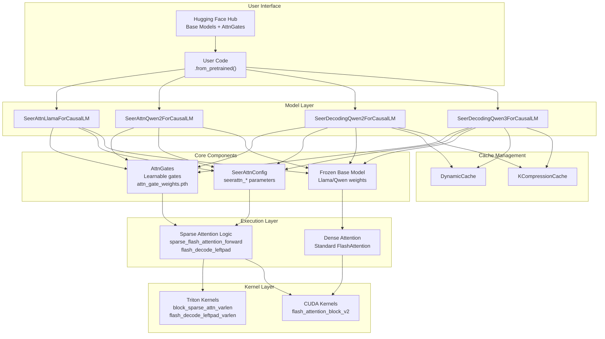
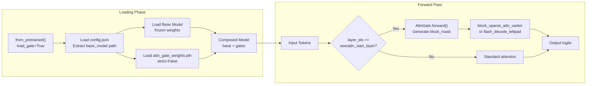
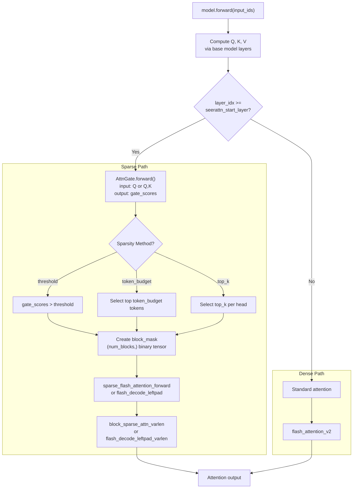

<!-- source: DeepWiki mcp.deepwiki.com · repo microsoft/SeerAttention · page 1 Home · fetched 2026-10-26 -->

# Home

<details>
<summary>Relevant source files</summary>

The following files were used as context for generating this wiki page:

- [README.md](README.md)
- [assets/SeerAttention-R.pdf](assets/SeerAttention-R.pdf)
- [assets/decode_acc.png](assets/decode_acc.png)
- [assets/efficiency_decode.png](assets/efficiency_decode.png)
- [assets/efficiency_prefill.png](assets/efficiency_prefill.png)
- [assets/seer.png](assets/seer.png)
- [assets/seerattention-r.png](assets/seerattention-r.png)
- [seer_attn/__init__.py](seer_attn/__init__.py)

</details>


## Purpose and Scope

This wiki documents the **SeerAttention** codebase, a sparse attention mechanism for Large Language Models (LLMs) that learns intrinsic sparsity patterns through self-distillation. This page provides an overview of the system architecture, key components, and how they interact. For installation and usage instructions, see [Getting Started](#2). For details on training AttnGates, see [Training and Distillation](#5). For evaluation benchmarks, see [Evaluation Framework](#7).

## What is SeerAttention?

SeerAttention is a trainable sparse attention mechanism that achieves faster inference while maintaining accuracy for:
- **Sparse Prefill**: Efficient processing of long input contexts (8k-131k tokens)
- **Sparse Decode (SeerAttention-R)**: Long-reasoning token generation with dynamic sparsity

The key innovation is **block-level sparse attention** controlled by lightweight **AttnGates** (66-503 MB) that are trained via self-distillation while keeping base model weights frozen. AttnGates learn to predict which attention blocks are important, enabling hardware-efficient sparse computation.

Sources: [README.md:1-28]()

## Core Concepts

### Self-Distillation Training

The training process keeps the base model frozen and only trains AttnGate parameters by minimizing the difference between:
- Dense attention output (from frozen base model)
- Sparse attention output (using learned gates)

This produces lightweight adapters that can be composed with any compatible base model at inference time.

### Block-Level Sparsity

Attention computation is organized into blocks (e.g., 64×64). AttnGates generate binary masks at block granularity, allowing entire blocks to be skipped. This aligns with hardware capabilities for efficient sparse computation.

### Sparsity Control Methods

Three methods control which blocks are activated:
- **threshold**: Activate blocks with gate scores above a threshold (e.g., 5e-4 to 5e-3)
- **token_budget**: Limit total attended tokens (e.g., 1k-8k tokens)
- **top_k**: Select top-k highest scoring blocks per head

Sources: [README.md:10-16](), [seer_attn/__init__.py:1-11]()

## System Architecture Overview



**Figure 1: High-Level System Architecture**

This diagram shows how user code loads models from Hugging Face Hub, which automatically compose AttnGates with base models. The models dispatch to sparse or dense attention based on configuration, with sparse paths using custom Triton/CUDA kernels.

Sources: [seer_attn/__init__.py:1-11](), [README.md:70-113]()

## Key Model Classes and Their Roles

| Model Class | Purpose | Base Architecture | Use Case |
|------------|---------|-------------------|----------|
| `SeerAttnLlamaForCausalLM` | Sparse prefill | Llama 3.1 | Long-context input (8k-131k tokens) |
| `SeerAttnQwen2ForCausalLM` | Sparse prefill | Qwen 2.5 | Long-context input (8k-131k tokens) |
| `SeerDecodingQwen2ForCausalLM` | Sparse decode | Qwen 2.5 | Long-reasoning generation |
| `SeerDecodingQwen3ForCausalLM` | Sparse decode | Qwen 3 | Long-reasoning generation |

### Prefill vs Decode Models

**Sparse Prefill Models** process long input sequences in parallel:
- Handle multiple query tokens simultaneously
- Use threshold or top_k sparsity methods
- Optimized for throughput on long contexts
- Located in `seer_attn/prefill_sparse/`

**Sparse Decode Models (SeerAttention-R)** generate tokens one at a time:
- Single query token per forward pass
- Use token_budget sparsity method
- Optimized for reasoning tasks (AIME, MATH, GPQA)
- Located in `seer_attn/decode_sparse/`

Sources: [seer_attn/__init__.py:1-11](), [README.md:32-54]()

## Component Interaction Flow



**Figure 2: Model Loading and Forward Pass Flow**

This diagram traces the code execution from loading a model to generating output. The `from_pretrained()` method automatically handles composition of base models with AttnGates, and the forward pass conditionally uses sparse attention based on layer index.

Sources: [README.md:70-113]()

## Configuration Parameters

Key configuration parameters in `SeerAttnQwen2Config` / `SeerAttnQwen3Config`:

| Parameter | Type | Description | Example Values |
|-----------|------|-------------|----------------|
| `base_model` | str | Path to base model on HF Hub | `"Qwen/Qwen3-4B"` |
| `seerattn_sparsity_method` | str | Sparsity selection method | `"threshold"`, `"token_budget"`, `"top_k"` |
| `seerattn_threshold` | float | Gate score threshold | `5e-4` to `5e-3` |
| `seerattn_token_budget` | int | Max attended tokens | `1024` to `8192` |
| `seerattn_gate_block_size` | int | Block size for sparsity | `64` |
| `seerattn_start_layer` | int | First layer to apply sparsity | `0` |
| `seerattn_gate_type` | str | Implementation mode | `"seer_sparse"`, `"seer_dense"`, `"oracle_sparse"` |

### Implementation Modes

- **seer_sparse**: Use learned AttnGates for sparse attention (default)
- **seer_dense**: Disable sparsity, use dense attention
- **oracle_sparse**: Use ground-truth importance scores (for ablation studies)

Sources: [README.md:70-113]()

## Available Pre-trained Models

### Sparse Decode (SeerAttention-R) AttnGates

| Base Model | HF Repository | AttnGates Size |
|------------|---------------|----------------|
| Qwen3-4B | `SeerAttention/SeerAttention-Decode-Qwen3-4B-AttnGates` | 66.1 MB |
| Qwen3-8B | `SeerAttention/SeerAttention-Decode-Qwen3-8B-AttnGates` | 66.1 MB |
| Qwen3-14B | `SeerAttention/SeerAttention-Decode-Qwen3-14B-AttnGates` | 83.9 MB |
| DeepSeek-R1-Distill-Qwen-14B | `SeerAttention/SeerAttention-Decode-R1-Distill-Qwen-14B-AttnGates` | 101 MB |

### Sparse Prefill AttnGates

| Base Model | HF Repository | AttnGates Size |
|------------|---------------|----------------|
| Llama-3.1-8B-Instruct | `SeerAttention/SeerAttention-Llama-3.1-8B-AttnGates` | 101 MB |
| Llama-3.1-70B-Instruct | `SeerAttention/SeerAttention-Llama-3.1-70B-AttnGates` | 503 MB |
| Qwen2.5-7B-Instruct | `SeerAttention/SeerAttention-Qwen2.5-7B-AttnGates` | 77 MB |
| Qwen2.5-14B-Instruct | `SeerAttention/SeerAttention-Qwen2.5-14B-AttnGates` | 189 MB |
| Qwen2.5-32B-Instruct | `SeerAttention/SeerAttention-Qwen2.5-32B-AttnGates` | 252 MB |

AttnGates are stored separately from base models on Hugging Face Hub. During loading, the system automatically:
1. Reads `config.json` from AttnGates repository
2. Extracts `base_model` path
3. Loads both base model and AttnGates
4. Composes them into a single model

Sources: [README.md:29-54]()

## Repository Structure

```
seer_attn/
├── prefill_sparse/          # Sparse prefill implementations
│   ├── llama/              # Llama architecture support
│   │   └── modeling_llama_seerattn.py  # SeerAttnLlamaForCausalLM
│   └── qwen/               # Qwen2 architecture support
│       └── modeling_qwen2_seerattn.py  # SeerAttnQwen2ForCausalLM
├── decode_sparse/           # Sparse decode implementations
│   ├── qwen2/              # Qwen2 decode support
│   │   └── modeling_qwen2_seerattn_inference.py  # SeerDecodingQwen2ForCausalLM
│   └── qwen3/              # Qwen3 decode support
│       └── modeling_qwen3_seerattn_inference.py  # SeerDecodingQwen3ForCausalLM
├── kernels/                 # Custom attention kernels
│   ├── triton/             # Triton kernel implementations
│   └── cuda/               # CUDA/CUTLASS implementations
├── train/                   # Training infrastructure
│   └── attn_gate_trainer.py  # Self-distillation trainer
└── utils/                   # Utilities and helpers

eval/                        # Evaluation framework
├── reasoning_tasks/         # AIME, MATH, GPQA benchmarks
├── long_context/           # PG19, LongBench, RULER benchmarks
└── efficiency/             # Speed and memory benchmarks

scripts/                     # Training and evaluation scripts
├── run_distillation_prefill.sh
└── run_distillation_decode.sh
```

**Key Files:**
- `seer_attn/__init__.py`: Exports main model classes
- Model files: Implement sparse attention logic for each architecture
- Kernel files: Provide GPU-optimized sparse attention implementations
- Training scripts: Self-distillation setup for AttnGates

Sources: [seer_attn/__init__.py:1-11]()

## Sparse Attention Execution Path



**Figure 3: Sparse vs Dense Attention Execution**

This diagram shows the conditional execution path within a forward pass. After a certain layer threshold, attention goes through the sparse path where AttnGates generate masks that control which attention blocks are computed.

Sources: [README.md:70-113]()

## Performance Characteristics

### Efficiency Gains

- **Prefill**: 2-3x speedup on long contexts with minimal accuracy loss
- **Decode**: Maintains reasoning accuracy while reducing computation
- **Memory**: Block-level sparsity reduces KV cache requirements

### Typical Sparsity Levels

| Task Type | Sparsity Method | Typical Sparsity | Sequence Length |
|-----------|----------------|------------------|-----------------|
| Long Context (PG19) | threshold=5e-4 | 60-90% sparse | 8k-131k tokens |
| Long Context (RULER) | threshold=5e-4 | 50-80% sparse | 4k-128k tokens |
| Reasoning (AIME) | token_budget=4096 | 70-85% sparse | Variable |
| Reasoning (MATH) | token_budget=2048 | 75-90% sparse | Variable |

Sources: [README.md:1-28]()

## Training Overview

AttnGates are trained via **self-distillation**:

1. **Setup**: Freeze base model weights, initialize small AttnGate networks
2. **Forward Pass**: 
   - Compute dense attention (teacher) using frozen base model
   - Compute sparse attention (student) using trainable gates
3. **Loss**: Minimize difference between sparse and dense outputs
4. **Result**: Lightweight AttnGates (66-503 MB) that predict important attention blocks

Training scripts are provided for both prefill and decode scenarios:
- `run_distillation_prefill.sh`: Train prefill AttnGates
- `run_distillation_decode.sh`: Train decode AttnGates

For detailed training instructions, see [Training and Distillation](#5).

Sources: [README.md:115-129]()

## Next Steps

- **To get started using SeerAttention**: See [Getting Started](#2)
- **To understand the core mechanism**: See [SeerAttention Mechanism](#3.1) and [AttnGates](#3.2)
- **To train your own AttnGates**: See [Training and Distillation](#5)
- **To evaluate on benchmarks**: See [Evaluation Framework](#7)
- **To understand kernel implementations**: See [Kernels and Performance](#6)

Sources: [README.md:1-174]()

---

