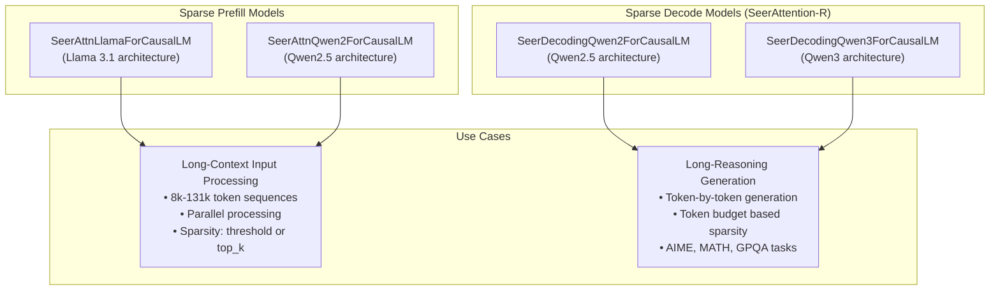
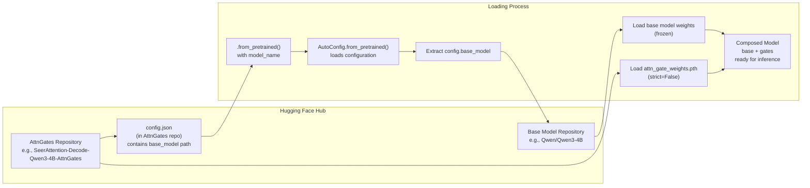
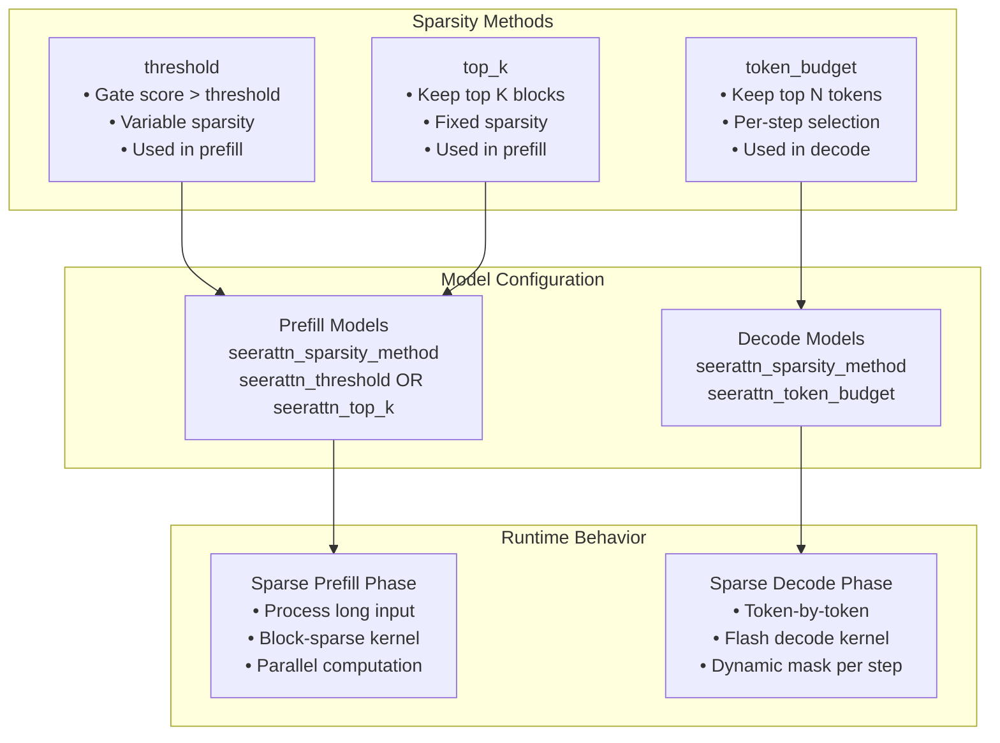

<!-- source: DeepWiki mcp.deepwiki.com · repo microsoft/SeerAttention · page 2 Getting Started · fetched 2026-10-26 -->

# Getting Started

<details>
<summary>Relevant source files</summary>

The following files were used as context for generating this wiki page:

- [README.md](README.md)
- [seer_attn/__init__.py](seer_attn/__init__.py)

</details>


This page provides a practical guide for installing and using SeerAttention models. It covers environment setup, loading pre-trained models from Hugging Face Hub, and running basic inference with both sparse prefill and sparse decode (SeerAttention-R) configurations.

For details on the underlying architecture and how components interact, see [Core Architecture](#3). For training your own AttnGates, see [Training and Distillation](#5). For comprehensive evaluation and benchmarking, see [Evaluation Framework](#7).

---

## Purpose and Scope

This document covers:
- Installing required dependencies
- Loading SeerAttention models from Hugging Face Hub
- Configuring sparsity parameters (threshold, token_budget, top_k)
- Running inference for sparse prefill (long-context input processing)
- Running inference for sparse decode (long-reasoning generation)
- Understanding the model composition process (base model + AttnGates)

---

## Installation

### Environment Setup

SeerAttention requires Python 3.11 and specific versions of PyTorch and related dependencies. The following commands create a conda environment and install all requirements:

```bash
conda create -yn seer python=3.11
conda activate seer
pip install torch==2.4.0
pip install -r requirements.txt
pip install flash-attn --no-build-isolation
pip install -e .
```

**Key Dependencies:**
- PyTorch 2.4.0 (for core tensor operations)
- Flash Attention (for efficient attention kernels)
- Transformers library (for model loading and AutoConfig interface)
- Triton (for custom sparse attention kernels)

The installation process compiles the package in editable mode, making the `seer_attn` module available for import.

**Sources:** [README.md:58-66]()

---

## Model Architecture Overview

SeerAttention provides four main model classes for different use cases:



**Sources:** [seer_attn/__init__.py:1-11](), [README.md:73-113]()

---

## Available Pre-trained Models

SeerAttention models are distributed via Hugging Face Hub as **AttnGates adapters**. These are lightweight (66 MB - 503 MB) and are composed with the original base models during loading.

### Sparse Decode Models (SeerAttention-R)

| Base Model | HF Repository | AttnGates Size | Use Case |
|------------|---------------|----------------|----------|
| Qwen3-4B | `SeerAttention/SeerAttention-Decode-Qwen3-4B-AttnGates` | 66.1 MB | Long-reasoning, token budget 1k-8k |
| Qwen3-8B | `SeerAttention/SeerAttention-Decode-Qwen3-8B-AttnGates` | 66.1 MB | Long-reasoning, token budget 1k-8k |
| Qwen3-14B | `SeerAttention/SeerAttention-Decode-Qwen3-14B-AttnGates` | 83.9 MB | Long-reasoning, token budget 1k-8k |
| DeepSeek-R1-Distill-Qwen-14B | `SeerAttention/SeerAttention-Decode-R1-Distill-Qwen-14B-AttnGates` | 101 MB | Long-reasoning, reasoning tasks |

### Sparse Prefill Models

| Base Model | HF Repository | AttnGates Size | Use Case |
|------------|---------------|----------------|----------|
| Llama-3.1-8B-Instruct | `SeerAttention/SeerAttention-Llama-3.1-8B-AttnGates` | 101 MB | Long-context prefill, threshold 5e-4 to 5e-3 |
| Llama-3.1-70B-Instruct | `SeerAttention/SeerAttention-Llama-3.1-70B-AttnGates` | 503 MB | Long-context prefill, large model |
| Qwen2.5-7B-Instruct | `SeerAttention/SeerAttention-Qwen2.5-7B-AttnGates` | 77 MB | Long-context prefill, threshold based |
| Qwen2.5-14B-Instruct | `SeerAttention/SeerAttention-Qwen2.5-14B-AttnGates` | 189 MB | Long-context prefill |
| Qwen2.5-32B-Instruct | `SeerAttention/SeerAttention-Qwen2.5-32B-AttnGates` | 252 MB | Long-context prefill |

**Sources:** [README.md:29-54]()

---

## Model Loading Process

The following diagram shows how models are composed from separate base model and AttnGates components:



**Key Concept:** The AttnGates repository's `config.json` contains a `base_model` field that references the original model (e.g., `"Qwen/Qwen3-4B"`). During `.from_pretrained()`, the system automatically loads both the base model and the gate weights, composing them into a single model ready for sparse inference.

**Sources:** [README.md:70-113]()

---

## Basic Inference: Sparse Decode (SeerAttention-R)

Sparse decode models are designed for long-reasoning token generation with token budget-based sparsity control.

### Code Example

```python
from transformers import AutoTokenizer, AutoConfig
from seer_attn import SeerDecodingQwen3ForCausalLM
import torch

# Load AttnGates and compose with base model
model_name = "SeerAttention/SeerAttention-Decode-Qwen3-4B-AttnGates"
config = AutoConfig.from_pretrained(model_name)

# Tokenizer from base model
tokenizer = AutoTokenizer.from_pretrained(
    config.base_model,  # e.g., "Qwen/Qwen3-4B"
    padding_side="left",
)

# Load model with token budget sparsity
model = SeerDecodingQwen3ForCausalLM.from_pretrained(
    model_name,
    torch_dtype=torch.bfloat16,
    seerattn_sparsity_method='token_budget',  # Token budget method
    seerattn_token_budget=4096,  # Keep top 4096 tokens per attention
).cuda()

# Ready for inference
# model.generate(...) will use sparse attention
```

### Configuration Parameters for Decode Models

| Parameter | Type | Description | Typical Values |
|-----------|------|-------------|----------------|
| `seerattn_sparsity_method` | str | Method for sparsity selection | `'token_budget'`, `'threshold'` |
| `seerattn_token_budget` | int | Number of tokens to keep per attention | 1024, 2048, 4096, 8192 |
| `seerattn_threshold` | float | Threshold for attention scores (alternative) | 1e-4 to 1e-3 |
| `torch_dtype` | dtype | Model precision | `torch.bfloat16`, `torch.float16` |

**Token Budget Method:** For each query token, the AttnGate selects the top K tokens (where K = `seerattn_token_budget`) to attend to, based on learned importance scores. This provides predictable memory and compute patterns during generation.

**Sources:** [README.md:80-94]()

---

## Basic Inference: Sparse Prefill

Sparse prefill models are designed for efficiently processing long input contexts using threshold-based or top-k sparsity.

### Code Example

```python
from transformers import AutoTokenizer, AutoConfig
from seer_attn import SeerAttnLlamaForCausalLM
import torch

# Load AttnGates and compose with base model
model_name = "SeerAttention/SeerAttention-Llama-3.1-8B-AttnGates"
config = AutoConfig.from_pretrained(model_name)

# Tokenizer from base model
tokenizer = AutoTokenizer.from_pretrained(
    config.base_model,  # e.g., "meta-llama/Llama-3.1-8B-Instruct"
    padding_side="left",
)

# Load model with threshold-based sparsity
model = SeerAttnLlamaForCausalLM.from_pretrained(
    model_name,
    torch_dtype=torch.bfloat16,
    seerattn_sparsity_method='threshold',  # Threshold method
    seerattn_threshold=5e-4,  # Higher = sparser (5e-4 to 5e-3)
).cuda()

# Ready for inference on long contexts
# model.generate(...) will use sparse attention during prefill
```

### Alternative: Top-K Sparsity

```python
# Using top_k method instead of threshold
model = SeerAttnLlamaForCausalLM.from_pretrained(
    model_name,
    torch_dtype=torch.bfloat16,
    seerattn_sparsity_method='top_k',
    seerattn_top_k=512,  # Keep top 512 blocks per query
).cuda()
```

### Configuration Parameters for Prefill Models

| Parameter | Type | Description | Typical Values |
|-----------|------|-------------|----------------|
| `seerattn_sparsity_method` | str | Method for sparsity selection | `'threshold'`, `'top_k'` |
| `seerattn_threshold` | float | Threshold for gate scores | 5e-4 (less sparse) to 5e-3 (more sparse) |
| `seerattn_top_k` | int | Number of blocks to keep per query | 256, 512, 1024 |
| `torch_dtype` | dtype | Model precision | `torch.bfloat16`, `torch.float16` |

**Threshold Method:** Gate scores below the threshold are masked out. Higher threshold = sparser attention = faster but potentially lower quality.

**Top-K Method:** For each query, keep only the top K blocks with highest gate scores. Provides more predictable sparsity levels.

**Sources:** [README.md:96-113]()

---

## Sparsity Method Selection

The following diagram shows how different sparsity methods are used across model types:



**Sources:** [README.md:73-113]()

---

## Verification and Testing

After loading a model, you can verify it's working correctly:

```python
# Simple generation test
inputs = tokenizer("What is the capital of France?", return_tensors="pt").to("cuda")
outputs = model.generate(
    **inputs,
    max_new_tokens=50,
    do_sample=False,
)
print(tokenizer.decode(outputs[0], skip_special_tokens=True))
```

### Expected Behavior

1. **Model Composition:** During `.from_pretrained()`, you should see loading messages for both the base model and AttnGates.
2. **Memory Usage:** Memory consumption should be similar to the base model (gates add minimal overhead).
3. **Generation Speed:** Sparse models should be faster than dense baselines, especially for long contexts.
4. **Output Quality:** For typical sparsity settings (threshold=5e-4 for prefill, token_budget=4096 for decode), output quality should be very close to the dense baseline.

---

## Common Configuration Patterns

### Pattern 1: Maximum Speed (Higher Sparsity)

```python
# Prefill: More aggressive sparsity
model = SeerAttnLlamaForCausalLM.from_pretrained(
    model_name,
    seerattn_sparsity_method='threshold',
    seerattn_threshold=5e-3,  # Higher threshold = more sparse
)

# Decode: Lower token budget
model = SeerDecodingQwen3ForCausalLM.from_pretrained(
    model_name,
    seerattn_sparsity_method='token_budget',
    seerattn_token_budget=2048,  # Lower budget = more sparse
)
```

### Pattern 2: Maximum Quality (Lower Sparsity)

```python
# Prefill: Conservative sparsity
model = SeerAttnLlamaForCausalLM.from_pretrained(
    model_name,
    seerattn_sparsity_method='threshold',
    seerattn_threshold=5e-4,  # Lower threshold = less sparse
)

# Decode: Higher token budget
model = SeerDecodingQwen3ForCausalLM.from_pretrained(
    model_name,
    seerattn_sparsity_method='token_budget',
    seerattn_token_budget=8192,  # Higher budget = less sparse
)
```

### Pattern 3: Predictable Sparsity

```python
# Using top_k for consistent sparsity level
model = SeerAttnLlamaForCausalLM.from_pretrained(
    model_name,
    seerattn_sparsity_method='top_k',
    seerattn_top_k=512,  # Always keep exactly 512 blocks
)
```

**Sources:** [README.md:73-113]()

---

## Next Steps

After successfully loading and testing a model, you can:

1. **Understand the Architecture:** See [Core Architecture](#3) for details on how SeerAttention works internally, including the role of AttnGates and block-level sparsity.

2. **Run Evaluations:** See [Evaluation Framework](#7) for comprehensive benchmarking on reasoning tasks, long-context benchmarks, and efficiency measurements.

3. **Train Custom AttnGates:** See [Training and Distillation](#5) for instructions on training AttnGates for your own models or custom datasets.

4. **Optimize Performance:** See [Kernels and Performance](#6) for details on the underlying Triton and CUDA kernels, and how to optimize for your hardware.

5. **Explore Model Variants:** See [Model Implementations](#4) for detailed documentation on each model class and their specific configurations.

---

## Troubleshooting

### Issue: CUDA Out of Memory

**Solution:** Reduce batch size or use higher sparsity (higher threshold / lower token budget).

### Issue: Model Loading Fails

**Solution:** Ensure both the base model and AttnGates are accessible from Hugging Face Hub. Check internet connection and HF authentication.

### Issue: Slow Inference Despite Sparsity

**Solution:** Verify that custom kernels are being used. Check that flash-attn is properly installed. Some sparsity configurations may not provide speedup if sparsity is too low.

### Issue: Poor Output Quality

**Solution:** Reduce sparsity (lower threshold / higher token budget). Some tasks may require higher attention density.

**Sources:** [README.md:56-113]()

---

