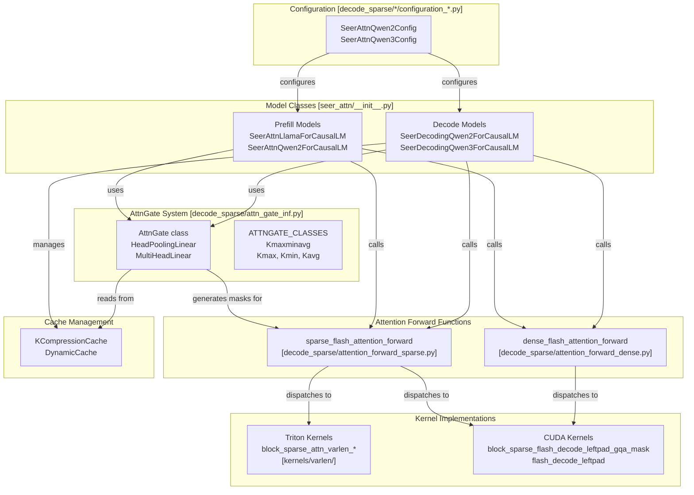
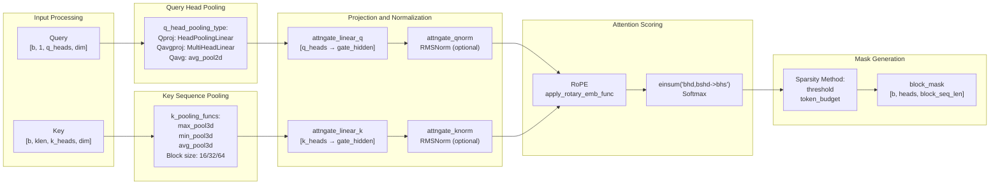
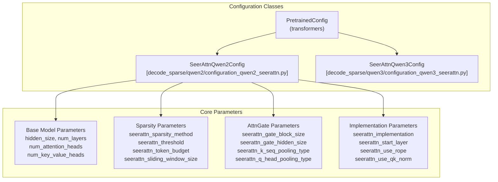
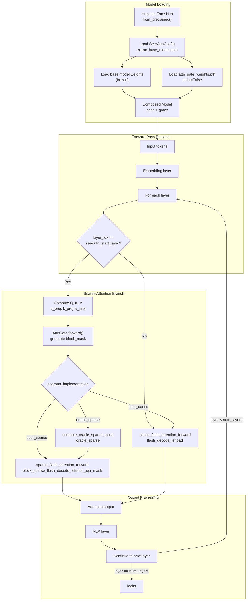
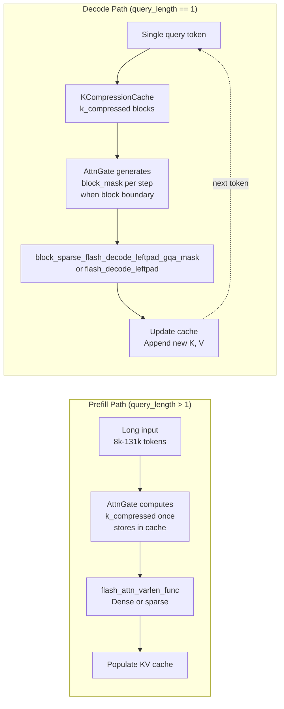

<!-- source: DeepWiki mcp.deepwiki.com · repo microsoft/SeerAttention · page 3 Core Architecture · fetched 2026-10-26 -->

# Core Architecture

<details>
<summary>Relevant source files</summary>

The following files were used as context for generating this wiki page:

- [README.md](README.md)
- [seer_attn/__init__.py](seer_attn/__init__.py)
- [seer_attn/decode_sparse/attention_forward_dense.py](seer_attn/decode_sparse/attention_forward_dense.py)
- [seer_attn/decode_sparse/attention_forward_sparse.py](seer_attn/decode_sparse/attention_forward_sparse.py)
- [seer_attn/decode_sparse/attn_gate_inf.py](seer_attn/decode_sparse/attn_gate_inf.py)
- [seer_attn/decode_sparse/qwen2/configuration_qwen2_seerattn.py](seer_attn/decode_sparse/qwen2/configuration_qwen2_seerattn.py)

</details>


## Purpose and Scope

This document provides a high-level overview of the SeerAttention system architecture, describing the main components and how they interact to enable sparse attention in large language models. The architecture supports two primary use cases: **sparse prefill** for efficient long-context input processing, and **sparse decode** (SeerAttention-R) for long-reasoning token generation.

For detailed information about specific components, see:
- Sparse attention mechanism details: [SeerAttention Mechanism](#3.1)
- AttnGate internals: [AttnGates](#3.2)
- Sparsity control methods: [Sparsity Methods](#3.3)
- Cache implementation: [Cache Management](#3.4)

For model-specific documentation, see [Model Implementations](#4).

## System Overview

SeerAttention is built on a modular architecture that separates concerns across several layers:

1. **Model Layer**: Provides specialized model classes that extend standard transformers with sparse attention capabilities
2. **AttnGate Layer**: Generates learned sparse masks using lightweight adapters (66-503 MB)
3. **Attention Interface Layer**: Dispatches to appropriate sparse or dense attention implementations
4. **Kernel Layer**: Provides high-performance implementations in Triton and CUDA
5. **Cache Layer**: Manages KV cache with optional compression for decode operations

The key architectural innovation is the **separation of AttnGates from base model weights**, enabling lightweight adaptation without full model retraining. AttnGates are stored separately on Hugging Face Hub and automatically composed with base models during inference.

### Component Hierarchy



**Sources:** [seer_attn/__init__.py:1-11](), [seer_attn/decode_sparse/attn_gate_inf.py:110-299](), [seer_attn/decode_sparse/attention_forward_sparse.py:111-163](), [seer_attn/decode_sparse/attention_forward_dense.py:110-156]()

## Main Architectural Components

### Model Classes

The system provides four main model classes, each serving distinct use cases:

| Model Class | Base Architecture | Use Case | Implementation Mode |
|-------------|------------------|----------|---------------------|
| `SeerAttnLlamaForCausalLM` | Llama 3.1 | Sparse prefill for long contexts | Threshold or TopK sparsity |
| `SeerAttnQwen2ForCausalLM` | Qwen 2.5 | Sparse prefill for long contexts | Threshold or TopK sparsity |
| `SeerDecodingQwen2ForCausalLM` | Qwen 2.5 | Sparse decode (SeerAttention-R) | Token budget sparsity |
| `SeerDecodingQwen3ForCausalLM` | Qwen 3 | Sparse decode (SeerAttention-R) | Token budget sparsity |

**Prefill models** are optimized for processing long input sequences (8k-131k tokens) in parallel, using block-sparse attention patterns determined by learned gates. **Decode models** operate token-by-token during generation, dynamically selecting which KV cache blocks to attend to based on learned importance scores.

All models are registered in [seer_attn/__init__.py:1-11]() and follow a consistent interface pattern:

```python
model = SeerDecodingQwen3ForCausalLM.from_pretrained(
    model_name,
    torch_dtype=torch.bfloat16,
    seerattn_sparsity_method='token_budget',  # or 'threshold'
    seerattn_token_budget=4096,
)
```

**Sources:** [seer_attn/__init__.py:1-11](), [README.md:74-113]()

### AttnGate System

The AttnGate system consists of lightweight neural networks that learn to predict which blocks of the KV cache are important for attention computation. The core class is `AttnGate`, with several automatically generated variants:

#### AttnGate Architecture



**Sources:** [seer_attn/decode_sparse/attn_gate_inf.py:110-256]()

The `AttnGate` class at [seer_attn/decode_sparse/attn_gate_inf.py:110-256]() implements this architecture with configurable pooling strategies:

- **Query Head Pooling** (`q_head_pooling_type`): Reduces query heads from `num_q_head` to `num_k_head` using `HeadPoolingLinear` [63-85](), `MultiHeadLinear` [87-109](), or average pooling
- **Key Sequence Pooling** (`k_pooling_funcs`): Reduces key sequence length by pooling blocks (max/min/avg) at [259-263]()
- **Projection**: Maps to `gate_hidden_size` (64/128/256) via learned linear layers
- **Normalization**: Optional RMSNorm for Q and K gate embeddings when `use_qk_norm=True`
- **Positional Encoding**: Optional RoPE application when `seerattn_use_rope=True`

The system auto-generates specialized `AttnGate` classes for different pooling combinations via `generate_combinations()` at [287-298](), creating classes like `Kmaxminavg`, `Kmax`, `Kmin`, etc.

**Sources:** [seer_attn/decode_sparse/attn_gate_inf.py:63-298]()

### Attention Forward Mechanisms

The system implements two attention forward paths that share similar interfaces but differ in kernel dispatch:

#### Sparse Attention Forward

`sparse_flash_attention_forward` at [seer_attn/decode_sparse/attention_forward_sparse.py:111-163]() handles block-sparse attention:

- **Prefill path** (query_length > 1): Uses standard `flash_attn_varlen_func` with dense attention [124-148]()
- **Decode path** (query_length == 1): Uses `block_sparse_flash_decode_leftpad_gqa_mask` with block-level sparsity [150-161]()

#### Dense Attention Forward

`dense_flash_attention_forward` at [seer_attn/decode_sparse/attention_forward_dense.py:110-156]() provides dense baseline:

- **Prefill path**: Uses `flash_attn_varlen_func` [121-145]()
- **Decode path**: Uses `flash_decode_leftpad` for efficient decode without sparsity [147-155]()

Both functions share the `_upad_input` helper at [39-109]() for handling variable-length sequences with padding removal.

**Sources:** [seer_attn/decode_sparse/attention_forward_sparse.py:39-163](), [seer_attn/decode_sparse/attention_forward_dense.py:38-156]()

### Configuration System

Configuration is managed through specialized config classes that extend `PretrainedConfig`:



**Sources:** [seer_attn/decode_sparse/qwen2/configuration_qwen2_seerattn.py:25-139]()

Key configuration parameters from [seer_attn/decode_sparse/qwen2/configuration_qwen2_seerattn.py:68-82]():

| Parameter | Valid Values | Purpose |
|-----------|-------------|---------|
| `seerattn_sparsity_method` | `threshold`, `token_budget` | Controls sparsity selection method |
| `seerattn_threshold` | float (e.g., 5e-4 to 5e-3) | Threshold for mask generation |
| `seerattn_token_budget` | int (e.g., 1024-8192) | Maximum tokens to attend to |
| `seerattn_gate_block_size` | 16, 32, 64 | Block granularity for sparse masks |
| `seerattn_gate_hidden_size` | 64, 128, 256 | Hidden dimension for gate networks |
| `seerattn_implementation` | `seer_sparse`, `seer_dense`, `oracle_sparse` | Attention implementation mode |
| `seerattn_start_layer` | int | First layer to apply sparse attention |

**Sources:** [seer_attn/decode_sparse/qwen2/configuration_qwen2_seerattn.py:46-139]()

## Component Interaction Patterns

### Inference Data Flow

The following diagram traces the execution flow from model loading through sparse attention computation:



**Sources:** [README.md:70-113](), [seer_attn/decode_sparse/attn_gate_inf.py:152-256]()

### Prefill vs Decode Execution Paths

The system handles prefill (multi-token input) and decode (single-token generation) differently:



**Sources:** [seer_attn/decode_sparse/attn_gate_inf.py:166-256](), [seer_attn/decode_sparse/attention_forward_sparse.py:111-163]()

**Key Differences:**

1. **Prefill** [seer_attn/decode_sparse/attn_gate_inf.py:231-256]():
   - Processes entire sequence at once
   - Computes compressed keys once via pooling
   - Stores `k_compressed` and `k_remainder` in cache
   - Can use dense attention (sparsity applied at training time)

2. **Decode** [seer_attn/decode_sparse/attn_gate_inf.py:166-230]():
   - Processes one token at a time (`is_decode = k.shape[1] == 1`)
   - Updates cache incrementally
   - Computes new block mask only at block boundaries (`max_cache_len % self.block_size == 0`)
   - Uses specialized decode kernels with left-padding support
   - Mask generation at [224-229](): applies threshold or token budget, ensures last block is always attended

## Design Philosophy

The SeerAttention architecture embodies several key design principles:

### 1. Separation of Concerns

**AttnGates are decoupled from base models**: Gates are stored as separate 66-503 MB files on Hugging Face Hub, while base models remain unchanged. This allows:
- Training gates without retraining the full model
- Mixing different gates with the same base model
- Easy distribution and version control

### 2. Block-Level Granularity

**Sparsity operates at block level (16/32/64 tokens)** rather than individual tokens:
- Hardware-efficient: aligns with GPU warp sizes and memory access patterns
- Reduces overhead: fewer mask decisions needed
- Maintains semantic coherence: keeps related tokens together

### 3. Dual-Mode Operation

**Prefill and decode have distinct implementations**:
- Prefill: optimized for parallel processing of long sequences
- Decode: optimized for token-by-token generation with incremental updates
- Shared AttnGates work across both modes

### 4. Flexible Sparsity Control

**Multiple sparsity methods** at [seer_attn/decode_sparse/qwen2/configuration_qwen2_seerattn.py:68]():
- `threshold`: Fixed sparsity level based on attention score cutoff
- `token_budget`: Fixed number of tokens to attend to (useful for decode)
- Implementation modes (`seer_sparse`, `seer_dense`, `oracle_sparse`) enable ablation studies

### 5. Layered Kernel Abstractions

**Attention interface → Triton/CUDA kernels**:
- High-level interface in Python for model code
- Multiple kernel backends (Triton, CUDA/CUTLASS) for different hardware profiles
- Automatic dispatch based on sequence length and sparsity mode

### 6. Cache-Aware Design

**KCompressionCache** stores both:
- Original K/V cache for attention computation
- Compressed K blocks (`k_compressed`) for gate scoring
- Remainder blocks (`k_remainder`) for partial blocks

This dual storage enables efficient gate computation without recomputing pooling operations at every decode step.

**Sources:** [README.md:30-31](), [seer_attn/decode_sparse/qwen2/configuration_qwen2_seerattn.py:46-139](), [seer_attn/decode_sparse/attn_gate_inf.py:186-205]()

## File Organization

The codebase follows a clear modular structure:

```
seer_attn/
├── __init__.py                    # Model class exports
├── prefill_sparse/
│   ├── llama/
│   │   └── modeling_llama_seerattn.py
│   └── qwen/
│       └── modeling_qwen2_seerattn.py
├── decode_sparse/
│   ├── attn_gate_inf.py           # AttnGate implementation
│   ├── attention_forward_dense.py  # Dense attention path
│   ├── attention_forward_sparse.py # Sparse attention path
│   ├── qwen2/
│   │   ├── configuration_qwen2_seerattn.py
│   │   └── modeling_qwen2_seerattn_inference.py
│   └── qwen3/
│       ├── configuration_qwen3_seerattn.py
│       └── modeling_qwen3_seerattn_inference.py
├── kernels/
│   └── varlen/
│       ├── block_sparse_attn_varlen_*.py  # Triton kernels
│       └── block_sparse_flash_decode_varlen_mask_leftpad.py  # CUDA kernels
└── modules/
    └── common.py                  # Shared utilities (RMSNorm, repeat_kv, etc.)
```

This structure separates:
- **Prefill vs decode** implementations
- **Model-specific** code (Llama, Qwen2, Qwen3)
- **Attention mechanisms** from model classes
- **Kernel implementations** from Python interfaces

**Sources:** [seer_attn/__init__.py:1-11]()

---

