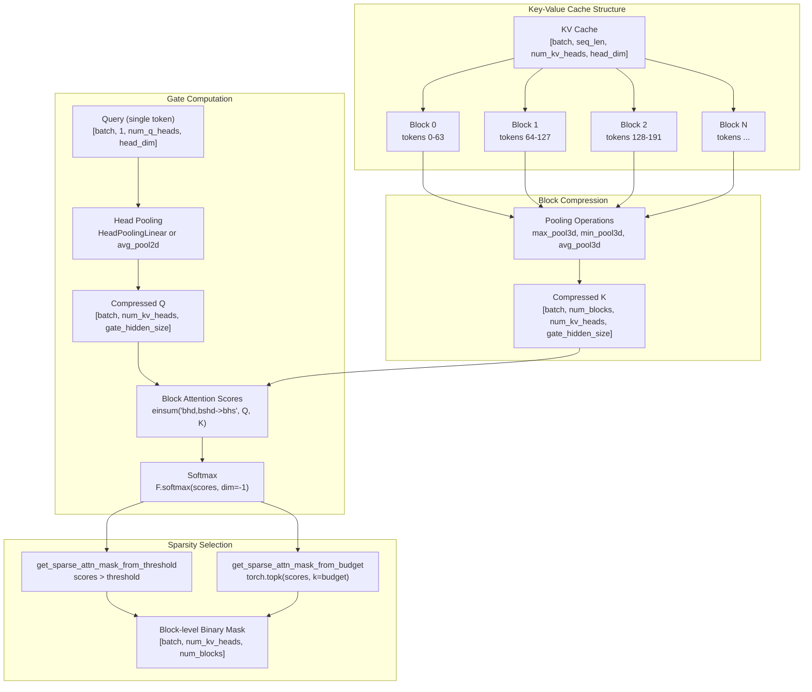
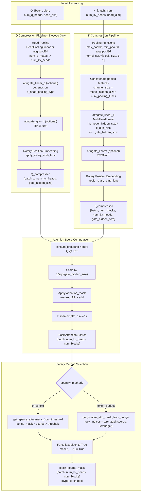
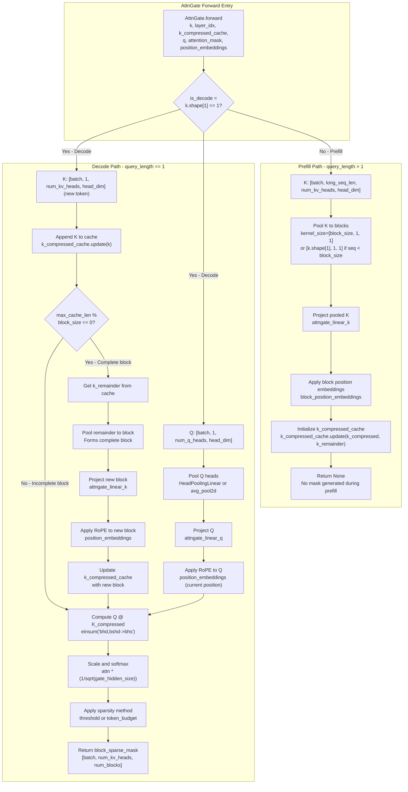
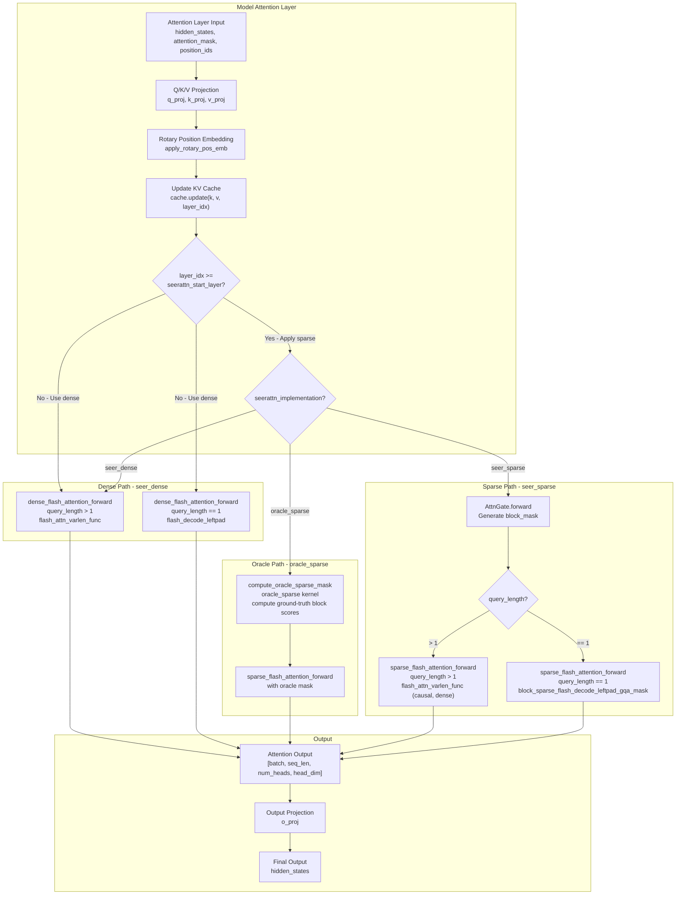

<!-- source: DeepWiki mcp.deepwiki.com · repo microsoft/SeerAttention · page 3.1 SeerAttention Mechanism · fetched 2026-10-26 -->

# SeerAttention Mechanism

<details>
<summary>Relevant source files</summary>

The following files were used as context for generating this wiki page:

- [README.md](README.md)
- [seer_attn/__init__.py](seer_attn/__init__.py)
- [seer_attn/decode_sparse/attention_forward_dense.py](seer_attn/decode_sparse/attention_forward_dense.py)
- [seer_attn/decode_sparse/attention_forward_sparse.py](seer_attn/decode_sparse/attention_forward_sparse.py)
- [seer_attn/decode_sparse/attn_gate_inf.py](seer_attn/decode_sparse/attn_gate_inf.py)
- [seer_attn/decode_sparse/qwen2/configuration_qwen2_seerattn.py](seer_attn/decode_sparse/qwen2/configuration_qwen2_seerattn.py)

</details>


## Purpose and Scope

This document explains the core sparse attention mechanism in SeerAttention: how block-level sparsity is computed, how attention gates generate sparse masks, and the computational flow during inference. For details on the AttnGate architecture and training process, see [AttnGates](#3.2). For information on sparsity control parameters (threshold, token budget, top-k), see [Sparsity Methods](#3.3). For cache management systems used with sparse attention, see [Cache Management](#3.4).

## Overview

SeerAttention implements **learned block-level sparse attention** that dynamically determines which blocks of the key-value cache to attend to during inference. Unlike dense attention that computes attention over all tokens, SeerAttention uses lightweight **AttnGates** to predict attention importance at the block level, then computes attention only on selected blocks. This mechanism achieves significant computational savings while maintaining model accuracy.

The system operates in two distinct modes:
- **Sparse Prefill**: Processes long input contexts efficiently using threshold or top-k based block selection
- **Sparse Decode**: Generates tokens one-by-one using token budget-based block selection

**Key Components:**

| Component | Purpose | Location |
|-----------|---------|----------|
| `AttnGate` | Generates block-level sparse masks | [seer_attn/decode_sparse/attn_gate_inf.py:110-256]() |
| `sparse_flash_attention_forward` | Executes sparse attention computation | [seer_attn/decode_sparse/attention_forward_sparse.py:111-162]() |
| `block_sparse_flash_decode_leftpad_gqa_mask` | CUDA kernel for sparse decode | Referenced in [seer_attn/decode_sparse/attention_forward_sparse.py:151]() |
| Sparsity methods | Convert gate scores to binary masks | [seer_attn/decode_sparse/attn_gate_inf.py:21-42]() |

**Sources:** [README.md:8-15](), [seer_attn/decode_sparse/attn_gate_inf.py:110-256]()

## Block-Level Sparsity Architecture

SeerAttention operates at **block granularity** rather than token granularity. The key-value cache is divided into fixed-size blocks (typically 16, 32, or 64 tokens per block), and attention masks are computed at the block level.



**Block Size Configuration:**

The block size is configurable via `seerattn_gate_block_size` parameter, with supported values of 16, 32, or 64 tokens. The block size must be chosen at training time and remain consistent during inference.

```python
# From configuration
seerattn_gate_block_size = 64  # tokens per block
```

**Hardware Alignment:** Block-level sparsity aligns with GPU memory access patterns and enables efficient kernel implementations. Entire blocks can be skipped during attention computation, resulting in actual speedups rather than just theoretical FLOP reductions.

**Sources:** [seer_attn/decode_sparse/attn_gate_inf.py:110-256](), [seer_attn/decode_sparse/qwen2/configuration_qwen2_seerattn.py:77-78]()

## Attention Gate Computation Flow

The `AttnGate` module is the core component that generates block-level sparse masks. It operates differently during prefill (query_length > 1) and decode (query_length == 1) phases.



**Key Implementation Details:**

| Component | Purpose | Configuration |
|-----------|---------|---------------|
| `k_pooling_funcs` | Extract block-level features from K | `['max', 'min', 'avg']` combinations |
| `q_head_pooling_type` | Reduce Q heads to match KV heads | `'Qproj'`, `'Qavgproj'`, `'Qavg'`, `'Qorig'` |
| `gate_hidden_size` | Dimensionality of compressed representations | 64, 128, or 256 |
| `use_qk_norm` | Apply RMSNorm before attention computation | Boolean flag |
| `use_flash_rope` | Use Flash Attention's RoPE implementation | Boolean flag |

**Q Head Pooling Types:**
- `'Qproj'`: Uses `HeadPoolingLinear` to learn per-head projection from Q heads to KV heads
- `'Qavgproj'`: Averages Q heads then projects with `MultiHeadLinear`
- `'Qavg'`: Simple average pooling over Q heads, no learned projection
- `'Qorig'`: Uses original Q heads without pooling (only for GQA compatibility)

**Sources:** [seer_attn/decode_sparse/attn_gate_inf.py:110-256](), [seer_attn/decode_sparse/attn_gate_inf.py:63-109](), [seer_attn/decode_sparse/qwen2/configuration_qwen2_seerattn.py:72-79]()

## Prefill vs Decode Operational Modes

The `AttnGate.forward` method operates in two fundamentally different modes based on sequence length, optimized for the computational patterns of prefill and decode phases.



**Prefill Mode Characteristics:**
- **Input:** Full sequence K without Q (Q not needed during prefill initialization)
- **Computation:** Pools entire K sequence into blocks, projects and stores in cache
- **Output:** Returns `None` - no mask generated, just cache initialization
- **Purpose:** Prepare the compressed block cache for subsequent decode steps
- **Code:** [seer_attn/decode_sparse/attn_gate_inf.py:231-255]()

**Decode Mode Characteristics:**
- **Input:** Single token K and Q
- **Computation:** 
  - Appends new K token to cache
  - Every `block_size` tokens, forms a complete block by pooling remainder
  - Computes attention between compressed Q and all compressed K blocks
- **Output:** Returns block-level binary mask for sparse attention
- **Purpose:** Dynamically select which blocks to attend to for current token
- **Code:** [seer_attn/decode_sparse/attn_gate_inf.py:168-230]()

**Block Completion Logic:**

During decode, the cache accumulates tokens in a "remainder" buffer. When `max_cache_len % block_size == 0`, the remainder forms a complete block:

1. Retrieve remainder: `k_remainder = k_compressed_cache.get_k_remainder(layer_idx)` [seer_attn/decode_sparse/attn_gate_inf.py:189]()
2. Pool to single block: `kernel_size=[self.block_size, 1, 1]` [seer_attn/decode_sparse/attn_gate_inf.py:190]()
3. Project and add to compressed cache [seer_attn/decode_sparse/attn_gate_inf.py:192-204]()

**Sources:** [seer_attn/decode_sparse/attn_gate_inf.py:152-256]()

## Sparsity Method Selection

After computing block attention scores, SeerAttention converts soft attention scores into hard binary masks using one of two methods configured by `seerattn_sparsity_method`.

**Threshold-Based Sparsity:**

```python
def get_sparse_attn_mask_from_threshold(x, threshold):
    dense_mask = x > threshold 
    return dense_mask
```

- **Parameter:** `seerattn_threshold` (typical range: 5e-4 to 5e-3)
- **Behavior:** Selects all blocks with attention score above threshold
- **Use case:** Prefill mode, variable sparsity based on content
- **Code:** [seer_attn/decode_sparse/attn_gate_inf.py:21-23]()

**Token Budget-Based Sparsity:**

```python
def get_sparse_attn_mask_from_budget(x, block_budget, block_attention_mask):
    if block_seq_len <= block_budget:
        return torch.ones_like(x, dtype=torch.bool) & block_attention_mask
    
    k = block_budget
    _, topk_indices = torch.topk(x, k=k, dim=-1, sorted=False)
    mask = torch.zeros_like(x, dtype=torch.bool)
    mask.scatter_(-1, topk_indices, True)
    return mask & block_attention_mask
```

- **Parameter:** `seerattn_token_budget` (typical range: 1024 to 8192 tokens)
- **Conversion:** `block_budget = token_budget / block_size`
- **Behavior:** Selects exactly top-k blocks by attention score
- **Use case:** Decode mode, fixed computational budget
- **Code:** [seer_attn/decode_sparse/attn_gate_inf.py:25-42]()

**Last Block Special Handling:**

Both methods force the last block (most recent tokens) to always be attended:

```python
mask[:, :, -1] = True
```

This ensures the model always has access to the most recent context, which is critical for maintaining coherence during generation.

**Sources:** [seer_attn/decode_sparse/attn_gate_inf.py:21-42](), [seer_attn/decode_sparse/attn_gate_inf.py:228]()

## Implementation Modes

SeerAttention supports three implementation modes configured via `seerattn_implementation`, enabling ablation studies and comparisons.

| Mode | Description | Use Case | Sparsity Source |
|------|-------------|----------|-----------------|
| `seer_sparse` | Full sparse attention with learned gates | Production inference | AttnGate predictions |
| `seer_dense` | Dense attention, gates computed but ignored | Accuracy baseline | N/A (no sparsity) |
| `oracle_sparse` | Sparse attention with ground-truth masks | Upper-bound analysis | Ground-truth attention weights |

**seer_sparse (Default):**

Uses learned `AttnGate` to predict block importance and applies sparse attention kernels.

- Configuration: `seerattn_implementation='seer_sparse'`
- Forward function: `sparse_flash_attention_forward` [seer_attn/decode_sparse/attention_forward_sparse.py:111-162]()
- Kernel: `block_sparse_flash_decode_leftpad_gqa_mask` [seer_attn/decode_sparse/attention_forward_sparse.py:151]()

**seer_dense (Baseline):**

Computes `AttnGate` predictions but does not apply sparsity, using standard dense attention instead. Useful for measuring accuracy loss from sparsity.

- Configuration: `seerattn_implementation='seer_dense'`
- Forward function: `dense_flash_attention_forward` [seer_attn/decode_sparse/attention_forward_dense.py:110-155]()
- Kernel: `flash_decode_leftpad` (standard Flash Attention) [seer_attn/decode_sparse/attention_forward_dense.py:148]()

**oracle_sparse (Upper Bound):**

Computes true attention weights using `oracle_sparse` kernel, then applies sparsity methods to the ground-truth scores. This provides an upper bound on what learned gates could achieve.

```python
def compute_oracle_sparse_mask(q, k, cache_seqlens, block_attention_mask, 
                                block_size, sparsity_method, threshold, block_budget):
    attn_weights = oracle_sparse(q, k, cache_seqlens, block_size)
    
    if sparsity_method == "token_budget":
        block_sparse_mask = get_sparse_attn_mask_from_budget(
            attn_weights, block_budget, block_attention_mask
        )
    elif sparsity_method == "threshold":
        block_sparse_mask = get_sparse_attn_mask_from_threshold(
            attn_weights, threshold
        )
    
    block_sparse_mask[:, :, -1] = True
    return block_sparse_mask
```

- Configuration: `seerattn_implementation='oracle_sparse'`
- Mask computation: [seer_attn/decode_sparse/attn_gate_inf.py:44-60]()
- Forward function: Same as `seer_sparse` but with oracle-computed masks

**Sources:** [seer_attn/decode_sparse/qwen2/configuration_qwen2_seerattn.py:79](), [seer_attn/decode_sparse/attn_gate_inf.py:44-60]()

## Integration with Flash Attention

SeerAttention integrates with Flash Attention by generating block-level sparse masks that are passed to custom sparse kernels. The integration differs between prefill and decode phases.



**Key Integration Points:**

1. **Layer Selection:** Only layers with `layer_idx >= seerattn_start_layer` use sparse attention. Earlier layers use standard dense attention for stability. [seer_attn/decode_sparse/qwen2/configuration_qwen2_seerattn.py:80]()

2. **Prefill Phase (query_length > 1):**
   - Initializes `AttnGate` compressed cache
   - Uses standard causal Flash Attention (`flash_attn_varlen_func`)
   - No sparse mask applied during prefill
   - Code: [seer_attn/decode_sparse/attention_forward_sparse.py:124-148]()

3. **Decode Phase (query_length == 1):**
   - `AttnGate` generates block-level mask per decoding step
   - Passes mask to `block_sparse_flash_decode_leftpad_gqa_mask` kernel
   - Kernel parameters:
     - `block_mask`: [batch, num_kv_heads, num_blocks] boolean tensor
     - `block_size`: Block size in tokens (16, 32, or 64)
     - `first_block_unmasked`: Always True (keeps first block attended)
     - `cache_seqlens`: Actual sequence lengths per batch element
   - Code: [seer_attn/decode_sparse/attention_forward_sparse.py:149-161]()

4. **Variable-Length Sequence Handling:**
   - Both sparse and dense paths support `cache_seqlens` parameter
   - Enables batching sequences of different lengths without padding overhead
   - Left-padding strategy used for KV cache alignment

**Sparse Kernel Parameters:**

| Parameter | Type | Description |
|-----------|------|-------------|
| `query_states` | `torch.Tensor` | [batch, 1, num_q_heads, head_dim] or [batch, num_q_heads, head_dim] |
| `key_states` | `torch.Tensor` | [batch, max_cache_len, num_kv_heads, head_dim] |
| `value_states` | `torch.Tensor` | [batch, max_cache_len, num_kv_heads, head_dim] |
| `cache_seqlens` | `torch.Tensor` | [batch] - actual length per sequence |
| `block_mask` | `torch.Tensor` | [batch, num_kv_heads, num_blocks] - boolean mask |
| `block_size` | `int` | 16, 32, or 64 |
| `sm_scale` | `float` | 1/sqrt(head_dim) |
| `first_block_unmasked` | `bool` | Always True |

**Sources:** [seer_attn/decode_sparse/attention_forward_sparse.py:111-162](), [seer_attn/decode_sparse/attention_forward_dense.py:110-155](), [seer_attn/decode_sparse/qwen2/configuration_qwen2_seerattn.py:68-82]()

## Configuration Parameters

All SeerAttention mechanism parameters are configured through the model configuration class (e.g., `SeerAttnQwen2Config`).

**Core Sparsity Parameters:**

| Parameter | Type | Default | Description |
|-----------|------|---------|-------------|
| `seerattn_sparsity_method` | str | `'threshold'` | Method for sparsity selection: `'threshold'` or `'token_budget'` |
| `seerattn_threshold` | float | `0.0` | Threshold value for threshold-based sparsity (typical: 5e-4 to 5e-3) |
| `seerattn_token_budget` | int | `4096` | Token budget for budget-based sparsity (converted to block budget) |
| `seerattn_gate_block_size` | int | `64` | Block size in tokens: 16, 32, or 64 |

**AttnGate Architecture Parameters:**

| Parameter | Type | Default | Description |
|-----------|------|---------|-------------|
| `seerattn_gate_hidden_size` | int | `128` | Hidden size for gate projections: 64, 128, or 256 |
| `seerattn_k_seq_pooling_type` | str | `'Kmaxminavg'` | K pooling functions: combinations of max/min/avg |
| `seerattn_q_head_pooling_type` | str | `'Qproj'` | Q head pooling: `'Qproj'`, `'Qavgproj'`, `'Qavg'`, `'Qorig'` |
| `seerattn_use_rope` | bool | `True` | Apply rotary position embeddings to gate representations |
| `seerattn_use_qk_norm` | bool | `False` | Apply RMSNorm before gate attention computation |

**Implementation Control Parameters:**

| Parameter | Type | Default | Description |
|-----------|------|---------|-------------|
| `seerattn_implementation` | str | `'seer_sparse'` | Implementation mode: `'seer_sparse'`, `'seer_dense'`, `'oracle_sparse'` |
| `seerattn_start_layer` | int | `0` | First layer to apply sparse attention (earlier layers use dense) |
| `seerattn_output_sparsity` | bool | `False` | Whether to output sparsity statistics during inference |
| `seerattn_sliding_window_size` | int | `0` | Sliding window size (0 means no sliding window) |

**Configuration Validation:**

The configuration class validates parameter values at initialization:

```python
assert self.seerattn_q_head_pooling_type in ['Qproj', 'Qavgproj', 'Qavg']
assert self.seerattn_implementation in ['seer_sparse', 'seer_dense', 'oracle_sparse']
assert self.seerattn_sparsity_method in ['threshold', 'nz_ratio']
assert self.seerattn_gate_hidden_size in [64, 128, 256]
assert self.seerattn_gate_block_size in [16, 32, 64]
```

**Example Configuration:**

```python
from transformers import AutoConfig

config = AutoConfig.from_pretrained("SeerAttention/SeerAttention-Decode-Qwen3-4B-AttnGates")

# Sparsity configuration
config.seerattn_sparsity_method = 'token_budget'
config.seerattn_token_budget = 4096

# Gate architecture
config.seerattn_gate_block_size = 64
config.seerattn_gate_hidden_size = 128
config.seerattn_k_seq_pooling_type = 'Kmaxminavg'
config.seerattn_q_head_pooling_type = 'Qproj'

# Implementation mode
config.seerattn_implementation = 'seer_sparse'
config.seerattn_start_layer = 0
```

**Sources:** [seer_attn/decode_sparse/qwen2/configuration_qwen2_seerattn.py:46-139](), [README.md:74-113]()

---

