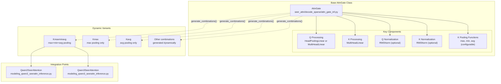
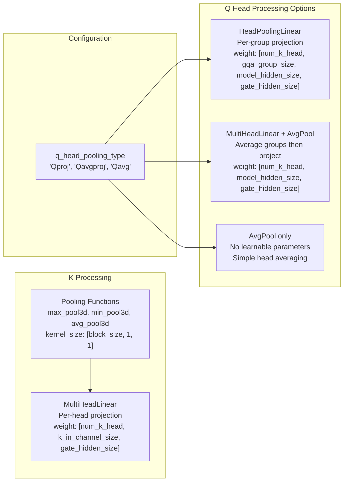
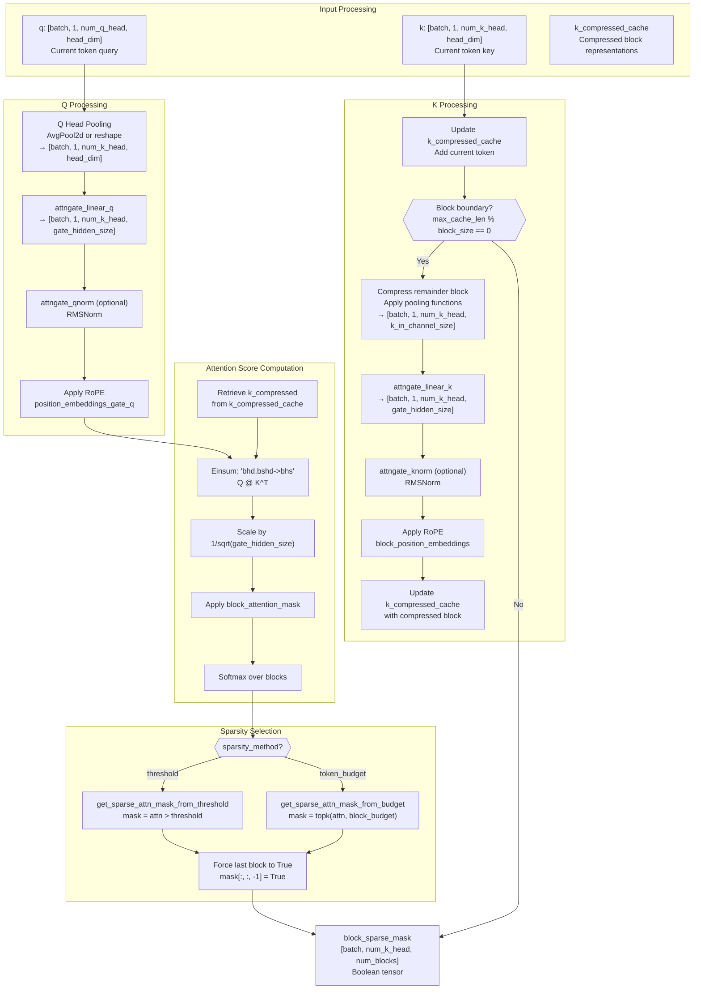
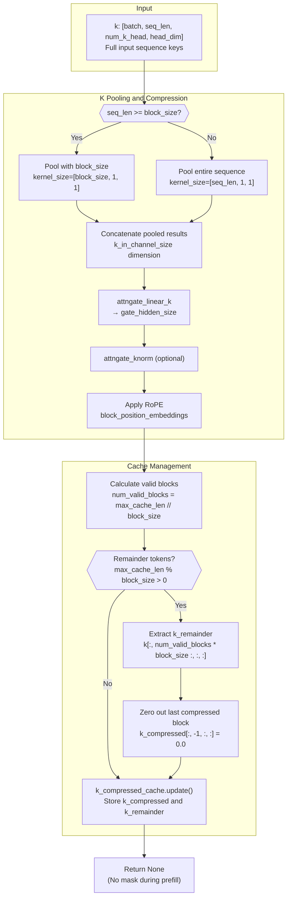
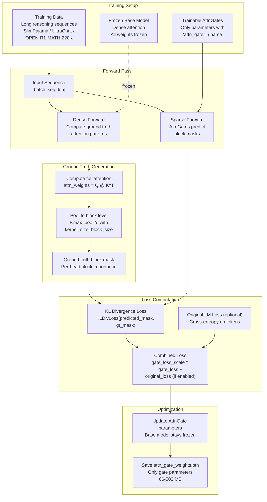
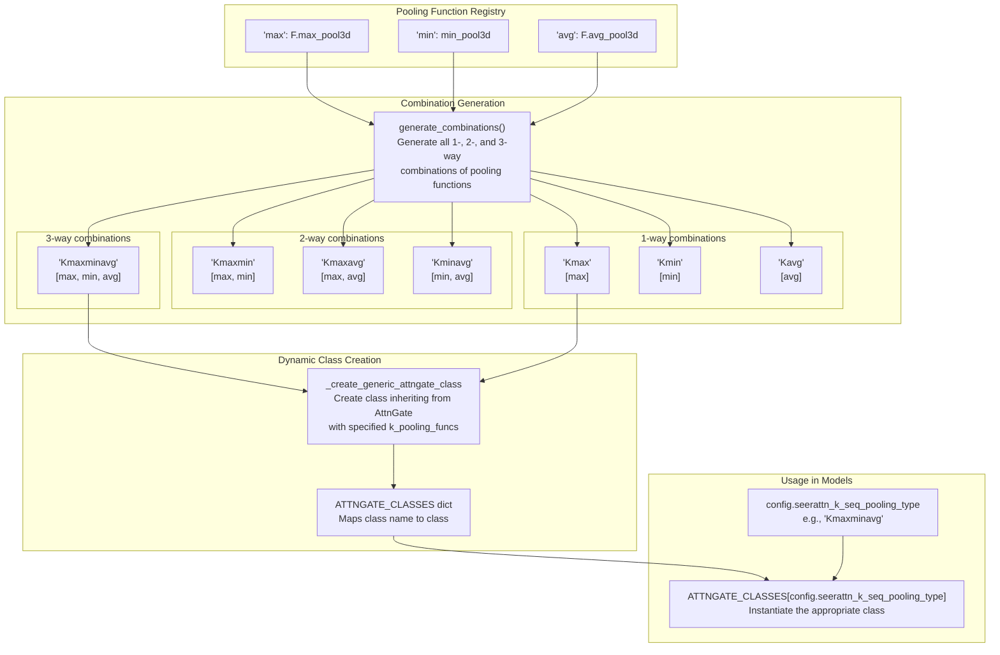
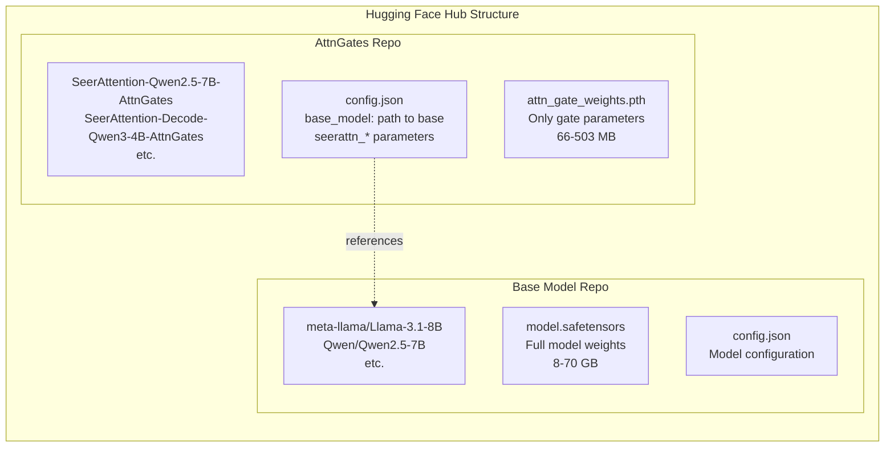
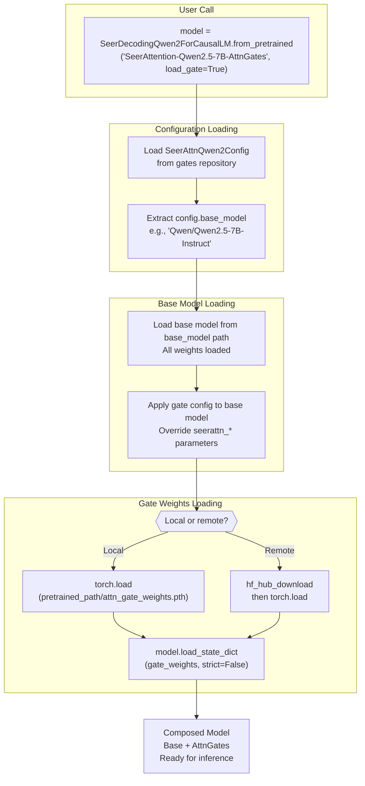

<!-- source: DeepWiki mcp.deepwiki.com · repo microsoft/SeerAttention · page 3.2 AttnGates · fetched 2026-10-26 -->

# AttnGates

<details>
<summary>Relevant source files</summary>

The following files were used as context for generating this wiki page:

- [distillation_decode.py](distillation_decode.py)
- [scripts/run_distillation_prefill.sh](scripts/run_distillation_prefill.sh)
- [seer_attn/decode_sparse/attention_forward_dense.py](seer_attn/decode_sparse/attention_forward_dense.py)
- [seer_attn/decode_sparse/attention_forward_sparse.py](seer_attn/decode_sparse/attention_forward_sparse.py)
- [seer_attn/decode_sparse/attn_gate_inf.py](seer_attn/decode_sparse/attn_gate_inf.py)
- [seer_attn/decode_sparse/qwen2/configuration_qwen2_seerattn.py](seer_attn/decode_sparse/qwen2/configuration_qwen2_seerattn.py)
- [seer_attn/decode_sparse/qwen2/modeling_qwen2_seerattn_inference.py](seer_attn/decode_sparse/qwen2/modeling_qwen2_seerattn_inference.py)
- [seer_attn/decode_sparse/qwen3/modeling_qwen3_seerattn_inference.py](seer_attn/decode_sparse/qwen3/modeling_qwen3_seerattn_inference.py)
- [seer_attn/modules/attention_distill.py](seer_attn/modules/attention_distill.py)
- [seer_attn/modules/common.py](seer_attn/modules/common.py)

</details>


## Purpose and Scope

AttnGates are lightweight, trainable neural network modules that learn to predict block-level attention sparsity patterns. They are the core innovation of SeerAttention, enabling efficient sparse attention by dynamically determining which blocks of keys/values should participate in attention computation. AttnGates are trained separately via self-distillation and stored independently from base models (66-503 MB), allowing them to be composed with frozen foundation models.

This page covers the architecture, mask generation mechanism, training process, and storage/loading of AttnGates. For information about how these generated masks are used in attention computation, see [Sparsity Methods](#3.3). For the broader integration into model forward passes, see [Sparse Decode Models](#4.2).

---

## Architecture Overview

### Class Hierarchy and Components



**Sources:** [seer_attn/decode_sparse/attn_gate_inf.py:110-256](), [seer_attn/decode_sparse/attn_gate_inf.py:266-298]()

### Core Parameters

The `AttnGate` class is configured with the following key parameters:

| Parameter | Typical Values | Description |
|-----------|---------------|-------------|
| `block_size` | 16, 32, 64 | Granularity of block-level sparsity |
| `model_hidden_size` | 128 (head_dim) | Dimension of model's attention head |
| `gate_hidden_size` | 64, 128, 256 | Internal hidden dimension for gate computation |
| `num_k_head` | 8-32 | Number of key/value heads (GQA) |
| `num_q_head` | 32-128 | Number of query heads |
| `q_head_pooling_type` | "Qproj", "Qavgproj", "Qavg" | How to aggregate query heads |
| `k_pooling_funcs` | [max, min, avg] | List of pooling functions for keys |
| `use_flash_rope` | True/False | Whether to use flash-attention RoPE format |
| `use_qk_norm` | True/False | Whether to normalize Q/K before attention |

**Sources:** [seer_attn/decode_sparse/attn_gate_inf.py:111-131](), [seer_attn/decode_sparse/qwen2/configuration_qwen2_seerattn.py:68-82]()

---

## Internal Components

### HeadPoolingLinear and MultiHeadLinear

AttnGates use specialized linear layers that operate per-head to maintain head-specific information:



**HeadPoolingLinear** ([seer_attn/decode_sparse/attn_gate_inf.py:63-84]()):
- Weight shape: `[num_k_head, gqa_group_size, model_hidden_size, gate_hidden_size]`
- Performs einsum: `'bskgi,kgio->bsko'` (4D) or `'skgi,kgio->sko'` (3D)
- Used when `q_head_pooling_type == "Qproj"`

**MultiHeadLinear** ([seer_attn/decode_sparse/attn_gate_inf.py:87-108]()):
- Weight shape: `[num_head, in_channel, hidden_size]`
- Performs einsum: `'bshi,hio->bsho'` (4D) or `'shi,hio->sho'` (3D)
- Used for K projection and when `q_head_pooling_type == "Qavgproj"`

**Sources:** [seer_attn/decode_sparse/attn_gate_inf.py:63-108](), [seer_attn/decode_sparse/attn_gate_inf.py:137-145]()

### K Pooling Strategy

Keys are pooled using a combination of pooling functions to capture different statistical properties:

| Pooling Type | Function | Purpose |
|--------------|----------|---------|
| `max` | `F.max_pool3d` | Captures maximum activations (most important tokens) |
| `min` | `min_pool3d` (custom) | Captures minimum activations (inverse pattern) |
| `avg` | `F.avg_pool3d` | Captures average activation level |

The pooling functions are applied with `kernel_size=[block_size, 1, 1]` and `stride=[block_size, 1, 1]`, reducing the sequence dimension by a factor of `block_size`. Results are concatenated: `k_in_channel_size = model_hidden_size * len(k_pooling_funcs)`.

**Sources:** [seer_attn/decode_sparse/attn_gate_inf.py:16-17](), [seer_attn/decode_sparse/attn_gate_inf.py:259-263](), [seer_attn/decode_sparse/attn_gate_inf.py:133-136]()

---

## Mask Generation Process

AttnGates generate block-level sparse masks differently for prefill and decode phases:

### Decode Phase (Token-by-Token Generation)



**Key Steps for Decode:**

1. **Q Processing** ([seer_attn/decode_sparse/attn_gate_inf.py:169-184]()):
   - Pool query heads from `num_q_head` to `num_k_head` (GQA alignment)
   - Project through `attngate_linear_q` to `gate_hidden_size`
   - Optional RMSNorm and RoPE application

2. **K Compression** ([seer_attn/decode_sparse/attn_gate_inf.py:186-204]()):
   - Add current key to cache
   - At block boundaries (when `max_cache_len % block_size == 0`):
     - Apply pooling functions to the remainder block
     - Concatenate pooled results
     - Project through `attngate_linear_k`
     - Optional RMSNorm and RoPE application
     - Store compressed block representation

3. **Attention Score Computation** ([seer_attn/decode_sparse/attn_gate_inf.py:207-223]()):
   - Compute attention scores between query and all compressed blocks
   - Einsum: `'bhd,bshd->bhs'` (query @ compressed_keys^T)
   - Scale by `1/sqrt(gate_hidden_size)`
   - Apply block attention mask
   - Softmax over block dimension

4. **Sparsity Selection** ([seer_attn/decode_sparse/attn_gate_inf.py:224-229]()):
   - Threshold method: Select blocks where `attn > threshold`
   - Token budget method: Select top-k blocks
   - Always keep last block active (`mask[:, :, -1] = True`)

**Sources:** [seer_attn/decode_sparse/attn_gate_inf.py:152-230]()

### Prefill Phase (Batch Processing)



**Prefill Behavior** ([seer_attn/decode_sparse/attn_gate_inf.py:231-255]()):

During prefill (when `k.shape[1] > 1`), AttnGates do **not** generate a sparse mask. Instead, they:

1. **Compress the input sequence** using the same pooling and projection operations
2. **Handle incomplete blocks**: If the sequence length isn't divisible by `block_size`, extract the remainder tokens and zero out the last compressed block
3. **Store compressed representations** in `k_compressed_cache` for use in subsequent decode steps
4. **Return `None`** - dense attention is used during prefill

This design reflects the fact that prefill processes long contexts in parallel, where the overhead of sparse attention may not be beneficial. The compression work done during prefill prepares the cache for efficient sparse decode.

**Sources:** [seer_attn/decode_sparse/attn_gate_inf.py:231-255]()

---

## Sparsity Method Functions

AttnGates support two primary sparsity control methods:

### Threshold-Based Sparsity

```python
def get_sparse_attn_mask_from_threshold(x, threshold):
    dense_mask = x > threshold 
    return dense_mask
```

- **Purpose**: Select blocks where attention score exceeds a fixed threshold
- **Typical threshold values**: `5e-4` to `5e-3` (from config)
- **Behavior**: Variable number of blocks selected per head/query
- **Use case**: Long-context understanding (PG19, LongBench, RULER)

**Sources:** [seer_attn/decode_sparse/attn_gate_inf.py:21-23](), [seer_attn/decode_sparse/qwen2/configuration_qwen2_seerattn.py:68-71]()

### Token Budget Sparsity

```python
def get_sparse_attn_mask_from_budget(x, block_budget, block_attention_mask):
    block_seq_len = x.size(-1)
    
    if block_seq_len <= block_budget:
        full_mask = torch.ones_like(x, dtype=torch.bool, device=x.device)
        full_mask = full_mask & block_attention_mask
        return full_mask

    k = block_budget 
    _, topk_indices = torch.topk(x, k=k, dim=-1, sorted=False)
    
    mask = torch.zeros_like(x, dtype=torch.bool, device=x.device)
    mask.scatter_(-1, topk_indices, True)

    final_mask = mask & block_attention_mask
    return final_mask
```

- **Purpose**: Select exactly top-k blocks based on attention scores
- **Typical values**: `block_budget = token_budget / block_size` (e.g., 4096 tokens / 64 = 64 blocks)
- **Behavior**: Fixed number of blocks selected per head/query
- **Use case**: Long-reasoning generation (AIME, MATH, GPQA)

**Sources:** [seer_attn/decode_sparse/attn_gate_inf.py:25-42](), [seer_attn/decode_sparse/qwen2/modeling_qwen2_seerattn_inference.py:94-106]()

---

## Training Process: Self-Distillation

### Overview

AttnGates are trained using a self-distillation approach where they learn to mimic the attention patterns of a frozen dense base model:



**Sources:** [distillation_decode.py:27-59](), [seer_attn/decode_sparse/qwen2/modeling_qwen2_seerattn_training.py]()

### Training Configuration

The training process is controlled by several key parameters:

| Parameter | Typical Value | Description |
|-----------|--------------|-------------|
| `gate_loss_scale` | 10.0 | Weight for gate loss vs. original LM loss |
| `orig_weight_training` | False | Whether to also train base model weights |
| `training_max_length` | 65536 | Maximum sequence length in training |
| `trainable_params` | "attngate" | Only parameters containing this string are trainable |
| `learning_rate` | 1e-3 | Learning rate for gate parameters |
| `warmup_steps` | 20 | Number of warmup steps |

**Loss Function** ([distillation_decode.py:43-59]()):

```python
def compute_loss(self, model, inputs, return_outputs=False, num_items_in_batch=None):
    outputs = model(**inputs)
    original_loss = outputs.get("loss")
    mask_loss = outputs.get("gate_loss")
    
    if self.orig_weight_training:
        tok_loss = original_loss + self.gate_loss_scale * mask_loss
    else:
        tok_loss = self.gate_loss_scale * mask_loss
    
    return (tok_loss, outputs) if return_outputs else tok_loss
```

**Sources:** [distillation_decode.py:27-59](), [distillation_decode.py:98-127]()

### Parameter Freezing

Only AttnGate parameters are trained:

```python
for n, p in model.named_parameters():
    if training_args.trainable_params in n:  # "attngate"
        p.requires_grad = True
    else:
        p.requires_grad = False
```

This results in:
- **Frozen**: All base model parameters (embeddings, attention QKV projections, MLP layers, etc.)
- **Trainable**: Only `attn_gate` modules (linear projections, norms if enabled)
- **Size**: 66-503 MB depending on model size and configuration

**Sources:** [distillation_decode.py:279-283]()

---

## Dynamic Variant Generation

AttnGates support multiple pooling combinations, generated dynamically at import time:



**Implementation** ([seer_attn/decode_sparse/attn_gate_inf.py:266-298]()):

```python
def _create_generic_attngate_class(base_class, suffix, k_pooling_names):
    k_pooling_funcs = [POOL_FUNCS[name] for name in k_pooling_names]
    class_name = f"K{''.join(k_pooling_names)}{suffix}"

    class NewAttnGate(base_class):
        def __init__(self, block_size, model_hidden_size, gate_hidden_size, 
                     num_k_head, num_q_head, q_head_pooling_type, 
                     use_flash_rope=False, use_qk_norm=False):
            super(NewAttnGate, self).__init__(
                block_size=block_size,
                model_hidden_size=model_hidden_size,
                gate_hidden_size=gate_hidden_size,
                num_k_head=num_k_head,
                num_q_head=num_q_head,
                q_head_pooling_type=q_head_pooling_type,
                k_pooling_funcs=k_pooling_funcs,
                use_flash_rope=use_flash_rope,
                use_qk_norm=use_qk_norm,
            )
    NewAttnGate.__name__ = class_name
    return class_name, NewAttnGate

def generate_combinations():
    new_classes = {}
    pool_types = ['max', 'min', 'avg']

    for k_comb in range(1, 4):
        for k_pooling_comb in combinations(pool_types, k_comb):
            class_name, new_class = _create_generic_attngate_class(
                AttnGate, '', k_pooling_comb
            )
            new_classes[class_name] = new_class
    return new_classes

ATTNGATE_CLASSES = generate_combinations()
```

This generates 7 classes total (3 single-pooling + 3 two-pooling + 1 three-pooling), accessible via the `ATTNGATE_CLASSES` dictionary.

**Sources:** [seer_attn/decode_sparse/attn_gate_inf.py:259-298]()

---

## Storage and Loading Mechanism

### Storage Format

AttnGates are stored separately from base models to enable flexible composition:



**Saved AttnGate Weights** contain only parameters with "attn_gate" in their names:

- `model.layers.{i}.self_attn.attn_gate.attngate_linear_q.weight`
- `model.layers.{i}.self_attn.attn_gate.attngate_linear_k.weight`
- `model.layers.{i}.self_attn.attn_gate.attngate_qnorm.weight` (if enabled)
- `model.layers.{i}.self_attn.attn_gate.attngate_knorm.weight` (if enabled)

**Saved Configuration** ([seer_attn/decode_sparse/qwen2/configuration_qwen2_seerattn.py:46-139]()):

```json
{
  "base_model": "Qwen/Qwen2.5-7B-Instruct",
  "seerattn_k_seq_pooling_type": "Kmaxminavg",
  "seerattn_q_head_pooling_type": "Qproj",
  "seerattn_gate_block_size": 64,
  "seerattn_gate_hidden_size": 128,
  "seerattn_use_rope": true,
  "seerattn_use_qk_norm": false,
  "seerattn_sparsity_method": "token_budget",
  "seerattn_token_budget": 4096,
  "seerattn_threshold": 0.0,
  "seerattn_implementation": "seer_sparse",
  "seerattn_start_layer": 0
}
```

**Sources:** [distillation_decode.py:344-353](), [seer_attn/decode_sparse/qwen2/configuration_qwen2_seerattn.py:46-139]()

### Loading Mechanism

The `from_pretrained` method handles automatic composition of base model and AttnGates:



**Implementation** ([seer_attn/decode_sparse/qwen2/modeling_qwen2_seerattn_inference.py:769-794]()):

```python
@classmethod
def from_pretrained(cls, pretrained_model_name_or_path, load_gate=True, *model_args, **kwargs):
    if load_gate:
        # Load gate config first
        config = SeerAttnQwen2Config.from_pretrained(pretrained_model_name_or_path, *model_args, **kwargs)
        base_model = config.base_model
        
        # Override config with any kwargs
        for key in list(kwargs.keys()):
            if hasattr(config, key) and key != "torch_dtype":
                setattr(config, key, kwargs.pop(key))
        
        # Load base model with gate config
        model = super().from_pretrained(base_model, config=config, *model_args, **kwargs)

        # Load gate weights
        if os.path.exists(pretrained_model_name_or_path):
            gate_weights = torch.load(
                os.path.join(pretrained_model_name_or_path, "attn_gate_weights.pth")
            )
        else:
            gate_weights = torch.load(
                hf_hub_download(repo_id=pretrained_model_name_or_path, 
                               filename="attn_gate_weights.pth")
            )
                
        model.load_state_dict(gate_weights, strict=False)
        print("Attention gate weights loaded successfully.")
    else:
        model = super().from_pretrained(pretrained_model_name_or_path, *model_args, **kwargs)

    return model
```

**Key Points:**

1. **`strict=False`**: Allows loading only AttnGate weights without errors for missing base model parameters
2. **Config composition**: Gate config's `base_model` field points to the frozen base model
3. **Separate storage**: AttnGates (66-503 MB) stored separately from base models (8-70 GB)
4. **Automatic download**: Uses Hugging Face Hub for both base and gate weights

**Sources:** [seer_attn/decode_sparse/qwen2/modeling_qwen2_seerattn_inference.py:769-794](), [seer_attn/decode_sparse/qwen3/modeling_qwen3_seerattn_inference.py:769-795]()

---

## Integration with Attention Layers

AttnGates are instantiated within attention modules:

```python
# From Qwen2SeerAttention.__init__
self.attn_gate = ATTNGATE_CLASSES[config.seerattn_k_seq_pooling_type](
    config.seerattn_gate_block_size, 
    self.head_dim, 
    config.seerattn_gate_hidden_size,
    num_k_head=config.num_key_value_heads, 
    num_q_head=config.num_attention_heads,
    q_head_pooling_type=config.seerattn_q_head_pooling_type,
    use_flash_rope=config.use_flash_rope,
    use_qk_norm=config.seerattn_use_qk_norm,
)
```

And called during forward pass:

```python
# Generate block sparse mask
block_sparse_mask = self.attn_gate(
    k_nope,  # Keys without RoPE
    self.layer_idx,
    k_compressed_cache,
    q_nope,  # Queries without RoPE
    block_attention_mask,
    max_cache_len=k.shape[1],
    position_embeddings=position_embeddings_gate_q,
    block_position_embeddings=block_position_embeddings,
    threshold=self.config.seerattn_threshold,
    block_budget=self.block_budget,
    sparsity_method=self.config.seerattn_sparsity_method,
)

# Use mask in sparse attention kernel
attn_output = sparse_flash_attention_forward(
    q, k, v,
    block_mask=block_sparse_mask,
    block_size=self.config.seerattn_gate_block_size,
    ...
)
```

**Sources:** [seer_attn/decode_sparse/qwen2/modeling_qwen2_seerattn_inference.py:89-98](), [seer_attn/decode_sparse/qwen2/modeling_qwen2_seerattn_inference.py:152-164]()

---

## Oracle Sparse Baseline

For ablation studies, an oracle sparse mode computes ground-truth attention scores:

```python
def compute_oracle_sparse_mask(q, k, cache_seqlens, block_attention_mask, 
                                block_size, sparsity_method, threshold=0.0, 
                                block_budget=2048):
    q_len = q.shape[1]
    if q_len > 1:  # Use dense prefill for oracle mode
        block_sparse_mask = None
    else:
        # Compute actual attention weights at block level
        attn_weights = oracle_sparse(q, k, cache_seqlens, block_size)
        
        if sparsity_method == "token_budget":
            block_sparse_mask = get_sparse_attn_mask_from_budget(
                attn_weights, block_budget, block_attention_mask
            )
        elif sparsity_method == "threshold":
            block_sparse_mask = get_sparse_attn_mask_from_threshold(
                attn_weights, threshold
            )

        block_sparse_mask[:, :, -1] = True
    
    return block_sparse_mask
```

This provides an upper bound on performance by using true attention scores rather than learned predictions.

**Sources:** [seer_attn/decode_sparse/attn_gate_inf.py:44-60]()

---

## Summary

**AttnGates** are the core predictive components of SeerAttention:

- **Architecture**: Lightweight modules with per-head linear projections and configurable pooling strategies
- **Size**: 66-503 MB per model, enabling separate storage from base models
- **Training**: Self-distillation from frozen dense models using KL divergence loss
- **Operation**: Generate block-level sparse masks during decode, skip mask generation during prefill
- **Flexibility**: Dynamic variant generation supports 7 pooling combinations; 3 Q head pooling types
- **Storage**: Separate HuggingFace repos with automatic composition via `from_pretrained(load_gate=True)`
- **Integration**: Instantiated per attention layer, called before sparse attention kernels

The modular design enables mixing and matching AttnGates with different base models and sparsity configurations.

**Sources:** [seer_attn/decode_sparse/attn_gate_inf.py:110-298](), [seer_attn/decode_sparse/qwen2/modeling_qwen2_seerattn_inference.py:72-210](), [distillation_decode.py:27-353]()

---

