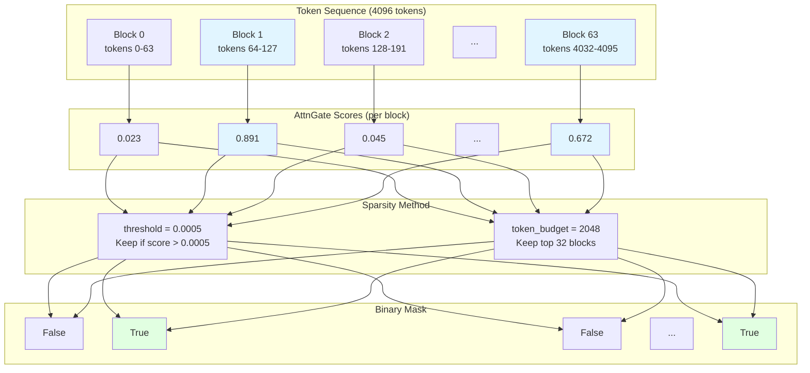
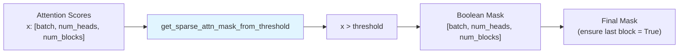
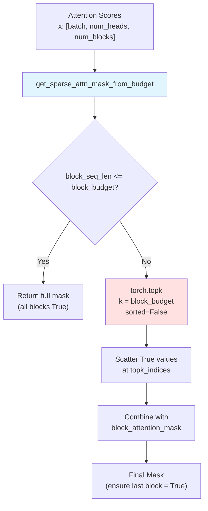
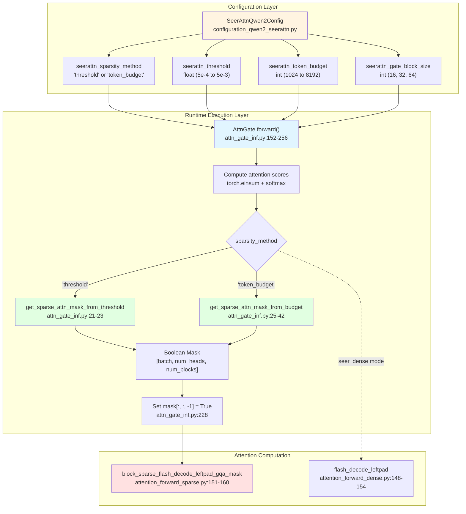
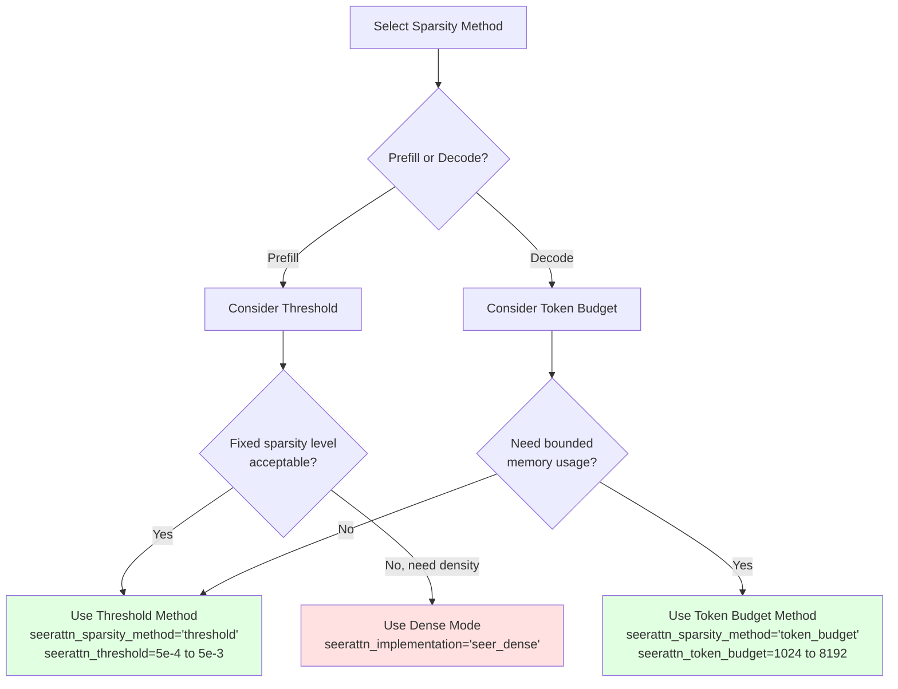

<!-- source: DeepWiki mcp.deepwiki.com · repo microsoft/SeerAttention · page 3.3 Sparsity Methods · fetched 2026-10-26 -->

# Sparsity Methods

<details>
<summary>Relevant source files</summary>

The following files were used as context for generating this wiki page:

- [README.md](README.md)
- [seer_attn/__init__.py](seer_attn/__init__.py)
- [seer_attn/decode_sparse/attention_forward_dense.py](seer_attn/decode_sparse/attention_forward_dense.py)
- [seer_attn/decode_sparse/attention_forward_sparse.py](seer_attn/decode_sparse/attention_forward_sparse.py)
- [seer_attn/decode_sparse/attn_gate_inf.py](seer_attn/decode_sparse/attn_gate_inf.py)
- [seer_attn/decode_sparse/qwen2/configuration_qwen2_seerattn.py](seer_attn/decode_sparse/qwen2/configuration_qwen2_seerattn.py)

</details>


## Purpose and Scope

This document explains the different sparsity control methods used in SeerAttention to convert soft attention scores (generated by AttnGates) into hard binary attention masks. These methods determine which blocks of the key-value cache are attended to during inference, directly controlling the trade-off between computational efficiency and model accuracy.

For information about how AttnGates generate the initial attention scores, see [AttnGates](#3.2). For details on the overall sparse attention mechanism, see [SeerAttention Mechanism](#3.1). For configuration parameters and model setup, see [Model Configuration](#4.3).

## Overview

SeerAttention supports multiple sparsity methods that operate at the **block level** rather than individual tokens. Each method takes attention scores computed by AttnGates and converts them into a binary mask that determines which blocks participate in attention computation.

| Method | Parameter | Description | Use Case |
|--------|-----------|-------------|----------|
| `threshold` | `seerattn_threshold` | Keep blocks with score > threshold | Long-context prefill, fixed sparsity level |
| `token_budget` | `seerattn_token_budget` | Keep top-k blocks based on token budget | Sparse decode, controlled memory/compute |

Both methods ensure the final block (containing the most recent tokens) is always kept, preventing loss of immediate context.

**Sources:** [README.md:73-109](), [seer_attn/decode_sparse/qwen2/configuration_qwen2_seerattn.py:68-71]()

## Block-Level Sparsity

All sparsity methods in SeerAttention operate at the **block granularity** defined by `seerattn_gate_block_size` (typically 16, 32, or 64 tokens). This design choice aligns with hardware characteristics and enables efficient kernel implementations.



**Diagram: Block-Level Sparsity Transformation**

The diagram shows how a sequence is divided into blocks, AttnGates compute per-block scores, sparsity methods convert scores to binary masks, and only masked blocks participate in attention.

**Sources:** [seer_attn/decode_sparse/qwen2/configuration_qwen2_seerattn.py:77-78](), [seer_attn/decode_sparse/attn_gate_inf.py:21-42]()

## Method 1: Threshold-Based Sparsity

### Implementation

The threshold method creates a sparse mask by keeping all blocks whose attention score exceeds a configurable threshold value.



**Diagram: Threshold Method Data Flow**

The function `get_sparse_attn_mask_from_threshold` in [seer_attn/decode_sparse/attn_gate_inf.py:21-23]() implements this logic:

```python
def get_sparse_attn_mask_from_threshold(x, threshold):
    dense_mask = x > threshold 
    return dense_mask
```

The threshold is then applied in `AttnGate.forward()` at [seer_attn/decode_sparse/attn_gate_inf.py:226-227]():

```python
elif sparsity_method == "threshold":
    mask = get_sparse_attn_mask_from_threshold(attn, threshold)
```

### Configuration Parameters

| Parameter | Type | Default | Typical Range | Description |
|-----------|------|---------|---------------|-------------|
| `seerattn_sparsity_method` | str | `'threshold'` | - | Set to `'threshold'` to use this method |
| `seerattn_threshold` | float | `0.0` | `5e-4` to `5e-3` | Minimum score for block inclusion |

Higher threshold values produce sparser attention (fewer blocks kept), resulting in faster inference but potentially lower quality. Lower values keep more blocks, maintaining quality but reducing speedup.

### Usage Example

From [README.md:96-109]():

```python
model = SeerAttnLlamaForCausalLM.from_pretrained(
    model_name,
    torch_dtype=torch.bfloat16,
    seerattn_sparsity_method='threshold',
    seerattn_threshold=5e-4,  # Higher = sparser
).cuda()
```

### When to Use

**Best for:**
- **Long-context prefill**: Processing long input sequences where you want consistent sparsity across different sequence lengths
- **Predictable sparsity patterns**: When you want a fixed sparsity level that doesn't vary with content
- **Quality-sensitive applications**: Fine-tuning threshold allows precise control over quality-speed trade-off

**Characteristics:**
- Sparsity level varies with input content (some sequences may be naturally sparser)
- Simpler to understand and tune
- Used in benchmarks like LongBench (threshold=2e-3) and RULER (threshold=5e-4)

**Sources:** [README.md:103-109](), [seer_attn/decode_sparse/attn_gate_inf.py:21-23](), [seer_attn/decode_sparse/qwen2/configuration_qwen2_seerattn.py:68-71]()

## Method 2: Token Budget Sparsity

### Implementation

The token budget method uses a top-k selection strategy to keep exactly a specified number of blocks, converting the token budget into a block budget and selecting the highest-scoring blocks.



**Diagram: Token Budget Method Data Flow**

The implementation in [seer_attn/decode_sparse/attn_gate_inf.py:25-42]() converts token budget to block budget and uses PyTorch's `topk` operation:

```python
def get_sparse_attn_mask_from_budget(x, block_budget, block_attention_mask):
    block_seq_len = x.size(-1)
    
    if block_seq_len <= block_budget:
        full_mask = torch.ones_like(x, dtype=torch.bool, device=x.device)
        full_mask = full_mask & block_attention_mask
        return full_mask

    k = block_budget 
    
    _, topk_indices = torch.topk(x, k=k, dim=-1, sorted=False)
    
    mask = torch.zeros_like(x, dtype=torch.bool, device=x.device)
    mask.scatter_(-1, topk_indices, True)

    final_mask = mask & block_attention_mask
    
    return final_mask
```

The token budget is applied in `AttnGate.forward()` at [seer_attn/decode_sparse/attn_gate_inf.py:224-225]():

```python
if sparsity_method == "token_budget":
    mask = get_sparse_attn_mask_from_budget(attn, block_budget, attention_mask)
```

### Configuration Parameters

| Parameter | Type | Default | Typical Range | Description |
|-----------|------|---------|---------------|-------------|
| `seerattn_sparsity_method` | str | `'threshold'` | - | Set to `'token_budget'` to use this method |
| `seerattn_token_budget` | int | `4096` | `1024` to `8192` | Number of tokens to keep (converted to blocks) |
| `seerattn_gate_block_size` | int | `64` | `16`, `32`, `64` | Block size for budget calculation |

The actual number of blocks kept is `block_budget = token_budget // block_size`. For example, with `token_budget=4096` and `block_size=64`, the system keeps 64 blocks.

### Usage Example

From [README.md:80-93]():

```python
model = SeerDecodingQwen3ForCausalLM.from_pretrained(
    model_name,
    torch_dtype=torch.bfloat16,
    seerattn_sparsity_method='token_budget',
    seerattn_token_budget=4096,
).cuda()
```

### When to Use

**Best for:**
- **Sparse decode (SeerAttention-R)**: Token-by-token generation in long reasoning tasks
- **Controlled resource usage**: When you need predictable memory and compute requirements
- **Variable-length sequences**: Maintains consistent sparsity regardless of total context length
- **Reasoning tasks**: AIME, MATH, GPQA benchmarks where quality at controlled budget is critical

**Characteristics:**
- Fixed sparsity level (exactly k blocks kept)
- Automatically adapts to sequence length
- Better for decode phase where cache size grows dynamically
- Prevents memory overflow by capping attention to fixed number of tokens

**Sources:** [README.md:80-93](), [seer_attn/decode_sparse/attn_gate_inf.py:25-42](), [seer_attn/decode_sparse/qwen2/configuration_qwen2_seerattn.py:68-71]()

## Code Entity Mapping

This diagram shows how sparsity methods map from configuration to runtime execution:



**Diagram: Sparsity Method Code Entity Flow**

This diagram traces the complete path from configuration parameters through runtime execution to kernel dispatch.

**Sources:** [seer_attn/decode_sparse/qwen2/configuration_qwen2_seerattn.py:68-78](), [seer_attn/decode_sparse/attn_gate_inf.py:21-42](), [seer_attn/decode_sparse/attn_gate_inf.py:152-256]()

## Oracle Sparse Method

In addition to the learned sparsity methods, the codebase includes an oracle sparse mode for ablation studies that computes ground-truth attention scores without using AttnGates.

### Implementation

The function `compute_oracle_sparse_mask` at [seer_attn/decode_sparse/attn_gate_inf.py:44-60]() computes exact attention scores between queries and keys, then applies either threshold or token budget methods:

```python
def compute_oracle_sparse_mask(q, k, cache_seqlens, block_attention_mask, 
                                block_size, sparsity_method, 
                                threshold=0.0, block_budget=2048):
    q_len = q.shape[1]
    if q_len > 1:  # use dense prefill for sparse decode
        block_sparse_mask = None
    else:
        attn_weights = oracle_sparse(q, k, cache_seqlens, block_size)
        
        if sparsity_method == "token_budget":
            block_sparse_mask = get_sparse_attn_mask_from_budget(
                attn_weights, block_budget, block_attention_mask)
        elif sparsity_method == "threshold":
            block_sparse_mask = get_sparse_attn_mask_from_threshold(
                attn_weights, threshold)

        block_sparse_mask[:, :, -1] = True
    
    return block_sparse_mask
```

This mode is activated by setting `seerattn_implementation='oracle_sparse'` in the configuration at [seer_attn/decode_sparse/qwen2/configuration_qwen2_seerattn.py:79]().

### Purpose

Oracle sparse mode serves as an upper-bound baseline for ablation studies, showing the best possible sparsity pattern if perfect attention scores were available without learning. It helps quantify how close learned AttnGates are to optimal sparse patterns.

**Sources:** [seer_attn/decode_sparse/attn_gate_inf.py:44-60](), [seer_attn/decode_sparse/qwen2/configuration_qwen2_seerattn.py:79]()

## Comparison and Selection Guide

### Method Comparison Table

| Aspect | Threshold | Token Budget |
|--------|-----------|--------------|
| **Sparsity Level** | Variable (content-dependent) | Fixed (exactly k blocks) |
| **Memory Usage** | Unpredictable | Predictable |
| **Tuning Complexity** | Simple (single threshold value) | Simple (single budget value) |
| **Sequence Length Sensitivity** | Less sensitive | More sensitive |
| **Primary Use Case** | Prefill phase | Decode phase |
| **Typical Models** | SeerAttnLlamaForCausalLM<br/>SeerAttnQwen2ForCausalLM | SeerDecodingQwen2ForCausalLM<br/>SeerDecodingQwen3ForCausalLM |
| **Benchmark Usage** | LongBench, RULER, PG19 | AIME, MATH, GPQA |

### Selection Flowchart



**Diagram: Sparsity Method Selection Guide**

**Sources:** [README.md:73-109](), [seer_attn/__init__.py:1-11]()

## Implementation Details

### Last Block Guarantee

Both sparsity methods ensure the last block (containing the most recent tokens) is always included in the sparse mask. This is implemented at [seer_attn/decode_sparse/attn_gate_inf.py:228]() and [seer_attn/decode_sparse/attn_gate_inf.py:58]():

```python
mask[:, :, -1] = True  # Always attend to last block
```

This prevents loss of immediate context, which is critical for causal language modeling.

### Attention Mask Integration

Both methods respect the original attention mask by combining it with the sparsity mask. In token budget mode, this is done at [seer_attn/decode_sparse/attn_gate_inf.py:40]():

```python
final_mask = mask & block_attention_mask
```

This ensures padding tokens and invalid positions are never attended to, even if they have high attention scores.

### Block Size Impact

The `seerattn_gate_block_size` parameter affects both methods:

- **Threshold method**: Larger blocks mean coarser granularity, potentially missing fine-grained patterns
- **Token budget method**: Larger blocks mean fewer total blocks for the same token budget (e.g., 4096 tokens with 64-token blocks = 64 blocks, but with 32-token blocks = 128 blocks)

Common block sizes are 16, 32, and 64, with 64 being the default for compute efficiency.

**Sources:** [seer_attn/decode_sparse/attn_gate_inf.py:21-60](), [seer_attn/decode_sparse/qwen2/configuration_qwen2_seerattn.py:77-78]()

## Runtime Behavior

### Decode Phase Behavior

During decode (single token generation), the sparsity method is applied at every step as the cache grows:

1. AttnGate computes attention scores for compressed blocks
2. Sparsity method selects which blocks to attend
3. Only selected blocks participate in attention computation
4. Cache grows by one block every `block_size` tokens

The method is invoked in `AttnGate.forward()` at [seer_attn/decode_sparse/attn_gate_inf.py:224-229]():

```python
if sparsity_method == "token_budget":
    mask = get_sparse_attn_mask_from_budget(attn, block_budget, attention_mask)
elif sparsity_method == "threshold":
    mask = get_sparse_attn_mask_from_threshold(attn, threshold)
mask[:, : ,-1] = True
```

### Prefill Phase Behavior

During prefill (processing input sequence), sparsity methods determine initial cache population:

1. Input sequence is divided into blocks
2. AttnGate computes scores for all blocks
3. Sparsity method determines which blocks to keep in cache
4. Dense attention is used for the query-to-key computation (causal masking handles sparsity)

Prefill uses dense attention at [seer_attn/decode_sparse/attn_gate_inf.py:47-48]() but still benefits from cache compression:

```python
if q_len > 1:  # use dense prefill for sparse decode
    block_sparse_mask = None
```

**Sources:** [seer_attn/decode_sparse/attn_gate_inf.py:152-256](), [seer_attn/decode_sparse/attention_forward_sparse.py:111-162]()

## Summary

SeerAttention provides two main sparsity methods for different use cases:

1. **Threshold-based sparsity** (`'threshold'`): Best for prefill phase and long-context tasks, provides content-adaptive sparsity with simple tuning via a single threshold parameter (typical range: 5e-4 to 5e-3)

2. **Token budget sparsity** (`'token_budget'`): Best for decode phase and reasoning tasks, provides fixed sparsity with predictable memory usage via a token budget parameter (typical range: 1024 to 8192)

Both methods operate at block granularity, ensure the last block is always kept, and integrate with attention masks. The choice between them depends on the phase of inference (prefill vs decode) and whether predictable resource usage or content-adaptive sparsity is more important.

**Sources:** [seer_attn/decode_sparse/attn_gate_inf.py:21-60](), [seer_attn/decode_sparse/qwen2/configuration_qwen2_seerattn.py:68-78](), [README.md:73-109]()

---

