<!-- source: DeepWiki mcp.deepwiki.com · repo microsoft/SeerAttention · page 3.4 Cache Management · fetched 2026-10-26 -->

# Cache Management

<details>
<summary>Relevant source files</summary>

The following files were used as context for generating this wiki page:

- [distillation_decode.py](distillation_decode.py)
- [eval/reasoning_tasks/eval_hf.py](eval/reasoning_tasks/eval_hf.py)
- [eval/reasoning_tasks/summary_results.py](eval/reasoning_tasks/summary_results.py)
- [scripts/run_distillation_prefill.sh](scripts/run_distillation_prefill.sh)
- [seer_attn/decode_sparse/cache_utils.py](seer_attn/decode_sparse/cache_utils.py)
- [seer_attn/decode_sparse/qwen2/modeling_qwen2_seerattn_inference.py](seer_attn/decode_sparse/qwen2/modeling_qwen2_seerattn_inference.py)
- [seer_attn/decode_sparse/qwen3/modeling_qwen3_seerattn_inference.py](seer_attn/decode_sparse/qwen3/modeling_qwen3_seerattn_inference.py)
- [seer_attn/modules/attention_distill.py](seer_attn/modules/attention_distill.py)
- [seer_attn/modules/common.py](seer_attn/modules/common.py)

</details>


## Purpose and Scope

This document describes the cache management systems used in SeerAttention, focusing on the storage and manipulation of key-value (KV) caches during inference. SeerAttention uses two complementary caching systems: the standard `DynamicCache` from Transformers for full KV storage, and a custom `KCompressionCache` for block-compressed key representations used by attention gates. This page covers cache initialization, update patterns, batch management, and integration with the generation loop.

For information about the attention mechanisms that consume these caches, see [SeerAttention Mechanism](#3.1). For details on the attention gates that use compressed caches, see [AttnGates](#3.2).

---

## Cache Types Overview

SeerAttention employs two cache types during sparse decode inference:

| Cache Type | Purpose | Storage Granularity | Used By |
|-----------|---------|-------------------|---------|
| `DynamicCache` | Standard KV cache for attention computation | Per-token | Sparse attention kernels |
| `KCompressionCache` | Compressed key representations for mask generation | Per-block (64 tokens) | AttnGates |

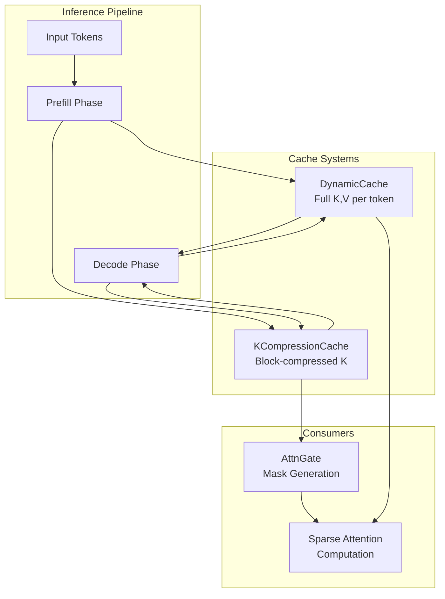

**Sources:** [seer_attn/decode_sparse/cache_utils.py:1-67](), [seer_attn/decode_sparse/qwen2/modeling_qwen2_seerattn_inference.py:452-458]()

---

## KCompressionCache Design

The `KCompressionCache` class stores block-level compressed key representations to support efficient attention gate computation without reprocessing the entire key cache at each decode step.

### Data Structure

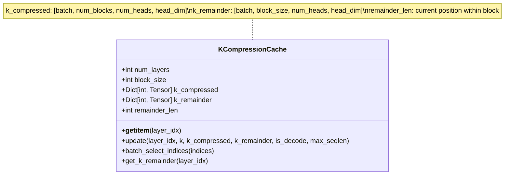

### Storage Organization

The cache maintains two components per layer:

1. **`k_compressed`**: Completed blocks of compressed keys
   - Shape: `[batch, num_blocks, num_kv_heads, head_dim]`
   - Each block represents `block_size` (typically 64) tokens
   - Updated during prefill or when a block fills up during decode

2. **`k_remainder`**: Incomplete block being filled
   - Shape: `[batch, block_size, num_kv_heads, head_dim]`
   - Stores tokens that haven't yet formed a complete block
   - Tracked position via `remainder_len` counter

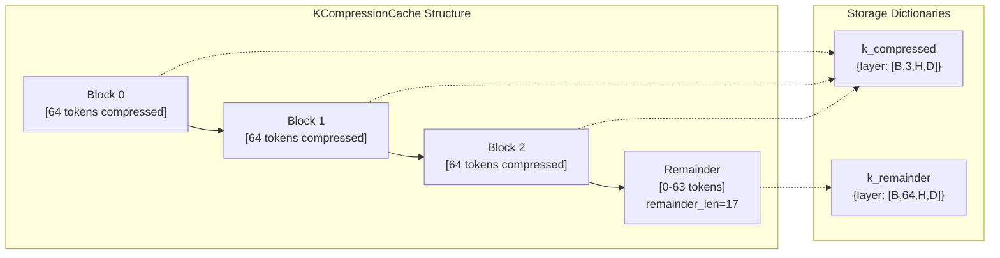

**Sources:** [seer_attn/decode_sparse/cache_utils.py:6-18]()

---

## Cache Initialization

Caches are initialized lazily during the first forward pass when `use_cache=True`.

### Initialization Flow

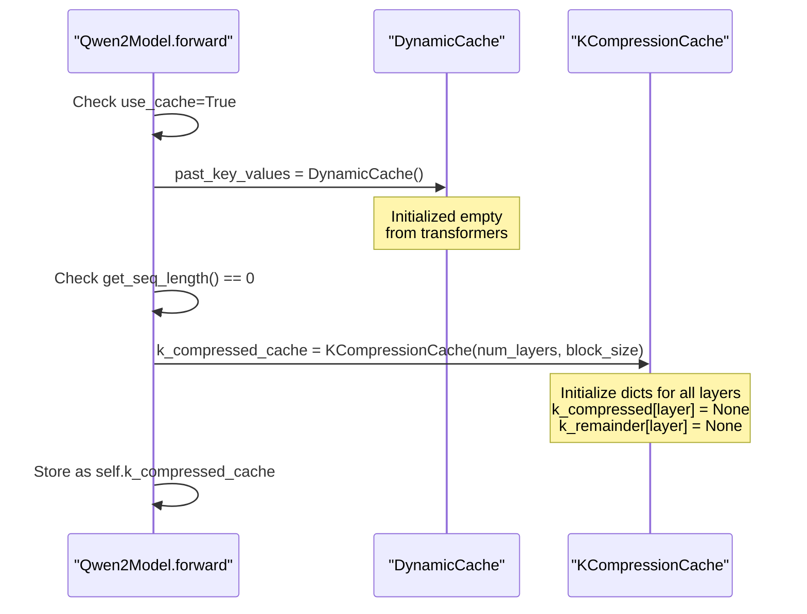

During prefill (first forward pass):
- `DynamicCache` is created empty via `DynamicCache()`
- `KCompressionCache` is created when cache length is 0: `KCompressionCache(num_layers, block_size)`
- Both are stored as model attributes for subsequent decode steps

**Sources:** [seer_attn/decode_sparse/qwen2/modeling_qwen2_seerattn_inference.py:452-458](), [seer_attn/decode_sparse/cache_utils.py:8-17]()

---

## Cache Update Patterns

### DynamicCache Updates

The standard `DynamicCache` updates occur in each attention layer via the transformers library's `Cache.update()` method:

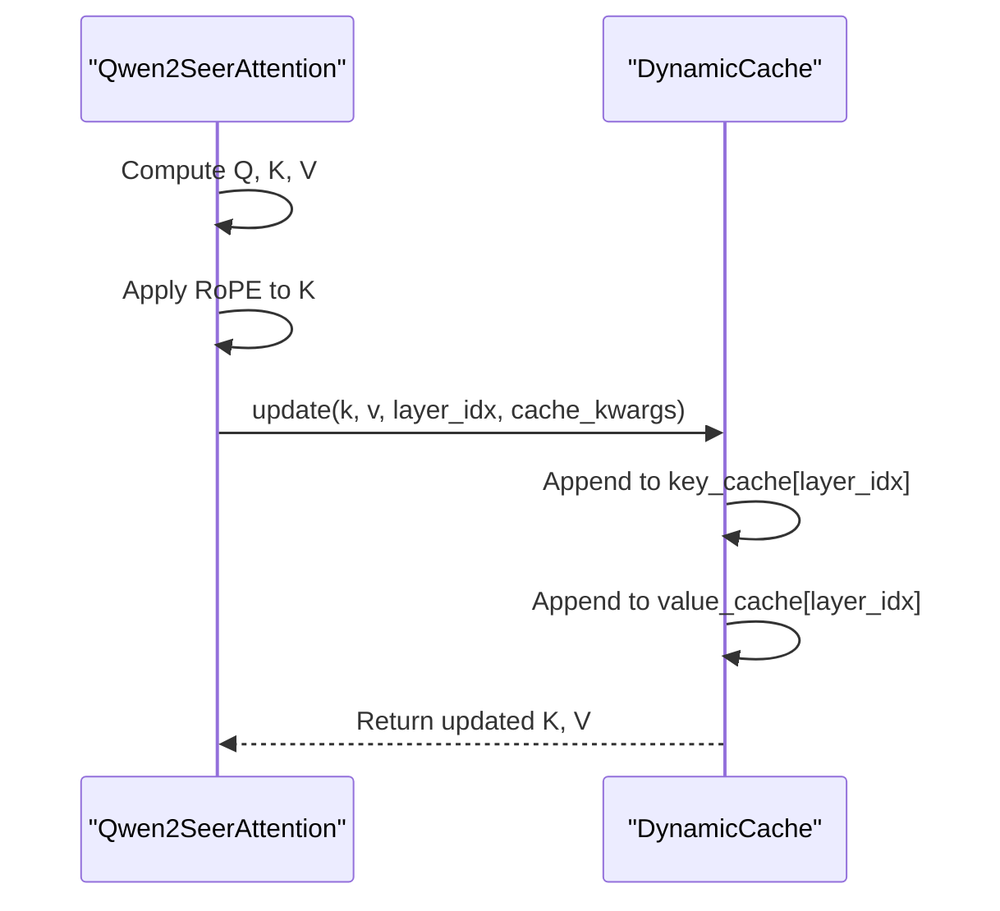

**Sources:** [seer_attn/decode_sparse/qwen2/modeling_qwen2_seerattn_inference.py:144-148]()

### KCompressionCache Updates

The `KCompressionCache.update()` method handles two scenarios: prefill and decode.

#### Prefill Update

During prefill, the entire compressed key representation is set:

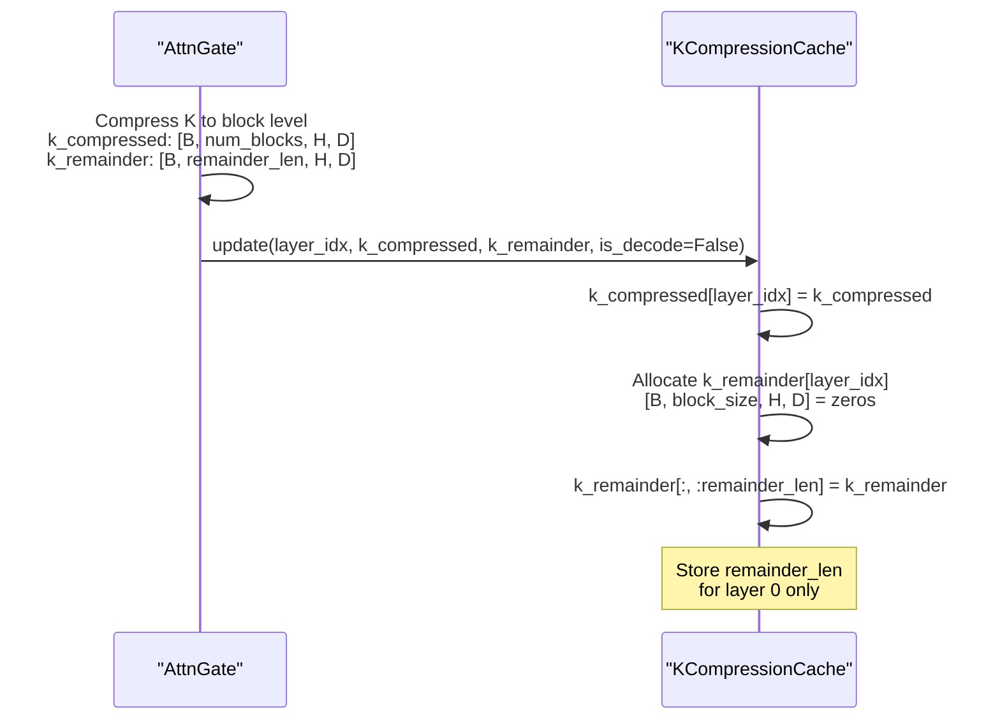

**Sources:** [seer_attn/decode_sparse/cache_utils.py:41-54]()

#### Decode Update (Single Token)

During decode, one token at a time is added to the remainder buffer:

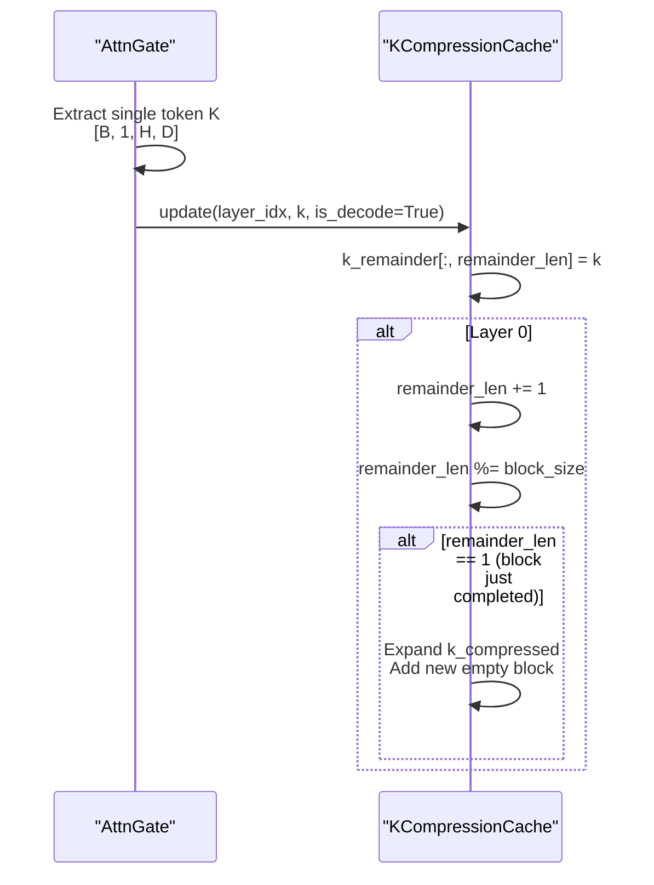

The `remainder_len` counter is only updated for layer 0 but applies to all layers, ensuring synchronized block completion across the model.

**Sources:** [seer_attn/decode_sparse/cache_utils.py:56-65]()

---

## Batch Management

During generation with `batch_exist_generate()`, sequences finish at different times. The cache management system supports dynamic batch size reduction by removing finished sequences.

### Batch Selection Interface

Both cache types support `batch_select_indices()` to reorganize their contents:

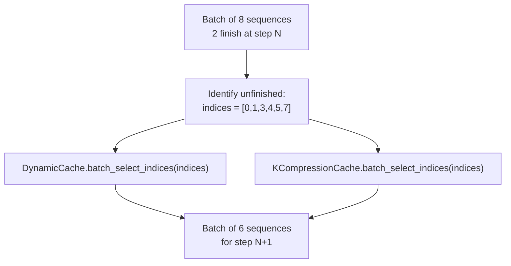

### Implementation

The `KCompressionCache.batch_select_indices()` method:

```python
def batch_select_indices(self, indices: torch.Tensor):
    for layer in range(self.num_layers):
        self.k_compressed[layer] = self.k_compressed[layer][indices, ...]
        self.k_remainder[layer] = self.k_remainder[layer][indices, ...]
```

This slices the batch dimension of both compressed and remainder tensors across all layers.

**Sources:** [seer_attn/decode_sparse/cache_utils.py:23-26](), [seer_attn/decode_sparse/qwen2/modeling_qwen2_seerattn_inference.py:750-756]()

---

## Integration with Generation

### Standard Generation Loop

In the standard generation flow, caches persist across all decode steps:

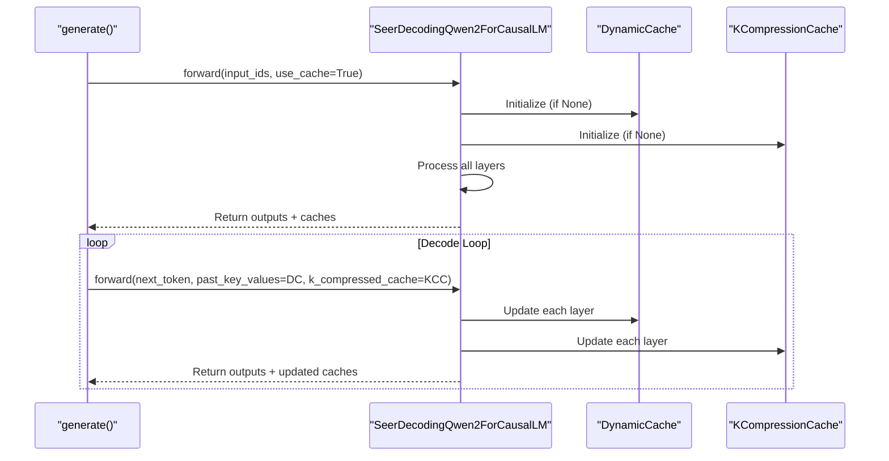

**Sources:** [seer_attn/decode_sparse/qwen2/modeling_qwen2_seerattn_inference.py:601-612]()

### Batch Exist Generate

The `batch_exist_generate()` method implements dynamic batch sizing with cache reorganization:

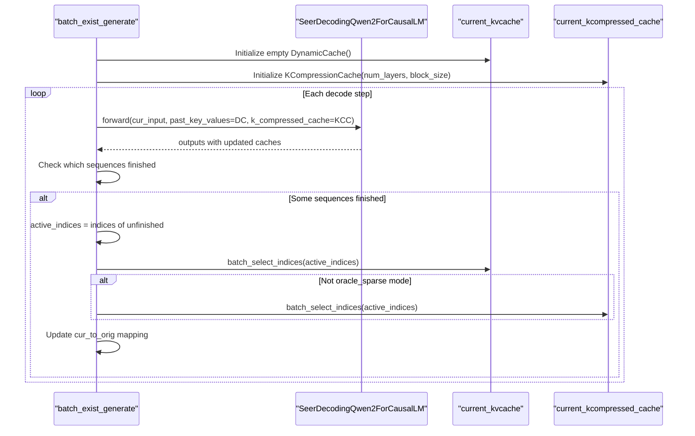

The key aspects:
1. Local cache instances (`current_kvcache`, `current_kcompressed_cache`) are created for the generation session
2. After each step, finished sequences are detected via EOS token matching
3. Active indices are computed and used to reorganize both caches
4. The `cur_to_orig` tensor tracks mapping from current batch positions to original positions

**Sources:** [seer_attn/decode_sparse/qwen2/modeling_qwen2_seerattn_inference.py:633-757](), [eval/reasoning_tasks/eval_hf.py:309-324]()

---

## Cache Memory Layout

### Memory Efficiency Considerations

The dual-cache system is designed for memory efficiency:

1. **DynamicCache**: Stores full per-token K and V tensors
   - Memory: `2 × layers × batch × seq_len × kv_heads × head_dim`
   - Essential for attention computation

2. **KCompressionCache**: Stores block-compressed K only (not V)
   - Memory: `layers × batch × (seq_len/block_size) × kv_heads × head_dim`
   - Roughly `1/block_size` (typically 1/64) of one component of DynamicCache
   - Only used for attention gate mask generation, not attention itself

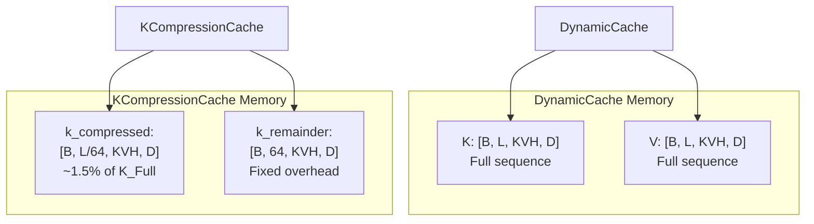

For a typical configuration (e.g., Qwen2-7B with 32 layers, 64 sequence length, 8 KV heads, 128 head dim):
- DynamicCache: `2 × 32 × B × L × 8 × 128 × 2 bytes ≈ 131KB × B × L`
- KCompressionCache: `32 × B × (L/64 + 64) × 8 × 128 × 2 bytes ≈ 2KB × B × L/64 + 2MB × B`

The compressed cache represents approximately 1.5% of the memory footprint of the full key cache.

**Sources:** [seer_attn/decode_sparse/cache_utils.py:1-67](), [seer_attn/decode_sparse/qwen2/modeling_qwen2_seerattn_inference.py:452-458]()

---

## Summary

SeerAttention's cache management system provides:

1. **Dual-cache architecture**: `DynamicCache` for full KV storage, `KCompressionCache` for block-compressed keys
2. **Efficient updates**: Single-token incremental updates during decode with block completion tracking
3. **Batch flexibility**: Support for dynamic batch size reduction via `batch_select_indices()`
4. **Memory efficiency**: Compressed cache uses ~1.5% of full key cache memory
5. **Seamless integration**: Works with both standard `generate()` and custom `batch_exist_generate()` methods

The cache system enables efficient sparse attention by maintaining compressed key representations for attention gate computation while preserving full granularity for the actual attention operations.

**Sources:** [seer_attn/decode_sparse/cache_utils.py:1-67](), [seer_attn/decode_sparse/qwen2/modeling_qwen2_seerattn_inference.py:452-458](), [eval/reasoning_tasks/eval_hf.py:309-342]()

---

