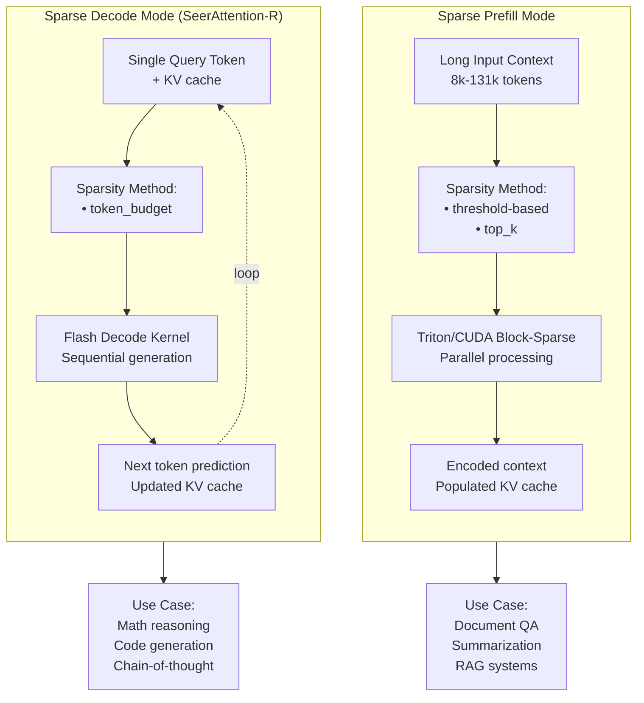
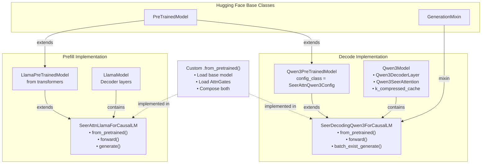
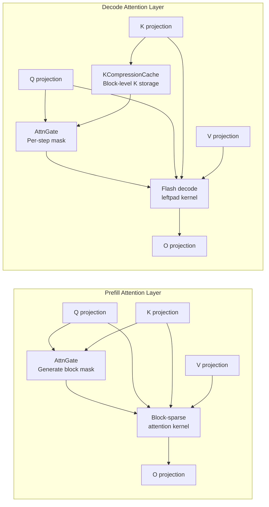
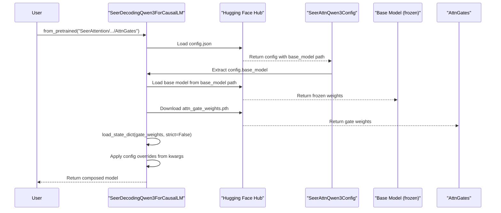

<!-- source: DeepWiki mcp.deepwiki.com · repo microsoft/SeerAttention · page 4 Model Implementations · fetched 2026-10-26 -->

# Model Implementations

<details>
<summary>Relevant source files</summary>

The following files were used as context for generating this wiki page:

- [README.md](README.md)
- [distillation_decode.py](distillation_decode.py)
- [scripts/run_distillation_prefill.sh](scripts/run_distillation_prefill.sh)
- [seer_attn/__init__.py](seer_attn/__init__.py)
- [seer_attn/decode_sparse/qwen2/modeling_qwen2_seerattn_inference.py](seer_attn/decode_sparse/qwen2/modeling_qwen2_seerattn_inference.py)
- [seer_attn/decode_sparse/qwen3/modeling_qwen3_seerattn_inference.py](seer_attn/decode_sparse/qwen3/modeling_qwen3_seerattn_inference.py)
- [seer_attn/modules/attention_distill.py](seer_attn/modules/attention_distill.py)
- [seer_attn/modules/common.py](seer_attn/modules/common.py)

</details>


## Purpose and Scope

This page provides an overview of the available model classes in SeerAttention, their architectural differences, and use cases. SeerAttention provides two distinct operational modes—**Sparse Prefill** for long-context input processing and **Sparse Decode (SeerAttention-R)** for long-reasoning token generation—each implemented as separate model classes.

For detailed information about:
- Sparse Prefill model usage and configuration, see [Sparse Prefill Models](#4.1)
- Sparse Decode model usage and configuration, see [Sparse Decode Models (SeerAttention-R)](#4.2)
- Configuration parameters and options, see [Model Configuration](#4.3)
- The underlying attention mechanism, see [SeerAttention Mechanism](#3.1)
- Training these models, see [Training and Distillation](#5)

## Model Class Overview

SeerAttention exposes four primary model classes through its public API:

```python
from seer_attn import (
    SeerAttnLlamaForCausalLM,      # Sparse Prefill: Llama architecture
    SeerAttnQwen2ForCausalLM,       # Sparse Prefill: Qwen2 architecture
    SeerDecodingQwen2ForCausalLM,   # Sparse Decode: Qwen2 architecture
    SeerDecodingQwen3ForCausalLM,   # Sparse Decode: Qwen3 architecture
)
```

These classes are organized into two operational categories based on their computational patterns and use cases.

**Sources:** [seer_attn/__init__.py:1-11]()

## Operational Modes: Prefill vs Decode



The two modes differ fundamentally in their computational characteristics:

| Aspect | Sparse Prefill | Sparse Decode (SeerAttention-R) |
|--------|----------------|----------------------------------|
| **Query length** | Many tokens (8k-131k) | Single token per step |
| **Sparsity control** | `seerattn_threshold` or `top_k` | `seerattn_token_budget` |
| **Sparsity method** | `threshold`, `top_k` | `token_budget` |
| **Kernel type** | Block-sparse attention (parallel) | Flash decode (sequential) |
| **Primary use case** | Long document encoding | Long reasoning generation |
| **Cache management** | `DynamicCache` only | `DynamicCache` + `KCompressionCache` |
| **Typical context** | Up to 131k input tokens | Up to 32k reasoning steps |

**Sources:** [README.md:8-19](), [seer_attn/decode_sparse/qwen3/modeling_qwen3_seerattn_inference.py:88-252](), [seer_attn/__init__.py:1-11]()

## Model Class Architecture Mapping

```mermaid
graph TD
    subgraph BaseArchitectures["Base Model Architectures"]
        LlamaBase["meta-llama/Llama-3.1-*<br/>Llama architecture"]
        Qwen2Base["Qwen/Qwen2.5-*<br/>Qwen2 architecture"]
        Qwen3Base["Qwen/Qwen3-*<br/>Qwen3 architecture"]
        DeepSeekBase["DeepSeek-R1-Distill-*<br/>Qwen2 architecture"]
    end
    
    subgraph PrefillModels["Sparse Prefill Models"]
        SeerAttnLlama["SeerAttnLlamaForCausalLM<br/>seer_attn.prefill_sparse.llama"]
        SeerAttnQwen2["SeerAttnQwen2ForCausalLM<br/>seer_attn.prefill_sparse.qwen"]
    end
    
    subgraph DecodeModels["Sparse Decode Models"]
        SeerDecodingQwen2["SeerDecodingQwen2ForCausalLM<br/>seer_attn.decode_sparse.qwen2"]
        SeerDecodingQwen3["SeerDecodingQwen3ForCausalLM<br/>seer_attn.decode_sparse.qwen3"]
    end
    
    subgraph Components["Shared Components"]
        AttnGate["AttnGates<br/>Learned sparsity predictors"]
        Config["Configuration Classes<br/>SeerAttnConfig variants"]
        Cache["Cache Management<br/>DynamicCache<br/>KCompressionCache"]
    end
    
    LlamaBase -->|"extends"| SeerAttnLlama
    Qwen2Base -->|"extends"| SeerAttnQwen2
    Qwen2Base -->|"extends"| SeerDecodingQwen2
    Qwen3Base -->|"extends"| SeerDecodingQwen3
    DeepSeekBase -->|"extends"| SeerDecodingQwen2
    
    AttnGate -.->|"used by"| SeerAttnLlama
    AttnGate -.->|"used by"| SeerAttnQwen2
    AttnGate -.->|"used by"| SeerDecodingQwen2
    AttnGate -.->|"used by"| SeerDecodingQwen3
    
    Config -.->|"configures"| SeerAttnLlama
    Config -.->|"configures"| SeerAttnQwen2
    Config -.->|"configures"| SeerDecodingQwen2
    Config -.->|"configures"| SeerDecodingQwen3
    
    Cache -.->|"manages"| SeerAttnLlama
    Cache -.->|"manages"| SeerAttnQwen2
    Cache -.->|"manages"| SeerDecodingQwen2
    Cache -.->|"manages"| SeerDecodingQwen3
```



**Sources:** [seer_attn/__init__.py:1-11](), [README.md:29-54]()

## Supported Base Models by Operational Mode

### Sparse Prefill Models

| Model Class | Supported Base Models | AttnGates Available | Size Range |
|-------------|----------------------|---------------------|------------|
| `SeerAttnLlamaForCausalLM` | Llama-3.1-8B, Llama-3.1-70B | Yes | 8B-70B |
| `SeerAttnQwen2ForCausalLM` | Qwen2.5-7B, Qwen2.5-14B, Qwen2.5-32B, DeepSeek-R1-Distill-Qwen-14B/32B | Yes | 7B-32B |

### Sparse Decode Models (SeerAttention-R)

| Model Class | Supported Base Models | AttnGates Available | Size Range |
|-------------|----------------------|---------------------|------------|
| `SeerDecodingQwen2ForCausalLM` | Qwen2 models | Yes (limited) | Variable |
| `SeerDecodingQwen3ForCausalLM` | Qwen3-4B, Qwen3-8B, Qwen3-14B, DeepSeek-R1-Distill-Qwen-14B | Yes | 4B-14B |

**Note:** DeepSeek-R1-Distill models use the Qwen2 architecture and are compatible with both prefill and decode model classes depending on the variant.

**Sources:** [README.md:32-54]()

## Model Class Inheritance and Key Methods



All model classes implement a custom `from_pretrained()` classmethod that:
1. Loads the `SeerAttnConfig` from the gates repository
2. Extracts `config.base_model` to identify the base model path
3. Loads the frozen base model weights from Hugging Face Hub
4. Loads the trained AttnGate weights (`attn_gate_weights.pth`)
5. Composes them together with `strict=False` parameter

**Sources:** [seer_attn/decode_sparse/qwen3/modeling_qwen3_seerattn_inference.py:769-795](), [seer_attn/decode_sparse/qwen2/modeling_qwen2_seerattn_inference.py:769-795]()

## Key Architectural Differences

### Attention Layer Implementation

**Prefill Models** use standard transformer decoder layers with modified attention:
- Standard query/key/value projections
- Block-sparse attention via Triton kernels
- `DynamicCache` for KV cache management
- Attention computed over entire input sequence

**Decode Models** use specialized decoding layers:
- Additional `k_compressed_cache` parameter in attention layers
- `KCompressionCache` for compressed key storage at block level
- Flash decode kernels optimized for single-query inference
- Per-step dynamic block mask generation



**Sources:** [seer_attn/decode_sparse/qwen3/modeling_qwen3_seerattn_inference.py:88-252]()

### Forward Method Signatures

Both prefill and decode models share similar forward signatures but handle cache differently:

**Common Parameters:**
- `input_ids`: Input token IDs
- `attention_mask`: Attention mask for padding
- `position_ids`: Position indices for RoPE
- `past_key_values`: Standard `DynamicCache` instance
- `use_cache`: Whether to return and use KV cache
- `output_attentions`: Whether to output attention weights
- `cache_position`: Current cache position

**Decode-Specific Parameters:**
- `k_compressed_cache`: Additional `KCompressionCache` instance for compressed key storage
- `logits_to_keep`: Number of logits to compute (memory optimization)

**Sources:** [seer_attn/decode_sparse/qwen3/modeling_qwen3_seerattn_inference.py:603-656](), [seer_attn/decode_sparse/qwen2/modeling_qwen2_seerattn_inference.py:578-631]()

## Model Loading and Composition



This composition strategy enables:
1. **Separate storage**: Base models and AttnGates stored independently on Hugging Face Hub
2. **No weight duplication**: Base model weights not copied for each AttnGates variant
3. **Flexible mixing**: Same base model can be paired with different gate configurations
4. **Lightweight adapters**: AttnGates range from 66 MB to 503 MB

**Sources:** [seer_attn/decode_sparse/qwen3/modeling_qwen3_seerattn_inference.py:769-795]()

## Choosing Between Model Types

### Use Sparse Prefill Models When:
- Processing long documents (8k-131k tokens) in a single forward pass
- Performing document QA, summarization, or retrieval tasks
- Input length is the bottleneck (not generation length)
- Using threshold-based or top-k sparsity is appropriate
- Benchmarking on long-context tasks like LongBench, RULER, or PG19

### Use Sparse Decode Models (SeerAttention-R) When:
- Generating long reasoning chains or thought processes
- Performing mathematical reasoning, code generation, or complex problem-solving
- Generation length is the bottleneck (e.g., >1k tokens output)
- Using token budget constraints (e.g., 1k-8k tokens of KV cache)
- Benchmarking on reasoning tasks like AIME, MATH, or GPQA
- Need dynamic batch reduction via `batch_exist_generate()`

**Sources:** [README.md:8-19](), [README.md:73-113]()

## Implementation Mode Selection

All model classes support three implementation modes controlled by the `seerattn_implementation` configuration parameter:

| Mode | Description | Use Case |
|------|-------------|----------|
| `"seer_sparse"` | Use learned AttnGates for sparsity | Production inference with trained gates |
| `"seer_dense"` | Disable sparsity, dense attention | Baseline comparison, no gates needed |
| `"oracle_sparse"` | Use ground truth attention scores | Research, upper bound analysis |

**Oracle mode** computes exact attention scores and applies sparsity threshold directly, providing an upper bound on achievable accuracy with perfect sparsity prediction.

**Sources:** [seer_attn/decode_sparse/qwen3/modeling_qwen3_seerattn_inference.py:192-217]()

## Training vs Inference Model Classes

The codebase maintains separate model implementations for training and inference:

**Training Models:**
- `seer_attn.decode_sparse.qwen2.modeling_qwen2_seerattn_training.SeerAttnQwen2ForCausalLM`
- `seer_attn.decode_sparse.qwen3.modeling_qwen3_seerattn_training.SeerAttnQwen3ForCausalLM`
- Include additional loss computation logic (`gate_loss`)
- Used by `AttnGateTrainer` in distillation scripts

**Inference Models:**
- `seer_attn.decode_sparse.qwen2.modeling_qwen2_seerattn_inference.SeerDecodingQwen2ForCausalLM`
- `seer_attn.decode_sparse.qwen3.modeling_qwen3_seerattn_inference.SeerDecodingQwen3ForCausalLM`
- Optimized for generation and evaluation
- Include custom generation methods like `batch_exist_generate()`

The public API (`seer_attn.__init__`) only exports the inference models.

**Sources:** [distillation_decode.py:14-16](), [seer_attn/__init__.py:1-11]()

## Next Steps

- For usage examples and configuration of prefill models, see [Sparse Prefill Models](#4.1)
- For usage examples and configuration of decode models, see [Sparse Decode Models (SeerAttention-R)](#4.2)
- For detailed configuration parameters, see [Model Configuration](#4.3)
- For training your own AttnGates, see [Training and Distillation](#5)

---

