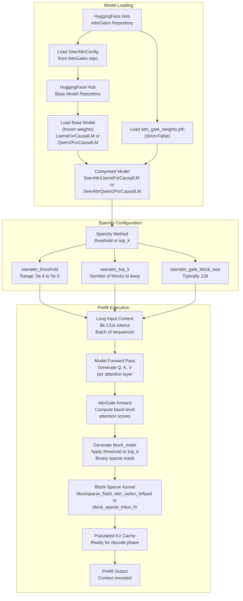
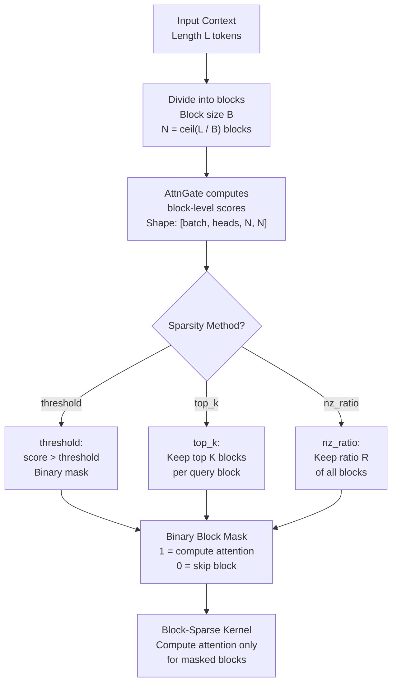
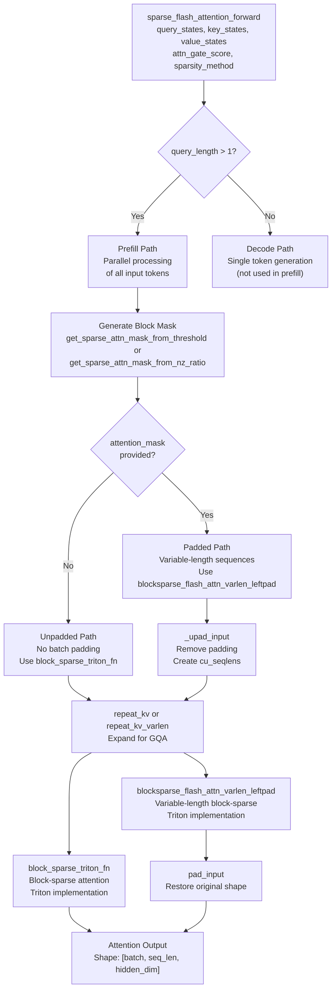
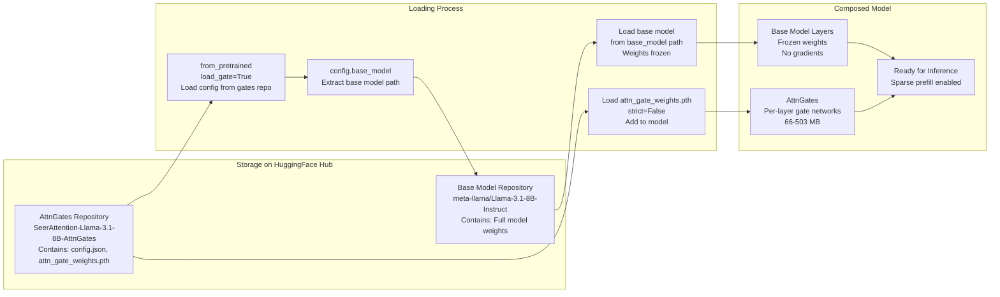
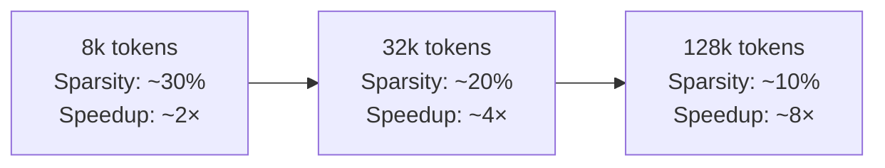

<!-- source: DeepWiki mcp.deepwiki.com · repo microsoft/SeerAttention · page 4.1 Sparse Prefill Models · fetched 2026-10-26 -->

# Sparse Prefill Models

<details>
<summary>Relevant source files</summary>

The following files were used as context for generating this wiki page:

- [README.md](README.md)
- [seer_attn/__init__.py](seer_attn/__init__.py)
- [seer_attn/modules/attention_forward.py](seer_attn/modules/attention_forward.py)

</details>


## Purpose and Scope

This page documents the sparse prefill models in SeerAttention: `SeerAttnLlamaForCausalLM` and `SeerAttnQwen2ForCausalLM`. These models are designed for efficient processing of long-context inputs during the **prefill phase** of LLM inference, where the entire input prompt is processed in parallel to populate the KV cache.

Sparse prefill models are distinct from sparse decode models in their operational mode:
- **Prefill**: Process many tokens in parallel (entire input context)
- **Decode**: Generate one token at a time (see [Sparse Decode Models](#4.2))

For information about AttnGates that enable sparsity, see [AttnGates](#3.2). For sparsity control methods, see [Sparsity Methods](#3.3). For the underlying attention mechanism, see [SeerAttention Mechanism](#3.1).

**Sources:** [README.md:1-174](), [seer_attn/__init__.py:1-11]()

---

## Overview

Sparse prefill models enable efficient long-context processing by applying block-level sparse attention during the prefill phase. They extend base Llama and Qwen2 architectures with lightweight AttnGates that learn which attention blocks can be safely skipped without degrading model quality.

### Key Characteristics

| Characteristic | Value |
|----------------|-------|
| **Use Case** | Long-context input processing (prefill phase) |
| **Supported Architectures** | Llama-3.1, Qwen2.5 |
| **Sequence Lengths** | 8k to 131k tokens |
| **Sparsity Methods** | `threshold`, `top_k` |
| **Block-Level Sparsity** | Hardware-efficient, block size typically 128 |
| **Parallelization** | Full parallel processing of input context |
| **AttnGates Size** | 77 MB to 503 MB (separate from base model) |

**Sources:** [README.md:29-54]()

---

## Model Classes

### SeerAttnLlamaForCausalLM

Sparse prefill model for Llama-3.1 architectures. Extends the base `LlamaForCausalLM` with AttnGates for learned sparse attention patterns.

**Available Configurations:**
- Llama-3.1-8B-Instruct (101 MB AttnGates)
- Llama-3.1-70B-Instruct (503 MB AttnGates)

**File Location:** [seer_attn/prefill_sparse/llama/modeling_llama_seerattn.py]()

### SeerAttnQwen2ForCausalLM

Sparse prefill model for Qwen2.5 architectures. Extends the base `Qwen2ForCausalLM` with AttnGates for learned sparse attention patterns.

**Available Configurations:**
- Qwen2.5-7B-Instruct (77 MB AttnGates)
- Qwen2.5-14B-Instruct (189 MB AttnGates)
- Qwen2.5-32B-Instruct (252 MB AttnGates)
- DeepSeek-R1-Distill-Qwen-14B (189 MB AttnGates)
- DeepSeek-R1-Distill-Qwen-32B (252 MB AttnGates)

**File Location:** [seer_attn/prefill_sparse/qwen/modeling_qwen2_seerattn.py]()

**Sources:** [README.md:42-54](), [seer_attn/__init__.py:2-3]()

---

## Architecture and Data Flow

The following diagram illustrates how sparse prefill models compose base models with AttnGates and process long-context inputs:

### Sparse Prefill Model Architecture



**Sources:** [README.md:70-113](), [seer_attn/modules/attention_forward.py:23-112]()

---

## Usage Examples

### Loading a Sparse Prefill Model with Threshold Sparsity

```python
from transformers import AutoTokenizer, AutoConfig
from seer_attn import SeerAttnLlamaForCausalLM
import torch

# Load Llama-3.1-8B with threshold-based sparsity
model_name = "SeerAttention/SeerAttention-Llama-3.1-8B-AttnGates"
config = AutoConfig.from_pretrained(model_name)
tokenizer = AutoTokenizer.from_pretrained(
    config.base_model,
    padding_side="left",
)

model = SeerAttnLlamaForCausalLM.from_pretrained(
    model_name,
    torch_dtype=torch.bfloat16,
    seerattn_sparsity_method='threshold',
    seerattn_threshold=5e-4,  # Higher = sparser
).cuda()

# The model is now ready for inference
# AttnGates and base model are automatically composed
```

### Loading a Qwen2 Model with Top-K Sparsity

```python
from transformers import AutoTokenizer, AutoConfig
from seer_attn import SeerAttnQwen2ForCausalLM
import torch

# Load Qwen2.5-7B with top-k sparsity
model_name = "SeerAttention/SeerAttention-Qwen2.5-7B-AttnGates"
config = AutoConfig.from_pretrained(model_name)
tokenizer = AutoTokenizer.from_pretrained(
    config.base_model,
    padding_side="left",
)

model = SeerAttnQwen2ForCausalLM.from_pretrained(
    model_name,
    torch_dtype=torch.bfloat16,
    seerattn_sparsity_method='top_k',
    seerattn_top_k=512,  # Keep top 512 blocks
).cuda()
```

**Sources:** [README.md:96-113]()

---

## Sparsity Configuration

### Configuration Parameters

The following table lists all sparsity-related configuration parameters for sparse prefill models:

| Parameter | Type | Description | Default |
|-----------|------|-------------|---------|
| `seerattn_sparsity_method` | `str` | Sparsity selection method: `'threshold'`, `'top_k'`, or `'nz_ratio'` | Required |
| `seerattn_threshold` | `float` | Threshold value for block score cutoff (used with `threshold` method) | `5e-4` to `5e-3` |
| `seerattn_top_k` | `int` | Number of top blocks to keep (used with `top_k` method) | Model-dependent |
| `seerattn_nz_ratio` | `float` | Non-zero ratio for sparsity (used with `nz_ratio` method) | `0.1` to `1.0` |
| `seerattn_gate_block_size` | `int` | Block size for sparse attention | `128` |
| `seerattn_start_layer` | `int` | Layer index to start applying sparsity | `0` |
| `seerattn_last_block_dense` | `bool` | Keep last block dense (for causal attention) | `True` |

### Sparsity Method Selection



**Sources:** [seer_attn/modules/attention_forward.py:23-112](), [seer_attn/modules/common.py]()

---

## Sparse Attention Forward Pass

The prefill phase sparse attention is implemented in `sparse_flash_attention_forward`, which handles both padded and unpadded sequences.

### Prefill Forward Pass Flow



**Sources:** [seer_attn/modules/attention_forward.py:23-112]()

### Code Reference for Prefill Forward

The main prefill logic is in [seer_attn/modules/attention_forward.py:42-93]():

Key operations:
1. **Mask Generation** (lines 43-52): Convert AttnGate scores to binary masks using threshold or nz_ratio
2. **Unpadded Sequence Path** (lines 54-69): Direct block-sparse computation for sequences without padding
3. **Padded Sequence Path** (lines 71-93): Handle variable-length batches with `cu_seqlens` indexing

**Sources:** [seer_attn/modules/attention_forward.py:23-112]()

---

## Kernel Selection

Sparse prefill models use different kernels based on sequence padding:

### Kernel Selection Logic

| Condition | Kernel Used | File Location |
|-----------|-------------|---------------|
| No padding (`attention_mask is None`) | `block_sparse_triton_fn` | [seer_attn/kernels/block_sparse_attn.py]() |
| With padding (`attention_mask` provided) | `blocksparse_flash_attn_varlen_leftpad` | [seer_attn/kernels/varlen/block_sparse_attn_varlen_2d_leftpad.py]() |

Both kernels support:
- **Block-level sparsity**: Skip entire blocks of attention computation
- **Grouped Query Attention (GQA)**: Efficient multi-query attention
- **Variable sequence lengths**: Handle different lengths in a batch
- **Left-padding alignment**: Compatible with standard LLM batch processing

For detailed kernel documentation, see [Triton Kernels](#6.1) and [CUDA and Flash Decode Kernels](#6.2).

**Sources:** [seer_attn/modules/attention_forward.py:60-92]()

---

## Model Composition

Sparse prefill models use a composition pattern where base model weights and AttnGates are stored separately and combined at load time.

### Composition Process



**Benefits of Composition:**
- **Storage Efficiency**: Base model weights not duplicated
- **Modularity**: Same base model can be used with different AttnGates
- **Easy Updates**: AttnGates can be updated independently
- **Backward Compatibility**: Base models remain unchanged

**Sources:** [README.md:29-31](), [README.md:70-113]()

---

## Performance Characteristics

### Memory and Speed

Sparse prefill models provide memory and speed benefits during long-context processing:

| Metric | Dense Attention | Sparse Attention (threshold=5e-4) | Improvement |
|--------|-----------------|-----------------------------------|-------------|
| **Memory Usage** | O(L²) | O(L² × sparsity) | ~50-90% reduction |
| **Computation** | All blocks computed | Only selected blocks | ~2-10× speedup |
| **Quality** | Baseline | ~99% of dense performance | Minimal degradation |

Where L is the sequence length and sparsity is typically 0.1-0.5 (10-50% of blocks active).

### Sequence Length Scaling



Longer sequences benefit more from sparsity as the quadratic attention cost grows.

**Sources:** README mentions efficiency improvements, evaluation benchmarks in [eval/]() directory

---

## Configuration Examples

### Aggressive Sparsity (Maximum Speed)

```python
model = SeerAttnQwen2ForCausalLM.from_pretrained(
    "SeerAttention/SeerAttention-Qwen2.5-7B-AttnGates",
    torch_dtype=torch.bfloat16,
    seerattn_sparsity_method='threshold',
    seerattn_threshold=5e-3,  # High threshold = very sparse
    seerattn_start_layer=0,
    seerattn_last_block_dense=True,
).cuda()
```

### Conservative Sparsity (Maximum Quality)

```python
model = SeerAttnLlamaForCausalLM.from_pretrained(
    "SeerAttention/SeerAttention-Llama-3.1-8B-AttnGates",
    torch_dtype=torch.bfloat16,
    seerattn_sparsity_method='threshold',
    seerattn_threshold=5e-4,  # Low threshold = less sparse
    seerattn_start_layer=0,
    seerattn_last_block_dense=True,
).cuda()
```

### Top-K Based Sparsity

```python
model = SeerAttnQwen2ForCausalLM.from_pretrained(
    "SeerAttention/SeerAttention-Qwen2.5-14B-AttnGates",
    torch_dtype=torch.bfloat16,
    seerattn_sparsity_method='top_k',
    seerattn_top_k=512,  # Keep top 512 blocks per query
    seerattn_gate_block_size=128,
).cuda()
```

**Sources:** [README.md:96-113]()

---

## Integration with Evaluation Framework

Sparse prefill models are evaluated using the long-context benchmarks in the evaluation framework. The following benchmarks specifically test prefill performance:

### Supported Benchmarks

| Benchmark | Purpose | Sparsity Method | Sequence Lengths |
|-----------|---------|-----------------|------------------|
| **PG19 Perplexity** | Language modeling quality | `nz_ratio` or `top_k` | 8k-131k tokens |
| **LongBench** | Multi-task long-context | `threshold=2e-3` | 0-8k+ tokens |
| **RULER** | Retrieval tasks | `threshold=5e-4` | 4k-128k tokens |

For detailed evaluation procedures, see [Long-Context Benchmarks](#7.2) and [Running Evaluations](#7.4).

**Sources:** Evaluation framework as described in high-level diagrams

---

## Related Pages

- [SeerAttention Mechanism](#3.1) - Details of the sparse attention algorithm
- [AttnGates](#3.2) - Architecture and training of attention gates
- [Sparsity Methods](#3.3) - In-depth explanation of threshold, top_k, and nz_ratio methods
- [Sparse Decode Models (SeerAttention-R)](#4.2) - Token-by-token generation with sparsity
- [Model Configuration](#4.3) - Complete configuration reference
- [Training Scripts and Data](#5.2) - How to train your own AttnGates
- [Triton Kernels](#6.1) - Block-sparse kernel implementations
- [Long-Context Benchmarks](#7.2) - Evaluation on long sequences

**Sources:** Table of contents structure

---

