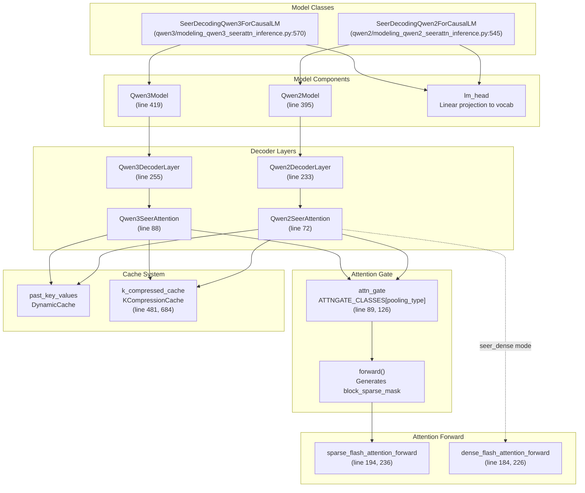
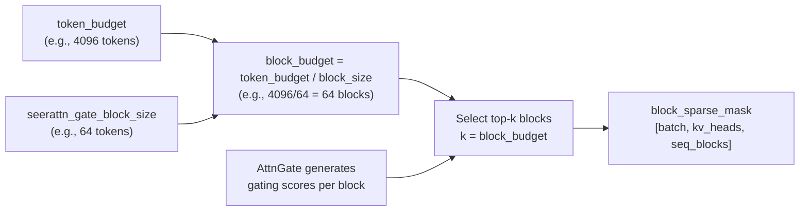
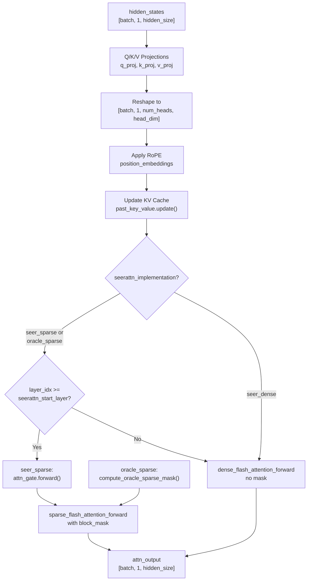
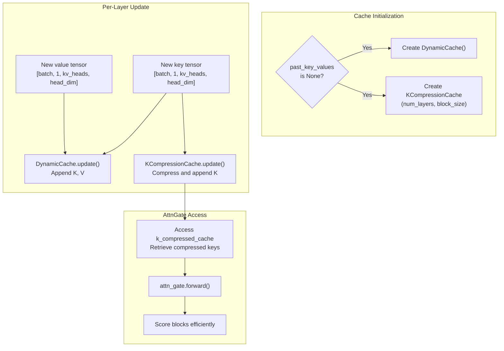
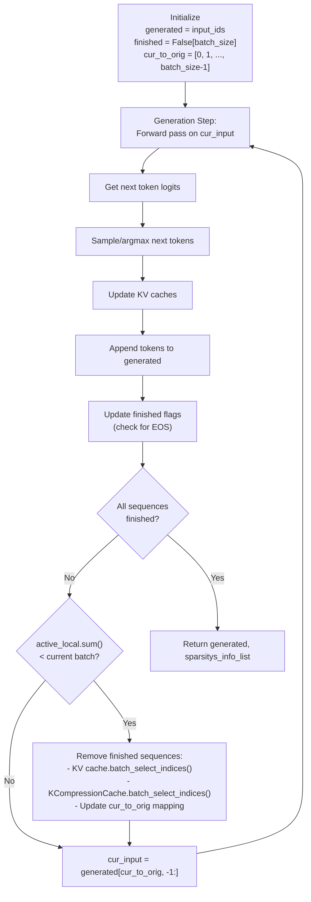

<!-- source: DeepWiki mcp.deepwiki.com · repo microsoft/SeerAttention · page 4.2 Sparse Decode Models (SeerAttention-R) · fetched 2026-10-26 -->

# Sparse Decode Models (SeerAttention-R)

<details>
<summary>Relevant source files</summary>

The following files were used as context for generating this wiki page:

- [README.md](README.md)
- [distillation_decode.py](distillation_decode.py)
- [scripts/run_distillation_prefill.sh](scripts/run_distillation_prefill.sh)
- [seer_attn/__init__.py](seer_attn/__init__.py)
- [seer_attn/decode_sparse/qwen2/modeling_qwen2_seerattn_inference.py](seer_attn/decode_sparse/qwen2/modeling_qwen2_seerattn_inference.py)
- [seer_attn/decode_sparse/qwen3/modeling_qwen3_seerattn_inference.py](seer_attn/decode_sparse/qwen3/modeling_qwen3_seerattn_inference.py)
- [seer_attn/modules/attention_distill.py](seer_attn/modules/attention_distill.py)
- [seer_attn/modules/common.py](seer_attn/modules/common.py)

</details>


## Purpose and Scope

This page documents the sparse decode model implementations in SeerAttention, referred to as **SeerAttention-R** in the research paper. These models enable efficient token-by-token generation during long-reasoning tasks by applying learned block-level sparsity during the decode phase. Unlike sparse prefill models (see [4.1](#4.1)), which process long input contexts, sparse decode models optimize each step of autoregressive generation.

Sparse decode models use a **token budget** sparsity method rather than threshold-based selection, making them suitable for controlling computational costs during extended chain-of-thought reasoning. They are evaluated on reasoning benchmarks including AIME, MATH, and GPQA.

For information about training these models, see [5](#5). For details on the underlying kernels, see [6.2](#6.2).

---

## Model Classes

SeerAttention provides two sparse decode model implementations, both supporting Qwen architectures:

| Class | Base Architecture | File Location | Purpose |
|-------|------------------|---------------|---------|
| `SeerDecodingQwen2ForCausalLM` | Qwen 2.x | [seer_attn/decode_sparse/qwen2/modeling_qwen2_seerattn_inference.py]() | Sparse decode for Qwen2 models |
| `SeerDecodingQwen3ForCausalLM` | Qwen 3.x | [seer_attn/decode_sparse/qwen3/modeling_qwen3_seerattn_inference.py]() | Sparse decode for Qwen3 models |

Both classes inherit from their respective base model classes and integrate with Hugging Face's `GenerationMixin` for standard generation interfaces.

**Key differences from prefill models:**
- Query length is always 1 (single token generation)
- Use token budget instead of threshold for sparsity
- Employ `KCompressionCache` for efficient key compression
- Support dynamic batch size adjustment via `batch_exist_generate`

Sources: [seer_attn/__init__.py:4-5](), [seer_attn/decode_sparse/qwen2/modeling_qwen2_seerattn_inference.py:545](), [seer_attn/decode_sparse/qwen3/modeling_qwen3_seerattn_inference.py:570]()

---

## Architecture Overview



**Architecture**: Both decode models follow the same structure. The main model class contains a base model (decoder stack) and language modeling head. Each decoder layer includes a `SeerAttention` module that conditionally uses sparse or dense attention based on configuration. The attention gate generates block-sparse masks at each decoding step.

Sources: [seer_attn/decode_sparse/qwen2/modeling_qwen2_seerattn_inference.py:545-631](), [seer_attn/decode_sparse/qwen3/modeling_qwen3_seerattn_inference.py:570-656]()

---

## Token Budget Sparsity Method

Sparse decode models use a **token budget** approach rather than threshold-based sparsity. This method selects a fixed number of key-value blocks to attend to at each generation step, providing predictable computational costs.

### How Token Budget Works



**Calculation**: The token budget is converted to a block budget at initialization:
- `block_budget = seerattn_token_budget // seerattn_gate_block_size`
- Typical values: token_budget=1024-8192, block_size=64, resulting in block_budget=16-128

At each decoding step, the attention gate scores all key blocks and selects the top `block_budget` blocks based on learned importance scores.

Sources: [seer_attn/decode_sparse/qwen2/modeling_qwen2_seerattn_inference.py:104-105](), [seer_attn/decode_sparse/qwen3/modeling_qwen3_seerattn_inference.py:94-95]()

---

## Attention Forward Flow



**Flow Description**:
1. **Projection**: Input hidden states are projected to Q, K, V
2. **RoPE**: Rotary position embeddings are applied
3. **Cache Update**: New K and V are appended to the cache
4. **Implementation Check**: Based on `seerattn_implementation` config:
   - `"seer_sparse"`: Use learned attention gates
   - `"oracle_sparse"`: Use ground-truth importance (for analysis)
   - `"seer_dense"`: Use standard dense attention
5. **Layer Check**: Sparsity is only applied from `seerattn_start_layer` onwards
6. **Mask Generation**: Attention gate generates block-sparse mask
7. **Sparse Attention**: Flash decode kernel executes with the mask

Sources: [seer_attn/decode_sparse/qwen2/modeling_qwen2_seerattn_inference.py:108-210](), [seer_attn/decode_sparse/qwen3/modeling_qwen3_seerattn_inference.py:146-252]()

---

## Cache Management with KCompressionCache

Sparse decode models use two cache systems in parallel:

### DynamicCache
Standard KV cache storing full key and value tensors.

**Location**: [transformers.cache_utils.DynamicCache]()

### KCompressionCache
Compressed key cache storing downsampled key representations for efficient attention gate computation.

**Purpose**: The attention gate needs to score all key blocks efficiently. Instead of accessing the full KV cache (expensive), it uses compressed key representations.



**Key Methods**:
- **Initialization**: [seer_attn/decode_sparse/qwen2/modeling_qwen2_seerattn_inference.py:452-458]()
- **Update**: Called per layer during forward pass
- **Batch Selection**: `batch_select_indices()` removes finished sequences

Sources: [seer_attn/decode_sparse/cache_utils.py](), [seer_attn/decode_sparse/qwen2/modeling_qwen2_seerattn_inference.py:452-458]()

---

## Configuration Parameters

Sparse decode models use `SeerAttnQwen2Config` or `SeerAttnQwen3Config`, which extend the base model configurations with additional parameters:

| Parameter | Type | Default | Description |
|-----------|------|---------|-------------|
| `seerattn_implementation` | str | `"seer_sparse"` | Implementation mode: `"seer_sparse"`, `"seer_dense"`, or `"oracle_sparse"` |
| `seerattn_sparsity_method` | str | `"token_budget"` | Sparsity selection method (always token_budget for decode) |
| `seerattn_token_budget` | int | 4096 | Number of tokens to attend to (controls sparsity) |
| `seerattn_gate_block_size` | int | 64 | Block size for attention gating |
| `seerattn_sliding_window_size` | int | 512 | Local sliding window size |
| `seerattn_start_layer` | int | 0 | First layer to apply sparse attention |
| `seerattn_output_sparsity` | bool | False | Whether to output sparsity statistics |
| `seerattn_k_seq_pooling_type` | str | `"Kmaxminavg"` | Pooling type for key sequence compression |
| `seerattn_q_head_pooling_type` | str | `"Qproj"` | Pooling type for query head dimension |
| `seerattn_gate_hidden_size` | int | 128 | Hidden size for attention gate network |
| `seerattn_use_rope` | bool | True | Whether to use rotary embeddings in gate |
| `seerattn_use_qk_norm` | bool | False | Whether to normalize Q and K in gate |
| `use_flash_rope` | bool | True | Use flash attention's RoPE implementation |
| `fused_norm` | bool | False | Use fused RMSNorm implementation |
| `base_model` | str | Required | Path to base model on HuggingFace Hub |

**Token Budget Range**: Typical values range from 1024 to 8192 tokens, corresponding to block budgets of 16-128 blocks (with block_size=64).

Sources: [seer_attn/decode_sparse/qwen2/configuration_qwen2_seerattn.py](), [seer_attn/decode_sparse/qwen3/configuration_qwen3_seerattn.py]()

---

## Loading and Basic Usage

### Loading from Hugging Face Hub

```python
from transformers import AutoTokenizer, AutoConfig
from seer_attn import SeerDecodingQwen3ForCausalLM
import torch

# Load model with attention gates
model_name = "SeerAttention/SeerAttention-Decode-Qwen3-4B-AttnGates"
config = AutoConfig.from_pretrained(model_name)
tokenizer = AutoTokenizer.from_pretrained(
    config.base_model,
    padding_side="left",
)

# Token budget based sparsity
model = SeerDecodingQwen3ForCausalLM.from_pretrained(
    model_name,
    torch_dtype=torch.bfloat16,
    seerattn_sparsity_method='token_budget',
    seerattn_token_budget=4096,  # Attend to 4096 tokens
).cuda()
```

**from_pretrained flow**:
1. Load configuration from gates repository
2. Extract `base_model` path from config
3. Load base model weights from HuggingFace
4. Load attention gate weights (`attn_gate_weights.pth`) with `strict=False`
5. Compose base model + attention gates

Sources: [README.md:80-93](), [seer_attn/decode_sparse/qwen3/modeling_qwen3_seerattn_inference.py:769-795]()

### Standard Generation

```python
# Prepare input
messages = [{"role": "user", "content": "Solve this math problem..."}]
text = tokenizer.apply_chat_template(messages, tokenize=False)
inputs = tokenizer(text, return_tensors="pt").to(model.device)

# Generate with standard interface
outputs = model.generate(
    **inputs,
    max_new_tokens=2048,
    do_sample=True,
    temperature=0.7,
)

response = tokenizer.decode(outputs[0], skip_special_tokens=True)
```

The model works with the standard Hugging Face `generate()` interface.

---

## Batch Generation with Dynamic Sizing

Sparse decode models implement `batch_exist_generate()`, which dynamically adjusts batch size by removing finished sequences during generation. This is particularly useful for long-reasoning tasks where different sequences may finish at different times.

### batch_exist_generate Method



**Key Features**:
1. **Dynamic Batch Reduction**: When sequences finish, they are removed from the active batch
2. **Cache Reorganization**: Both `DynamicCache` and `KCompressionCache` are updated to reflect the reduced batch
3. **Mapping Tracking**: `cur_to_orig` maintains the mapping from current batch indices to original batch indices
4. **Sparsity Logging**: Optionally collects sparsity statistics per step

**Implementation**:
- Qwen2: [seer_attn/decode_sparse/qwen2/modeling_qwen2_seerattn_inference.py:633-764]()
- Qwen3: [seer_attn/decode_sparse/qwen3/modeling_qwen3_seerattn_inference.py:658-766]()

### Usage Example

```python
# Prepare batch of inputs
input_ids = tokenizer(batch_texts, return_tensors="pt", padding=True).input_ids.cuda()
attention_mask = (input_ids != tokenizer.pad_token_id).long()

# Generate with dynamic batch sizing
generated_ids, sparsity_info = model.batch_exist_generate(
    input_ids=input_ids,
    attention_mask=attention_mask,
    max_length=2048,
    do_sample=True,
)

# Decode results
responses = tokenizer.batch_decode(generated_ids, skip_special_tokens=True)
```

**Advantages**:
- Reduces memory usage as sequences finish
- Improves GPU utilization by removing padding
- Automatically handles variable-length outputs

Sources: [seer_attn/decode_sparse/qwen2/modeling_qwen2_seerattn_inference.py:633-764](), [seer_attn/decode_sparse/qwen3/modeling_qwen3_seerattn_inference.py:658-766]()

---

## Sparsity Output and Monitoring

When `seerattn_output_sparsity=True`, the model outputs sparsity statistics during generation:

```python
# Enable sparsity output
model = SeerDecodingQwen3ForCausalLM.from_pretrained(
    model_name,
    seerattn_token_budget=4096,
    seerattn_output_sparsity=True,  # Enable sparsity tracking
)

# Forward pass returns sparsity info
outputs = model(input_ids, attention_mask=attention_mask, use_cache=True)

# Access sparsity info
sparsitys_info = outputs.sparsitys_info
# Format: List of (activated_blocks, total_blocks) tuples per layer
```

**Sparsity Info Structure**:
- Only collected for `query_length == 1` (decode steps)
- Only for layers >= `seerattn_start_layer`
- Format: `(activate_block_count, original_block_count)` per layer
- Used for analyzing actual sparsity patterns

**Calculation**:
```python
activate_block_count = block_sparse_mask.sum()  # Activated blocks
original_block_count = block_attention_mask.sum() * num_key_value_heads  # Total available blocks
```

Sources: [seer_attn/decode_sparse/qwen2/modeling_qwen2_seerattn_inference.py:177-181](), [seer_attn/decode_sparse/qwen3/modeling_qwen3_seerattn_inference.py:220-223]()

---

## Implementation Modes

Sparse decode models support three implementation modes for analysis and comparison:

### seer_sparse (Default)
Uses learned attention gates to generate sparse masks:
```python
model = SeerDecodingQwen3ForCausalLM.from_pretrained(
    model_name,
    seerattn_implementation='seer_sparse',  # Default
    seerattn_token_budget=4096,
)
```

**Behavior**: `attn_gate.forward()` generates block-sparse masks based on learned patterns.

### seer_dense
Disables sparsity entirely, using standard dense attention:
```python
model = SeerDecodingQwen3ForCausalLM.from_pretrained(
    model_name,
    seerattn_implementation='seer_dense',
)
```

**Behavior**: All blocks are attended to. Useful for accuracy comparison.

### oracle_sparse
Uses ground-truth importance computed from full attention scores:
```python
model = SeerDecodingQwen3ForCausalLM.from_pretrained(
    model_name,
    seerattn_implementation='oracle_sparse',
    seerattn_token_budget=4096,
)
```

**Behavior**: `compute_oracle_sparse_mask()` computes attention scores for all blocks and selects top-k. Used for upper-bound analysis.

Sources: [seer_attn/decode_sparse/qwen2/modeling_qwen2_seerattn_inference.py:150-175](), [seer_attn/decode_sparse/qwen3/modeling_qwen3_seerattn_inference.py:192-217]()

---

## Supported Base Models

Sparse decode models are available for the following base models on Hugging Face Hub:

| Base Model | HF Repository | AttnGates Size | Block Size |
|------------|---------------|----------------|------------|
| Qwen3-4B | [SeerAttention-Decode-Qwen3-4B-AttnGates](https://huggingface.co/SeerAttention/SeerAttention-Decode-Qwen3-4B-AttnGates) | 66.1 MB | 64 |
| Qwen3-8B | [SeerAttention-Decode-Qwen3-8B-AttnGates](https://huggingface.co/SeerAttention/SeerAttention-Decode-Qwen3-8B-AttnGates) | 66.1 MB | 64 |
| Qwen3-14B | [SeerAttention-Decode-Qwen3-14B-AttnGates](https://huggingface.co/SeerAttention/SeerAttention-Decode-Qwen3-14B-AttnGates) | 83.9 MB | 64 |
| DeepSeek-R1-Distill-Qwen-14B | [SeerAttention-Decode-R1-Distill-Qwen-14B-AttnGates](https://huggingface.co/SeerAttention/SeerAttention-Decode-R1-Distill-Qwen-14B-AttnGates) | 101 MB | 64 |

**Note**: Only Qwen2 and Qwen3 architectures are currently supported for sparse decode. Support for other architectures requires implementing the corresponding decode model class.

Sources: [README.md:32-40]()

---

## Rotary Position Embeddings

Sparse decode models use multiple RoPE instances for different purposes:

### Standard RoPE
Applied to query and key tensors in attention:
```python
position_embeddings = self.rotary_emb(hidden_states, position_ids)
cos, sin = position_embeddings
q = apply_rotary_emb_func(q, cos, sin, ...)
k = apply_rotary_emb_func(k, cos, sin, ...)
```

### Block-Level RoPE
Applied to compressed keys in attention gate (when `seerattn_use_rope=True`):
```python
block_position_ids = position_ids[:, 0::seerattn_gate_block_size]
block_position_embeddings = self.block_rotary_emb(hidden_states, block_position_ids)
```

**Downsampling**: Position IDs are downsampled to match the block-level sequence length.

### Gate Query RoPE
Applied to query in attention gate:
```python
position_embeddings_gate_q = self.rotary_emb_gate_q(hidden_states, position_ids)
```

**Purpose**: Provides position information at the original sequence resolution for query-side processing in the attention gate.

Sources: [seer_attn/decode_sparse/qwen2/modeling_qwen2_seerattn_inference.py:474-482](), [seer_attn/decode_sparse/qwen3/modeling_qwen3_seerattn_inference.py:499-507]()

---

## Integration with Training

Sparse decode models have corresponding training implementations that share the same architecture but include additional functionality for self-distillation:

- **Training**: [seer_attn/decode_sparse/qwen2/modeling_qwen2_seerattn_training.py]()
- **Inference**: [seer_attn/decode_sparse/qwen2/modeling_qwen2_seerattn_inference.py]()

**Key Differences**:
- Training models compute gate loss for self-distillation
- Training models process variable-length sequences
- Inference models are optimized for token-by-token generation

For details on training sparse decode models, see [5.2](#5.2).

Sources: [distillation_decode.py:14-15](), [scripts/run_distillation_prefill.sh:1-39]()

---

## Performance Considerations

### Token Budget Selection

The token budget controls the trade-off between speed and accuracy:

| Token Budget | Block Budget (bs=64) | Sparsity | Use Case |
|--------------|---------------------|----------|----------|
| 1024 | 16 blocks | High (~95%) | Maximum speedup |
| 2048 | 32 blocks | Moderate (~90%) | Balanced |
| 4096 | 64 blocks | Low (~85%) | High accuracy |
| 8192 | 128 blocks | Minimal (~70%) | Conservative |

**Recommendation**: Start with 4096 and adjust based on task requirements.

### Layer-wise Sparsity

The `seerattn_start_layer` parameter controls which layers use sparse attention:

```python
model = SeerDecodingQwen3ForCausalLM.from_pretrained(
    model_name,
    seerattn_start_layer=8,  # Only layers 8+ use sparse attention
    seerattn_token_budget=4096,
)
```

**Strategy**: Early layers often benefit from dense attention for feature extraction, while later layers can use sparse attention for reasoning.

### Memory Usage

Memory usage is dominated by:
1. **KV Cache**: Grows with sequence length
2. **KCompressionCache**: ~10-20% of KV cache size
3. **Model Weights**: Shared across all sequences in batch

**Batch Size**: With dynamic batch generation, memory is automatically freed as sequences complete.

Sources: [seer_attn/decode_sparse/qwen2/modeling_qwen2_seerattn_inference.py:104-106](), [seer_attn/decode_sparse/qwen3/modeling_qwen3_seerattn_inference.py:94-96]()

---

