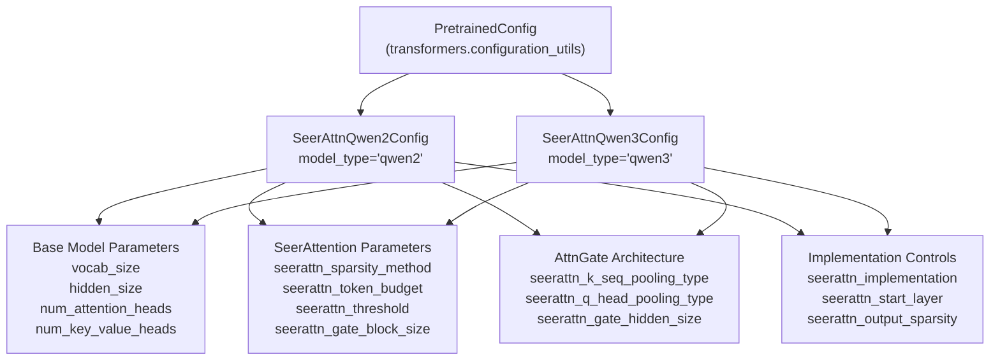
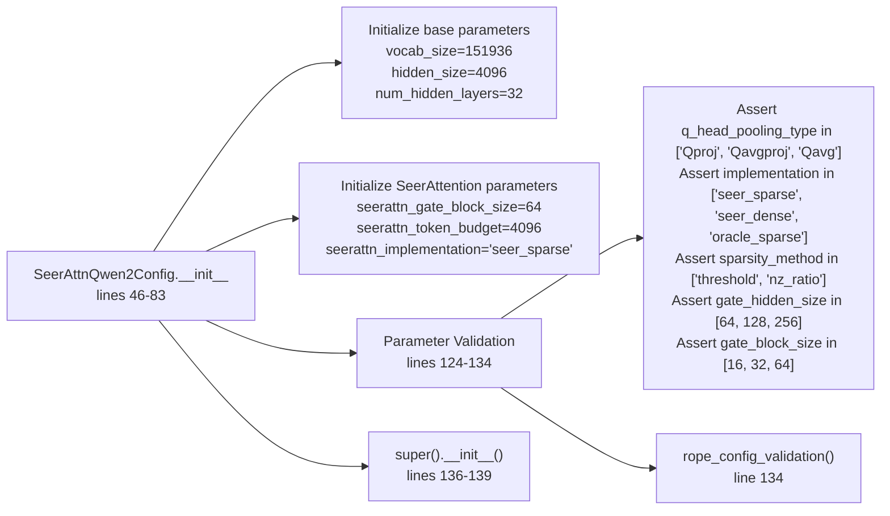
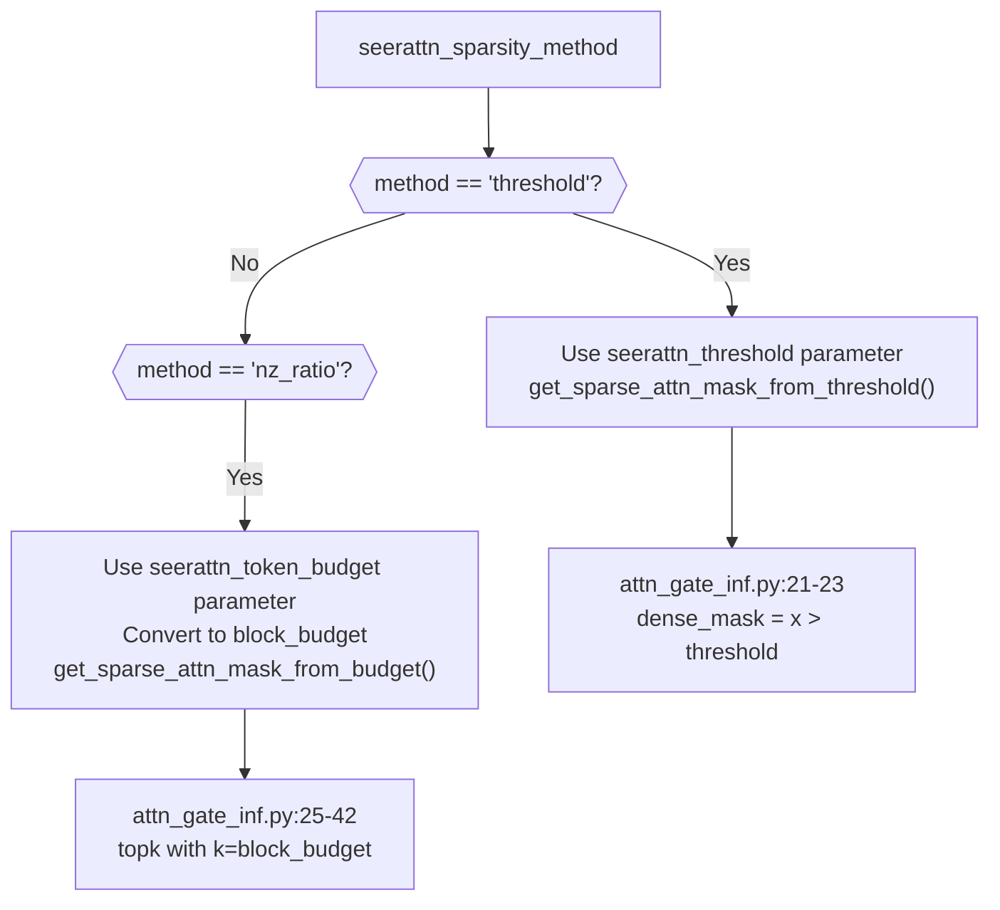
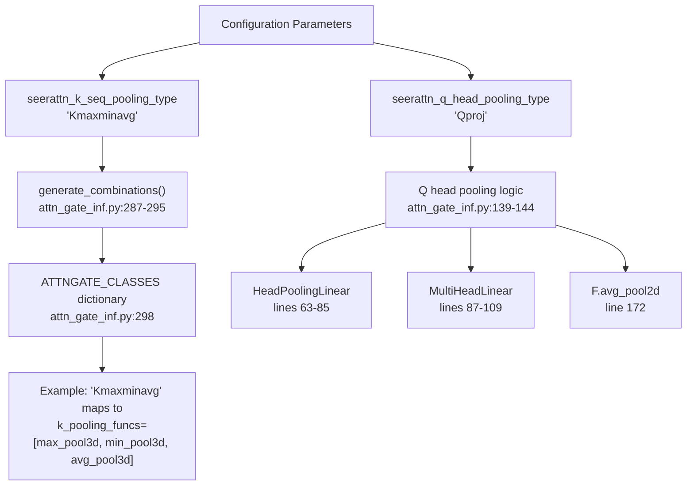
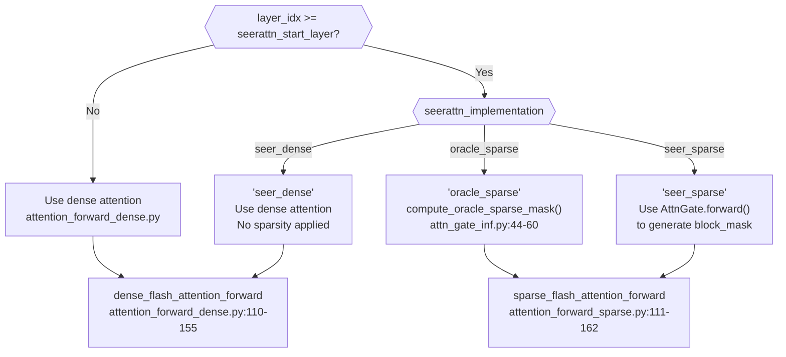

<!-- source: DeepWiki mcp.deepwiki.com · repo microsoft/SeerAttention · page 4.3 Model Configuration · fetched 2026-10-26 -->

# Model Configuration

<details>
<summary>Relevant source files</summary>

The following files were used as context for generating this wiki page:

- [seer_attn/decode_sparse/attention_forward_dense.py](seer_attn/decode_sparse/attention_forward_dense.py)
- [seer_attn/decode_sparse/attention_forward_sparse.py](seer_attn/decode_sparse/attention_forward_sparse.py)
- [seer_attn/decode_sparse/attn_gate_inf.py](seer_attn/decode_sparse/attn_gate_inf.py)
- [seer_attn/decode_sparse/qwen2/configuration_qwen2_seerattn.py](seer_attn/decode_sparse/qwen2/configuration_qwen2_seerattn.py)
- [seer_attn/kernels/varlen/block_sparse_flash_decode_varlen_mask_leftpad.py](seer_attn/kernels/varlen/block_sparse_flash_decode_varlen_mask_leftpad.py)
- [seer_attn/kernels/varlen/flash_decode_varlen_left_pad_max_v2.py](seer_attn/kernels/varlen/flash_decode_varlen_left_pad_max_v2.py)

</details>


## Purpose and Scope

This document provides a complete reference for SeerAttention configuration classes and their parameters. Configuration classes control all aspects of sparse attention behavior, including sparsity methods, AttnGate architecture, block sizes, and implementation modes. This page covers `SeerAttnQwen2Config` and `SeerAttnQwen3Config`, which extend the base Transformers configuration system to add SeerAttention-specific parameters.

For information about how these configurations are used during model loading, see [Getting Started](#2). For details about AttnGate architecture controlled by these parameters, see [AttnGates](#3.2). For sparsity method details, see [Sparsity Methods](#3.3).

---

## Configuration Class Architecture

SeerAttention configuration classes inherit from `PretrainedConfig` and extend base model configurations with sparse attention parameters. The configuration system enables:

1. **Separation of concerns**: Base model parameters (vocabulary size, hidden dimensions) are kept separate from SeerAttention parameters (sparsity thresholds, gate architectures)
2. **HuggingFace Hub integration**: Configurations are stored in `config.json` within AttnGates repositories
3. **Automatic validation**: Parameter constraints are checked at initialization
4. **Backward compatibility**: Standard Transformers parameters remain unchanged



**Sources**: [seer_attn/decode_sparse/qwen2/configuration_qwen2_seerattn.py:1-139]()

---

## SeerAttnQwen2Config Class Definition

The primary configuration class for SeerAttention-enabled Qwen2 models is located at [seer_attn/decode_sparse/qwen2/configuration_qwen2_seerattn.py:25-139](). Key characteristics:

- **Class name**: `SeerAttnQwen2Config`
- **Model type**: `"qwen2"`
- **Inheritance**: `PretrainedConfig` from `transformers.configuration_utils`
- **Default initialization**: [configuration_qwen2_seerattn.py:46-83]() shows all default values
- **Validation**: [configuration_qwen2_seerattn.py:124-134]() enforces parameter constraints



**Sources**: [seer_attn/decode_sparse/qwen2/configuration_qwen2_seerattn.py:46-139]()

---

## Base Model Parameters

These parameters define the underlying transformer architecture and are inherited from standard Qwen2 configuration:

| Parameter | Type | Default | Description |
|-----------|------|---------|-------------|
| `vocab_size` | `int` | `151936` | Size of vocabulary for tokenizer |
| `hidden_size` | `int` | `4096` | Dimension of hidden states |
| `intermediate_size` | `int` | `22016` | Dimension of MLP intermediate layer |
| `num_hidden_layers` | `int` | `32` | Number of transformer layers |
| `num_attention_heads` | `int` | `32` | Number of query attention heads |
| `num_key_value_heads` | `int` | `32` | Number of key/value heads (for GQA) |
| `hidden_act` | `str` | `"silu"` | Activation function for MLP |
| `max_position_embeddings` | `int` | `32768` | Maximum sequence length for position embeddings |
| `initializer_range` | `float` | `0.02` | Standard deviation for weight initialization |
| `rms_norm_eps` | `float` | `1e-6` | Epsilon for RMSNorm layers |
| `use_cache` | `bool` | `True` | Whether to use KV cache during generation |
| `rope_theta` | `float` | `10000.0` | Base frequency for RoPE embeddings |
| `rope_scaling` | `dict/None` | `None` | Configuration for RoPE scaling (NTK, YaRN, etc.) |
| `attention_dropout` | `float` | `0.0` | Dropout probability for attention weights |
| `use_sliding_window` | `bool` | `False` | Whether to use sliding window attention |
| `sliding_window` | `int` | `4096` | Size of sliding window if enabled |
| `max_window_layers` | `int` | `28` | Number of layers to apply sliding window |
| `fused_norm` | `bool` | `False` | Whether to use fused RMSNorm kernel |
| `use_flash_rope` | `bool` | `False` | Whether to use Flash Attention's RoPE implementation |
| `tie_word_embeddings` | `bool` | `False` | Whether to tie input/output embeddings |

**Sources**: [seer_attn/decode_sparse/qwen2/configuration_qwen2_seerattn.py:48-66](), [configuration_qwen2_seerattn.py:84-106]()

---

## SeerAttention Sparsity Parameters

These parameters control sparse attention behavior and determine which tokens/blocks are attended to:

### Core Sparsity Controls

| Parameter | Type | Default | Valid Values | Description |
|-----------|------|---------|--------------|-------------|
| `seerattn_sparsity_method` | `str` | `"threshold"` | `["threshold", "nz_ratio"]` | Method for determining sparsity:<br/>• `"threshold"`: Keep blocks with attention weight > threshold<br/>• `"nz_ratio"`: Keep top-k blocks (via token budget) |
| `seerattn_threshold` | `float` | `0.0` | Any float | Threshold value for `"threshold"` sparsity method. Typical values: `5e-4` to `5e-3` |
| `seerattn_token_budget` | `int` | `4096` | Any positive int | Number of tokens to keep for `"token_budget"` method (converted to block budget internally) |
| `seerattn_sliding_window_size` | `int` | `0` | Any non-negative int | Size of sliding window for local attention. `0` means no sliding window |

**Usage example**: For decode with token budget of 4096 tokens and block size 64, the block budget becomes `4096 // 64 = 64` blocks.

**Sources**: [seer_attn/decode_sparse/qwen2/configuration_qwen2_seerattn.py:68-71](), [configuration_qwen2_seerattn.py:109-112]()

### Sparsity Method Selection Logic



**Sources**: [seer_attn/decode_sparse/attn_gate_inf.py:21-42](), [attn_gate_inf.py:224-228]()

---

## AttnGate Architecture Parameters

These parameters define the architecture of the attention gate that produces sparse masks:

| Parameter | Type | Default | Valid Values | Description |
|-----------|------|---------|--------------|-------------|
| `seerattn_gate_block_size` | `int` | `64` | `[16, 32, 64]` | Block size for block-sparse attention. Affects memory-compute tradeoff |
| `seerattn_gate_hidden_size` | `int` | `128` | `[64, 128, 256]` | Hidden dimension for AttnGate projections |
| `seerattn_k_seq_pooling_type` | `str` | `"Kmaxminavg"` | Any combination of `"max"`, `"min"`, `"avg"` | Pooling functions for K sequence dimension:<br/>• `"Kmax"`: Max pooling only<br/>• `"Kmaxminavg"`: Concatenate max, min, avg pools |
| `seerattn_q_head_pooling_type` | `str` | `"Qproj"` | `["Qproj", "Qavgproj", "Qavg"]` | Query head pooling strategy:<br/>• `"Qproj"`: HeadPoolingLinear projection<br/>• `"Qavgproj"`: Average then project<br/>• `"Qavg"`: Average pooling only |
| `seerattn_use_rope` | `bool` | `True` | `[True, False]` | Whether to apply RoPE to AttnGate Q/K |
| `seerattn_use_qk_norm` | `bool` | `False` | `[True, False]` | Whether to apply RMSNorm to AttnGate Q/K |

### AttnGate Architecture Mapping



**Sources**: [seer_attn/decode_sparse/attn_gate_inf.py:63-149](), [attn_gate_inf.py:259-298](), [seer_attn/decode_sparse/qwen2/configuration_qwen2_seerattn.py:74-76]()

---

## Implementation Mode Parameters

These parameters control how SeerAttention is implemented and which layers use it:

| Parameter | Type | Default | Valid Values | Description |
|-----------|------|---------|--------------|-------------|
| `seerattn_implementation` | `str` | `"seer_sparse"` | `["seer_sparse", "seer_dense", "oracle_sparse"]` | Implementation mode:<br/>• `"seer_sparse"`: Use learned AttnGates for sparsity<br/>• `"seer_dense"`: Dense attention (no sparsity)<br/>• `"oracle_sparse"`: Oracle sparsity from ground truth attention |
| `seerattn_start_layer` | `int` | `0` | Any non-negative int | First layer (inclusive) to apply SeerAttention. Layers before use dense attention |
| `seerattn_output_sparsity` | `bool` | `False` | `[True, False]` | Whether to output sparsity statistics during inference |
| `seerattn_loss_slice_ratio` | `float` | `0.0` | `[0.0, 1.0]` | Ratio of sequence to use for loss computation during training. `0.0` means use full sequence |

### Implementation Mode Dispatch



**Sources**: [seer_attn/decode_sparse/qwen2/configuration_qwen2_seerattn.py:79-81](), [configuration_qwen2_seerattn.py:119-123](), [seer_attn/decode_sparse/attn_gate_inf.py:44-60]()

---

## Parameter Relationships and Constraints

### Validation Rules

The configuration class enforces several constraints at initialization [configuration_qwen2_seerattn.py:124-129]():

```python
assert self.seerattn_q_head_pooling_type in ['Qproj', 'Qavgproj', 'Qavg']
assert self.seerattn_implementation in ['seer_sparse', 'seer_dense', 'oracle_sparse']
assert self.seerattn_sparsity_method in ['threshold', 'nz_ratio']
assert self.seerattn_gate_hidden_size in [64, 128, 256]
assert self.seerattn_gate_block_size in [16, 32, 64]
```

### Parameter Dependencies

| If Parameter | Then Required | Reason |
|--------------|---------------|--------|
| `seerattn_sparsity_method="threshold"` | `seerattn_threshold` must be set | Threshold value determines which blocks to keep |
| `seerattn_sparsity_method="nz_ratio"` | `seerattn_token_budget` must be set | Token budget converted to block budget for top-k selection |
| `seerattn_implementation="seer_sparse"` | AttnGate weights must be loaded | Learned gates required for mask generation |
| `seerattn_implementation="oracle_sparse"` | Must be decode mode (q_len=1) | Oracle computation requires access to full attention matrix |
| `num_attention_heads` | Must be divisible by `num_key_value_heads` | GQA group size must be integer |

### Block Size and Token Budget Relationship

For decode sparse models, the token budget is converted to a block budget:

```
block_budget = seerattn_token_budget // seerattn_gate_block_size
```

**Example**: With `seerattn_token_budget=4096` and `seerattn_gate_block_size=64`:
- Block budget = `4096 // 64 = 64` blocks
- Each block represents 64 consecutive tokens in the KV cache
- AttnGate selects top 64 blocks based on predicted attention weights

**Sources**: [seer_attn/decode_sparse/attn_gate_inf.py:25-42]()

---

## Configuration Usage Patterns

### Loading from HuggingFace Hub

When loading a SeerAttention model, the configuration is automatically loaded from the AttnGates repository:

```python
from transformers import AutoConfig

# Load configuration from HuggingFace Hub
config = AutoConfig.from_pretrained(
    "SeerAttention-Qwen2.5-7B-AttnGates",
    trust_remote_code=True
)

# Configuration contains both base model path and SeerAttention parameters
base_model_path = config.base_model  # e.g., "Qwen/Qwen2.5-7B"
sparsity_method = config.seerattn_sparsity_method  # e.g., "threshold"
token_budget = config.seerattn_token_budget  # e.g., 4096
```

### Runtime Configuration Override

Configuration parameters can be overridden at model initialization or during generation:

```python
# Override at initialization
model = SeerDecodingQwen2ForCausalLM.from_pretrained(
    "SeerAttention-Qwen2.5-7B-AttnGates",
    seerattn_token_budget=8192,  # Increase token budget
    seerattn_implementation="seer_dense"  # Temporarily disable sparsity
)

# Configuration affects all attention layers >= seerattn_start_layer
```

### Configuration in Training vs Inference

| Phase | Key Parameters | Typical Values |
|-------|----------------|----------------|
| **Training (Prefill)** | `seerattn_sparsity_method`<br/>`seerattn_threshold`<br/>`seerattn_loss_slice_ratio` | `"threshold"`<br/>`5e-4` to `5e-3`<br/>`0.0` (use full sequence) |
| **Inference (Decode)** | `seerattn_sparsity_method`<br/>`seerattn_token_budget`<br/>`seerattn_gate_block_size` | `"nz_ratio"`<br/>`1024` to `8192`<br/>`64` |
| **Evaluation (Baseline)** | `seerattn_implementation`<br/>`seerattn_output_sparsity` | `"seer_dense"` or `"oracle_sparse"`<br/>`True` |

**Sources**: [seer_attn/decode_sparse/qwen2/configuration_qwen2_seerattn.py:46-139]()

---

## Configuration File Format

The configuration is stored as JSON in the HuggingFace Hub repository. Example structure:

```json
{
  "model_type": "qwen2",
  "vocab_size": 151936,
  "hidden_size": 4096,
  "num_hidden_layers": 32,
  "num_attention_heads": 32,
  "num_key_value_heads": 8,
  
  "base_model": "Qwen/Qwen2.5-7B",
  
  "seerattn_sparsity_method": "threshold",
  "seerattn_threshold": 0.0005,
  "seerattn_token_budget": 4096,
  "seerattn_gate_block_size": 64,
  "seerattn_gate_hidden_size": 128,
  "seerattn_k_seq_pooling_type": "Kmaxminavg",
  "seerattn_q_head_pooling_type": "Qproj",
  "seerattn_implementation": "seer_sparse",
  "seerattn_start_layer": 0,
  "seerattn_use_rope": true,
  "seerattn_use_qk_norm": false,
  "seerattn_output_sparsity": false
}
```

The `base_model` field is critical as it references the frozen base model to be loaded alongside the AttnGates.

**Sources**: [seer_attn/decode_sparse/qwen2/configuration_qwen2_seerattn.py:1-139]()

---

## Tensor Parallelism and Pipeline Parallelism Plans

The configuration includes plans for distributed training/inference:

### Tensor Parallelism Plan

[configuration_qwen2_seerattn.py:31-39]() defines how layers are sharded across GPUs:

```python
base_model_tp_plan = {
    "layers.*.self_attn.q_proj": "colwise",
    "layers.*.self_attn.k_proj": "colwise",
    "layers.*.self_attn.v_proj": "colwise",
    "layers.*.self_attn.o_proj": "rowwise",
    "layers.*.mlp.gate_proj": "colwise",
    "layers.*.mlp.up_proj": "colwise",
    "layers.*.mlp.down_proj": "rowwise",
}
```

- **Colwise**: Column-wise sharding (split output dimension)
- **Rowwise**: Row-wise sharding (split input dimension, requires all-reduce)

### Pipeline Parallelism Plan

[configuration_qwen2_seerattn.py:40-44]() defines stage boundaries:

```python
base_model_pp_plan = {
    "embed_tokens": (["input_ids"], ["inputs_embeds"]),
    "layers": (["hidden_states", "attention_mask"], ["hidden_states"]),
    "norm": (["hidden_states"], ["hidden_states"]),
}
```

**Sources**: [seer_attn/decode_sparse/qwen2/configuration_qwen2_seerattn.py:30-44]()

---

## Summary Table: All SeerAttention Configuration Parameters

| Category | Parameter | Type | Default | Description |
|----------|-----------|------|---------|-------------|
| **Sparsity Control** | `seerattn_sparsity_method` | `str` | `"threshold"` | Sparsity selection method |
| | `seerattn_threshold` | `float` | `0.0` | Threshold for attention weights |
| | `seerattn_token_budget` | `int` | `4096` | Token budget for top-k selection |
| | `seerattn_sliding_window_size` | `int` | `0` | Local attention window size |
| **AttnGate Architecture** | `seerattn_gate_block_size` | `int` | `64` | Block size for sparsity |
| | `seerattn_gate_hidden_size` | `int` | `128` | Gate hidden dimension |
| | `seerattn_k_seq_pooling_type` | `str` | `"Kmaxminavg"` | K sequence pooling functions |
| | `seerattn_q_head_pooling_type` | `str` | `"Qproj"` | Q head pooling strategy |
| | `seerattn_use_rope` | `bool` | `True` | Apply RoPE to gate Q/K |
| | `seerattn_use_qk_norm` | `bool` | `False` | Apply RMSNorm to gate Q/K |
| **Implementation** | `seerattn_implementation` | `str` | `"seer_sparse"` | Implementation mode |
| | `seerattn_start_layer` | `int` | `0` | First layer using SeerAttention |
| | `seerattn_output_sparsity` | `bool` | `False` | Output sparsity statistics |
| | `seerattn_loss_slice_ratio` | `float` | `0.0` | Training loss slice ratio |

**Sources**: [seer_attn/decode_sparse/qwen2/configuration_qwen2_seerattn.py:46-139]()

---

