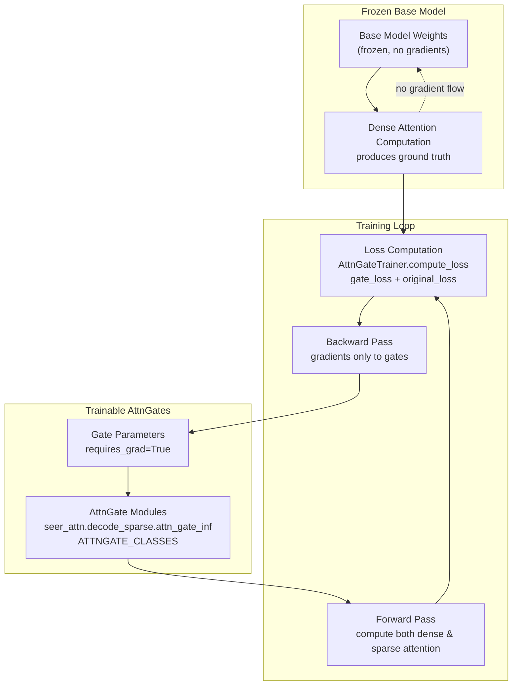
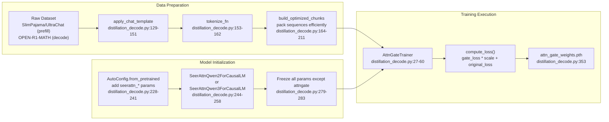
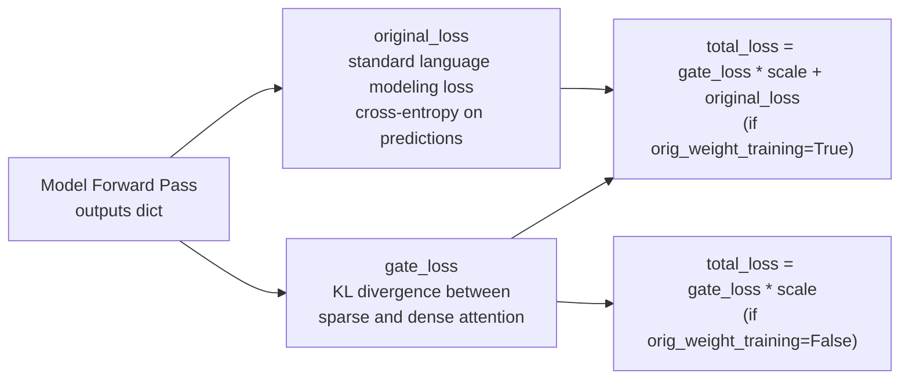
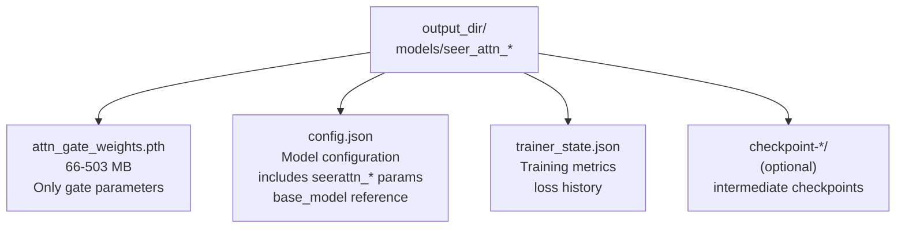
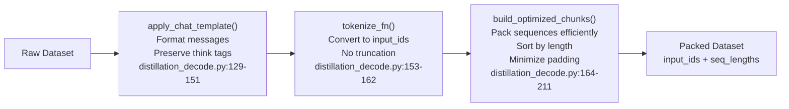
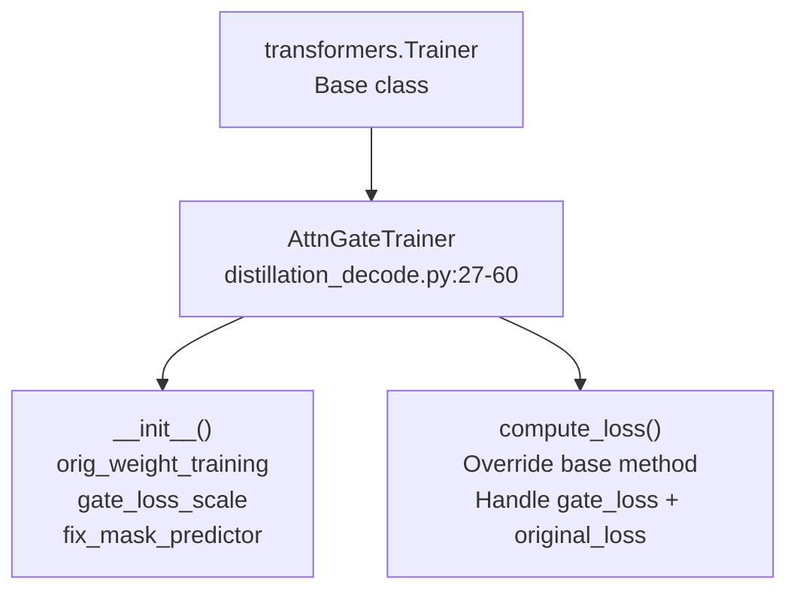

<!-- source: DeepWiki mcp.deepwiki.com · repo microsoft/SeerAttention · page 5 Training and Distillation · fetched 2026-10-26 -->

# Training and Distillation

<details>
<summary>Relevant source files</summary>

The following files were used as context for generating this wiki page:

- [README.md](README.md)
- [distillation_decode.py](distillation_decode.py)
- [scripts/run_distillation_prefill.sh](scripts/run_distillation_prefill.sh)
- [seer_attn/__init__.py](seer_attn/__init__.py)
- [seer_attn/decode_sparse/qwen2/modeling_qwen2_seerattn_inference.py](seer_attn/decode_sparse/qwen2/modeling_qwen2_seerattn_inference.py)
- [seer_attn/decode_sparse/qwen3/modeling_qwen3_seerattn_inference.py](seer_attn/decode_sparse/qwen3/modeling_qwen3_seerattn_inference.py)
- [seer_attn/modules/attention_distill.py](seer_attn/modules/attention_distill.py)
- [seer_attn/modules/common.py](seer_attn/modules/common.py)

</details>


## Purpose and Scope

This page provides an overview of the training and distillation process used to create AttnGates for SeerAttention models. The training process uses **self-distillation** to teach lightweight attention gates to predict sparse attention patterns while keeping the base model weights frozen. This approach produces small adapter modules (66-503 MB) that can be composed with existing pretrained models without requiring full model retraining.

For detailed information about the self-distillation algorithm and loss functions, see [Self-Distillation Process](#5.1). For practical guidance on running training scripts and preparing data, see [Training Scripts and Data](#5.2).

---

## Self-Distillation Overview

The SeerAttention training approach uses **self-distillation**: the base model acts as its own teacher by computing dense attention patterns, which the trainable AttnGates learn to approximate using sparse masks. This differs from traditional distillation where a separate teacher model is required.

### Key Characteristics

| Aspect | Description |
|--------|-------------|
| **Frozen Weights** | All original model parameters remain fixed during training |
| **Trainable Component** | Only AttnGate modules (attention gate networks) are trained |
| **Training Signal** | Gates learn to predict which attention blocks are important by comparing against dense attention |
| **Output Size** | 66-503 MB (depending on model size), much smaller than full model |
| **Training Time** | ~5 hours on 8xA100 GPUs for Llama-3.1-8B |

The fundamental insight is that attention patterns in pretrained LLMs exhibit intrinsic sparsity that can be learned and exploited at inference time.

Sources: [README.md:8-30](), [distillation_decode.py:27-60]()

---

## Training Architecture

### Component Roles



**Training Architecture: Frozen Base Model with Trainable Gates**

The training process maintains a clear separation between frozen and trainable components:

- **Frozen Base Model**: All attention, MLP, and embedding layers remain fixed with `requires_grad=False`
- **Trainable AttnGates**: Lightweight modules that predict block-sparse masks based on Q/K representations
- **Dual Computation**: Each forward pass computes both dense attention (for ground truth) and sparse attention (for training the gates)

Sources: [distillation_decode.py:279-283](), [seer_attn/decode_sparse/qwen2/modeling_qwen2_seerattn_inference.py:89-98]()

---

## Training Workflow

### End-to-End Pipeline



**Complete Training Pipeline from Data to Saved AttnGates**

The workflow consists of three main phases:

1. **Data Preparation**: Apply chat templates, tokenize, and pack sequences into fixed-length chunks for efficient training
2. **Model Initialization**: Load base model configuration, add SeerAttention-specific parameters, and freeze non-gate parameters  
3. **Training Execution**: Run `AttnGateTrainer` which computes both gate loss and original loss, backpropagate only to gates, and save final gate weights

Sources: [distillation_decode.py:214-354]()

---

## Trainable vs Frozen Parameters

### Parameter Filtering

The training script explicitly controls which parameters receive gradients:

```python
# From distillation_decode.py:279-283
for n, p in model.named_parameters():
    if training_args.trainable_params in n:  # default: "attngate"
        p.requires_grad = True
    else:
        p.requires_grad = False
```

### What Gets Trained

| Component | Trainable | Parameter Count | Location |
|-----------|-----------|----------------|----------|
| `attn_gate` modules | ✅ Yes | 66-503 MB | Each decoder layer |
| `q_proj`, `k_proj`, `v_proj`, `o_proj` | ❌ No | N/A | Frozen base model |
| `mlp` layers | ❌ No | N/A | Frozen base model |
| `embed_tokens` | ❌ No | N/A | Frozen base model |
| `lm_head` | ❌ No | N/A | Frozen base model |

The `attn_gate` modules are typically located at:
- `model.layers[i].self_attn.attn_gate` for each layer `i`

These gates consist of:
- Pooling operations for Q and K
- Small MLPs for scoring block importance
- Optional QK normalization and RoPE embeddings

Sources: [distillation_decode.py:279-283](), [seer_attn/decode_sparse/qwen2/modeling_qwen2_seerattn_inference.py:89-98]()

---

## Loss Function

### Dual Loss Computation

The training objective combines two loss terms:



**Loss Computation in AttnGateTrainer.compute_loss()**

The `AttnGateTrainer` class overrides the `compute_loss` method to handle gate-specific training:

```python
# From distillation_decode.py:43-59
def compute_loss(self, model, inputs, return_outputs=False, num_items_in_batch=None):
    outputs = model(**inputs)
    original_loss = outputs.get("loss")
    mask_loss = outputs.get("gate_loss")
    
    if self.orig_weight_training:
        tok_loss = original_loss + self.gate_loss_scale * mask_loss
    else:
        tok_loss = self.gate_loss_scale * mask_loss
    
    return (tok_loss, outputs) if return_outputs else tok_loss
```

### Loss Components

| Loss Term | Purpose | Typical Scale |
|-----------|---------|---------------|
| `gate_loss` | Teaches gates to match dense attention patterns | 10.0x multiplier |
| `original_loss` | Standard LM loss (optional during gate training) | 1.0x or disabled |

In typical training:
- `orig_weight_training=False` - Only train gates, ignore LM loss
- `gate_loss_scale=10.0` - Emphasize gate learning

Sources: [distillation_decode.py:27-60](), [distillation_decode.py:112-114]()

---

## Training Scripts

### Prefill vs Decode Training

SeerAttention provides two separate training workflows:

| Script | Purpose | Target Models | Data |
|--------|---------|---------------|------|
| `run_distillation_prefill.sh` | Train gates for long-context input processing | Llama-3.1, Qwen2.5 | SlimPajama, UltraChat |
| `run_distillation_decode.sh` | Train gates for long-reasoning generation | Qwen2, Qwen3 | OPEN-R1-MATH-220K |

Both scripts use the same underlying Python training code but with different:
- Base models
- Sequence lengths
- Training data
- Hyperparameters

### Quick Start Commands

```bash
# Train prefill gates for Llama-3.1-8B
BASE_MODEL=meta-llama/Llama-3.1-8B-Instruct bash run_distillation_prefill.sh

# Train decode gates for Qwen3-4B
BASE_MODEL=Qwen/Qwen3-4B bash run_distillation_decode.sh
```

Sources: [README.md:115-129](), [scripts/run_distillation_prefill.sh:1-39]()

---

## Training Configuration

### Key Hyperparameters

From the shell scripts and Python code, these are the main configuration parameters:

| Parameter | Default | Description |
|-----------|---------|-------------|
| `training_max_length` | 65536 (prefill)<br/>varies (decode) | Maximum sequence length per training sample |
| `gate_loss_scale` | 10.0 | Multiplier for gate loss |
| `learning_rate` | 1e-3 | AdamW learning rate |
| `warmup_steps` | 20 | Linear warmup steps |
| `per_device_train_batch_size` | 1 | Batch size per GPU |
| `gradient_accumulation_steps` | Calculated | To achieve effective batch size |
| `seerattn_gate_block_size` | 64 | Block size for sparse attention |
| `seerattn_gate_hidden_size` | 128 | Hidden dimension in gate MLP |

### Model Arguments

Additional configuration specified in `ModelArguments`:

```python
# From distillation_decode.py:62-94
@dataclass
class ModelArguments:
    base_model: str = "meta-llama/Meta-Llama-3.1-8B"
    seerattn_k_seq_pooling_type: str = "Kmaxminavg"  # K pooling strategy
    seerattn_gate_block_size: int = 64               # Block size
    seerattn_q_head_pooling_type: str = "Qproj"      # Q pooling strategy
    seerattn_gate_hidden_size: int = 128             # Gate MLP hidden size
    seerattn_use_qk_norm: bool = False               # QK normalization
    seerattn_use_rope: bool = True                   # Rotary embeddings
```

Sources: [distillation_decode.py:62-94](), [scripts/run_distillation_prefill.sh:4-16]()

---

## Output Artifacts

### Saved Files

After training completes, the following files are saved to the output directory:



**Training Output Directory Structure**

### Loading Trained Gates

The saved `attn_gate_weights.pth` can be loaded into a model using:

```python
# From modeling files, e.g., qwen3:770-791
@classmethod
def from_pretrained(cls, pretrained_model_name_or_path, load_gate=True, ...):
    if load_gate:
        config = SeerAttnQwen3Config.from_pretrained(pretrained_model_name_or_path)
        base_model = config.base_model
        model = super().from_pretrained(base_model, config=config, ...)
        
        gate_weights = torch.load(
            os.path.join(pretrained_model_name_or_path, "attn_gate_weights.pth")
        )
        model.load_state_dict(gate_weights, strict=False)
```

The `strict=False` flag allows loading only the gate parameters into a full model, leaving base model weights unchanged.

Sources: [distillation_decode.py:343-353](), [seer_attn/decode_sparse/qwen3/modeling_qwen3_seerattn_inference.py:769-795]()

---

## Data Requirements

### Prefill Training Data

For training sparse prefill gates (long-context input processing):
- **Format**: Instruction-tuning format with long contexts
- **Examples**: SlimPajama, UltraChat
- **Sequence Lengths**: Up to 65,536 tokens
- **Processing**: Sequences are packed into chunks for efficient training

### Decode Training Data  

For training sparse decode gates (long-reasoning generation):
- **Format**: Reasoning traces with `` sections
- **Examples**: OPEN-R1-MATH-220K dataset
- **Sequence Lengths**: Variable, includes long reasoning chains
- **Processing**: Chat templates preserve thinking tokens

### Data Preparation Pipeline



**Data Preparation from Raw Dataset to Training-Ready Batches**

The `build_optimized_chunks` function implements a greedy packing algorithm:
1. Sort sequences by length (longest first)
2. For each sequence, find the chunk with minimal remaining space
3. Pack sequence into that chunk if it fits
4. Create new chunk if no suitable chunk exists

This maximizes GPU utilization by minimizing padding within each training batch.

Sources: [distillation_decode.py:129-211](), [distillation_decode.py:289-315]()

---

## Training Classes

### AttnGateTrainer



**AttnGateTrainer Class Hierarchy**

The `AttnGateTrainer` extends HuggingFace's `Trainer` class with custom loss computation:

```python
# From distillation_decode.py:27-60
class AttnGateTrainer(Trainer):
    def __init__(self, orig_weight_training=False, gate_loss_scale=1.0, 
                 fix_mask_predictor=False, *args, **kwargs):
        super().__init__(*args, **kwargs)
        self.gate_loss_scale = gate_loss_scale
        self.orig_weight_training = orig_weight_training
        self.fix_mask_predictor = fix_mask_predictor
```

Key methods:
- `compute_loss()`: Custom loss calculation for gate training
- Inherits from `Trainer`: training loop, checkpointing, logging, distributed training

Sources: [distillation_decode.py:27-60]()

---

## Training Model Classes

### Training vs Inference Models

SeerAttention separates training and inference model implementations:

| Purpose | Module Path | Key Difference |
|---------|-------------|----------------|
| **Training** | `seer_attn.decode_sparse.qwen2.modeling_qwen2_seerattn_training` | Computes both dense and sparse attention, returns `gate_loss` |
| **Training** | `seer_attn.decode_sparse.qwen3.modeling_qwen3_seerattn_training` | Computes both dense and sparse attention, returns `gate_loss` |
| **Inference** | `seer_attn.decode_sparse.qwen2.modeling_qwen2_seerattn_inference` | Only sparse attention, no ground truth computation |
| **Inference** | `seer_attn.decode_sparse.qwen3.modeling_qwen3_seerattn_inference` | Only sparse attention, no ground truth computation |

During training, the model needs to:
1. Compute dense attention (ground truth)
2. Compute sparse attention with gates
3. Compare them to produce `gate_loss`
4. Return both losses in the output

During inference, only sparse attention is computed for efficiency.

Sources: [distillation_decode.py:14-15](), [seer_attn/__init__.py:1-11]()

---

## Training Time and Resources

### Estimated Training Requirements

| Model Size | GPUs | Training Time | Memory per GPU | Total Data |
|------------|------|---------------|----------------|------------|
| Llama-3.1-8B | 8x A100 | ~5 hours | ~40 GB | ~524M tokens |
| Qwen2.5-7B | 8x A100 | ~4 hours | ~35 GB | ~524M tokens |
| Qwen3-4B | 8x A100 | ~3 hours | ~30 GB | Variable |

These estimates assume:
- DeepSpeed Stage 2 for distributed training
- `training_max_length=65536` for prefill
- `per_device_train_batch_size=1`
- Mixed precision (bfloat16)

### GPU Memory Considerations

Training requires:
- **Frozen base model**: Stored in bfloat16, no optimizer states needed
- **AttnGate parameters**: Small (66-503 MB), need optimizer states
- **Activation memory**: Proportional to sequence length and batch size
- **Gradient buffers**: Only for trainable parameters

The frozen base model significantly reduces memory requirements compared to full fine-tuning.

Sources: [scripts/run_distillation_prefill.sh:1-2](), [README.md:115-129]()

---

