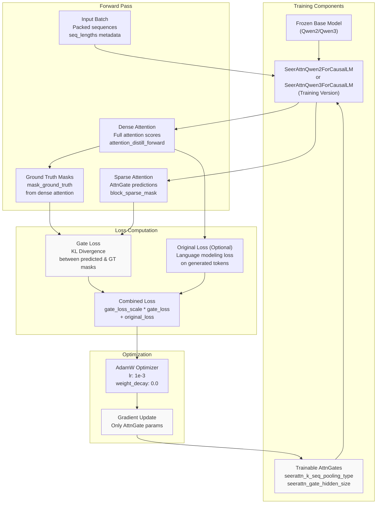
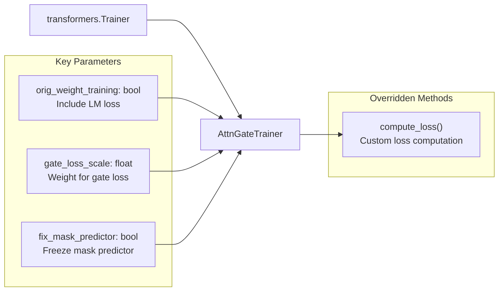
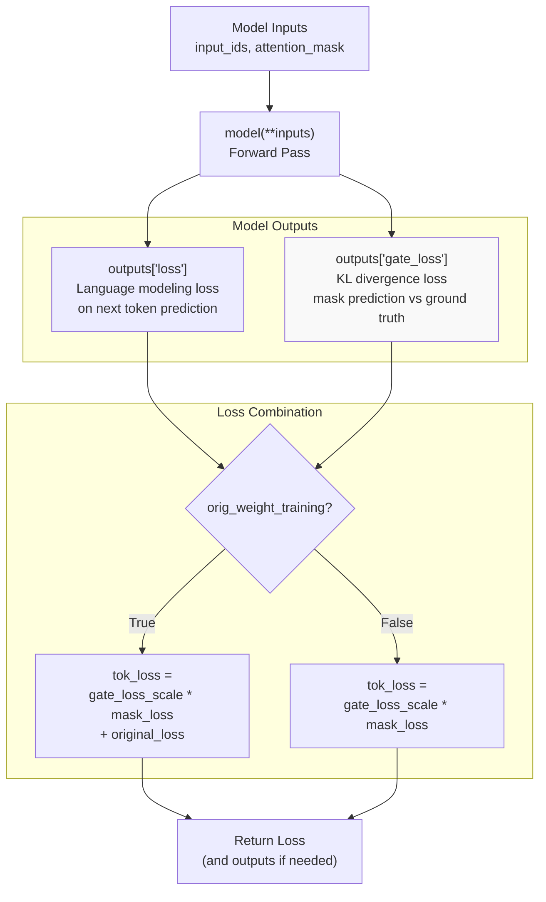
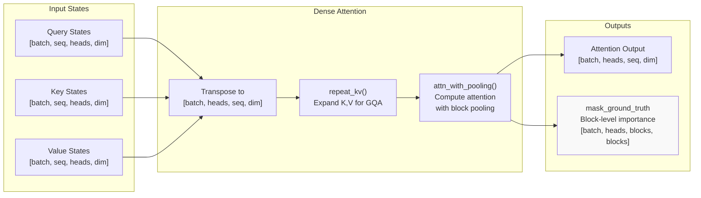

<!-- source: DeepWiki mcp.deepwiki.com · repo microsoft/SeerAttention · page 5.1 Self-Distillation Process · fetched 2026-10-26 -->

# Self-Distillation Process

<details>
<summary>Relevant source files</summary>

The following files were used as context for generating this wiki page:

- [distillation_decode.py](distillation_decode.py)
- [scripts/run_distillation_prefill.sh](scripts/run_distillation_prefill.sh)
- [seer_attn/decode_sparse/qwen2/modeling_qwen2_seerattn_inference.py](seer_attn/decode_sparse/qwen2/modeling_qwen2_seerattn_inference.py)
- [seer_attn/decode_sparse/qwen3/modeling_qwen3_seerattn_inference.py](seer_attn/decode_sparse/qwen3/modeling_qwen3_seerattn_inference.py)
- [seer_attn/modules/attention_distill.py](seer_attn/modules/attention_distill.py)
- [seer_attn/modules/common.py](seer_attn/modules/common.py)

</details>


## Purpose and Scope

This document explains the self-distillation training process used to train AttnGates in SeerAttention. Self-distillation enables lightweight attention gates to learn sparse attention patterns by using a frozen dense model as the teacher. This page covers the training architecture, loss computation, data preparation, and the training loop mechanics.

For information about the trained AttnGates themselves, see [AttnGates](#3.2). For practical guidance on running training scripts, see [Training Scripts and Data](#5.2). For model configuration details, see [Model Configuration](#4.3).

---

## Self-Distillation Philosophy

Self-distillation in SeerAttention trains **AttnGates** to predict which attention blocks are important, using the full dense attention pattern as ground truth supervision. The key principles are:

| Principle | Description | Benefit |
|-----------|-------------|---------|
| **Frozen Base Model** | Base model weights remain frozen during training | No catastrophic forgetting, preserves original capabilities |
| **Lightweight Adaptation** | Only AttnGate parameters (66-503 MB) are trained | Fast training, minimal storage overhead |
| **Ground Truth from Dense** | Dense attention scores provide supervision signal | AttnGates learn to approximate optimal sparsity |
| **Block-Level Prediction** | Gates predict importance at block granularity | Efficient computation, hardware-aligned sparsity |

The self-distillation approach differs from traditional knowledge distillation because the student (sparse model with gates) and teacher (dense model) share the same base weights—only the attention mechanism differs.

**Sources:** [distillation_decode.py:1-358]()

---

## Training Architecture Overview



**Diagram: Self-Distillation Training Architecture**

The training architecture consists of a frozen base model composed with trainable AttnGates. During each forward pass, both dense and sparse attention are computed, allowing the gates to learn from the full attention distribution.

**Sources:** [distillation_decode.py:27-59](), [distillation_decode.py:214-357](), [seer_attn/modules/attention_distill.py:11-40]()

---

## AttnGateTrainer Class

The `AttnGateTrainer` class extends Hugging Face's `Trainer` to implement custom loss computation for AttnGate training.

### Class Definition



**Diagram: AttnGateTrainer Class Structure**

### Key Components

| Component | Type | Purpose |
|-----------|------|---------|
| `gate_loss_scale` | float | Scaling factor for gate loss (typically 10.0) |
| `orig_weight_training` | bool | Whether to include original LM loss in training |
| `fix_mask_predictor` | bool | Whether to freeze mask predictor during training |
| `compute_loss()` | method | Computes combined loss from model outputs |

**Sources:** [distillation_decode.py:27-59]()

---

## Loss Computation Flow

### Forward Pass and Loss Calculation



**Diagram: compute_loss Method Flow**

### Loss Function Details

The loss computation follows these steps:

1. **Forward Pass**: Model generates both dense and sparse attention outputs
2. **Extract Losses**: 
   - `original_loss`: Standard language modeling loss from dense attention
   - `gate_loss`: KL divergence between predicted sparse mask and ground truth from dense attention
3. **Combine Losses**: 
   - If `orig_weight_training=True`: `loss = original_loss + gate_loss_scale * gate_loss`
   - If `orig_weight_training=False`: `loss = gate_loss_scale * gate_loss`
4. **Backpropagation**: Only AttnGate parameters receive gradients

The typical configuration uses `orig_weight_training=False` to focus training exclusively on the gate prediction task.

**Sources:** [distillation_decode.py:43-59]()

---

## Ground Truth Mask Generation

The ground truth sparse masks are generated by computing full dense attention and identifying important blocks:



**Diagram: Ground Truth Mask Generation via attention_distill_forward**

The `attention_distill_forward` function in [seer_attn/modules/attention_distill.py:11-40]() computes full attention while simultaneously generating block-level importance masks. These masks serve as the ground truth supervision signal for training AttnGates.

**Sources:** [seer_attn/modules/attention_distill.py:11-40](), [seer_attn/kernels/attn_pooling_kernel_2d.py]()

---

## Data Preparation and Packing

To maximize training efficiency, sequences are packed into fixed-length chunks using an optimized packing algorithm.

### Data Processing Pipeline

```mermaid
graph TB
    Raw["Raw Dataset<br/>load_dataset() or<br/>load_from_disk()"]
    
    Template["apply_chat_template()<br/>Format messages<br/>Add `:

```python
# From distillation_decode.py:270-276
with open("chat_template/templates.json", "r") as f:
    chat_template = json.load(f)

if model_args.base_model in chat_template.keys():
    tokenizer.chat_template = chat_template[model_args.base_model]
```

This ensures reasoning tokens are included in the training data.

**Sources:** [distillation_decode.py:129-151](), [distillation_decode.py:270-276](), [scripts/run_distillation_prefill.sh:1-39]()

---

