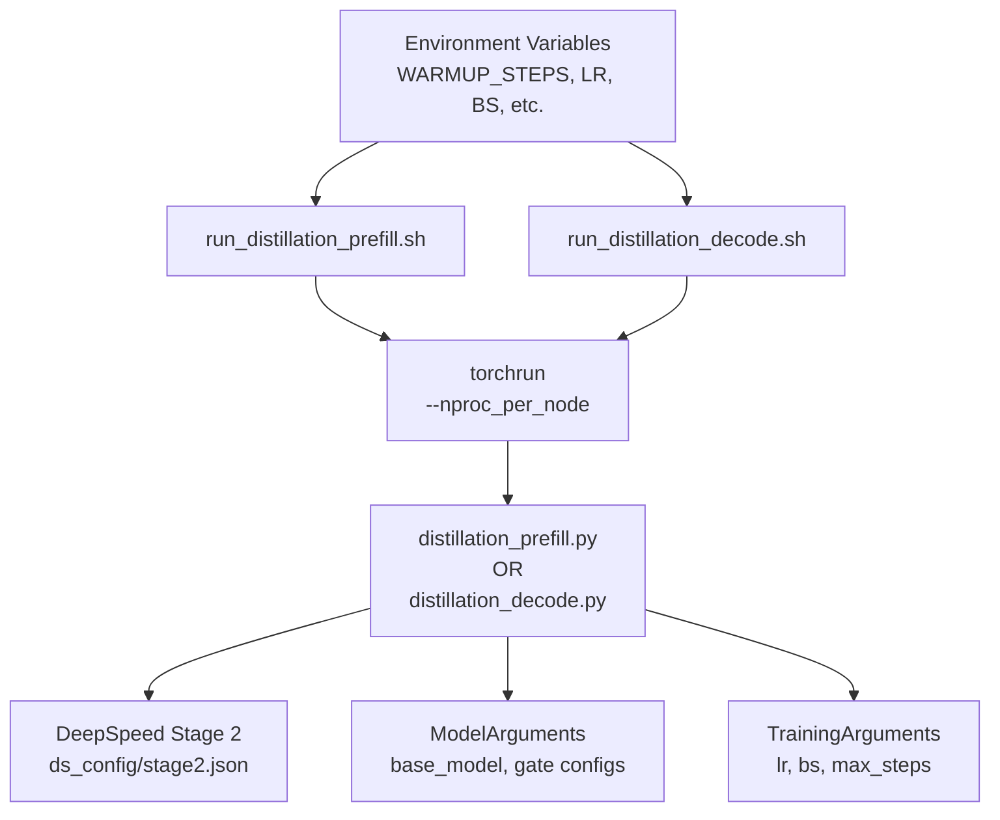
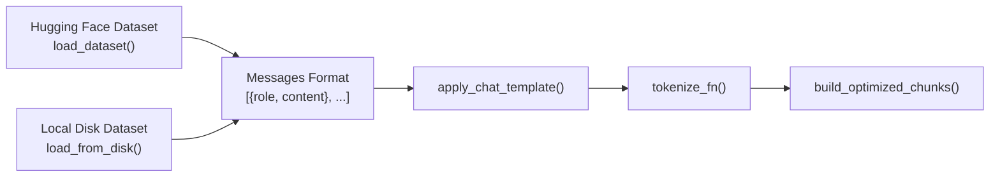
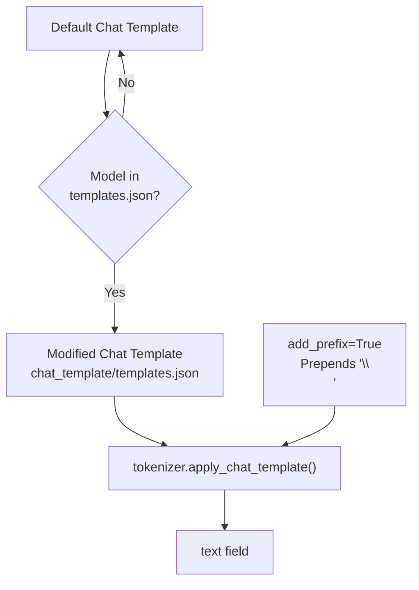
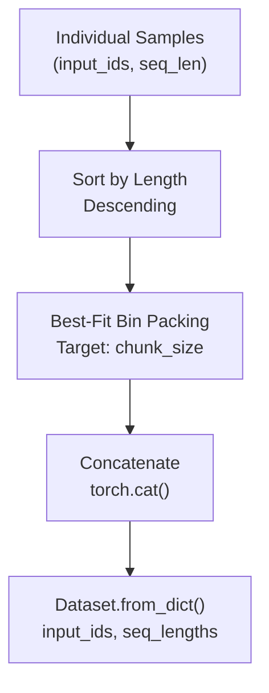
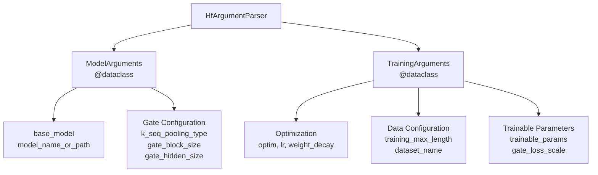
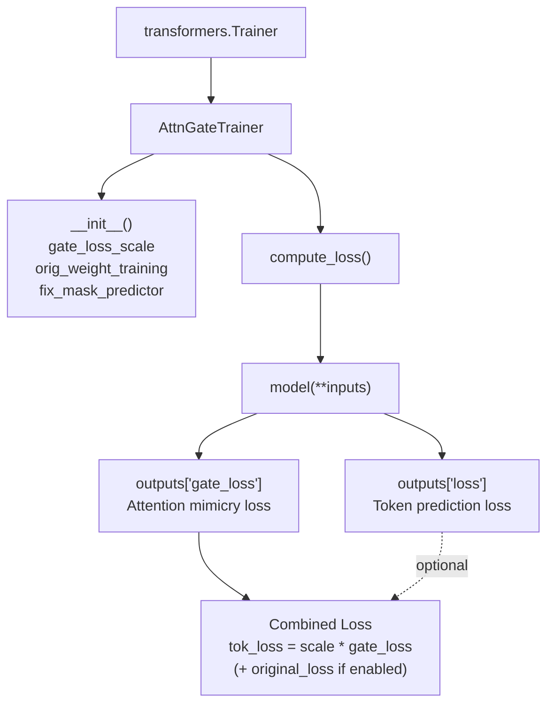
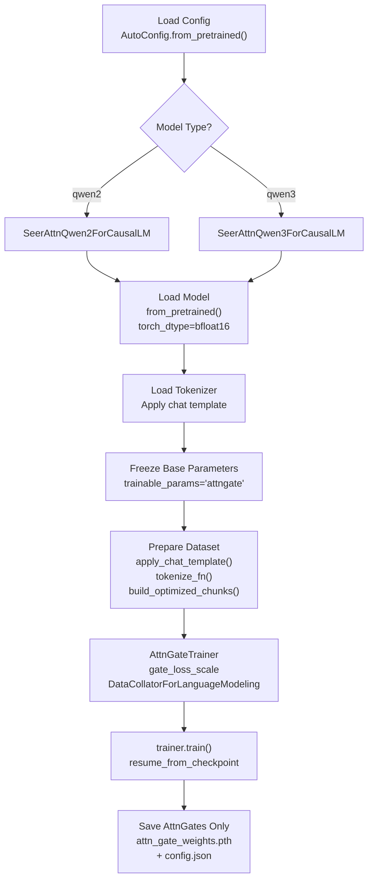

<!-- source: DeepWiki mcp.deepwiki.com · repo microsoft/SeerAttention · page 5.2 Training Scripts and Data · fetched 2026-10-26 -->

# Training Scripts and Data

<details>
<summary>Relevant source files</summary>

The following files were used as context for generating this wiki page:

- [README.md](README.md)
- [distillation_decode.py](distillation_decode.py)
- [scripts/run_distillation_prefill.sh](scripts/run_distillation_prefill.sh)
- [seer_attn/__init__.py](seer_attn/__init__.py)
- [seer_attn/decode_sparse/qwen2/modeling_qwen2_seerattn_inference.py](seer_attn/decode_sparse/qwen2/modeling_qwen2_seerattn_inference.py)
- [seer_attn/decode_sparse/qwen3/modeling_qwen3_seerattn_inference.py](seer_attn/decode_sparse/qwen3/modeling_qwen3_seerattn_inference.py)
- [seer_attn/modules/attention_distill.py](seer_attn/modules/attention_distill.py)
- [seer_attn/modules/common.py](seer_attn/modules/common.py)

</details>


## Purpose and Scope

This page provides a practical guide to training AttnGates using the self-distillation process. It covers the training scripts, data preparation, configuration parameters, and the training workflow. For the theoretical background of self-distillation, see [Self-Distillation Process](#5.1). For information about model architectures and configurations, see [Model Configuration](#4.3).

The training process produces lightweight AttnGate adapters (66-503 MB) that can be composed with frozen base models during inference.

---

## Training Scripts Overview

SeerAttention provides two training modes with corresponding shell scripts:

| Script | Purpose | Model Types | Typical Context Length |
|--------|---------|-------------|------------------------|
| `run_distillation_prefill.sh` | Train AttnGates for sparse prefill | Llama, Qwen2.5 | 32k-65k tokens |
| `run_distillation_decode.sh` | Train AttnGates for sparse decode | Qwen2, Qwen3 | Variable (used in generation) |

Both scripts invoke the same Python training implementation but with different configurations and datasets.

### Script Invocation Pattern



**Sources:** [scripts/run_distillation_prefill.sh:1-39](), [README.md:118-128]()

### Prefill Training Script

The prefill script trains AttnGates for efficient long-context input processing:

```bash
BASE_MODEL=meta-llama/Llama-3.1-8B-Instruct bash run_distillation_prefill.sh
```

Key default parameters:
- `training_max_length`: 65536 tokens
- `gate_type`: "Qavg_Kmaxminavg" (pooling strategy)
- `gate_loss_scale`: 10.0
- `bs`: 16 (global batch size)
- Estimated training time: ~5 hours on 8xA100 GPUs

**Sources:** [scripts/run_distillation_prefill.sh:1-39]()

### Decode Training Script

The decode script trains AttnGates for long-reasoning token generation:

```bash
BASE_MODEL=Qwen/Qwen3-4B bash run_distillation_decode.sh
```

This script targets Qwen2/Qwen3 architectures and uses reasoning-focused datasets.

**Sources:** [README.md:119-123]()

---

## Data Requirements and Preparation

### Supported Dataset Formats

The training pipeline supports two dataset input formats:



**Sources:** [distillation_decode.py:290-315]()

#### Dataset Structure

Each example must contain a `messages` field with conversational turns:

```python
{
    "messages": [
        {"role": "user", "content": "Question text"},
        {"role": "assistant", "content": "Answer"}
    ]
}
```

Common datasets for training:
- **Prefill**: SlimPajama, UltraChat (long-context)
- **Decode**: OPEN-R1-MATH-220K, reasoning datasets with `<think>` tokens

**Sources:** [distillation_decode.py:129-151]()

### Chat Template Handling

A critical aspect of decode training is preserving `<think>` tokens during template application. Some default chat templates strip content between special markers, which is problematic for reasoning models.



The `apply_chat_template` function handles this:

**Sources:** [distillation_decode.py:129-151](), [distillation_decode.py:268-276]()

### Tokenization Pipeline

After chat template application, the data flows through tokenization:

```python
def tokenize_fn(tokenizer, examples):
    outputs = tokenizer(
        examples["text"],
        add_special_tokens=False,
        truncation=False,
        return_tensors="pt",
        padding=False,
    )
    return {"input_ids": outputs["input_ids"][0]}
```

**Sources:** [distillation_decode.py:153-162]()

### Optimized Chunk Building

The `build_optimized_chunks` function packs sequences efficiently to minimize padding waste:



Algorithm characteristics:
- Sorts samples by decreasing length
- Uses best-fit decreasing heuristic
- Creates chunks up to `training_max_length`
- Minimizes padding overhead
- Random shuffles final chunks

**Sources:** [distillation_decode.py:164-211]()

---

## Training Configuration

### Configuration Hierarchy



**Sources:** [distillation_decode.py:62-127]()

### ModelArguments

The `ModelArguments` dataclass defines model and AttnGate architecture parameters:

| Parameter | Default | Description |
|-----------|---------|-------------|
| `base_model` | "meta-llama/Meta-Llama-3.1-8B" | Base model identifier |
| `model_name_or_path` | None | Local model path override |
| `seerattn_k_seq_pooling_type` | "Kmaxminavg" | AttnGate pooling strategy |
| `seerattn_gate_block_size` | 64 | Block size (fixed) |
| `seerattn_q_head_pooling_type` | "Qproj" | Query head pooling |
| `seerattn_gate_hidden_size` | 128 | AttnGate hidden dimension |
| `seerattn_loss_slice_ratio` | 0.0 | KL loss slicing ratio |
| `seerattn_use_qk_norm` | False | Apply QK normalization |
| `seerattn_use_rope` | True | Use RoPE in gates |

**Sources:** [distillation_decode.py:62-94]()

### TrainingArguments

Extends `transformers.TrainingArguments` with SeerAttention-specific parameters:

| Parameter | Default | Description |
|-----------|---------|-------------|
| `optim` | "adamw_torch" | Optimizer type |
| `training_max_length` | 65536 | Maximum sequence length |
| `trainable_params` | "attngate" | Parameter filter for training |
| `gate_loss_scale` | 10.0 | Gate loss weight multiplier |
| `dataset_name` | "./cache_dir/..." | Dataset path or HF identifier |
| `toknized_dataset` | False | Whether dataset is pre-tokenized |
| `save_entire_model` | False | Save full model or gates only |

**Sources:** [distillation_decode.py:97-127]()

---

## Training Process

### AttnGateTrainer Architecture

The `AttnGateTrainer` class extends Hugging Face's `Trainer` to implement custom loss computation for self-distillation:



**Sources:** [distillation_decode.py:27-59]()

### Loss Computation Logic

The core loss computation combines two components:

```python
def compute_loss(self, model, inputs, return_outputs=False, num_items_in_batch=None):
    torch.cuda.empty_cache()
    outputs = model(**inputs)
    
    original_loss = outputs.get("loss")      # Token prediction
    mask_loss = outputs.get("gate_loss")     # Gate mimicry
    
    if self.orig_weight_training:
        tok_loss = original_loss + self.gate_loss_scale * mask_loss
    else:
        tok_loss = self.gate_loss_scale * mask_loss  # Default: gates only
    
    return (tok_loss, outputs) if return_outputs else tok_loss
```

By default, only `gate_loss` is used (weighted by `gate_loss_scale`), as the base model weights are frozen.

**Sources:** [distillation_decode.py:43-59]()

### Trainable Parameter Selection

Only AttnGate parameters are trained; base model weights remain frozen:

```python
for n, p in model.named_parameters():
    if training_args.trainable_params in n:  # Default: "attngate"
        p.requires_grad = True
    else:
        p.requires_grad = False
```

This selective training is what enables lightweight adapter outputs (66-503 MB vs multi-GB full models).

**Sources:** [distillation_decode.py:279-283]()

### Training Loop Flow



**Sources:** [distillation_decode.py:214-357]()

---

## Output Artifacts

After training completes, the system saves minimal artifacts:

### File Structure

```
output_dir/
├── config.json                    # Model configuration
├── attn_gate_weights.pth         # Trained AttnGate parameters only
└── checkpoint-*/                  # Optional intermediate checkpoints
```

### AttnGate Weight Extraction

Only parameters containing "attn_gate" in their names are saved:

```python
if rank == 0:
    state_dict = trainer.model.state_dict()
    
    # Restore original vocab size
    model.config.vocab_size = original_vocab_size
    model.config.save_pretrained(training_args.output_dir)
    
    # Extract only AttnGate weights
    attn_gate_state_dict = {k: v for k, v in state_dict.items() 
                            if "attn_gate" in k}
    torch.save(attn_gate_state_dict, 
               os.path.join(training_args.output_dir, "attn_gate_weights.pth"))
```

**Sources:** [distillation_decode.py:344-353]()

### Configuration Metadata

The saved `config.json` includes:
- `base_model`: Reference to the base model path
- All `seerattn_*` configuration parameters
- Standard model architecture parameters

This enables automatic composition during inference via `from_pretrained(load_gate=True)`.

**Sources:** [distillation_decode.py:228-241](), [distillation_decode.py:350-351]()

---

## Multi-GPU and Distributed Training

### DeepSpeed Integration

Both training scripts use DeepSpeed Stage 2 for memory-efficient distributed training:

```bash
torchrun --nproc_per_node=$gpus --master_port=10003 distillation_decode.py \
    --deepspeed ds_config/stage2.json \
    --per_device_train_batch_size 1 \
    --gradient_accumulation_steps $gradient_accumulation_steps
```

The effective batch size is computed as:
```
effective_batch_size = gpus × per_device_bs × gradient_accumulation_steps
```

**Sources:** [scripts/run_distillation_prefill.sh:19-36]()

### Rank Synchronization

Training includes barrier synchronization to ensure dataset preparation completes before all ranks begin:

```python
rank = int(os.environ.get('RANK', -1))
if rank > 0:
    barrier()  # Wait for rank 0 to prepare data

# ... dataset preparation ...

if rank == 0:
    barrier()  # Signal completion to other ranks
```

**Sources:** [distillation_decode.py:285-320]()

---

## Best Practices and Tips

### Hyperparameter Guidelines

| Scenario | Recommended Settings |
|----------|---------------------|
| **Prefill Training** | `max_length=65536`, `gate_loss_scale=10.0`, `lr=1e-3` |
| **Decode Training** | `max_length=32768`, `gate_loss_scale=10.0`, `lr=1e-3` |
| **Memory Constrained** | Reduce `max_length`, increase gradient accumulation |
| **Quick Iteration** | Reduce `total_data` and `max_steps` |

### Dataset Considerations

1. **Reasoning Datasets**: For decode training, ensure datasets contain explicit reasoning chains (e.g., within `<think>` tags)
2. **Chat Templates**: Always verify that your chat template preserves reasoning tokens
3. **Sequence Length**: Use `training_max_length` appropriate for your target use case (longer for prefill)

**Sources:** [scripts/run_distillation_prefill.sh:4-16](), [distillation_decode.py:268-276]()

### Checkpoint Management

The training script checks for existing outputs before starting:

```python
if os.path.exists(os.path.join(training_args.output_dir, "attn_gate_weights.pth")):
    print("Attn gate weights already exist, skip training.")
    return
```

For resuming interrupted training:
```python
last_checkpoint = get_last_checkpoint(training_args.output_dir)
if training_args.resume_from_checkpoint is None and last_checkpoint is not None:
    training_args.resume_from_checkpoint = last_checkpoint
```

**Sources:** [distillation_decode.py:220-222](), [distillation_decode.py:335-338]()

---

## Example: Training Qwen3-4B for Decode

Complete example workflow:

```bash
# Set environment variables
export BASE_MODEL="Qwen/Qwen3-4B"
export WARMUP_STEPS=20
export TRAINING_MAX_LENGTH=32768
export LR=1e-3
export GATE_LOSS_SCALE=10.0
export GPUS=8

# Run training
bash run_distillation_decode.sh

# Output location: models/seer_attn_qwen3/[run_name]/
# Contains: config.json, attn_gate_weights.pth
```

The resulting AttnGates can then be loaded for inference:
```python
from seer_attn import SeerDecodingQwen3ForCausalLM

model = SeerDecodingQwen3ForCausalLM.from_pretrained(
    "models/seer_attn_qwen3/[run_name]",
    load_gate=True,
    seerattn_sparsity_method='token_budget',
    seerattn_token_budget=4096,
)
```

**Sources:** [README.md:119-123](), [README.md:80-93]()

---

