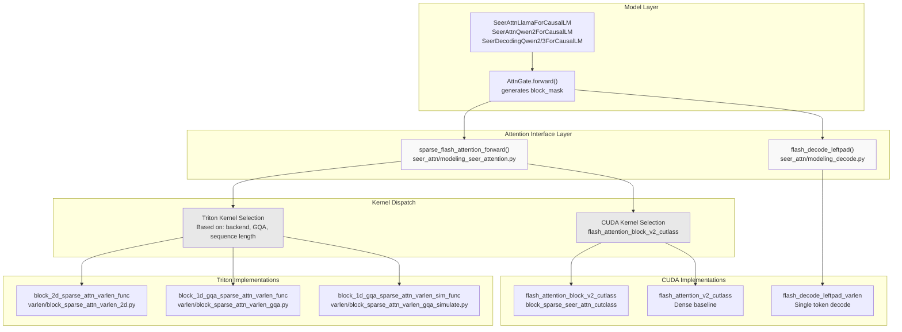
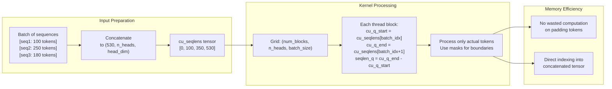
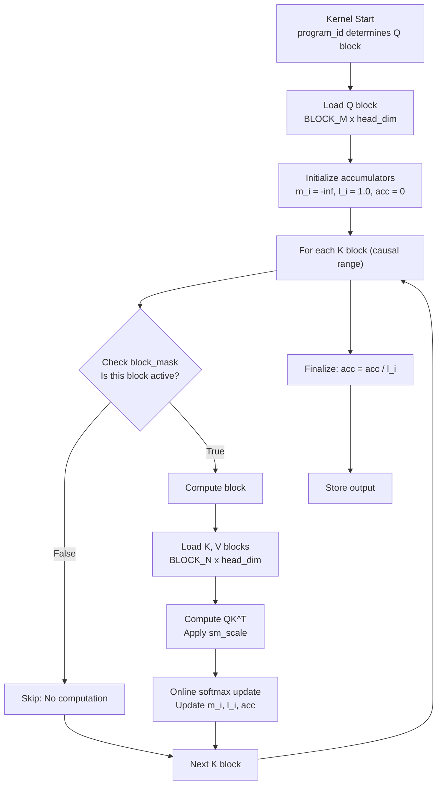
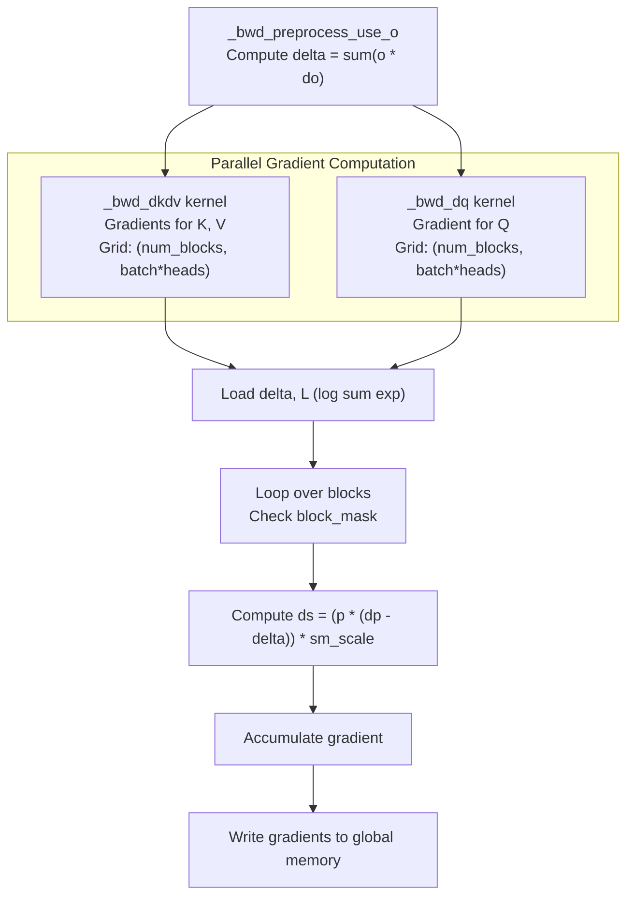
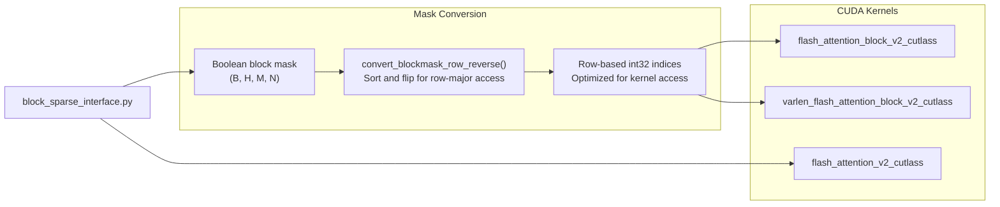
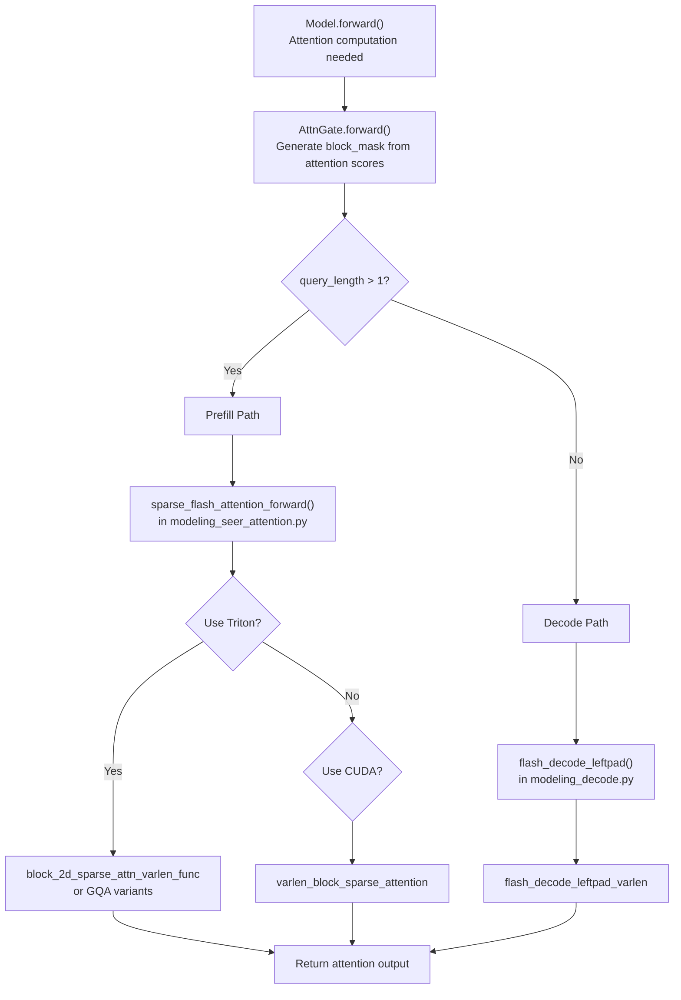

<!-- source: DeepWiki mcp.deepwiki.com · repo microsoft/SeerAttention · page 6 Kernels and Performance · fetched 2026-10-26 -->

# Kernels and Performance

<details>
<summary>Relevant source files</summary>

The following files were used as context for generating this wiki page:

- [seer_attn/kernels/block_sparse_attention/README.md](seer_attn/kernels/block_sparse_attention/README.md)
- [seer_attn/kernels/block_sparse_attention/block_sparse_seer_attn/block_sparse_interface.py](seer_attn/kernels/block_sparse_attention/block_sparse_seer_attn/block_sparse_interface.py)
- [seer_attn/kernels/block_sparse_attention/csrc/flash.h](seer_attn/kernels/block_sparse_attention/csrc/flash.h)
- [seer_attn/kernels/varlen/attn_pooling_kernel_varlen.py](seer_attn/kernels/varlen/attn_pooling_kernel_varlen.py)
- [seer_attn/kernels/varlen/block_sparse_attn_varlen_2d.py](seer_attn/kernels/varlen/block_sparse_attn_varlen_2d.py)
- [seer_attn/kernels/varlen/block_sparse_attn_varlen_gqa.py](seer_attn/kernels/varlen/block_sparse_attn_varlen_gqa.py)
- [seer_attn/kernels/varlen/block_sparse_attn_varlen_gqa_simulate.py](seer_attn/kernels/varlen/block_sparse_attn_varlen_gqa_simulate.py)

</details>


This page provides an overview of the custom kernel implementations in SeerAttention, covering both Triton and CUDA/CUTLASS implementations, their performance characteristics, and when each is used. The system employs a two-tier kernel strategy: Triton kernels for flexibility and development velocity, and CUDA/CUTLASS kernels for maximum performance in production scenarios.

For detailed documentation on specific kernel implementations:
- Triton kernel variants and their optimizations: see [Triton Kernels](#6.1)
- CUDA/CUTLASS kernels and flash decode implementations: see [CUDA and Flash Decode Kernels](#6.2)
- Performance optimization techniques: see [Performance Optimizations](#6.3)

## Kernel Architecture Overview

SeerAttention implements block-sparse attention using custom kernels in two languages:

**Triton Kernels**: Python-based kernel language that compiles to efficient GPU code. Used for:
- Rapid prototyping and experimentation
- Block-sparse prefill attention with variable-length sequences
- Three variants optimized for different scenarios

**CUDA/CUTLASS Kernels**: Native CUDA implementations using NVIDIA's CUTLASS library. Used for:
- Maximum performance in production deployments
- Custom block-sparse mask handling
- Integration with existing FlashAttention-2 optimizations

The kernel layer sits between the model's attention mechanism and the GPU hardware, translating sparse attention patterns into efficient memory access patterns.



**Sources**: 
- [seer_attn/kernels/varlen/block_sparse_attn_varlen_2d.py:1-850]()
- [seer_attn/kernels/varlen/block_sparse_attn_varlen_gqa.py:1-645]()
- [seer_attn/kernels/varlen/block_sparse_attn_varlen_gqa_simulate.py:1-659]()
- [seer_attn/kernels/block_sparse_attention/block_sparse_seer_attn/block_sparse_interface.py:1-44]()

## Kernel Selection Strategy

The system selects kernels based on the operational phase and hardware configuration:

### Prefill Phase Kernels

For processing long input contexts (query_length > 1):

| Kernel Variant | Use Case | Key Features | File Location |
|----------------|----------|--------------|---------------|
| `block_2d_sparse_attn_varlen_func` | General 2D block-sparse attention | Flexible block patterns, MHA/GQA support | [varlen/block_sparse_attn_varlen_2d.py]() |
| `block_1d_gqa_sparse_attn_varlen_func` | GQA-optimized with autotuning | Autotuned warps, token-level granularity | [varlen/block_sparse_attn_varlen_gqa.py:46-52]() |
| `block_1d_gqa_sparse_attn_varlen_sim_func` | Alternative GQA implementation | Simpler mask handling | [varlen/block_sparse_attn_varlen_gqa_simulate.py]() |
| `flash_attention_block_v2_cutlass` | CUDA block-sparse | Maximum performance, custom mask format | [block_sparse_interface.py:36-38]() |

The 2D variant treats attention as a 2D grid of blocks and checks block masks. The GQA variants optimize for grouped-query attention by processing query heads in groups and using per-token masks for better granularity.

### Decode Phase Kernels

For token-by-token generation (query_length == 1):

- `flash_decode_leftpad_varlen`: Specialized for single-token queries with variable-length KV caches
- Handles left-padded sequences efficiently using `cache_leftpad` offset
- Implements split-merge pattern for parallel processing

**Sources**:
- [seer_attn/kernels/varlen/block_sparse_attn_varlen_2d.py:221-289]()
- [seer_attn/kernels/varlen/block_sparse_attn_varlen_gqa.py:46-52,154-223]()

## Variable-Length Sequence Handling

All kernels support variable-length sequences to avoid padding overhead. This is critical for batch processing where sequences have different lengths.



**Key Implementation Details**:

The `cu_seqlens` (cumulative sequence lengths) tensor stores the starting position of each sequence:
- Shape: `(batch_size + 1,)` 
- Example: `[0, 100, 350, 530]` for batch of 3 sequences
- Each kernel loads its sequence bounds: [block_sparse_attn_varlen_2d.py:125-132]()

```python
# Kernel loads sequence boundaries
cu_q_start = tl.load(cu_seqlens_q + off_z).to(tl.int64)
cu_q_end = tl.load(cu_seqlens_q + off_z + 1).to(tl.int64)
seqlen_q = cu_q_end - cu_q_start
```

Pointers are offset to the correct sequence position: [block_sparse_attn_varlen_2d.py:142-145]()

```python
Q += cu_q_start * stride_qt + off_h_q * stride_qh
K += cu_k_start * stride_kt + off_h_for_kv * stride_kh
V += cu_k_start * stride_vt + off_h_for_kv * stride_vh
```

**Sources**:
- [seer_attn/kernels/varlen/block_sparse_attn_varlen_2d.py:101-152]()
- [seer_attn/kernels/varlen/block_sparse_attn_varlen_gqa.py:54-112]()

## Block-Sparse Attention Computation

The core innovation is skipping entire blocks of attention computation based on learned or heuristic masks.

### Forward Pass Structure

All Triton kernels follow a similar pattern with an inner loop over K/V blocks:



The critical optimization is the mask check at [block_sparse_attn_varlen_2d.py:54-96](). When a block is inactive, the entire computation (matrix multiply, softmax, attention) is skipped:

```python
mask_val = tl.load(block_mask_ptr + k_block_col_idx * stride_bmask_n)
if mask_val == True:
    # Only compute if block is active
    k = tl.load(k_ptrs + start_n * stride_kt)
    qk = tl.dot(q, k)
    # ... rest of computation
```

### Online Softmax Algorithm

The kernels use the online softmax algorithm to compute attention without storing the full attention matrix. This is adapted from FlashAttention but modified to skip sparse blocks:

1. Maintain running statistics: `m_i` (max) and `l_i` (sum)
2. For each block, compute new max `m_ij` and update:
   - `alpha = exp(m_i - m_ij)` (rescaling factor)
   - `l_i = l_i * alpha + l_ij` (updated sum)
   - `acc = acc * alpha + new_contribution` (updated accumulator)

See [block_sparse_attn_varlen_2d.py:76-96]() for implementation.

**Sources**:
- [seer_attn/kernels/varlen/block_sparse_attn_varlen_2d.py:36-96,100-218]()
- [seer_attn/kernels/varlen/block_sparse_attn_varlen_gqa.py:53-151]()

## Backward Pass for Training

The Triton kernels implement full backward passes to support training of AttnGates. The backward pass computes gradients for Q, K, and V:

### Backward Pass Structure



The backward kernels ([block_sparse_attn_varlen_2d.py:292-662]()) implement the chain rule for attention:

- `_bwd_preprocess_use_o`: Computes `delta = sum(o * do)` needed for gradient computation
- `_bwd_dkdv`: Computes `dK` and `dV` by looping over Q blocks 
- `_bwd_dq`: Computes `dQ` by looping over K/V blocks

Critical optimization: Like the forward pass, backward also skips inactive blocks based on the mask.

**Sources**:
- [seer_attn/kernels/varlen/block_sparse_attn_varlen_2d.py:291-662]()
- [seer_attn/kernels/varlen/block_sparse_attn_varlen_gqa.py:226-611]()

## CUDA/CUTLASS Kernel Interface

The CUDA kernels provide an alternative implementation with potentially better performance. They are accessed through Python bindings:



Key functions from [block_sparse_interface.py:5-28]():

- `convert_blockmask_row_reverse()`: Converts boolean masks to row-major sorted indices for efficient kernel access
- `block_sparse_attention()`: Main entry point for block-sparse attention with batched sequences
- `varlen_block_sparse_attention()`: Entry point for variable-length sequences

The CUDA kernels use a different mask representation optimized for cache-friendly row-major traversal. The conversion function sorts block indices per row and flips them to enable efficient prefetching.

**Sources**:
- [seer_attn/kernels/block_sparse_attention/block_sparse_seer_attn/block_sparse_interface.py:1-44]()
- [seer_attn/kernels/block_sparse_attention/csrc/flash.h:1-95]()

## Performance Characteristics

### Computational Complexity

Block-sparse attention reduces computational complexity from O(N²) to O(N × s × B) where:
- N = sequence length
- s = average sparsity (fraction of active blocks)  
- B = block size (typically 64)

For 90% sparsity (s=0.1) and block size 64, this represents a ~10× reduction in FLOPs.

### Memory Access Patterns

The kernels are optimized for GPU memory hierarchy:

| Memory Level | Access Pattern | Optimization |
|--------------|----------------|--------------|
| Global Memory | Q, K, V loads | Coalesced loads, variable-length indexing |
| Shared Memory | K, V blocks | Reuse across Q elements in block |
| Registers | Accumulators | Online softmax state (m_i, l_i, acc) |
| L2 Cache | Block masks | Small size enables caching |

### Autotuning

The GQA kernel variant uses Triton's autotuning to select optimal configurations:

[block_sparse_attn_varlen_gqa.py:46-52]()
```python
@triton.autotune(
    configs=[
        triton.Config({}, num_warps=num_warps)
        for num_warps in [1, 2, 4, 8, 16]
    ],
    key=['gqa_group_size', 'BLOCK_H', 'BLOCK_N', 'BLOCK_D'],
)
```

This automatically benchmarks different warp counts and selects the fastest for each combination of parameters.

### Platform-Specific Optimizations

AMD ROCm (HIP) backend requires different configuration:

[block_sparse_attn_varlen_2d.py:255-258]()
```python
if is_hip():
    extra_kern_args = {"waves_per_eu": 1}
else:
    extra_kern_args = {}
```

**Sources**:
- [seer_attn/kernels/varlen/block_sparse_attn_varlen_gqa.py:46-52]()
- [seer_attn/kernels/varlen/block_sparse_attn_varlen_2d.py:255-258]()

## Integration with Model Code

The model layer calls kernel functions through high-level interfaces. Here's the typical call flow:



The model provides:
- Q, K, V tensors: `(total_tokens, n_heads, head_dim)`
- `cu_seqlens`: Cumulative sequence lengths for variable-length batches
- `block_mask`: Boolean tensor of shape `(batch, n_heads, num_q_blocks, num_k_blocks)`
- `sm_scale`: Softmax scaling factor (typically `1/sqrt(head_dim)`)
- `block_size`: Block granularity (default 64)

The kernel returns:
- Output tensor: Same shape as Q
- Attention statistics: `L` (log-sum-exp) for potential backward pass

**Sources**:
- [seer_attn/kernels/varlen/block_sparse_attn_varlen_2d.py:221-289]()
- [seer_attn/kernels/block_sparse_attention/block_sparse_seer_attn/block_sparse_interface.py:36-42]()

## Summary

SeerAttention's kernel layer provides:

1. **Dual Implementation**: Triton for flexibility and development, CUDA/CUTLASS for production performance
2. **Sparse Computation**: Skip inactive blocks to reduce FLOPs and memory bandwidth
3. **Variable-Length Support**: Efficient batching without padding overhead  
4. **GQA Optimization**: Specialized kernels for grouped-query attention
5. **Full Backward Pass**: Enables training of attention gates
6. **Autotuning**: Automatic selection of optimal kernel configurations

The kernel implementations form the performance foundation of SeerAttention, enabling efficient sparse attention at scale. For implementation details, see the child pages on specific kernel variants and optimization techniques.

---

