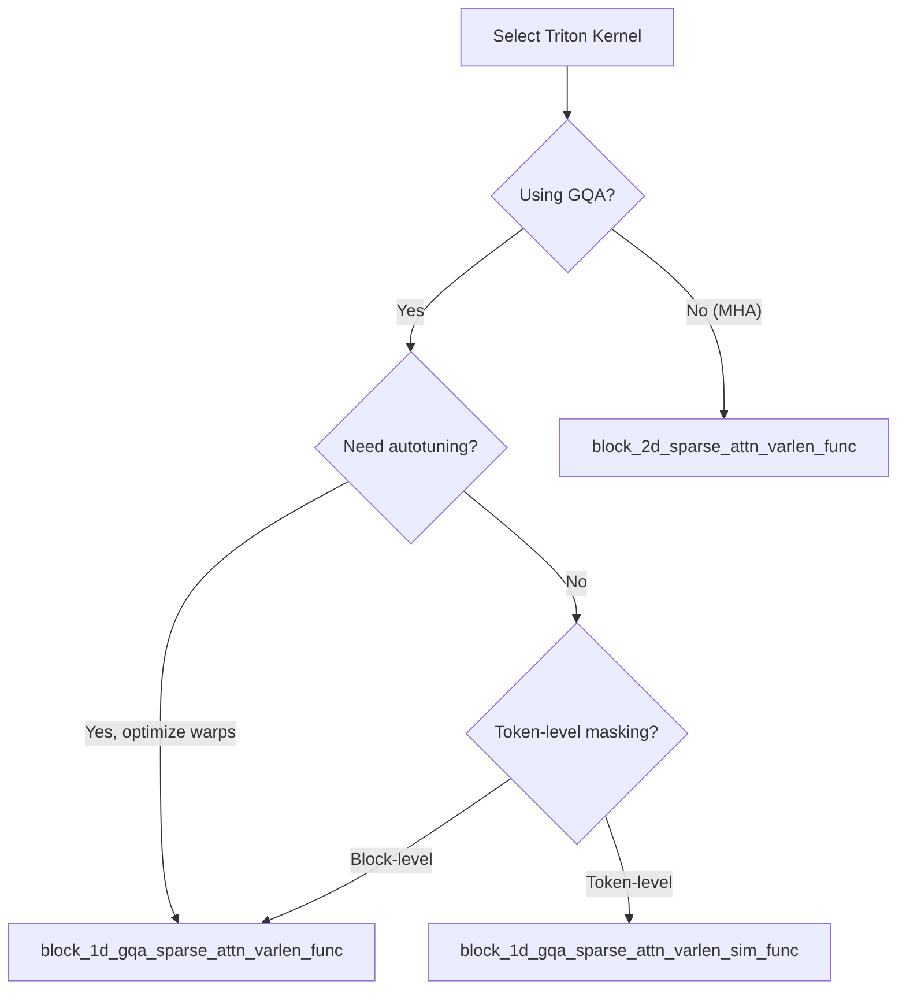
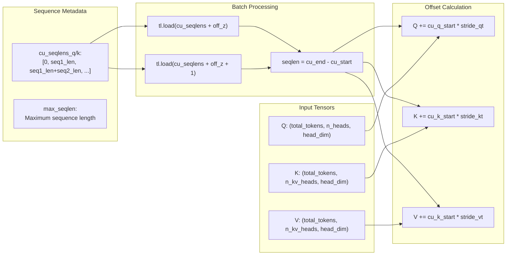
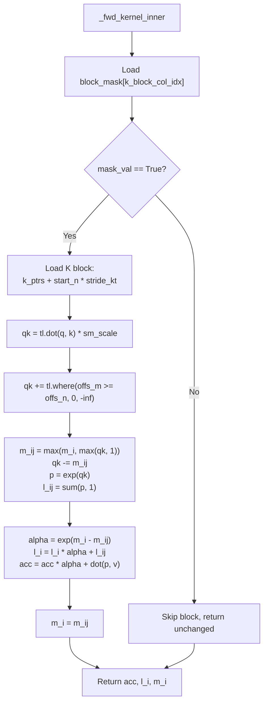
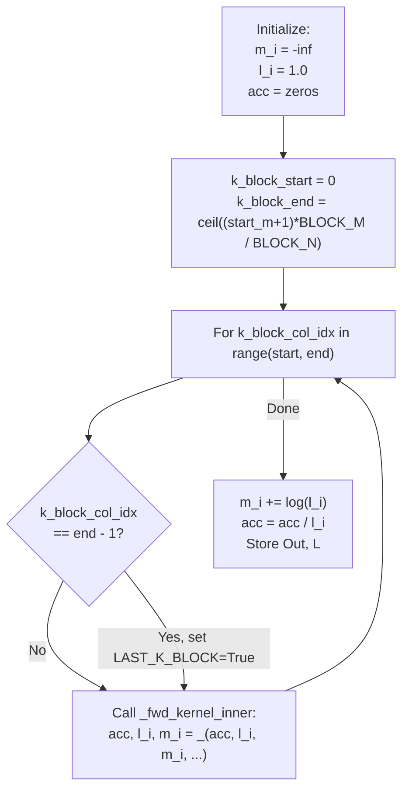
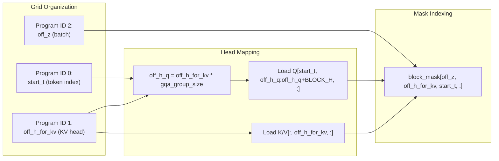
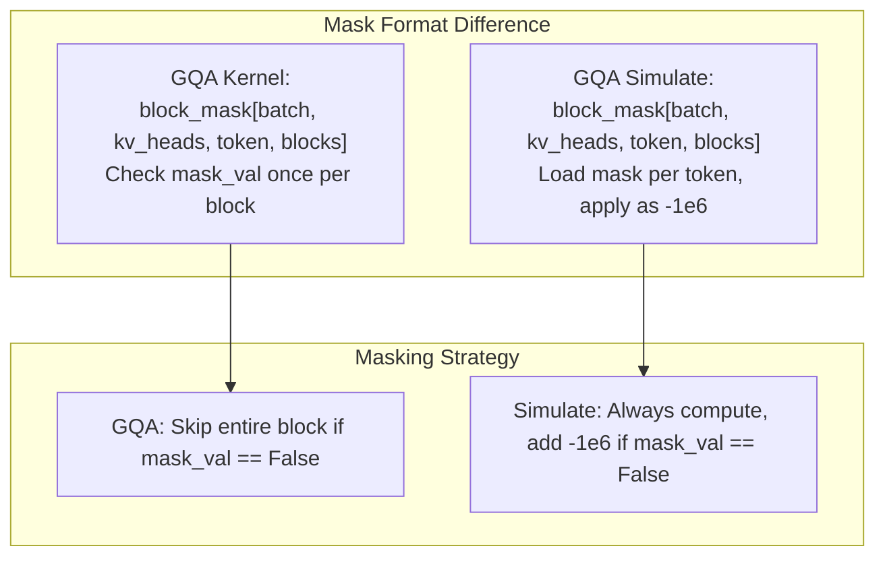
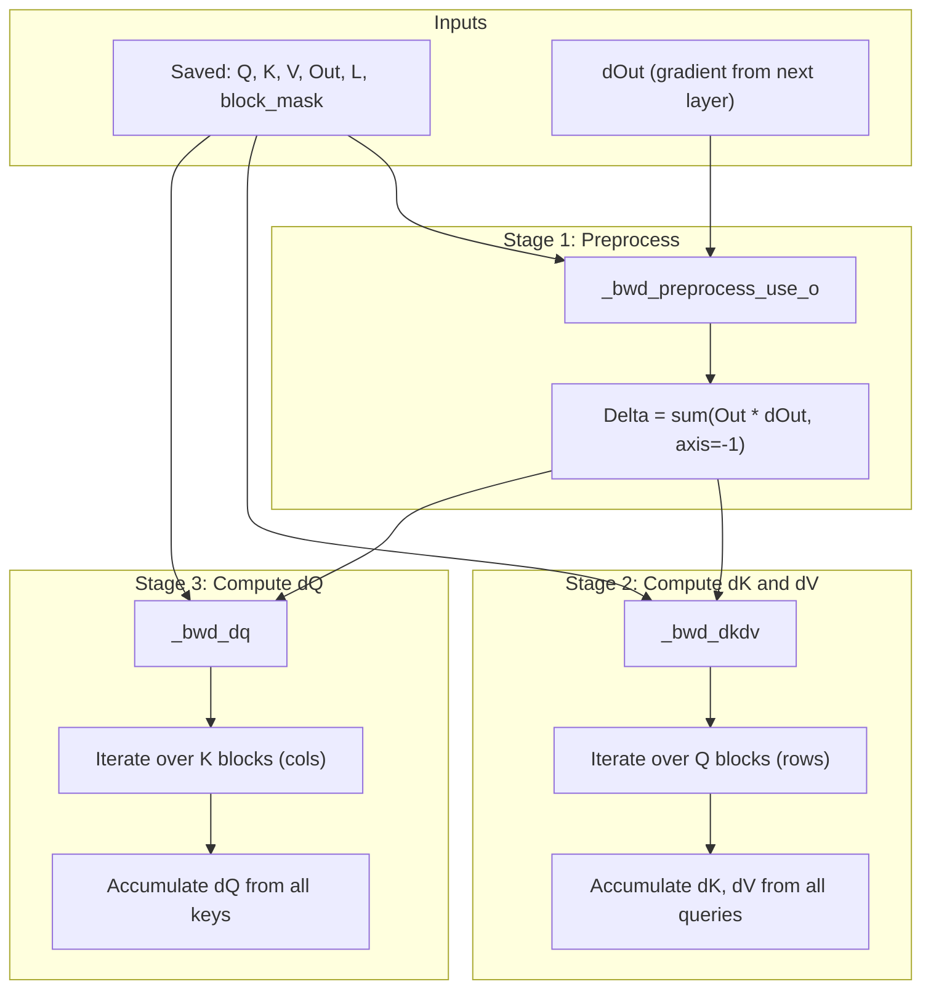

<!-- source: DeepWiki mcp.deepwiki.com · repo microsoft/SeerAttention · page 6.1 Triton Kernels · fetched 2026-10-26 -->

# Triton Kernels

<details>
<summary>Relevant source files</summary>

The following files were used as context for generating this wiki page:

- [seer_attn/kernels/varlen/attn_pooling_kernel_varlen.py](seer_attn/kernels/varlen/attn_pooling_kernel_varlen.py)
- [seer_attn/kernels/varlen/block_sparse_attn_varlen_2d.py](seer_attn/kernels/varlen/block_sparse_attn_varlen_2d.py)
- [seer_attn/kernels/varlen/block_sparse_attn_varlen_gqa.py](seer_attn/kernels/varlen/block_sparse_attn_varlen_gqa.py)
- [seer_attn/kernels/varlen/block_sparse_attn_varlen_gqa_simulate.py](seer_attn/kernels/varlen/block_sparse_attn_varlen_gqa_simulate.py)

</details>


## Purpose and Scope

This page documents the Triton-based kernel implementations for block-sparse attention in SeerAttention. These kernels enable efficient sparse attention computation during both prefill and decode phases using variable-length sequences and block-level sparsity patterns.

For CUDA/CUTLASS-based kernels and flash decode implementations, see [CUDA and Flash Decode Kernels](#6.2). For general performance optimization strategies across all kernels, see [Performance Optimizations](#6.3).

**Sources:** [seer_attn/kernels/varlen/block_sparse_attn_varlen_2d.py:1-696](), [seer_attn/kernels/varlen/block_sparse_attn_varlen_gqa.py:1-645]()

## Kernel Variants Overview

SeerAttention provides three Triton kernel implementations, each optimized for different attention patterns and hardware configurations:

| Kernel Variant | File | Primary Use Case | Key Features |
|---------------|------|------------------|--------------|
| **2D Block-Sparse** | `block_sparse_attn_varlen_2d.py` | General-purpose sparse attention | Standard Q/K/V shapes, causal masking, supports both MHA and GQA |
| **GQA Optimized** | `block_sparse_attn_varlen_gqa.py` | Grouped Query Attention | Token-level parallelization, autotuned warps, optimized for GQA ratios |
| **GQA Simulate** | `block_sparse_attn_varlen_gqa_simulate.py` | GQA with alternative indexing | Row-per-token masking, simpler mask handling, alternative implementation |

**Sources:** [seer_attn/kernels/varlen/block_sparse_attn_varlen_2d.py:1-50](), [seer_attn/kernels/varlen/block_sparse_attn_varlen_gqa.py:1-50](), [seer_attn/kernels/varlen/block_sparse_attn_varlen_gqa_simulate.py:1-50]()

### Kernel Selection Criteria



**Sources:** [seer_attn/kernels/varlen/block_sparse_attn_varlen_2d.py:695](), [seer_attn/kernels/varlen/block_sparse_attn_varlen_gqa.py:644](), [seer_attn/kernels/varlen/block_sparse_attn_varlen_gqa_simulate.py:659]()

## Variable-Length Sequence Architecture

All Triton kernels use variable-length sequence handling to avoid padding overhead. Sequences are packed into a single tensor with cumulative sequence length indices.

### Variable-Length Indexing



**Key Implementation Details:**

- **`cu_seqlens`**: Cumulative sequence lengths tensor `[0, len1, len1+len2, ...]` of shape `(batch_size + 1,)`
- **Batch indexing**: Each kernel thread grid is organized as `(num_blocks, n_heads, batch_size)`
- **Token offset**: `cu_start = cu_seqlens[batch_idx]`, `cu_end = cu_seqlens[batch_idx + 1]`
- **No padding**: Sequences are tightly packed, eliminating wasted computation on padding tokens

**Sources:** [seer_attn/kernels/varlen/block_sparse_attn_varlen_2d.py:101-146](), [seer_attn/kernels/varlen/block_sparse_attn_varlen_gqa.py:54-101]()

## Block-Sparse Attention Mechanism

### Block Mask Format

The sparse attention pattern is specified using a 4D boolean block mask:

```python
# block_mask shape: (batch_size, n_heads, num_q_blocks, num_k_blocks)
# block_size: typically 64
# num_blocks = ceil(seqlen / block_size)
```

| Dimension | Size | Description |
|-----------|------|-------------|
| Batch | `batch_size` | One mask per batch element |
| Heads | `n_heads` (Q heads) or `n_kv_heads` (for GQA) | Per-head sparsity patterns |
| Q Blocks | `ceil(seqlen / block_size)` | Query block rows |
| K Blocks | `ceil(seqlen / block_size)` | Key block columns |

**Mask Semantics:**
- `True`: Block is **active**, compute attention for this QK block
- `False`: Block is **sparse**, skip computation for this QK block

**Sources:** [seer_attn/kernels/varlen/block_sparse_attn_varlen_2d.py:221-288]()

### Forward Pass: 2D Kernel Inner Loop



The kernel implements **online softmax** to avoid materializing the full attention matrix:

- **`m_i`**: Running maximum of attention scores for each query
- **`l_i`**: Running sum of exponentials (denominator of softmax)
- **`alpha`**: Correction factor when updating maximum: `exp(m_old - m_new)`
- **`acc`**: Accumulated output, rescaled by `alpha` when `m_i` changes

**Sources:** [seer_attn/kernels/varlen/block_sparse_attn_varlen_2d.py:36-96]()

### Forward Pass: Main Kernel

The main forward kernel orchestrates block-level iteration:



**Causal Masking:** The kernel only iterates over blocks up to the current query position: `k_block_end = ceil((start_m + 1) * BLOCK_M / BLOCK_N)`. This enforces the triangular causal attention pattern.

**Sources:** [seer_attn/kernels/varlen/block_sparse_attn_varlen_2d.py:100-218]()

## GQA Kernel Optimizations

The GQA kernel ([block_sparse_attn_varlen_gqa.py:54-151]()) uses a different parallelization strategy optimized for grouped query attention:

### Key Differences from 2D Kernel

| Aspect | 2D Kernel | GQA Kernel |
|--------|-----------|------------|
| **Grid dimension 0** | Q blocks (BLOCK_M rows) | Individual tokens |
| **Grid dimension 1** | All Q heads | KV heads only |
| **Head indexing** | `off_h_q` directly | `off_h_q = off_h_kv * gqa_group_size` |
| **BLOCK_H** | N/A (fixed BLOCK_M) | Processes `gqa_group_size` heads per kernel |
| **Autotuning** | Manual num_warps | @triton.autotune on num_warps |

### GQA Parallelization Strategy



**Advantages:**
- **Finer-grained parallelism**: Each token gets its own thread block
- **Better load balancing**: Shorter sequences don't waste GPU resources
- **Optimized for GQA**: Exploits grouped structure with `BLOCK_H` dimension

**Sources:** [seer_attn/kernels/varlen/block_sparse_attn_varlen_gqa.py:46-151]()

### Autotuning Configuration

The GQA kernel uses Triton's autotuning to select optimal warp configurations:

```python
@triton.autotune(
    configs=[
        triton.Config({}, num_warps=num_warps)
        for num_warps in [1, 2, 4, 8, 16]
    ],
    key=['gqa_group_size', 'BLOCK_H', 'BLOCK_N', 'BLOCK_D'],
)
```

The autotuner benchmarks all configurations and selects the fastest based on the specific combination of:
- `gqa_group_size`: Q heads per KV head (e.g., 8 for GQA-8)
- `BLOCK_H`: Head block size (padded to min 16)
- `BLOCK_N`: Key/value block size (typically 64)
- `BLOCK_D`: Head dimension (64, 128, or 256)

**Sources:** [seer_attn/kernels/varlen/block_sparse_attn_varlen_gqa.py:46-52](), [seer_attn/kernels/varlen/block_sparse_attn_varlen_gqa.py:283-289]()

## GQA Simulate Kernel

The GQA simulate variant ([block_sparse_attn_varlen_gqa_simulate.py]()) provides an alternative GQA implementation with simplified mask handling:

### Key Distinctions



**Trade-offs:**

| Aspect | GQA Kernel | GQA Simulate Kernel |
|--------|------------|---------------------|
| **Efficiency** | Higher (skips sparse blocks) | Lower (always computes QK) |
| **Simplicity** | More complex control flow | Simpler, no conditional skipping |
| **Use case** | Production inference | Debugging, validation |
| **Mask application** | Early exit | Additive bias (-1e6) |

**Sources:** [seer_attn/kernels/varlen/block_sparse_attn_varlen_gqa_simulate.py:56-163](), [seer_attn/kernels/varlen/block_sparse_attn_varlen_gqa.py:115-140]()

## Backward Pass Implementation

All three kernel variants implement full backward passes for training. The backward pass is split into three stages:

### Backward Pass Architecture



**Sources:** [seer_attn/kernels/varlen/block_sparse_attn_varlen_2d.py:291-662]()

### Stage 1: Preprocess (Delta Computation)

The preprocess kernel computes `Delta[i] = sum(Out[i] * dOut[i])`, which is needed for the chain rule in attention gradients:

```python
@triton.jit
def _bwd_preprocess_use_o(Out, DO, Delta, ...):
    # Load output and gradient
    o = tl.load(out_ptrs, mask=mask_m[:, None])
    do = tl.load(do_ptrs, mask=mask_m[:, None])
    
    # Compute dot product along hidden dimension
    delta = tl.sum(o * do, axis=1)
    
    # Store delta for use in subsequent kernels
    tl.store(delta_ptrs, delta, mask=mask_m)
```

**Sources:** [seer_attn/kernels/varlen/block_sparse_attn_varlen_2d.py:291-347]()

### Stage 2: Compute dK and dV

The `_bwd_dkdv` kernel iterates over query rows to accumulate gradients for keys and values:

```python
# For each K/V block (start_n):
#   Initialize dv, dk = 0
#   For each Q block (row_idx) that attends to this K block:
#     if block_mask[row_idx, start_n]:
#       Load q, do
#       Recompute attention: qk = q @ k.T, p = exp(qk * scale - l_i)
#       dv += p.T @ do
#       dp = do @ v.T
#       ds = p * (dp - Delta) * scale
#       dk += ds.T @ q
```

**Key insight:** The backward pass **recomputes** attention probabilities `p` on-the-fly rather than storing them from the forward pass, trading computation for memory.

**Sources:** [seer_attn/kernels/varlen/block_sparse_attn_varlen_2d.py:349-460]()

### Stage 3: Compute dQ

The `_bwd_dq` kernel iterates over key columns to accumulate gradients for queries:

```python
# For each Q block (start_m):
#   Initialize dq = 0
#   For each K block (col_idx) in causal range:
#     if block_mask[start_m, col_idx]:
#       Load k, v
#       Recompute attention: qk = q @ k.T, p = exp(qk * scale - l_i)
#       dp = do @ v.T
#       ds = p * (dp - Delta) * scale
#       dq += ds @ k
```

**Sources:** [seer_attn/kernels/varlen/block_sparse_attn_varlen_2d.py:464-557]()

## PyTorch Integration

Each kernel is wrapped in a PyTorch `autograd.Function` for seamless integration with automatic differentiation:

### Autograd Function Wrapper


### Function Definitions

```python
class _block_sparse_attn_varlen(torch.autograd.Function):
    @staticmethod
    def forward(ctx, q, k, v, cu_seqlens_k, cu_seqlens_q, 
                max_seqlen, sm_scale, dense_block_mask, block_size=64):
        out, L = blocksparse_flash_attn_varlen_fwd(...)
        ctx.save_for_backward(out, L, q, k, v, cu_seqlens_k, 
                              cu_seqlens_q, dense_block_mask)
        ctx.sm_scale = sm_scale
        ctx.block_size = block_size
        ctx.max_seqlen = max_seqlen
        return out
    
    @staticmethod
    def backward(ctx, do):
        out, L, q, k, v, cu_seqlens_k, cu_seqlens_q, dense_block_mask = ctx.saved_tensors
        dq, dk, dv = blocksparse_flash_attn_varlen_bwd(...)
        return dq, dk, dv, None, None, None, None, None, None
```

### Entry Point Functions

| Entry Point | Kernel Variant | Usage |
|-------------|----------------|-------|
| `block_2d_sparse_attn_varlen_func` | 2D kernel | General MHA/GQA, block-parallel |
| `block_1d_gqa_sparse_attn_varlen_func` | GQA kernel | Autotuned GQA, token-parallel |
| `block_1d_gqa_sparse_attn_varlen_sim_func` | GQA simulate | Simplified GQA, debugging |

**Sources:** [seer_attn/kernels/varlen/block_sparse_attn_varlen_2d.py:664-696](), [seer_attn/kernels/varlen/block_sparse_attn_varlen_gqa.py:613-645](), [seer_attn/kernels/varlen/block_sparse_attn_varlen_gqa_simulate.py:628-659]()

## Kernel Launch Configuration

### Grid and Block Sizing

All kernels use lambda-defined grid functions for flexibility:

**2D Kernel Grid:**
```python
grid = lambda META: (
    triton.cdiv(max_seqlen, META['BLOCK_M']),  # Q blocks
    n_heads,                                     # All Q heads
    batch                                        # Batch dimension
)
```

**GQA Kernel Grid:**
```python
grid = lambda META: (
    max_seqlen,    # Individual tokens
    k_h,           # KV heads (not Q heads)
    batch          # Batch dimension
)
```

**Sources:** [seer_attn/kernels/varlen/block_sparse_attn_varlen_2d.py:261](), [seer_attn/kernels/varlen/block_sparse_attn_varlen_gqa.py:198]()

### Hardware-Specific Parameters

```python
# AMD ROCm (HIP) configuration
if is_hip():
    extra_kern_args = {"waves_per_eu": 1}
else:
    extra_kern_args = {}

# Kernel launch with hardware-specific args
_fwd_kernel_varlen[grid](
    q, k, v, out, L, ...,
    BLOCK_M=block_size,
    BLOCK_N=block_size,
    BLOCK_D=head_size,
    num_warps=4,
    num_stages=1,
    **extra_kern_args  # Hardware-specific tuning
)
```

**Sources:** [seer_attn/kernels/varlen/block_sparse_attn_varlen_2d.py:255-286]()

## Attention Pooling Kernel

The [attn_pooling_kernel_varlen.py]() file implements a specialized kernel for attention score aggregation:

### Purpose

This kernel computes block-level attention statistics without materializing the full attention output:

```python
def attn_pooling_qk_varlen(q, k, cu_seqlens, max_seqlen, sm_scale, block_size=64):
    # Returns:
    # - Po: (batch, n_heads, num_blocks, num_blocks) - normalized block attention scores
    # - group_R: List of per-sequence (n_heads, seqlen, n_blocks) intermediate scores
```

### Use Case

This kernel is used for **analyzing attention patterns** and **generating soft masks** during AttnGate training, enabling efficient computation of block-level importance scores without full attention computation.

**Sources:** [seer_attn/kernels/varlen/attn_pooling_kernel_varlen.py:165-243]()

## Performance Characteristics

### Computational Complexity

For a sequence of length `N` with block size `B` and sparsity `s`:

| Operation | Dense Attention | Block-Sparse Triton |
|-----------|-----------------|---------------------|
| **FLOPs (forward)** | O(N² × d) | O(s × N² × d) |
| **Memory reads** | O(N × d) | O(s × N × d) |
| **Kernel launches** | 1 | 1 |
| **Online softmax overhead** | N/A | ~5-10% (rescaling) |

**Key advantages:**
- **Single kernel launch**: No split-K decomposition needed
- **Block-level skipping**: Entire blocks are skipped when `mask_val == False`
- **Memory efficiency**: Online softmax avoids storing full attention matrix

**Sources:** [seer_attn/kernels/varlen/block_sparse_attn_varlen_2d.py:36-96]()

### Block Size Trade-offs

| Block Size | Advantages | Disadvantages |
|------------|------------|---------------|
| **32** | Finer-grained sparsity, less wasted computation | More overhead, less SRAM reuse |
| **64** (default) | Good balance, hardware-aligned | Standard choice for most use cases |
| **128** | Better SRAM reuse, fewer kernel iterations | Coarser sparsity, more wasted work |

The typical configuration uses **`block_size=64`** to match common head dimensions (64, 128) and provide good SRAM utilization.

**Sources:** [seer_attn/kernels/varlen/block_sparse_attn_varlen_2d.py:221-288]()

---

