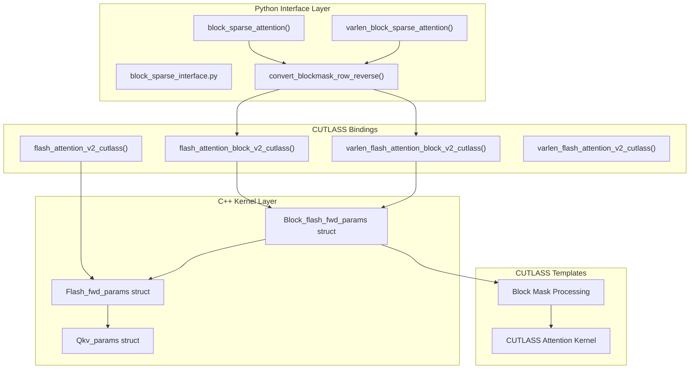
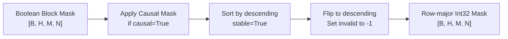
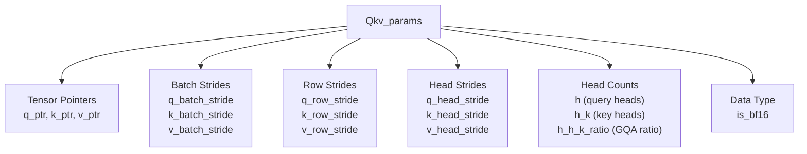
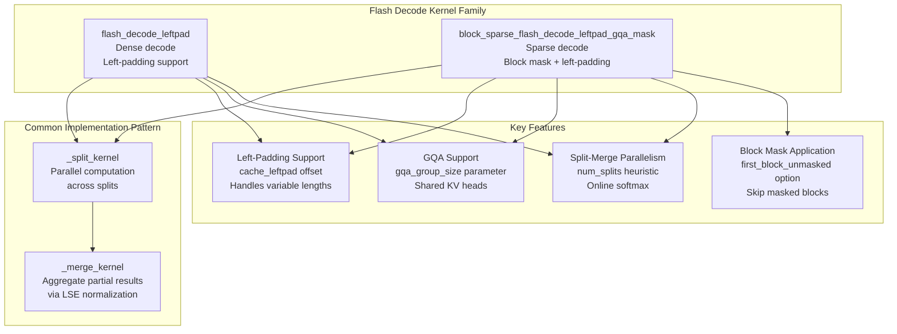
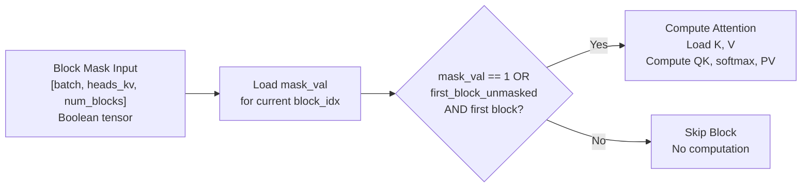
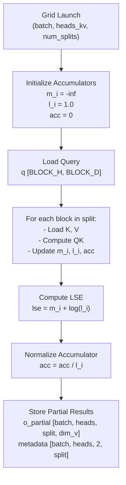
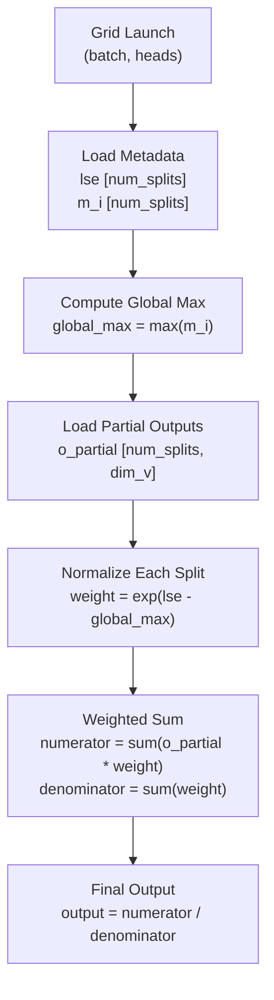
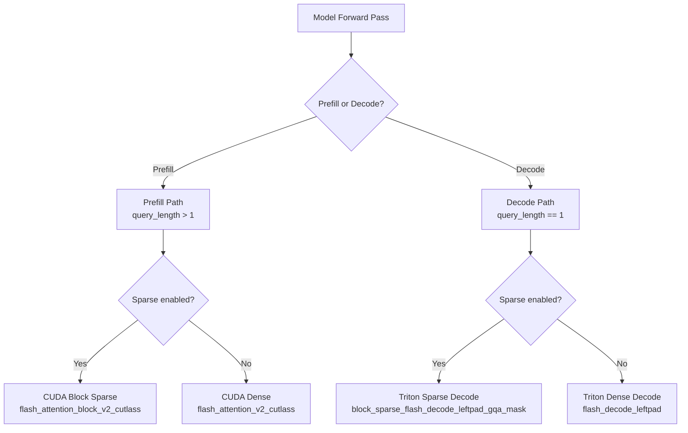

<!-- source: DeepWiki mcp.deepwiki.com · repo microsoft/SeerAttention · page 6.2 CUDA and Flash Decode Kernels · fetched 2026-10-26 -->

# CUDA and Flash Decode Kernels

<details>
<summary>Relevant source files</summary>

The following files were used as context for generating this wiki page:

- [seer_attn/kernels/block_sparse_attention/README.md](seer_attn/kernels/block_sparse_attention/README.md)
- [seer_attn/kernels/block_sparse_attention/block_sparse_seer_attn/block_sparse_interface.py](seer_attn/kernels/block_sparse_attention/block_sparse_seer_attn/block_sparse_interface.py)
- [seer_attn/kernels/block_sparse_attention/csrc/flash.h](seer_attn/kernels/block_sparse_attention/csrc/flash.h)
- [seer_attn/kernels/varlen/block_sparse_flash_decode_varlen_mask_leftpad.py](seer_attn/kernels/varlen/block_sparse_flash_decode_varlen_mask_leftpad.py)
- [seer_attn/kernels/varlen/flash_decode_varlen_left_pad_max_v2.py](seer_attn/kernels/varlen/flash_decode_varlen_left_pad_max_v2.py)

</details>


This page documents the CUDA/CUTLASS-based kernel implementations and flash decode kernels used in SeerAttention. These kernels provide alternative implementations to the Triton kernels (see [Triton Kernels](#6.1)) and specialized functionality for decode-phase attention with left-padding support.

For general performance optimization strategies including variable-length sequences and online softmax, see [Performance Optimizations](#6.3). For information about when these kernels are invoked from model code, see [Sparse Prefill Models](#4.1) and [Sparse Decode Models](#4.2).

---

## Overview

The SeerAttention system provides two primary kernel backends:

1. **CUDA/CUTLASS Kernels**: Block-sparse attention implementations built on CUTLASS templates, offering optimized performance on certain hardware configurations
2. **Triton Flash Decode Kernels**: Specialized kernels for single-token decode with left-padding support and block-sparse masking

The CUDA kernels are primarily used during the prefill phase for block-sparse attention, while the Triton flash decode kernels handle the decode phase where queries consist of single tokens.

**Sources:** [seer_attn/kernels/block_sparse_attention/README.md:1-19]()

---

## Block Sparse Attention CUDA Kernels

### Architecture

The CUDA implementation provides block-sparse FlashAttention kernels using CUTLASS templates. These kernels support custom block masks and are exposed through a Python interface.



**Diagram: Block Sparse CUDA Kernel Architecture**

**Sources:** [seer_attn/kernels/block_sparse_attention/block_sparse_seer_attn/block_sparse_interface.py:1-43](), [seer_attn/kernels/block_sparse_attention/csrc/flash.h:1-95]()

### Python Interface Functions

The system provides four main entry points for CUDA-based attention:

| Function | Purpose | Input Format | Masking |
|----------|---------|--------------|---------|
| `my_flash_attn()` | Dense attention baseline | `(q, k, v)` standard shapes | Causal optional |
| `my_varlen_flash_attn()` | Dense variable-length | `(q, k, v)` with `cu_seqlens` | Causal optional |
| `block_sparse_attention()` | Block-sparse attention | `(q, k, v)` with block mask | Custom block mask |
| `varlen_block_sparse_attention()` | Variable-length sparse | `(q, k, v)` with mask + `cu_seqlens` | Custom block mask |

**Sources:** [seer_attn/kernels/block_sparse_attention/block_sparse_seer_attn/block_sparse_interface.py:30-42]()

### Block Mask Conversion

The `convert_blockmask_row_reverse()` function transforms boolean block masks into the row-major format expected by CUTLASS kernels:



**Diagram: Block Mask Conversion Pipeline**

The conversion process:
1. Applies causal masking if requested, limiting each query block to attend only to valid key blocks
2. Converts boolean mask to uint8 for sorting compatibility
3. Sorts block indices in ascending order with stable sort
4. Sets invalid (zero) mask values to -1 
5. Flips the result to descending order (row-major format for CUTLASS)
6. Returns int32 tensor

**Sources:** [seer_attn/kernels/block_sparse_attention/block_sparse_seer_attn/block_sparse_interface.py:5-28]()

---

## Parameter Structures

The CUDA kernels use C++ structs to manage attention parameters efficiently.

### Qkv_params

Base structure defining query, key, and value tensor metadata:



**Diagram: Qkv_params Structure**

The `h_h_k_ratio` field is precomputed as `h / h_k` to support Grouped Query Attention (GQA), where multiple query heads share key-value heads.

**Sources:** [seer_attn/kernels/block_sparse_attention/csrc/flash.h:5-30]()

### Flash_fwd_params

Extended structure for forward pass attention computation:

| Field Category | Fields | Purpose |
|----------------|--------|---------|
| Output | `o_ptr`, `o_batch_stride`, `o_row_stride`, `o_head_stride` | Output tensor metadata |
| Softmax | `softmax_lse_ptr`, `scale_softmax`, `scale_softmax_log2` | Softmax computation parameters |
| Dimensions | `b`, `seqlen_q`, `seqlen_k`, `d`, `seqlen_q_rounded`, etc. | Tensor dimensions and rounded sizes |
| Variable Length | `cu_seqlens_q`, `cu_seqlens_k`, `seqused_k` | Cumulative sequence length arrays |
| Block Mask | `blockmask`, `m_block_dim`, `n_block_dim`, `num_blocksparse_heads` | Block sparsity configuration |
| Flags | `is_causal`, `is_seqlens_k_cumulative` | Behavioral flags |

**Sources:** [seer_attn/kernels/block_sparse_attention/csrc/flash.h:33-89]()

### Block_flash_fwd_params

Extends `Flash_fwd_params` with additional block mask metadata:

- `block_mask_ptr`: Pointer to block mask tensor with shape `[B, NHead, seq/blockM, seq/blockN]`
- `mask_head_stride`: Stride between heads in mask tensor
- `mask_batch_stride`: Stride between batches in mask tensor

**Sources:** [seer_attn/kernels/block_sparse_attention/csrc/flash.h:91-95]()

---

## Flash Decode Kernels

The flash decode kernels provide specialized implementations for single-token decoding with support for left-padded sequences and block-sparse masking.

### Kernel Variants



**Diagram: Flash Decode Kernel Architecture**

**Sources:** [seer_attn/kernels/varlen/flash_decode_varlen_left_pad_max_v2.py:1-252](), [seer_attn/kernels/varlen/block_sparse_flash_decode_varlen_mask_leftpad.py:1-287]()

### flash_decode_leftpad

Dense flash decode kernel for single-token queries with left-padding support.

**Function Signature:**
```python
flash_decode_leftpad(
    q,                  # [batch, heads, dim] or [batch, 1, heads, dim]
    k_cache,            # [batch, max_cache_seqlen, heads_kv, dim]
    v_cache,            # [batch, max_cache_seqlen, heads_kv, dim_v]
    cache_seqlens,      # [batch] - actual sequence lengths
    block_size=32,
    sm_scale=None,      # defaults to 1/sqrt(dim)
)
```

**Key Implementation Details:**

1. **Left-Padding Calculation:** [seer_attn/kernels/varlen/flash_decode_varlen_left_pad_max_v2.py:54-62]()
   - Computes `cache_leftpad = max_seqlen - cache_seqlens` per batch
   - Calculates `leftpad_block_offset = cache_leftpad // BLOCK_N`
   - Adjusts block iteration to skip left-padded blocks

2. **Split Heuristic:** [seer_attn/kernels/varlen/flash_decode_varlen_left_pad_max_v2.py:186-197]()
   - Uses `num_splits_heuristic()` to determine parallelization degree
   - Balances GPU utilization against synchronization overhead
   - Maximum splits capped at 128

3. **Online Softmax:** [seer_attn/kernels/varlen/flash_decode_varlen_left_pad_max_v2.py:84-104]()
   - Maintains running maximum `m_i` and sum `l_i` across blocks
   - Updates accumulator with exponential correction: `acc = acc * alpha[:, None]`
   - Computes final LSE: `lse = m_i + log(l_i)`

**Sources:** [seer_attn/kernels/varlen/flash_decode_varlen_left_pad_max_v2.py:158-251]()

### block_sparse_flash_decode_leftpad_gqa_mask

Sparse flash decode kernel with block-level masking and left-padding support.

**Function Signature:**
```python
block_sparse_flash_decode_leftpad_gqa_mask(
    q,                      # [batch, heads, dim] or [batch, 1, heads, dim]
    k_cache,                # [batch, max_cache_seqlen, heads_kv, dim]
    v_cache,                # [batch, max_cache_seqlen, heads_kv, dim_v]
    cache_seqlens,          # [batch] - actual sequence lengths
    block_mask,             # [batch, heads_kv, num_blocks] - boolean mask
    block_size=32,
    sm_scale=None,
    first_block_unmasked=False,  # Force first block to be attended
    debug=False,            # Return intermediate tensors if True
)
```

**Block Mask Processing:**



**Diagram: Block Mask Application in Decode Kernel**

**Key Differences from Dense Variant:**

1. **Block Mask Loading:** [seer_attn/kernels/varlen/block_sparse_flash_decode_varlen_mask_leftpad.py:81-82]()
   - Loads single boolean value per block: `mask_val = tl.load(mask_ptr + cur_block_idx * stride_mask_s)`
   - Skips entire block if mask is False

2. **First Block Override:** [seer_attn/kernels/varlen/block_sparse_flash_decode_varlen_mask_leftpad.py:82]()
   - Allows forcing first block to be attended even if mask is False
   - Useful when gates cannot reliably predict importance of initial context

3. **Computational Savings:**
   - Only loads K/V tensors for masked blocks
   - Skips QK computation, softmax, and PV multiplication for unmasked blocks
   - Memory bandwidth savings proportional to sparsity ratio

**Sources:** [seer_attn/kernels/varlen/block_sparse_flash_decode_varlen_mask_leftpad.py:163-287]()

---

## Split-Merge Pattern

Both flash decode kernels use a two-stage split-merge pattern for parallelization.

### Split Kernel

The `_split_kernel` computes partial attention outputs across splits:



**Diagram: Split Kernel Computation Flow**

**Work Distribution:** [seer_attn/kernels/varlen/block_sparse_flash_decode_varlen_mask_leftpad.py:64-69]()
- Total blocks divided among splits
- Remainder blocks distributed to first splits
- Each split processes `blocks_per_split` or `blocks_per_split + 1` blocks

**Sources:** [seer_attn/kernels/varlen/block_sparse_flash_decode_varlen_mask_leftpad.py:21-116]()

### Merge Kernel

The `_merge_kernel` aggregates partial results using LSE normalization:



**Diagram: Merge Kernel Aggregation**

**Mathematical Formulation:** [seer_attn/kernels/varlen/block_sparse_flash_decode_varlen_mask_leftpad.py:148-156]()

For splits `i = 1, ..., num_splits` with partial outputs `o_i`, LSE values `lse_i`, and max values `m_i`:

1. Global maximum: `M = max(m_i)`
2. Normalized weights: `w_i = exp(lse_i - M)`
3. Final output: `output = sum(o_i * w_i) / sum(w_i)`

This ensures numerically stable aggregation across splits.

**Sources:** [seer_attn/kernels/varlen/block_sparse_flash_decode_varlen_mask_leftpad.py:126-159]()

---

## Kernel Selection and Usage

The choice between CUDA and Triton kernels, and between dense and sparse variants, depends on the inference phase and configuration.

### Selection Criteria

| Scenario | Kernel Used | Rationale |
|----------|-------------|-----------|
| Prefill (block-sparse) | `flash_attention_block_v2_cutlass` or Triton | CUDA offers optimized performance for certain hardware |
| Prefill (dense baseline) | `flash_attention_v2_cutlass` | Standard FlashAttention-2 implementation |
| Decode (sparse) | `block_sparse_flash_decode_leftpad_gqa_mask` | Specialized for single token + block mask |
| Decode (dense) | `flash_decode_leftpad` | No masking overhead |

### Integration Points



**Diagram: Kernel Selection Flow**

The model implementations in [Sparse Prefill Models](#4.1) and [Sparse Decode Models](#4.2) handle this selection based on configuration parameters like `seerattn_sparsity_method` and the current generation phase.

**Sources:** [seer_attn/kernels/block_sparse_attention/block_sparse_seer_attn/block_sparse_interface.py:36-42](), [seer_attn/kernels/varlen/block_sparse_flash_decode_varlen_mask_leftpad.py:163-287]()

---

## Performance Characteristics

### CUDA Kernels

**Advantages:**
- Optimized CUTLASS templates provide excellent performance on A100/H100 GPUs
- Lower kernel launch overhead compared to Triton on some configurations
- Native support for custom block masks without preprocessing

**Limitations:**
- Requires compilation with CUDA toolkit
- Less portable across GPU architectures than Triton
- Block mask must be converted to row-major format

### Flash Decode Kernels

**Advantages:**
- Specialized for decode workload (single query token)
- Left-padding support enables efficient variable-length batching
- Split-merge pattern provides parallelization for long sequences
- Block-sparse variant reduces computation proportional to sparsity

**Limitations:**
- Requires careful tuning of `num_splits` for optimal performance
- Split-merge overhead becomes significant for short sequences
- Block-level granularity may not capture fine-grained sparsity patterns

For detailed performance analysis and optimization strategies, see [Performance Optimizations](#6.3) and [Efficiency Benchmarks](#7.3).

**Sources:** [seer_attn/kernels/varlen/block_sparse_flash_decode_varlen_mask_leftpad.py:229-236](), [seer_attn/kernels/varlen/flash_decode_varlen_left_pad_max_v2.py:190-197]()

---

