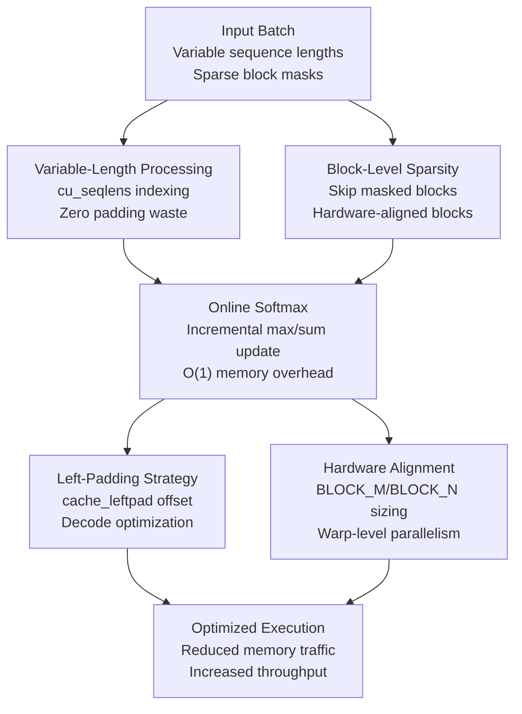
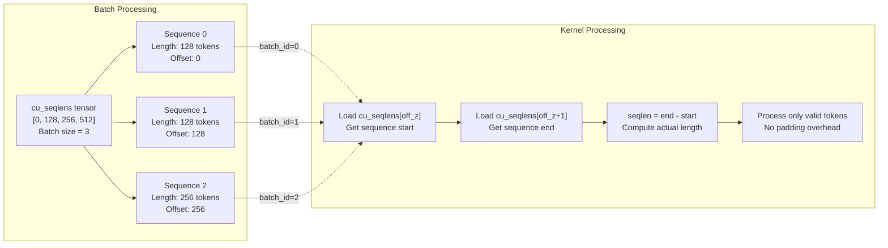
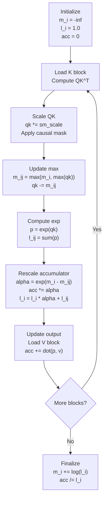
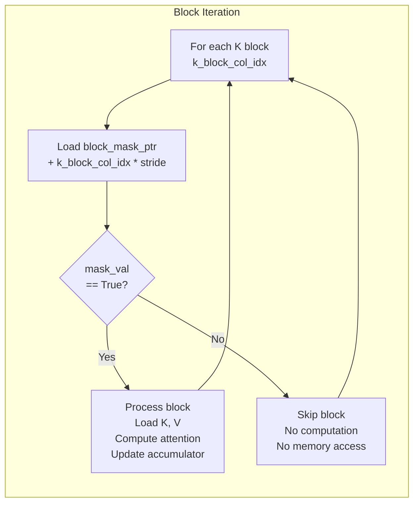
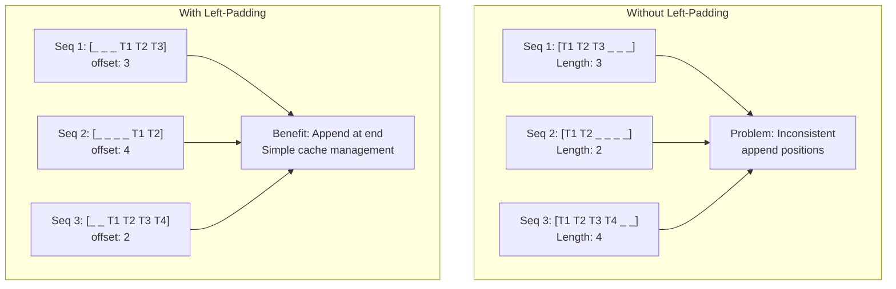
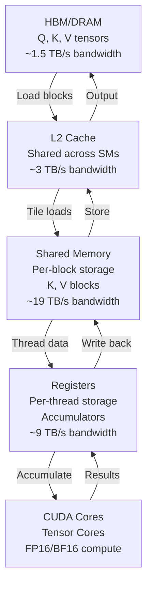
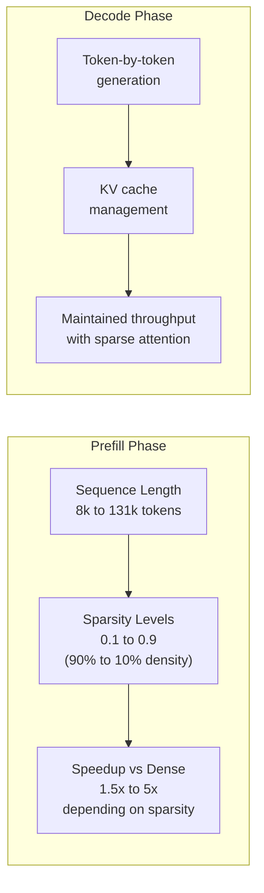

<!-- source: DeepWiki mcp.deepwiki.com · repo microsoft/SeerAttention · page 6.3 Performance Optimizations · fetched 2026-10-26 -->

# Performance Optimizations

<details>
<summary>Relevant source files</summary>

The following files were used as context for generating this wiki page:

- [eval/README.md](eval/README.md)
- [eval/efficiency/benchmark_sparse_attn.py](eval/efficiency/benchmark_sparse_attn.py)
- [requirements.txt](requirements.txt)
- [seer_attn/kernels/varlen/attn_pooling_kernel_varlen.py](seer_attn/kernels/varlen/attn_pooling_kernel_varlen.py)
- [seer_attn/kernels/varlen/block_sparse_attn_varlen_2d.py](seer_attn/kernels/varlen/block_sparse_attn_varlen_2d.py)
- [seer_attn/kernels/varlen/block_sparse_attn_varlen_gqa.py](seer_attn/kernels/varlen/block_sparse_attn_varlen_gqa.py)
- [seer_attn/kernels/varlen/block_sparse_attn_varlen_gqa_simulate.py](seer_attn/kernels/varlen/block_sparse_attn_varlen_gqa_simulate.py)

</details>


This page documents the key performance optimizations employed in SeerAttention's kernel implementations. These optimizations enable efficient sparse attention computation while maintaining numerical accuracy and supporting variable batch configurations.

For information about the specific kernel implementations, see [Triton Kernels](#6.1) and [CUDA and Flash Decode Kernels](#6.2). For overall kernel architecture, see [Kernels and Performance](#6).

---

## Optimization Strategy Overview

SeerAttention employs four primary performance optimization techniques that work together to achieve efficient sparse attention computation:



**Sources:** [eval/README.md:100-102](), [seer_attn/kernels/varlen/block_sparse_attn_varlen_2d.py]()

---

## Variable-Length Sequence Processing

SeerAttention kernels eliminate padding waste by using cumulative sequence length tensors (`cu_seqlens_q` and `cu_seqlens_k`) to index directly into variable-length sequences within a batch.

### Implementation Mechanism

The variable-length approach stores sequences contiguously in memory with an auxiliary index tensor that marks sequence boundaries:



In the Triton kernels, this is implemented as:

```python
# From _fwd_kernel_varlen in block_sparse_attn_varlen_2d.py
cu_q_start = tl.load(cu_seqlens_q + off_z).to(tl.int64)
cu_q_end = tl.load(cu_seqlens_q + off_z + 1).to(tl.int64)
seqlen_q = cu_q_end - cu_q_start
```

[seer_attn/kernels/varlen/block_sparse_attn_varlen_2d.py:125-127]()

### Memory Efficiency Benefits

| Approach | Memory Layout | Wasted Space | Access Pattern |
|----------|---------------|--------------|----------------|
| **Padded Batches** | Each sequence padded to max_length | `(max_len - actual_len) × batch_size` | Simple but wasteful |
| **Variable-Length** | Contiguous storage with cu_seqlens | Zero | Indexed via cu_seqlens |

The variable-length approach eliminates memory waste for batches with heterogeneous sequence lengths, which is common in real-world inference scenarios. This is particularly important for long-context processing where sequence lengths can vary from 4k to 131k tokens.

**Sources:** [seer_attn/kernels/varlen/block_sparse_attn_varlen_2d.py:100-134](), [seer_attn/kernels/varlen/block_sparse_attn_varlen_gqa.py:77-87]()

---

## Online Softmax Algorithm

The online softmax algorithm, inherited from FlashAttention, enables single-pass attention computation without materializing the full attention matrix. This reduces memory footprint from O(N²) to O(N) for sequence length N.

### Mathematical Foundation

The algorithm maintains running statistics (`m_i` for max, `l_i` for sum) that are incrementally updated as blocks are processed:

```
m_new = max(m_old, max(new_block))
l_new = l_old * exp(m_old - m_new) + sum(exp(new_block - m_new))
```

### Kernel Implementation



The implementation in the `_fwd_kernel_inner` function demonstrates this pattern:

```python
# Compute attention scores
qk = tl.dot(q, k)
qk *= sm_scale

# Update running max and sum
m_ij = tl.maximum(m_i, tl.max(qk, 1))
qk -= m_ij[:, None]
p = tl.exp(qk)
l_ij = tl.sum(p, 1)

# Rescale previous accumulator
alpha = tl.exp(m_i - m_ij)
l_i = l_i * alpha + l_ij
acc = acc * alpha[:, None]

# Accumulate new values
acc += tl.dot(p, v)
m_i = m_ij
```

[seer_attn/kernels/varlen/block_sparse_attn_varlen_2d.py:67-95]()

### Numerical Stability

The online softmax algorithm maintains numerical stability by:
1. Subtracting the running max (`m_ij`) before exponentiation to prevent overflow
2. Using `float32` precision for accumulation even with `float16` inputs
3. Rescaling previous contributions when the max changes

**Sources:** [seer_attn/kernels/varlen/block_sparse_attn_varlen_2d.py:36-96](), [seer_attn/kernels/varlen/attn_pooling_kernel_varlen.py:9-52]()

---

## Block-Level Sparsity Optimization

Block-level sparsity enables the kernel to skip entire blocks of computation when the block mask indicates they should be zeroed out. This is more efficient than element-level sparsity because it reduces memory traffic and enables early termination.

### Block Mask Checking



The kernel implementation uses a simple guard clause:

```python
mask_val = tl.load(block_mask_ptr + k_block_col_idx * stride_bmask_n)
if mask_val == True:
    start_n = k_block_col_idx * BLOCK_N
    # ... compute attention for this block
    k = tl.load(k_ptrs + start_n * stride_kt)
    qk = tl.dot(q, k)
    # ... rest of computation
```

[seer_attn/kernels/varlen/block_sparse_attn_varlen_2d.py:54-95]()

### Hardware Alignment

Block sizes are chosen to align with GPU hardware characteristics:

| Parameter | Typical Value | Hardware Constraint |
|-----------|---------------|---------------------|
| `BLOCK_M` | 64-128 | Fits in shared memory |
| `BLOCK_N` | 64 | Aligned with memory transactions |
| `BLOCK_D` | 64, 128, 256 | Head dimension |
| `num_warps` | 1, 2, 4, 8, 16 | GPU warp count |

The GQA variant uses autotuning to find optimal configurations:

```python
@triton.autotune(
    configs=[
        triton.Config({}, num_warps=num_warps)
        for num_warps in [1, 2, 4, 8, 16]
    ],
    key=['gqa_group_size', 'BLOCK_H', 'BLOCK_N', 'BLOCK_D'],
)
```

[seer_attn/kernels/varlen/block_sparse_attn_varlen_gqa.py:46-52]()

### Computational Savings

For a sequence of length N with block size B and sparsity ratio s:
- Dense attention: O(N²) operations
- Block-sparse attention: O(N² × (1-s)) operations
- Memory traffic reduced proportionally to sparsity

The efficiency benchmark script demonstrates these savings:

```python
# Generate sparse mask with specified sparsity
base_blockmask = generate_base_sparsity_mask(
    seq_len, seq_len, block_size, block_size, block_size, 
    sparsity, is_causal, device="cuda"
)

# Benchmark shows speedup increases with sparsity
sparse_time = run_benchmark(epoch, warmup, block_sparse_attention, 
                            q, k, v, base_blockmask, is_causal, sm_scale)
```

[eval/efficiency/benchmark_sparse_attn.py:77-79]()

**Sources:** [seer_attn/kernels/varlen/block_sparse_attn_varlen_2d.py:54-95](), [seer_attn/kernels/varlen/block_sparse_attn_varlen_gqa.py:115-139](), [eval/efficiency/benchmark_sparse_attn.py:30-59]()

---

## Left-Padding Strategy

The left-padding strategy optimizes decode-phase inference by aligning variable-length KV caches to the right side of the memory buffer. This enables efficient cache management during token-by-token generation.

### Motivation

During decoding, sequences grow incrementally and may have different starting points in the cache. Left-padding ensures:
1. New tokens are always appended at consistent positions
2. Cache indexing remains simple despite variable lengths
3. Memory access patterns are predictable



### Implementation

The left-padding strategy is implemented in the flash decode kernels (referenced in high-level diagrams):
- `flash_decode_leftpad` interface for single-token queries
- `cache_leftpad` offset parameter to handle variable starting positions
- Support for variable-length sequences in decode phase

This optimization is particularly important for the sparse decode models documented in [Sparse Decode Models](#4.2).

**Sources:** High-level system diagrams (Diagram 4), evaluation framework references to `flash_decode_leftpad`

---

## Hardware-Aware Design Considerations

### Memory Hierarchy Optimization

The kernels are designed to maximize data reuse within the GPU memory hierarchy:



### Warp-Level Parallelism

The kernels use Triton's autotuning to find optimal warp configurations:

```python
# From block_sparse_attn_varlen_gqa.py
@triton.autotune(
    configs=[
        triton.Config({}, num_warps=num_warps)
        for num_warps in [1, 2, 4, 8, 16]
    ],
    key=['gqa_group_size', 'BLOCK_H', 'BLOCK_N', 'BLOCK_D'],
)
```

[seer_attn/kernels/varlen/block_sparse_attn_varlen_gqa.py:46-52]()

Different configurations are optimal for different workloads:
- **1-2 warps**: Small batch sizes, small head dimensions
- **4 warps**: Balanced general-purpose configuration
- **8-16 warps**: Large batch sizes, larger blocks

### Platform-Specific Optimizations

The kernels detect and adapt to different GPU architectures:

```python
def is_hip():
    return triton.runtime.driver.active.get_current_target().backend == "hip"

# Configure based on platform
if is_hip():
    extra_kern_args = {"waves_per_eu": 1}
else:
    extra_kern_args = {}
```

[seer_attn/kernels/varlen/block_sparse_attn_varlen_2d.py:17-18](), [seer_attn/kernels/varlen/block_sparse_attn_varlen_2d.py:255-258]()

AMD GPUs (HIP backend) require different wave configurations compared to NVIDIA GPUs for optimal performance.

**Sources:** [seer_attn/kernels/varlen/block_sparse_attn_varlen_2d.py:255-286](), [seer_attn/kernels/varlen/block_sparse_attn_varlen_gqa.py:46-52](), [seer_attn/kernels/varlen/block_sparse_attn_varlen_gqa.py:191-194]()

---

## Performance Impact

### Measured Efficiency Gains

The benchmark results demonstrate significant speedups from sparse attention:



From the evaluation README, efficiency benchmarks show:
- Sparse attention provides speedups proportional to sparsity ratio
- Memory usage reduced correspondingly
- Negligible accuracy loss for appropriate sparsity thresholds

### Optimization Interaction

The four primary optimizations work synergistically:

| Optimization | Primary Benefit | Interacts With |
|--------------|-----------------|----------------|
| **Variable-Length** | Eliminates padding waste | Block-Level Sparsity |
| **Online Softmax** | O(N) memory complexity | All optimizations |
| **Block-Level Sparsity** | Skips computation | Hardware Alignment |
| **Left-Padding** | Cache efficiency | Variable-Length |

### Configuration Recommendations

Based on the kernel implementations and benchmark results:

**For Prefill (long sequences):**
- Block size: 64
- Threshold-based or TopK sparsity
- Sequence lengths: 8k-131k tokens
- Target sparsity: 0.3-0.7 (30-70% of blocks active)

**For Decode (token generation):**
- Block size: 64
- Token budget: 1k-8k tokens
- Single query per step
- Left-padding enabled

**Sources:** [eval/README.md:100-102](), [eval/efficiency/benchmark_sparse_attn.py:61-123](), configuration documentation in kernel files

---

## Summary

SeerAttention achieves its performance characteristics through four complementary optimizations:

1. **Variable-Length Sequences**: Zero padding waste through cu_seqlens indexing
2. **Online Softmax**: O(N) memory with incremental statistics update
3. **Block-Level Sparsity**: Skip entire blocks based on learned masks
4. **Left-Padding Strategy**: Efficient cache management for decode

These optimizations are hardware-aware, with autotuning for different GPU configurations and platform-specific adjustments. The result is sparse attention that approaches or exceeds dense attention speed while using significantly less computation and memory.

For kernel-specific implementation details, see [Triton Kernels](#6.1) and [CUDA and Flash Decode Kernels](#6.2).

**Sources:** All kernel files in [seer_attn/kernels/varlen/](), [eval/efficiency/benchmark_sparse_attn.py](), [eval/README.md:100-102]()

---

