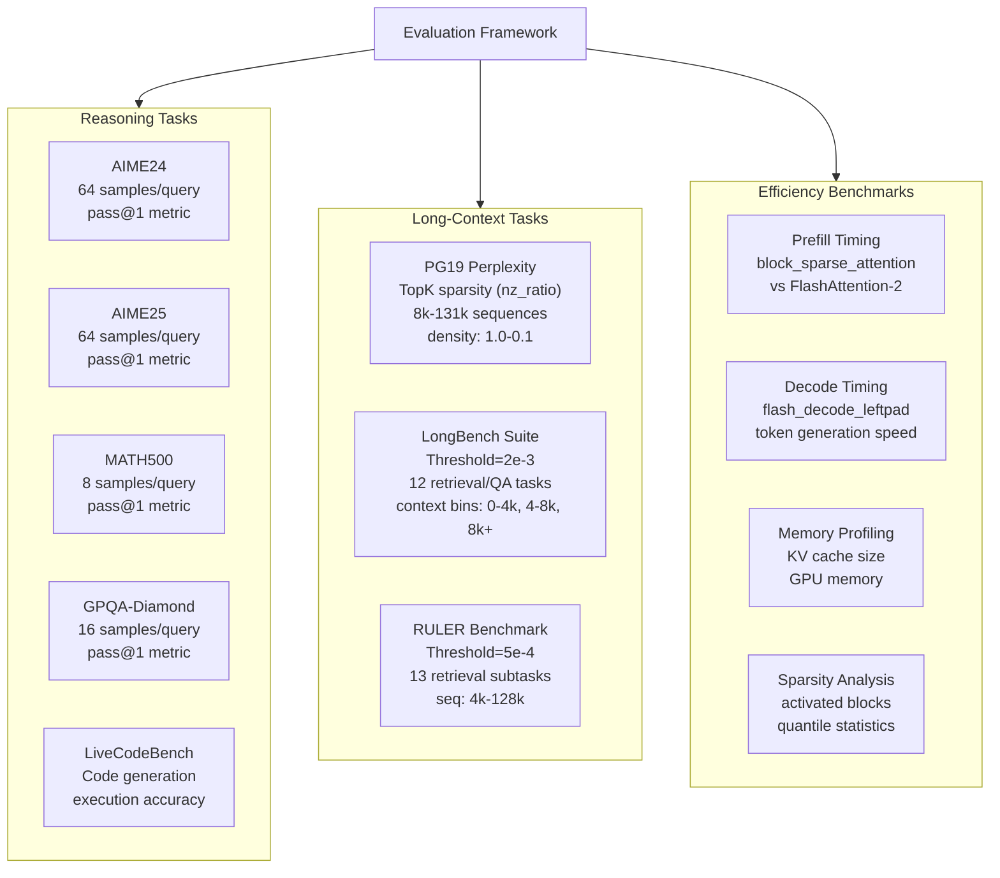
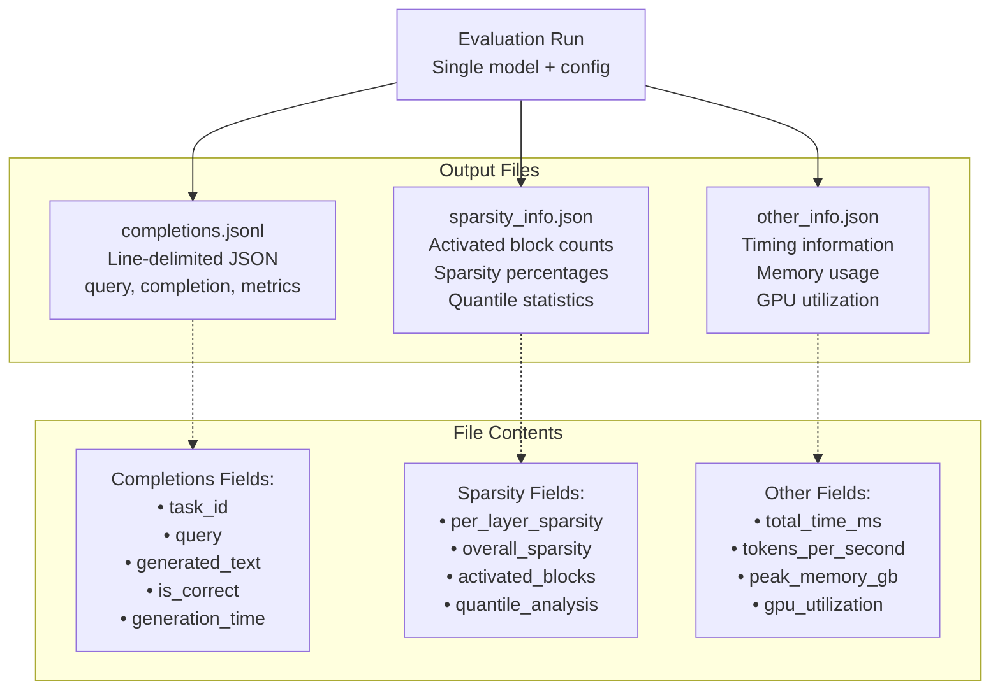
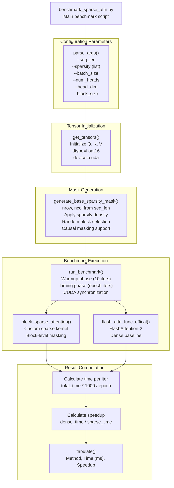
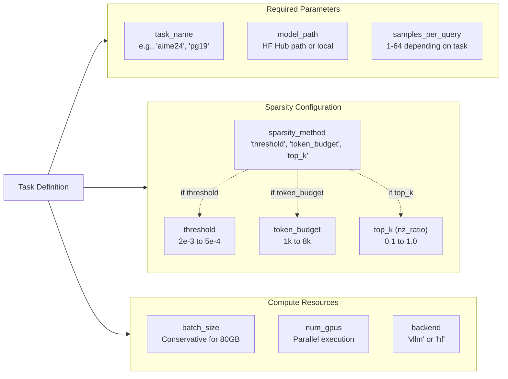

<!-- source: DeepWiki mcp.deepwiki.com · repo microsoft/SeerAttention · page 7 Evaluation Framework · fetched 2026-10-26 -->

# Evaluation Framework

<details>
<summary>Relevant source files</summary>

The following files were used as context for generating this wiki page:

- [eval/README.md](eval/README.md)
- [eval/efficiency/benchmark_sparse_attn.py](eval/efficiency/benchmark_sparse_attn.py)
- [eval/reasoning_tasks/README.md](eval/reasoning_tasks/README.md)
- [requirements.txt](requirements.txt)

</details>


## Purpose and Scope

The Evaluation Framework provides a comprehensive system for benchmarking SeerAttention models across three dimensions: **accuracy** (reasoning and long-context tasks), **efficiency** (computational performance), and **sparsity characteristics** (pattern analysis). The framework supports parallel execution across multiple GPUs, multiple execution backends, and automatic result aggregation.

This page provides an overview of the evaluation infrastructure, execution pipelines, and result management. For detailed information about specific evaluation types, see:
- [Reasoning Tasks Evaluation](#7.1) - AIME, MATH, GPQA, LiveCodeBench benchmarks
- [Long-Context Benchmarks](#7.2) - PG19, LongBench, RULER evaluations
- [Efficiency Benchmarks](#7.3) - Timing and memory profiling
- [Running Evaluations](#7.4) - Practical guide to executing evaluations

For information about the models being evaluated, see [Model Implementations](#4). For training metrics during self-distillation, see [Training and Distillation](#5).

## Evaluation Categories

The framework organizes evaluations into three primary categories, each testing different aspects of SeerAttention's performance.

### Evaluation Category Structure



**Sources:** [eval/README.md:1-102](), [eval/reasoning_tasks/README.md:1-54]()

### Evaluation Metrics by Category

| Category | Benchmarks | Primary Metrics | Sparsity Control | Sequence Lengths |
|----------|-----------|----------------|------------------|------------------|
| **Reasoning** | AIME24/25, MATH500, GPQA-Diamond | pass@1 accuracy | `token_budget`: 1k-8k | Variable (task-dependent) |
| **Long-Context** | PG19 | Perplexity | `top_k` (nz_ratio): 0.1-1.0 | 8k-131k tokens |
| **Long-Context** | LongBench | Accuracy per task | `threshold`: 2e-3 | 0-4k, 4-8k, 8k+ bins |
| **Long-Context** | RULER | Accuracy per subtask | `threshold`: 5e-4 | 4k, 8k, 16k, 32k, 64k, 128k |
| **Efficiency** | Custom timing | ms per forward pass | Configurable | 8k-131k tokens |

**Sources:** [eval/README.md:5-98](), [eval/reasoning_tasks/README.md:12-54]()

## Evaluation Infrastructure

The framework uses a parallel orchestration system to coordinate evaluation across multiple GPUs and manage computational resources efficiently.

### Execution Pipeline

```mermaid
graph LR
    TaskConfig["Task Configuration<br/>task_name, model_path<br/>samples_per_query<br/>token_budget/threshold"]
    
    Orchestrator["Parallel Orchestrator<br/>parallel_run_vllm.py<br/>parallel_run_hf.py"]
    
    subgraph Backend["Execution Backend Selection"]
        CheckBackend{"Backend<br/>Type?"}
        VLLMBackend["vLLM Engine<br/>High throughput<br/>PagedAttention<br/>Dense baseline"]
        HFBackend["HuggingFace Transformers<br/>Custom attention hooks<br/>Sparsity support<br/>AttnGates integration"]
    end
    
    subgraph GPUAlloc["GPU Allocation"]
        GPUManager["GPU Manager<br/>CUDA_VISIBLE_DEVICES<br/>Dynamic assignment"]
        MultiGPU["Multi-GPU Pool<br/>Parallel task execution"]
    end
    
    subgraph Execution["Model Execution"]
        LoadModel["Load Model<br/>base + AttnGates"]
        ConfigSparsity["Configure Sparsity<br/>method, threshold/budget"]
        RunInference["Run Inference<br/>Generate completions"]
        CollectMetrics["Collect Metrics<br/>accuracy, timing, sparsity"]
    end
    
    subgraph Storage["Result Storage"]
        PerRunFiles["Per-Run Files<br/>completions.jsonl<br/>sparsity_info.json<br/>other_info.json"]
        Aggregation["Aggregation Script<br/>Average across runs<br/>Confidence intervals"]
        SummaryReports["Summary Reports<br/>Tables by model<br/>Tables by budget"]
    end
    
    TaskConfig --> Orchestrator
    Orchestrator --> CheckBackend
    CheckBackend -->|"vLLM"| VLLMBackend
    CheckBackend -->|"HF"| HFBackend
    
    Orchestrator --> GPUManager
    GPUManager --> MultiGPU
    
    VLLMBackend --> LoadModel
    HFBackend --> LoadModel
    MultiGPU --> LoadModel
    
    LoadModel --> ConfigSparsity
    ConfigSparsity --> RunInference
    RunInference --> CollectMetrics
    
    CollectMetrics --> PerRunFiles
    PerRunFiles --> Aggregation
    Aggregation --> SummaryReports
```



**Sources:** [eval/README.md:1-102](), [eval/reasoning_tasks/README.md:1-10]()

### Backend Comparison

| Feature | vLLM Backend | HuggingFace Backend |
|---------|-------------|---------------------|
| **Primary Use** | Dense baseline comparisons | Sparse attention evaluation |
| **Attention Support** | Standard FlashAttention-2 | Custom sparse attention kernels |
| **AttnGates** | Not supported | Full support |
| **Throughput** | High (PagedAttention) | Moderate (custom kernels) |
| **Sparsity Profiling** | No | Yes (`sparsity_info.json`) |
| **Scripts** | `parallel_run_vllm.py` | `parallel_run_hf.py` |

**Sources:** [eval/reasoning_tasks/README.md:1-10]()

## Result Storage and Aggregation

### Per-Run Output Files

Each evaluation run produces three standardized JSON files:



**Sources:** [eval/README.md:1-102]()

### Aggregation Process

Results from multiple runs are aggregated to compute final metrics:

| Metric Type | Aggregation Method | Output Format |
|------------|-------------------|---------------|
| **Reasoning Accuracy** | pass@1 = (correct samples) / (total samples) | Percentage per task |
| **Perplexity** | Average across sequences | PPL per sequence length |
| **Timing** | Mean ± std across runs | ms ± std |
| **Sparsity** | Median across layers/runs | Percentage ± quantiles |

**Sources:** [eval/README.md:1-102]()

## Efficiency Benchmarking Infrastructure

The framework includes dedicated infrastructure for measuring computational efficiency of sparse attention kernels.

### Benchmark Script Architecture



**Sources:** [eval/efficiency/benchmark_sparse_attn.py:1-125]()

### Key Functions in Efficiency Benchmarking

The `benchmark_sparse_attn.py` script provides the following core functions:

- **`get_tensors()`** [eval/efficiency/benchmark_sparse_attn.py:10-14]() - Initializes Q, K, V tensors with specified dimensions and dtype
- **`run_benchmark()`** [eval/efficiency/benchmark_sparse_attn.py:17-27]() - Executes warmup phase, measures timing with CUDA synchronization
- **`generate_base_sparsity_mask()`** [eval/efficiency/benchmark_sparse_attn.py:30-58]() - Creates block-sparse masks with configurable density and causal masking
- **`benchmark()`** [eval/efficiency/benchmark_sparse_attn.py:61-89]() - Main benchmark coordinator comparing sparse vs dense attention

### Example Benchmark Results

The script produces tabulated output comparing sparse attention at different sparsity levels against FlashAttention-2:

```
Method (Sparsity)              Time (ms)    Speedup
block_sparse_attn (0.50)       X.XX ms      Y.YYx
block_sparse_attn (0.70)       X.XX ms      Y.YYx
FlashAttention-2 (full)        X.XX ms      -
```

**Sources:** [eval/efficiency/benchmark_sparse_attn.py:112-122]()

## Configuration and Dependencies

### Required Dependencies

The evaluation framework requires the following key dependencies:

| Package | Version | Purpose |
|---------|---------|---------|
| `transformers` | 4.51.0 | Model loading and inference |
| `accelerate` | Latest | Multi-GPU management |
| `deepspeed` | 0.16.3 | Distributed training/evaluation |
| `triton` | 3.0.0 | Custom kernel compilation |
| `tabulate` | Latest | Result table formatting |
| `sympy` | Latest | Math task evaluation |
| `psutil` | Latest | System resource monitoring |

**Sources:** [requirements.txt:1-21]()

### Evaluation Task Configuration

Each evaluation task requires configuration parameters:



**Sources:** [eval/reasoning_tasks/README.md:1-10](), [eval/README.md:52-98]()

## Summary

The Evaluation Framework provides comprehensive benchmarking infrastructure across three key dimensions:

1. **Reasoning Tasks** - Measures accuracy on mathematical and general reasoning with pass@1 metrics using token budget sparsity
2. **Long-Context Tasks** - Evaluates perplexity and retrieval accuracy across varying context lengths using threshold or top-k sparsity  
3. **Efficiency Benchmarks** - Profiles computational performance, comparing sparse kernel execution time against dense baselines

The parallel orchestration system (`parallel_run_vllm.py`, `parallel_run_hf.py`) coordinates evaluation across multiple GPUs, with automatic result aggregation and summary report generation. Results are stored in standardized JSON formats (`completions.jsonl`, `sparsity_info.json`, `other_info.json`) for reproducibility and analysis.

For detailed information about running specific evaluations, see the sub-pages listed at the beginning of this document.

**Sources:** [eval/README.md:1-102](), [eval/reasoning_tasks/README.md:1-54](), [eval/efficiency/benchmark_sparse_attn.py:1-125]()

---

