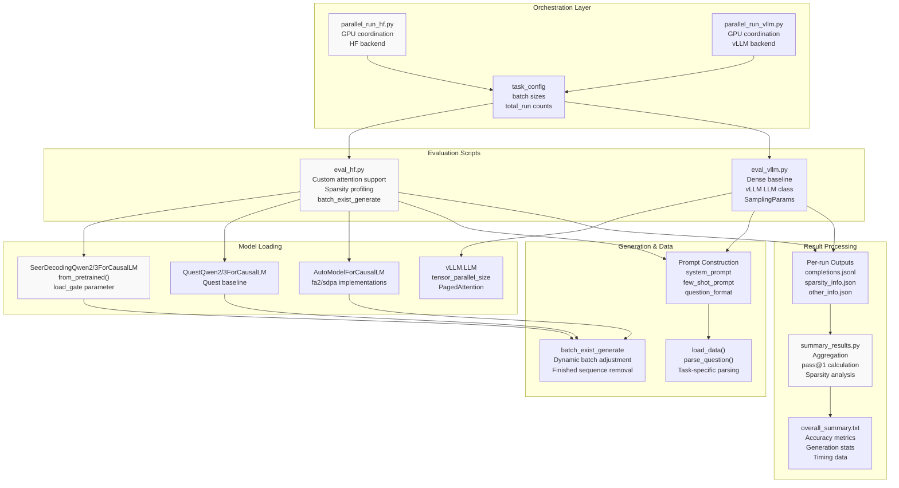
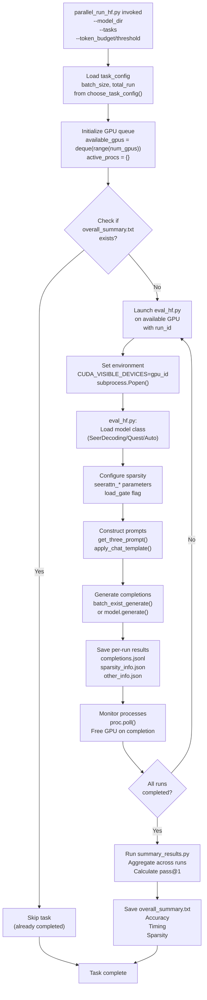
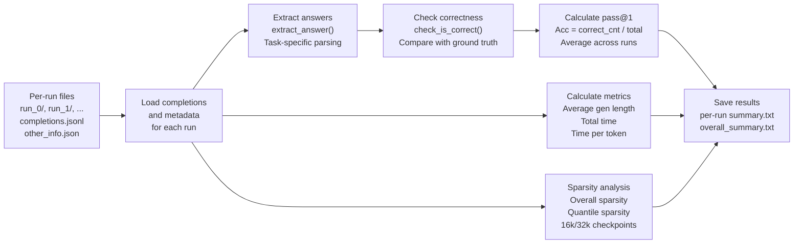

<!-- source: DeepWiki mcp.deepwiki.com · repo microsoft/SeerAttention · page 7.1 Reasoning Tasks Evaluation · fetched 2026-10-26 -->

# Reasoning Tasks Evaluation

<details>
<summary>Relevant source files</summary>

The following files were used as context for generating this wiki page:

- [.gitignore](.gitignore)
- [eval/reasoning_tasks/README.md](eval/reasoning_tasks/README.md)
- [eval/reasoning_tasks/eval_hf.py](eval/reasoning_tasks/eval_hf.py)
- [eval/reasoning_tasks/eval_vllm.py](eval/reasoning_tasks/eval_vllm.py)
- [eval/reasoning_tasks/parallel_run_hf.py](eval/reasoning_tasks/parallel_run_hf.py)
- [eval/reasoning_tasks/parallel_run_vllm.py](eval/reasoning_tasks/parallel_run_vllm.py)
- [eval/reasoning_tasks/summary_results.py](eval/reasoning_tasks/summary_results.py)
- [seer_attn/decode_sparse/cache_utils.py](seer_attn/decode_sparse/cache_utils.py)

</details>


## Purpose and Scope

This document describes the reasoning tasks evaluation framework for SeerAttention models. The system evaluates model performance on mathematical and scientific reasoning benchmarks including AIME24/25, MATH500, GPQA-Diamond, and LiveCodeBench using pass@1 metrics with multiple samples per query.

For long-context evaluations (PG19, LongBench, RULER), see [Long-Context Benchmarks](#7.2). For efficiency benchmarking and profiling, see [Efficiency Benchmarks](#7.3). For general evaluation orchestration and execution infrastructure, see [Running Evaluations](#7.4).

---

## Supported Benchmarks and Metrics

The evaluation framework supports four primary reasoning benchmarks, each with task-specific sampling configurations:

| Benchmark | Description | Samples per Query | Total Runs | Metric |
|-----------|-------------|-------------------|------------|--------|
| **AIME24/25** | American Invitational Mathematics Examination | 64 | 64 | pass@1 |
| **MATH500** | Competition-level mathematics problems | 8 | 8 | pass@1 |
| **GPQA-Diamond** | Graduate-level science questions | 16 | 16 | pass@1 |
| **LiveCodeBench** | Code generation with execution validation | 8 | 8 | execution accuracy |

The pass@1 metric measures the probability that at least one sample among n samples is correct. Results are averaged across all runs to provide confidence intervals.

**Sources:** [eval/reasoning_tasks/README.md:1-54](), [eval/reasoning_tasks/parallel_run_vllm.py:10-17](), [eval/reasoning_tasks/parallel_run_hf.py:10-24]()

---

## Evaluation Architecture

### System Components



**Sources:** [eval/reasoning_tasks/eval_hf.py:1-417](), [eval/reasoning_tasks/eval_vllm.py:1-194](), [eval/reasoning_tasks/parallel_run_hf.py:1-203](), [eval/reasoning_tasks/parallel_run_vllm.py:1-149]()

---

## Configuration and Parameters

### Attention Implementation Options

The [eval_hf.py:96]() script supports multiple attention implementations via the `--attention_implementation` parameter:

| Implementation | Description | Use Case |
|----------------|-------------|----------|
| `seer_sparse` | Learned sparse attention with AttnGates | SeerAttention evaluation |
| `seer_dense` | AttnGate model without sparsity | Ablation study |
| `oracle_sparse` | Ground truth sparsity patterns | Upper bound analysis |
| `quest` | Quest attention baseline | Comparison baseline |
| `fa2` | FlashAttention-2 | Dense baseline |
| `sdpa` | PyTorch SDPA | Dense baseline |

**Sources:** [eval/reasoning_tasks/eval_hf.py:96](), [eval/reasoning_tasks/eval_hf.py:239-289]()

### Sparsity Control Parameters

When using `seer_sparse` or `oracle_sparse`, sparsity is controlled by:

```python
# Token budget method - fixed number of activated blocks per step
seerattn_sparsity_method = "token_budget"
seerattn_token_budget = 2048  # Common values: 1k, 2k, 4k, 6k, 8k

# Threshold method - activation threshold for block selection
seerattn_sparsity_method = "threshold"
seerattn_threshold = 0.0005  # Common range: 5e-4 to 5e-3

# Block configuration
seerattn_gate_block_size = 64  # Block size for sparse patterns
seerattn_start_layer = 0  # Layer to start sparse attention (0 = all layers)
seerattn_sliding_window_size = 0  # Optional local attention window
```

**Sources:** [eval/reasoning_tasks/eval_hf.py:89-94](), [eval/reasoning_tasks/eval_hf.py:253-262](), [eval/reasoning_tasks/parallel_run_hf.py:42-47]()

### Task-Specific Batch Sizes

The [parallel_run_hf.py:10-24]() function `choose_task_config()` defines conservative batch sizes optimized for 80GB GPU memory:

```python
task_config = {
    "aime24": {"bs": 15, "total_run": 64},
    "aime25": {"bs": 15, "total_run": 64},
    "math": {"bs": 75, "total_run": 8},
    "gpqa": {"bs": 30, "total_run": 16},
    "olympiadbench": {"bs": 15, "total_run": 8},
    "livecodebench": {"bs": 15, "total_run": 8},
}
```

These batch sizes can be adjusted based on available GPU memory and model size.

**Sources:** [eval/reasoning_tasks/parallel_run_hf.py:10-24](), [eval/reasoning_tasks/README.md:4]()

---

## Evaluation Workflow

### HuggingFace Backend Workflow



**Sources:** [eval/reasoning_tasks/parallel_run_hf.py:72-202](), [eval/reasoning_tasks/eval_hf.py:139-411]()

### Key Execution Steps

#### 1. Model Loading and Configuration

The [eval_hf.py:239-289]() section handles model loading based on `attention_implementation`:

For `seer_sparse` or `seer_dense`:
```python
# Determine model class from model name
if "qwen3" in model_name_lower:
    model_class = SeerDecodingQwen3ForCausalLM
elif "qwen" in model_name_lower:
    model_class = SeerDecodingQwen2ForCausalLM

# Load with sparsity configuration
model = model_class.from_pretrained(
    model_name_or_path,
    torch_dtype=torch.bfloat16,
    device_map=device,
    load_gate=(args.attention_implementation == "seer_sparse"),
    seerattn_sparsity_method=args.sparsity_method,
    seerattn_threshold=args.threshold,
    seerattn_token_budget=args.token_budget,
    seerattn_gate_block_size=args.block_size,
    seerattn_start_layer=args.start_layer,
    seerattn_output_sparsity=args.profile_sparsity,
)
```

**Sources:** [eval/reasoning_tasks/eval_hf.py:239-263]()

#### 2. Prompt Construction

Prompts are constructed using task-specific templates in [eval/reasoning_tasks/eval_hf.py:113-136]():

```python
# Load prompt templates
system_prompt, few_shot_prompt, question_format = get_three_prompt(
    args.prompt_type, args.data_name
)

# Format question
cur_prompt = question_format.format(question=question)

# Wrap with chat template if requested
if args.surround_with_messages:
    messages = [{"role": "user", "content": cur_prompt}]
    cur_prompt = tokenizer.apply_chat_template(
        messages, tokenize=False, add_generation_prompt=True
    )
```

**Sources:** [eval/reasoning_tasks/eval_hf.py:113-136](), [eval/reasoning_tasks/eval_hf.py:175-195]()

#### 3. Batch Generation

The system supports two generation modes in [eval/reasoning_tasks/eval_hf.py:309-333]():

**With `batch_exist_generate`** (recommended for efficiency):
```python
if args.use_batch_exist:
    if args.attention_implementation in ["seer_sparse", "oracle_sparse"]:
        # Use built-in implementation with sparsity tracking
        outputs, batch_sparsitys_info = model.batch_exist_generate(
            input_ids=batch_input_ids,
            attention_mask=attention_mask,
            max_length=args.max_tokens,
            do_sample=True,
        )
    else:
        # Use standalone implementation
        outputs = batch_exist_generate(
            model,
            input_ids=batch_input_ids,
            attention_mask=attention_mask,
            max_length=args.max_tokens,
            do_sample=True,
        )
```

The `batch_exist_generate` utility dynamically removes finished sequences from the batch and reorganizes the KV cache, improving efficiency. See [Batch Generation Utilities](#8.2) for details.

**Sources:** [eval/reasoning_tasks/eval_hf.py:309-333]()

#### 4. Sparsity Profiling

When `--profile_sparsity` is enabled, sparsity information is collected during generation:

```python
if args.profile_sparsity:
    all_batch_sparsitys_info.append(batch_sparsitys_info)

# Calculate overall sparsity after all batches
total_activate_count, total_original_count, overall_sparsity_ratio = \
    calculate_overall_sparsity(all_batch_sparsitys_info)
```

The [eval_hf.py:27-68]() function `calculate_overall_sparsity()` computes the ratio of activated blocks to total blocks across all layers and generation steps:

```
overall_sparsity = 1 - (total_activated_blocks / total_original_blocks)
```

**Sources:** [eval/reasoning_tasks/eval_hf.py:27-68](), [eval/reasoning_tasks/eval_hf.py:341-342](), [eval/reasoning_tasks/eval_hf.py:384-409]()

#### 5. Result Saving

Each run saves three output files in [eval/reasoning_tasks/eval_hf.py:199-204]():

- **completions.jsonl**: Generated text completions, one per line
- **sparsity_info.json**: Detailed sparsity data per batch/sequence/layer (if profiling enabled)
- **other_info.json**: Generation lengths, timing, and overall sparsity

The system supports checkpoint/resume functionality in [eval/reasoning_tasks/eval_hf.py:214-224](), allowing interrupted evaluations to continue from the last completed batch.

**Sources:** [eval/reasoning_tasks/eval_hf.py:199-236](), [eval/reasoning_tasks/eval_hf.py:362-377]()

---

## Result Aggregation and Analysis

### Summary Processing

The [summary_results.py:107-287]() script aggregates results across multiple runs:



**Sources:** [eval/reasoning_tasks/summary_results.py:107-287]()

### Accuracy Calculation

For each completion, the system:

1. **Parses ground truth**: `parse_ground_truth(example, data_name)` extracts the correct answer
2. **Extracts predicted answer**: `extract_answer(completion, data_name)` uses task-specific extraction
3. **Checks correctness**: `check_is_correct(predicted, ground_truth)` performs normalization and comparison
4. **Computes pass@1**: Averages correctness across all samples and runs

**Sources:** [eval/reasoning_tasks/summary_results.py:186-199]()

### Quantile Sparsity Analysis

The [summary_results.py:18-84]() function `calculate_quantile_sparsity()` computes sparsity at different generation positions:

```python
def calculate_quantile_sparsity(
    all_batch_sparsitys_info: List[List[Optional[Tuple[Tuple[int, int], ...]]]],
    group_size: int = 1000
) -> List[float]:
    """
    Calculates sparsity for each quantile group of sequence steps.
    Each group aggregates over `group_size` steps (default 1000).
    Returns sparsity = 1 - (activated / original) for each group.
    """
```

This enables analysis of how sparsity evolves during long reasoning sequences. The 16k and 32k checkpoints (positions 15000-16000 and 31000-32000) are specifically tracked.

**Sources:** [eval/reasoning_tasks/summary_results.py:18-84](), [eval/reasoning_tasks/summary_results.py:162-170]()

---

## Running Evaluations

### Basic HuggingFace Evaluation

To evaluate a single model with SeerAttention:

```bash
python eval/reasoning_tasks/eval_hf.py \
    --model_name_or_path microsoft/SeerAttention-Decode-Qwen3-4B-AttnGates \
    --data_name aime24 \
    --batch_size 15 \
    --attention_implementation seer_sparse \
    --sparsity_method token_budget \
    --token_budget 4096 \
    --start_layer 0 \
    --block_size 64 \
    --max_tokens 32768 \
    --output_dir ./results/aime24 \
    --use_batch_exist \
    --use_fused_kernel \
    --surround_with_messages \
    --profile_sparsity \
    --run_id 0 \
    --rank 0
```

**Sources:** [eval/reasoning_tasks/eval_hf.py:75-103]()

### Parallel Execution

For production evaluations with multiple runs, use the parallel orchestrator:

```bash
python eval/reasoning_tasks/parallel_run_hf.py \
    --model_dir microsoft/SeerAttention-Decode-Qwen3-4B-AttnGates \
    --model_size 14B \
    --tasks "aime24,aime25,math,gpqa" \
    --output_dir ./results \
    --attention_implementation seer_sparse \
    --sparsity_method token_budget \
    --token_budget "2048,4096,6144,8192" \
    --num_gpus 8 \
    --max_tokens 32768 \
    --profile_sparsity
```

This will:
1. Launch runs in parallel across 8 GPUs
2. Test each token budget configuration
3. Execute the full sample count for each task (64 for AIME, 8 for MATH, 16 for GPQA)
4. Automatically aggregate results

**Sources:** [eval/reasoning_tasks/parallel_run_hf.py:26-203]()

### vLLM Dense Baseline

For dense baseline comparisons using vLLM:

```bash
python eval/reasoning_tasks/parallel_run_vllm.py \
    --model_dir Qwen/Qwen3-4B \
    --tasks "aime24,math,gpqa" \
    --output_dir ./results \
    --num_gpus 8 \
    --max_tokens 32768
```

The vLLM backend provides optimized dense attention inference but does not support sparse attention.

**Sources:** [eval/reasoning_tasks/parallel_run_vllm.py:19-149](), [eval/reasoning_tasks/eval_vllm.py:91-188]()

---

## Output File Structure

### Directory Organization

```
results/
└── model_name/
    └── task_bs{bs}_{method}_B{budget}_start{layer}_blocksize{bs}_{impl}/
        ├── run_0/
        │   ├── completions.jsonl      # Generated completions
        │   ├── sparsity_info.json     # Detailed sparsity data (if profiled)
        │   ├── other_info.json        # Generation metadata
        │   └── summary.txt            # Per-run summary
        ├── run_1/
        │   └── ...
        └── overall_summary.txt        # Aggregated results
```

**Sources:** [eval/reasoning_tasks/eval_hf.py:199-204](), [eval/reasoning_tasks/parallel_run_hf.py:124-127]()

### Output File Formats

#### completions.jsonl
```json
{"completion": "Step 1: Let's analyze the problem...\n\nFinal Answer: \\boxed{42}"}
{"completion": "We need to find...\n\n\\boxed{7}"}
```

#### other_info.json
```json
{
  "generate_lens": [2048, 1834, 2156, ...],
  "total_time": 15.7,
  "overall_sparsity": 0.76
}
```

#### overall_summary.txt
```
Model Path: microsoft/SeerAttention-Decode-Qwen3-4B-AttnGates
Total_run: 64
Acc: 0.7260
Average generate length: 1987.3
Max generate length: 5432
Total time: 245.32min
Average time per token: 0.0019
Overall sparsity: 0.76
Average sparsity at 16k: 0.78
Average sparsity at 32k: 0.79
```

**Sources:** [eval/reasoning_tasks/eval_hf.py:371-377](), [eval/reasoning_tasks/summary_results.py:266-283]()

---

## Performance Results

The [README.md:12-54]() provides benchmark results showing that SeerAttention-R achieves competitive accuracy with significant sparsity:

### AIME24 (64 samples per query)
- **Qwen3-4B** with 4k token budget: **69.32%** accuracy (vs 71.25% full attention)
- **Qwen3-14B** with 6k token budget: **78.49%** accuracy (vs 78.91% full attention)

### MATH500 (8 samples per query)
- **Qwen3-4B** with 2k token budget: **91.85%** accuracy (vs 93.93% full attention)
- **Qwen3-14B** with 4k token budget: **95.12%** accuracy (vs 95.22% full attention)

### GPQA-Diamond (16 samples per query)
- **Qwen3-8B** with 4k token budget: **60.48%** accuracy (vs 60.54% full attention)
- **Qwen3-14B** with 4k token budget: **63.83%** accuracy (vs 65.25% full attention)

These results demonstrate that SeerAttention-R maintains 95%+ relative accuracy while using only 25-50% of attention computation (1-4k token budget vs 8k+ full sequences).

**Sources:** [eval/reasoning_tasks/README.md:12-54]()

---

