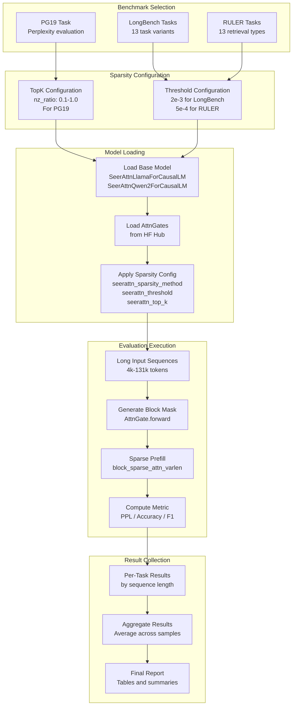
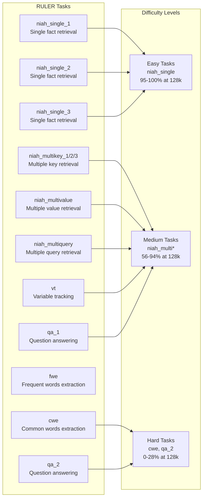
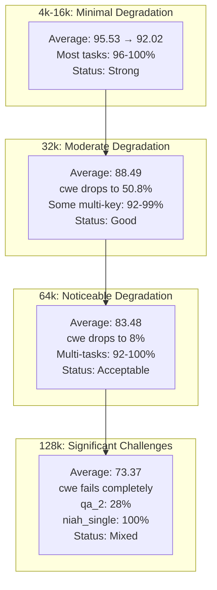

<!-- source: DeepWiki mcp.deepwiki.com · repo microsoft/SeerAttention · page 7.2 Long-Context Benchmarks · fetched 2026-10-26 -->

# Long-Context Benchmarks

<details>
<summary>Relevant source files</summary>

The following files were used as context for generating this wiki page:

- [eval/README.md](eval/README.md)
- [eval/efficiency/benchmark_sparse_attn.py](eval/efficiency/benchmark_sparse_attn.py)
- [eval/reasoning_tasks/README.md](eval/reasoning_tasks/README.md)
- [requirements.txt](requirements.txt)

</details>


## Purpose and Scope

This document covers the long-context evaluation benchmarks used to measure SeerAttention's ability to process and understand extended input sequences. These benchmarks test perplexity and retrieval performance across context lengths ranging from 4k to 131k tokens using threshold-based and TopK sparsity methods.

For reasoning task evaluations (AIME, MATH, GPQA) that test long-chain thinking during generation, see [Reasoning Tasks Evaluation](#7.1). For efficiency and timing measurements, see [Efficiency Benchmarks](#7.3). For practical instructions on running evaluations, see [Running Evaluations](#7.4).

---

## Overview of Long-Context Benchmarks

SeerAttention's sparse prefill capabilities are evaluated across three primary long-context benchmarks:

| Benchmark | Purpose | Sparsity Method | Sequence Lengths | Tasks |
|-----------|---------|-----------------|------------------|-------|
| **PG19** | Language modeling perplexity | TopK (nz_ratio) | 8k-131k tokens | Single perplexity task |
| **LongBench** | Multi-task long-context understanding | Threshold (2e-3) | 0-8k+ tokens | 13 diverse tasks |
| **RULER** | Needle-in-haystack retrieval | Threshold (5e-4) | 4k-128k tokens | 13 retrieval variants |

Each benchmark uses different sparsity configurations optimized for its specific requirements. PG19 tests language modeling with TopK-based density control, while LongBench and RULER use threshold-based sparsity for information retrieval tasks.

Sources: [eval/README.md:49-98]()

---

## Long-Context Evaluation Pipeline

The following diagram illustrates how long-context benchmarks are executed within the evaluation framework:



**Diagram: Long-Context Evaluation Flow**

The pipeline loads sparse prefill models (typically `SeerAttnLlamaForCausalLM` or `SeerAttnQwen2ForCausalLM`), applies benchmark-specific sparsity configurations, processes long input sequences through sparse attention mechanisms, and aggregates results into final reports.

Sources: [eval/README.md:49-98]()

---

## PG19 Perplexity Evaluation

### Overview

PG19 perplexity evaluation measures language modeling quality on the PG19 dataset (books from Project Gutenberg) with sequences exceeding 128k tokens. The benchmark uses TopK-based sparsity controlled by `nz_ratio` (density) parameters.

### Sparsity Configuration

PG19 evaluation uses the `top_k` sparsity method with varying density levels:

```python
# Configuration for PG19 evaluation
config = SeerAttnQwen2Config(
    seerattn_sparsity_method="top_k",  # TopK selection
    seerattn_top_k=None,  # Controlled via nz_ratio instead
    # nz_ratio (density) values: 1.0, 0.5, 0.4, 0.3, 0.2, 0.1
)
```

The `nz_ratio` parameter controls density (non-zero ratio), where:
- `nz_ratio=1.0`: Full dense attention (100% blocks activated)
- `nz_ratio=0.5`: 50% sparsity
- `nz_ratio=0.1`: 90% sparsity

### Results

The following table shows perplexity results for Llama-3.1-8B across different sequence lengths and density levels:

| Density | 8192 | 16384 | 32768 | 65536 | 131072 |
|---------|------|-------|-------|-------|--------|
| 1.00    | 10.03 | 9.88  | 9.92  | 9.97  | 10.03  |
| 0.50    | 10.04 | 9.89  | 9.92  | 9.99  | 10.05  |
| 0.40    | 10.06 | 9.89  | 9.93  | 9.99  | 10.07  |
| 0.30    | 10.09 | 9.91  | 9.95  | 10.01 | 10.15  |
| 0.20    | 10.19 | 9.94  | 9.97  | 10.04 | 10.37  |
| 0.10    | 10.61 | 10.08 | 10.04 | 10.09 | 10.88  |

**Key Observations:**
- At 50% density (0.50), perplexity remains nearly identical to full attention across all sequence lengths
- Even at 30% density (0.30), perplexity degradation is minimal (< 0.2 points)
- At 10% density (0.10), perplexity increases by ~0.6-0.8 points, showing graceful degradation
- Longer sequences (131k) are more sensitive to aggressive sparsity

### Evaluation Methodology

PG19 evaluation:
1. Filters the dataset to sequences > 128k tokens
2. Truncates to the target test length (8k, 16k, 32k, 65k, 131k)
3. Computes perplexity using sparse prefill with TopK sparsity
4. Reports average perplexity across sampled documents

Sources: [eval/README.md:52-63]()

---

## LongBench Suite

### Overview

LongBench is a comprehensive multi-task benchmark for long-context understanding, covering 13 diverse tasks including question answering, summarization, and code completion. Tasks are grouped by input length: 0-4k, 4-8k, and 8k+ tokens.

### Sparsity Configuration

LongBench uses threshold-based sparsity with a fixed threshold:

```python
# Configuration for LongBench evaluation
config = SeerAttnQwen2Config(
    seerattn_sparsity_method="threshold",
    seerattn_threshold=2e-3,  # Fixed threshold for all tasks
    seerattn_gate_block_size=64,  # Block size for mask generation
)
```

The threshold of `2e-3` balances accuracy and efficiency, filtering out attention scores below this value at the block level.

### Task Descriptions and Results

| Task | Description | 0-4k | 4-8k | 8k+ |
|------|-------------|------|------|-----|
| **2wikimqa** | Multi-hop QA | 51.1 | 47.85 | 33.36 |
| **gov_report** | Report summarization | 35.03 | 35.05 | 34.57 |
| **hotpotqa** | Multi-hop QA | 63.97 | 60.0 | 56.7 |
| **lcc** | Code completion | 67.98 | 73.18 | 65.28 |
| **multi_news** | Multi-doc summarization | 28.1 | 25.78 | 24.25 |
| **multifieldqa_en** | Multi-field QA | 58.63 | 51.45 | 51.87 |
| **passage_count** | Passage counting | 18.0 | 10.15 | 11.88 |
| **passage_retrieval_en** | Passage retrieval | 100.0 | 99.0 | 98.0 |
| **qasper** | Scientific QA | 47.77 | 44.04 | 39.63 |
| **repobench-p** | Code repo completion | 51.78 | 56.24 | 56.75 |
| **samsum** | Dialogue summarization | 43.28 | 41.19 | 45.29 |
| **trec** | Classification | 64.0 | 76.0 | 75.0 |
| **triviaqa** | Factoid QA | 90.91 | 88.45 | 92.43 |
| **Averaged** | All tasks | **55.43** | **54.49** | **52.69** |

### Performance Analysis

**Strong Performance:**
- `passage_retrieval_en`: Near-perfect retrieval (98-100%) across all lengths
- `triviaqa`: High factoid QA accuracy (88-92%)
- `lcc` and `repobench-p`: Strong code understanding (65-73%)

**Length Sensitivity:**
- `2wikimqa`: Significant degradation at 8k+ (51.1 → 33.36)
- `passage_count`: Challenging counting task (10-18%)
- Most tasks show moderate degradation with increasing length

The averaged score of 52.69 at 8k+ demonstrates SeerAttention's ability to maintain competitive performance on diverse long-context tasks while using sparse attention.

Sources: [eval/README.md:65-84]()

---

## RULER Benchmark

### Overview

RULER (Rule-based Understanding of Long-context Evaluation Resources) is a synthetic benchmark specifically designed to test retrieval capabilities across varying context lengths (4k to 128k). It includes 13 task variants covering needle-in-haystack (NIAH) retrieval, variable tracking, and question answering.

### Sparsity Configuration

RULER uses a more conservative threshold than LongBench to maintain high retrieval accuracy:

```python
# Configuration for RULER evaluation
config = SeerAttnQwen2Config(
    seerattn_sparsity_method="threshold",
    seerattn_threshold=5e-4,  # Lower threshold = less aggressive sparsity
    seerattn_gate_block_size=64,
)
```

The threshold of `5e-4` (vs. `2e-3` for LongBench) retains more attention weights to preserve fine-grained retrieval capabilities.

### Task Categories and Results



**Diagram: RULER Task Taxonomy**

### Detailed Results by Sequence Length

| Length | niah_single_1 | niah_single_2 | niah_single_3 | niah_multikey_1 | niah_multikey_2 | niah_multikey_3 | niah_multivalue | niah_multiquery | vt | cwe | fwe | qa_1 | qa_2 | avg |
|--------|---------------|---------------|---------------|-----------------|-----------------|-----------------|-----------------|-----------------|-----|-----|-----|------|------|-----|
| **4k** | 100 | 100 | 100 | 100 | 100 | 100 | 100 | 100 | 99.2 | 100 | 90.67 | 84 | 68 | **95.53** |
| **8k** | 100 | 100 | 100 | 100 | 100 | 100 | 100 | 100 | 99.2 | 98 | 88 | 68 | 52 | **92.71** |
| **16k** | 100 | 100 | 100 | 96 | 100 | 100 | 100 | 100 | 100 | 85.6 | 90.67 | 68 | 56 | **92.02** |
| **32k** | 100 | 100 | 100 | 100 | 96 | 100 | 92 | 99 | 99.2 | 50.8 | 93.33 | 72 | 48 | **88.49** |
| **64k** | 100 | 100 | 100 | 100 | 100 | 92 | 94 | 99 | 97.6 | 8 | 82.67 | 64 | 48 | **83.48** |
| **128k** | 100 | 100 | 100 | 100 | 76 | 56 | 94 | 94 | 75.2 | 0 | 66.67 | 64 | 28 | **73.37** |

### Performance Patterns

**Task-Specific Analysis:**

1. **Single NIAH Tasks (niah_single_1/2/3):**
   - Perfect 100% accuracy across all lengths (4k-128k)
   - Demonstrates strong single-fact retrieval capability
   - Baseline for minimum expected performance

2. **Multi-Key/Value/Query Tasks:**
   - High performance at shorter lengths (96-100% at 4k-32k)
   - Moderate degradation at 128k (56-94%)
   - `niah_multikey_3` shows most degradation (100% → 56%)

3. **Variable Tracking (vt):**
   - Stable at shorter lengths (99-100%)
   - Degradation at 128k (75.2%)

4. **Word Extraction Tasks (cwe, fwe):**
   - Most challenging category
   - `cwe` fails completely at 64k+ (50.8% → 0%)
   - `fwe` maintains moderate performance (66-93%)

5. **Question Answering (qa_1, qa_2):**
   - `qa_1` relatively stable (64-84%)
   - `qa_2` shows significant degradation (68% → 28%)

### Length Scaling Analysis

The following diagram illustrates performance degradation patterns:



**Diagram: RULER Performance Degradation by Length**

Sources: [eval/README.md:87-97]()

---

## Sparsity Method Selection Guidelines

Different long-context benchmarks require different sparsity configurations based on their characteristics:

### Configuration Mapping

| Benchmark | Sparsity Method | Parameter | Rationale |
|-----------|-----------------|-----------|-----------|
| PG19 | `top_k` | `nz_ratio=0.3-0.5` | Language modeling tolerates moderate sparsity; TopK ensures consistent density |
| LongBench | `threshold` | `threshold=2e-3` | Multi-task benchmark needs balanced sparsity; threshold adapts per layer |
| RULER | `threshold` | `threshold=5e-4` | Retrieval tasks need high precision; lower threshold retains more information |

### Implementation in Code

The sparsity method is configured via `SeerAttnConfig` classes:

```python
# Example: Configure for LongBench evaluation
from seer_attn.models.seer_attn_qwen2 import SeerAttnQwen2Config

config = SeerAttnQwen2Config.from_pretrained(
    "microsoft/SeerAttention-Qwen2.5-7B-AttnGates",
    load_gate=True,
)

# Override sparsity settings for LongBench
config.seerattn_sparsity_method = "threshold"
config.seerattn_threshold = 2e-3
config.seerattn_start_layer = 0  # Apply sparsity from first layer
```

### Sparsity Method Trade-offs

**Threshold Method:**
- **Pros:** Adapts to attention distribution; preserves important weights
- **Cons:** Variable sparsity across layers/heads
- **Best for:** Tasks requiring precise information retrieval (LongBench, RULER)

**TopK Method:**
- **Pros:** Consistent sparsity level; predictable performance
- **Cons:** May discard useful low-score weights
- **Best for:** Language modeling tasks with tolerance for approximation (PG19)

Sources: [eval/README.md:52-97]()

---

## Running Long-Context Evaluations

### Basic Evaluation Commands

Long-context benchmarks are typically run using HuggingFace backend (not vLLM) to enable custom sparse attention implementations:

```bash
# PG19 perplexity evaluation
python eval/longbench/run_pg19.py \
    --model_path microsoft/SeerAttention-Llama-3.1-8B-AttnGates \
    --load_gate true \
    --sparsity_method top_k \
    --nz_ratio 0.3 \
    --seq_lengths 8192,16384,32768,65536,131072

# LongBench evaluation
python eval/longbench/run_longbench.py \
    --model_path microsoft/SeerAttention-Qwen2.5-7B-AttnGates \
    --load_gate true \
    --sparsity_method threshold \
    --threshold 2e-3 \
    --tasks all

# RULER evaluation
python eval/ruler/run_ruler.py \
    --model_path microsoft/SeerAttention-Qwen2.5-7B-AttnGates \
    --load_gate true \
    --sparsity_method threshold \
    --threshold 5e-4 \
    --seq_lengths 4k,8k,16k,32k,64k,128k
```

### Output Structure

Evaluation scripts generate the following output files:

```
results/
├── pg19/
│   ├── ppl_results_8k.json
│   ├── ppl_results_16k.json
│   └── ...
├── longbench/
│   ├── 2wikimqa_results.json
│   ├── hotpotqa_results.json
│   └── summary.json
└── ruler/
    ├── niah_single_1_4k.json
    ├── niah_single_1_8k.json
    └── summary.json
```

Each result file contains:
- Per-sample predictions/scores
- Sparsity statistics (if enabled)
- Aggregated metrics (perplexity, accuracy, F1)

For detailed instructions on parallel evaluation and result aggregation, see [Running Evaluations](#7.4).

Sources: [eval/README.md:49-98]()

---

## Summary

SeerAttention's sparse prefill mechanism demonstrates strong performance across diverse long-context benchmarks:

**Key Findings:**
- **PG19:** Maintains near-identical perplexity (< 0.2 PPL increase) at 50% sparsity, even on 131k token sequences
- **LongBench:** Achieves 52.69 average score on 8k+ tasks with threshold=2e-3, covering 13 diverse long-context tasks
- **RULER:** Perfect single-needle retrieval (100%) and strong multi-task performance (73.37 average) at 128k length

**Sparsity Configuration:**
- TopK (nz_ratio=0.3-0.5) for language modeling
- Threshold (2e-3) for multi-task understanding
- Threshold (5e-4) for precise retrieval

These results validate that learned sparse attention patterns can effectively process extended contexts while maintaining competitive accuracy on diverse tasks.

Sources: [eval/README.md:49-98]()

---

