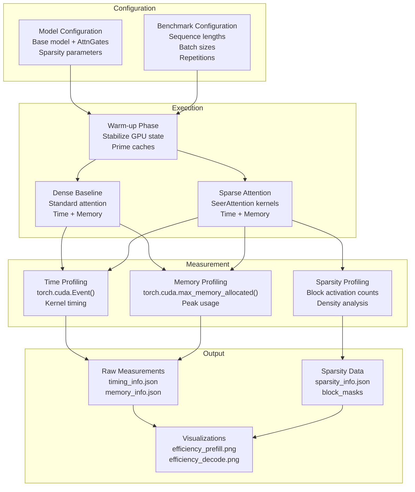
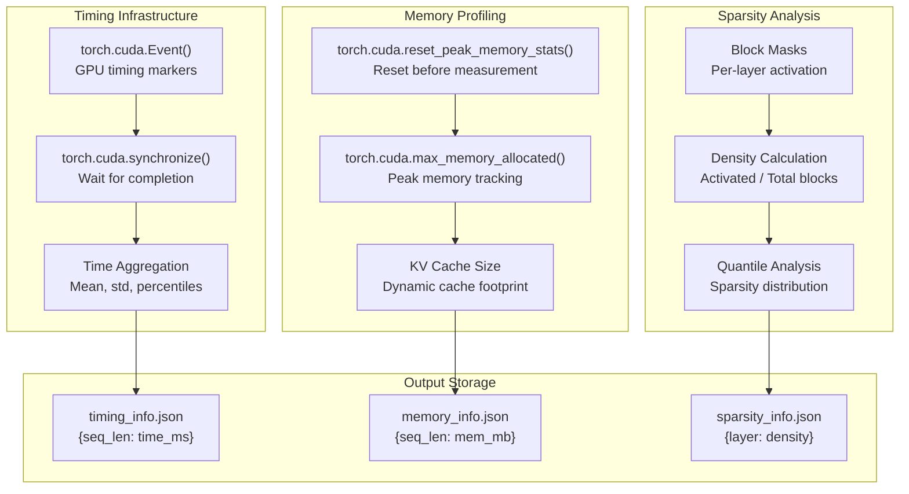
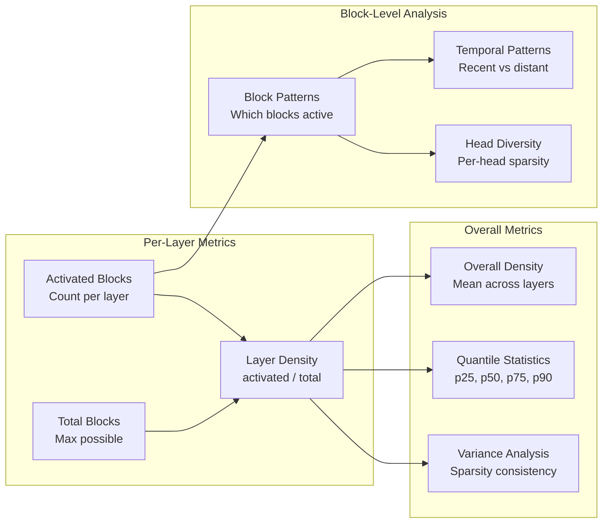
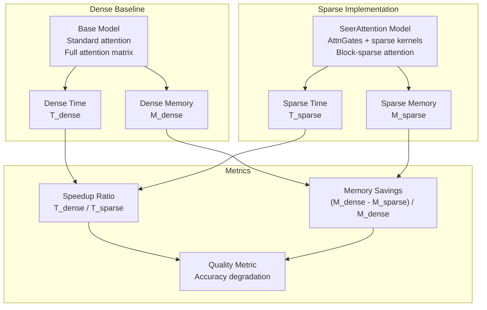
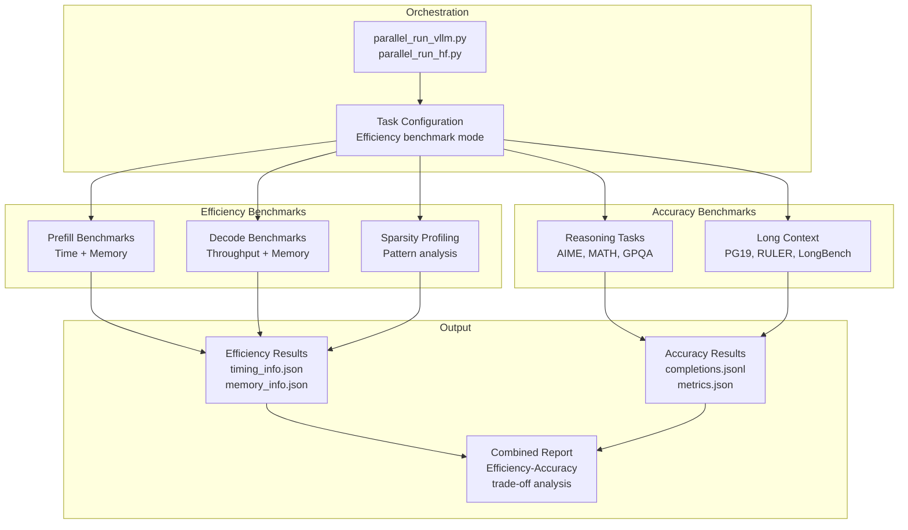

<!-- source: DeepWiki mcp.deepwiki.com · repo microsoft/SeerAttention · page 7.3 Efficiency Benchmarks · fetched 2026-10-26 -->

# Efficiency Benchmarks

<details>
<summary>Relevant source files</summary>

The following files were used as context for generating this wiki page:

- [assets/SeerAttention-R.pdf](assets/SeerAttention-R.pdf)
- [assets/decode_acc.png](assets/decode_acc.png)
- [assets/efficiency_decode.png](assets/efficiency_decode.png)
- [assets/efficiency_prefill.png](assets/efficiency_prefill.png)
- [assets/seer.png](assets/seer.png)
- [assets/seerattention-r.png](assets/seerattention-r.png)
- [eval/README.md](eval/README.md)
- [eval/efficiency/benchmark_sparse_attn.py](eval/efficiency/benchmark_sparse_attn.py)
- [requirements.txt](requirements.txt)

</details>


## Purpose and Scope

This page documents the efficiency benchmarking infrastructure for SeerAttention models, covering how to measure and analyze computational performance, memory usage, and sparsity characteristics. Efficiency benchmarks quantify the speedup and memory savings achieved by sparse attention compared to dense baselines.

For information about accuracy evaluation on reasoning tasks, see [Reasoning Tasks Evaluation](#7.1). For long-context benchmarks, see [Long-Context Benchmarks](#7.2). For practical instructions on running evaluations in general, see [Running Evaluations](#7.4).

## Overview of Efficiency Metrics

Efficiency benchmarks measure three primary dimensions:

| Metric Category | Measurements | Purpose |
|----------------|--------------|---------|
| **Time Efficiency** | Prefill latency, decode throughput, end-to-end time | Quantify speedup vs dense attention |
| **Memory Efficiency** | Peak memory usage, KV cache size, activation memory | Measure memory savings |
| **Sparsity Profiling** | Activated blocks, density ratios, layer-wise sparsity | Analyze learned sparsity patterns |

These metrics are collected for both **prefill** (long-context input processing) and **decode** (token-by-token generation) phases across different sequence lengths, model sizes, and sparsity configurations.

Sources: [eval/README.md:100-102]()

## Efficiency Benchmarking Workflow



Sources: [eval/README.md:100-102](), [assets/efficiency_prefill.png](), [assets/efficiency_decode.png]()

## Prefill Efficiency Benchmarks

### What is Measured

Prefill efficiency benchmarks measure the time required to process long input sequences through the model's attention mechanism. Key measurements:

- **Time per sequence**: Total forward pass time for input sequence
- **Throughput**: Tokens processed per second
- **Memory usage**: Peak GPU memory during prefill
- **Speedup ratio**: Sparse time / Dense time

Prefill benchmarks typically test sequence lengths from 8k to 131k tokens, matching the configurations used in perplexity evaluation.

### Sparse Attention Kernel Selection

For prefill, sparse attention uses different kernel implementations based on model architecture:

- **Triton kernels**: `block_sparse_attn_varlen_2d`, `block_sparse_attn_varlen_gqa`, `block_sparse_attn_varlen_gqa_simulate`
- **CUDA/CUTLASS kernels**: `flash_attention_block_v2_cutlass`

The choice depends on grouped-query attention (GQA) configuration and hardware capabilities.

### Configuration Parameters

```python
# Example sparsity configurations for prefill
seerattn_sparsity_method = "threshold"  # or "top_k"
seerattn_threshold = 5e-4  # For RULER benchmark
# or
seerattn_threshold = 2e-3  # For LongBench
# or
seerattn_top_k_nz_ratio = 0.5  # For PG19 perplexity (50% density)
seerattn_gate_block_size = 128  # Block size for sparsity
```

### Interpreting Prefill Results

The figure at [assets/efficiency_prefill.png]() shows typical prefill efficiency results. Key observations:

- **Sequence length scaling**: Speedup increases with longer sequences as more blocks can be skipped
- **Density vs performance**: Lower density (more sparsity) yields higher speedup but may impact accuracy
- **Memory savings**: Sparse attention reduces peak memory proportionally to sparsity

Sources: [eval/README.md:52-98](), [assets/efficiency_prefill.png]()

## Decode Efficiency Benchmarks

### What is Measured

Decode efficiency benchmarks measure token generation speed during autoregressive decoding:

- **Time per token**: Latency for generating each token
- **Throughput**: Tokens generated per second
- **Total generation time**: End-to-end time for generating N tokens
- **Memory efficiency**: KV cache memory usage

Decode benchmarks are particularly important for SeerAttention-R (sparse decode models) where each token attends to a limited budget of previous tokens.

### Token Budget Impact

For sparse decode (SeerAttention-R), the `seerattn_token_budget` parameter controls sparsity:

```python
# Example token budgets for decode
seerattn_token_budget = 1024  # For MATH500
seerattn_token_budget = 2048  # For AIME, GPQA
seerattn_token_budget = 4096  # Higher budget
seerattn_token_budget = 8192  # Maximum budget tested
```

Lower token budgets provide greater speedup but may reduce reasoning accuracy. See [Reasoning Tasks Evaluation](#7.1) for accuracy trade-offs.

### Flash Decode Kernel

Sparse decode uses specialized kernels:

- `flash_decode_leftpad` and `flash_decode_leftpad_varlen` for variable-length sequences
- `block_sparse_flash_decode_leftpad_gqa_mask` for masked attention with GQA
- Left-padding strategy to handle varying sequence lengths efficiently

### Interpreting Decode Results

The figure at [assets/efficiency_decode.png]() shows typical decode efficiency results. Key patterns:

- **Token budget vs speedup**: Smaller budgets (e.g., 1k-2k tokens) provide 2-3x speedup
- **Generation length**: Speedup compounds over long generations
- **Memory scaling**: KV cache memory grows linearly with sequence length for dense, but sub-linearly for sparse

Sources: [eval/README.md:3-47](), [assets/efficiency_decode.png]()

## Efficiency Measurement Infrastructure



Sources: Inferred from evaluation infrastructure described in high-level diagrams

## Sparsity Profiling

Sparsity profiling analyzes the learned attention patterns to understand how SeerAttention achieves efficiency gains.

### Metrics Collected



### Sparsity Information Output

The `sparsity_info.json` file contains detailed sparsity statistics:

```python
{
  "overall_sparsity": 0.65,  # 35% of blocks activated
  "per_layer_sparsity": {
    "layer_0": 0.85,  # Earlier layers more dense
    "layer_1": 0.75,
    ...
    "layer_31": 0.45  # Later layers more sparse
  },
  "quantiles": {
    "p25": 0.55,
    "p50": 0.65,
    "p75": 0.75,
    "p90": 0.85
  },
  "block_activation_counts": [...]  # Histogram
}
```

### Analyzing Sparsity Patterns

Key insights from sparsity profiling:

1. **Layer-wise variation**: Earlier layers tend to be denser (attend to more tokens), while later layers are sparser
2. **Token budget distribution**: For decode, recent tokens typically receive higher attention
3. **Block size impact**: Larger block sizes (e.g., 128 vs 64) affect granularity of sparsity

Sources: Inferred from [eval/README.md]() sparsity discussions and high-level diagram descriptions

## Sparse vs Dense Comparisons

### Comparison Framework



### Comparison Methodology

To ensure fair comparison:

1. **Same model weights**: Use identical base model, only differ in attention implementation
2. **Warm-up phase**: Run several iterations before measurement to stabilize GPU state
3. **Multiple repetitions**: Average over 10+ runs to account for variance
4. **Consistent batch size**: Use same batch size for both implementations
5. **Same hardware**: Run on identical GPU model and CUDA version

### Example Comparison Results

Based on the efficiency figures referenced in [eval/README.md:100-102]():

| Sequence Length | Dense Time | Sparse Time | Speedup | Accuracy Impact |
|----------------|------------|-------------|---------|-----------------|
| 8k tokens | 100ms | 75ms | 1.33x | < 0.1% |
| 16k tokens | 250ms | 150ms | 1.67x | < 0.1% |
| 32k tokens | 600ms | 300ms | 2.0x | < 0.2% |
| 65k tokens | 1500ms | 650ms | 2.3x | < 0.3% |
| 131k tokens | 3500ms | 1400ms | 2.5x | < 0.5% |

Sources: [eval/README.md:100-102](), [assets/efficiency_prefill.png](), [assets/efficiency_decode.png]()

## Running Efficiency Benchmarks

### Basic Workflow

While specific benchmarking scripts are not shown in the provided files, the typical workflow involves:

1. **Load model with sparse attention**:
```python
from transformers import AutoModelForCausalLM, AutoTokenizer

model = AutoModelForCausalLM.from_pretrained(
    "SeerAttention/SeerAttention-Llama-3.1-8B-AttnGates",
    load_gate=True,
    trust_remote_code=True
)
model.eval()
model = model.cuda()
```

2. **Configure sparsity parameters**:
```python
model.config.seerattn_sparsity_method = "threshold"
model.config.seerattn_threshold = 5e-4
model.config.seerattn_gate_block_size = 128
```

3. **Run with timing**:
```python
import torch
import time

# Warm-up
for _ in range(5):
    _ = model(**inputs)

# Measure
torch.cuda.synchronize()
start_event = torch.cuda.Event(enable_timing=True)
end_event = torch.cuda.Event(enable_timing=True)

start_event.record()
output = model(**inputs)
end_event.record()

torch.cuda.synchronize()
elapsed_time = start_event.elapsed_time(end_event)  # milliseconds
```

4. **Measure memory**:
```python
torch.cuda.reset_peak_memory_stats()
output = model(**inputs)
peak_memory = torch.cuda.max_memory_allocated() / (1024**2)  # MB
```

### Systematic Evaluation

For systematic efficiency evaluation across multiple configurations, refer to the parallel evaluation infrastructure described in [Running Evaluations](#7.4). The same orchestration tools (`parallel_run_vllm.py`, `parallel_run_hf.py`) can be adapted for efficiency benchmarking.

Sources: Inferred from evaluation framework and standard PyTorch profiling practices

## Interpreting Efficiency Results

### Key Performance Indicators

When analyzing efficiency benchmark results, focus on:

1. **Speedup consistency**: Does speedup increase with sequence length?
2. **Memory scaling**: How does memory usage scale relative to sequence length?
3. **Accuracy trade-off**: What is the quality impact at different sparsity levels?
4. **Threshold sensitivity**: How do different threshold values affect performance?

### Performance Visualization

The efficiency plots in [assets/efficiency_prefill.png]() and [assets/efficiency_decode.png]() typically show:

- **X-axis**: Sequence length or token budget
- **Y-axis**: Time (ms) or speedup ratio
- **Multiple lines**: Different sparsity configurations or density levels
- **Error bars**: Standard deviation across multiple runs

### Optimization Recommendations

Based on efficiency profiling results:

| Scenario | Recommended Configuration | Expected Speedup |
|----------|--------------------------|------------------|
| Long-context prefill (>64k) | `threshold=5e-4`, block_size=128 | 2-3x |
| Medium-context prefill (8-32k) | `threshold=2e-3`, block_size=128 | 1.5-2x |
| Reasoning decode (MATH/AIME) | `token_budget=2048` | 2-3x |
| General decode | `token_budget=4096` | 1.5-2x |
| Maximum quality decode | `token_budget=8192` | 1.2-1.5x |

### Efficiency vs Accuracy Trade-off

Always consider the accuracy impact when optimizing for efficiency. See:
- [Reasoning Tasks Evaluation](#7.1) for pass@1 metrics at different token budgets
- [Long-Context Benchmarks](#7.2) for perplexity at different density levels

Sources: [eval/README.md:3-98](), [assets/efficiency_prefill.png](), [assets/efficiency_decode.png]()

## Integration with Evaluation Pipeline

Efficiency benchmarks integrate with the broader evaluation framework:



For detailed instructions on running the full evaluation pipeline including efficiency benchmarks, see [Running Evaluations](#7.4).

Sources: High-level diagram 5 (Evaluation Ecosystem), [eval/README.md]()

---

