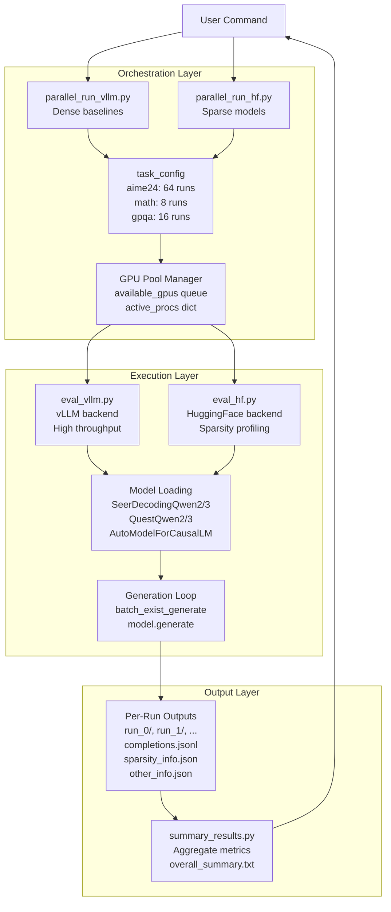
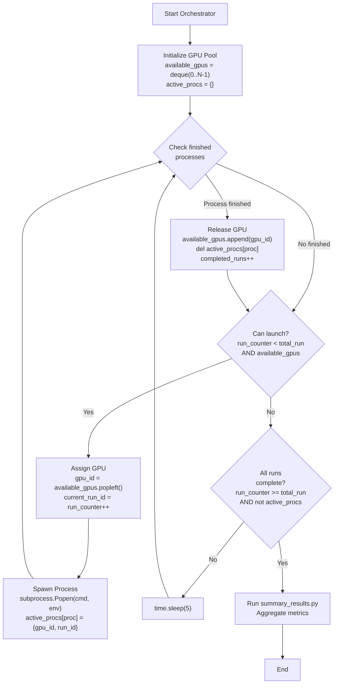
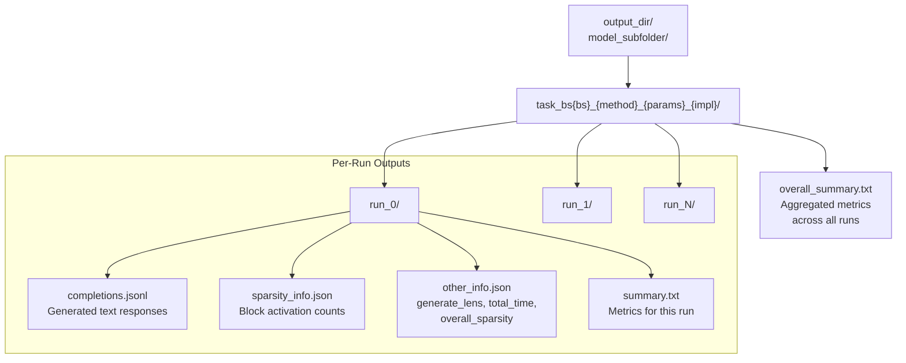

<!-- source: DeepWiki mcp.deepwiki.com · repo microsoft/SeerAttention · page 7.4 Running Evaluations · fetched 2026-10-26 -->

# Running Evaluations

<details>
<summary>Relevant source files</summary>

The following files were used as context for generating this wiki page:

- [.gitignore](.gitignore)
- [eval/reasoning_tasks/README.md](eval/reasoning_tasks/README.md)
- [eval/reasoning_tasks/eval_hf.py](eval/reasoning_tasks/eval_hf.py)
- [eval/reasoning_tasks/eval_vllm.py](eval/reasoning_tasks/eval_vllm.py)
- [eval/reasoning_tasks/parallel_run_hf.py](eval/reasoning_tasks/parallel_run_hf.py)
- [eval/reasoning_tasks/parallel_run_vllm.py](eval/reasoning_tasks/parallel_run_vllm.py)
- [eval/reasoning_tasks/summary_results.py](eval/reasoning_tasks/summary_results.py)
- [seer_attn/decode_sparse/cache_utils.py](seer_attn/decode_sparse/cache_utils.py)

</details>


## Purpose and Scope

This page provides a practical guide to executing evaluations in the SeerAttention framework. It covers the orchestration infrastructure, parallel execution system, GPU management, output formats, and result aggregation. For details about specific benchmark tasks and metrics, see [Reasoning Tasks Evaluation](#7.1), [Long-Context Benchmarks](#7.2), and [Efficiency Benchmarks](#7.3).

The evaluation system consists of:
- **Parallel orchestrators** ([parallel_run_vllm.py](), [parallel_run_hf.py]()) that coordinate multi-GPU execution
- **Evaluation scripts** ([eval_vllm.py](), [eval_hf.py]()) that perform inference and collect metrics
- **Aggregation tools** ([summary_results.py]()) that summarize results across multiple runs

Sources: [eval/reasoning_tasks/parallel_run_vllm.py:1-149](), [eval/reasoning_tasks/parallel_run_hf.py:1-203]()

---

## Evaluation Architecture

The evaluation system uses a two-tier architecture where parallel orchestrators manage GPU resources and coordinate multiple evaluation processes.



**Orchestration Flow**: The parallel orchestrators read task configuration, manage a pool of available GPUs, spawn evaluation processes with GPU assignments, monitor completion, and trigger result aggregation.

Sources: [eval/reasoning_tasks/parallel_run_vllm.py:10-17](), [eval/reasoning_tasks/parallel_run_hf.py:10-24](), [eval/reasoning_tasks/eval_hf.py:239-289]()

---

## Evaluation Backends

The system supports two execution backends optimized for different use cases.

### vLLM Backend

The vLLM backend is used for **dense attention baselines** and high-throughput inference. It uses PagedAttention for efficient memory management.

**Key characteristics:**
- Single batch generation across all samples
- Automatic tensor parallelism across multiple GPUs
- No sparsity profiling support
- Best for vanilla model evaluation

**Invocation**: [parallel_run_vllm.py:101-111]()

```python
cmd = [
    "python", "eval_vllm.py",
    "--model_name_or_path", model_dir,
    "--data_name", task,
    "--output_dir", output_config_subdir,
    "--surround_with_messages",
    "--limit", str(limit),
    "--rank", str(gpu_id),
    "--run_id", str(current_run_id),
    "--max_tokens", str(max_tokens),
]
```

**Model Loading**: [eval_vllm.py:140-145]()
```python
llm = LLM(model=model_name_or_path, 
          tensor_parallel_size=len(available_gpus), 
          trust_remote_code=True)
```

Sources: [eval/reasoning_tasks/eval_vllm.py:91-165](), [eval/reasoning_tasks/parallel_run_vllm.py:96-117]()

### HuggingFace Backend

The HuggingFace backend is used for **sparse attention models** and detailed profiling. It supports SeerAttention, Quest, and standard attention implementations.

**Key characteristics:**
- Batch-by-batch processing with checkpointing
- Sparsity profiling and metric collection
- Support for `batch_exist_generate` optimization
- Multiple attention implementations: `seer_sparse`, `seer_dense`, `oracle_sparse`, `quest`, `fa2`, `sdpa`

**Attention Implementation Selection**: [eval_hf.py:239-289]()

| Implementation | Model Class | Use Case |
|----------------|-------------|----------|
| `seer_sparse` | `SeerDecodingQwen2ForCausalLM`, `SeerDecodingQwen3ForCausalLM` | Learned sparse attention with AttnGates |
| `seer_dense` | Same as above | Dense attention baseline (no sparsity) |
| `oracle_sparse` | Same as above | Ground truth sparsity patterns |
| `quest` | `QuestQwen2ForCausalLM`, `QuestQwen3ForCausalLM` | Quest attention baseline |
| `fa2` | `AutoModelForCausalLM` | FlashAttention-2 baseline |
| `sdpa` | `AutoModelForCausalLM` | PyTorch SDPA baseline |

**Model Configuration for Sparse Attention**: [eval_hf.py:248-263]()
```python
model = model_class.from_pretrained(
    model_name_or_path,
    torch_dtype=torch.bfloat16,
    device_map=device,
    load_gate=args.attention_implementation == "seer_sparse",
    use_cache=True,
    seerattn_sparsity_method=args.sparsity_method,
    seerattn_threshold=args.threshold,
    seerattn_sliding_window_size=args.sliding_window_size,
    seerattn_token_budget=args.token_budget,
    seerattn_gate_block_size=args.block_size,
    seerattn_implementation=args.attention_implementation,
    use_flash_rope=args.use_fused_kernel,
    fused_norm=args.use_fused_kernel,
    seerattn_output_sparsity=args.profile_sparsity,
    seerattn_start_layer=args.start_layer,
)
```

Sources: [eval/reasoning_tasks/eval_hf.py:139-289](), [eval/reasoning_tasks/parallel_run_hf.py:153-174]()

---

## Parallel Orchestration System

Both orchestrators use a GPU pool management system that dynamically assigns GPUs to evaluation runs.



**GPU Pool Management**: [parallel_run_vllm.py:58-59](), [parallel_run_hf.py:118-119]()

The orchestrator maintains two key data structures:
- `available_gpus`: A `deque` containing GPU IDs ready for assignment
- `active_procs`: A `dict` mapping process objects to `{"gpu_id": int, "run_id": int}`

**Process Lifecycle**:

1. **Initialization**: [parallel_run_hf.py:118-121]()
```python
active_procs = {}
available_gpus = deque(range(num_gpus))
completed_runs = 0
run_counter = 0
```

2. **Check Finished Processes**: [parallel_run_hf.py:137-142]()
```python
for proc, info in list(active_procs.items()):
    if proc.poll() is not None:
        print(f"Run {info['run_id']} on GPU {info['gpu_id']} finished.")
        available_gpus.append(info['gpu_id'])
        del active_procs[proc]
        completed_runs += 1
```

3. **Launch New Processes**: [parallel_run_hf.py:144-176]()
```python
while run_counter < total_run and available_gpus:
    gpu_id = available_gpus.popleft()
    current_run_id = run_counter
    run_counter += 1
    
    env = os.environ.copy()
    cmd = [
        "python", "eval_hf.py",
        "--rank", str(gpu_id),
        "--run_id", str(current_run_id),
        # ... other arguments
    ]
    
    proc = subprocess.Popen(cmd, env=env)
    active_procs[proc] = {"gpu_id": gpu_id, "run_id": current_run_id}
```

Sources: [eval/reasoning_tasks/parallel_run_hf.py:118-180](), [eval/reasoning_tasks/parallel_run_vllm.py:56-123]()

---

## Task Configuration

Each benchmark has a specific configuration for batch size and number of runs. The HuggingFace backend uses task-specific batch sizes to optimize GPU memory usage.

**Task Configuration Table**: [parallel_run_hf.py:13-20]()

| Task | Batch Size | Total Runs | Samples per Query |
|------|------------|------------|-------------------|
| `aime24` | 15 | 64 | 64 |
| `aime25` | 15 | 64 | 64 |
| `math` | 75 | 8 | 8 |
| `gpqa` | 30 | 16 | 16 |
| `olympiadbench` | 15 | 8 | 8 |
| `livecodebench` | 15 | 8 | 8 |

**vLLM Configuration**: [parallel_run_vllm.py:10-16]()

For vLLM, only `total_run` is specified (no batch size needed as vLLM handles batching automatically).

**Batch Size Selection**: The batch sizes are tuned for 80GB GPU memory. Adjust these values based on your GPU memory:
- Larger models (32B) require smaller batch sizes
- Longer sequences require smaller batch sizes
- Sparse attention allows larger batch sizes than dense

Sources: [eval/reasoning_tasks/parallel_run_hf.py:10-24](), [eval/reasoning_tasks/parallel_run_vllm.py:10-17]()

---

## Output Structure

Each evaluation run produces a structured output directory with per-run results and aggregated summaries.



### File Formats

**completions.jsonl**: One JSON object per line containing generated text.

[eval_hf.py:362-365]()
```json
{"completion": "Let's solve this step by step..."}
{"completion": "To find the answer..."}
```

**sparsity_info.json**: Nested structure tracking block activations per batch, sequence step, and layer.

[eval_hf.py:367-369]()
```json
[
  [  // Batch 0
    [  // Sequence step 0
      [activated_blocks_layer0, total_blocks_layer0],
      [activated_blocks_layer1, total_blocks_layer1],
      ...
    ],
    ...
  ],
  ...
]
```

**other_info.json**: Metadata about generation and sparsity.

[eval_hf.py:371-377]()
```json
{
  "generate_lens": [1024, 2048, ...],
  "total_time": 45.67,
  "overall_sparsity": 0.85
}
```

### Checkpoint and Resume

The evaluation scripts support checkpointing and resuming. If `completions.jsonl` exists, the script loads completed examples and resumes from where it left off.

[eval_hf.py:214-224]()
```python
if os.path.exists(completion_filepath):
    print(f"Loading checkpoint from {completion_filepath}")
    with open(completion_filepath, 'r') as f:
        for line in f:
            item = json.loads(line.strip())
            completions.append(item["completion"])
        start_i = len(completions)
        print(f"Resuming from {start_i}...")
    if start_i == len(examples):
        print(f"Run {args.run_id} already completed. Skipping...")
        return
```

Sources: [eval/reasoning_tasks/eval_hf.py:199-224](), [eval/reasoning_tasks/eval_vllm.py:149-187]()

---

## Sparsity Profiling

When `--profile_sparsity` is enabled, the HuggingFace backend collects detailed sparsity metrics during generation.

### Overall Sparsity Calculation

[eval_hf.py:27-68]()
```python
def calculate_overall_sparsity(
    all_batch_sparsitys_info: List[List[Optional[Tuple[Tuple[int, int], ...]]]]
) -> Tuple[int, int, float]:
    """
    Sparsity = 1 - (total activated blocks / total original blocks)
    """
    total_activate_count = 0
    total_original_count = 0
    
    for each_batch_sequence_info in all_batch_sparsitys_info:
        for each_step_sparsitys_info in each_batch_sequence_info:
            for each_layer_sparsitys_info in each_step_sparsitys_info:
                total_activate_count += each_layer_sparsitys_info[0]
                total_original_count += each_layer_sparsitys_info[1]
    
    if total_original_count == 0:
        overall_sparsity_ratio = 0.0
    else:
        overall_sparsity_ratio = 1 - total_activate_count / total_original_count
    
    return total_activate_count, total_original_count, overall_sparsity_ratio
```

### Quantile Sparsity

The aggregation script calculates sparsity for groups of generation steps (default: 1000 tokens per group).

[summary_results.py:18-84]()
```python
def calculate_quantile_sparsity(
    all_batch_sparsitys_info: List[List[Optional[Tuple[Tuple[int, int], ...]]]],
    group_size: int = 1000
) -> List[float]:
    """
    Calculates sparsity for each quantile group of sequence steps.
    """
    # Aggregate per-step totals across all batches
    # Group into quantiles
    # Return list of sparsity values per group
```

**Use Case**: Analyze how sparsity changes during long generation sequences. For example, check sparsity at 16k tokens and 32k tokens.

[summary_results.py:164-170]()
```python
if len(quantile_sparsities) >= 16:
    sparsity_16k = quantile_sparsities[15]
    sparsity_16k_list.append(sparsity_16k)

if len(quantile_sparsities) >= 32:
    sparsity_32k = quantile_sparsities[31]
    sparsity_32k_list.append(sparsity_32k)
```

Sources: [eval/reasoning_tasks/eval_hf.py:27-68](), [eval/reasoning_tasks/summary_results.py:18-84](), [eval/reasoning_tasks/summary_results.py:162-170]()

---

## Result Aggregation

After all runs complete, [summary_results.py]() aggregates metrics and computes final statistics.

```mermaid
graph LR
    LoadData["Load Dataset<br/>load_data(data_name, split)"]
    
    IterateRuns["Iterate Runs<br/>for i in range(total_run)"]
    
    LoadCompletions["Load Completions<br/>completions.jsonl"]
    
    LoadMetrics["Load Metrics<br/>other_info.json<br/>sparsity_info.json"]
    
    GradeAnswers["Grade Answers<br/>extract_answer()<br/>check_is_correct()"]
    
    ComputeAcc["Compute Accuracy<br/>correct_cnt / total"]
    
    AggregateMetrics["Aggregate Metrics<br/>Average Acc, time,<br/>sparsity across runs"]
    
    WriteOverall["Write Results<br/>overall_summary.txt"]
    
    LoadData --> IterateRuns
    IterateRuns --> LoadCompletions
    LoadCompletions --> LoadMetrics
    LoadMetrics --> GradeAnswers
    GradeAnswers --> ComputeAcc
    ComputeAcc --> AggregateMetrics
    AggregateMetrics --> WriteOverall
```



### Grading Process

For reasoning tasks (AIME, MATH, GPQA), the system extracts answers and compares them to ground truth.

[summary_results.py:186-199]()
```python
correct_cnt = 0
for i in range(len(completions)):
    d = examples[i]
    gt_cot, gt_ans = parse_ground_truth(d, args.data_name)
    generated_responses = [completions[i]]
    generated_answers = [
        extract_answer(generated_response, args.data_name) 
        for generated_response in generated_responses
    ]
    is_correct_list = [
        check_is_correct(generated_answer, gt_ans) 
        for generated_answer in generated_answers
    ]
    is_correct = any(is_correct_list)
    if is_correct:
        correct_cnt += 1

Acc = correct_cnt / len(examples)
```

### Aggregated Metrics

[summary_results.py:236-283]()
```python
Acc = sum(Acc_list) / len(Acc_list)
average_generate_len = sum(generate_lens_list) / len(generate_lens_list)
max_generate_len = max(generate_lens_list)
total_time = sum(total_time_list) / len(total_time_list)
average_time_per_token = sum(total_time_list) / sum(generate_lens_list)

if args.profile_sparsity:
    overall_sparsity = sum(overall_sparsity_list) / len(overall_sparsity_list)
    average_sparsity_16k = sum(sparsity_16k_list) / len(sparsity_16k_list)
    average_sparsity_32k = sum(sparsity_32k_list) / len(sparsity_32k_list)
```

**Overall Summary Format**: [summary_results.py:267-283]()
```
Model Path: /path/to/model
Total_run: 64
Acc: 0.7260
Average generate length: 2048.5
Max generate length: 8192
Total time: 45.67min
Average time per token: 0.0015
Overall sparsity: 0.85
Average sparsity at 16k: 0.82
Average sparsity at 32k: 0.79
```

Sources: [eval/reasoning_tasks/summary_results.py:107-287]()

---

## Usage Examples

### Example 1: Run Dense Baseline with vLLM

Evaluate a dense model (e.g., DeepSeek-R1-Distill) on AIME24 using 8 GPUs:

```bash
python parallel_run_vllm.py \
  --model_dir "deepseek-ai/DeepSeek-R1-Distill-Qwen-14B" \
  --tasks "aime24" \
  --output_dir "./results/aime24" \
  --num_gpus 8 \
  --max_tokens 32768
```

**What happens**:
- Launches 64 runs (per task_config)
- Each run uses all 8 GPUs via tensor parallelism
- Outputs saved to `./results/aime24/DeepSeek-R1-Distill-Qwen-14B/aime24_vllm_dense/`

Sources: [eval/reasoning_tasks/parallel_run_vllm.py:19-149]()

### Example 2: Run Sparse Model with Token Budget

Evaluate SeerAttention-Decode model with token budget of 4k:

```bash
python parallel_run_hf.py \
  --model_dir "microsoft/SeerAttention-Decode-Qwen3-4B-AttnGates" \
  --model_size "14B" \
  --tasks "aime24,aime25,math,gpqa" \
  --output_dir "./results" \
  --attention_implementation "seer_sparse" \
  --sparsity_method "token_budget" \
  --token_budget "4096" \
  --num_gpus 8 \
  --start_layer 0 \
  --profile_sparsity
```

**What happens**:
- Runs all 4 tasks sequentially
- For each task, launches runs in parallel across 8 GPUs (1 GPU per run)
- Uses token budget of 4096 for sparse attention
- Profiles sparsity metrics
- Outputs saved to `./results/SeerAttention-Decode-Qwen3-4B-AttnGates/{task}_bs{bs}_token_budget_B4096_start0_blocksize64_seer_sparse/`

Sources: [eval/reasoning_tasks/parallel_run_hf.py:26-203]()

### Example 3: Sweep Multiple Token Budgets

Evaluate multiple sparsity levels:

```bash
python parallel_run_hf.py \
  --model_dir "microsoft/SeerAttention-Decode-Qwen3-4B-AttnGates" \
  --model_size "14B" \
  --tasks "math" \
  --output_dir "./results" \
  --attention_implementation "seer_sparse" \
  --sparsity_method "token_budget" \
  --token_budget "1024,2048,4096,6144,8192" \
  --num_gpus 8 \
  --profile_sparsity
```

**What happens**:
- Runs MATH500 with 5 different token budgets
- Each budget configuration runs 8 times (total_run=8)
- Results saved to separate directories per budget
- Aggregated results in each directory's `overall_summary.txt`

Sources: [eval/reasoning_tasks/parallel_run_hf.py:59-62](), [eval/reasoning_tasks/parallel_run_hf.py:99-127]()

### Example 4: Run Quest Baseline

Compare against Quest attention:

```bash
python parallel_run_hf.py \
  --model_dir "Qwen/Qwen3-4B" \
  --model_size "14B" \
  --tasks "aime24" \
  --output_dir "./results" \
  --attention_implementation "quest" \
  --sparsity_method "token_budget" \
  --token_budget "4096" \
  --num_gpus 8
```

**What happens**:
- Loads base Qwen3-4B model
- Applies Quest attention with token budget 4096
- Quest sparsity calculated as: `(1 - token_budget / output_tokens) * 100` [eval_hf.py:351-355]()

Sources: [eval/reasoning_tasks/eval_hf.py:264-274](), [eval/reasoning_tasks/eval_hf.py:351-355]()

### Example 5: Single Evaluation Run for Debugging

Run a single evaluation on one GPU for debugging:

```bash
python eval_hf.py \
  --model_name_or_path "microsoft/SeerAttention-Decode-Qwen3-4B-AttnGates" \
  --data_name "math" \
  --batch_size 75 \
  --limit 10 \
  --output_dir "./debug_output" \
  --attention_implementation "seer_sparse" \
  --sparsity_method "token_budget" \
  --token_budget 4096 \
  --rank 0 \
  --run_id 0 \
  --use_batch_exist \
  --use_fused_kernel \
  --surround_with_messages \
  --profile_sparsity
```

**What happens**:
- Evaluates only 10 examples (--limit 10)
- Uses GPU 0
- Saves to `./debug_output/run_0/`
- Profiles sparsity information

Sources: [eval/reasoning_tasks/eval_hf.py:75-103]()

---

## Command-Line Arguments Reference

### parallel_run_hf.py Arguments

| Argument | Type | Default | Description |
|----------|------|---------|-------------|
| `--model_dir` | str | Required | Path or HF Hub ID of model |
| `--model_size` | str | "14B" | Model size (affects batch size selection) |
| `--tasks` | str | "aime" | Comma-separated task names |
| `--output_dir` | str | "./results/aime" | Base output directory |
| `--attention_implementation` | str | "seer_sparse" | Attention type: `seer_sparse`, `seer_dense`, `oracle_sparse`, `quest`, `fa2`, `sdpa` |
| `--limit` | int | -1 | Limit number of examples (-1 for all) |
| `--num_gpus` | int | 8 | Number of GPUs to use |
| `--block_size` | str | "64" | Block size for sparse attention |
| `--sparsity_method` | str | "threshold" | Sparsity method: `token_budget` or `threshold` |
| `--sliding_window_size` | str | "0" | Sliding window size (0 to disable) |
| `--threshold` | str | "0" | Threshold value (comma-separated for sweep) |
| `--token_budget` | str | "2048" | Token budget (comma-separated for sweep) |
| `--max_tokens` | str | "32768" | Maximum generation length |
| `--start_layer` | int | 0 | First layer to apply sparsity (0 for all) |
| `--profile_sparsity` | flag | False | Enable sparsity profiling |

Sources: [eval/reasoning_tasks/parallel_run_hf.py:26-50]()

### eval_hf.py Arguments

| Argument | Type | Default | Description |
|----------|------|---------|-------------|
| `--model_name_or_path` | str | Required | Model path |
| `--batch_size` | int | 16 | Batch size for generation |
| `--limit` | int | -1 | Limit examples |
| `--data_dir` | str | "./data" | Data directory |
| `--data_name` | str | "math" | Dataset name |
| `--split` | str | "test" | Dataset split |
| `--max_tokens` | int | 32768 | Max generation tokens |
| `--prompt_type` | str | "qwen-instruct" | Prompt format |
| `--surround_with_messages` | flag | False | Wrap prompt in chat template |
| `--use_few_shot` | flag | False | Add few-shot examples |
| `--output_dir` | str | "./outputs" | Output directory |
| `--sparsity_method` | str | "threshold" | `token_budget` or `threshold` |
| `--sliding_window_size` | int | 0 | Sliding window size |
| `--threshold` | float | 0 | Threshold value |
| `--token_budget` | int | 2048 | Token budget |
| `--start_layer` | int | 0 | Start layer for sparsity |
| `--block_size` | int | 64 | Block size |
| `--rank` | int | 0 | GPU ID |
| `--attention_implementation` | str | "seer_sparse" | Attention implementation |
| `--use_batch_exist` | flag | False | Use batch_exist_generate optimization |
| `--use_fused_kernel` | flag | False | Use fused kernels (RoPE, norm) |
| `--profile_sparsity` | flag | False | Profile sparsity |
| `--run_id` | int | 0 | Run ID for output directory |

Sources: [eval/reasoning_tasks/eval_hf.py:75-103]()

---

## Advanced Features

### Batch Exist Generation

The `batch_exist_generate` optimization dynamically removes finished sequences from batches during generation, improving efficiency.

**Enable with**: `--use_batch_exist` flag [eval_hf.py:97]()

**Invocation**: [eval_hf.py:309-325]()
```python
if args.use_batch_exist:
    if args.attention_implementation == "seer_sparse" or args.attention_implementation == "oracle_sparse":
        outputs, batch_sparsitys_info = model.batch_exist_generate(
            input_ids=batch_input_ids,
            attention_mask=attention_mask,
            max_length=args.max_tokens,
            do_sample=True,
        )
    else:
        outputs = batch_exist_generate(
            model,
            input_ids=batch_input_ids,
            attention_mask=attention_mask,
            max_length=args.max_tokens,
            do_sample=True,
        )
```

For details on the implementation, see [Batch Generation Utilities](#8.2).

Sources: [eval/reasoning_tasks/eval_hf.py:309-333]()

### Fused Kernels

Enable fused implementations of RoPE and layer normalization for improved performance.

**Enable with**: `--use_fused_kernel` flag [eval_hf.py:98]()

**Configuration**: [eval_hf.py:259-260]()
```python
use_flash_rope=args.use_fused_kernel,
fused_norm=args.use_fused_kernel,
```

Sources: [eval/reasoning_tasks/eval_hf.py:259-260]()

### Resuming Interrupted Evaluations

If evaluations are interrupted, the system automatically resumes from the last completed batch.

**Checkpoint Detection**: [eval_hf.py:214-224]()

The orchestrator also skips configurations that have already completed by checking for `overall_summary.txt`:

[parallel_run_hf.py:131-134]()
```python
overall_summary_filepath = os.path.join(output_config_subdir, "overall_summary.txt")
if os.path.exists(overall_summary_filepath):
    print(f"Skip {param_desc} because overall_summary.txt already exists.")
    continue
```

Sources: [eval/reasoning_tasks/eval_hf.py:214-224](), [eval/reasoning_tasks/parallel_run_hf.py:131-134]()

---

