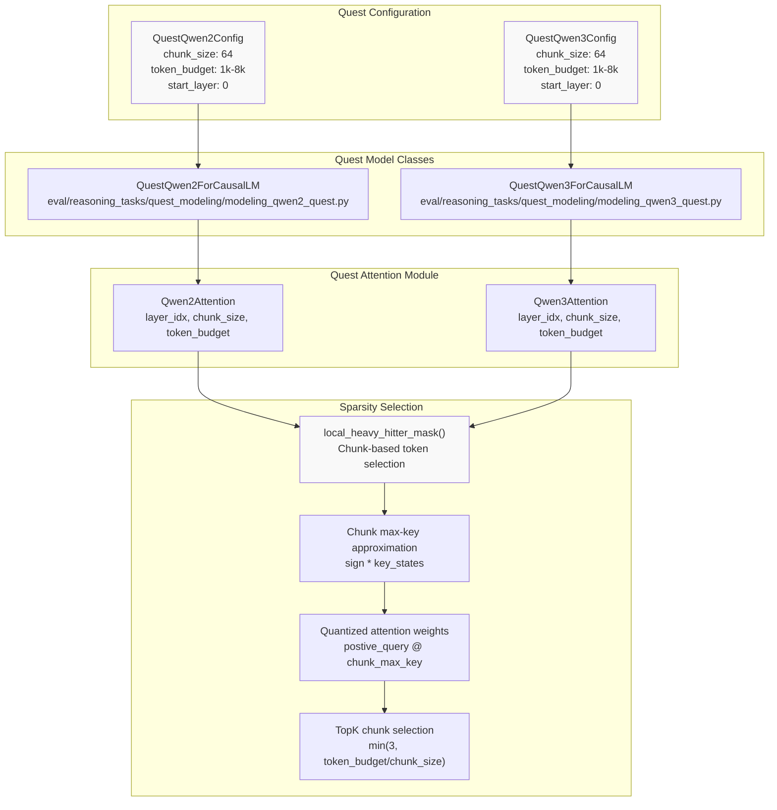
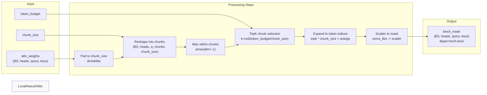
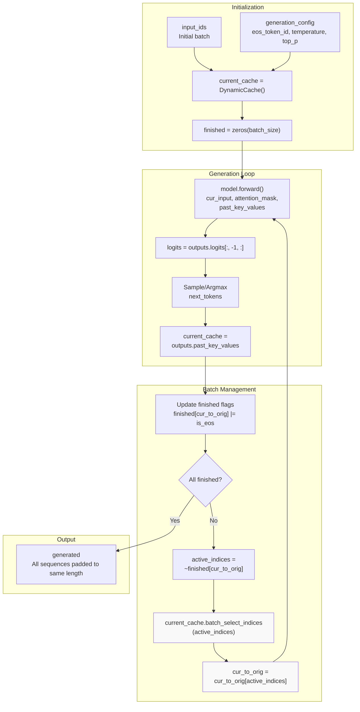
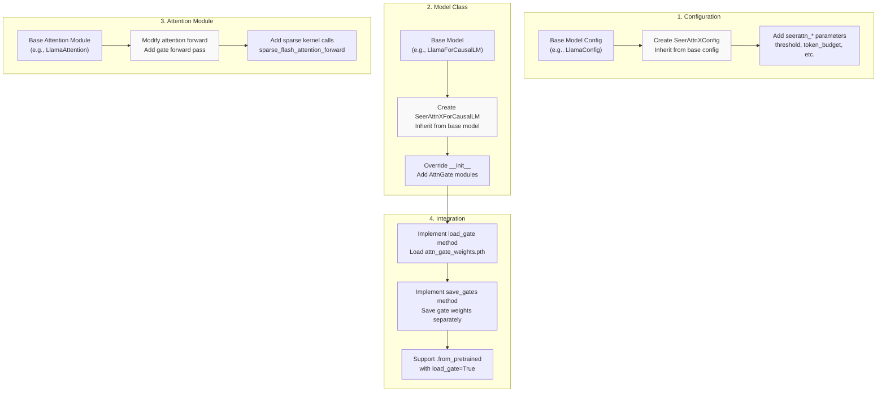

<!-- source: DeepWiki mcp.deepwiki.com · repo microsoft/SeerAttention · page 8 Advanced Topics · fetched 2026-10-26 -->

# Advanced Topics

<details>
<summary>Relevant source files</summary>

The following files were used as context for generating this wiki page:

- [eval/reasoning_tasks/generation_utils.py](eval/reasoning_tasks/generation_utils.py)
- [eval/reasoning_tasks/quest_modeling/README.md](eval/reasoning_tasks/quest_modeling/README.md)
- [eval/reasoning_tasks/quest_modeling/__init__.py](eval/reasoning_tasks/quest_modeling/__init__.py)
- [eval/reasoning_tasks/quest_modeling/configuration_qwen2_quest.py](eval/reasoning_tasks/quest_modeling/configuration_qwen2_quest.py)
- [eval/reasoning_tasks/quest_modeling/configuration_qwen3_quest.py](eval/reasoning_tasks/quest_modeling/configuration_qwen3_quest.py)
- [eval/reasoning_tasks/quest_modeling/modeling_qwen2_quest.py](eval/reasoning_tasks/quest_modeling/modeling_qwen2_quest.py)
- [eval/reasoning_tasks/quest_modeling/modeling_qwen3_quest.py](eval/reasoning_tasks/quest_modeling/modeling_qwen3_quest.py)
- [eval/reasoning_tasks/scripts/eval_quest.sh](eval/reasoning_tasks/scripts/eval_quest.sh)

</details>


This page documents advanced features and extensions available in the SeerAttention codebase. It covers three main areas: the Quest attention baseline implementation used for comparative evaluation, batch generation utilities for efficient inference, and guidelines for extending SeerAttention to new architectures or custom sparsity methods.

For core SeerAttention mechanisms, see [SeerAttention Mechanism](#3.1). For standard model usage, see [Getting Started](#2).

---

## Quest Attention Baseline

Quest is an alternative sparse attention method implemented in this repository for comparison with SeerAttention. Quest uses a training-free approach based on local heavy hitter detection, whereas SeerAttention uses learned attention gates.

### Architecture Overview

Quest implements block-level sparse attention using chunk-based selection of important tokens. The implementation is available for both Qwen2 and Qwen3 architectures.



**Quest Attention Pipeline**

Sources: [eval/reasoning_tasks/quest_modeling/modeling_qwen2_quest.py:179-397](), [eval/reasoning_tasks/quest_modeling/modeling_qwen3_quest.py:213-441](), [eval/reasoning_tasks/quest_modeling/configuration_qwen2_quest.py:25-207](), [eval/reasoning_tasks/quest_modeling/configuration_qwen3_quest.py:25-215]()

### Configuration Parameters

Quest models use specialized configuration classes that extend the base Qwen2/Qwen3 configurations:

| Parameter | Type | Default | Description |
|-----------|------|---------|-------------|
| `chunk_size` | int | 64 | Size of token chunks for local heavy hitter detection |
| `token_budget` | int | 2048 | Maximum number of tokens to attend to per query |
| `start_layer` | int | 0 | Layer index where Quest sparsity begins (earlier layers use dense) |

Sources: [eval/reasoning_tasks/quest_modeling/configuration_qwen2_quest.py:168-184](), [eval/reasoning_tasks/quest_modeling/configuration_qwen3_quest.py:174-190]()

### Local Heavy Hitter Mask Function

The core sparsity mechanism in Quest is the `local_heavy_hitter_mask` function, which selects important tokens based on chunk-level attention approximations.



**Local Heavy Hitter Mask Generation**

The function operates on attention weights and returns a boolean mask:

1. **Padding**: Attention weights are padded to make sequence length divisible by `chunk_size` [eval/reasoning_tasks/quest_modeling/modeling_qwen2_quest.py:44-62]()
2. **Chunking**: Reshaped into chunks of size `chunk_size` [eval/reasoning_tasks/quest_modeling/modeling_qwen2_quest.py:65-71]()
3. **Max pooling**: Each chunk is reduced to its maximum attention weight [eval/reasoning_tasks/quest_modeling/modeling_qwen2_quest.py:65-71]()
4. **TopK selection**: Select top chunks based on `token_budget / chunk_size` [eval/reasoning_tasks/quest_modeling/modeling_qwen2_quest.py:73-75]()
5. **Expansion**: Expand selected chunks back to token indices [eval/reasoning_tasks/quest_modeling/modeling_qwen2_quest.py:78-81]()
6. **Mask creation**: Create boolean mask with selected tokens set to True [eval/reasoning_tasks/quest_modeling/modeling_qwen2_quest.py:82-87]()

Sources: [eval/reasoning_tasks/quest_modeling/modeling_qwen2_quest.py:41-88](), [eval/reasoning_tasks/quest_modeling/modeling_qwen3_quest.py:55-101]()

### Quest Attention Forward Pass

Quest attention operates differently during prefill and decode phases:

**Prefill Phase (query_length > 1)**: Uses standard dense attention via `flash_forward()` method [eval/reasoning_tasks/quest_modeling/modeling_qwen2_quest.py:202-259]()

**Decode Phase (query_length == 1)**: Implements sparse attention with chunk-based selection:

1. **Compute attention scores**: Standard Q @ K^T / sqrt(head_dim) [eval/reasoning_tasks/quest_modeling/modeling_qwen2_quest.py:303]()
2. **Max-key approximation**: Compute sign-based max values per chunk to approximate attention patterns [eval/reasoning_tasks/quest_modeling/modeling_qwen2_quest.py:305-344]()
3. **Quantized weight computation**: Use approximated attention for token selection [eval/reasoning_tasks/quest_modeling/modeling_qwen2_quest.py:341-344]()
4. **Apply local_heavy_hitter_mask**: Select important tokens based on quantized weights [eval/reasoning_tasks/quest_modeling/modeling_qwen2_quest.py:373-377]()
5. **Mask attention scores**: Zero out non-selected tokens [eval/reasoning_tasks/quest_modeling/modeling_qwen2_quest.py:379-380]()
6. **Compute output**: Standard softmax and value multiplication [eval/reasoning_tasks/quest_modeling/modeling_qwen2_quest.py:382-385]()

Sources: [eval/reasoning_tasks/quest_modeling/modeling_qwen2_quest.py:261-397](), [eval/reasoning_tasks/quest_modeling/modeling_qwen3_quest.py:306-441]()

### Quest vs SeerAttention Comparison

| Aspect | Quest | SeerAttention |
|--------|-------|---------------|
| **Sparsity Learning** | Training-free, heuristic-based | Learned via self-distillation |
| **Selection Method** | Chunk-based local heavy hitters | Block-level attention gates |
| **Token Selection** | Max-pooling within chunks | Learned gate predictions |
| **Computational Cost** | Sign-based approximation (low) | Gate forward pass (low) |
| **Adaptability** | Fixed heuristic | Adapts to model behavior |
| **Storage** | No additional weights | AttnGates (66-503 MB) |
| **Phases** | Decode-only sparsity | Both prefill and decode sparsity |

Quest provides a strong baseline for comparison because it requires no training, while SeerAttention learns sparsity patterns that may better match the model's actual attention behavior.

Sources: [eval/reasoning_tasks/quest_modeling/README.md:1-3]()

### Using Quest Models

Quest models can be evaluated using the provided evaluation scripts:

```bash
# From eval/reasoning_tasks/scripts/eval_quest.sh
model_dir="deepseek-ai/DeepSeek-R1-Distill-Qwen-14B"
attention_implementation="quest"
block_size="64"
token_budget="4096"

python parallel_run_hf.py \
    --model_dir "$model_dir" \
    --attention_implementation "$attention_implementation" \
    --block_size "$block_size" \
    --token_budget "$token_budget"
```

Sources: [eval/reasoning_tasks/scripts/eval_quest.sh:1-33]()

---

## Batch Generation Utilities

The codebase provides specialized generation utilities for efficient batch processing with dynamic batch size adjustment.

### batch_exist_generate Function

The `batch_exist_generate` function implements a modified generation loop that dynamically removes finished sequences from the batch and reorganizes the KV cache.



**batch_exist_generate Pipeline**

Sources: [eval/reasoning_tasks/generation_utils.py:8-105]()

### Key Features

#### Dynamic Batch Size Adjustment

The function maintains a mapping `cur_to_orig` that tracks which positions in the current batch correspond to which positions in the original batch:

```python
# Initial mapping: all sequences active
cur_to_orig = torch.arange(initial_batch_size, device=device)

# After removing finished sequences
active_local = ~finished[cur_to_orig]
active_indices_local = torch.nonzero(active_local, as_tuple=False).squeeze(-1)
cur_to_orig = cur_to_orig[active_indices_local]
```

This allows the batch size to shrink as sequences finish, reducing computational waste.

Sources: [eval/reasoning_tasks/generation_utils.py:36](), [eval/reasoning_tasks/generation_utils.py:87-99]()

#### KV Cache Reorganization

When sequences are removed from the batch, the KV cache must be reorganized to match:

```python
# Remove finished sequences from cache
current_cache.batch_select_indices(active_indices_local)

# Also update attention mask
if attention_mask is not None:
    attention_mask = attention_mask[active_indices_local]
```

The `batch_select_indices` method is a custom method on `DynamicCache` that selectively keeps only the specified batch indices.

Sources: [eval/reasoning_tasks/generation_utils.py:94](), [eval/reasoning_tasks/generation_utils.py:96-97]()

#### Finished Sequence Tracking

Finished sequences are tracked using a boolean tensor and updated each step:

```python
# Update finished flags for active sequences
if isinstance(generation_config.eos_token_id, list):
    finished[cur_to_orig] |= torch.isin(next_tokens.squeeze(1), eos_token_ids)
else:
    finished[cur_to_orig] |= (next_tokens.squeeze(1) == eos_token_id)
```

This supports both single and multiple EOS token IDs.

Sources: [eval/reasoning_tasks/generation_utils.py:78-81]()

#### Token Padding for Finished Sequences

Generated tokens for finished sequences are filled with EOS tokens:

```python
# Create full tensor with EOS tokens
new_tokens_full = torch.full((initial_batch_size, 1), eos_token_id,
                             dtype=next_tokens.dtype, device=device)

# Fill in tokens for active sequences
new_tokens_full[cur_to_orig] = next_tokens

# Append to all sequences
generated = torch.cat([generated, new_tokens_full], dim=1)
```

This ensures all sequences in the output have the same length.

Sources: [eval/reasoning_tasks/generation_utils.py:67-72]()

### Function Signature

```python
def batch_exist_generate(
    model,
    input_ids: torch.LongTensor,
    attention_mask: Optional[torch.LongTensor] = None,
    max_length: int = 100,
    do_sample: bool = False,
    **model_kwargs,
) -> torch.LongTensor
```

**Parameters:**
- `model`: The language model to generate with
- `input_ids`: Initial token IDs of shape `(batch_size, seq_len)`
- `attention_mask`: Attention mask of shape `(batch_size, seq_len)`
- `max_length`: Maximum sequence length to generate
- `do_sample`: Whether to sample (True) or use greedy decoding (False)
- `**model_kwargs`: Additional keyword arguments passed to model forward

**Returns:**
- `generated`: Generated sequences of shape `(batch_size, final_seq_len)` with finished sequences padded with EOS tokens

Sources: [eval/reasoning_tasks/generation_utils.py:8-105]()

### Use Cases

The `batch_exist_generate` function is particularly useful when:

1. **Variable completion times**: Different prompts in the batch may require different numbers of tokens to complete
2. **Long generation**: For reasoning tasks where some solutions may be found quickly while others require extensive reasoning
3. **Memory efficiency**: Reducing active batch size saves memory and computation
4. **Debugging**: The function prints active batch indices and KV length, useful for monitoring [eval/reasoning_tasks/generation_utils.py:93]()

This utility is especially valuable for reasoning task evaluation where response lengths can vary significantly.

Sources: [eval/reasoning_tasks/generation_utils.py:8-105]()

---

## Extending SeerAttention

This section provides guidance for developers who want to extend SeerAttention to new model architectures or customize sparsity methods.

### Adding Support for New Model Architectures

To add SeerAttention support for a new transformer architecture, follow this pattern:



**Architecture Extension Pattern**

#### Step 1: Create Configuration Class

Create a configuration class that extends the base model's config:

```python
class SeerAttnXConfig(BaseXConfig):
    def __init__(
        self,
        seerattn_sparsity_method: str = "threshold",
        seerattn_threshold: float = 5e-4,
        seerattn_token_budget: int = 4096,
        seerattn_gate_block_size: int = 64,
        seerattn_start_layer: int = 0,
        seerattn_impl: str = "seer_sparse",
        base_model: Optional[str] = None,
        **kwargs,
    ):
        self.seerattn_sparsity_method = seerattn_sparsity_method
        self.seerattn_threshold = seerattn_threshold
        self.seerattn_token_budget = seerattn_token_budget
        self.seerattn_gate_block_size = seerattn_gate_block_size
        self.seerattn_start_layer = seerattn_start_layer
        self.seerattn_impl = seerattn_impl
        self.base_model = base_model
        super().__init__(**kwargs)
```

Reference existing implementations at [src/seerattn_models/configuration_seerattn_qwen2.py:1-109]() and [src/seerattn_models/configuration_seerattn_llama.py:1-109]()

#### Step 2: Implement Model Class

Create a model class that adds AttnGate modules:

```python
class SeerAttnXForCausalLM(BaseXForCausalLM):
    def __init__(self, config):
        super().__init__(config)
        
        # Add attention gates for applicable layers
        self.attn_gates = nn.ModuleList([
            AttnGate(
                num_heads=config.num_attention_heads,
                head_dim=config.hidden_size // config.num_attention_heads,
                gate_block_size=config.seerattn_gate_block_size,
            )
            if layer_idx >= config.seerattn_start_layer
            else None
            for layer_idx in range(config.num_hidden_layers)
        ])
```

Key points:
- Initialize AttnGates for layers >= `seerattn_start_layer`
- Store gate configuration parameters
- Implement gate loading/saving methods

#### Step 3: Modify Attention Forward Pass

Update the attention module to use sparse kernels:

```python
def forward(self, hidden_states, attention_mask, ...):
    # Standard Q, K, V projection
    query_states = self.q_proj(hidden_states)
    key_states = self.k_proj(hidden_states)
    value_states = self.v_proj(hidden_states)
    
    # Apply AttnGate if layer_idx >= start_layer
    if self.attn_gate is not None:
        block_mask = self.attn_gate(
            query_states=query_states,
            key_states=key_states,
            attention_mask=attention_mask,
        )
    else:
        block_mask = None
    
    # Use sparse or dense attention based on block_mask
    if block_mask is not None:
        attn_output = sparse_flash_attention_forward(
            query_states, key_states, value_states, block_mask
        )
    else:
        attn_output = standard_attention_forward(
            query_states, key_states, value_states, attention_mask
        )
    
    return self.o_proj(attn_output)
```

Reference [src/seerattn_models/modeling_seerattn_llama.py:1-1198]() for a complete implementation.

#### Step 4: Implement Loading and Saving

Add methods to handle gate weights separately from base model weights:

```python
def load_gate(self, gate_path):
    """Load attention gate weights from checkpoint"""
    state_dict = torch.load(gate_path, map_location="cpu")
    missing_keys, unexpected_keys = self.load_state_dict(
        state_dict, strict=False
    )
    # Only attn_gates should be loaded
    assert all("attn_gates" in key for key in missing_keys)
    
def save_gates(self, save_path):
    """Save only attention gate weights"""
    gate_state_dict = {
        k: v for k, v in self.state_dict().items()
        if "attn_gates" in k
    }
    torch.save(gate_state_dict, save_path)
```

### Customizing Sparsity Methods

The codebase supports multiple sparsity methods via the `seerattn_sparsity_method` parameter. To add a new method:

#### 1. Add Method to Configuration

Update the config validation:

```python
VALID_SPARSITY_METHODS = ["threshold", "token_budget", "top_k", "my_custom_method"]

if config.seerattn_sparsity_method not in VALID_SPARSITY_METHODS:
    raise ValueError(f"Invalid sparsity method: {config.seerattn_sparsity_method}")
```

#### 2. Implement Selection Logic in AttnGate

Modify the `AttnGate.forward()` method to handle the new sparsity method:

```python
if self.sparsity_method == "threshold":
    block_mask = gate_scores > self.threshold
elif self.sparsity_method == "token_budget":
    # Select top-k blocks based on budget
    k = self.token_budget // self.gate_block_size
    topk_indices = torch.topk(gate_scores, k=k, dim=-1).indices
    block_mask = torch.zeros_like(gate_scores, dtype=torch.bool)
    block_mask.scatter_(-1, topk_indices, True)
elif self.sparsity_method == "my_custom_method":
    # Implement custom selection logic
    block_mask = custom_selection(gate_scores, self.custom_param)
```

Reference [src/seerattn_models/modeling_seerattn_qwen2.py:1-1446]() for threshold and token budget implementations.

#### 3. Update Kernel Dispatch

Ensure sparse kernels receive the correct block masks:

```python
if self.config.seerattn_impl == "seer_sparse":
    attn_output = sparse_flash_attention_forward(
        query_states=query_states,
        key_states=key_states,
        value_states=value_states,
        block_mask=block_mask,  # Custom mask from new method
        gate_block_size=self.config.seerattn_gate_block_size,
    )
```

### Implementation Patterns

The codebase follows consistent patterns across architectures:

| Component | Pattern | Examples |
|-----------|---------|----------|
| **Configuration** | `SeerAttn{Arch}Config` inherits from `{Arch}Config` | `SeerAttnQwen2Config`, `SeerAttnLlamaConfig` |
| **Model** | `SeerAttn{Arch}ForCausalLM` inherits from `{Arch}ForCausalLM` | `SeerAttnLlamaForCausalLM` |
| **Attention** | `SeerAttn{Arch}Attention` modifies base attention | Modified in place |
| **Gates** | `AttnGate` modules stored in `self.attn_gates` list | Common across architectures |
| **Loading** | `.from_pretrained(load_gate=True)` | Automatic composition |
| **Saving** | `save_gates()` method saves only gate weights | Separate from base model |

Following these patterns ensures consistency and maintainability.

### Testing and Validation

When extending SeerAttention to new architectures:

1. **Verify output equivalence**: With `seerattn_impl="seer_dense"`, outputs should match the base model
2. **Test sparsity levels**: Measure actual sparsity achieved vs. configured thresholds/budgets
3. **Benchmark performance**: Compare speed and memory usage vs. dense attention
4. **Evaluate accuracy**: Run on relevant benchmarks to ensure quality is maintained
5. **Check gradient flow**: During training, ensure gradients flow correctly to gate parameters

### Contributing

To contribute extensions to the SeerAttention repository:

1. Follow the implementation patterns documented above
2. Include configuration classes, model classes, and loading/saving utilities
3. Add evaluation scripts in `eval/` directory
4. Document any architecture-specific considerations
5. Include example usage in documentation
6. Submit pull request with comprehensive testing

Sources: Project structure and implementation patterns across [src/seerattn_models/]() directory

---

This page covers the advanced features needed to work with Quest baselines, optimize batch generation, and extend SeerAttention to new use cases. For training AttnGates, see [Training and Distillation](#5). For kernel implementation details, see [Kernels and Performance](#6).

---

