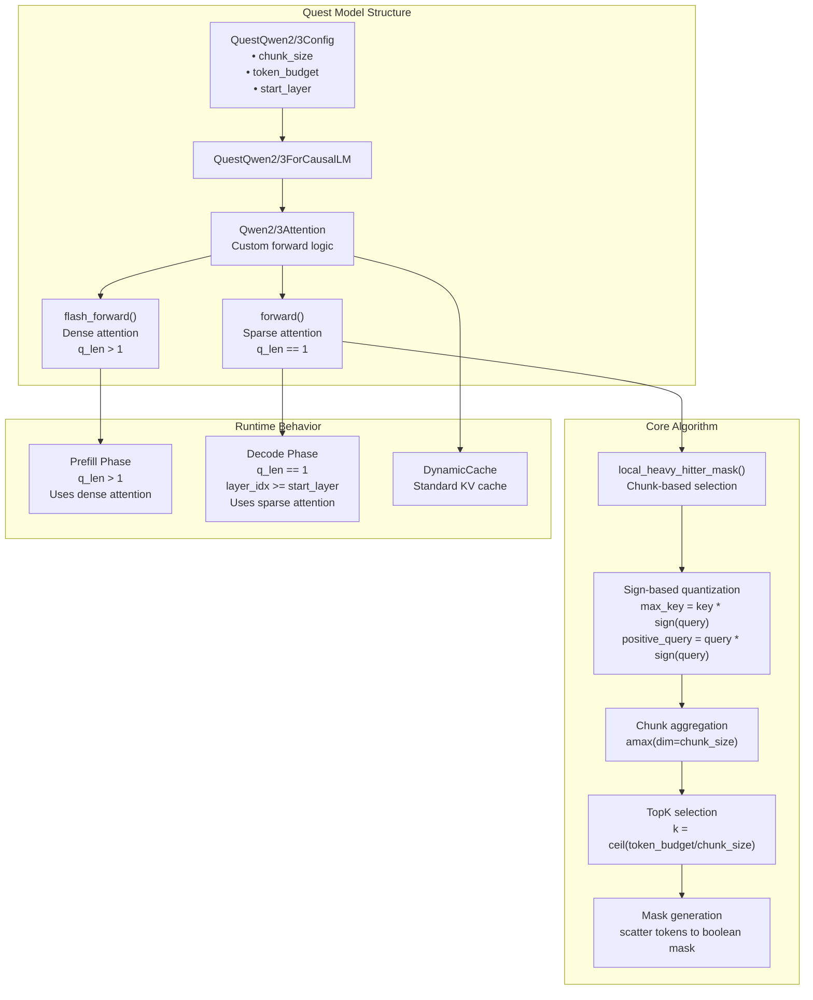
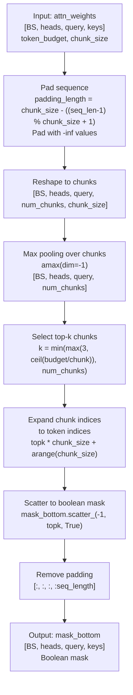
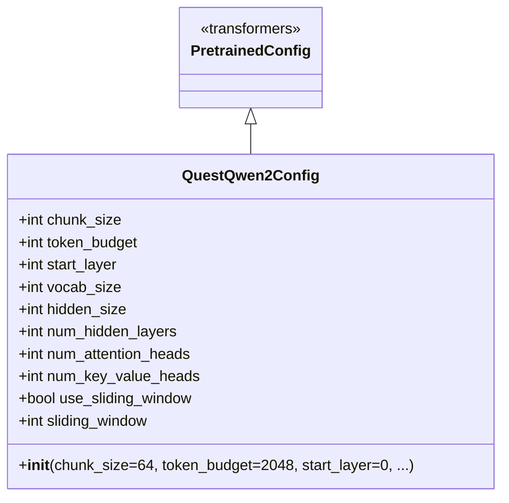
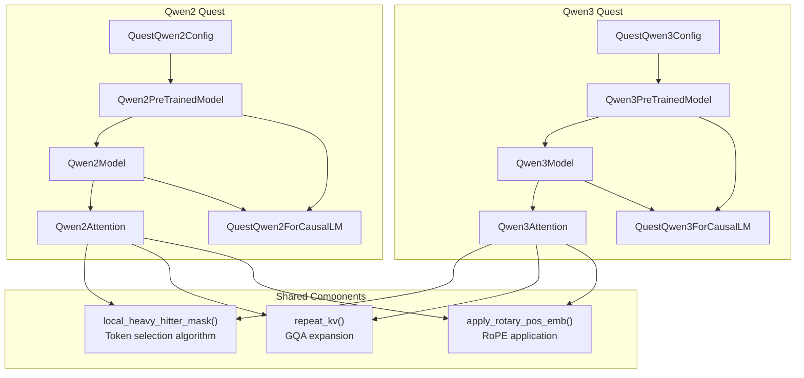
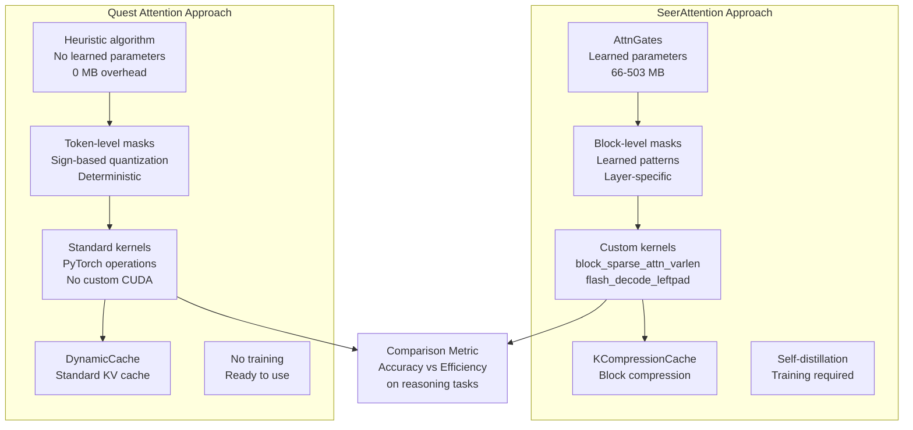

<!-- source: DeepWiki mcp.deepwiki.com · repo microsoft/SeerAttention · page 8.1 Quest Attention Baseline · fetched 2026-10-26 -->

# Quest Attention Baseline

<details>
<summary>Relevant source files</summary>

The following files were used as context for generating this wiki page:

- [eval/reasoning_tasks/quest_modeling/README.md](eval/reasoning_tasks/quest_modeling/README.md)
- [eval/reasoning_tasks/quest_modeling/__init__.py](eval/reasoning_tasks/quest_modeling/__init__.py)
- [eval/reasoning_tasks/quest_modeling/configuration_qwen2_quest.py](eval/reasoning_tasks/quest_modeling/configuration_qwen2_quest.py)
- [eval/reasoning_tasks/quest_modeling/configuration_qwen3_quest.py](eval/reasoning_tasks/quest_modeling/configuration_qwen3_quest.py)
- [eval/reasoning_tasks/quest_modeling/modeling_qwen2_quest.py](eval/reasoning_tasks/quest_modeling/modeling_qwen2_quest.py)
- [eval/reasoning_tasks/quest_modeling/modeling_qwen3_quest.py](eval/reasoning_tasks/quest_modeling/modeling_qwen3_quest.py)
- [eval/reasoning_tasks/scripts/eval_quest.sh](eval/reasoning_tasks/scripts/eval_quest.sh)

</details>


## Purpose and Scope

This document describes the Quest Attention implementation, which serves as a **comparison baseline** for evaluating SeerAttention's performance on reasoning tasks. Quest is an alternative sparse attention mechanism that uses chunk-based heavy hitter selection without learned attention gates. For information about the primary SeerAttention implementation, see [Sparse Decode Models (SeerAttention-R)](#4.2). For evaluation procedures, see [Reasoning Tasks Evaluation](#7.1).

The Quest implementation is located in `eval/reasoning_tasks/quest_modeling/` and provides Qwen2 and Qwen3 model variants configured for token-budget-based sparse decoding during long-reasoning generation tasks.

**Sources:** [eval/reasoning_tasks/quest_modeling/README.md:1-3]()

---

## Architecture Overview

Quest Attention implements sparse attention during the **decode phase only** (query length = 1) using a heuristic-based approach. Unlike SeerAttention which uses learned AttnGates, Quest employs a deterministic algorithm that selects important tokens based on quantized attention approximations.

### System Components



**Key Characteristics:**

| Aspect | Implementation |
|--------|---------------|
| **Sparsity Method** | Token budget with chunk-based selection |
| **Mask Generation** | Deterministic, no learned parameters |
| **Phase Support** | Decode only (prefill uses dense attention) |
| **Cache Type** | Standard `DynamicCache` |
| **Layer Control** | `start_layer` parameter controls which layers use sparsity |
| **Quantization** | Sign-based approximation for efficient token selection |

**Sources:** [eval/reasoning_tasks/quest_modeling/modeling_qwen2_quest.py:179-397](), [eval/reasoning_tasks/quest_modeling/modeling_qwen3_quest.py:213-441]()

---

## The local_heavy_hitter_mask Algorithm

The core of Quest Attention is the `local_heavy_hitter_mask()` function, which implements a chunk-based token selection algorithm to identify the most important tokens for attention computation.

### Algorithm Flow



### Implementation Details

The algorithm operates in several stages:

**1. Sequence Padding**
```python
# Lines 45-62 in modeling_qwen2_quest.py
padding_length = chunk_size - ((seq_length - 1) % chunk_size + 1)
attn_weights = torch.cat([attn_weights, padding_tensor], dim=-1)
```

**2. Chunk Aggregation**
```python
# Lines 64-71 in modeling_qwen2_quest.py
chunk_attn_weights = attn_weights.reshape(
    ..., attn_weights.shape[3] // chunk_size, chunk_size
).amax(dim=-1)
```

**3. Top-K Selection**
```python
# Lines 73-75 in modeling_qwen2_quest.py
k = min(max(3, math.ceil(token_budget / chunk_size)), chunk_attn_weights.size(-1))
_, topk = chunk_attn_weights.topk(k=k, dim=-1)
```

**4. Mask Construction**
```python
# Lines 77-83 in modeling_qwen2_quest.py
topk = topk.unsqueeze(-1).repeat(..., chunk_size) * chunk_size + torch.arange(chunk_size)
mask_bottom = torch.zeros_like(attn_weights, dtype=torch.bool)
mask_bottom.scatter_(-1, topk, True)
```

**Minimum Token Selection:** The algorithm ensures at least 3 chunks are selected (`max(3, math.ceil(token_budget / chunk_size))`), providing a minimum attention budget even for very small `token_budget` values.

**Sources:** [eval/reasoning_tasks/quest_modeling/modeling_qwen2_quest.py:41-88](), [eval/reasoning_tasks/quest_modeling/modeling_qwen3_quest.py:55-101]()

---

## Attention Forward Pass with Quest

The Quest attention mechanism uses a **dual-path approach**: dense attention for prefill, sparse attention for decode with sign-based quantization.

### Decode Phase Algorithm

```mermaid
graph TB
    DecodeInput["Decode input<br/>hidden_states [bsz, 1, hidden]<br/>past_key_value cache"]
    
    QKVProj["Projection<br/>q_proj, k_proj, v_proj<br/>Apply RoPE"]
    
    CacheUpdate["Update KV cache<br/>key_states, value_states<br/>kv_seq_len tokens total"]
    
    RepeatKV["Repeat KV for GQA<br/>repeat_kv(num_key_value_groups)"]
    
    SignCompute["Compute sign-based quantization<br/>sign = (query > 0) + (~(query > 0)) * -1<br/>max_key = key * sign<br/>positive_query = query * sign"]
    
    PadChunk["Pad max_key to chunk_size<br/>Add padding with -inf"]
    
    ChunkMaxKey["Compute chunk max_key<br/>reshape and amax(dim=chunk_size)"]
    
    ExpandChunks["Expand chunks<br/>repeat to original length"]
    
    QuantWeight["Compute quantized attention<br/>matmul(positive_query, chunk_max_key.T)"]
    
    ApplyMask["Apply attention mask<br/>Add causal mask to weights"]
    
    HeavyHitter["Call local_heavy_hitter_mask()<br/>Select important tokens"]
    
    MaskAttn["Mask attention weights<br/>attn_weights[~mask] = -inf"]
    
    Softmax["Softmax normalization<br/>softmax(attn_weights, dim=-1)"]
    
    MatmulV["Attention output<br/>matmul(attn_weights, value_states)"]
    
    Output["Output: attn_output<br/>Transpose and project"]
    
    DecodeInput --> QKVProj
    QKVProj --> CacheUpdate
    CacheUpdate --> RepeatKV
    RepeatKV --> SignCompute
    SignCompute --> PadChunk
    PadChunk --> ChunkMaxKey
    ChunkMaxKey --> ExpandChunks
    ExpandChunks --> QuantWeight
    QuantWeight --> ApplyMask
    ApplyMask --> HeavyHitter
    HeavyHitter --> MaskAttn
    MaskAttn --> Softmax
    Softmax --> MatmulV
    MatmulV --> Output
```



### Sign-Based Quantization

The key innovation in Quest is the **sign-based quantization** that enables efficient token selection:

```python
# Lines 305-307 in modeling_qwen2_quest.py
sign = (query_states > 0) + (~(query_states > 0)) * -1
max_key = key_states * sign
positive_query = query_states * sign
```

This transformation:
- Flips negative query values to positive
- Adjusts key values accordingly
- Enables max-pooling approximation of attention scores
- Provides upper bound on actual attention weights

**Sources:** [eval/reasoning_tasks/quest_modeling/modeling_qwen2_quest.py:261-397](), [eval/reasoning_tasks/quest_modeling/modeling_qwen3_quest.py:306-441]()

---

## Configuration Classes

Quest models use custom configuration classes that extend the base Qwen2/Qwen3 configurations with Quest-specific parameters.

### QuestQwen2Config



### Configuration Parameters

| Parameter | Type | Default | Description |
|-----------|------|---------|-------------|
| `chunk_size` | int | 64 | Size of token chunks for aggregation |
| `token_budget` | int | 2048 | Maximum tokens to attend to per query |
| `start_layer` | int | 0 | Layer index to start applying sparse attention |
| Standard Qwen2/3 params | various | - | All standard architecture parameters |

### Parameter Usage

**chunk_size:** Controls the granularity of token selection. Smaller values provide finer-grained selection but increase computation. Typical value: 64.

**token_budget:** Total number of tokens each query can attend to. This is the primary sparsity control parameter. During decode, `min(kv_seq_len, token_budget)` tokens are selected.

**start_layer:** Enables layer-wise sparsity control. Layers before `start_layer` use dense attention, layers >= `start_layer` use sparse Quest attention. Setting to 0 applies sparsity to all layers.

**Sources:** [eval/reasoning_tasks/quest_modeling/configuration_qwen2_quest.py:148-207](), [eval/reasoning_tasks/quest_modeling/configuration_qwen3_quest.py:152-215]()

---

## Model Implementations

Quest provides two model variants: `QuestQwen2ForCausalLM` and `QuestQwen3ForCausalLM`, both implementing the same attention algorithm with architecture-specific adaptations.

### Model Class Hierarchy



### Key Implementation Differences

**Qwen2 vs Qwen3 Architectural Differences:**

| Feature | Qwen2 | Qwen3 |
|---------|-------|-------|
| Q/K/V projection bias | True | config.attention_bias |
| QK normalization | None | Qwen3RMSNorm (q_norm, k_norm) |
| Head dimension | hidden_size // num_heads | Configurable head_dim parameter |

### Attention Layer Structure

Both implementations follow the same control flow:

```python
# Lines 261-283 in modeling_qwen2_quest.py (similar in qwen3)
def forward(self, hidden_states, ...):
    bsz, q_len, _ = hidden_states.size()
    
    # Use dense attention for prefill or early layers
    if q_len > 1 or self.layer_idx < self.start_layer:
        return self.flash_forward(hidden_states, ...)
    
    # Use Quest sparse attention for decode
    # ... projection, rope, cache update ...
    # ... sign-based quantization ...
    # ... local_heavy_hitter_mask selection ...
    # ... masked attention computation ...
```

**Sources:** [eval/reasoning_tasks/quest_modeling/modeling_qwen2_quest.py:816-920](), [eval/reasoning_tasks/quest_modeling/modeling_qwen3_quest.py:840-945]()

---

## Using Quest for Evaluation

Quest models are used as baselines for evaluating SeerAttention on reasoning tasks. The evaluation script demonstrates typical usage.

### Evaluation Script Example

```bash
# eval/reasoning_tasks/scripts/eval_quest.sh

model_dir="deepseek-ai/DeepSeek-R1-Distill-Qwen-14B"
output_dir="./result_quest"
attention_implementation="quest"

# Quest-specific parameters
block_size="64"            # chunk_size
sparsity_method="token_budget"
token_budget="4096"
start_layer="0"

python parallel_run_hf.py \
    --model_dir "$model_dir" \
    --attention_implementation "$attention_implementation" \
    --block_size "$block_size" \
    --token_budget "$token_budget" \
    --start_layer "$start_layer" \
    # ... other parameters
```

### Integration with Evaluation Framework

The Quest implementation integrates with the evaluation framework through the `attention_implementation="quest"` parameter, which triggers loading of the Quest model classes instead of standard transformers models.

**Parameter Mapping:**

| CLI Parameter | Config Attribute | Description |
|--------------|------------------|-------------|
| `--block_size` | `chunk_size` | Token chunk size for aggregation |
| `--token_budget` | `token_budget` | Maximum tokens per query |
| `--start_layer` | `start_layer` | First layer to apply sparsity |
| `--sparsity_method` | - | Must be "token_budget" for Quest |

**Sources:** [eval/reasoning_tasks/scripts/eval_quest.sh:1-33]()

---

## Comparison with SeerAttention

Quest Attention serves as a baseline to evaluate SeerAttention's learned approach against a heuristic-based method.

### Architectural Comparison



### Feature Comparison Table

| Feature | SeerAttention | Quest Attention |
|---------|--------------|----------------|
| **Mask Generation** | Learned AttnGates | Deterministic heuristic |
| **Training Required** | Yes (self-distillation) | No |
| **Parameter Overhead** | 66-503 MB | 0 MB |
| **Sparsity Level** | Block-level (e.g., 128×128) | Token-level |
| **Sparsity Method** | threshold/token_budget/top_k | token_budget only |
| **Custom Kernels** | Yes (Triton, CUDA) | No |
| **Cache Type** | KCompressionCache | DynamicCache |
| **Prefill Support** | Sparse prefill supported | Dense only |
| **Decode Support** | Sparse decode | Sparse decode |
| **Quantization** | None | Sign-based approximation |
| **Layer Control** | `seerattn_start_layer` | `start_layer` |

### Algorithmic Differences

**SeerAttention:**
- Uses learned gate functions to predict attention importance
- Operates at block granularity for hardware efficiency
- Requires training phase but achieves better quality-sparsity tradeoff
- Supports both prefill and decode sparsity

**Quest Attention:**
- Uses sign-based quantization to approximate attention scores
- Selects individual tokens within chunks
- No training required, purely heuristic
- Decode-only sparsity (prefill uses dense attention)

### Performance Implications

**SeerAttention advantages:**
- Better accuracy at same sparsity level (learned patterns)
- Block-level sparsity enables hardware-optimized kernels
- Supports sparse prefill for long-context efficiency

**Quest Attention advantages:**
- No training overhead or parameter storage
- Simpler implementation without custom kernels
- Immediate deployment on any base model

**Sources:** [eval/reasoning_tasks/quest_modeling/README.md:1-3](), [eval/reasoning_tasks/quest_modeling/modeling_qwen2_quest.py:179-397]()

---

## Summary

Quest Attention provides a training-free sparse attention baseline using chunk-based heavy hitter selection. Key characteristics:

1. **Heuristic-based:** Uses sign-based quantization and max-pooling approximation instead of learned gates
2. **Decode-only:** Applies sparsity during generation phase; uses dense attention for prefill
3. **Token-budget controlled:** Primary sparsity parameter controls total tokens attended per query
4. **No additional parameters:** Zero overhead beyond configuration
5. **Evaluation baseline:** Enables comparison with SeerAttention's learned approach

The implementation is located in `eval/reasoning_tasks/quest_modeling/` and supports both Qwen2 and Qwen3 architectures. For evaluation usage, see [eval_quest.sh](eval/reasoning_tasks/scripts/eval_quest.sh:1-33)().

---

