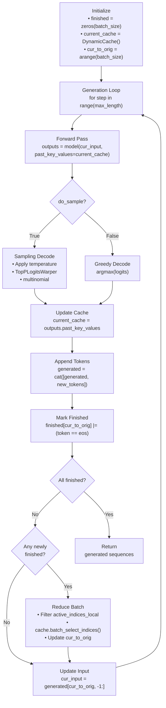
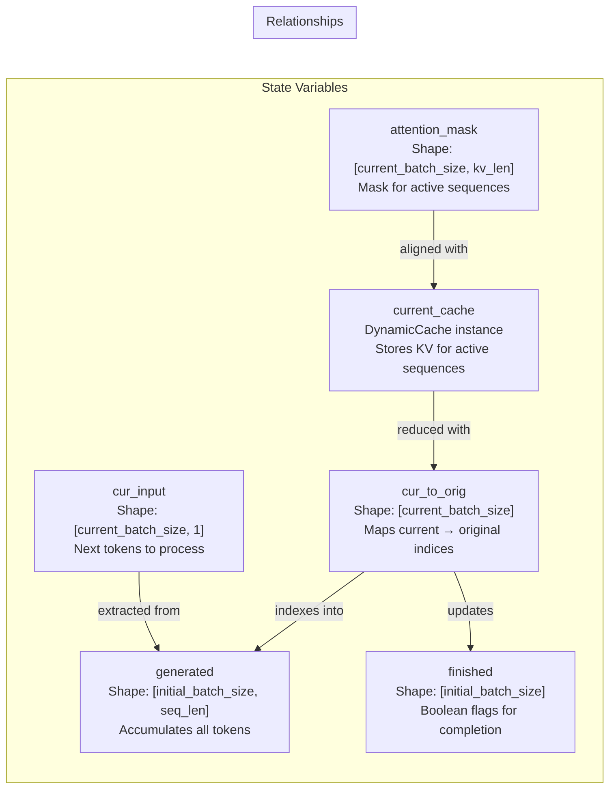
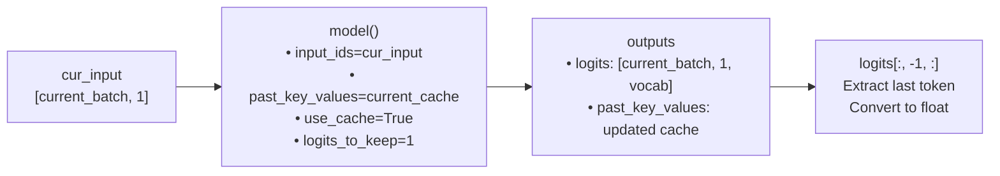
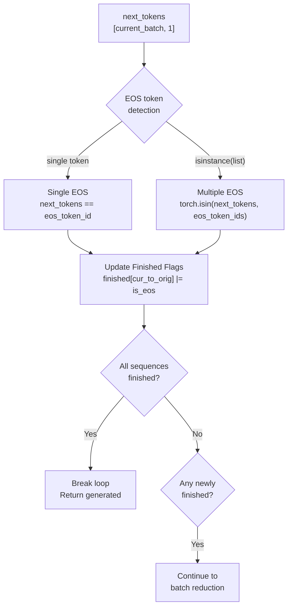
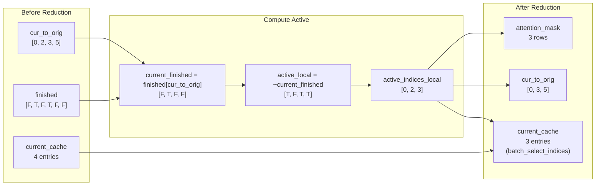
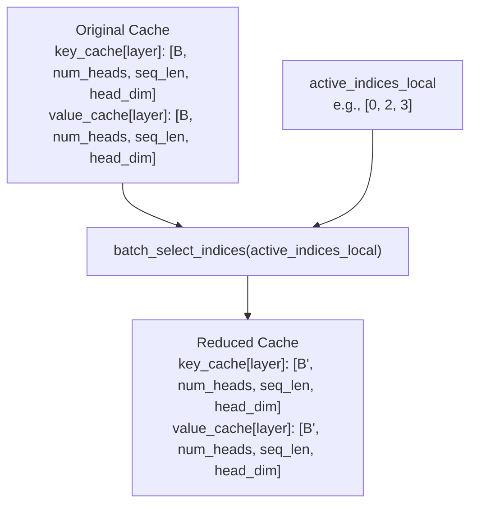

<!-- source: DeepWiki mcp.deepwiki.com · repo microsoft/SeerAttention · page 8.2 Batch Generation Utilities · fetched 2026-10-26 -->

# Batch Generation Utilities

<details>
<summary>Relevant source files</summary>

The following files were used as context for generating this wiki page:

- [eval/reasoning_tasks/generation_utils.py](eval/reasoning_tasks/generation_utils.py)

</details>


## Purpose and Scope

This document covers the `batch_exist_generate` function, a specialized generation utility that dynamically reduces batch size during token generation by removing finished sequences and reorganizing the KV cache. This optimization is particularly useful for reducing computational overhead when sequences finish at different times during evaluation.

For general model generation configuration, see [Model Configuration](#4.3). For information about KV cache implementations, see [Cache Management](#3.4).

## Overview

The `batch_exist_generate` function provides an optimized generation loop that differs from standard Hugging Face generation in a critical way: instead of maintaining all sequences in the batch until the longest sequence finishes, it dynamically removes finished sequences and reorganizes the KV cache. This results in significant computational savings during evaluation tasks where sequences may finish at different times.

**Key Features:**
- Dynamic batch size reduction as sequences finish
- KV cache reorganization to match reduced batch size
- Support for both greedy and sampling-based decoding
- Tracking of finished sequences across batch size changes
- Compatibility with `DynamicCache` from Transformers

**Sources:** [eval/reasoning_tasks/generation_utils.py:8-105]()

## Function Signature

```python
def batch_exist_generate(
    model,
    input_ids: torch.LongTensor,
    attention_mask: Optional[torch.LongTensor] = None,
    max_length: int = 100,
    do_sample: bool = False,
    **model_kwargs,
)
```

| Parameter | Type | Description |
|-----------|------|-------------|
| `model` | Module | The language model to use for generation |
| `input_ids` | `torch.LongTensor` | Input token IDs of shape `[batch_size, seq_len]` |
| `attention_mask` | `Optional[torch.LongTensor]` | Attention mask for input |
| `max_length` | `int` | Maximum total sequence length (input + generated) |
| `do_sample` | `bool` | Whether to use sampling (True) or greedy decoding (False) |
| `**model_kwargs` | `dict` | Additional arguments passed to model forward pass |

**Returns:** `torch.LongTensor` of shape `[batch_size, final_seq_len]` containing generated sequences, with finished sequences padded with EOS tokens.

**Sources:** [eval/reasoning_tasks/generation_utils.py:8-15]()

## Generation Workflow

The generation process follows a loop structure with dynamic batch adjustment:



**Sources:** [eval/reasoning_tasks/generation_utils.py:20-105]()

## Key State Variables

The function maintains several critical state variables throughout generation:

### State Tracking Tensors



| Variable | Initial Size | Final Size | Purpose |
|----------|--------------|------------|---------|
| `generated` | `[B, L_init]` | `[B, L_final]` | Stores all generated tokens for all sequences (fixed batch dimension) |
| `finished` | `[B]` | `[B]` | Boolean flags indicating which original sequences are complete |
| `cur_to_orig` | `[B]` → `[B']` | `[B'']` | Mapping from current active indices to original batch indices (shrinks) |
| `current_cache` | `B` entries | `B''` entries | KV cache for only active sequences (shrinks) |
| `cur_input` | `[B, 1]` → `[B', 1]` | `[B'', 1]` | Next input tokens for active sequences (shrinks) |

Where `B` is initial batch size, `B'` is current batch size, and sizes decrease over time as sequences finish.

**Sources:** [eval/reasoning_tasks/generation_utils.py:20-36]()

## Initialization Phase

The function begins by preparing generation configuration and initializing state:

### Configuration Setup

[eval/reasoning_tasks/generation_utils.py:21-29]() handles generation configuration extraction:
- Calls `model._prepare_generation_config(None)` to get default generation settings
- Extracts EOS token ID(s) from configuration, supporting both single token and list of tokens
- Stores initial batch size for later reference

### State Initialization

[eval/reasoning_tasks/generation_utils.py:30-36]() initializes tracking variables:
- `finished`: Boolean tensor of shape `[initial_batch_size]` initialized to `False`, tracks completion status in original batch indexing
- `current_cache`: Empty `DynamicCache()` instance to store past key-values
- `cur_to_orig`: Identity mapping `torch.arange(initial_batch_size)` that maintains correspondence between active and original indices

### Sampling Preparation

[eval/reasoning_tasks/generation_utils.py:38-39]() conditionally initializes sampling:
- If `do_sample=True`, creates `TopPLogitsWarper` with `top_p` from generation config
- Enables nucleus sampling for diverse generation

**Sources:** [eval/reasoning_tasks/generation_utils.py:20-39]()

## Generation Loop

The core generation loop [eval/reasoning_tasks/generation_utils.py:41-103]() iterates up to `max_length - generated.shape[1]` times:

### Forward Pass



[eval/reasoning_tasks/generation_utils.py:43-54]():
- Executes model forward pass with `past_key_values=current_cache` for incremental decoding
- Uses `logits_to_keep=1` to only compute logits for the last token (efficiency optimization)
- Extracts logits for the last position: `logits = outputs.logits[:, -1, :]`
- Converts logits to float and moves to input device

**Sources:** [eval/reasoning_tasks/generation_utils.py:43-54]()

### Token Selection

The function supports two decoding strategies:

#### Sampling Decoding

[eval/reasoning_tasks/generation_utils.py:56-60]() when `do_sample=True`:
1. Apply temperature scaling: `logits /= generation_config.temperature`
2. Apply top-p filtering: `processed_logits = top_p_warper(cur_input, logits)`
3. Compute probabilities: `probs = torch.softmax(processed_logits, dim=-1)`
4. Sample: `next_tokens = torch.multinomial(probs, num_samples=1)`

#### Greedy Decoding

[eval/reasoning_tasks/generation_utils.py:61-62]() when `do_sample=False`:
- Selects maximum probability token: `next_tokens = torch.argmax(logits, dim=-1, keepdim=True)`

**Sources:** [eval/reasoning_tasks/generation_utils.py:56-62]()

### Cache Update and Token Append

[eval/reasoning_tasks/generation_utils.py:64-74]() updates state:

1. **Cache Update**: `current_cache = outputs.past_key_values` stores new KV pairs
2. **Token Broadcasting**: Creates `new_tokens_full` of shape `[initial_batch_size, 1]` filled with EOS, then fills active positions using `cur_to_orig` mapping
3. **Sequence Append**: Concatenates new tokens to `generated` sequences
4. **Attention Mask Update**: If provided, extends attention mask by one position

This ensures `generated` always maintains the original batch size, with inactive sequences padded with EOS tokens.

**Sources:** [eval/reasoning_tasks/generation_utils.py:64-74]()

## Dynamic Batch Reduction

The critical optimization occurs when sequences finish, triggering batch size reduction:

### Finished Sequence Detection



[eval/reasoning_tasks/generation_utils.py:77-85]() handles EOS detection:
- For list of EOS tokens: `finished[cur_to_orig] |= torch.isin(next_tokens.squeeze(1), eos_token_ids)`
- For single EOS token: `finished[cur_to_orig] |= (next_tokens.squeeze(1) == eos_token_id)`
- Uses `cur_to_orig` to update correct positions in original batch indexing
- If all sequences finished, breaks early

**Sources:** [eval/reasoning_tasks/generation_utils.py:77-85]()

### Batch Size Reduction

When some (but not all) sequences finish, [eval/reasoning_tasks/generation_utils.py:87-100]() reduces the batch:



The reduction process:

1. **Identify Current Finished**: `current_finished = finished[cur_to_orig]` maps finished flags to current batch
2. **Find Active**: `active_local = ~current_finished` creates boolean mask for active sequences
3. **Check Reduction Needed**: `if active_local.sum().item() < cur_to_orig.shape[0]`
4. **Extract Indices**: `active_indices_local = torch.nonzero(active_local, as_tuple=False).squeeze(-1)`
5. **Reorganize Cache**: `current_cache.batch_select_indices(active_indices_local)` keeps only active entries
6. **Reduce Attention Mask**: `attention_mask = attention_mask[active_indices_local]` if present
7. **Update Mapping**: `cur_to_orig = cur_to_orig[active_indices_local]` maintains correct mapping

**Note**: [eval/reasoning_tasks/generation_utils.py:93]() prints debug information: `print("active batch index", active_indices_local, "kvlen:", attention_mask.shape[1])`

**Sources:** [eval/reasoning_tasks/generation_utils.py:87-100]()

## Cache Reorganization

The KV cache reorganization is handled by the `DynamicCache.batch_select_indices()` method called at [eval/reasoning_tasks/generation_utils.py:94]().

### Cache Selection Mechanism



The `batch_select_indices` method:
- Takes a tensor of indices representing which batch entries to keep
- Iterates through all layers in the cache
- For each layer, selects `key_cache[layer] = key_cache[layer][active_indices_local]`
- Similarly selects `value_cache[layer] = value_cache[layer][active_indices_local]`
- Modifies the cache in-place, reducing memory usage

This operation is critical for efficiency: by removing finished sequences from the cache, subsequent forward passes operate on a smaller batch, reducing both computation and memory usage.

**Sources:** [eval/reasoning_tasks/generation_utils.py:94]()

## Input Preparation for Next Step

After batch reduction (or if no reduction occurred), [eval/reasoning_tasks/generation_utils.py:101-102]() prepares the next input:

```python
cur_input = generated[cur_to_orig, -1:].clone()
```

This line:
- Uses `cur_to_orig` to index into the full `generated` tensor
- Extracts the last token (position `-1`) for each active sequence
- Clones to create a new tensor for the next iteration
- Results in shape `[current_batch_size, 1]`

The use of `cur_to_orig` as an indexing tensor is crucial: it ensures that only active sequences' tokens are passed to the model in the next iteration, maintaining alignment between the reduced batch and the KV cache.

**Sources:** [eval/reasoning_tasks/generation_utils.py:101-102]()

## Return Value and Padding

After the generation loop completes (either by reaching `max_length` or all sequences finishing), [eval/reasoning_tasks/generation_utils.py:105]() returns `generated`.

The returned tensor has shape `[initial_batch_size, final_seq_len]` where:
- All sequences maintain their original batch positions
- Finished sequences are padded with EOS tokens after their completion
- Active sequences continue to hold their generated tokens

This design ensures that:
1. Output shape is predictable (matches input batch size)
2. Finished sequences are properly terminated
3. Caller can easily identify which sequences finished early by checking for EOS tokens

**Sources:** [eval/reasoning_tasks/generation_utils.py:105]()

## Computational Benefits

The dynamic batch reduction provides significant computational savings:

### Efficiency Comparison

| Scenario | Standard Generation | batch_exist_generate |
|----------|---------------------|----------------------|
| 8 sequences, 4 finish early | Process all 8 for full duration | Process 8 → 4 after early completion |
| Memory usage | KV cache for 8 sequences × full length | KV cache reduces from 8 → 4 entries |
| Forward passes | Same batch size throughout | Decreasing batch size |
| Computation | O(B × L × d²) where B=8, L=max | O(B₁×L₁×d² + B₂×L₂×d²) where B₂<B₁ |

**Example**: If 4 out of 8 sequences finish at step 100 of a 1000-step generation:
- Standard approach: 8000 forward passes at batch size 8
- Dynamic approach: 800 passes at batch size 8 + 7200 passes at batch size 4
- Savings: ~50% computation for the remaining 900 steps

### Use Cases

This utility is particularly beneficial for:
- **Reasoning task evaluation**: Where sequences may finish at very different times (e.g., some problems solved quickly, others require extensive reasoning)
- **Variable-length sampling**: When generating multiple samples per prompt with different completion times
- **Memory-constrained environments**: Where reducing active batch size frees GPU memory for other operations

**Sources:** [eval/reasoning_tasks/generation_utils.py:8-105]()

## Integration with Evaluation Pipeline

The `batch_exist_generate` function is used in reasoning task evaluation to efficiently generate multiple samples per problem:

### Typical Usage Pattern

```python
# From evaluation scripts
outputs = batch_exist_generate(
    model=model,
    input_ids=batch_prompts,  # Shape: [num_samples, prompt_len]
    attention_mask=attention_mask,
    max_length=max_total_length,
    do_sample=True,  # For pass@1 with multiple samples
)
# outputs shape: [num_samples, final_len]
# Finished sequences padded with EOS
```

The function integrates with the parallel evaluation framework (see [Running Evaluations](#7.4)) by:
1. Accepting batched prompts from the evaluation harness
2. Generating multiple samples efficiently with dynamic batch reduction
3. Returning results in a format compatible with downstream processing (answer extraction, grading)

**Sources:** [eval/reasoning_tasks/generation_utils.py:8-105]()

## Limitations and Considerations

### Current Limitations

1. **Cache Type**: Only compatible with `DynamicCache`; does not support `KCompressionCache` or other cache types that may not implement `batch_select_indices()`
2. **Attention Mask Assumption**: Assumes left-aligned sequences (standard for causal LM); right-padded inputs may require modification
3. **Token Budget**: Does not integrate with token budget sparsity (see [Sparsity Methods](#3.3)); uses model's default attention mechanism

### Implementation Notes

- The function creates a new `DynamicCache` instance rather than reusing passed cache, ensuring clean state
- Debug printing at [eval/reasoning_tasks/generation_utils.py:93]() should be removed for production use
- The `clone()` operation at [eval/reasoning_tasks/generation_utils.py:102]() is necessary to avoid in-place modification issues

**Sources:** [eval/reasoning_tasks/generation_utils.py:8-105]()

---

