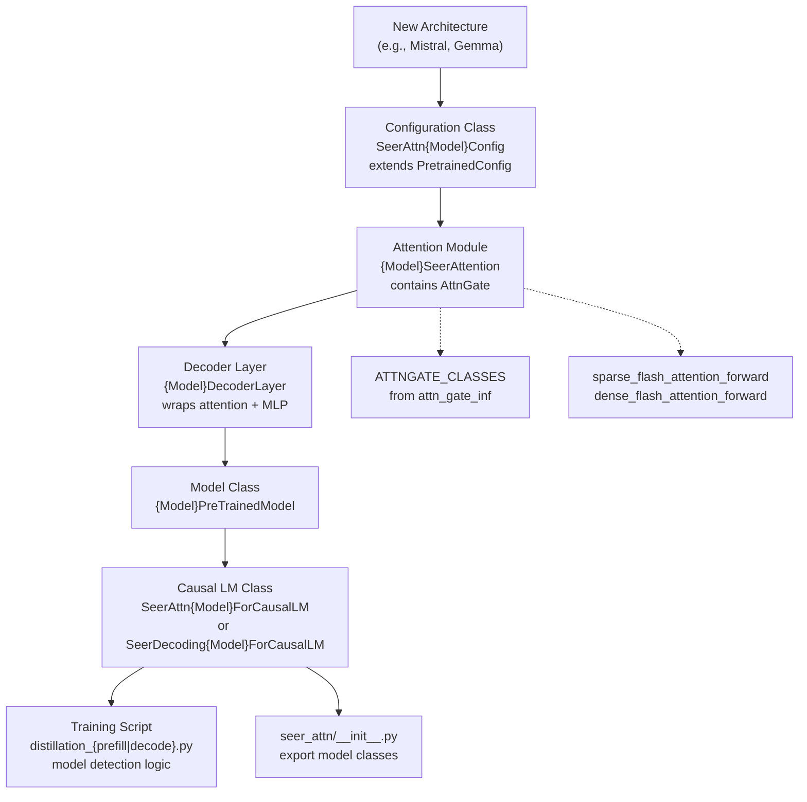
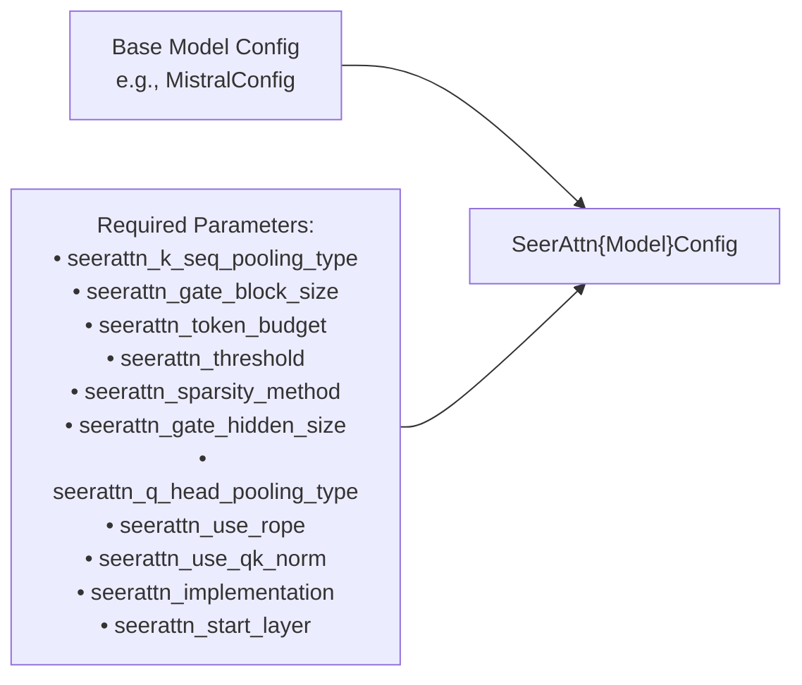
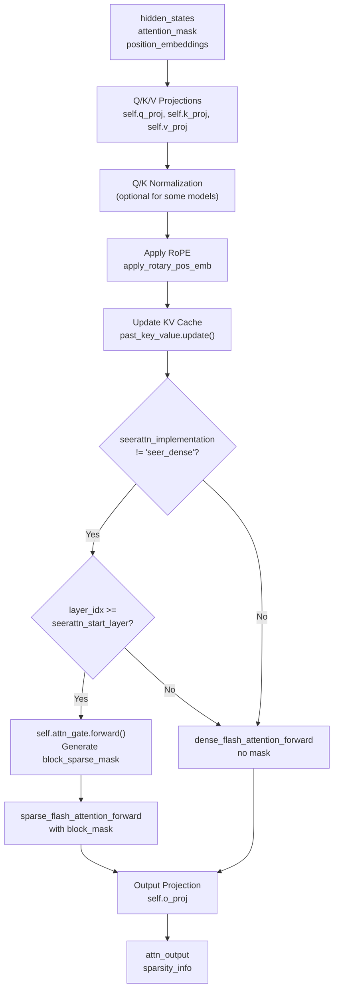
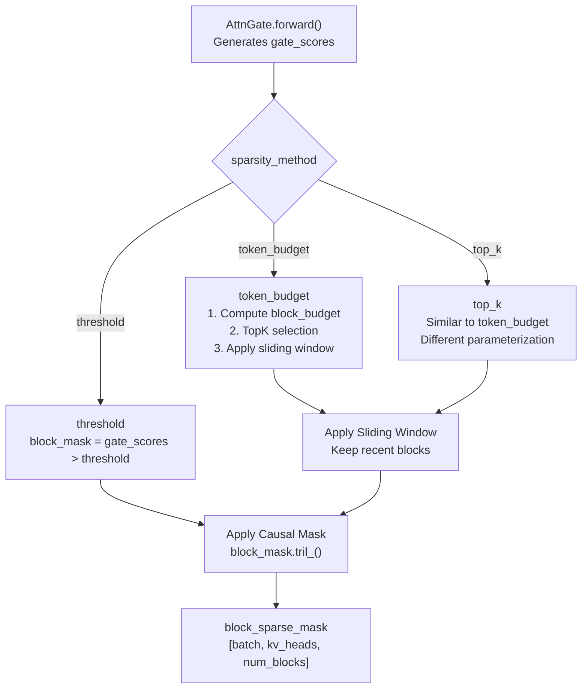
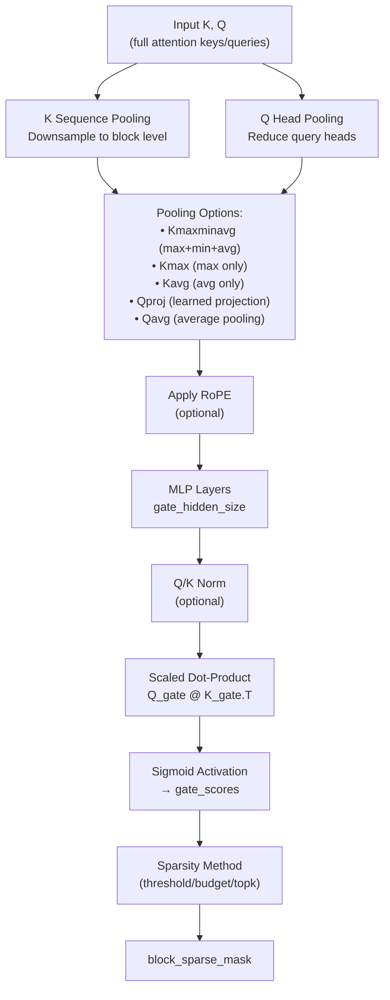

<!-- source: DeepWiki mcp.deepwiki.com · repo microsoft/SeerAttention · page 8.3 Extending SeerAttention · fetched 2026-10-26 -->

# Extending SeerAttention

<details>
<summary>Relevant source files</summary>

The following files were used as context for generating this wiki page:

- [README.md](README.md)
- [distillation_decode.py](distillation_decode.py)
- [scripts/run_distillation_prefill.sh](scripts/run_distillation_prefill.sh)
- [seer_attn/__init__.py](seer_attn/__init__.py)
- [seer_attn/decode_sparse/qwen2/modeling_qwen2_seerattn_inference.py](seer_attn/decode_sparse/qwen2/modeling_qwen2_seerattn_inference.py)
- [seer_attn/decode_sparse/qwen3/modeling_qwen3_seerattn_inference.py](seer_attn/decode_sparse/qwen3/modeling_qwen3_seerattn_inference.py)
- [seer_attn/modules/attention_distill.py](seer_attn/modules/attention_distill.py)
- [seer_attn/modules/common.py](seer_attn/modules/common.py)

</details>


## Purpose and Scope

This page provides guidance for developers who want to extend SeerAttention by adding support for new model architectures, customizing sparsity methods, or contributing improvements to the codebase. It covers the key extension points in the system architecture and provides step-by-step instructions for common customization scenarios.

For information about using existing SeerAttention models, see [Getting Started](#2). For details about the training process, see [Training and Distillation](#5).

---

## Adding Support for New Model Architectures

### Overview of Required Components

Adding support for a new model architecture requires implementing several interconnected components that work together to enable sparse attention with learned gates.



**Diagram: Key components required for adding a new model architecture**

Sources: [seer_attn/__init__.py:1-11](), [seer_attn/decode_sparse/qwen3/modeling_qwen3_seerattn_inference.py:1-795](), [distillation_decode.py:244-251]()

---

### Step 1: Create Configuration Class

The configuration class extends the base model's config and adds SeerAttention-specific parameters.



**Diagram: Configuration class inheritance structure**

**Key configuration parameters:**

| Parameter | Type | Purpose | Typical Values |
|-----------|------|---------|----------------|
| `seerattn_k_seq_pooling_type` | str | Key sequence pooling method | "Kmaxminavg", "Kmax", "Kavg" |
| `seerattn_gate_block_size` | int | Block size for sparse attention | 64, 128 |
| `seerattn_token_budget` | int | Max tokens to attend to (decode) | 1024, 2048, 4096, 8192 |
| `seerattn_threshold` | float | Threshold for activation (prefill) | 5e-4, 1e-3, 2e-3, 5e-3 |
| `seerattn_sparsity_method` | str | Sparsity selection method | "threshold", "token_budget", "top_k" |
| `seerattn_gate_hidden_size` | int | Hidden size of AttnGate | 128, 256 |
| `seerattn_q_head_pooling_type` | str | Query head pooling method | "Qproj", "Qavg" |
| `seerattn_use_rope` | bool | Use RoPE in AttnGate | True |
| `seerattn_use_qk_norm` | bool | Use QK normalization in gate | False |
| `seerattn_implementation` | str | Implementation mode | "seer_sparse", "seer_dense", "oracle_sparse" |
| `seerattn_start_layer` | int | Layer to start applying sparsity | 0 |

**Example configuration class structure** (see Qwen3 as reference):

```python
class SeerAttn{Model}Config(PretrainedConfig):
    model_type = "seerattn_{model}"
    
    def __init__(
        self,
        # Base model parameters
        vocab_size=...,
        hidden_size=...,
        # ... other base params
        
        # SeerAttention parameters
        seerattn_k_seq_pooling_type="Kmaxminavg",
        seerattn_gate_block_size=64,
        seerattn_token_budget=4096,
        seerattn_threshold=5e-4,
        seerattn_sparsity_method="token_budget",
        seerattn_gate_hidden_size=128,
        seerattn_q_head_pooling_type="Qproj",
        seerattn_use_rope=True,
        seerattn_use_qk_norm=False,
        seerattn_implementation="seer_sparse",
        seerattn_start_layer=0,
        seerattn_sliding_window_size=4096,
        base_model=None,
        **kwargs,
    ):
        super().__init__(**kwargs)
        # Initialize all parameters
```

Sources: [seer_attn/decode_sparse/qwen3/configuration_qwen3_seerattn.py]() (inferred from usage), [distillation_decode.py:233-241]()

---

### Step 2: Implement Attention Module with SeerAttention

The attention module is the core component where sparse attention is applied. It must integrate AttnGate for mask generation and call the appropriate kernels.



**Diagram: Attention module forward pass flow**

**Key implementation requirements:**

1. **Initialize AttnGate**: Use the registry pattern to instantiate the appropriate gate type
   ```python
   self.attn_gate = ATTNGATE_CLASSES[config.seerattn_k_seq_pooling_type](
       config.seerattn_gate_block_size, 
       self.head_dim, 
       config.seerattn_gate_hidden_size,
       num_k_head=config.num_key_value_heads, 
       num_q_head=config.num_attention_heads,
       q_head_pooling_type=config.seerattn_q_head_pooling_type,
       use_flash_rope=config.use_flash_rope,
       use_qk_norm=config.seerattn_use_qk_norm,
   )
   ```

2. **Compute Q, K, V**: Follow the base model's projection pattern
   
3. **Apply model-specific normalization**: Some models (like Qwen3) use Q/K normalization

4. **Apply RoPE**: Support both flash-attn RoPE and standard implementation
   ```python
   if self.use_flash_rope:
       q = apply_rotary_emb_func(q, cos, sin, False, True, cu_seqlens=None, max_seqlen=q_len)
       k = apply_rotary_emb_func(k, cos, sin, False, True, cu_seqlens=None, max_seqlen=q_len)
   else:
       q, k = apply_rotary_pos_emb(q, k, cos, sin, unsqueeze_dim=2)
   ```

5. **Update KV cache**: Integrate with the cache system

6. **Generate sparse mask**: Call AttnGate conditionally
   ```python
   if self.seerattn_implementation != "seer_dense":
       if self.seerattn_implementation == "seer_sparse":
           block_sparse_mask = self.attn_gate(
               k_nope,
               self.layer_idx,
               k_compressed_cache,
               q_nope,
               block_attention_mask,
               max_cache_len=k.shape[1],
               position_embeddings=position_embeddings_gate_q,
               block_position_embeddings=block_position_embeddings,
               threshold=self.config.seerattn_threshold,
               block_budget=self.block_budget,
               sparsity_method=self.config.seerattn_sparsity_method,
           )
       else:  # oracle_sparse
           block_sparse_mask = compute_oracle_sparse_mask(...)
   ```

7. **Apply attention**: Choose sparse or dense based on configuration and layer
   ```python
   if self.config.seerattn_implementation == "seer_dense" or self.layer_idx < self.seerattn_start_layer:
       attn_output = dense_flash_attention_forward(q, k, v, ...)
   else:
       attn_output = sparse_flash_attention_forward(q, k, v, block_mask=block_sparse_mask, ...)
   ```

8. **Return sparsity info**: For profiling and analysis
   ```python
   if self.seerattn_output_sparsity and q_len == 1 and self.layer_idx >= self.seerattn_start_layer:
       activate_block_count = block_sparse_mask.sum()
       original_block_count = block_attention_mask.sum() * self.config.num_key_value_heads
       activate_and_original_block_count = (activate_block_count.item(), original_block_count.item())
   ```

Sources: [seer_attn/decode_sparse/qwen3/modeling_qwen3_seerattn_inference.py:88-252](), [seer_attn/decode_sparse/qwen2/modeling_qwen2_seerattn_inference.py:72-210]()

---

### Step 3: Implement Model and CausalLM Classes

The model class coordinates decoder layers and handles rotary embeddings, while the CausalLM class adds the language modeling head and generation utilities.

**Key model class responsibilities:**

1. **Decoder layer initialization**: Create all decoder layers with layer indices
   ```python
   self.layers = nn.ModuleList(
       [{Model}DecoderLayer(config, layer_idx) for layer_idx in range(config.num_hidden_layers)]
   )
   ```

2. **Multiple RoPE embeddings**: For standard attention, block positions, and gate queries
   ```python
   self.rotary_emb = {Model}RotaryEmbedding(config=config)
   
   # For AttnGate with downsampled positions
   block_config = copy.deepcopy(config)
   block_config.hidden_size = config.seerattn_gate_hidden_size * config.num_attention_heads
   self.block_rotary_emb = {Model}RotaryEmbedding(config=block_config)
   self.rotary_emb_gate_q = {Model}RotaryEmbedding(config=block_config)
   ```

3. **KCompressionCache initialization**: For decode models
   ```python
   if use_cache:
       if past_key_values is None:
           past_key_values = DynamicCache()
       if k_compressed_cache is None:
           if past_key_values.get_seq_length() == 0:
               self.k_compressed_cache = KCompressionCache(self.num_layers, self.config.seerattn_gate_block_size)
           k_compressed_cache = self.k_compressed_cache
   ```

4. **Block attention mask generation**: Downsample attention mask to block level
   ```python
   def _gen_block_attention_mask(self, attention_mask):
       mask = F.max_pool1d(
           attention_mask.to(torch.bfloat16),
           kernel_size=[self.config.seerattn_gate_block_size],
           stride=[self.config.seerattn_gate_block_size],
           ceil_mode=True,
       ).to(torch.bool)
       mask = mask.unsqueeze(1)
       return mask
   ```

5. **Position embeddings computation**: Generate embeddings for different purposes
   ```python
   position_embeddings = self.rotary_emb(hidden_states, position_ids)
   
   if self.config.seerattn_use_rope:
       block_position_ids = position_ids[:, 0::self.config.seerattn_gate_block_size]
       block_position_embeddings = self.block_rotary_emb(hidden_states, block_position_ids)
       position_embeddings_gate_q = self.rotary_emb_gate_q(hidden_states, position_ids)
   ```

**Key CausalLM class responsibilities:**

1. **Custom from_pretrained**: Load base model and AttnGate weights separately
   ```python
   @classmethod
   def from_pretrained(cls, pretrained_model_name_or_path, load_gate=True, *model_args, **kwargs):
       if load_gate:
           config = SeerAttn{Model}Config.from_pretrained(pretrained_model_name_or_path, *model_args, **kwargs)
           base_model = config.base_model
           
           # Apply config overrides
           for key in list(kwargs.keys()):
               if hasattr(config, key) and key != "torch_dtype":
                   setattr(config, key, kwargs.pop(key))
           
           # Load base model
           model = super().from_pretrained(base_model, config=config, *model_args, **kwargs)
           
           # Load gate weights
           if os.path.exists(pretrained_model_name_or_path):
               gate_weights = torch.load(os.path.join(pretrained_model_name_or_path, "attn_gate_weights.pth"))
           else:
               gate_weights = torch.load(
                   hf_hub_download(repo_id=pretrained_model_name_or_path, filename="attn_gate_weights.pth")
               )
           
           model.load_state_dict(gate_weights, strict=False)
       else:
           model = super().from_pretrained(pretrained_model_name_or_path, *model_args, **kwargs)
       
       return model
   ```

2. **batch_exist_generate** (for decode models): Dynamic batch size adjustment during generation

Sources: [seer_attn/decode_sparse/qwen3/modeling_qwen3_seerattn_inference.py:419-767](), [seer_attn/decode_sparse/qwen2/modeling_qwen2_seerattn_inference.py:395-766]()

---

### Step 4: Register Model and Update Training Scripts

**Update `seer_attn/__init__.py`:**

```python
from seer_attn.prefill_sparse.{model}.modeling_{model}_seerattn import SeerAttn{Model}ForCausalLM
from seer_attn.decode_sparse.{model}.modeling_{model}_seerattn_inference import SeerDecoding{Model}ForCausalLM

__all__ = [
    # ... existing models
    "SeerAttn{Model}ForCausalLM",
    "SeerDecoding{Model}ForCausalLM",
]
```

**Update training scripts** (`distillation_prefill.py` or `distillation_decode.py`):

Add model detection logic:
```python
if "{model}" in model_args.model_name_or_path.lower():
    print("Using {Model} model")
    model_cls = SeerAttn{Model}ForCausalLM  # or SeerDecoding{Model}ForCausalLM
elif ...
```

Sources: [seer_attn/__init__.py:1-11](), [distillation_decode.py:244-251]()

---

### Step 5: Testing and Validation

**Create a test checklist:**

| Test | Description | How to Verify |
|------|-------------|---------------|
| Model Loading | Load base model and gates | `model.from_pretrained(...)` succeeds |
| Forward Pass | Run inference with sparse attention | Output shape matches expected |
| KV Cache | Cache updated correctly during generation | Sequential generation produces valid output |
| Sparsity Info | Sparsity statistics collected | `outputs.sparsitys_info` contains valid data |
| Dense Mode | Model works with `seer_dense` | Compare outputs with base model |
| Oracle Mode | Oracle sparse matches dense (slower) | Quality metrics within tolerance |
| Training | AttnGate training completes | Loss converges, gates saved successfully |
| Different Budgets | Various token budgets work | Generation succeeds with 1k, 2k, 4k, 8k budgets |

**Example testing code:**
```python
from transformers import AutoTokenizer, AutoConfig
from seer_attn import SeerDecoding{Model}ForCausalLM

model_name = "path/to/your/attngate/model"
config = AutoConfig.from_pretrained(model_name)
tokenizer = AutoTokenizer.from_pretrained(config.base_model)

model = SeerDecoding{Model}ForCausalLM.from_pretrained(
    model_name,
    torch_dtype=torch.bfloat16,
    seerattn_sparsity_method='token_budget',
    seerattn_token_budget=4096,
).cuda()

# Test generation
inputs = tokenizer("Hello, world!", return_tensors="pt").to("cuda")
outputs = model.generate(**inputs, max_length=100)
print(tokenizer.decode(outputs[0]))
```

---

## Customizing Sparsity Methods

SeerAttention supports three built-in sparsity methods: `threshold`, `token_budget`, and `top_k`. You can customize the sparsity selection logic or add new methods.



**Diagram: Sparsity method selection flow**

Sources: [seer_attn/decode_sparse/attn_gate_inf.py]() (inferred from usage patterns)

---

### Existing Sparsity Methods

**1. Threshold Method** (for prefill):
- **Use case**: Long-context input processing
- **Parameter**: `seerattn_threshold` (e.g., 5e-4, 1e-3, 5e-3)
- **Logic**: `block_mask = gate_scores > threshold`
- **Characteristics**: Simple, interpretable, sparsity varies by input

**2. Token Budget Method** (for decode):
- **Use case**: Long-reasoning generation with controlled compute
- **Parameter**: `seerattn_token_budget` (e.g., 1024, 2048, 4096, 8192)
- **Logic**: 
  ```
  block_budget = token_budget / block_size
  block_budget = min(block_budget, num_blocks)
  topk_indices = torch.topk(gate_scores, block_budget, dim=-1).indices
  block_mask[topk_indices] = True
  # Apply sliding window to keep recent blocks
  ```
- **Characteristics**: Fixed compute cost per step, quality-efficiency tradeoff

**3. Top-K Method**:
- **Use case**: Alternative to token_budget with percentage-based selection
- **Parameter**: `seerattn_top_k_ratio` (percentage of blocks to keep)
- **Logic**: Similar to token_budget but parameterized differently
- **Characteristics**: Relative to sequence length

Sources: [seer_attn/decode_sparse/qwen3/modeling_qwen3_seerattn_inference.py:194-217]()

---

### Adding a Custom Sparsity Method

To add a custom sparsity method, modify the AttnGate's mask selection logic:

**Option 1: Modify existing gate classes**

Locate the mask generation code in AttnGate implementations and add a new branch:

```python
# In attn_gate_inf.py or similar
def select_blocks_with_method(gate_scores, sparsity_method, **params):
    if sparsity_method == "threshold":
        return gate_scores > params['threshold']
    elif sparsity_method == "token_budget":
        # Existing logic
        ...
    elif sparsity_method == "top_k":
        # Existing logic
        ...
    elif sparsity_method == "custom_method":
        # Your custom logic
        # Example: adaptive threshold per head
        threshold_per_head = compute_adaptive_threshold(gate_scores)
        return gate_scores > threshold_per_head.unsqueeze(-1)
    else:
        raise ValueError(f"Unknown sparsity method: {sparsity_method}")
```

**Option 2: Create a wrapper class**

Create a custom sparsity selector that wraps the AttnGate:

```python
class CustomSparsitySelector:
    def __init__(self, base_gate, **custom_params):
        self.base_gate = base_gate
        self.custom_params = custom_params
    
    def __call__(self, *args, **kwargs):
        # Get gate scores from base gate
        gate_scores = self.base_gate.compute_scores(*args, **kwargs)
        
        # Apply custom selection logic
        block_mask = self.custom_selection_logic(gate_scores)
        
        return block_mask
    
    def custom_selection_logic(self, gate_scores):
        # Implement your custom method
        # Example: hybrid threshold + budget
        threshold_mask = gate_scores > self.custom_params['min_threshold']
        topk_mask = self.get_topk_mask(gate_scores, self.custom_params['max_budget'])
        return threshold_mask & topk_mask
```

**Option 3: Configuration-based approach**

Add custom parameters to the config and implement in the attention module:

1. Add config parameters:
   ```python
   # In configuration class
   seerattn_custom_param1=None,
   seerattn_custom_param2=None,
   ```

2. Use in attention module:
   ```python
   # In attention forward
   if self.config.seerattn_sparsity_method == "custom":
       block_sparse_mask = self.apply_custom_sparsity(
           gate_scores,
           self.config.seerattn_custom_param1,
           self.config.seerattn_custom_param2,
       )
   ```

Sources: [seer_attn/decode_sparse/qwen3/modeling_qwen3_seerattn_inference.py:194-217](), [seer_attn/decode_sparse/qwen2/modeling_qwen2_seerattn_inference.py:152-175]()

---

## Customizing AttnGate Architecture

The AttnGate is the learned component that predicts which blocks to attend to. You can customize its architecture, pooling methods, and training.



**Diagram: AttnGate internal architecture**

Sources: [seer_attn/decode_sparse/qwen3/modeling_qwen3_seerattn_inference.py:126-136]()

---

### Key Customization Points

**1. Pooling Type** (`seerattn_k_seq_pooling_type`):

Controls how key sequences are downsampled to block level:

| Type | Description | Trade-off |
|------|-------------|-----------|
| `Kmaxminavg` | Concatenate max, min, avg pooled features | More expressive, larger gate |
| `Kmax` | Max pooling only | Captures peak activations |
| `Kavg` | Average pooling only | Smoother representations |

**Implementation location**: AttnGate class registry in `ATTNGATE_CLASSES`

**2. Query Head Pooling** (`seerattn_q_head_pooling_type`):

Controls how multiple attention heads are reduced:

| Type | Description | When to Use |
|------|-------------|-------------|
| `Qproj` | Learned projection layer | More flexibility, more parameters |
| `Qavg` | Simple averaging | Fewer parameters, faster |

**3. Gate Hidden Size** (`seerattn_gate_hidden_size`):

- Controls the dimensionality of the gate's internal MLP
- Typical values: 128, 256
- **Trade-off**: Larger = more capacity but more parameters and compute

**4. Q/K Normalization** (`seerattn_use_qk_norm`):

- Apply normalization before attention in the gate
- Can improve training stability
- Typical: `False` for most models

**5. RoPE Usage** (`seerattn_use_rope`):

- Apply rotary position embeddings in the gate
- Helps gate attend to positional patterns
- Typical: `True` for positional awareness

Sources: [distillation_decode.py:66-93]()

---

### Adding a New Pooling Method

To add a new pooling method, create a new AttnGate class:

```python
class CustomAttnGate(nn.Module):
    """Custom AttnGate with specialized pooling"""
    
    def __init__(self, block_size, head_dim, gate_hidden_size, 
                 num_k_head, num_q_head, **kwargs):
        super().__init__()
        self.block_size = block_size
        self.head_dim = head_dim
        
        # Custom pooling layers
        self.custom_k_pooling = YourCustomKPooling(...)
        self.custom_q_pooling = YourCustomQPooling(...)
        
        # Gate MLP
        input_dim = self.compute_input_dim()
        self.gate_mlp = nn.Sequential(
            nn.Linear(input_dim, gate_hidden_size),
            nn.ReLU(),
            nn.Linear(gate_hidden_size, gate_hidden_size),
        )
        
        # Attention mechanism
        self.q_proj_gate = nn.Linear(gate_hidden_size, head_dim)
        self.k_proj_gate = nn.Linear(gate_hidden_size, head_dim)
    
    def forward(self, k, layer_idx, k_compressed_cache, q, 
                block_attention_mask, **kwargs):
        # 1. Pool K to block level
        k_pooled = self.custom_k_pooling(k)  # [batch, num_blocks, kv_heads, features]
        
        # 2. Pool Q heads
        q_pooled = self.custom_q_pooling(q)  # [batch, query_len, features]
        
        # 3. Apply gate MLP
        k_gate = self.gate_mlp(k_pooled)
        q_gate = self.gate_mlp(q_pooled)
        
        # 4. Compute attention scores
        q_gate = self.q_proj_gate(q_gate)  # [batch, query_len, head_dim]
        k_gate = self.k_proj_gate(k_gate)  # [batch, num_blocks, kv_heads, head_dim]
        
        gate_scores = torch.einsum('bqd,bnhd->bhnq', q_gate, k_gate)
        gate_scores = torch.sigmoid(gate_scores / math.sqrt(self.head_dim))
        
        # 5. Apply sparsity method
        block_mask = self.apply_sparsity_method(
            gate_scores, kwargs['sparsity_method'], **kwargs
        )
        
        return block_mask
```

Register the new gate:
```python
# In attn_gate_inf.py or wherever ATTNGATE_CLASSES is defined
ATTNGATE_CLASSES = {
    "Kmaxminavg": ExistingGateClass,
    "Custom": CustomAttnGate,
    # ... other types
}
```

Sources: [seer_attn/decode_sparse/qwen3/modeling_qwen3_seerattn_inference.py:126-136]()

---

### Training Custom AttnGates

When training with custom gate architectures, update the training script:

**1. Add configuration parameters:**
```python
# In ModelArguments dataclass
seerattn_custom_gate_param1: Optional[str] = field(
    default="value",
    metadata={"help": "Description of custom parameter"},
)
```

**2. Pass to config:**
```python
# In train() function
config.seerattn_custom_gate_param1 = model_args.seerattn_custom_gate_param1
```

**3. Ensure trainable parameters include your custom components:**
```python
# In train() function
for n, p in model.named_parameters():
    if training_args.trainable_params in n or "custom_gate" in n:
        p.requires_grad = True
    else:
        p.requires_grad = False
```

**4. Save custom gate weights:**
```python
# Already handled by existing save logic
attn_gate_state_dict = {k: v for k, v in state_dict.items() if "attn_gate" in k}
torch.save(attn_gate_state_dict, os.path.join(training_args.output_dir, "attn_gate_weights.pth"))
```

Sources: [distillation_decode.py:27-59](), [distillation_decode.py:279-353]()

---

## Contributing to the Project

### Contribution Guidelines

SeerAttention is an open-source project that welcomes contributions. The project follows Microsoft's open-source practices.


**Diagram: Contribution workflow**

Sources: [README.md:153-173]()

---

### Contributor License Agreement (CLA)

Most contributions require you to agree to a Contributor License Agreement (CLA) declaring that you have the right to grant the rights to use your contribution.

- **First-time contributors**: When you submit a pull request, a CLA bot will automatically determine whether you need to provide a CLA
- **Process**: Follow the instructions provided by the bot
- **One-time only**: You only need to do this once across all Microsoft repos using the CLA

**CLA Link**: https://cla.opensource.microsoft.com

Sources: [README.md:155-161]()

---

### Code Style and Standards

**1. Follow existing patterns:**
- Match the code style of the file you're editing
- Use type hints for function parameters and returns
- Add docstrings for public APIs

**2. Model implementations:**
- Follow the structure of existing models (Qwen2/Qwen3/Llama)
- Maintain separation between prefill and decode implementations
- Keep configuration in separate files

**3. Testing:**
- Test model loading and inference
- Verify sparse attention produces valid outputs
- Test different sparsity configurations
- Ensure backward compatibility

**4. Documentation:**
- Update README.md if adding new models
- Add docstrings to new classes and functions
- Update configuration documentation
- Include examples in code comments

---

### Areas for Contribution

**High-priority areas:**

| Area | Description | Skill Level |
|------|-------------|-------------|
| New Model Support | Add support for Mistral, Gemma, etc. | Intermediate-Advanced |
| Kernel Optimizations | Improve Triton/CUDA kernel performance | Advanced |
| Sparsity Methods | Novel sparsity selection algorithms | Intermediate |
| Evaluation Tasks | Add new benchmarks and metrics | Beginner-Intermediate |
| Documentation | Improve docs, add tutorials | Beginner |
| Bug Fixes | Fix reported issues | All levels |

**Example contribution areas:**

1. **Model Architecture Support**:
   - Add support for Mistral-7B
   - Add support for Gemma-7B
   - Add support for GPT-NeoX architectures

2. **Performance Improvements**:
   - Optimize block-sparse kernels
   - Reduce memory usage in KCompressionCache
   - Improve batch generation efficiency

3. **Feature Enhancements**:
   - Dynamic sparsity adjustment during generation
   - Multi-modal attention support
   - Quantization support for gates

4. **Evaluation and Benchmarking**:
   - Add more reasoning tasks
   - Add long-context benchmarks
   - Add efficiency profiling tools

---

### Submitting Pull Requests

**PR Checklist:**

- [ ] Code follows existing style and patterns
- [ ] All tests pass locally
- [ ] New tests added for new features
- [ ] Documentation updated (README, docstrings, wiki)
- [ ] CLA signed
- [ ] PR description clearly explains changes
- [ ] Linked to relevant issue (if applicable)

**PR Template:**
```markdown
## Description
Brief description of changes

## Motivation and Context
Why is this change needed? What problem does it solve?

## Type of Change
- [ ] Bug fix
- [ ] New feature
- [ ] Breaking change
- [ ] Documentation update

## How Has This Been Tested?
Describe tests performed

## Checklist
- [ ] Code follows style guidelines
- [ ] Self-review completed
- [ ] Comments added for complex code
- [ ] Documentation updated
- [ ] Tests added/updated
- [ ] All tests pass
```

Sources: [README.md:153-165]()

---

### Contact and Support

**Reporting Issues:**
- Use GitHub Issues for bug reports and feature requests
- Include reproduction steps and environment details
- Provide minimal reproducible examples

**Questions and Discussions:**
- Check existing issues and discussions
- Review documentation and examples
- Be specific about your use case

**Code of Conduct:**
This project has adopted the [Microsoft Open Source Code of Conduct](https://opensource.microsoft.com/codeofconduct/). For more information see the [Code of Conduct FAQ](https://opensource.microsoft.com/codeofconduct/faq/) or contact [opencode@microsoft.com](mailto:opencode@microsoft.com) with questions or comments.

Sources: [README.md:163-173]()

---

## Summary

This page covered the main extension points in SeerAttention:

1. **Adding New Model Architectures**: Configuration classes, attention modules, model classes, and integration with training scripts
2. **Customizing Sparsity Methods**: Threshold, token budget, top-k, and how to add custom selection logic
3. **Customizing AttnGate Architecture**: Pooling methods, gate parameters, and creating custom gate implementations
4. **Contributing**: CLA process, code standards, contribution areas, and PR guidelines

For specific implementation details, refer to existing model implementations as templates:
- Prefill: [seer_attn/prefill_sparse/qwen/modeling_qwen2_seerattn.py]()
- Decode: [seer_attn/decode_sparse/qwen3/modeling_qwen3_seerattn_inference.py]()
- Training: [distillation_decode.py]()