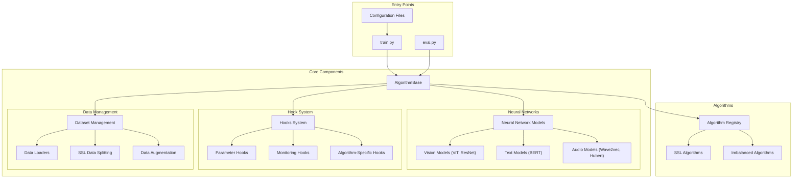
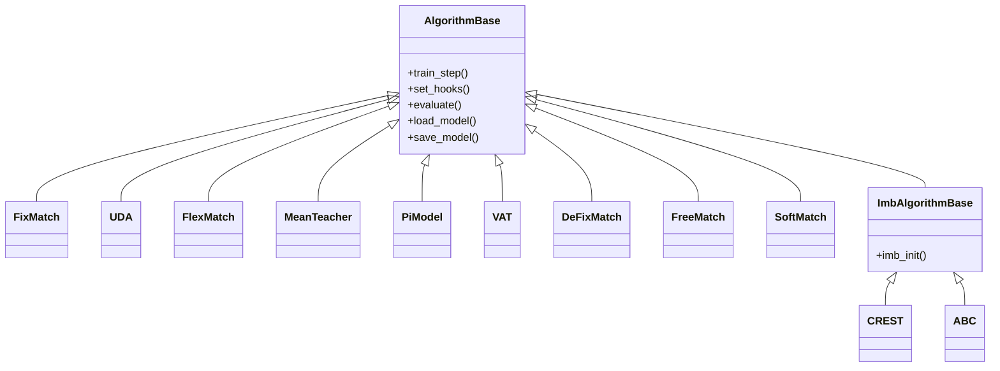
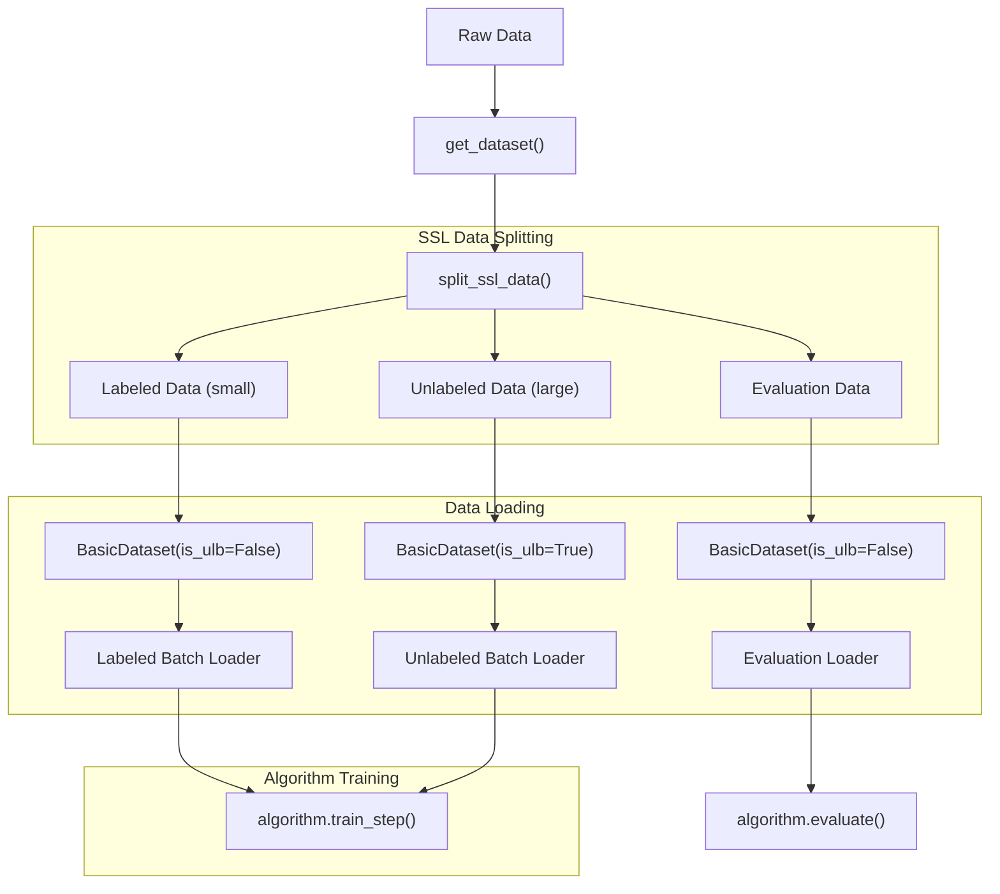
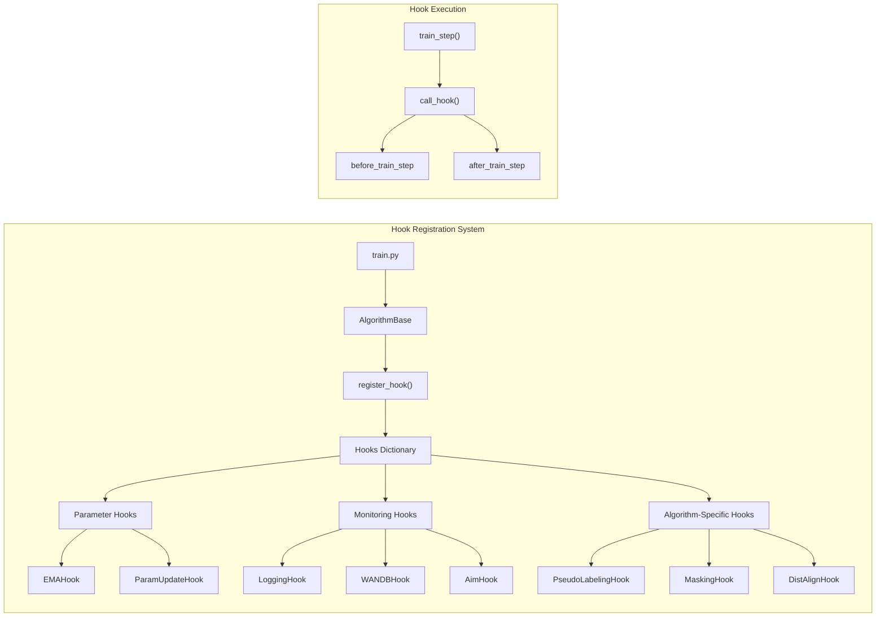
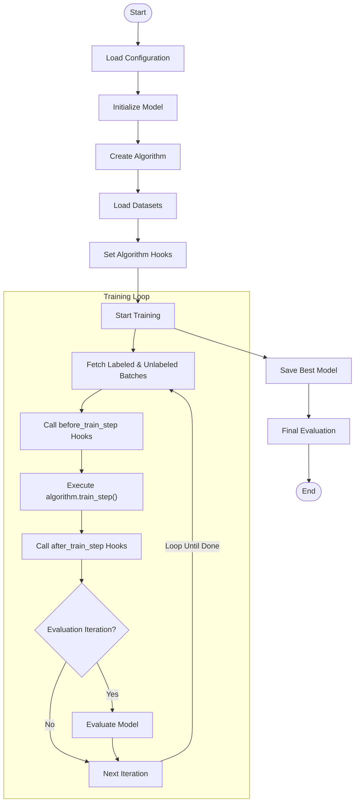

<!-- source: DeepWiki mcp.deepwiki.com · repo microsoft/Semi-supervised-learning · page 1 Overview · fetched 2026-10-26 -->

# Overview

Relevant source files

The following files were used as context for generating this wiki page:

- [CHANGE_LOG.md](CHANGE_LOG.md)
- [README.md](README.md)
- [docs/algorithm_zoo.md](docs/algorithm_zoo.md)
- [docs/benchmark.md](docs/benchmark.md)
- [docs/contributors.md](docs/contributors.md)
- [docs/tutorial.md](docs/tutorial.md)
- [semilearn/algorithms/defixmatch/defixmatch.py](semilearn/algorithms/defixmatch/defixmatch.py)
- [semilearn/core/hooks/aim.py](semilearn/core/hooks/aim.py)
- [semilearn/datasets/audio_datasets/datasetbase.py](semilearn/datasets/audio_datasets/datasetbase.py)

This document provides an introduction to USB (Unified Semi-supervised Learning Benchmark), a comprehensive framework for semi-supervised learning research and applications across multiple domains. This overview explains the purpose, key features, and high-level architecture of the USB framework.

USB is a PyTorch-based framework that offers implementations of various semi-supervised learning (SSL) algorithms with support for computer vision (CV), natural language processing (NLP), and audio tasks. It is designed to be easy to use, extensible, and affordable for research groups of all sizes.

For detailed installation instructions, see [Installation and Setup](#1.1). For a deeper examination of the system architecture, refer to [System Architecture](#1.2).

## Purpose and Goals

USB aims to provide a unified benchmark for semi-supervised learning that:

1. Standardizes the implementation and evaluation of SSL algorithms
2. Supports multiple domains (CV, NLP, and audio) with a consistent interface
3. Enables fair comparisons between different SSL approaches
4. Offers a flexible framework for developing new SSL algorithms
5. Provides reproducible benchmarks for the research community

## High-Level Architecture

The USB framework consists of several interconnected components organized around a core architecture that supports multiple algorithms, datasets, and training methods.

### System Overview Diagram

Sources: [README.md:112-118](), [semilearn/algorithms/defixmatch/defixmatch.py:11-14]()

### Algorithm Hierarchy

USB implements numerous SSL algorithms that all inherit from a common `AlgorithmBase` class, which provides the foundation for implementing SSL techniques.

Sources: [docs/algorithm_zoo.md:1-21]()

## Key Features

USB offers several key features that make it a valuable tool for SSL research and applications:

| Feature | Description |
|---------|-------------|
| Multiple Domains | Supports CV, NLP, and audio tasks with a unified API |
| Algorithm Library | Implements 15+ SSL algorithms including FixMatch, UDA, MeanTeacher, etc. |
| Extensibility | Plugin architecture with hooks for customizing algorithm behavior |
| Benchmarking | Standardized evaluation across datasets and algorithms |
| Experiment Tracking | Integration with wandb, Aim, and other logging tools |
| Reproducibility | Configuration-based experiment setup for reproducible results |

Sources: [README.md:113-115](), [CHANGE_LOG.md:14-21]()

## Data Processing Pipeline

The USB framework handles data through a standardized pipeline that prepares it for semi-supervised learning:

Sources: [semilearn/datasets/audio_datasets/datasetbase.py:45-135](), [docs/tutorial.md:72-82]()

## Hooks System

One of the unique aspects of USB is its hook system, which allows for customization of algorithm behavior at various points in the training process:

Sources: [semilearn/algorithms/defixmatch/defixmatch.py:43-46](), [semilearn/core/hooks/aim.py:9-49]()

## Supported Algorithms

USB implements numerous semi-supervised learning algorithms, including:

1. **Consistency-based methods**:
   - PiModel - Forces outputs of perturbed versions of data to be similar
   - MeanTeacher - Uses exponential moving average of model weights
   - VAT - Virtual Adversarial Training for robustness

2. **Pseudo-labeling methods**:
   - FixMatch - Uses weak augmentations for pseudo-label generation and strong augmentations for learning
   - FlexMatch - Dynamic class-specific thresholds for pseudo-labeling
   - DeFixMatch - Debiased version of FixMatch
   - SoftMatch - Addresses quantity-quality tradeoff in pseudo-labeling

3. **Contrastive methods**:
   - CoMatch - Combines consistency regularization and contrastive learning
   - SimMatch - Extends CoMatch with semantic and instance-level consistency

4. **Imbalanced learning methods**:
   - Various algorithms for handling class imbalance in SSL settings

Sources: [docs/algorithm_zoo.md:4-20]()

## Supported Datasets

USB provides support for datasets across three domains:

1. **Computer Vision**:
   - CIFAR-100, STL10, TissueMNIST, SemiAves, EuroSAT, ImageNet

2. **Natural Language Processing**:
   - IMDB, Amazon Review, Yelp Review, AG News, Yahoo! Answer

3. **Audio**:
   - GTZAN, UrbanSound8k, FSDNoisy18k, Keyword Spotting, ESC-50

Sources: [docs/benchmark.md:1-42]()

## Training Process Flow

The standard training process in USB follows this general flow:

Sources: [README.md:147-150](), [docs/tutorial.md:86-90]()

## Summary

USB provides a comprehensive framework for semi-supervised learning research and application across multiple domains. Its modular design, extensible architecture, and rich algorithm library make it a valuable tool for both exploring existing SSL techniques and developing new approaches. The framework's standardized benchmarking capabilities enable fair comparisons between different methods, contributing to the advancement of the field.

In the following sections of the documentation, we will dive deeper into the individual components of the USB framework, explaining how to use them effectively and how to extend the framework with custom algorithms and datasets.

---

