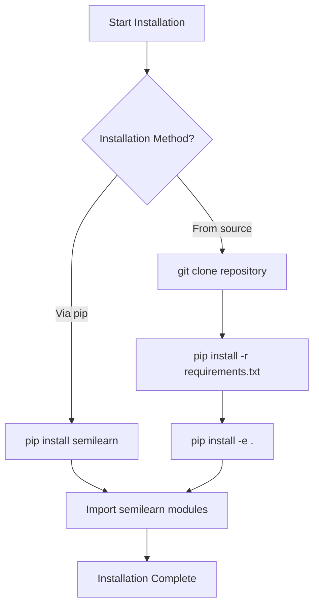
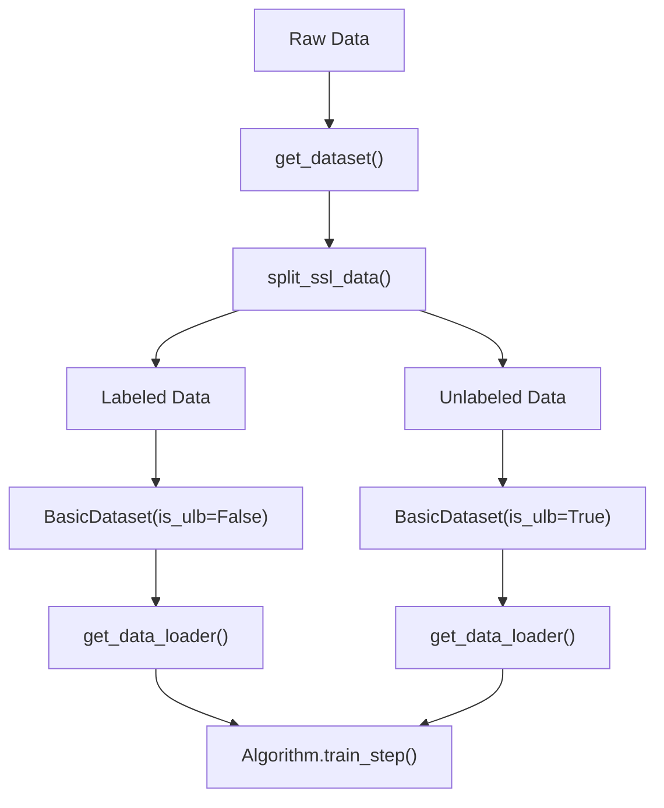
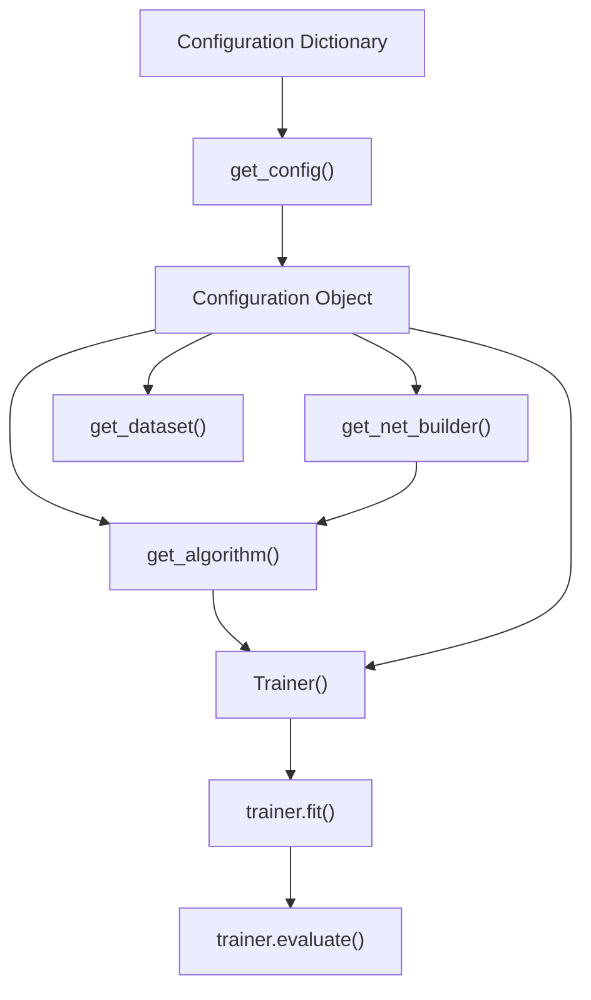

<!-- source: DeepWiki mcp.deepwiki.com · repo microsoft/Semi-supervised-learning · page 1.1 Installation and Setup · fetched 2026-10-26 -->

# Installation and Setup

<details>
<summary>Relevant source files</summary>

The following files were used as context for generating this wiki page:

- [.gitignore](.gitignore)
- [docs/Makefile](docs/Makefile)
- [docs/conf.py](docs/conf.py)
- [docs/index.rst](docs/index.rst)
- [docs/make.bat](docs/make.bat)
- [notebooks/Custom_Dataset.ipynb](notebooks/Custom_Dataset.ipynb)
- [requirements.txt](requirements.txt)
- [semilearn/__init__.py](semilearn/__init__.py)
- [semilearn/datasets/utils.py](semilearn/datasets/utils.py)
- [semilearn/nets/vit/vit.py](semilearn/nets/vit/vit.py)
- [setup.py](setup.py)

</details>


This page provides detailed instructions for installing and configuring the USB (Unified Semi-supervised learning Benchmark) framework. It covers all necessary steps to set up the environment, install the required dependencies, and prepare your system for running semi-supervised learning experiments.

For information about the overall architecture of the framework, see [System Architecture](#1.2).

## Prerequisites and Dependencies

Before installing USB, ensure your system meets the following requirements:

- **Python**: Version 3.9 or higher (as specified in [setup.py:44]())
- **GPU Support**: CUDA-compatible GPU recommended for training (but not required)

The framework depends on the following packages, as defined in [requirements.txt]():

| Category | Packages |
|----------|----------|
| Deep Learning | torch>=1.12.0, torchvision>=0.13.0, torchaudio>=0.12.0, timm>=0.5.4 |
| NLP | transformers>=4.30.0 |
| Data Processing | numpy>=1.24.4, scikit-learn>=1.0.2, Pillow>=9.0.0 |
| Visualization | tensorboard>=2.9.1, wandb, aim |

Sources: [requirements.txt:1-19](), [setup.py:19-44]()

## Installation Methods

### Installation Flow Diagram



### Option 1: Install via pip

The simplest way to install USB is using pip:

```bash
pip install semilearn
```

This installs the `semilearn` package containing all components of the USB framework.

Sources: [docs/index.rst:16-18](), [setup.py:27-44]()

### Option 2: Install from source

For development or to access the latest features, install from source:

1. Clone the repository:
```bash
git clone https://github.com/microsoft/Semi-supervised-learning.git
cd Semi-supervised-learning
```

2. Install the dependencies:
```bash
pip install -r requirements.txt
```

3. Install the package in development mode:
```bash
pip install -e .
```

Sources: [setup.py:19-44](), [requirements.txt:1-19]()

## Directory Structure

After installation, the framework uses the following directory structure:

```
Project Directory/
├── semilearn/               # Main package
│   ├── algorithms/          # SSL algorithms implementation
│   ├── core/                # Core components and AlgorithmBase
│   ├── datasets/            # Dataset loaders
│   ├── lighting/            # Training framework
│   └── nets/                # Network architectures
├── data/                    # Dataset storage (created on first use)
└── saved_models/            # Model checkpoints
```

The directories `data/` and `saved_models/` will be created during usage. These and other development artifacts are excluded from version control as specified in [.gitignore:1-7]().

Sources: [.gitignore:1-7]()

## Data Setup

### Data Processing Pipeline

USB provides a structured pipeline for preparing data for semi-supervised learning:



The key components of this pipeline are:

1. **Data Splitting**: The `split_ssl_data()` function divides your dataset into labeled and unlabeled portions
2. **Dataset Creation**: `BasicDataset` wraps the data with appropriate transforms
3. **Data Loading**: `get_data_loader()` creates DataLoader instances for training

Sources: [semilearn/datasets/utils.py:16-52](), [semilearn/__init__.py:4-8]()

### Setting Up Custom Data

For custom datasets, follow these steps:

1. Prepare your data in numpy array format
2. Split data into labeled and unlabeled sets using `split_ssl_data()`
3. Create transforms for your data domain
4. Create `BasicDataset` instances for labeled and unlabeled data
5. Create data loaders using `get_data_loader()`

Here's an example based on the Custom Dataset notebook:

```python
from semilearn import split_ssl_data, BasicDataset, get_data_loader

# Split data into labeled and unlabeled sets
lb_data, lb_target, ulb_data, ulb_target = split_ssl_data(
    config, data, target, config.num_classes,
    config.num_labels, include_lb_to_ulb=config.include_lb_to_ulb
)

# Create datasets with appropriate transforms
lb_dataset = BasicDataset(config.algorithm, lb_data, lb_target, 
                         config.num_classes, train_transform, is_ulb=False)
ulb_dataset = BasicDataset(config.algorithm, ulb_data, ulb_target, 
                         config.num_classes, train_transform, is_ulb=True, 
                         strong_transform=train_strong_transform)

# Create data loaders
train_lb_loader = get_data_loader(config, lb_dataset, config.batch_size)
train_ulb_loader = get_data_loader(config, ulb_dataset, 
                                  int(config.batch_size * config.uratio))
```

Sources: [notebooks/Custom_Dataset.ipynb:171-189](), [notebooks/Custom_Dataset.ipynb:226-229]()

## Configuration Setup

USB uses a configuration system to define all aspects of the training process. The configuration includes algorithm selection, network architecture, and training parameters.

### Configuration Components and Flow



### Basic Configuration Example

```python
from semilearn import get_config

config = {
    # Algorithm configuration
    'algorithm': 'fixmatch',
    'hard_label': True,
    'uratio': 2,
    
    # Network configuration
    'net': 'vit_tiny_patch2_32',
    'use_pretrain': True, 
    
    # Optimization configuration
    'epoch': 20,
    'batch_size': 16,
    'optim': 'AdamW',
    'lr': 5e-4,
    
    # Dataset configuration
    'dataset': 'cifar10',
    'num_labels': 40,
    'num_classes': 10,
    
    # Device configuration
    'gpu': 0,
    'num_workers': 2,
}

config = get_config(config)
```

Sources: [notebooks/Custom_Dataset.ipynb:85-121](), [semilearn/__init__.py:8]()

## Complete Setup Example

Here's a complete example to set up and run your first experiment:

```python
from semilearn import get_algorithm, get_net_builder, get_config, Trainer

# 1. Create configuration
config = {
    'algorithm': 'fixmatch',
    'net': 'vit_tiny_patch2_32',
    'use_pretrain': True,
    'dataset': 'cifar10',
    'num_labels': 40,
    'num_classes': 10,
    'batch_size': 16,
    'gpu': 0
}
config = get_config(config)

# 2. Create model and algorithm
net_builder = get_net_builder(config.net, from_name=False)
algorithm = get_algorithm(config, net_builder)

# 3. Create trainer and run
trainer = Trainer(config, algorithm)
trainer.fit(train_lb_loader, train_ulb_loader, eval_loader)
```

This setup creates a configuration, initializes a model using the specified network architecture, sets up the SSL algorithm, and creates a trainer to run the experiment.

Sources: [notebooks/Custom_Dataset.ipynb:144-146](), [notebooks/Custom_Dataset.ipynb:282-285]()

## Model Selection

USB provides several network architectures that can be used for different tasks. For computer vision tasks, Vision Transformers (ViT) and CNN models are available:

```python
# Example of using ViT model
config = {
    'net': 'vit_tiny_patch2_32',  # Small ViT for 32x32 images
    'use_pretrain': True,
    # Other configuration parameters...
}

# For larger images
config = {
    'net': 'vit_base_patch16_224',  # Base ViT for 224x224 images
    'use_pretrain': True,
    # Other configuration parameters...
}
```

The models are defined in [semilearn/nets/vit/vit.py:241-291]() and selected via the `get_net_builder()` function.

## Verification

To verify your installation works correctly:

```python
from semilearn import get_net_builder, get_algorithm, get_config

# Create a minimal configuration
config = {
    'algorithm': 'fixmatch',
    'net': 'vit_tiny_patch2_32',
    'num_classes': 10,
    'gpu': 0
}
config = get_config(config)

# Try to create a model
net_builder = get_net_builder(config.net, from_name=False)
algorithm = get_algorithm(config, net_builder)
print("Installation successful!")
```

This simple code will attempt to import necessary modules and create a model, which confirms that all dependencies are properly installed.

## Troubleshooting

### Common Issues

| Issue | Solution |
|-------|----------|
| Missing dependencies | Ensure all requirements from `requirements.txt` are installed |
| CUDA out of memory | Reduce batch size or model size |
| Module not found errors | Make sure the package is installed or you're in the correct directory |
| Import errors | Check Python version compatibility (requires Python 3.9+) |

### Path Issues

If you encounter path-related errors:
- Check if the `data/` directory exists and has write permissions
- Make sure paths in configuration are correctly specified 
- Verify the existence of required directories (create them if necessary)

The framework automatically handles some directory creation, but you might need to manually create directories in some cases.

## Next Steps

For more detailed information on:
- Using specific algorithms, see [Algorithms](#3)
- Working with datasets, see [Datasets and Data Handling](#4)
- Training and evaluating models, see [Training Framework](#2.2)

Sources: [semilearn/__init__.py:4-8](), [notebooks/Custom_Dataset.ipynb:282-285]()

---

