<!-- source: DeepWiki mcp.deepwiki.com · repo microsoft/Semi-supervised-learning · page 1.2 System Architecture · fetched 2026-10-26 -->

# System Architecture

Relevant source files

The following files were used as context for generating this wiki page:

- [README.md](README.md)
- [docs/algorithm_zoo.md](docs/algorithm_zoo.md)
- [docs/benchmark.md](docs/benchmark.md)
- [docs/contributors.md](docs/contributors.md)
- [docs/tutorial.md](docs/tutorial.md)
- [requirements.txt](requirements.txt)
- [semilearn/__init__.py](semilearn/__init__.py)
- [semilearn/algorithms/defixmatch/defixmatch.py](semilearn/algorithms/defixmatch/defixmatch.py)
- [semilearn/datasets/audio_datasets/datasetbase.py](semilearn/datasets/audio_datasets/datasetbase.py)
- [semilearn/nets/vit/vit.py](semilearn/nets/vit/vit.py)

## Purpose and Scope

This document describes the high-level architecture of the USB (Unified Semi-supervised Learning Benchmark) framework. It provides an overview of the key components, their relationships, and the overall system design. The architecture is designed to support semi-supervised learning algorithms across multiple domains including Computer Vision (CV), Natural Language Processing (NLP), and Audio classification tasks.

This page focuses on the structural organization of the system and how the components interact. For detailed information on specific algorithms implemented in USB, see [Basic SSL Algorithms](#3.1) and [Advanced SSL Algorithms](#3.2). For details on dataset handling, refer to [Datasets and Data Handling](#4).

Sources: [README.md:112-118](), [docs/algorithm_zoo.md:1-21]()

## High-Level Architecture Overview

USB is designed with modularity and extensibility in mind. The framework allows researchers to easily implement, evaluate, and compare different semi-supervised learning algorithms across diverse domains.

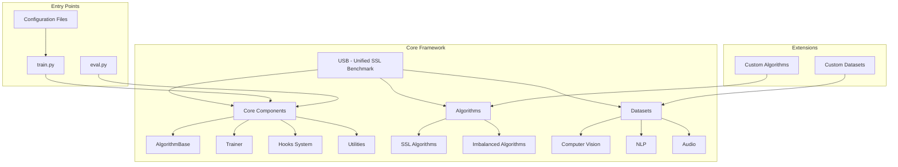

The architecture consists of:

1. **Core Components**: The foundational elements of the framework including `AlgorithmBase`, `Trainer`, Hooks system, and utility functions.
2. **Algorithms**: Various SSL algorithms including traditional methods like FixMatch, FlexMatch, and specialized algorithms for imbalanced datasets.
3. **Datasets**: Support for multiple domains (CV, NLP, Audio) with standardized interfaces.
4. **Entry Points**: Main scripts for training (`train.py`), evaluation (`eval.py`), and configuration management.
5. **Extensions**: Support for custom algorithms and datasets.

Sources: [README.md:112-118](), [semilearn/__init__.py:1-9]()

## Core Components

### AlgorithmBase

The `AlgorithmBase` class serves as the foundation for all SSL algorithms in USB. It provides common functionality for training, evaluation, and model management.

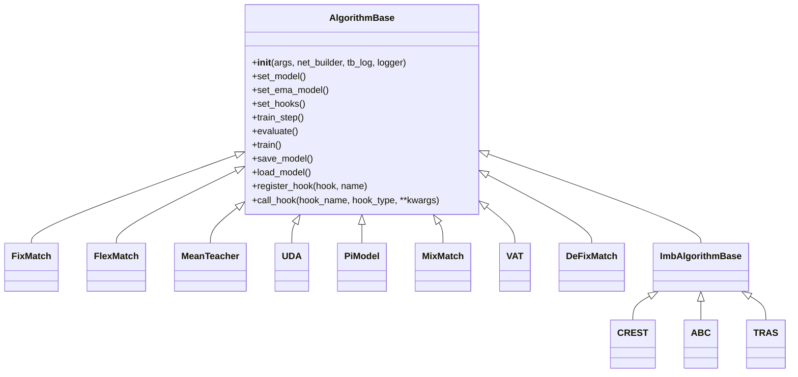

Each algorithm inherits from `AlgorithmBase` and implements its own `train_step()` method to define the specific training behavior. The base class handles common operations such as model initialization, optimization, hook registration, and evaluation.

Sources: [semilearn/algorithms/defixmatch/defixmatch.py:11-135]()

### Training Framework

The training framework is centered around the `Trainer` class, which orchestrates the training process, handles device management, and coordinates evaluation.

```mermaid
flowchart TD
    subgraph "Training Process"
        Start["Start Training"] --> LoadConfig["Load Configuration"]
        LoadConfig --> InitModel["Initialize Model"]
        InitModel --> CreateAlgo["Create Algorithm Instance"]
        CreateAlgo --> LoadData["Load Datasets"]
        LoadData --> TrainLoop["Training Loop"]
        
        TrainLoop --> LabeledBatch["Process Labeled Batch"]
        LabeledBatch --> UnlabeledBatch["Process Unlabeled Batch"]
        UnlabeledBatch --> AlgoStep["Algorithm.train_step()"]
        AlgoStep --> CallHooks["Call Registered Hooks"]
        CallHooks --> CheckEval["Evaluation Checkpoint?"]
        CheckEval -->|"Yes"| Evaluate["Evaluate Model"]
        CheckEval -->|"No"| NextIter["Next Iteration"]
        Evaluate --> NextIter
        NextIter --> |"Until max iterations"| LabeledBatch
        
        TrainLoop --> SaveModel["Save Best Model"]
        SaveModel --> FinalEval["Final Evaluation"]
        FinalEval --> End["End Training"]
    end
```

The training process starts by loading a configuration, initializing the model and algorithm, and then entering the training loop. In each iteration, the framework processes labeled and unlabeled batches, calls the algorithm's `train_step()` method, and invokes registered hooks.

Sources: [docs/tutorial.md:88-90](), [README.md:226-242]()

### Hooks System

The hooks system provides a flexible mechanism for extending and customizing algorithm behavior without modifying the core implementation.

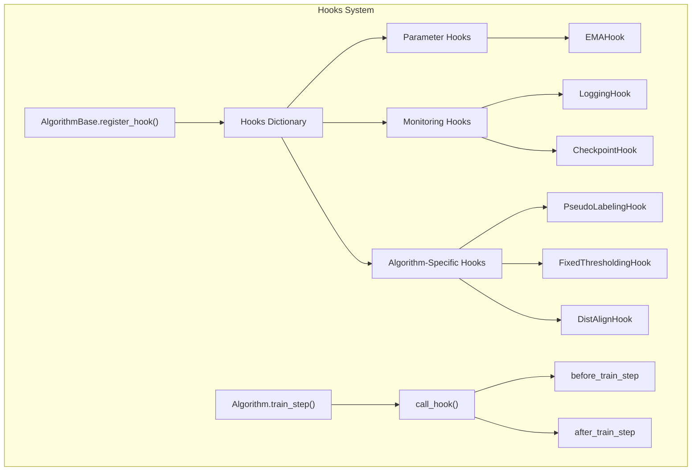

Hooks are registered with `AlgorithmBase` and called at specific points during the training process. This modular design allows for easy extension and customization of algorithm behavior.

Sources: [semilearn/algorithms/defixmatch/defixmatch.py:43-46]()

### Dataset Handling

USB provides a unified interface for handling datasets across different domains (CV, NLP, Audio) with support for data augmentation and semi-supervised learning splits.

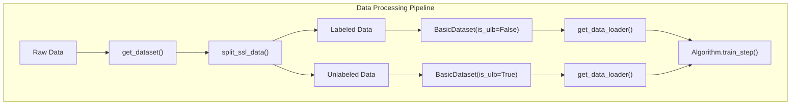

The data processing pipeline starts with raw data, which is split into labeled and unlabeled sets using `split_ssl_data()`. These sets are then wrapped in `BasicDataset` instances with appropriate transformations, and fed into data loaders for training.

Sources: [semilearn/datasets/audio_datasets/datasetbase.py:45-135](), [docs/tutorial.md:72-82]()

## Algorithm Structure

USB implements a wide range of semi-supervised learning algorithms, all following a consistent structure through inheritance from `AlgorithmBase`.

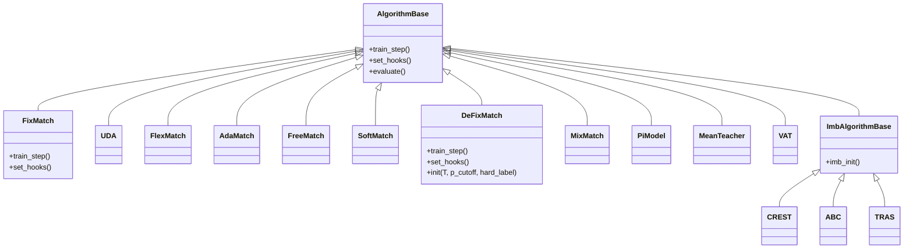

Each algorithm defines its own `train_step()` method that implements the specific training logic, and may register custom hooks via `set_hooks()`. Algorithms for imbalanced datasets inherit from `ImbAlgorithmBase`, which extends `AlgorithmBase` with functionality specific to handling class imbalance.

Sources: [semilearn/algorithms/defixmatch/defixmatch.py:11-135](), [docs/algorithm_zoo.md:1-21]()

## Model Architectures

USB supports various model architectures across different domains, including:

1. **Computer Vision**: Vision Transformers (ViT), Wide ResNets, etc.
2. **NLP**: BERT, Transformers
3. **Audio**: Wave2vec, Hubert

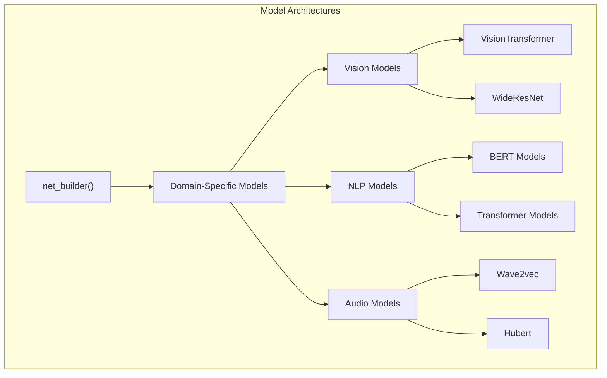

The `VisionTransformer` class, for example, implements an attention-based architecture for computer vision tasks:

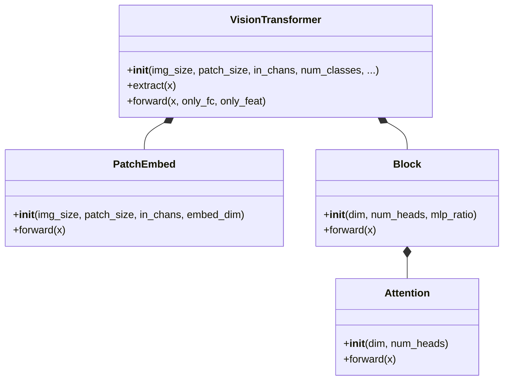

Sources: [semilearn/nets/vit/vit.py:132-196](), [semilearn/nets/vit/vit.py:18-42]()

## Data Flow in Training

The data flow during training illustrates how labeled and unlabeled data are processed through the system:

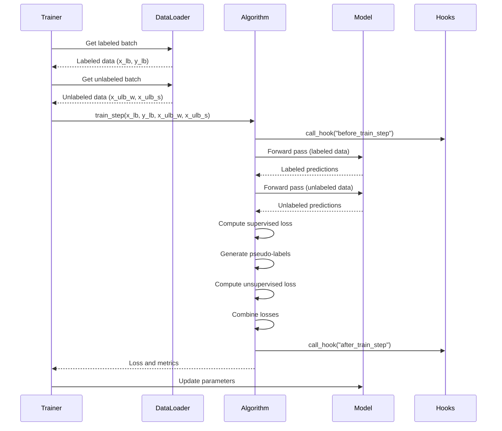

This diagram shows how the `Trainer` coordinates the data flow, how the `Algorithm` processes labeled and unlabeled data, and how hooks are called at specific points in the process.

Sources: [semilearn/algorithms/defixmatch/defixmatch.py:48-125]()

## Implementation Example: DeFixMatch Algorithm

To illustrate how algorithms are implemented in USB, let's look at the DeFixMatch algorithm:

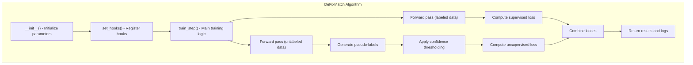

DeFixMatch extends FixMatch by introducing a de-biasing component that uses pseudo-labels generated for labeled data to counteract confirmation bias. The algorithm registers the `PseudoLabelingHook` and `FixedThresholdingHook` to handle pseudo-label generation and confidence thresholding.

Sources: [semilearn/algorithms/defixmatch/defixmatch.py:11-135]()

## Configuration and Extension Points

USB provides several extension points for customization:

### Algorithm Registration

New algorithms are registered using the `@ALGORITHMS.register` decorator:

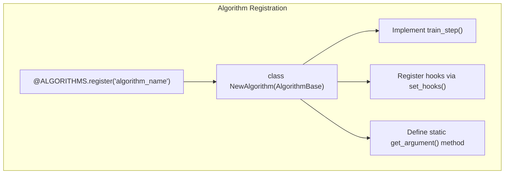

### Custom Datasets

Custom datasets can be integrated by:

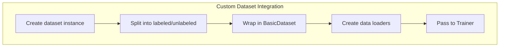

This flexible architecture allows researchers to easily extend USB with new algorithms and datasets.

Sources: [docs/tutorial.md:108-208](), [semilearn/algorithms/defixmatch/defixmatch.py:11-12]()

## Summary

The USB framework provides a unified architecture for implementing, evaluating, and comparing semi-supervised learning algorithms across multiple domains. Its modular design centered around the `AlgorithmBase` class and the hooks system enables easy extension and customization. The framework handles the complexities of semi-supervised learning, including data splitting, augmentation, and algorithm-specific optimizations, providing a solid foundation for research in this field.

Sources: [README.md:112-118](), [semilearn/__init__.py:1-9]()

---

