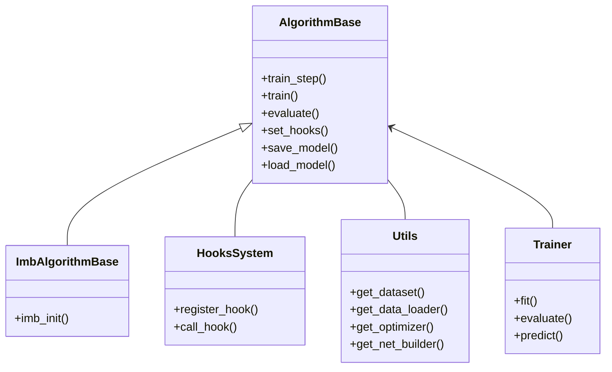
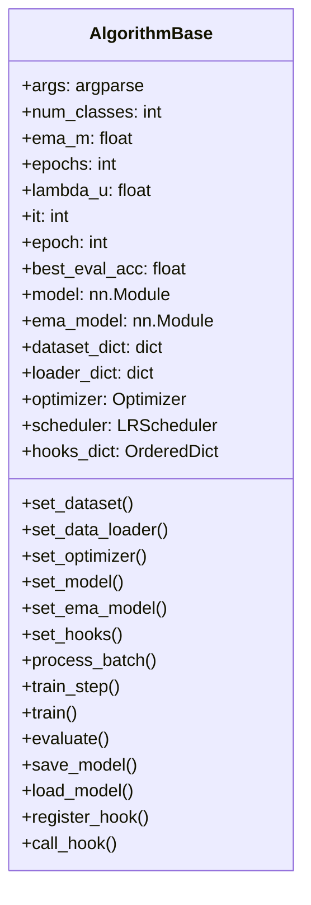
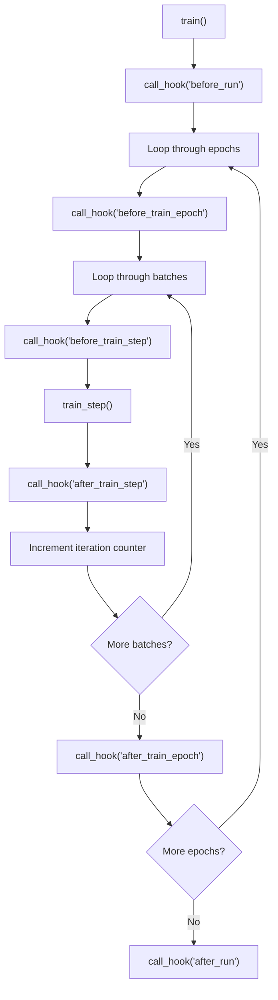
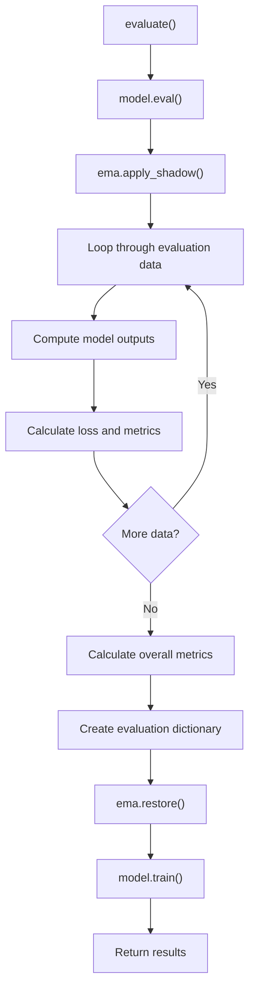
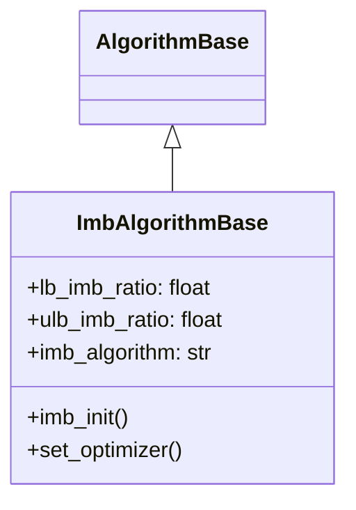
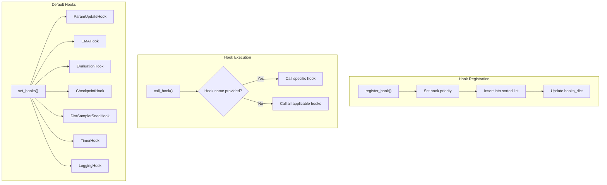
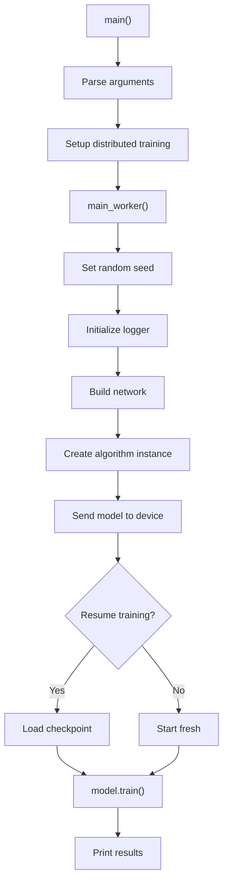
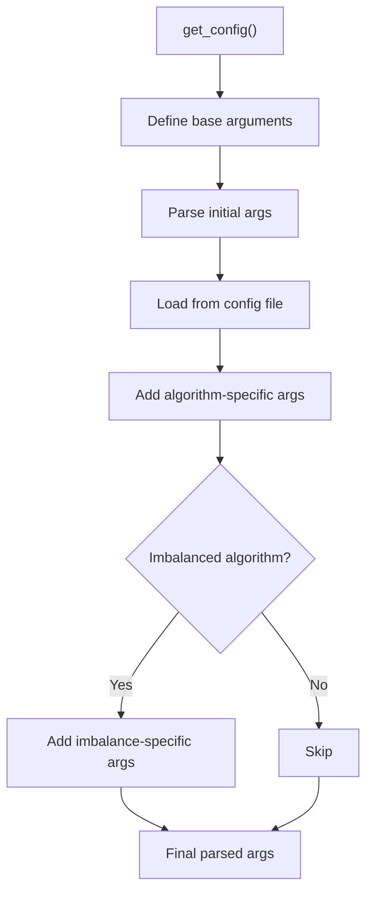
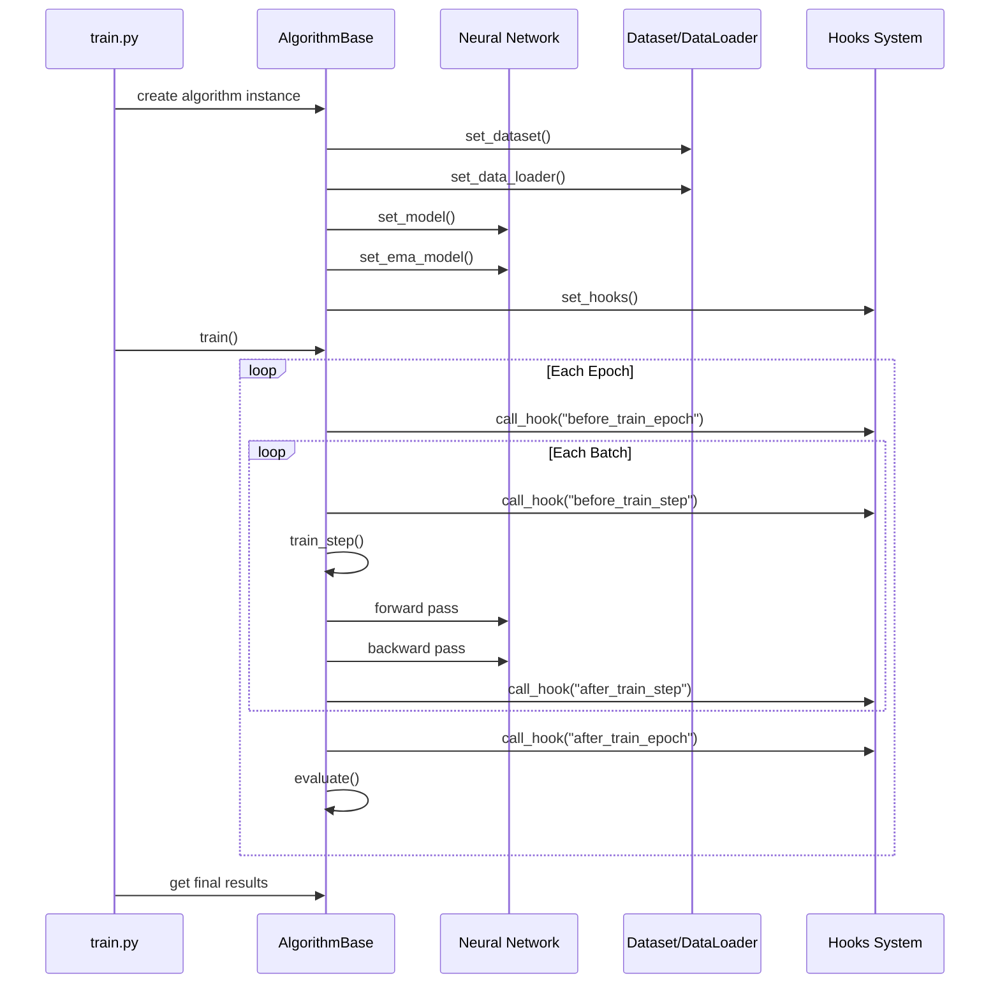

<!-- source: DeepWiki mcp.deepwiki.com · repo microsoft/Semi-supervised-learning · page 2 Core Components · fetched 2026-10-26 -->

# Core Components

<details>
<summary>Relevant source files</summary>

The following files were used as context for generating this wiki page:

- [semilearn/core/algorithmbase.py](semilearn/core/algorithmbase.py)
- [semilearn/core/utils/build.py](semilearn/core/utils/build.py)
- [semilearn/core/utils/misc.py](semilearn/core/utils/misc.py)
- [semilearn/imb_algorithms/abc/abc.py](semilearn/imb_algorithms/abc/abc.py)
- [semilearn/imb_algorithms/tras/tras.py](semilearn/imb_algorithms/tras/tras.py)
- [semilearn/lighting/config.py](semilearn/lighting/config.py)
- [semilearn/lighting/trainer.py](semilearn/lighting/trainer.py)
- [train.py](train.py)

</details>


This document outlines the fundamental building blocks that form the foundation of the USB (Unified Semi-supervised Learning Benchmark) framework. Core components manage the training, evaluation, and execution of semi-supervised learning algorithms.

For specific algorithm implementations, see [Algorithms](#3). For dataset management, see [Datasets and Data Handling](#4).

## Core Components Overview

The USB framework is built around several key components that work together to provide a unified platform for semi-supervised learning research:



Sources: [semilearn/core/algorithmbase.py:20-507](), [semilearn/lighting/trainer.py:15-131](), [semilearn/core/utils/build.py:14-255]()

## AlgorithmBase

The `AlgorithmBase` class serves as the foundation for all semi-supervised learning algorithms in USB. It provides a standardized interface and common functionality that all algorithms share.



Sources: [semilearn/core/algorithmbase.py:20-507]()

### Key Functions

| Method | Purpose |
|--------|---------|
| `__init__` | Initializes common parameters, datasets, models, and hooks |
| `set_dataset` | Loads and prepares datasets for training and evaluation |
| `set_data_loader` | Creates data loaders for labeled, unlabeled, and evaluation data |
| `set_model` | Initializes the neural network model |
| `set_ema_model` | Creates Exponential Moving Average (EMA) model for evaluation |
| `set_optimizer` | Sets up optimizer and learning rate scheduler |
| `set_hooks` | Registers default hooks for training |
| `train_step` | Implemented by specific algorithms for a single training step |
| `train` | Orchestrates the training process using hooks |
| `evaluate` | Evaluates model performance on validation/test data |
| `save_model` | Saves model state for checkpointing |
| `load_model` | Loads model state from checkpoint |

Sources: [semilearn/core/algorithmbase.py:34-507]()

### Training Process

The training process in `AlgorithmBase` follows a structured flow:



Sources: [semilearn/core/algorithmbase.py:285-315]()

### Evaluation Process

The evaluation process assesses model performance:



Sources: [semilearn/core/algorithmbase.py:317-372]()

## ImbAlgorithmBase

`ImbAlgorithmBase` extends `AlgorithmBase` to handle class-imbalanced semi-supervised learning scenarios. It adds specialized functionality for dealing with imbalanced data distributions.



Sources: [semilearn/core/algorithmbase.py:510-534]()

## Hooks System

The hooks system is a powerful mechanism that enables extensibility and customization of the training process. Hooks are registered with specific priority levels and called at predefined points during training.



Sources: [semilearn/core/algorithmbase.py:439-498](), [semilearn/core/algorithmbase.py:201-216]()

### Default Hooks

The framework registers several default hooks for common training functionality:

| Hook | Priority | Purpose |
|------|----------|---------|
| `ParamUpdateHook` | HIGHEST | Updates model parameters during training |
| `EMAHook` | HIGH | Updates Exponential Moving Average model |
| `EvaluationHook` | HIGH | Performs periodic model evaluation |
| `CheckpointHook` | HIGH | Saves model checkpoints |
| `DistSamplerSeedHook` | NORMAL | Manages seeds for distributed sampling |
| `TimerHook` | LOW | Tracks training time |
| `LoggingHook` | LOWEST | Logs training metrics |
| `WANDBHook` | LOWEST | Logs to Weights & Biases (optional) |
| `AimHook` | LOWEST | Logs to Aim (optional) |

Sources: [semilearn/core/algorithmbase.py:201-216]()

## Training Framework

The training framework in USB provides the entry point for training semi-supervised learning algorithms. There are two main implementations:

1. **Command-line Interface**: Defined in [train.py]()
2. **Lighting Trainer**: A more streamlined API in [semilearn/lighting/trainer.py]()

### Command-line Training Flow



Sources: [train.py:257-403]()

### Configuration Management

USB uses a flexible configuration system that can be set through:

1. Command-line arguments
2. Configuration files (YAML)
3. Pre-defined algorithm-specific configs



Sources: [train.py:29-254](), [semilearn/lighting/config.py:11-154]()

## Utility Functions

The USB framework includes several utility functions that facilitate common operations:

### Network Building

```python
# Build network from name
net_builder = get_net_builder(args.net, args.net_from_name)
model = net_builder(num_classes=args.num_classes)
```

Sources: [semilearn/core/utils/build.py:14-39]()

### Dataset and Data Loader Creation

```python
# Create datasets
dataset_dict = get_dataset(args, algorithm, dataset, num_labels, num_classes)

# Create data loaders
train_loader = get_data_loader(args, dataset_dict['train_lb'], batch_size)
```

Sources: [semilearn/core/utils/build.py:60-180]()

### Optimizer and Scheduler Creation

```python
# Create optimizer
optimizer = get_optimizer(model, args.optim, args.lr, args.momentum, args.weight_decay)

# Create scheduler
scheduler = get_cosine_schedule_with_warmup(optimizer, num_train_iter, num_warmup_steps)
```

Sources: [semilearn/core/utils/build.py:183-241]()

## Integration Between Components

The components of USB are designed to work together seamlessly. Here's how they interact:



Sources: [train.py:257-403](), [semilearn/core/algorithmbase.py:285-315]()

## Summary

The core components of USB provide a flexible and extensible framework for implementing semi-supervised learning algorithms. The modular design allows researchers to focus on algorithm development while leveraging the common infrastructure for:

- Dataset management and loading
- Model initialization and training
- Evaluation and metrics tracking
- Checkpoint management
- Logging and visualization

The hooks system enables customization of the training process at various stages, making it easy to extend the framework with new functionality without modifying the core code.

Sources: [semilearn/core/algorithmbase.py:20-507](), [train.py:257-403]()

---

