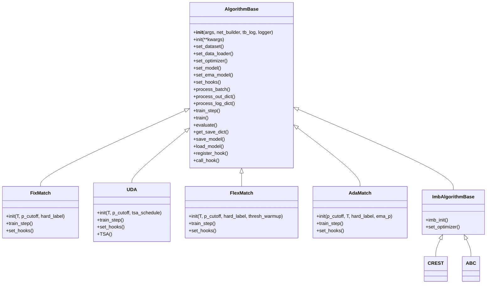
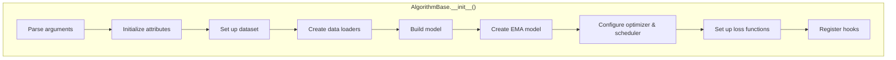
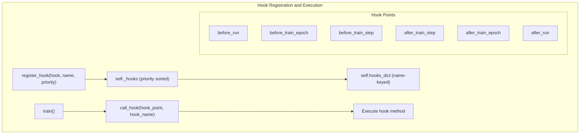
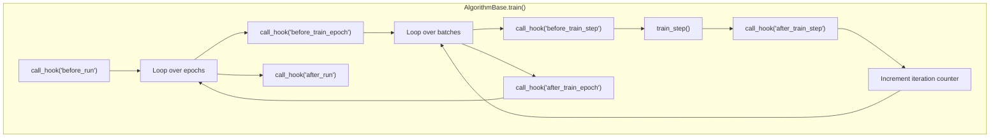

<!-- source: DeepWiki mcp.deepwiki.com · repo microsoft/Semi-supervised-learning · page 2.1 AlgorithmBase · fetched 2026-10-26 -->

# AlgorithmBase

<details>
<summary>Relevant source files</summary>

The following files were used as context for generating this wiki page:

- [semilearn/algorithms/adamatch/adamatch.py](semilearn/algorithms/adamatch/adamatch.py)
- [semilearn/algorithms/fixmatch/fixmatch.py](semilearn/algorithms/fixmatch/fixmatch.py)
- [semilearn/algorithms/flexmatch/flexmatch.py](semilearn/algorithms/flexmatch/flexmatch.py)
- [semilearn/algorithms/uda/uda.py](semilearn/algorithms/uda/uda.py)
- [semilearn/core/algorithmbase.py](semilearn/core/algorithmbase.py)
- [train.py](train.py)

</details>


This document details the `AlgorithmBase` class, which serves as the foundation for all semi-supervised learning (SSL) algorithms in the USB (Unified Semi-supervised learning Benchmark) framework. The `AlgorithmBase` class provides a standardized structure for implementing, training, and evaluating SSL algorithms, along with common utilities and hooks for customization.

For information about specific SSL algorithms that inherit from AlgorithmBase, see [Algorithms](#3). For details about the training framework that uses AlgorithmBase, see [Training Framework](#2.2).

## 1. Purpose and Responsibilities

The `AlgorithmBase` class serves as an abstract base class that defines the common interface and functionality for all SSL algorithms. Its main responsibilities include:

1. Managing model initialization and configuration
2. Setting up datasets and data loaders
3. Configuring optimizers and schedulers
4. Implementing the training loop structure
5. Providing evaluation methods
6. Managing model checkpointing
7. Supporting a flexible hook system for customizing behavior

All algorithm implementations in the USB framework inherit from this base class and override specific methods to implement their unique SSL approaches.

Sources: [semilearn/core/algorithmbase.py:20-507]()

## 2. Class Structure and Inheritance Hierarchy



This diagram shows how `AlgorithmBase` serves as the foundation for all SSL algorithms in the USB framework. Specific algorithms like FixMatch, UDA, FlexMatch, and AdaMatch directly inherit from AlgorithmBase, while imbalanced learning algorithms inherit from ImbAlgorithmBase, which itself extends AlgorithmBase.

Sources: 
- [semilearn/core/algorithmbase.py:20-507]()
- [semilearn/core/algorithmbase.py:510-534]()
- [semilearn/algorithms/fixmatch/fixmatch.py:11-114]()
- [semilearn/algorithms/uda/uda.py:12-136]()
- [semilearn/algorithms/flexmatch/flexmatch.py:15-140]()
- [semilearn/algorithms/adamatch/adamatch.py:14-141]()

## 3. Initialization and Core Attributes

When initializing an `AlgorithmBase` instance, several important components are set up:



The initialization process includes the following key components:

| Component | Description | Relevant Method |
|-----------|-------------|-----------------|
| Model | The main neural network | `set_model()` |
| EMA Model | Exponential moving average of the model for evaluation | `set_ema_model()` |
| Dataset | Training and evaluation datasets | `set_dataset()` |
| Data Loaders | Iterators for the datasets | `set_data_loader()` |
| Optimizer & Scheduler | For model parameter updates | `set_optimizer()` |
| Hooks | Extensible components for customizing behavior | `set_hooks()` |
| Loss Functions | CE loss and consistency loss | Initialized directly in `__init__` |

Key attributes initialized in the constructor include:

```python
self.args = args  # Algorithm arguments
self.num_classes = args.num_classes  # Number of classes
self.ema_m = args.ema_m  # EMA momentum
self.epochs = args.epoch  # Number of epochs
self.num_train_iter = args.num_train_iter  # Total training iterations
self.num_eval_iter = args.num_eval_iter  # Evaluation frequency
self.lambda_u = args.ulb_loss_ratio  # Unsupervised loss weight
self.use_amp = args.amp  # Automatic mixed precision
```

Sources:
- [semilearn/core/algorithmbase.py:34-103]()
- [semilearn/core/algorithmbase.py:174-184]()
- [semilearn/core/algorithmbase.py:186-199]()

## 4. The Hook System

One of the most powerful features of `AlgorithmBase` is its hook system, which enables flexible customization of the training process without modifying the core code.



The `AlgorithmBase` registers several built-in hooks by default:

| Hook | Priority | Purpose |
|------|----------|---------|
| `ParamUpdateHook` | HIGHEST | Updates model parameters during training |
| `EMAHook` | HIGH | Updates the EMA model |
| `EvaluationHook` | HIGH | Periodically evaluates the model |
| `CheckpointHook` | HIGH | Saves model checkpoints |
| `DistSamplerSeedHook` | NORMAL | Manages distributed training seeds |
| `TimerHook` | LOW | Times training operations |
| `LoggingHook` | LOWEST | Logs training progress |
| `WANDBHook` (optional) | LOWEST | Integrates with Weights & Biases |
| `AimHook` (optional) | LOWEST | Integrates with Aim |

Algorithm-specific hooks are registered by their respective algorithm classes. For example, FixMatch registers:
- `PseudoLabelingHook` - Generates pseudo-labels for unlabeled data
- `FixedThresholdingHook` - Applies thresholding to pseudo-labels

Sources:
- [semilearn/core/algorithmbase.py:201-216]()
- [semilearn/core/algorithmbase.py:439-498]()
- [semilearn/algorithms/fixmatch/fixmatch.py:43-46]()

## 5. The Training Process

The `train()` method implements the main training loop, which iterates over epochs and batches, calling the algorithm-specific `train_step()` method and managing hooks.



The `train_step()` method is an abstract method that must be implemented by each algorithm subclass. It typically follows this pattern:

1. Process labeled and unlabeled batches
2. Forward pass through the model
3. Calculate supervised loss (from labeled data)
4. Generate pseudo-labels for unlabeled data
5. Apply algorithm-specific processing (thresholding, sharpening, etc.)
6. Calculate unsupervised loss
7. Combine losses and return

For example, the FixMatch algorithm's `train_step()` method:
1. Processes labeled data to compute supervised loss
2. Generates pseudo-labels from weakly-augmented unlabeled data
3. Applies confidence thresholding to filter out uncertain predictions
4. Computes unsupervised loss by comparing strongly-augmented unlabeled predictions with pseudo-labels
5. Combines the losses with appropriate weighting

Sources:
- [semilearn/core/algorithmbase.py:285-315]()
- [semilearn/algorithms/fixmatch/fixmatch.py:48-105]()

## 6. Algorithm-Specific Customization

Algorithms that inherit from `AlgorithmBase` customize its behavior in several ways:

1. **Implementing `train_step()`**: Define the specific training step logic
2. **Overriding `init()`**: Set algorithm-specific parameters
3. **Customizing `set_hooks()`**: Register algorithm-specific hooks
4. **Extending `get_save_dict()`**: Add algorithm-specific state to checkpoints

Here's a comparison of how different algorithms customize `AlgorithmBase`:

| Algorithm | Key Parameters | Special Hooks | Unique Features |
|-----------|---------------|--------------|-----------------|
| FixMatch | T (temperature), p_cutoff (threshold) | FixedThresholdingHook | Simple confidence-based masking |
| FlexMatch | T, p_cutoff, thresh_warmup | FlexMatchThresholdingHook | Class-wise dynamic thresholding |
| UDA | T, p_cutoff, tsa_schedule | FixedThresholdingHook | Training Signal Annealing (TSA) |
| AdaMatch | T, p_cutoff, ema_p | DistAlignEMAHook, AdaMatchThresholdingHook | Distribution alignment |

Sources:
- [semilearn/algorithms/fixmatch/fixmatch.py:33-46]()
- [semilearn/algorithms/flexmatch/flexmatch.py:43-57]()
- [semilearn/algorithms/uda/uda.py:35-48]()
- [semilearn/algorithms/adamatch/adamatch.py:37-54]()

## 7. Evaluation and Model Management

`AlgorithmBase` provides several methods for model evaluation and management:

### 7.1 Evaluation

The `evaluate()` method:
1. Sets the model to evaluation mode
2. Applies the EMA model for better evaluation performance
3. Iterates through evaluation data
4. Computes multiple metrics (top-1/top-5 accuracy, balanced accuracy, precision, recall, F1 score)
5. Generates a confusion matrix
6. Returns an evaluation dictionary

### 7.2 Model Saving and Loading

The `save_model()` and `load_model()` methods handle model checkpointing, saving/loading:
- Model parameters
- EMA model parameters
- Optimizer state
- Training iteration and epoch counters
- Best evaluation metrics
- Algorithm-specific state (through `get_save_dict()`)

This enables seamless resumption of training from checkpoints.

Sources:
- [semilearn/core/algorithmbase.py:317-372]()
- [semilearn/core/algorithmbase.py:375-437]()

## 8. Implementation Process for New Algorithms

To implement a new SSL algorithm using `AlgorithmBase`:

1. Create a new class that inherits from `AlgorithmBase`
2. Implement the `init()` method to set algorithm-specific parameters
3. Override `set_hooks()` to register any custom hooks
4. Implement the `train_step()` method with the algorithm's specific training logic
5. Optionally override `get_save_dict()` and `load_model()` if the algorithm needs to save additional state
6. Register the algorithm using the `@ALGORITHMS.register()` decorator

Example structure for a new algorithm:

```python
@ALGORITHMS.register('new_algorithm')
class NewAlgorithm(AlgorithmBase):
    def __init__(self, args, net_builder, tb_log=None, logger=None):
        super().__init__(args, net_builder, tb_log, logger)
        self.init(param1=args.param1, param2=args.param2)
    
    def init(self, param1, param2):
        self.param1 = param1
        self.param2 = param2
    
    def set_hooks(self):
        self.register_hook(CustomHook(), "CustomHook")
        super().set_hooks()
    
    def train_step(self, x_lb, y_lb, x_ulb_w, x_ulb_s):
        # Implement algorithm-specific training step
        # Calculate losses and return results
        pass
    
    @staticmethod
    def get_argument():
        return [
            SSL_Argument('--param1', float, 0.5),
            SSL_Argument('--param2', float, 0.95),
        ]
```

Sources:
- [semilearn/algorithms/fixmatch/fixmatch.py:11-114]()
- [semilearn/algorithms/uda/uda.py:12-136]()

---

