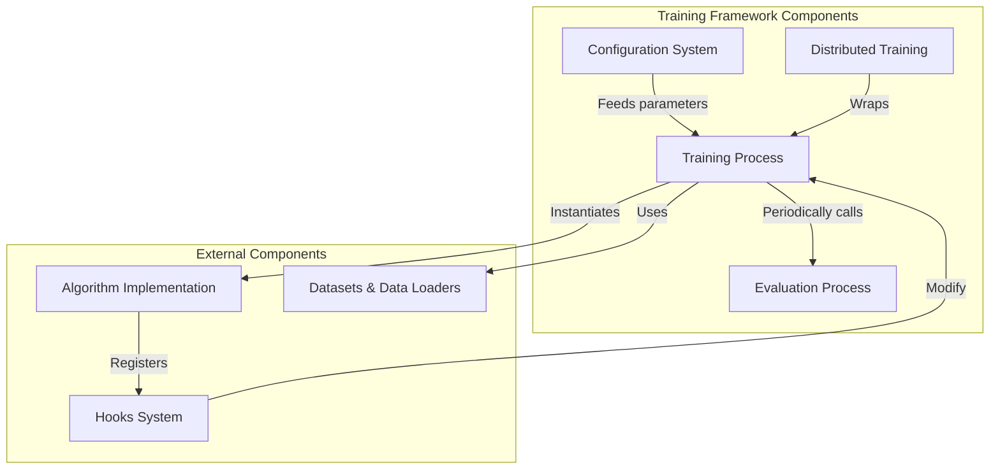
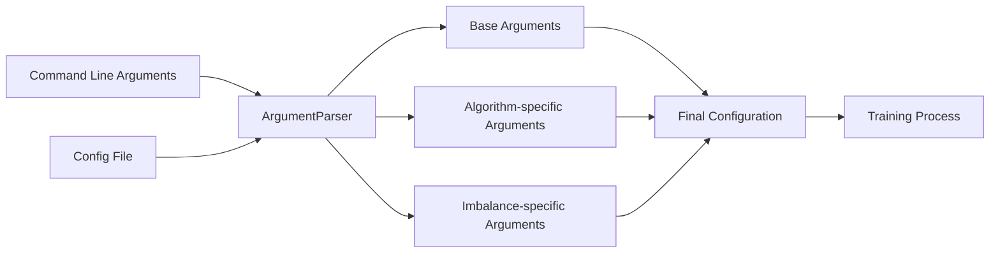
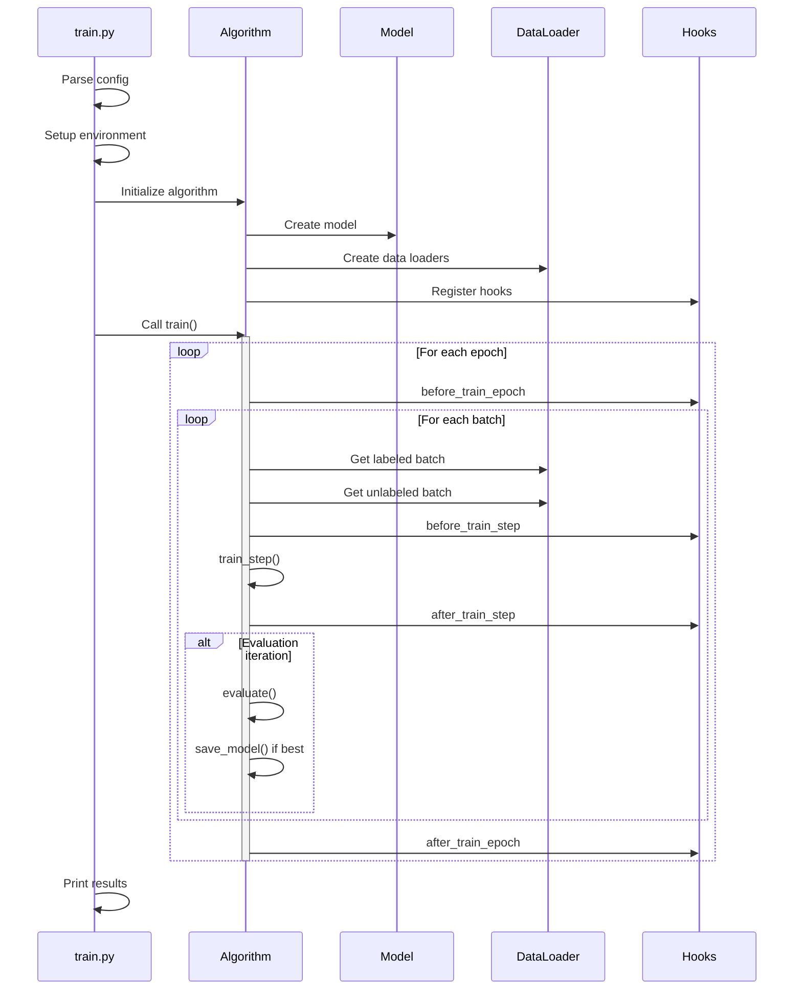
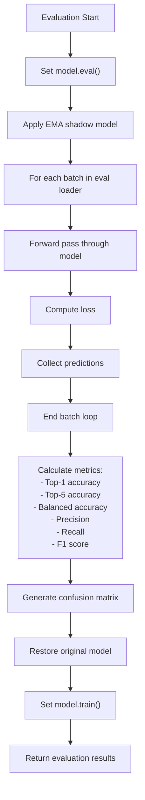
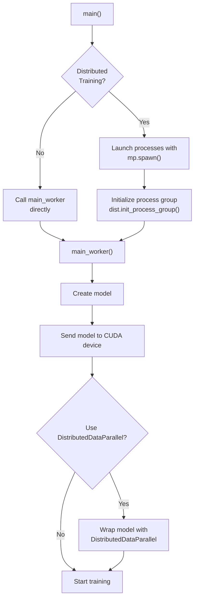
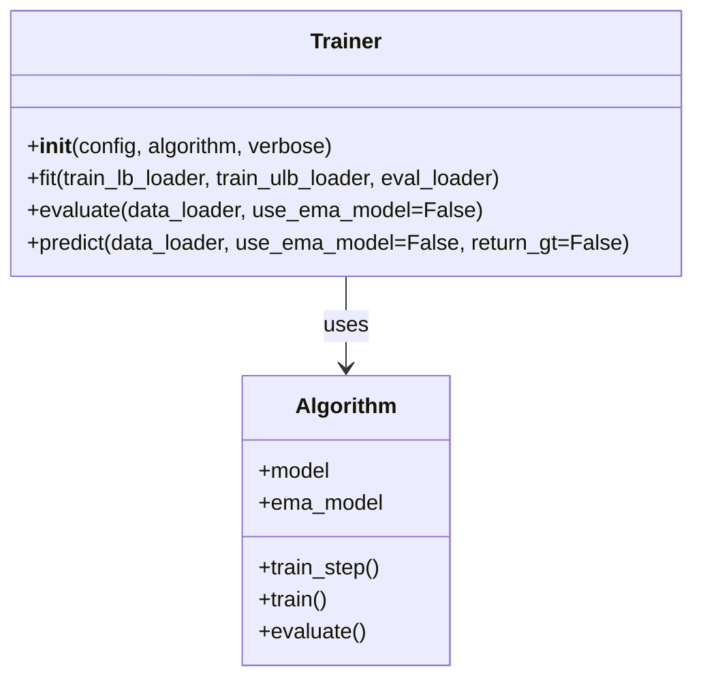

<!-- source: DeepWiki mcp.deepwiki.com · repo microsoft/Semi-supervised-learning · page 2.2 Training Framework · fetched 2026-10-26 -->

# Training Framework

<details>
<summary>Relevant source files</summary>

The following files were used as context for generating this wiki page:

- [notebooks/Beginner_Example.ipynb](notebooks/Beginner_Example.ipynb)
- [notebooks/Custom_Algorithm.ipynb](notebooks/Custom_Algorithm.ipynb)
- [semilearn/core/algorithmbase.py](semilearn/core/algorithmbase.py)
- [semilearn/lighting/config.py](semilearn/lighting/config.py)
- [semilearn/lighting/trainer.py](semilearn/lighting/trainer.py)
- [train.py](train.py)

</details>


The Training Framework is the core component of the USB (Unified Semi-supervised Learning Benchmark) that orchestrates the entire training process. This document explains how training is configured, executed, and evaluated in the USB framework.

For information about the base algorithm implementation, see [AlgorithmBase](#2.1). For details on the hook system used to extend training behavior, see [Hooks System](#2.3).

## Overview

The Training Framework provides a unified system for training semi-supervised learning algorithms across different domains (computer vision, NLP, audio). It manages configuration, model setup, training loops, evaluation, and distributed training processes.



Sources: [train.py:257-403](), [semilearn/core/algorithmbase.py:20-282]()

## Configuration System

The configuration system allows users to define training parameters through command-line arguments or configuration files.

### Configuration Parameters

The configuration parameters are categorized into:

| Category | Description | Examples |
|----------|-------------|----------|
| Saving & Loading | Model checkpoint management | `save_dir`, `save_name`, `resume`, `load_path` |
| Training Configuration | Core training parameters | `epoch`, `num_train_iter`, `batch_size`, `uratio` |
| Optimizer Configuration | Learning rate and optimization | `optim`, `lr`, `momentum`, `weight_decay` |
| Backbone Configuration | Model architecture settings | `net`, `net_from_name`, `use_pretrain` |
| Algorithm Configuration | Algorithm-specific settings | `algorithm`, `use_cat`, `amp` |
| Data Configuration | Dataset parameters | `data_dir`, `dataset`, `num_classes`, `train_sampler` |
| Distributed Training | Multi-GPU settings | `world-size`, `rank`, `dist-url`, `gpu` |



Sources: [train.py:29-254](), [semilearn/lighting/config.py:11-154]()

### Configuration Generation Process

The configuration generation process happens in `get_config()`:

1. Define base arguments for all training aspects
2. Parse initial arguments
3. Load algorithm-specific arguments
4. Load imbalance algorithm-specific arguments (if applicable)
5. Override arguments from config file (if specified)
6. Set up distributed training parameters

Sources: [train.py:29-254](), [semilearn/lighting/config.py:11-154]()

## Training Process

The training process is orchestrated by the `main()` and `main_worker()` functions in `train.py`, which initialize the environment and delegate the actual training to the algorithm's `train()` method.



Sources: [train.py:257-403](), [semilearn/core/algorithmbase.py:284-315]()

### Initialization

The initialization phase includes:

1. Parsing configuration from command line or config file
2. Setting up environment (random seed, CUDA, etc.)
3. Setting up distributed training if needed
4. Initializing the algorithm with the appropriate network builder
5. Setting up logging

Sources: [train.py:257-376](), [semilearn/core/algorithmbase.py:35-103]()

### Training Loop

The core training loop is implemented in `AlgorithmBase.train()` and performs:

1. Iterate through epochs
2. Iterate through batches of labeled and unlabeled data
3. Call hooks before/after each training step
4. Call algorithm-specific `train_step()` method
5. Periodically evaluate the model and save checkpoints

The training process stops when:
- The maximum number of iterations (`num_train_iter`) is reached
- The maximum number of epochs is reached

Sources: [semilearn/core/algorithmbase.py:284-315]()

### Training Step

The `train_step()` method is implemented by each algorithm and defines how a single batch is processed:

1. Process labeled and unlabeled data
2. Compute supervised loss (labeled data)
3. Compute unsupervised loss (unlabeled data)
4. Update model parameters
5. Record metrics

Sources: [semilearn/core/algorithmbase.py:273-282]()

## Evaluation Process

Evaluation is performed periodically during training and at the end of training. The evaluation process:

1. Switches the model to evaluation mode
2. Applies EMA (Exponential Moving Average) model if enabled
3. Computes forward pass on evaluation dataset
4. Calculates metrics (accuracy, precision, recall, F1)
5. Logs confusion matrix
6. Returns the model to training mode



Sources: [semilearn/core/algorithmbase.py:317-372](), [semilearn/lighting/trainer.py:80-93]()

## Distributed Training Support

USB supports distributed training across multiple GPUs using PyTorch's DistributedDataParallel.



Key components of distributed training:
- `world_size`: Total number of processes
- `rank`: Process ID
- `dist_url`: URL for initializing process group
- `dist_backend`: Backend for distributed communication (usually NCCL)
- `multiprocessing_distributed`: Whether to use multiprocessing for distributed training

Sources: [train.py:303-317](), [train.py:337-351]()

## Simplified Training Interface

The `Trainer` class in `semilearn/lighting/trainer.py` provides a simplified interface for training:



This interface is particularly useful for interactive environments like Jupyter notebooks, as seen in the example notebooks.

Sources: [semilearn/lighting/trainer.py:15-131](), [notebooks/Beginner_Example.ipynb]()

## Integration with Algorithms

The Training Framework is designed to work with any algorithm that inherits from `AlgorithmBase`. Each algorithm must implement:

- `train_step()`: Defines how a single batch is processed
- Algorithm-specific parameters (via `get_argument()`)
- Optional hooks for customizing the training process

```mermaid
flowchart TD
    subgraph "Training Framework"
        train_py["train.py"]
        config["Configuration"]
        trainer["Trainer"]
    end
    
    subgraph "Algorithm Base"
        alg_base["AlgorithmBase"]
        train_method["train()"]
        eval_method["evaluate()"]
    end
    
    subgraph "SSL Algorithms"
        fixmatch["FixMatch"]
        flexmatch["FlexMatch"]
        freematch["FreeMatch"]
        other["Other Algorithms..."]
    end
    
    train_py --> |"instantiates"| alg_base
    config --> |"configures"| alg_base
    trainer --> |"wraps"| alg_base
    
    alg_base <-- |"inherits"| fixmatch
    alg_base <-- |"inherits"| flexmatch
    alg_base <-- |"inherits"| freematch
    alg_base <-- |"inherits"| other
    
    train_method --> |"calls algorithm-specific"| train_step["train_step()"]
    fixmatch --> |"implements"| train_step
    flexmatch --> |"implements"| train_step
    freematch --> |"implements"| train_step
    other --> |"implements"| train_step
```

Sources: [semilearn/core/algorithmbase.py:20-106](), [semilearn/core/algorithmbase.py:273-282]()

## Example Usage

Below is a simplified example of using the Training Framework based on the provided notebook:

1. Define configuration:
```python
config = {
    'algorithm': 'fixmatch',
    'net': 'vit_tiny_patch2_32',
    'epoch': 1,
    'num_train_iter': 5000,
    'batch_size': 16,
    'dataset': 'cifar10',
    'num_labels': 40,
    # ... other config params
}
config = get_config(config)
```

2. Create algorithm:
```python
algorithm = get_algorithm(config, get_net_builder(config.net, from_name=False))
```

3. Create datasets and data loaders:
```python
dataset_dict = get_dataset(config, config.algorithm, config.dataset, config.num_labels)
train_lb_loader = get_data_loader(config, dataset_dict['train_lb'], config.batch_size)
train_ulb_loader = get_data_loader(config, dataset_dict['train_ulb'], 
                                  int(config.batch_size * config.uratio))
eval_loader = get_data_loader(config, dataset_dict['eval'], config.eval_batch_size)
```

4. Train:
```python
trainer = Trainer(config, algorithm)
trainer.fit(train_lb_loader, train_ulb_loader, eval_loader)
```

5. Evaluate:
```python
results = trainer.evaluate(eval_loader)
```

Sources: [notebooks/Beginner_Example.ipynb](), [notebooks/Custom_Algorithm.ipynb]()

## Creating Custom Algorithms

To create a custom algorithm:

1. Inherit from an existing algorithm or `AlgorithmBase`
2. Implement the `train_step()` method
3. Register the algorithm with the `@ALGORITHMS.register('algorithm_name')` decorator
4. Implement `get_argument()` if needed for algorithm-specific parameters

For example:
```python
@ALGORITHMS.register('custom_algorithm')
class CustomAlgorithm(AlgorithmBase):
    def train_step(self, idx_lb, x_lb, y_lb, idx_ulb, x_ulb_w, x_ulb_s):
        # Implement training step
        # ...
        return out_dict, log_dict
    
    @staticmethod
    def get_argument():
        return [
            # Define algorithm-specific arguments
        ]
```

Sources: [notebooks/Custom_Algorithm.ipynb](), [semilearn/core/algorithmbase.py:501-507]()

## Summary

The Training Framework is a flexible and extensible system for training semi-supervised learning algorithms. It provides:

- A unified configuration system
- A standard training process that can be customized with hooks
- Support for distributed training
- A comprehensive evaluation process
- Easy integration with custom algorithms

This framework enables consistent experimentation with different SSL algorithms across various domains and datasets, making it a powerful tool for research and development in semi-supervised learning.

---

