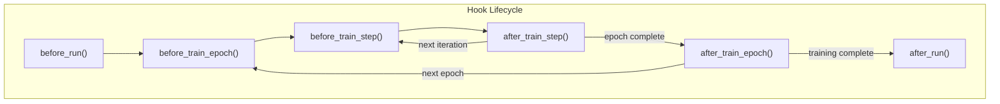
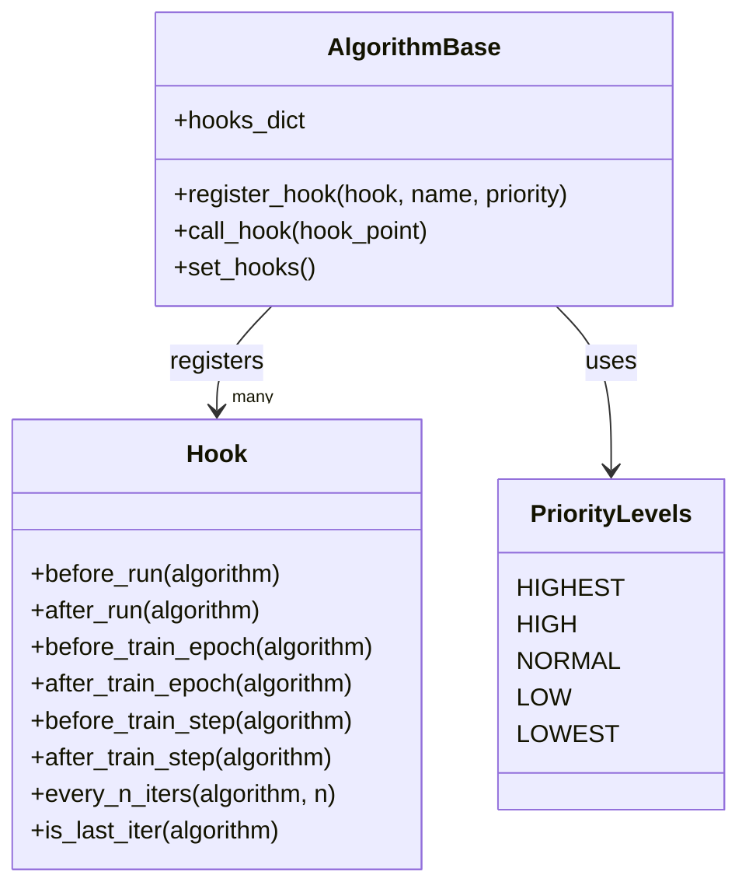
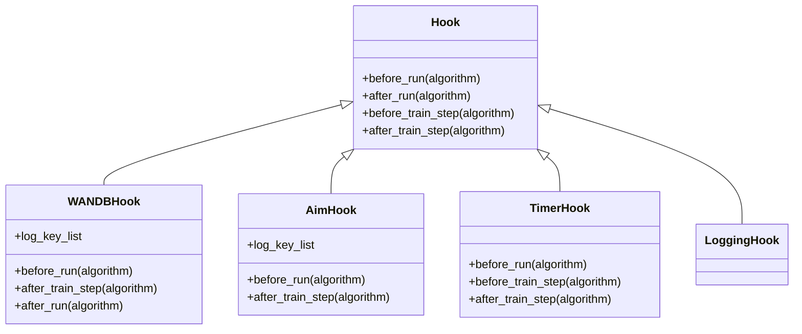
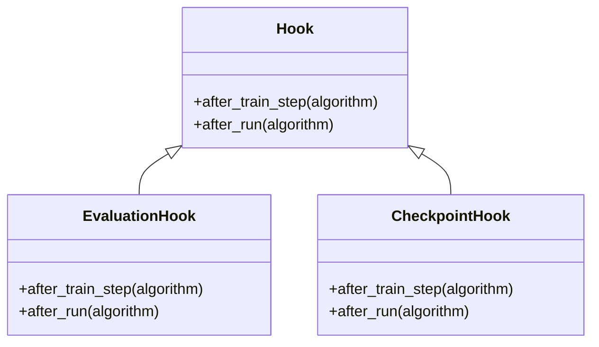
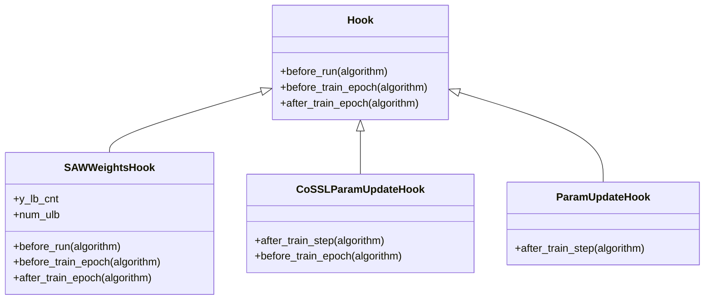
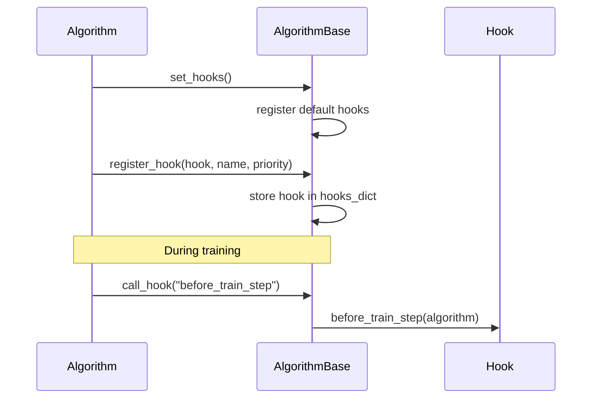
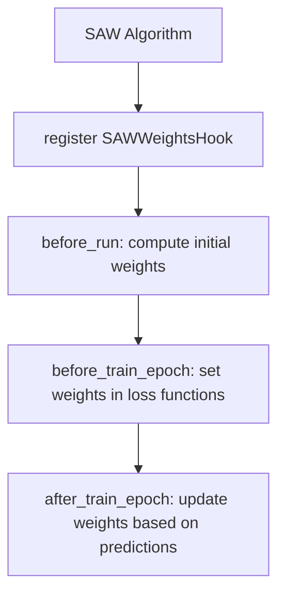
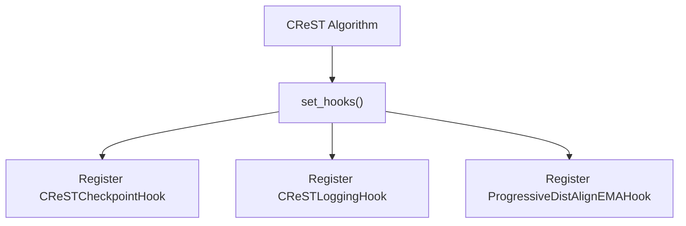

<!-- source: DeepWiki mcp.deepwiki.com · repo microsoft/Semi-supervised-learning · page 2.3 Hooks System · fetched 2026-10-26 -->

# Hooks System

<details>
<summary>Relevant source files</summary>

The following files were used as context for generating this wiki page:

- [CHANGE_LOG.md](CHANGE_LOG.md)
- [semilearn/core/criterions/consistency.py](semilearn/core/criterions/consistency.py)
- [semilearn/core/hooks/aim.py](semilearn/core/hooks/aim.py)
- [semilearn/core/hooks/evaluation.py](semilearn/core/hooks/evaluation.py)
- [semilearn/core/hooks/timer.py](semilearn/core/hooks/timer.py)
- [semilearn/core/hooks/wandb.py](semilearn/core/hooks/wandb.py)
- [semilearn/imb_algorithms/__init__.py](semilearn/imb_algorithms/__init__.py)
- [semilearn/imb_algorithms/cossl/cossl.py](semilearn/imb_algorithms/cossl/cossl.py)
- [semilearn/imb_algorithms/cossl/utils.py](semilearn/imb_algorithms/cossl/utils.py)
- [semilearn/imb_algorithms/crest/crest.py](semilearn/imb_algorithms/crest/crest.py)
- [semilearn/imb_algorithms/saw/saw.py](semilearn/imb_algorithms/saw/saw.py)
- [semilearn/imb_algorithms/saw/utils.py](semilearn/imb_algorithms/saw/utils.py)

</details>


The Hooks System in the USB (Unified Semi-supervised Learning Benchmark) is an extensible event-based mechanism that allows for customizing and extending the training workflow without modifying the core algorithm code. It enables separation of concerns between the main training logic and auxiliary functionality like logging, evaluation, parameter updates, and algorithm-specific operations.

For information about the overall training framework see [Training Framework](#2.2), and for algorithm implementation details see [Algorithms](#3).

## System Architecture

The Hooks System follows an observer pattern where various "hooks" can be registered to be called at specific points during the training lifecycle.

### Hook Lifecycle



Sources: [semilearn/imb_algorithms/crest/crest.py:184-232](), [semilearn/core/hooks/evaluation.py:15-38]()

### Hook Registration and Priority System



Sources: [semilearn/imb_algorithms/crest/crest.py:53-58](), [semilearn/imb_algorithms/cossl/cossl.py:176-177](), [semilearn/imb_algorithms/saw/saw.py:37-49]()

Hooks are registered with a priority level that determines their execution order during each hook point. The available priority levels are:

- `HIGHEST`: Executed first
- `HIGH`: Executed after highest priority hooks
- `NORMAL`: Default priority level
- `LOW`: Executed after normal priority hooks
- `LOWEST`: Executed last

## Standard Hooks

The USB framework provides several standard hooks for different purposes:

### Monitoring Hooks



Sources: [semilearn/core/hooks/wandb.py:9-62](), [semilearn/core/hooks/aim.py:9-49](), [semilearn/core/hooks/timer.py:8-27]()

#### WANDBHook

The WANDBHook integrates with Weights & Biases to track experiments. It:
- Initializes W&B run with appropriate metadata in `before_run()`
- Logs metrics at regular intervals in `after_train_step()`
- Closes the W&B run in `after_run()`

#### AimHook

Similar to WANDBHook, AimHook integrates with the Aim experiment tracking tool:
- Sets up the Aim run with experiment configuration and tags
- Logs metrics and evaluation results at specified intervals

#### TimerHook

The TimerHook measures execution time for training:
- Creates CUDA events for timing in `before_run()`
- Records the data loading time in `before_train_step()`
- Calculates and logs the run time in `after_train_step()`

### Evaluation and Checkpoint Hooks



Sources: [semilearn/core/hooks/evaluation.py:9-38]()

#### EvaluationHook

The EvaluationHook periodically evaluates the model during training:
- Runs evaluation at specified intervals in `after_train_step()`
- Updates and tracks the best performance metrics
- Loads the best model and evaluates on the test set in `after_run()`

### Algorithm-Specific Hooks

Many SSL algorithms implement custom hooks for specialized functionality:



Sources: [semilearn/imb_algorithms/saw/utils.py:22-57](), [semilearn/imb_algorithms/cossl/cossl.py:50-99]()

#### SAWWeightsHook

The SAWWeightsHook implements class weighting functionality for the SAW algorithm:
- Computes effective weights for labeled and unlabeled data in `before_run()`
- Updates the loss function weights in `before_train_epoch()`
- Recomputes unlabeled data weights based on predictions in `after_train_epoch()`

#### CoSSLParamUpdateHook

The CoSSLParamUpdateHook extends parameter updates for the CoSSL algorithm:
- Handles normal parameter updates plus teacher classifier updates
- Initializes the teacher classifier with warmup in `before_train_epoch()`

## Hook Registration Process

Hooks are registered with the algorithm base class through the `register_hook` method. The registration process typically happens in the `set_hooks()` method of the algorithm.



Sources: [semilearn/imb_algorithms/crest/crest.py:53-71](), [semilearn/imb_algorithms/saw/saw.py:37-49]()

## Common Hook Patterns

### Conditional Execution

Hooks often use utilities like `every_n_iters()` to conditionally execute logic:

```python
def after_train_step(self, algorithm):
    if self.every_n_iters(algorithm, algorithm.num_log_iter):
        # Log metrics every num_log_iter iterations
        self.run.log(log_dict, step=algorithm.it)
    
    if self.every_n_iters(algorithm, algorithm.num_eval_iter):
        # Evaluate model every num_eval_iter iterations
        self.run.log({'eval/best-acc': algorithm.best_eval_acc}, step=algorithm.it)
```

Sources: [semilearn/core/hooks/wandb.py:50-59](), [semilearn/core/hooks/evaluation.py:14-24]()

### Algorithm State Access and Modification

Hooks have direct access to the algorithm instance and can read or modify its state:

```python
def before_run(self, algorithm):
    algorithm.x_lb_weights = effective_weights(self.y_lb_cnt).cuda(algorithm.gpu)
    algorithm.print_fn("labeled data class weights: {}".format(algorithm.x_lb_weights))
```

Sources: [semilearn/imb_algorithms/saw/utils.py:28-36]()

## Algorithm-Specific Hook Usage Examples

Different SSL algorithms use the hooks system in different ways:

### SAW Algorithm

The SAW algorithm uses hooks to implement class weighting:



Sources: [semilearn/imb_algorithms/saw/saw.py:37-49](), [semilearn/imb_algorithms/saw/utils.py:22-57]()

### CReST Algorithm

The CReST algorithm replaces standard hooks with specialized versions:



Sources: [semilearn/imb_algorithms/crest/crest.py:53-71]()

## Implementing Custom Hooks

To create a custom hook, you need to inherit from the `Hook` base class and implement the desired lifecycle methods:

```python
class CustomHook(Hook):
    def __init__(self, custom_param):
        super().__init__()
        self.custom_param = custom_param
        
    def before_run(self, algorithm):
        # Initialization logic
        pass
        
    def after_train_step(self, algorithm):
        # Logic to execute after each training step
        if self.every_n_iters(algorithm, 100):
            # Do something every 100 iterations
            pass
```

Register your custom hook in your algorithm's `set_hooks` method:

```python
def set_hooks(self):
    super().set_hooks()
    self.register_hook(CustomHook(custom_param=42), "CustomHook", "NORMAL")
```

## Summary

The Hooks System provides a flexible, extensible way to customize the training process in the USB framework. By separating core algorithm logic from auxiliary functionality, it enables:

1. Clean, modular code organization
2. Easy addition of new monitoring, logging, and evaluation features
3. Algorithm-specific customizations without modifying the core training loop
4. Conditional execution at specific points in the training process

This architecture makes the USB framework highly adaptable to different SSL algorithms and research needs.

Sources: [CHANGE_LOG.md:29-31]()

---

