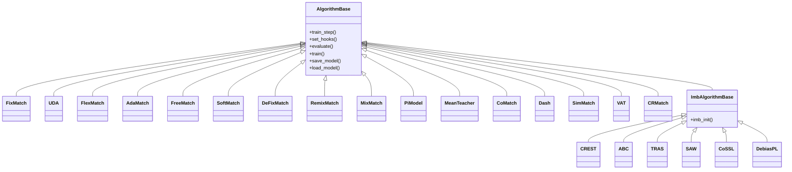
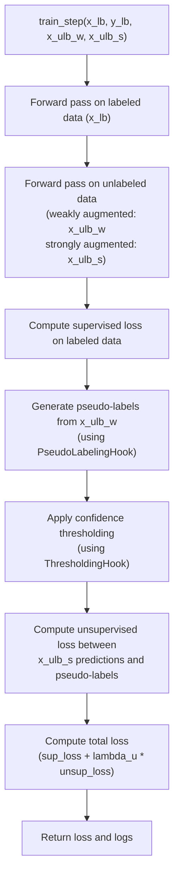
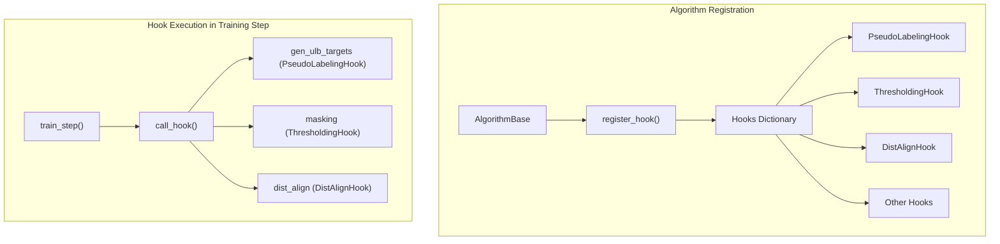

<!-- source: DeepWiki mcp.deepwiki.com · repo microsoft/Semi-supervised-learning · page 3 Algorithms · fetched 2026-10-26 -->

# Algorithms

<details>
<summary>Relevant source files</summary>

The following files were used as context for generating this wiki page:

- [docs/algorithm_zoo.md](docs/algorithm_zoo.md)
- [docs/benchmark.md](docs/benchmark.md)
- [docs/contributors.md](docs/contributors.md)
- [docs/tutorial.md](docs/tutorial.md)
- [semilearn/algorithms/adamatch/adamatch.py](semilearn/algorithms/adamatch/adamatch.py)
- [semilearn/algorithms/fixmatch/fixmatch.py](semilearn/algorithms/fixmatch/fixmatch.py)
- [semilearn/algorithms/flexmatch/flexmatch.py](semilearn/algorithms/flexmatch/flexmatch.py)
- [semilearn/algorithms/mixmatch/mixmatch.py](semilearn/algorithms/mixmatch/mixmatch.py)
- [semilearn/algorithms/pimodel/pimodel.py](semilearn/algorithms/pimodel/pimodel.py)
- [semilearn/algorithms/remixmatch/remixmatch.py](semilearn/algorithms/remixmatch/remixmatch.py)
- [semilearn/algorithms/uda/uda.py](semilearn/algorithms/uda/uda.py)

</details>


## Introduction

This page provides an overview of the Semi-Supervised Learning (SSL) algorithms implemented in the USB (Unified Semi-Supervised Learning Benchmark) framework. The framework includes implementations of numerous state-of-the-art SSL algorithms across different categories, all built on a unified architecture for fair comparison and extensibility.

For more detailed information on specific algorithm categories, see the following pages:
- [Basic SSL Algorithms](#3.1): Documentation of fundamental SSL algorithms like FixMatch, UDA, PiModel, and MeanTeacher
- [Advanced SSL Algorithms](#3.2): Documentation of more sophisticated SSL algorithms like FreeMatch, SoftMatch, and FlexMatch
- [Imbalanced Learning Algorithms](#3.3): Documentation of algorithms designed specifically for imbalanced datasets
- [Custom Algorithm Development](#3.4): Guide for developing and implementing your own custom SSL algorithms

## Algorithm Hierarchy

In the USB framework, all SSL algorithms inherit from a common base class, `AlgorithmBase`, which provides core functionality for training, evaluation, and model management. Imbalanced learning algorithms inherit from `ImbAlgorithmBase`, which extends `AlgorithmBase` with functionality specific to imbalanced datasets.

### Algorithm Class Hierarchy



Sources: [semilearn/algorithms/fixmatch/fixmatch.py](), [semilearn/algorithms/mixmatch/mixmatch.py](), [semilearn/algorithms/remixmatch/remixmatch.py]()

## Implemented Algorithms

The USB framework implements 16 popular SSL algorithms:

| Algorithm | Key Characteristics | Primary Techniques |
|-----------|---------------------|-------------------|
| FixMatch | Simple and effective | Pseudo-labeling with confidence thresholding |
| UDA | Strong augmentation | Consistency regularization |
| FlexMatch | Adapts to class difficulty | Class-specific thresholds |
| AdaMatch | Designed for domain adaptation | Relative thresholding and distribution alignment |
| FreeMatch | Dynamic threshold adjustment | Self-adaptive thresholding |
| SoftMatch | Soft pseudo-labeling | Distribution-aware target sharpening |
| MixMatch | Distribution interpolation | Mixup and label guessing |
| RemixMatch | Enhanced MixMatch | Distribution alignment and stronger augmentation |
| PiModel | Simple consistency | MSE between different augmentations |
| MeanTeacher | Uses EMA model | Teacher-student consistency |
| CoMatch | Contrastive learning | Graph-based feature consistency |
| Dash | Gradually increasing threshold | Non-convex optimization |
| SimMatch | Multi-level consistency | Semantic and instance-level similarity |
| VAT | Adversarial perturbations | Robustness to adversarial examples |
| CRMatch | Feature-level consistency | Consistency and equivariance regularization |
| DeFixMatch | Debiased pseudo-labeling | Addresses confirmation bias |

Sources: [docs/algorithm_zoo.md]()

## Algorithm Training Process

The general workflow of SSL algorithms in USB involves processing labeled and unlabeled data, computing losses, and updating model parameters. Here's a typical workflow using FixMatch as an example:



Sources: [semilearn/algorithms/fixmatch/fixmatch.py:48-105]()

## Key Concepts and Techniques

SSL algorithms in USB utilize several key concepts and techniques:

### Pseudo-labeling

Pseudo-labeling is a technique where a model's predictions on unlabeled data are used as targets for further training. In USB, this is implemented through the `PseudoLabelingHook`, which transforms model logits into pseudo-labels.

Example from FixMatch:
```python
pseudo_label = self.call_hook("gen_ulb_targets", "PseudoLabelingHook", 
                              logits=probs_x_ulb_w,
                              use_hard_label=self.use_hard_label,
                              T=self.T,
                              softmax=False)
```

Sources: [semilearn/algorithms/fixmatch/fixmatch.py:87-91]()

### Consistency Regularization

Consistency regularization enforces that a model's predictions should be consistent under different perturbations of the same input. Many USB algorithms apply this principle by ensuring predictions on weakly and strongly augmented versions of unlabeled data are similar.

Example from PiModel:
```python
unsup_loss = self.consistency_loss(logits_x_ulb_s,
                                  self.compute_prob(logits_x_ulb_w.detach()),
                                  'mse')
```

Sources: [semilearn/algorithms/pimodel/pimodel.py:56-59]()

### Confidence Thresholding

Confidence thresholding filters out uncertain predictions by applying a threshold to the predicted probabilities. Different algorithms implement various thresholding strategies:

- **Fixed Thresholding**: Used by FixMatch, applies a constant threshold (e.g., 0.95)
- **Class-Adaptive Thresholding**: Used by FlexMatch, adjusts thresholds based on class learning difficulty
- **Dynamic Thresholding**: Used by FreeMatch, adapts thresholds during training

Example from FixMatch:
```python
mask = self.call_hook("masking", "MaskingHook", logits_x_ulb=probs_x_ulb_w, softmax_x_ulb=False)
```

Sources: [semilearn/algorithms/fixmatch/fixmatch.py:84]()

### Mixup

Mixup is a data augmentation technique that creates new training samples by linearly interpolating between pairs of samples and their labels. MixMatch and RemixMatch incorporate mixup into their SSL approaches.

Example from MixMatch:
```python
mixed_x, mixed_y, _ = mixup_one_target(inputs, input_labels,
                                      self.mixup_alpha,
                                      is_bias=True)
```

Sources: [semilearn/algorithms/mixmatch/mixmatch.py:88-90]()

### Distribution Alignment

Distribution alignment adjusts the predicted class distribution on unlabeled data to match a target distribution (often derived from labeled data). This helps address class imbalance issues.

Example from RemixMatch:
```python
self.register_hook(
    DistAlignEMAHook(num_classes=self.num_classes, p_target_type='gt', p_target=lb_class_dist), 
    "DistAlignHook")
```

Sources: [semilearn/algorithms/remixmatch/remixmatch.py:96-98]()

## Algorithm Integration with Framework Components

The algorithms in USB interact with several other components of the framework:

### Hooks System

Algorithms use hooks to extend and customize their behavior. Each algorithm registers the hooks it needs during initialization and calls them at specific points in the training process.



Sources: [semilearn/algorithms/fixmatch/fixmatch.py:43-46]()

### Algorithm Registration System

In USB, algorithms are registered with a central registry using the `@ALGORITHMS.register` decorator. This allows for easy instantiation of algorithms based on configuration files.

Example from FixMatch:
```python
@ALGORITHMS.register('fixmatch')
class FixMatch(AlgorithmBase):
    # Implementation
```

Each algorithm also defines its configuration arguments using the `get_argument` static method:

```python
@staticmethod
def get_argument():
    return [
        SSL_Argument('--hard_label', str2bool, True),
        SSL_Argument('--T', float, 0.5),
        SSL_Argument('--p_cutoff', float, 0.95),
    ]
```

Sources: [semilearn/algorithms/fixmatch/fixmatch.py:11-14, 108-114]()

## Algorithm-Specific Parameters

Different algorithms require different parameters to control their behavior. Here are examples of key parameters for several algorithms:

| Algorithm | Key Parameters | Description |
|-----------|----------------|-------------|
| FixMatch | `p_cutoff` | Confidence threshold for pseudo-labels |
| | `T` | Temperature for prediction sharpening |
| | `hard_label` | Whether to use hard or soft pseudo-labels |
| MixMatch | `T` | Temperature for sharpening |
| | `mixup_alpha` | Parameter for Beta distribution in mixup |
| | `unsup_warm_up` | Ramp-up ratio for unsupervised loss |
| FlexMatch | `p_cutoff` | Base confidence threshold |
| | `thresh_warmup` | Whether to warm up thresholds |
| RemixMatch | `T` | Temperature for sharpening |
| | `rot_loss_ratio` | Weight for rotation loss |
| | `kl_loss_ratio` | Weight for KL divergence loss |
| UDA | `T` | Temperature for sharpening |
| | `p_cutoff` | Confidence threshold |
| | `tsa_schedule` | Training signal annealing schedule |

Sources: [semilearn/algorithms/fixmatch/fixmatch.py:108-114](), [semilearn/algorithms/mixmatch/mixmatch.py:131-138](), [semilearn/algorithms/flexmatch/flexmatch.py:133-140](), [semilearn/algorithms/remixmatch/remixmatch.py:221-228](), [semilearn/algorithms/uda/uda.py:128-135]()

## Datasets and Evaluation

The USB framework evaluates SSL algorithms on a diverse range of datasets across three domains:

1. **Computer Vision**: CIFAR-100, STL10, TissueMNIST, SemiAves, EuroSAT, ImageNet
2. **Natural Language Processing**: IMDB, Amazon Review, Yelp Review, AG News, Yahoo! Answer
3. **Audio**: GTZAN, UrbanSound8k, FSDNoisy18k, Keyword Spotting, ESC-50

For detailed information about these datasets, see the [Datasets and Data Handling](#4) page.

Sources: [docs/benchmark.md:1-42]()

## Conclusion

The Algorithms subsystem is the core of the USB framework, providing implementations of numerous state-of-the-art SSL algorithms within a unified architecture. This enables fair comparison across algorithms and easy extension with new methods. The modular design, with the common `AlgorithmBase` class and flexible hook system, allows for both standardization and customization.

For detailed information on specific algorithm categories, implementation details, and best practices for using and extending these algorithms, refer to the specialized pages linked at the beginning of this document.

---

