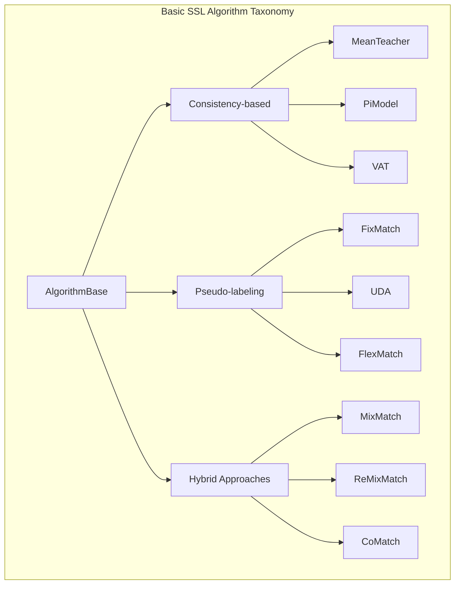
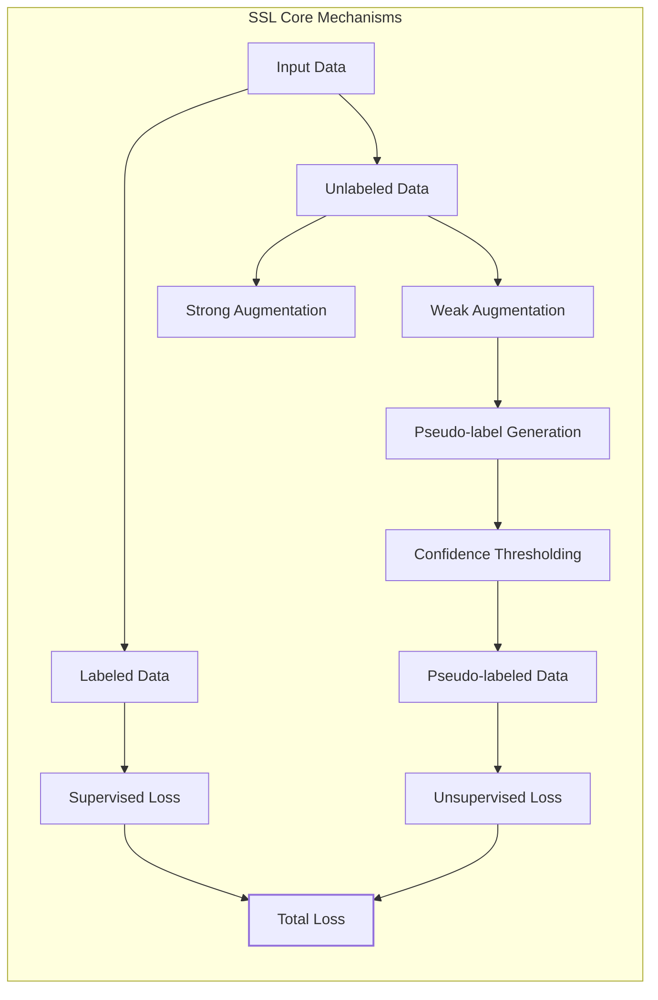
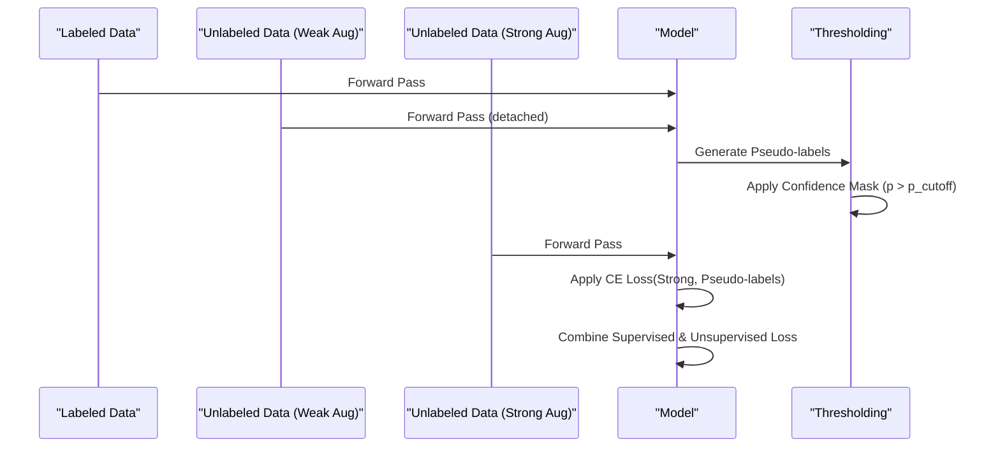
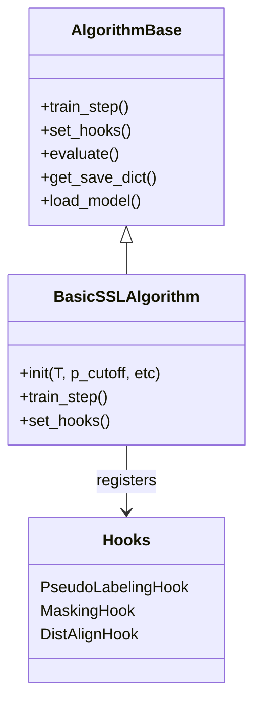
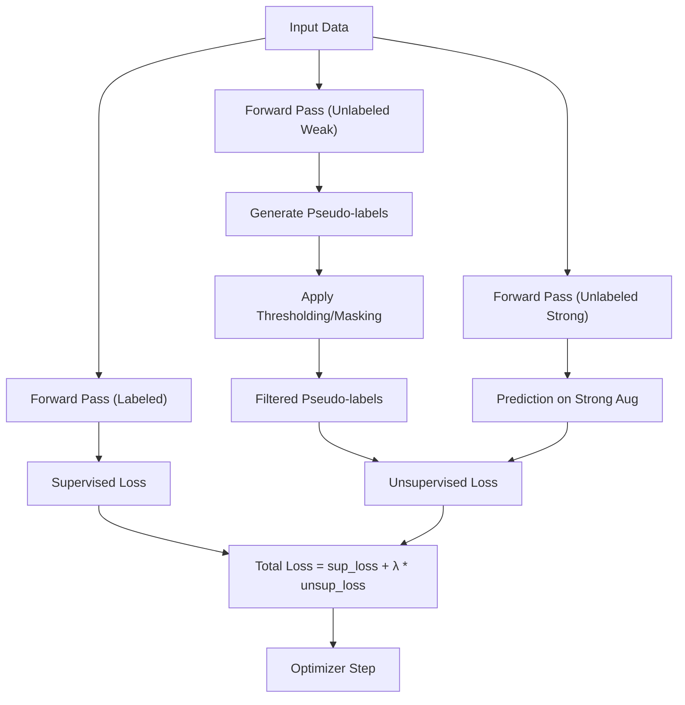
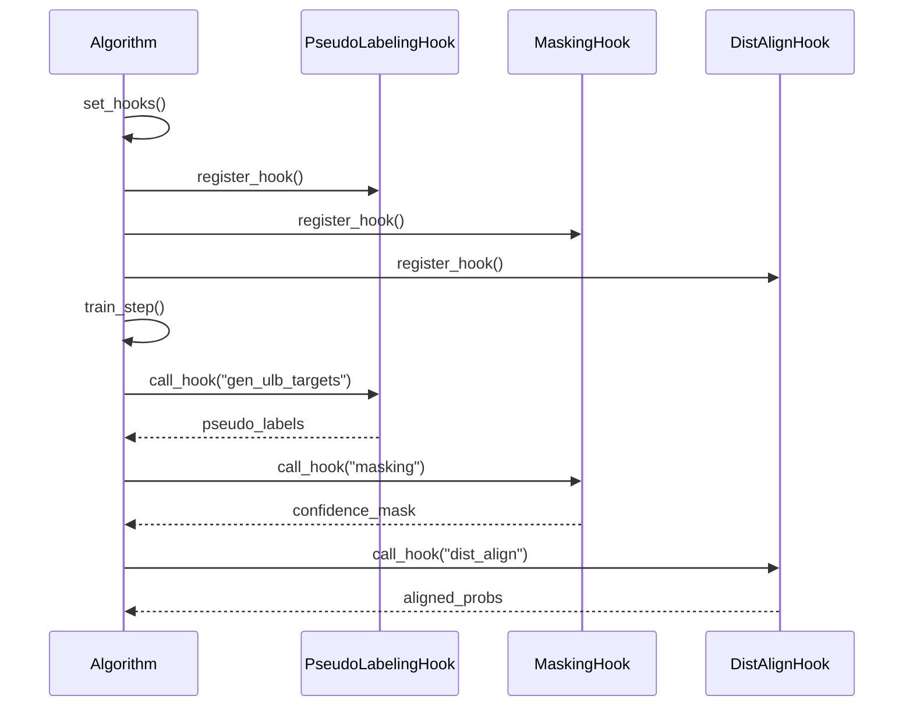

<!-- source: DeepWiki mcp.deepwiki.com · repo microsoft/Semi-supervised-learning · page 3.1 Basic SSL Algorithms · fetched 2026-10-26 -->

# Basic SSL Algorithms

<details>
<summary>Relevant source files</summary>

The following files were used as context for generating this wiki page:

- [semilearn/algorithms/adamatch/adamatch.py](semilearn/algorithms/adamatch/adamatch.py)
- [semilearn/algorithms/comatch/comatch.py](semilearn/algorithms/comatch/comatch.py)
- [semilearn/algorithms/fixmatch/fixmatch.py](semilearn/algorithms/fixmatch/fixmatch.py)
- [semilearn/algorithms/flexmatch/flexmatch.py](semilearn/algorithms/flexmatch/flexmatch.py)
- [semilearn/algorithms/meanteacher/meanteacher.py](semilearn/algorithms/meanteacher/meanteacher.py)
- [semilearn/algorithms/mixmatch/mixmatch.py](semilearn/algorithms/mixmatch/mixmatch.py)
- [semilearn/algorithms/pimodel/pimodel.py](semilearn/algorithms/pimodel/pimodel.py)
- [semilearn/algorithms/remixmatch/remixmatch.py](semilearn/algorithms/remixmatch/remixmatch.py)
- [semilearn/algorithms/uda/uda.py](semilearn/algorithms/uda/uda.py)

</details>


This page documents the core semi-supervised learning (SSL) algorithms implemented in the USB (Unified Semi-supervised Learning Benchmark) framework. These algorithms form the foundation of the SSL approach in this codebase, providing implementations of widely-used methods in the literature that serve as baselines for more advanced techniques. For advanced SSL algorithms, see [Advanced SSL Algorithms](#3.2), and for imbalanced learning algorithms, see [Imbalanced Learning Algorithms](#3.3).

## Overview of Basic SSL Algorithms

The USB framework implements several fundamental SSL algorithms that operate on similar principles but with different specific mechanisms. Each algorithm inherits from the `AlgorithmBase` class (covered in [AlgorithmBase](#2.1)) and follows a consistent interface pattern while implementing its unique approach to leveraging unlabeled data.



Sources: [semilearn/algorithms/fixmatch/fixmatch.py](), [semilearn/algorithms/meanteacher/meanteacher.py](), [semilearn/algorithms/pimodel/pimodel.py](), [semilearn/algorithms/uda/uda.py](), [semilearn/algorithms/mixmatch/mixmatch.py](), [semilearn/algorithms/remixmatch/remixmatch.py]()

## Common SSL Principles

Basic SSL algorithms in the framework share several key principles:

1. **Consistency Regularization**: Enforcing consistent predictions on different augmented versions of the same unlabeled image
2. **Pseudo-Labeling**: Generating artificial labels for unlabeled data based on model predictions
3. **Confidence Thresholding**: Filtering out low-confidence predictions to maintain high-quality pseudo-labels
4. **Distribution Alignment**: Aligning the distribution of class predictions on unlabeled data with the distribution observed in labeled data



Sources: [semilearn/algorithms/fixmatch/fixmatch.py:48-105](), [semilearn/algorithms/uda/uda.py:50-110]()

## Algorithm Implementations

### FixMatch

FixMatch is a simple yet effective SSL algorithm that combines consistency regularization with pseudo-labeling.

**Key characteristics:**
- Uses weakly-augmented images to generate pseudo-labels
- Applies confidence thresholding to filter unreliable pseudo-labels
- Enforces consistency between pseudo-labels and predictions on strongly-augmented versions



**Implementation details:**
- Uses fixed threshold `p_cutoff` (default 0.95) for confidence filtering
- Uses temperature `T` (default 0.5) for sharpening pseudo-labels
- Option for hard or soft labels through `hard_label` parameter

Sources: [semilearn/algorithms/fixmatch/fixmatch.py]()

### UDA (Unsupervised Data Augmentation)

UDA applies consistency regularization with a focus on using strong data augmentation techniques to generate diverse views of unlabeled data.

**Key characteristics:**
- Similar to FixMatch but with different augmentation strategies
- Includes Training Signal Annealing (TSA) to gradually release the supervised training signal
- Uses soft pseudo-labels rather than hard labels

**Implementation details:**
- Supports different TSA schedules: linear, exponential, logarithmic, or none
- Uses confidence threshold `p_cutoff` (default 0.8)
- Temperature parameter `T` (default 0.4) for controlling sharpness of pseudo-labels

Sources: [semilearn/algorithms/uda/uda.py]()

### MeanTeacher

MeanTeacher uses an exponential moving average (EMA) of model parameters to create a teacher model that generates stable targets for unlabeled data.

**Key characteristics:**
- Maintains a teacher model as the EMA of the student model
- Teacher model generates pseudo-labels for unlabeled data
- Applies consistency between student predictions and teacher pseudo-labels

**Implementation details:**
- Uses MSE loss for consistency regularization
- Gradual warm-up of unsupervised loss weight through `unsup_warm_up` parameter
- Does not use confidence thresholding, relying on teacher model quality instead

Sources: [semilearn/algorithms/meanteacher/meanteacher.py]()

### PiModel

PiModel is one of the simplest SSL algorithms, applying consistency regularization between different augmented views of the same unlabeled example.

**Key characteristics:**
- Uses the same model to process two differently augmented versions of unlabeled data
- Enforces consistency between predictions on both versions
- Simpler than MeanTeacher as it doesn't maintain a separate teacher model

**Implementation details:**
- Uses MSE loss for consistency regularization
- Uses a warm-up parameter `unsup_warm_up` (default 0.4) to gradually increase the unsupervised loss weight
- No confidence thresholding

Sources: [semilearn/algorithms/pimodel/pimodel.py]()

### MixMatch

MixMatch introduces the concept of mixing labeled and unlabeled data through interpolation techniques.

**Key characteristics:**
- Averages predictions on multiple augmented versions of unlabeled samples
- Applies temperature sharpening to create pseudo-labels
- Uses MixUp to blend labeled and unlabeled examples

**Implementation details:**
- Uses parameter `T` (default 0.5) for temperature sharpening
- MixUp blending parameter `mixup_alpha` (default 0.5)
- Option for manifold mixup through `mixup_manifold` parameter
- Uses MSE loss for consistency between mixed predictions

Sources: [semilearn/algorithms/mixmatch/mixmatch.py]()

### ReMixMatch

ReMixMatch extends MixMatch with additional techniques including distribution alignment and augmentation anchoring.

**Key characteristics:**
- Adds rotation-based self-supervision as an auxiliary task
- Implements distribution alignment to match class distributions
- Uses a stronger form of augmentation than MixMatch

**Implementation details:**
- Adds rotation prediction loss with weight `rot_loss_ratio` (default 0.5)
- Adds KL divergence loss with weight `kl_loss_ratio` (default 0.5)
- Temperature parameter `T` (default 0.5) for sharpening
- Uses DistAlignEMAHook for distribution alignment

Sources: [semilearn/algorithms/remixmatch/remixmatch.py]()

## Common Implementation Patterns

Basic SSL algorithms in the USB framework follow several common implementation patterns:



Sources: [semilearn/algorithms/fixmatch/fixmatch.py:43-46](), [semilearn/algorithms/uda/uda.py:45-48](), [semilearn/algorithms/flexmatch/flexmatch.py:54-57]()

## Key Components Table

The following table summarizes the key components and parameters of each basic SSL algorithm:

| Algorithm | Key Parameters | Hooks Used | Loss Functions | Special Features |
|-----------|----------------|------------|----------------|------------------|
| FixMatch | `T` (0.5), `p_cutoff` (0.95) | PseudoLabelingHook, FixedThresholdingHook | CE Loss | Hard label option |
| UDA | `T` (0.4), `p_cutoff` (0.8) | PseudoLabelingHook, FixedThresholdingHook | CE Loss | TSA schedules |
| MeanTeacher | `unsup_warm_up` (0.4) | EMAHook | MSE Loss | Teacher-student |
| PiModel | `unsup_warm_up` (0.4) | None | MSE Loss | Simple consistency |
| MixMatch | `T` (0.5), `mixup_alpha` (0.5) | None | MSE Loss | MixUp |
| ReMixMatch | `T` (0.5), `rot_loss_ratio` (0.5) | DistAlignEMAHook | CE Loss, Rotation Loss | Self-supervision |

Sources: [semilearn/algorithms/fixmatch/fixmatch.py:108-114](), [semilearn/algorithms/uda/uda.py:128-135](), [semilearn/algorithms/meanteacher/meanteacher.py:79-83](), [semilearn/algorithms/pimodel/pimodel.py:71-75](), [semilearn/algorithms/mixmatch/mixmatch.py:131-138](), [semilearn/algorithms/remixmatch/remixmatch.py:219-228]()

## Training Process Flow

All basic SSL algorithms follow a similar training process flow, with variations in how they generate and utilize pseudo-labels:



Sources: [semilearn/algorithms/fixmatch/fixmatch.py:48-105](), [semilearn/algorithms/uda/uda.py:50-110](), [semilearn/algorithms/meanteacher/meanteacher.py:36-76]()

## Algorithm Registration and Configuration

All algorithms are registered with the framework using the `@ALGORITHMS.register` decorator and provide their configuration options through the `get_argument` static method:

```python
@ALGORITHMS.register('fixmatch')
class FixMatch(AlgorithmBase):
    # Implementation...
    
    @staticmethod
    def get_argument():
        return [
            SSL_Argument('--hard_label', str2bool, True),
            SSL_Argument('--T', float, 0.5),
            SSL_Argument('--p_cutoff', float, 0.95),
        ]
```

Each algorithm can be instantiated through the framework's configuration system, which passes the appropriate arguments to the algorithm constructor.

Sources: [semilearn/algorithms/fixmatch/fixmatch.py:11-12](), [semilearn/algorithms/fixmatch/fixmatch.py:108-114]()

## Integration with Hooks System

Most basic SSL algorithms utilize the hooks system for modularity and extensibility:



Sources: [semilearn/algorithms/fixmatch/fixmatch.py:43-46](), [semilearn/algorithms/fixmatch/fixmatch.py:84-91](), [semilearn/algorithms/remixmatch/remixmatch.py:90-98]()

This modular design allows for easy extension and modification of algorithm behavior through the hooks system, which is detailed in [Hooks System](#2.3).

---

