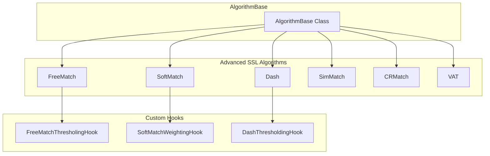
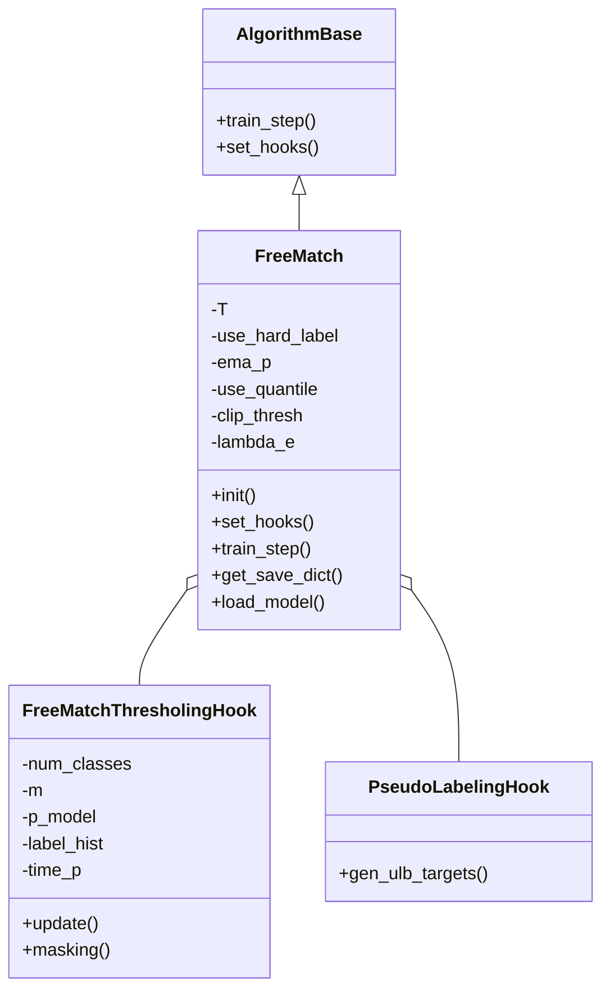
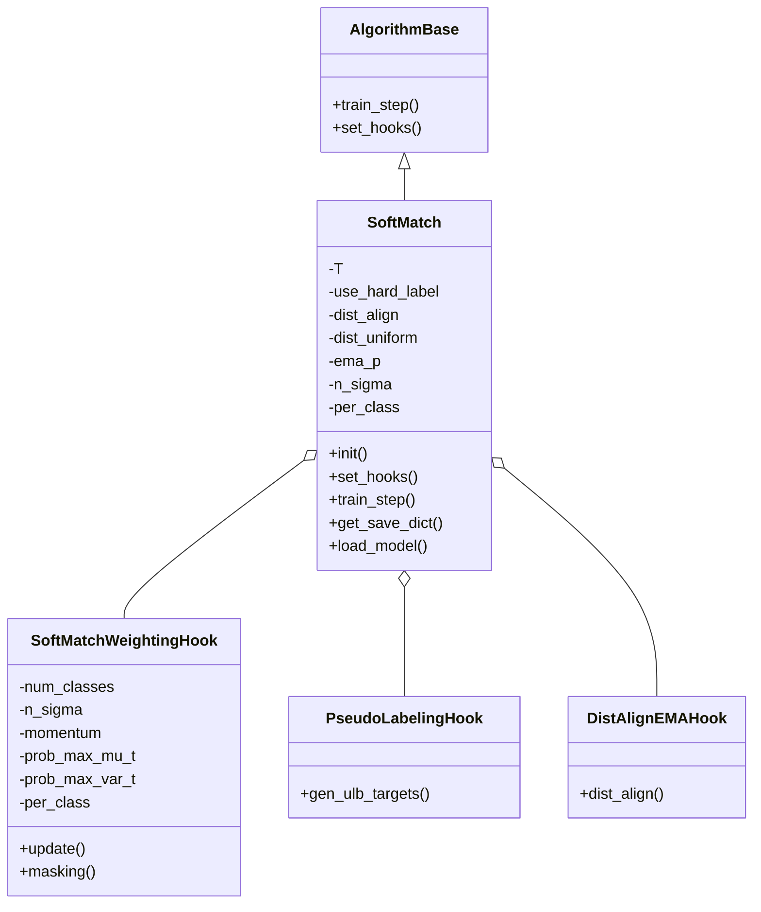
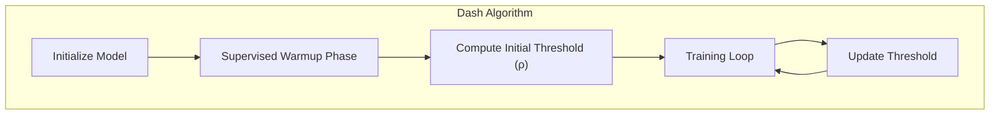

<!-- source: DeepWiki mcp.deepwiki.com · repo microsoft/Semi-supervised-learning · page 3.2 Advanced SSL Algorithms · fetched 2026-10-26 -->

# Advanced SSL Algorithms

<details>
<summary>Relevant source files</summary>

The following files were used as context for generating this wiki page:

- [semilearn/algorithms/crmatch/crmatch.py](semilearn/algorithms/crmatch/crmatch.py)
- [semilearn/algorithms/dash/dash.py](semilearn/algorithms/dash/dash.py)
- [semilearn/algorithms/freematch/__init__.py](semilearn/algorithms/freematch/__init__.py)
- [semilearn/algorithms/freematch/freematch.py](semilearn/algorithms/freematch/freematch.py)
- [semilearn/algorithms/freematch/utils.py](semilearn/algorithms/freematch/utils.py)
- [semilearn/algorithms/simmatch/simmatch.py](semilearn/algorithms/simmatch/simmatch.py)
- [semilearn/algorithms/softmatch/softmatch.py](semilearn/algorithms/softmatch/softmatch.py)
- [semilearn/algorithms/utils/misc.py](semilearn/algorithms/utils/misc.py)
- [semilearn/algorithms/vat/vat.py](semilearn/algorithms/vat/vat.py)

</details>


This page documents the advanced Semi-Supervised Learning (SSL) algorithms implemented in the USB framework. These algorithms extend basic SSL techniques (see [Basic SSL Algorithms](#3.1)) with more sophisticated mechanisms for threshold adaptation, confidence weighting, and distribution alignment to improve performance across different datasets and domains.

## Overview of Advanced SSL Algorithms

Advanced SSL algorithms in USB enhance the learning process by incorporating mechanisms that dynamically adjust to data characteristics during training, rather than relying on fixed thresholds or static weighting. These algorithms typically address key challenges in semi-supervised learning:

1. **Threshold Adaptation**: Dynamically adjusting confidence thresholds for pseudo-label selection
2. **Distribution Alignment**: Correcting distribution shift between labeled and unlabeled data
3. **Sample Weighting**: Using statistical properties to weight unlabeled samples
4. **Entropy Regularization**: Encouraging more confident predictions

The following diagram shows the relationship between these advanced algorithms and the base framework:



Sources: [semilearn/algorithms/freematch/freematch.py:47-153](), [semilearn/algorithms/softmatch/softmatch.py:13-146](), [semilearn/algorithms/dash/dash.py:16-231]()

## FreeMatch

FreeMatch is an advanced SSL algorithm that introduces Self-Adaptive Thresholding (SAT) to dynamically adjust confidence thresholds during training, eliminating the need for manual threshold tuning.

### Key Features

1. **Self-Adaptive Threshold (SAT)**: Automatically adjusts confidence thresholds based on the model's current performance
2. **Class-wise Threshold Modulation**: Adjusts thresholds per class to account for class imbalance
3. **Entropy-based Regularization**: Encourages confident predictions on unlabeled data

### Implementation Architecture



Sources: [semilearn/algorithms/freematch/freematch.py:47-153](), [semilearn/algorithms/freematch/utils.py:10-69]()

### Self-Adaptive Threshold Mechanism

The core innovation of FreeMatch is its Self-Adaptive Threshold mechanism, implemented in the `FreeMatchThresholingHook` class. This hook:

1. Tracks the model's prediction confidence distribution with exponential moving average
2. Updates class distribution statistics with `p_model` and `label_hist`
3. Calculates adaptive thresholds based on these statistics
4. Modulates thresholds based on class frequency to handle imbalance

```python
mask = max_probs.ge(self.time_p * mod[max_idx]).to(max_probs.dtype)
```

The threshold is adjusted by this formula, where `self.time_p` is the global confidence threshold and `mod` is the class-specific modulation factor.

Sources: [semilearn/algorithms/freematch/utils.py:10-69]()

### Entropy Loss

FreeMatch also incorporates an entropy loss to encourage confident predictions:

```python
ent_loss, _ = entropy_loss(mask, logits_x_ulb_s, self.p_model, self.label_hist)
total_loss = sup_loss + self.lambda_u * unsup_loss + self.lambda_e * ent_loss
```

This regulates the model to make more balanced predictions across classes while maintaining high confidence.

Sources: [semilearn/algorithms/freematch/freematch.py:112-118]()

## SoftMatch

SoftMatch is an advanced algorithm that replaces the hard binary mask used in most SSL algorithms with a continuous weighting mechanism based on statistical confidence measures.

### Key Features

1. **Statistical Confidence Weighting**: Weighs unlabeled samples based on their deviation from mean confidence
2. **Distribution Alignment**: Aligns prediction distribution with target distribution
3. **Per-class Statistics**: Maintains class-wise confidence statistics

### Implementation Architecture



Sources: [semilearn/algorithms/softmatch/softmatch.py:13-146]()

### Statistical Confidence Weighting Mechanism

The key innovation of SoftMatch is replacing binary masking with a continuous weight function based on statistical confidence measures:

1. Calculates the mean and variance of maximum prediction probabilities
2. Weighs samples based on deviation from the mean (using Gaussian-like weighting)
3. Can operate either globally or on a per-class basis

This allows more gradual incorporation of uncertain samples, rather than the hard threshold approach used in other algorithms.

## Dash

Dash (Dynamic Threshold Adjustment in Semi-supervised learning) introduces a dynamic threshold that automatically adapts throughout training.

### Key Features

1. **Dynamic Threshold**: Adjusts threshold based on validation loss
2. **Warmup Stage**: Initializes model with supervised learning before using unlabeled data
3. **Progressive Threshold Reduction**: Gradually reduces threshold to include more unlabeled samples

### Implementation Architecture



Sources: [semilearn/algorithms/dash/dash.py:16-231]()

### Dynamic Threshold Mechanism

The threshold in Dash is computed as:

```
ρ = max(ρ_min, ρ_init * (C * γ^t))
```

Where:
- `ρ_init` is the initial threshold (set from validation loss)
- `C` and `γ` are hyperparameters
- `t` is the training progress
- `ρ_min` is the minimum threshold value

This allows the algorithm to adaptively include more unlabeled samples as training progresses.

Sources: [semilearn/algorithms/dash/dash.py:60-153]()

## Other Advanced Algorithms

### SimMatch

SimMatch introduces similarity-based pseudo-label refinement using a memory bank of feature embeddings.

**Key Features:**
- Maintains a feature memory bank from labeled samples
- Computes similarities between unlabeled samples and memory bank
- Refines pseudo-labels using similarity information
- Smooths pseudo-labels with neighborhood consistency

Sources: [semilearn/algorithms/simmatch/simmatch.py:13-259]()

### CRMatch

CRMatch combines consistency regularization with a self-supervised rotation prediction task.

**Key Features:**
- Additional rotation prediction task as auxiliary self-supervision
- Dense classifier for stronger feature learning
- Fixed confidence threshold for pseudo-labeling

Sources: [semilearn/algorithms/crmatch/crmatch.py:16-292]()

### VAT (Virtual Adversarial Training)

VAT generates adversarial perturbations to unlabeled data and enforces consistency in predictions.

**Key Features:**
- Computes adversarial perturbations with respect to KL divergence
- Applies entropy minimization for confident predictions
- Can operate on input space or embedding space

Sources: [semilearn/algorithms/vat/vat.py:14-146]()

## Algorithm Comparison

The following table compares key features of the advanced SSL algorithms:

| Algorithm | Key Innovation | Thresholding Mechanism | Distribution Handling | Extra Loss |
|-----------|---------------|----------------------|---------------------|-----------|
| FreeMatch | Self-Adaptive Threshold | Dynamic, class-wise | Class distribution tracking | Entropy loss |
| SoftMatch | Statistical weighting | Continuous, based on statistics | Distribution alignment | CE with soft weights |
| Dash | Dynamic threshold | Based on validation loss | None specified | Standard consistency |
| SimMatch | Memory bank | Fixed threshold | Queue-based alignment | Similarity loss |
| CRMatch | Rotation prediction | Fixed threshold | None specified | Rotation loss |
| VAT | Adversarial perturbation | None | None | KL divergence + entropy |

## Common Configuration Parameters

Advanced SSL algorithms typically share these configuration parameters:

```python
# Common parameters
SSL_Argument('--T', float, 0.5)  # Temperature for sharpening
SSL_Argument('--hard_label', str2bool, True)  # Use hard labels or soft
SSL_Argument('--ema_p', float, 0.999)  # EMA momentum

# FreeMatch specific
SSL_Argument('--ent_loss_ratio', float, 0.01)  # Entropy loss weight
SSL_Argument('--use_quantile', str2bool, False)  # Use quantile for threshold
SSL_Argument('--clip_thresh', str2bool, False)  # Clip threshold

# SoftMatch specific
SSL_Argument('--n_sigma', int, 2)  # Number of std deviations for weighting
SSL_Argument('--per_class', str2bool, False)  # Per-class statistics
```

Sources: [semilearn/algorithms/freematch/freematch.py:144-153](), [semilearn/algorithms/softmatch/softmatch.py:136-146](), [semilearn/algorithms/utils/misc.py:8-32]()

## Integration with the USB Framework

Advanced SSL algorithms are integrated into the USB framework through:

1. Registration with the `ALGORITHMS` registry using the decorator pattern
2. Implementation of key methods from `AlgorithmBase`
3. Custom hooks for specialized functionality
4. Configuration parameter definitions

For example, FreeMatch is registered and configured as:

```python
@ALGORITHMS.register('freematch')
class FreeMatch(AlgorithmBase):
    # Implementation
    
    @staticmethod
    def get_argument():
        return [
            SSL_Argument('--hard_label', str2bool, True),
            SSL_Argument('--T', float, 0.5),
            # Other parameters
        ]
```

Sources: [semilearn/algorithms/freematch/freematch.py:47-153](), [semilearn/core/utils.py]()

## Summary

Advanced SSL algorithms in the USB framework extend basic consistency-based methods with sophisticated techniques for adaptive thresholding, sample weighting, and distribution alignment. These algorithms generally provide better performance and robustness across different datasets and domains by dynamically adapting to the data characteristics during training.

To implement a custom advanced SSL algorithm, see [Custom Algorithm Development](#3.4) for guidance.

---

