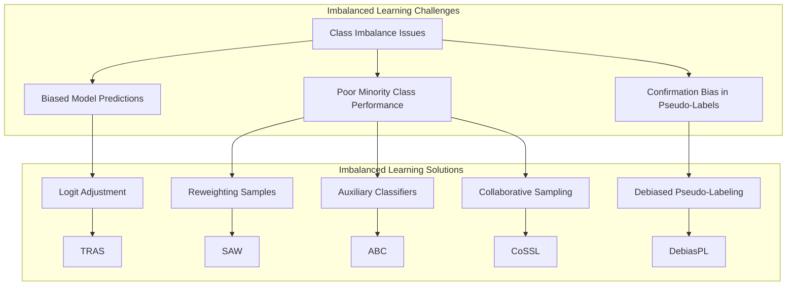
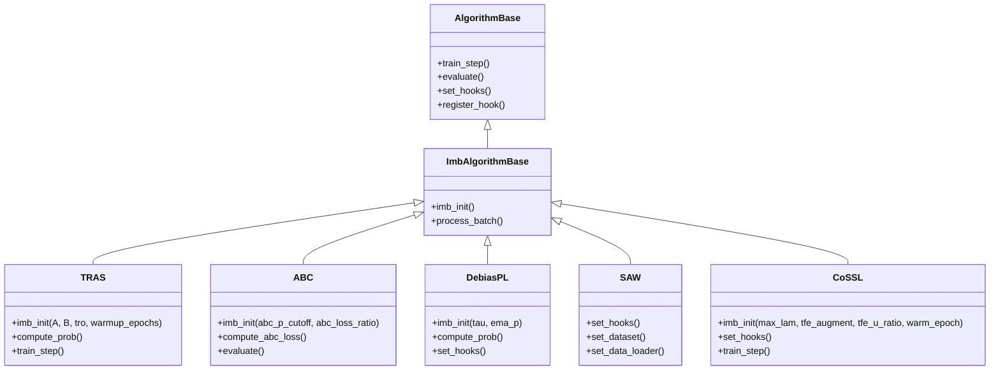
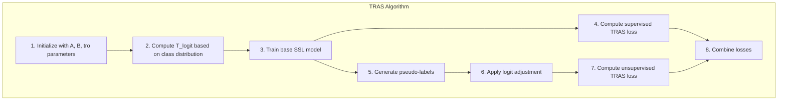
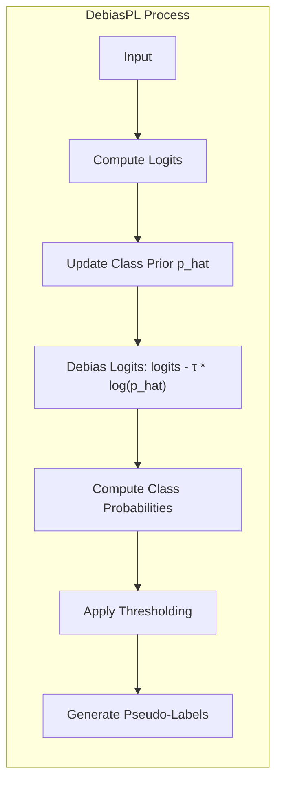
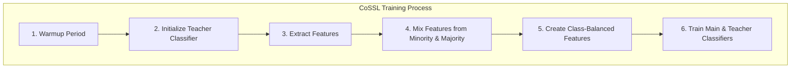
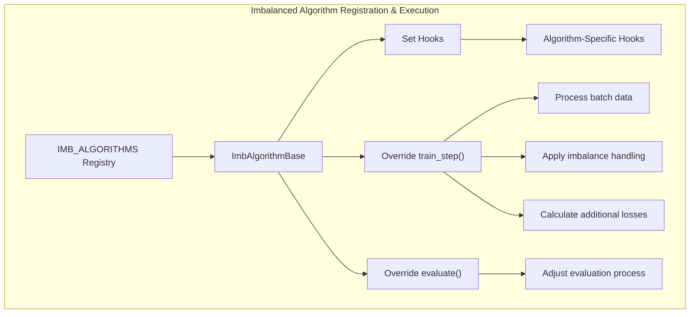
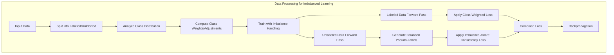

<!-- source: DeepWiki mcp.deepwiki.com · repo microsoft/Semi-supervised-learning · page 3.3 Imbalanced Learning Algorithms · fetched 2026-10-26 -->

# Imbalanced Learning Algorithms

<details>
<summary>Relevant source files</summary>

The following files were used as context for generating this wiki page:

- [.github/workflows/blank.yml](.github/workflows/blank.yml)
- [.github/workflows/issue.yml](.github/workflows/issue.yml)
- [semilearn/core/criterions/consistency.py](semilearn/core/criterions/consistency.py)
- [semilearn/core/hooks/wandb.py](semilearn/core/hooks/wandb.py)
- [semilearn/core/utils/build.py](semilearn/core/utils/build.py)
- [semilearn/core/utils/misc.py](semilearn/core/utils/misc.py)
- [semilearn/imb_algorithms/abc/abc.py](semilearn/imb_algorithms/abc/abc.py)
- [semilearn/imb_algorithms/cossl/cossl.py](semilearn/imb_algorithms/cossl/cossl.py)
- [semilearn/imb_algorithms/cossl/utils.py](semilearn/imb_algorithms/cossl/utils.py)
- [semilearn/imb_algorithms/debiaspl/debiaspl.py](semilearn/imb_algorithms/debiaspl/debiaspl.py)
- [semilearn/imb_algorithms/saw/saw.py](semilearn/imb_algorithms/saw/saw.py)
- [semilearn/imb_algorithms/saw/utils.py](semilearn/imb_algorithms/saw/utils.py)
- [semilearn/imb_algorithms/tras/tras.py](semilearn/imb_algorithms/tras/tras.py)

</details>


## Purpose and Scope

This page documents the imbalanced learning algorithms implemented in the USB (Unified Semi-supervised learning Benchmark) framework. These algorithms are specifically designed to address class imbalance problems in semi-supervised learning scenarios, where the distribution of labeled and unlabeled data may be imbalanced across different classes. For information about standard semi-supervised learning algorithms, see [Basic SSL Algorithms](#3.1) and [Advanced SSL Algorithms](#3.2).

## Overview of Imbalanced Learning in SSL

Semi-supervised learning typically assumes balanced class distributions. However, real-world datasets often exhibit significant class imbalances that can degrade model performance. Imbalanced learning algorithms in USB address this challenge by applying various techniques such as logit adjustment, re-weighting samples, debiasing pseudo-labels, and targeted feature augmentation.



Sources: [semilearn/imb_algorithms/tras/tras.py](), [semilearn/imb_algorithms/saw/saw.py](), [semilearn/imb_algorithms/abc/abc.py](), [semilearn/imb_algorithms/debiaspl/debiaspl.py](), [semilearn/imb_algorithms/cossl/cossl.py]()

## Core Architecture

All imbalanced learning algorithms in USB inherit from the `ImbAlgorithmBase` class, which extends the standard `AlgorithmBase` class. This design provides a unified interface for implementing imbalanced learning techniques while maintaining compatibility with the core SSL framework.



Sources: [semilearn/core/utils/build.py](), [semilearn/imb_algorithms/tras/tras.py](), [semilearn/imb_algorithms/abc/abc.py](), [semilearn/imb_algorithms/debiaspl/debiaspl.py](), [semilearn/imb_algorithms/saw/saw.py](), [semilearn/imb_algorithms/cossl/cossl.py]()

## Implemented Algorithms

The USB framework includes several state-of-the-art imbalanced learning algorithms, each with its unique approach to handling class imbalance. Here's a comparison of the key properties:

| Algorithm | Core Technique | Base SSL Algorithm | Key Components |
|-----------|---------------|-------------------|----------------|
| TRAS | Logit Adjustment | FixMatch | Transfer & Share mechanism, Class-aware logit adjustment |
| ABC | Auxiliary Classifier | Any | Class-balanced sampling, Auxiliary classifier with controlled sampling |
| DebiasPL | Pseudo-Label Debiasing | Most (not MixMatch, MeanTeacher, PiModel) | Adjusted confidence threshold, Distribution alignment |
| SAW | Sample-Aware Weighting | Any | Effective number-based weighting, Separate weights for labeled and unlabeled data |
| CoSSL | Collaborative Sampling | Any | Teacher-student model, Feature mixing, Class-balanced sampling |

Sources: [semilearn/imb_algorithms/tras/tras.py](), [semilearn/imb_algorithms/abc/abc.py](), [semilearn/imb_algorithms/debiaspl/debiaspl.py](), [semilearn/imb_algorithms/saw/saw.py](), [semilearn/imb_algorithms/cossl/cossl.py]()

### TRAS (Transfer & Share)

TRAS (Transfer & Share) algorithm utilizes logit adjustment to address class imbalance by transferring knowledge from majority to minority classes. It adjusts the logits based on the class distribution observed in the labeled data.



Key components of TRAS:
- Custom loss functions: `TRASLogitsAdjCELoss` and `TRASKLLoss`
- Logit adjustment parameter (`la`) based on class distribution
- Warmup period during which standard SSL training is performed

TRAS is built specifically on top of FixMatch and adjusts the decision boundary to account for class imbalance.

Sources: [semilearn/imb_algorithms/tras/tras.py:15-60](), [semilearn/imb_algorithms/tras/tras.py:60-163]()

### ABC (Adaptively Balancing Confidence)

ABC uses an auxiliary classifier to handle class imbalance. It maintains two classifiers - the main one from the base SSL algorithm and an auxiliary one specifically designed to balance class performance.

Key features of ABC:
- Uses an auxiliary classifier with different sampling strategies
- Applies Bernoulli masking based on class distribution
- Adjusts masking as training progresses to gradually shift from imbalanced to balanced distributions

The algorithm computes loss on both labeled and unlabeled data using the auxiliary classifier, which is trained to be more balanced across classes.

Sources: [semilearn/imb_algorithms/abc/abc.py:15-36](), [semilearn/imb_algorithms/abc/abc.py:38-156]()

### DebiasPL (Debiased Pseudo-Labeling)

DebiasPL addresses the confirmation bias problem in pseudo-labeling by adjusting the confidence threshold based on class frequency.



Key components:
- Estimation of class prior distribution `p_hat` using exponential moving average
- Logit adjustment using the tau parameter: `logits - tau * log(p_hat)`
- Custom hook `DebiasPLHook` for distribution alignment

DebiasPL can work with most SSL algorithms except for MixMatch, MeanTeacher, and PiModel.

Sources: [semilearn/imb_algorithms/debiaspl/debiaspl.py:12-61]()

### SAW (Sample-Aware Weighting)

SAW applies effective number-based weighting to both labeled and unlabeled data. It calculates different weights for labeled and unlabeled samples based on their effective number and distributional characteristics.

Key features:
- Uses `effective_weights` calculation based on class frequency
- Applies different weights to labeled loss and unlabeled consistency loss
- Dynamically updates unlabeled data weights based on model predictions

The algorithm implements custom loss functions `SAWCELoss` and `SAWConsistencyLoss` that incorporate the sample weights.

Sources: [semilearn/imb_algorithms/saw/saw.py:16-83](), [semilearn/imb_algorithms/saw/utils.py:13-88]()

### CoSSL (Collaborative Sample Selection Learning)

CoSSL employs a collaborative sampling strategy with an additional teacher classifier. It warmups a specialized teacher model and uses feature mixing to balance class distributions.



Key components:
- Feature extraction and mixing using `TFE` (TransFer and Exploration)
- Teacher-student collaborative learning
- Class-balanced sampling through weighted feature generation
- Specialized optimizer for the teacher classifier

CoSSL has a more complex implementation with additional training procedures for the teacher classifier.

Sources: [semilearn/imb_algorithms/cossl/cossl.py:20-273](), [semilearn/imb_algorithms/cossl/utils.py:65-150]()

## Integration with USB Framework

Imbalanced learning algorithms are integrated into the USB framework using the registration mechanism and hook system. Each algorithm is registered with the `IMB_ALGORITHMS` registry.



Key integration points:
1. Registration via `@IMB_ALGORITHMS.register('algorithm_name')`
2. Initialization of algorithm-specific parameters via `imb_init()`
3. Override of core methods like `train_step()` and `evaluate()`
4. Custom hooks for specialized behavior

Sources: [semilearn/imb_algorithms/tras/tras.py:59](), [semilearn/imb_algorithms/abc/abc.py:38](), [semilearn/imb_algorithms/debiaspl/debiaspl.py:12](), [semilearn/imb_algorithms/saw/saw.py:16](), [semilearn/imb_algorithms/cossl/cossl.py:100]()

## Configuration and Usage

To use imbalanced learning algorithms, you need to specify both the base SSL algorithm and the imbalanced learning algorithm in your configuration. Each imbalanced algorithm provides static `get_argument()` methods that define its configuration parameters.

Example configuration parameters:

| Algorithm | Key Parameters | Description |
|-----------|---------------|-------------|
| TRAS | `tras_A`, `tras_B`, `tras_tro`, `tras_warmup_epochs` | Control logit adjustment and warmup period |
| ABC | `abc_p_cutoff`, `abc_loss_ratio` | Threshold for auxiliary classifier and loss ratio |
| DebiasPL | `debiaspl_tau`, `debiaspl_ema_p` | Control debiasing strength and EMA momentum |
| SAW | No specific parameters | Uses internal weighting mechanism |
| CoSSL | `cossl_max_lam`, `cossl_tfe_augment`, `cossl_warm_epoch` | Control feature mixing and warmup |

Usage example:
```python
# Configuration for TRAS algorithm with FixMatch base
args.algorithm = 'fixmatch'  # Base SSL algorithm
args.imb_algorithm = 'tras'  # Imbalanced learning algorithm
args.tras_A = 2
args.tras_B = 2
args.tras_tro = 1.0
args.tras_warmup_epochs = 10
```

Sources: [semilearn/imb_algorithms/tras/tras.py:155-162](), [semilearn/imb_algorithms/abc/abc.py:151-156](), [semilearn/imb_algorithms/debiaspl/debiaspl.py:56-61](), [semilearn/imb_algorithms/cossl/cossl.py:259-272]()

## Data Flow in Imbalanced Learning



The data flow in imbalanced learning algorithms typically involves:
1. Analyzing the class distribution in labeled data
2. Computing adjustments or weights based on this distribution
3. Applying these adjustments during the training process
4. Special handling of pseudo-labeling to prevent reinforcement of bias

Sources: [semilearn/core/utils/build.py:60-108](), [semilearn/imb_algorithms/tras/tras.py:100-143](), [semilearn/imb_algorithms/saw/utils.py:22-56]()

## Monitoring and Evaluation

Imbalanced learning algorithms include specialized monitoring via the hooks system, with metrics tracked in Tensorboard, Wandb, or other logging systems. Key metrics include class-specific accuracy, precision, recall, and F1 scores, which are particularly important for imbalanced datasets.

The framework's `WANDBHook` includes imbalance-specific tags when using imbalanced learning algorithms:

```python
data_setting = f'setting: {algorithm.args.dataset}_lb{algorithm.args.num_labels}_{algorithm.args.lb_imb_ratio}_ulb{algorithm.args.ulb_num_labels}_{algorithm.args.ulb_imb_ratio}'
alg = f'alg: {algorithm.args.algorithm}'
imb_alg = f'imb_alg: {algorithm.args.imb_algorithm}'
tags = [benchmark, dataset, data_setting, alg, imb_alg]
```

Sources: [semilearn/core/hooks/wandb.py:9-62]()

## Best Practices and Tips

When using imbalanced learning algorithms, consider the following best practices:

1. **Choose the right algorithm** based on your dataset characteristics:
   - For severe imbalance, TRAS and SAW tend to work well
   - For moderate imbalance, ABC and DebiasPL can be effective
   - For complex tasks with sufficient data, CoSSL can provide strong performance

2. **Tune algorithm-specific parameters** carefully, as they can significantly impact performance:
   - Warmup periods are important for algorithms like TRAS and CoSSL
   - Adjustment strengths (tau in DebiasPL, A/B in TRAS) should be tuned based on imbalance severity

3. **Monitor class-specific metrics** rather than just overall accuracy:
   - Precision, recall, and F1 scores for minority classes
   - Confusion matrix to identify class-specific issues

4. **Consider combining techniques** for very challenging imbalanced datasets, such as:
   - Data augmentation for minority classes
   - Sample re-weighting (SAW) with logit adjustment (TRAS)

---

