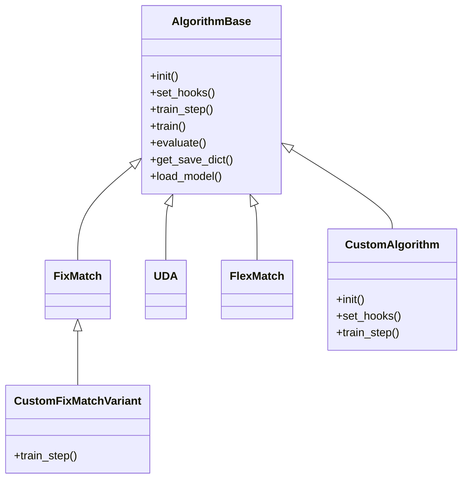
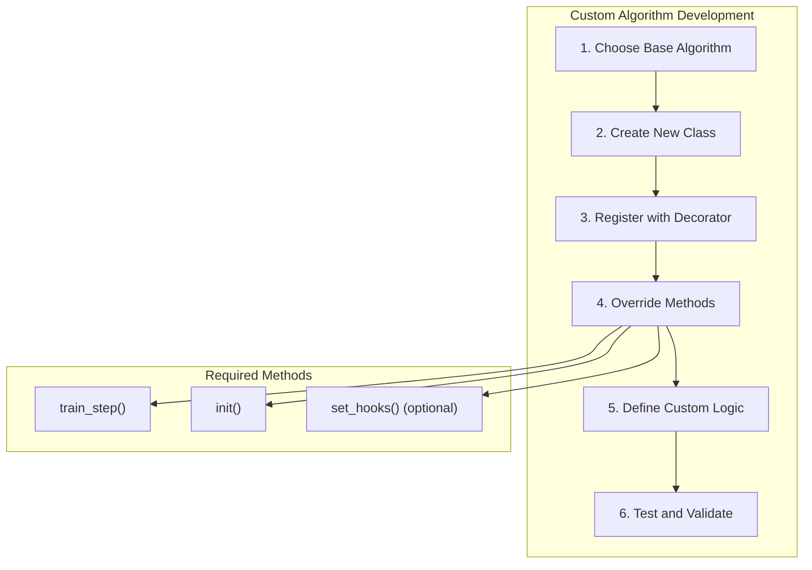
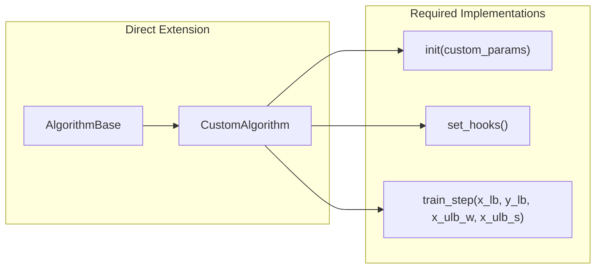
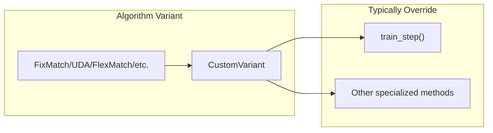
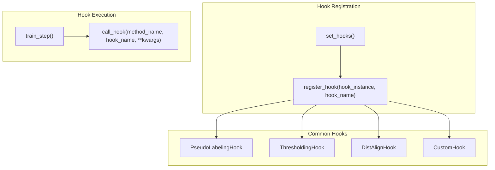
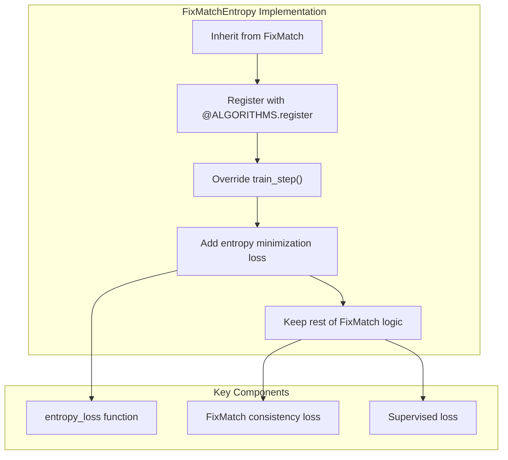
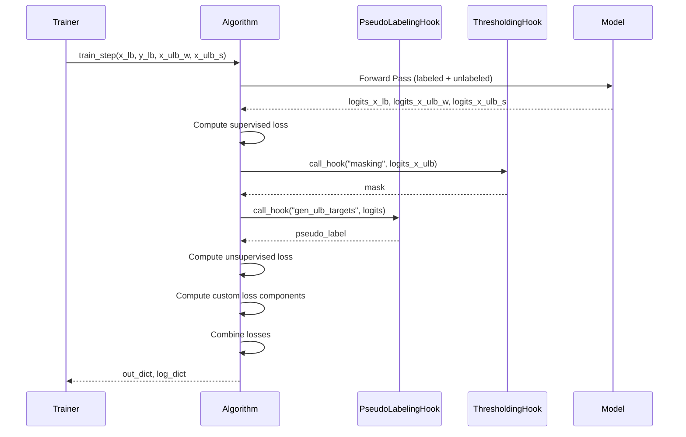

<!-- source: DeepWiki mcp.deepwiki.com · repo microsoft/Semi-supervised-learning · page 3.4 Custom Algorithm Development · fetched 2026-10-26 -->

# Custom Algorithm Development

<details>
<summary>Relevant source files</summary>

The following files were used as context for generating this wiki page:

- [notebooks/Beginner_Example.ipynb](notebooks/Beginner_Example.ipynb)
- [notebooks/Custom_Algorithm.ipynb](notebooks/Custom_Algorithm.ipynb)
- [semilearn/algorithms/adamatch/adamatch.py](semilearn/algorithms/adamatch/adamatch.py)
- [semilearn/algorithms/fixmatch/fixmatch.py](semilearn/algorithms/fixmatch/fixmatch.py)
- [semilearn/algorithms/flexmatch/flexmatch.py](semilearn/algorithms/flexmatch/flexmatch.py)
- [semilearn/algorithms/uda/uda.py](semilearn/algorithms/uda/uda.py)

</details>


## Purpose and Scope

This document provides a comprehensive guide for developing custom semi-supervised learning (SSL) algorithms within the USB (Unified Semi-supervised learning Benchmark) framework. It covers the architecture of algorithms, the process of creating and registering new algorithms, and best practices for algorithm development. For general information about the existing SSL algorithms, see [Basic SSL Algorithms](#3.1) and [Advanced SSL Algorithms](#3.2).

## Algorithm Architecture in USB

The USB framework is designed to facilitate the development of new SSL algorithms through a modular and extensible architecture. All algorithms inherit from a common base class and utilize a hook system for customization.



*Diagram: Algorithm inheritance hierarchy showing how custom algorithms can extend the base class or existing algorithms*

Sources: [semilearn/algorithms/fixmatch/fixmatch.py:12-34](https://github.com/microsoft/Semi-supervised-learning/blob/master/semilearn/algorithms/fixmatch/fixmatch.py), [notebooks/Custom_Algorithm.ipynb:76-78](https://github.com/microsoft/Semi-supervised-learning/blob/master/notebooks/Custom_Algorithm.ipynb)

### Key Components of an Algorithm

Every algorithm in USB consists of the following essential components:

1. **Registration** - Algorithms are registered with the framework using the `@ALGORITHMS.register()` decorator
2. **Initialization** - Custom parameters and configurations are set in the `init()` method
3. **Hooks** - Specialized functionality is added through the hook system in `set_hooks()`
4. **Training Logic** - The core algorithm logic is implemented in the `train_step()` method



*Diagram: Custom algorithm development workflow*

Sources: [notebooks/Custom_Algorithm.ipynb:42-44](https://github.com/microsoft/Semi-supervised-learning/blob/master/notebooks/Custom_Algorithm.ipynb), [semilearn/algorithms/fixmatch/fixmatch.py:11-36](https://github.com/microsoft/Semi-supervised-learning/blob/master/semilearn/algorithms/fixmatch/fixmatch.py)

## Creating a Custom Algorithm

### Method 1: Extending from AlgorithmBase

For creating an entirely new algorithm, extend directly from `AlgorithmBase`:



*Diagram: Direct extension from AlgorithmBase*

Sources: [semilearn/algorithms/fixmatch/fixmatch.py:33-46](https://github.com/microsoft/Semi-supervised-learning/blob/master/semilearn/algorithms/fixmatch/fixmatch.py)

### Method 2: Extending from an Existing Algorithm

For creating a variant of an existing algorithm, extend from that algorithm:



*Diagram: Creating an algorithm variant*

Sources: [notebooks/Custom_Algorithm.ipynb:76-138](https://github.com/microsoft/Semi-supervised-learning/blob/master/notebooks/Custom_Algorithm.ipynb)

### Step-by-Step Guide

1. **Choose a base class**: Decide whether to extend directly from `AlgorithmBase` or from an existing algorithm
2. **Create your class**: Define a new class that inherits from the chosen base
3. **Register your algorithm**: Use the `@ALGORITHMS.register('algorithm_name')` decorator
4. **Initialize parameters**: Implement or override the `init()` method with custom parameters
5. **Set up hooks**: Override the `set_hooks()` method to register custom hooks
6. **Implement core logic**: Define the `train_step()` method with your algorithm's logic

## The Hook System

The hook system in USB provides a powerful way to customize algorithm behavior without reimplementing common functionality. Hooks are registered in the `set_hooks()` method and can be called during training.



*Diagram: Hook system architecture*

Sources: [semilearn/algorithms/fixmatch/fixmatch.py:43-46](https://github.com/microsoft/Semi-supervised-learning/blob/master/semilearn/algorithms/fixmatch/fixmatch.py), [semilearn/algorithms/flexmatch/flexmatch.py:54-57](https://github.com/microsoft/Semi-supervised-learning/blob/master/semilearn/algorithms/flexmatch/flexmatch.py)

### Common Hooks

1. **PseudoLabelingHook**: Generates pseudo-labels for unlabeled data
2. **ThresholdingHook variants**: Define confidence thresholds for pseudo-labels
   - FixedThresholdingHook
   - FlexMatchThresholdingHook
   - AdaMatchThresholdingHook
3. **DistAlignHook**: Aligns the distribution of pseudo-labels

## Custom Algorithm Example: FixMatch with Entropy Minimization

Let's examine a practical example of creating a custom algorithm by extending FixMatch and adding an entropy minimization loss.



*Diagram: FixMatchEntropy algorithm implementation*

Sources: [notebooks/Custom_Algorithm.ipynb:62-138](https://github.com/microsoft/Semi-supervised-learning/blob/master/notebooks/Custom_Algorithm.ipynb)

### 1. Define the custom algorithm class

```python
@ALGORITHMS.register('fixmatch_entropy')
class FixMatchEntropy(FixMatch):
    # Override train_step method
    def train_step(self, idx_lb, x_lb, y_lb, x_ulb_w, x_ulb_s):
        # Implementation details...
```

Sources: [notebooks/Custom_Algorithm.ipynb:76-78](https://github.com/microsoft/Semi-supervised-learning/blob/master/notebooks/Custom_Algorithm.ipynb)

### 2. Implement the entropy loss function

```python
def entropy_loss(ul_y):
    p = F.softmax(ul_y, dim=1)
    return -(p * F.log_softmax(ul_y, dim=1)).sum(dim=1).mean(dim=0)
```

Sources: [notebooks/Custom_Algorithm.ipynb:71-73](https://github.com/microsoft/Semi-supervised-learning/blob/master/notebooks/Custom_Algorithm.ipynb)

### 3. Add entropy loss to the train_step method

The key modification in the `train_step` method is the addition of entropy minimization:

```python
# NOTE: add entropy loss here
loss_entmin = entropy_loss(logits_x_ulb_w)
```

Sources: [notebooks/Custom_Algorithm.ipynb:128-129](https://github.com/microsoft/Semi-supervised-learning/blob/master/notebooks/Custom_Algorithm.ipynb)

### 4. Using the custom algorithm

To use the custom algorithm, simply specify it in the configuration:

```python
config = {
    'algorithm': 'fixmatch_entropy',
    # Other configuration parameters...
}
```

Sources: [notebooks/Custom_Algorithm.ipynb:169-170](https://github.com/microsoft/Semi-supervised-learning/blob/master/notebooks/Custom_Algorithm.ipynb)

## Data Flow in Custom Algorithms

Understanding how data flows through the algorithm is essential for custom algorithm development:



*Diagram: Data flow in a custom algorithm's train_step method*

Sources: [semilearn/algorithms/fixmatch/fixmatch.py:48-105](https://github.com/microsoft/Semi-supervised-learning/blob/master/semilearn/algorithms/fixmatch/fixmatch.py), [notebooks/Custom_Algorithm.ipynb:78-138](https://github.com/microsoft/Semi-supervised-learning/blob/master/notebooks/Custom_Algorithm.ipynb)

## Best Practices for Custom Algorithm Development

### 1. Choose the right base class

- Extend directly from `AlgorithmBase` for fundamentally new algorithms
- Extend from existing algorithms (like `FixMatch`, `UDA`, etc.) for variations

### 2. Maintain the standard interface

- Keep the same parameter signatures for core methods like `train_step()`
- Return the expected output dictionaries (`out_dict` and `log_dict`)

### 3. Leverage the hook system

- Use existing hooks where possible instead of reimplementing functionality
- Create custom hooks for reusable algorithm components

### 4. Add custom arguments

If your algorithm needs custom hyperparameters, define them using the static `get_argument()` method:

```python
@staticmethod
def get_argument():
    return [
        SSL_Argument('--custom_param', type, default_value, 'description'),
        # More parameters...
    ]
```

Sources: [semilearn/algorithms/fixmatch/fixmatch.py:108-114](https://github.com/microsoft/Semi-supervised-learning/blob/master/semilearn/algorithms/fixmatch/fixmatch.py), [semilearn/algorithms/flexmatch/flexmatch.py:133-140](https://github.com/microsoft/Semi-supervised-learning/blob/master/semilearn/algorithms/flexmatch/flexmatch.py)

### 5. Handle model saving and loading

If your algorithm maintains state beyond the model weights, override:
- `get_save_dict()` to include custom state
- `load_model()` to restore custom state

Sources: [semilearn/algorithms/flexmatch/flexmatch.py:119-131](https://github.com/microsoft/Semi-supervised-learning/blob/master/semilearn/algorithms/flexmatch/flexmatch.py), [semilearn/algorithms/adamatch/adamatch.py:119-132](https://github.com/microsoft/Semi-supervised-learning/blob/master/semilearn/algorithms/adamatch/adamatch.py)

## Summary

Developing custom algorithms in the USB framework involves:

1. Selecting an appropriate base class
2. Registering your algorithm with the `@ALGORITHMS.register()` decorator
3. Implementing the required methods (`init()`, `train_step()`)
4. Utilizing the hook system for modular functionality
5. Properly handling input and output data

By following these guidelines, you can efficiently develop and test new SSL algorithms within the unified benchmark system.

---

