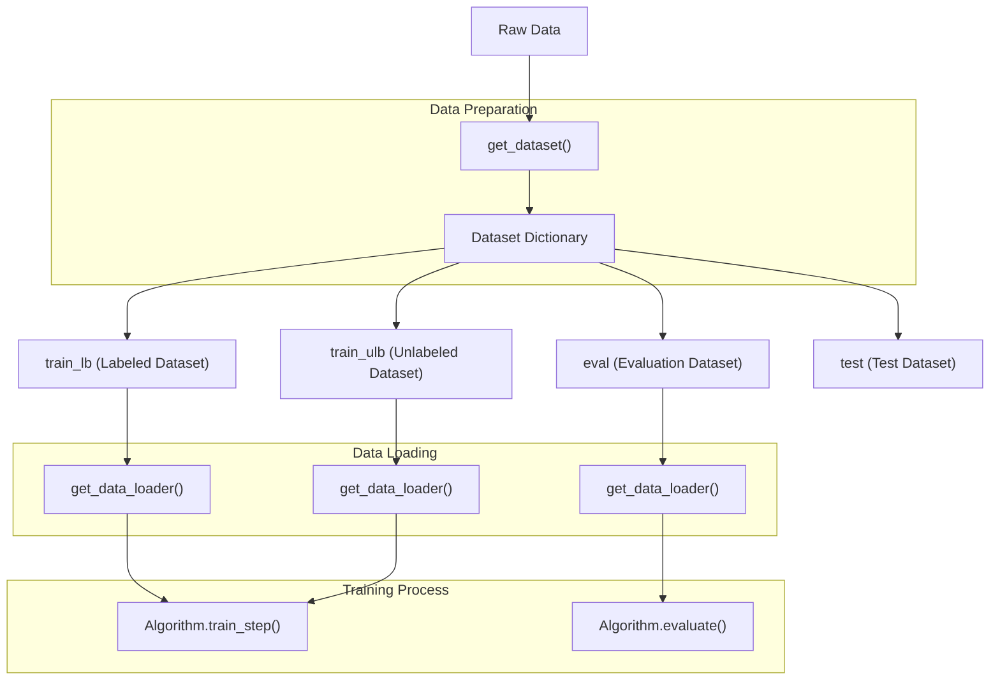
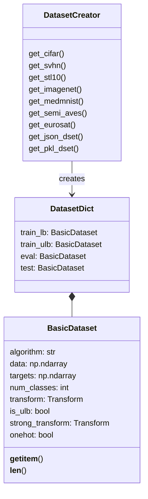
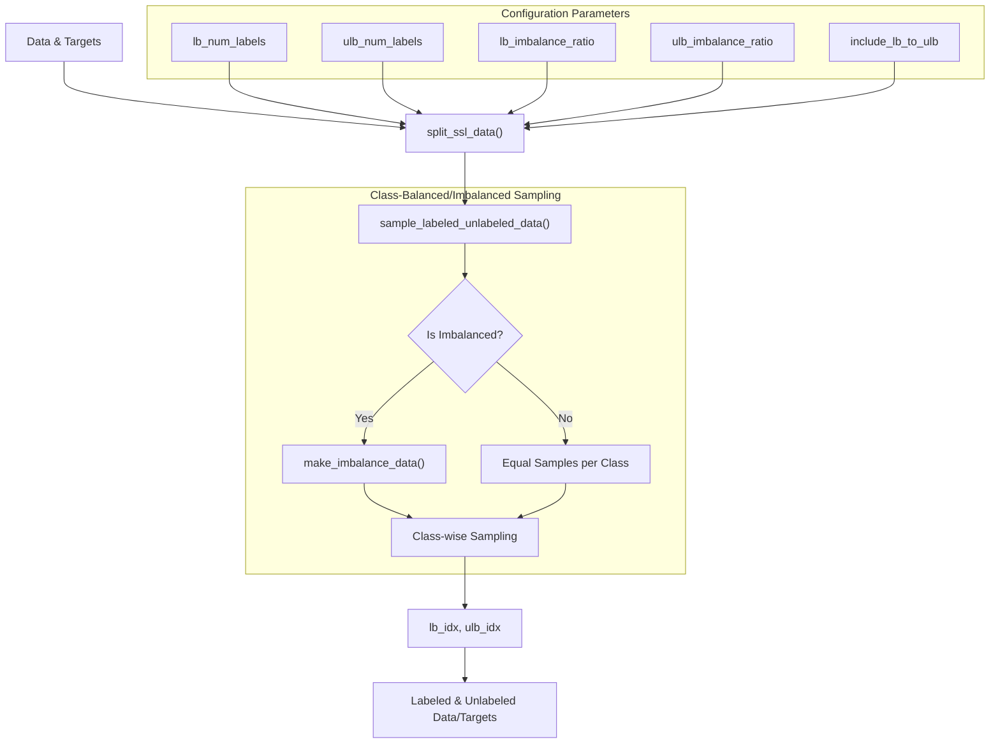
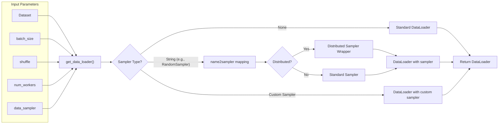
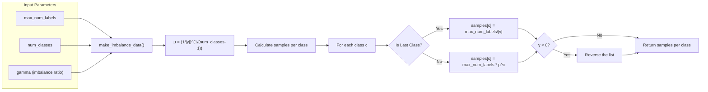
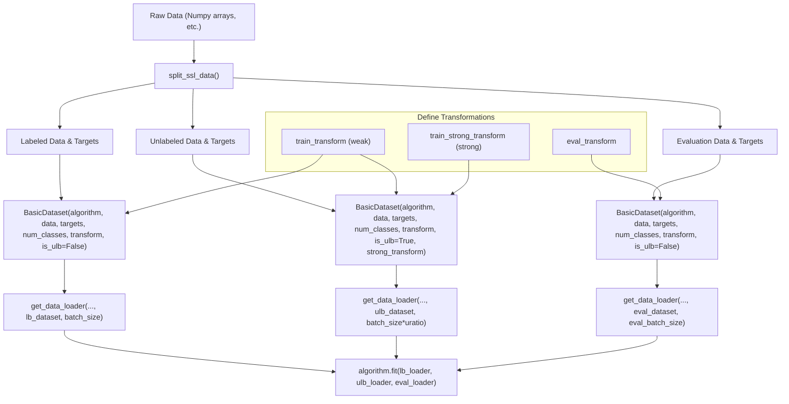

<!-- source: DeepWiki mcp.deepwiki.com · repo microsoft/Semi-supervised-learning · page 4 Datasets and Data Handling · fetched 2026-10-26 -->

# Datasets and Data Handling

<details>
<summary>Relevant source files</summary>

The following files were used as context for generating this wiki page:

- [notebooks/Custom_Dataset.ipynb](notebooks/Custom_Dataset.ipynb)
- [semilearn/core/utils/build.py](semilearn/core/utils/build.py)
- [semilearn/core/utils/misc.py](semilearn/core/utils/misc.py)
- [semilearn/datasets/utils.py](semilearn/datasets/utils.py)
- [semilearn/imb_algorithms/abc/abc.py](semilearn/imb_algorithms/abc/abc.py)
- [semilearn/imb_algorithms/tras/tras.py](semilearn/imb_algorithms/tras/tras.py)
- [setup.py](setup.py)

</details>


This document provides a comprehensive guide to the dataset management and data handling mechanisms in the USB (Unified Semi-supervised learning Benchmark) framework. It covers how data is loaded, processed, split into labeled and unlabeled sets, and fed into SSL algorithms. For information about supported datasets and their specific implementations, see [Supported Datasets](#4.1).

## 1. Data Handling Architecture

The USB framework uses a systematic approach to data handling that supports a wide range of datasets across different domains (computer vision, NLP, and audio) while enabling various semi-supervised learning scenarios. The following diagram illustrates the overall data processing pipeline:



Sources: [semilearn/core/utils/build.py:60-108](), [semilearn/datasets/utils.py:16-52]()

## 2. Dataset Preparation and Loading

### 2.1 Dataset Creation Process

The USB framework provides a unified interface for loading datasets across different domains. The main entry point is the `get_dataset` function which returns a dictionary containing labeled, unlabeled, evaluation, and test datasets.



Sources: [semilearn/core/utils/build.py:60-108]()

### 2.2 Data Splitting for Semi-Supervised Learning

A critical component of semi-supervised learning is the division of data into labeled and unlabeled sets. The USB framework uses the `split_ssl_data` function to handle this process:



Sources: [semilearn/datasets/utils.py:16-52](), [semilearn/datasets/utils.py:59-120](), [semilearn/datasets/utils.py:123-136]()

The data splitting process supports:
- Balanced class distribution (equal samples per class)
- Imbalanced class distribution (controlled by imbalance ratio)
- Option to include labeled data in the unlabeled set
- Persistent indices (saved to disk for reproducibility)

## 3. Data Loaders and Batch Processing

### 3.1 Data Loader Creation

The USB framework provides the `get_data_loader` function to create PyTorch DataLoader objects with appropriate configurations:



Sources: [semilearn/core/utils/build.py:111-180]()

### 3.2 Domain-Specific Data Processing

The USB framework supports different data domains (vision, text, audio) with specialized processing:

| Domain | Data Type | Collator Function | Special Processing |
|--------|-----------|-------------------|-------------------|
| Vision | Images | None (default) | Resize, normalization, augmentation |
| NLP | Text | BERT collators | Tokenization, padding, truncation |
| Audio | Waveforms | Wave2Vec/Hubert collators | Sample rate conversion, padding, chunking |

Sources: [semilearn/datasets/utils.py:139-154]()

## 4. Imbalanced Dataset Handling

The USB framework provides robust support for imbalanced datasets, which is particularly important for real-world scenarios where class distributions are rarely uniform.

### 4.1 Creating Imbalanced Datasets

The function `make_imbalance_data` applies an exponential decay to the number of samples per class:



Sources: [semilearn/datasets/utils.py:123-136]()

### 4.2 Imbalance-Aware Algorithms

The framework includes several algorithms specifically designed to handle imbalanced datasets:

| Algorithm | Description | Class-Balancing Technique |
|-----------|-------------|---------------------------|
| TRAS | Transfer & Share | Logit adjustment with class-distribution-aware thresholding |
| ABC | Auxiliary Balanced Classifier | Auxiliary classifier with dynamic balancing masks |
| CREST | Class-Rebalancing Self-Training | Rebalancing through sample weighting and thresholding |
| SAW | Sample Aware Weighting | Dynamic sample weighting based on class distributions |
| CoSSL | Co-modeling for SSL | Collaborative learning with diversity-promoting regularization |
| DebiasPL | Debiasing Pseudo-Labels | Adjusting pseudo-label distribution to match true distribution |

Sources: [semilearn/imb_algorithms/tras/tras.py:1-163](), [semilearn/imb_algorithms/abc/abc.py:1-157]()

## 5. Custom Dataset Integration

Integrating a custom dataset into the USB framework involves several steps:



Sources: [notebooks/Custom_Dataset.ipynb:1-316]()

### 5.1 Example: Custom Dataset Creation

The following steps demonstrate how to create a custom dataset:

1. Prepare your data in a suitable format (e.g., numpy arrays)
2. Use `split_ssl_data` to divide into labeled and unlabeled sets
3. Define transformations (weak and strong augmentations)
4. Create `BasicDataset` instances for labeled, unlabeled, and evaluation data
5. Create data loaders with `get_data_loader`
6. Pass the data loaders to the algorithm's training function

Sources: [notebooks/Custom_Dataset.ipynb:171-214]()

## 6. Data Augmentation Strategies

Data augmentation is crucial for semi-supervised learning, especially for methods that rely on consistency regularization. The USB framework supports different augmentation strategies depending on the data domain:

| Domain | Weak Augmentation | Strong Augmentation | Purpose |
|--------|-------------------|---------------------|---------|
| Vision | Random crop, flip | RandAugment, CTAugment | Create diverse views of the same image |
| NLP | Word dropout, synonym replacement | Back-translation, word shuffle | Generate semantically similar texts |
| Audio | Time shifting, noise injection | Time masking, frequency masking | Create variations while preserving content |

For custom augmentation, transformations can be defined and passed to the `BasicDataset` constructor:

```python
train_transform = transforms.Compose([
    transforms.RandomHorizontalFlip(),
    transforms.RandomCrop(32, padding=int(32 * 0.125)),
    transforms.ToTensor(),
    transforms.Normalize([0.5, 0.5, 0.5], [0.5, 0.5, 0.5])
])

train_strong_transform = transforms.Compose([
    # More aggressive augmentations here
])

lb_dataset = BasicDataset(algorithm, lb_data, lb_target, num_classes, 
                         train_transform, is_ulb=False)
ulb_dataset = BasicDataset(algorithm, ulb_data, ulb_target, num_classes,
                           train_transform, is_ulb=True, 
                           strong_transform=train_strong_transform)
```

Sources: [notebooks/Custom_Dataset.ipynb:177-189]()

## 7. Data Handling in Distributed Training

The USB framework supports distributed training through PyTorch's DistributedDataParallel. The data loading mechanism adapts to distributed settings by:

1. Using appropriate samplers for distributed training
2. Adjusting batch sizes per GPU
3. Supporting synchronized batch normalization

```mermaid
flowchart TB
    subgraph "Data Loader Creation"
        GetDataLoader["get_data_loader()"]
        DistributedCheck{"distributed=True?"}
        DistributedCheck -->|"Yes"| DistributedSetup["Setup distributed samplers"]
        DistributedCheck -->|"No"| StandardSetup["Use standard samplers"]
        
        DistributedSetup --> AdjustBatchSize["Adjust batch size per GPU"]
        DistributedSetup --> SetupReplicas["Configure num_replicas and rank"]
        SetupReplicas --> CalculateSamples["Calculate samples per worker"]
        CalculateSamples --> CreateDistLoader["Create DataLoader with distributed sampler"]
        
        StandardSetup --> CreateStdLoader["Create standard DataLoader"]
        
        CreateDistLoader --> ReturnLoader["Return DataLoader"]
        CreateStdLoader --> ReturnLoader
    end
    
    subgraph "Model Setup"
        ModelToCUDA["send_model_cuda()"]
        CheckDistributed{"distributed=True?"}
        CheckDistributed -->|"Yes"| SetupDDP["Setup DistributedDataParallel"]
        CheckDistributed -->|"No"| SetupDP["Setup DataParallel"]
        
        SetupDDP --> SyncBN["Convert to SyncBatchNorm"]
        SyncBN --> WrapDDP["Wrap with DistributedDataParallel"]
        
        SetupDP --> WrapDP["Wrap with DataParallel"]
        
        WrapDDP --> ReturnModel["Return wrapped model"]
        WrapDP --> ReturnModel
    end
```



Sources: [semilearn/core/utils/build.py:144-172](), [semilearn/core/utils/misc.py:39-70]()

## 8. Conclusion

The USB framework provides a comprehensive and flexible data handling system that supports a wide range of datasets across different domains. Key features include:

1. Unified interface for dataset creation and loading
2. Support for both balanced and imbalanced class distributions
3. Flexible data splitting for semi-supervised learning
4. Domain-specific data processing and augmentation
5. Support for distributed training

This architecture enables researchers to easily implement and compare different semi-supervised learning algorithms across various datasets and settings.

---

