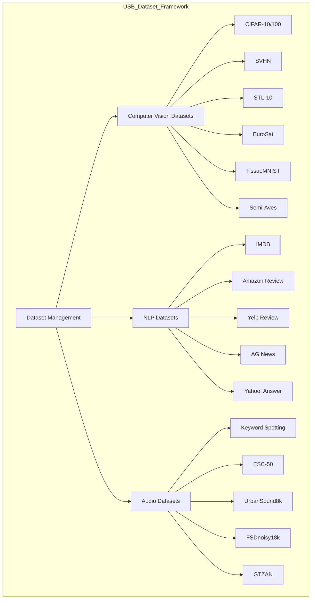
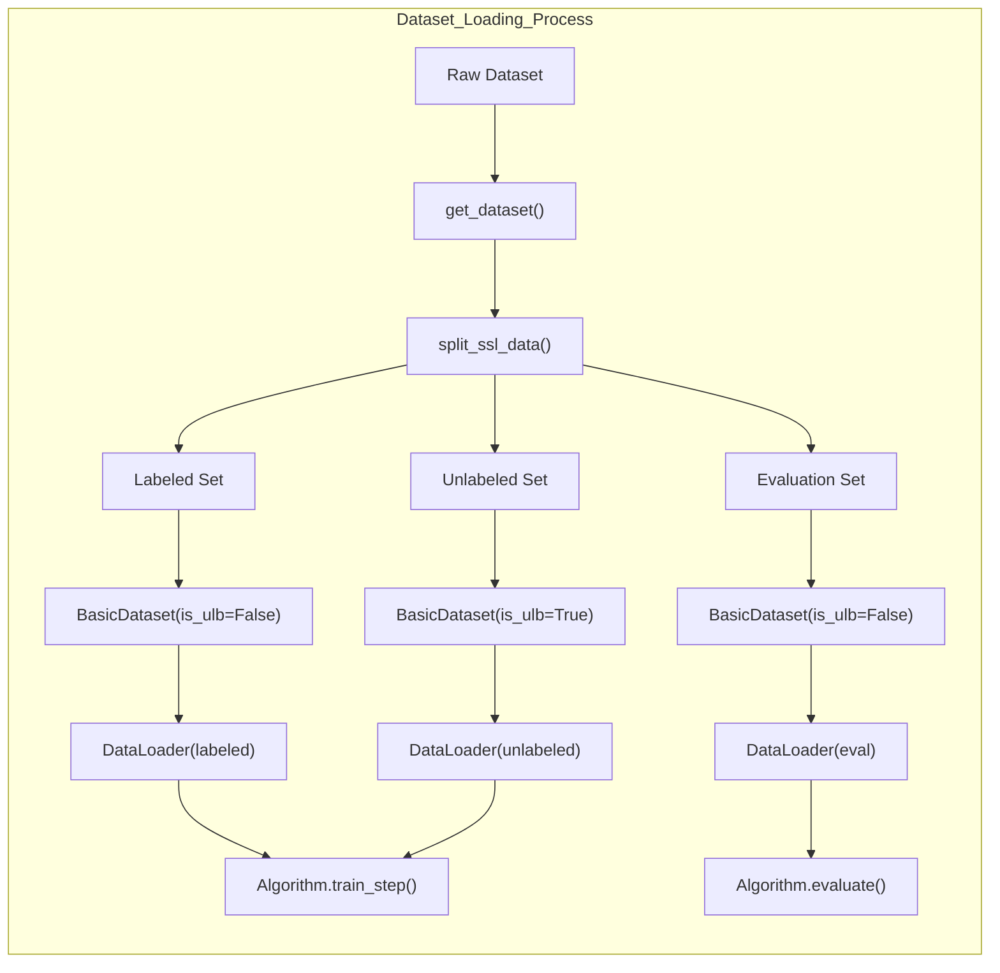
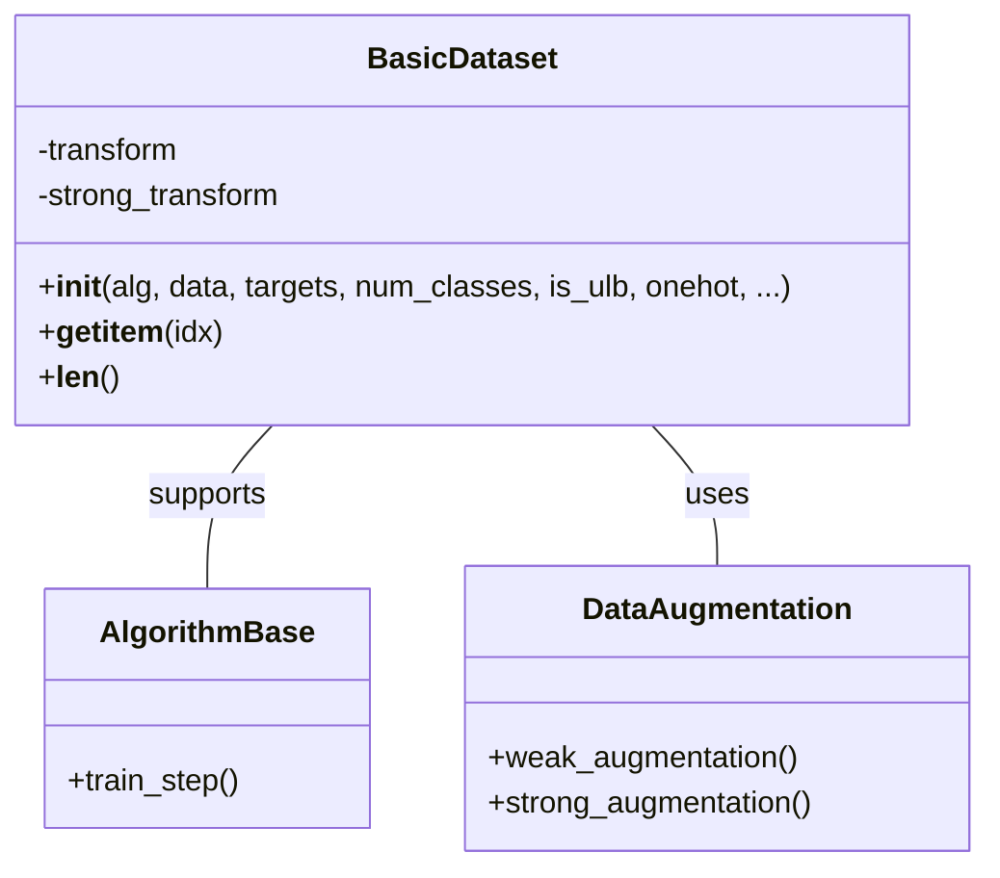
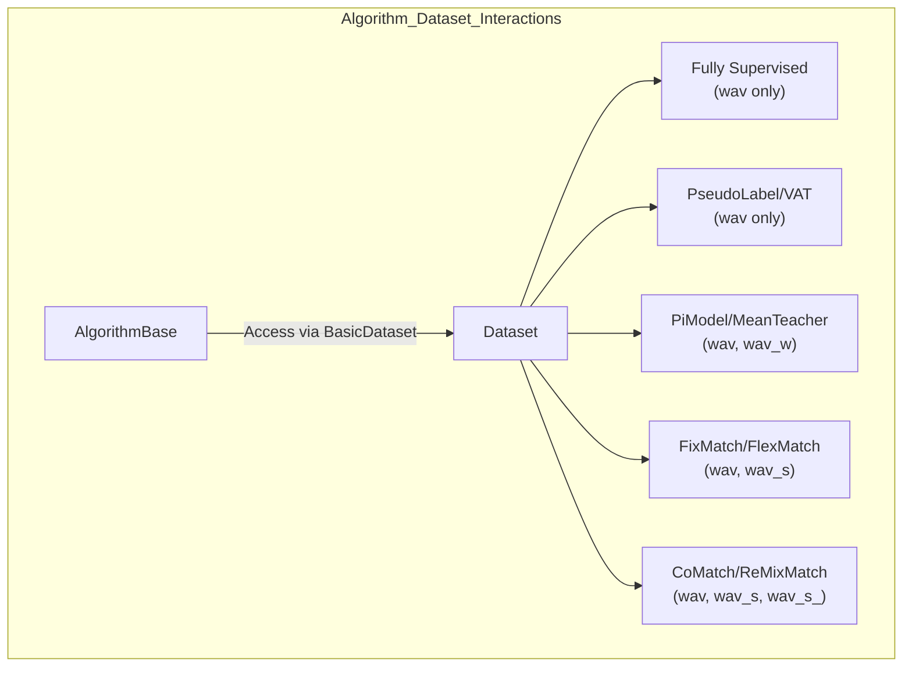

<!-- source: DeepWiki mcp.deepwiki.com · repo microsoft/Semi-supervised-learning · page 4.1 Supported Datasets · fetched 2026-10-26 -->

# Supported Datasets

Relevant source files

The following files were used as context for generating this wiki page:

- [README.md](README.md)
- [results/README.md](results/README.md)
- [semilearn/algorithms/defixmatch/defixmatch.py](semilearn/algorithms/defixmatch/defixmatch.py)
- [semilearn/datasets/audio_datasets/datasetbase.py](semilearn/datasets/audio_datasets/datasetbase.py)

## Purpose and Scope

This document provides a comprehensive overview of all datasets supported by the USB (Unified Semi-supervised Learning Benchmark) framework across Computer Vision (CV), Natural Language Processing (NLP), and Audio domains. It details dataset characteristics, organization, and loading mechanisms. For information about data augmentation techniques and processing pipelines, see [Data Augmentation and Processing](#4.2).

## Dataset Overview

USB supports 15 diverse datasets across three domains, providing a comprehensive benchmark for semi-supervised learning algorithms. Each dataset is configured with specific label settings to create semi-supervised learning scenarios.

Sources: [README.md:113-115](), [results/README.md:8-66]()

## Computer Vision Datasets

USB supports both classic CV benchmark datasets and additional specialized datasets to provide comprehensive evaluation.

### Classic CV Benchmarks

| Dataset   | #Label Settings    | #Training data | #Test data | #Class | Description |
|-----------|-------------------|----------------|------------|--------|-------------|
| CIFAR-10  | 4 / 25 / 400      | 50,000         | 10,000     | 10     | 32x32 color images in 10 categories |
| CIFAR-100 | 4 / 25 / 100      | 50,000         | 10,000     | 100    | 32x32 color images in 100 categories |
| SVHN      | 4 / 25 / 100      | 604,388        | 26,032     | 10     | Street View House Numbers |
| STL-10    | 4 / 25 / 100      | 100,000        | 10,000     | 10     | 96x96 color images in 10 categories |

### Additional USB CV Datasets

| Dataset     | #Label Settings | #Training data    | #Test data | #Class | Description |
|-------------|----------------|-------------------|------------|--------|-------------|
| EuroSat     | 2 / 4          | 16,200            | 5,400      | 10     | Satellite imagery of European land cover types |
| TissueMNIST | 10 / 50        | 165,466           | 47,280     | 8      | Medical tissue images across 8 categories |
| Semi-Aves   | 15-53          | 3,959 / 26,640    | 4,000      | 200    | Bird species classification dataset |

Sources: [results/README.md:8-34]()

## Natural Language Processing Datasets

USB includes five diverse NLP datasets covering sentiment analysis, topic classification, and question answering tasks.

| Dataset       | #Label Settings | #Training data | #Val data | #Test data | #Class | Description |
|---------------|----------------|----------------|-----------|------------|--------|-------------|
| IMDB          | 10 / 50        | 23,000         | 2,000     | 25,000     | 2      | Movie reviews sentiment analysis |
| Amazon Review | 50 / 200       | 250,000        | 25,000    | 65,000     | 5      | Product reviews with star ratings |
| Yelp Review   | 50 / 200       | 250,000        | 25,000    | 50,000     | 5      | Business reviews with star ratings |
| AG News       | 10 / 50        | 100,000        | 10,000    | 7,600      | 4      | News article classification |
| Yahoo! Answer | 50 / 200       | 500,000        | 50,000    | 60,000     | 10     | Question-answer classification |

Sources: [results/README.md:35-50]()

## Audio Datasets

USB supports five audio classification datasets covering different domains such as environmental sounds, music, and speech.

| Dataset          | #Label Settings | #Training data | #Val data | #Test data | #Class | Description |
|------------------|----------------|----------------|-----------|------------|--------|-------------|
| Keyword Spotting | 5 / 20         | 18,538         | 2,577     | 2,567      | 10     | Speech command recognition |
| ESC-50           | 5 / 10         | 1,200          | 400       | 400        | 50     | Environmental sound classification |
| UrbanSound8k     | 10 / 40        | 7,079          | 816       | 837        | 10     | Urban sound classification |
| FSDnoisy18k      | 52-171         | 1,772 / 15,813 | -         | 947        | 20     | Noisy audio classification |
| GTZAN            | 10 / 40        | 7,000          | 1,500     | 1,500      | 10     | Music genre classification |

Sources: [results/README.md:51-66]()

## Dataset Processing Pipeline

The framework follows a standardized processing pipeline for all datasets, providing unified access to semi-supervised learning settings across domains.

Sources: [semilearn/datasets/audio_datasets/datasetbase.py:45-135]()

## BasicDataset Class

The `BasicDataset` class serves as the foundation for all datasets in USB, handling both labeled and unlabeled data, and providing appropriate transformations based on the specific SSL algorithm.

The `BasicDataset` class handles:
- Data loading for both labeled and unlabeled examples
- Domain-specific transformations (like audio waveform transforms)
- Different data processing strategies based on the SSL algorithm
- Input preparation for various SSL algorithms including weak/strong augmentation pairs

Sources: [semilearn/datasets/audio_datasets/datasetbase.py:45-135]()

## Domain-Specific Processing

### Audio Processing

For audio datasets, USB provides specialized transformations including:

- Random subsampling to handle variable-length audio
- Speed modification (0.5-2.0x)
- Pitch shifting (-2.0 to +4.0)
- Gain adjustment
- Reverberation effects

The `WaveformTransforms` class implements these transformations using torchaudio's sox effects pipeline.

Sources: [semilearn/datasets/audio_datasets/datasetbase.py:14-41]()

## Dataset Usage in Algorithms

Semi-supervised learning algorithms leverage the dataset infrastructure in different ways. The framework automatically handles the appropriate data loading pattern based on the algorithm.

Different algorithms access data in different patterns:
- Fully supervised algorithms use standard data loading
- Consistency-based algorithms (PiModel, MeanTeacher) use multiple weak augmentations
- Strong augmentation algorithms (FixMatch, FlexMatch) use weak-strong augmentation pairs
- More complex algorithms like CoMatch and ReMixMatch use multiple augmentation views

Sources: [semilearn/datasets/audio_datasets/datasetbase.py:111-132](), [semilearn/algorithms/defixmatch/defixmatch.py:48-125]()

## Using Custom Datasets

To use custom datasets with USB, users need to implement:

1. A dataset loading function that returns data in the format expected by `BasicDataset`
2. Proper data splitting for labeled/unlabeled sets using `split_ssl_data()`
3. Appropriate transforms for the data domain

The framework is designed to be easily extensible to new datasets while maintaining the same interface for algorithm development and evaluation.

---

