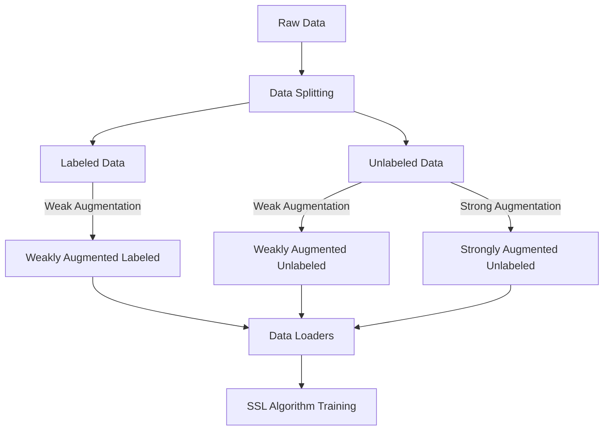
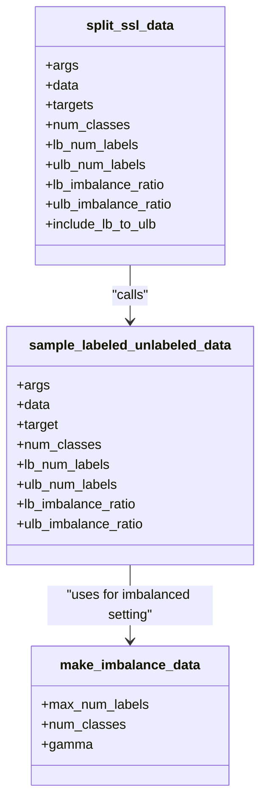
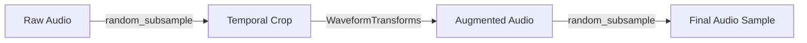
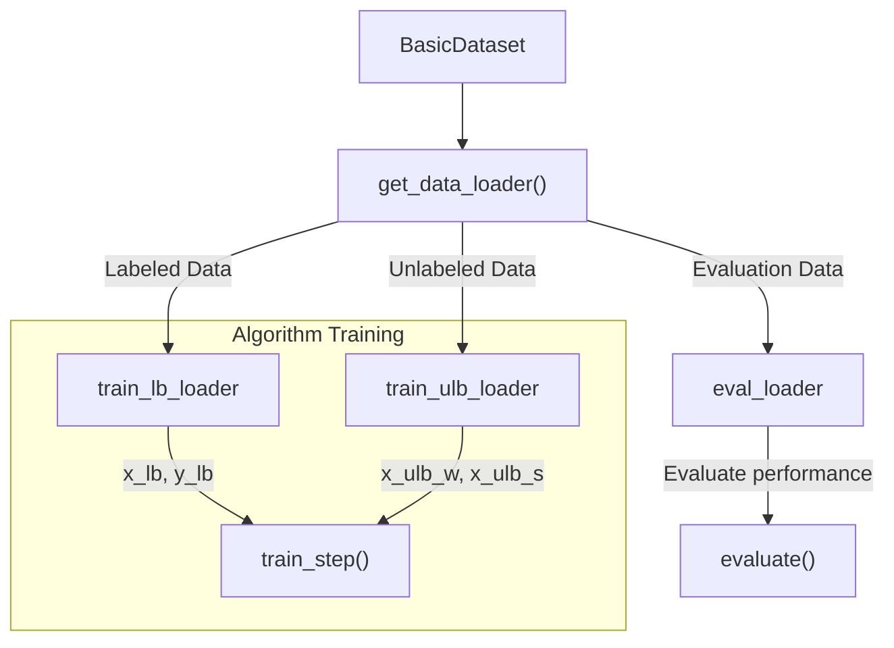
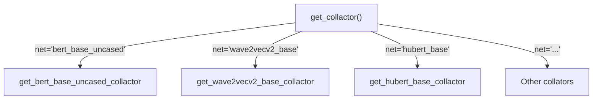

<!-- source: DeepWiki mcp.deepwiki.com · repo microsoft/Semi-supervised-learning · page 4.2 Data Augmentation and Processing · fetched 2026-10-26 -->

# Data Augmentation and Processing

<details>
<summary>Relevant source files</summary>

The following files were used as context for generating this wiki page:

- [README.md](README.md)
- [notebooks/Custom_Dataset.ipynb](notebooks/Custom_Dataset.ipynb)
- [semilearn/algorithms/defixmatch/defixmatch.py](semilearn/algorithms/defixmatch/defixmatch.py)
- [semilearn/datasets/audio_datasets/datasetbase.py](semilearn/datasets/audio_datasets/datasetbase.py)
- [semilearn/datasets/utils.py](semilearn/datasets/utils.py)
- [setup.py](setup.py)

</details>


## Purpose and Scope

This document details the data augmentation and processing pipelines used in the USB (Unified Semi-supervised learning Benchmark) framework. It covers how data is split between labeled and unlabeled sets, the augmentation techniques employed across different domains (CV, NLP, Audio), and the dataset classes that implement these functionalities. For information about the supported datasets themselves, see [Supported Datasets](#4.1).

## 1. Data Processing Overview

The USB framework employs a systematic approach to data processing for semi-supervised learning, where data preprocessing and augmentation play critical roles in algorithm performance. The processing pipeline includes data splitting, transformation, and augmentation steps that prepare data for training SSL algorithms.



Sources: [semilearn/datasets/utils.py:16-52](), [notebooks/Custom_Dataset.ipynb:171-189]()

## 2. Data Splitting

### 2.1 SSL Data Splitting

The process of splitting data into labeled and unlabeled sets is fundamental to semi-supervised learning. USB provides utilities to perform this splitting while maintaining certain properties (e.g., class balance):



The main function for data splitting is `split_ssl_data`, which separates the dataset into labeled and unlabeled portions according to specified parameters:

- `lb_num_labels`: Number of labeled samples
- `ulb_num_labels`: Number of unlabeled samples (optional)
- `lb_imbalance_ratio`: Controls class imbalance in labeled data
- `ulb_imbalance_ratio`: Controls class imbalance in unlabeled data
- `include_lb_to_ulb`: If True, labeled data is also included in unlabeled data

Sources: [semilearn/datasets/utils.py:16-52](), [semilearn/datasets/utils.py:59-120]()

### 2.2 Imbalanced Data Handling

For imbalanced learning scenarios, USB provides `make_imbalance_data` function to create class-imbalanced data distributions using an exponential formulation:

```
samples_per_class[c] = max_num_labels * μ^c
```

where μ = (1/|γ|)^(1/(num_classes-1)) and γ is the imbalance ratio parameter.

Sources: [semilearn/datasets/utils.py:123-136]()

## 3. Data Augmentation Techniques

USB implements domain-specific augmentation techniques for computer vision, NLP, and audio data. These augmentations are crucial for SSL algorithms that rely on consistency regularization between weakly and strongly augmented views.

### 3.1 Computer Vision Augmentations

For computer vision tasks, USB provides weak and strong augmentation pairs:

| Augmentation Type | Typical Transforms |
|-------------------|-------------------|
| Weak Augmentation | Random Horizontal Flip, Random Crop |
| Strong Augmentation | RandAugment, Cutout, Color Jitter |

Example of defining CV augmentations:

```python
# Weak augmentation
train_transform = transforms.Compose([
    transforms.RandomHorizontalFlip(),
    transforms.RandomCrop(32, padding=int(32 * 0.125), padding_mode='reflect'),
    transforms.ToTensor(),
    transforms.Normalize([0.5, 0.5, 0.5], [0.5, 0.5, 0.5])
])

# Strong augmentation
train_strong_transform = transforms.Compose([
    transforms.RandomHorizontalFlip(),
    transforms.RandomCrop(32, padding=int(32 * 0.125), padding_mode='reflect'),
    # RandAugment would be added here for strong augmentation
    transforms.ToTensor(),
    transforms.Normalize([0.5, 0.5, 0.5], [0.5, 0.5, 0.5])
])
```

Sources: [notebooks/Custom_Dataset.ipynb:178-186]()

### 3.2 Audio Augmentations

For audio data, USB implements the `WaveformTransforms` class which provides transformations such as:

1. Speed modification
2. Pitch shifting
3. Attenuation/gain adjustment
4. Reverberation

The audio augmentation pipeline includes:



For strong augmentations, multiple effects are randomly applied from the effects list, followed by sample rate normalization.

Sources: [semilearn/datasets/audio_datasets/datasetbase.py:14-41](), [semilearn/datasets/utils.py:169-175]()

### 3.3 Algorithm-Specific Augmentation Strategies

Different SSL algorithms require specific augmentation strategies:

| Algorithm | Augmentation Strategy |
|-----------|------------------------|
| FixMatch, DeFixMatch, FreeMatch, etc. | Weak + Strong augmentation pairs |
| PiModel, MeanTeacher | Two weak augmentations |
| CoMatch, RemixMatch | Weak + Two strong augmentations |
| VAT | Adversarial perturbation |

Sources: [semilearn/datasets/audio_datasets/datasetbase.py:111-132](), [semilearn/algorithms/defixmatch/defixmatch.py:48-125]()

## 4. Dataset Classes

### 4.1 BasicDataset Structure

The core dataset class in USB is `BasicDataset`, which handles the data and augmentation process:

```mermaid
classDiagram
    class BasicDataset {
        +alg: Algorithm name
        +data: Input data
        +targets: Labels
        +num_classes: Number of classes
        +is_ulb: If unlabeled data
        +transform: Weak augmentation
        +strong_transform: Strong augmentation
        +__getitem__(): Get augmented sample(s)
    }
    
    BasicDataset --> "AlgorithmBase" : "adapts augmentations based on algorithm"
```

The `__getitem__` method of `BasicDataset` provides different outputs depending on:
1. Whether the data is labeled or unlabeled
2. Which SSL algorithm is being used

Sources: [semilearn/datasets/audio_datasets/datasetbase.py:45-135](), [notebooks/Custom_Dataset.ipynb:188-189]()

### 4.2 Data Loader Integration

Data loaders in USB integrate with the dataset classes to provide batched data for training:



The data loaders handle batching, shuffling, and parallel loading of data, with different batch sizes for labeled and unlabeled data controlled by the `uratio` parameter.

Sources: [notebooks/Custom_Dataset.ipynb:226-229]()

## 5. Custom Data Integration

### 5.1 Creating Custom Datasets

To use custom datasets with USB, you need to:

1. Prepare your data in a compatible format (typically numpy arrays)
2. Split the data into labeled and unlabeled sets using `split_ssl_data`
3. Define appropriate transforms for weak and strong augmentation
4. Create `BasicDataset` instances for labeled and unlabeled data
5. Create data loaders using `get_data_loader`

Example workflow:

```python
# 1. Prepare data
data = ...  # Your custom data
target = ... # Your labels

# 2. Split data
lb_data, lb_target, ulb_data, ulb_target = split_ssl_data(
    config, data, target, num_classes, num_labels
)

# 3. Define transforms
train_transform = ...  # Weak augmentation
train_strong_transform = ...  # Strong augmentation

# 4. Create datasets
lb_dataset = BasicDataset(alg, lb_data, lb_target, num_classes, 
                         train_transform, is_ulb=False)
ulb_dataset = BasicDataset(alg, ulb_data, ulb_target, num_classes,
                          train_transform, is_ulb=True, 
                          strong_transform=train_strong_transform)

# 5. Create data loaders
train_lb_loader = get_data_loader(config, lb_dataset, batch_size)
train_ulb_loader = get_data_loader(config, ulb_dataset, batch_size * uratio)
```

Sources: [notebooks/Custom_Dataset.ipynb:171-229]()

## 6. Implementation Details

### 6.1 Domain-Specific Collators

For different data domains, USB provides specialized collator functions to handle batching properly:



These collators handle specific requirements for each model type, such as tokenization for BERT or resampling for audio models.

Sources: [semilearn/datasets/utils.py:139-154]()

### 6.2 Audio Data Processing

For audio data, the framework includes utilities like `random_subsample` for cropping audio to a specified length:

```python
def random_subsample(wav, max_length, sample_rate=16000):
    """Randomly sample chunks of `max_length` seconds from the input audio"""
    sample_length = int(round(sample_rate * max_length))
    if len(wav) <= sample_length:
        return wav
    random_offset = random.randint(0, len(wav) - sample_length - 1)
    return wav[random_offset : random_offset + sample_length]
```

This function enables consistent audio input length while preserving randomness during training.

Sources: [semilearn/datasets/utils.py:169-175](), [semilearn/datasets/audio_datasets/datasetbase.py:106-109]()

## Summary

Data augmentation and processing are core components of the USB framework, providing the foundation for SSL algorithms to learn from both labeled and unlabeled data. The modular design allows for easy adaptation to different domains and integration of custom datasets, while maintaining a unified approach to semi-supervised learning across CV, NLP, and audio tasks.

---

