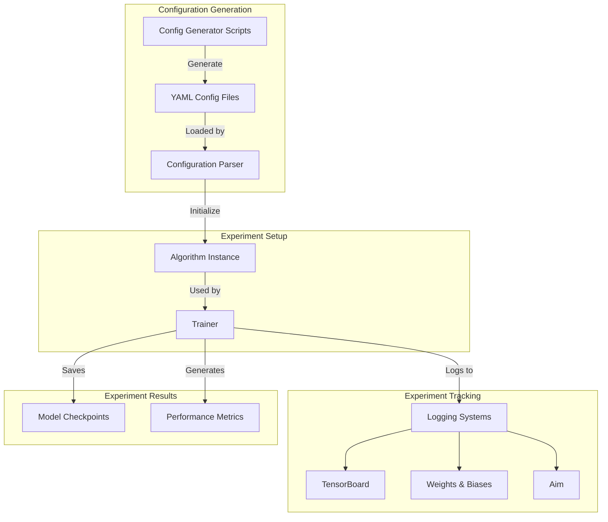
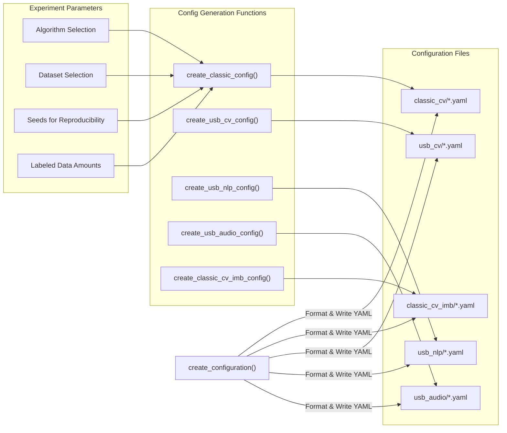
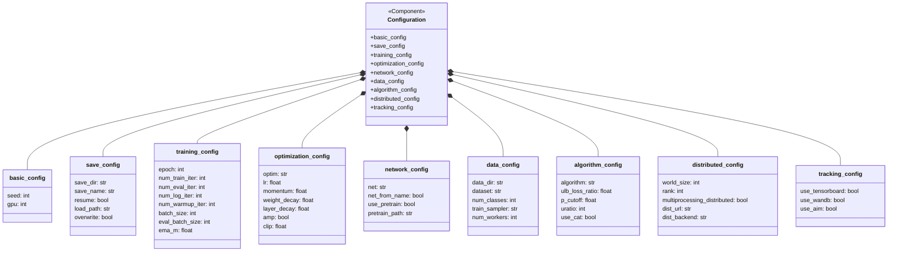
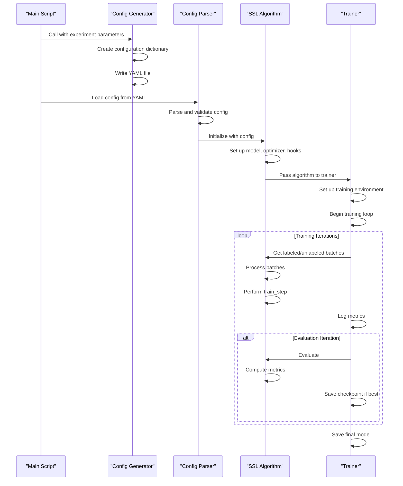
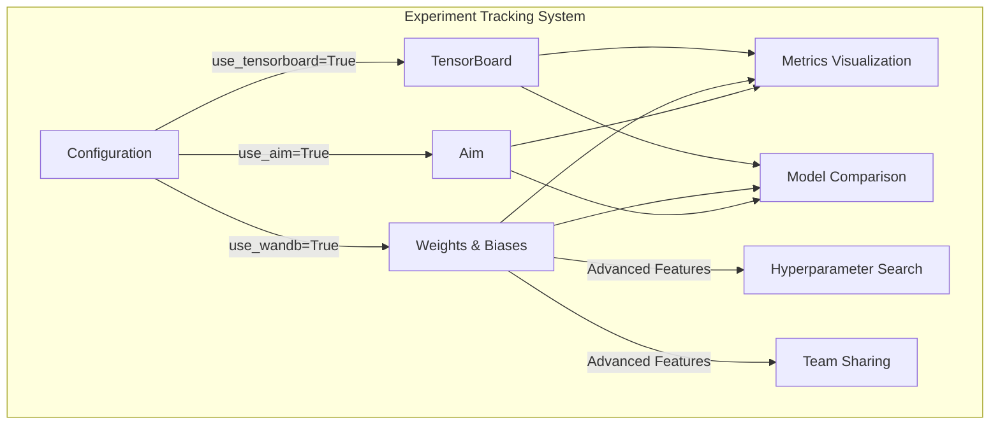

<!-- source: DeepWiki mcp.deepwiki.com · repo microsoft/Semi-supervised-learning · page 5 Configuration and Experiment Management · fetched 2026-10-26 -->

# Configuration and Experiment Management

<details>
<summary>Relevant source files</summary>

The following files were used as context for generating this wiki page:

- [scripts/config_generator_classic_cv.py](scripts/config_generator_classic_cv.py)
- [scripts/config_generator_classic_cv_imb.py](scripts/config_generator_classic_cv_imb.py)
- [scripts/config_generator_usb_audio.py](scripts/config_generator_usb_audio.py)
- [scripts/config_generator_usb_cv.py](scripts/config_generator_usb_cv.py)
- [scripts/config_generator_usb_nlp.py](scripts/config_generator_usb_nlp.py)
- [semilearn/lighting/config.py](semilearn/lighting/config.py)
- [semilearn/lighting/trainer.py](semilearn/lighting/trainer.py)

</details>


This document provides a detailed explanation of the configuration and experiment management system in the USB (Unified Semi-supervised learning Benchmark) framework. It covers how experiment configurations are created, managed, and tracked throughout the training process. For information about the specific algorithms and their implementations, see [Algorithms](#3), and for details about dataset handling, see [Datasets and Data Handling](#4).

## 1. Configuration System Overview

The USB framework uses a comprehensive configuration system to manage experiments across different domains (computer vision, NLP, audio) and algorithms. This system enables reproducible research by ensuring all parameters are explicitly defined and tracked.



Sources: [scripts/config_generator_classic_cv.py:10-36](). [semilearn/lighting/config.py:11-153](). [semilearn/lighting/trainer.py:15-131]().

### 1.1 Configuration File Structure

Configuration files in USB are stored as YAML files with a hierarchical structure. They are organized by algorithm type and dataset, with naming conventions that reflect the experiment parameters.

Example configuration file structure:
```
config/
├── classic_cv/
│   ├── fixmatch/
│   │   ├── fixmatch_cifar10_40_0.yaml
│   │   └── ...
│   ├── flexmatch/
│   │   └── ...
├── classic_cv_imb/
│   └── ...
├── usb_cv/
│   └── ...
├── usb_nlp/
│   └── ...
└── usb_audio/
    └── ...
```

Sources: [scripts/config_generator_classic_cv.py:24-36](). [scripts/config_generator_classic_cv_imb.py:13-62]().

## 2. Configuration Generation

The USB framework includes several scripts for generating configuration files for different domains and experiment types. These scripts create YAML configuration files with appropriate parameters for each algorithm and dataset combination.

### 2.1 Configuration Generation Process



Sources: [scripts/config_generator_classic_cv.py:39-255](). [scripts/config_generator_usb_cv.py:39-230](). [scripts/config_generator_usb_nlp.py:39-232](). [scripts/config_generator_usb_audio.py:39-231](). [scripts/config_generator_classic_cv_imb.py:65-252]().

### 2.2 Domain-Specific Configuration Generators

The framework provides specialized configuration generators for different research domains:

| Domain | Generator Script | Purpose |
|--------|------------------|---------|
| Classic CV | `config_generator_classic_cv.py` | Configurations for traditional CV datasets (CIFAR-10, CIFAR-100, SVHN, STL-10) |
| Imbalanced CV | `config_generator_classic_cv_imb.py` | Configurations for imbalanced SSL experiments |
| USB CV | `config_generator_usb_cv.py` | CV configurations with modern architectures (ViT) |
| USB NLP | `config_generator_usb_nlp.py` | NLP datasets with transformer models |
| USB Audio | `config_generator_usb_audio.py` | Audio datasets with speech models |

Sources: [scripts/config_generator_classic_cv.py:258-376](). [scripts/config_generator_classic_cv_imb.py:254-616](). [scripts/config_generator_usb_cv.py:290-472](). [scripts/config_generator_usb_nlp.py:235-356](). [scripts/config_generator_usb_audio.py:234-351]().

## 3. Configuration Parameters

The USB framework uses a comprehensive set of parameters to control experiment behavior. These parameters can be organized into several categories:

### 3.1 Common Configuration Parameters



Sources: [semilearn/lighting/config.py:18-127](). [scripts/config_generator_classic_cv.py:42-253]().

### 3.2 Domain-Specific Parameters

#### 3.2.1 Computer Vision Parameters

```
img_size: Specifies the image size (e.g., 32, 96, 224)
crop_ratio: Ratio for image cropping during augmentation (typical value: 0.875)
```

Sources: [scripts/config_generator_classic_cv.py:212-216](). [scripts/config_generator_usb_cv.py:242-244]().

#### 3.2.2 NLP Parameters

```
max_length: Maximum sequence length for tokenized text (default: 512)
```

Sources: [scripts/config_generator_usb_nlp.py:216](). [semilearn/lighting/config.py:100]().

#### 3.2.3 Audio Parameters

```
max_length_seconds: Maximum audio length in seconds
sample_rate: Audio sampling rate (typically 16000 Hz)
```

Sources: [scripts/config_generator_usb_audio.py:212-213](). [semilearn/lighting/config.py:103-104]().

### 3.3 Algorithm-Specific Parameters

Different SSL algorithms require specific parameters to control their behavior. Here are examples for some common algorithms:

| Algorithm | Key Parameters |
|-----------|----------------|
| FixMatch | `hard_label`, `T` (temperature), `p_cutoff` |
| FlexMatch | `hard_label`, `T`, `thresh_warmup`, `p_cutoff` |
| UDA | `tsa_schedule`, `T`, `p_cutoff` |
| MixMatch | `mixup_alpha`, `T`, `ulb_loss_ratio`, `unsup_warm_up` |
| MeanTeacher | `ulb_loss_ratio`, `unsup_warm_up`, `ema_m` |
| FreeMatch | `hard_label`, `T`, `ema_p`, `ent_loss_ratio` |
| SoftMatch | `hard_label`, `T`, `dist_align`, `dist_uniform`, `ema_p` |

Sources: [scripts/config_generator_classic_cv.py:63-203](). [scripts/config_generator_usb_cv.py:90-190](). [scripts/config_generator_usb_nlp.py:78-192](). [scripts/config_generator_usb_audio.py:75-188]().

### 3.4 Imbalanced Learning Parameters

For imbalanced learning scenarios, additional parameters are available:

```
lb_imb_ratio: Imbalance ratio for labeled data
ulb_imb_ratio: Imbalance ratio for unlabeled data
ulb_num_labels: Number of labels for unlabeled data
imb_algorithm: Name of the imbalanced learning algorithm
```

Sources: [scripts/config_generator_classic_cv_imb.py:14-38](). [scripts/config_generator_classic_cv_imb.py:161-164](). [semilearn/lighting/config.py:90-93]().

## 4. Configuration Workflow

The configuration workflow in USB involves generating, loading, and applying configurations to experiments.



Sources: [semilearn/lighting/config.py:11-153](). [semilearn/lighting/trainer.py:15-77]().

### 4.1 Configuration Loading and Parsing

The configuration is loaded and parsed using the `get_config` function in `semilearn/lighting/config.py`. This function:

1. Sets up an argument parser with default values
2. Overwrites defaults with values from the config file
3. Adds algorithm-specific parameters
4. Adds imbalanced learning parameters if applicable
5. Sets derived parameters (e.g., save_name, dist_url)

Sources: [semilearn/lighting/config.py:11-153]().

### 4.2 Using Configuration in Training

The `Trainer` class uses the configuration to set up and manage the training process:

1. Sets up the logger using the save path derived from config
2. Initializes the model and EMA mechanism
3. Manages the training loop based on configured iterations/epochs
4. Performs evaluation at the specified frequency
5. Saves checkpoints according to the configuration

Sources: [semilearn/lighting/trainer.py:15-77]().

## 5. Experiment Tracking

USB supports multiple experiment tracking tools to monitor and analyze training progress and results.

### 5.1 Supported Tracking Tools



Sources: [semilearn/lighting/config.py:23-25](). [scripts/config_generator_classic_cv.py:52-54](). [scripts/config_generator_usb_cv.py:65-67]().

### 5.2 Configuring Tracking Options

Tracking options are configured through the following parameters:

```
use_tensorboard: Enable TensorBoard logging
use_wandb: Enable Weights & Biases logging
use_aim: Enable Aim logging
```

These can be set in the configuration file or through command-line arguments.

Sources: [semilearn/lighting/config.py:23-25](). [scripts/config_generator_classic_cv.py:52-54]().

### 5.3 Experiment Naming and Organization

Experiments are organized using a structured naming convention that encodes key information about the experiment:

```
{algorithm}_{dataset}_{num_labels}_{seed}
```

For imbalanced learning experiments, additional components are added:

```
{algorithm}_{imb_algorithm}_{dataset}_lb{num_lb}_{imb_lb}_ulb{num_ulb}_{imb_ulb}_{seed}
```

This naming convention helps track experiments and makes it easier to compare results.

Sources: [scripts/config_generator_classic_cv.py:10-16](). [scripts/config_generator_classic_cv_imb.py:14-38]().

## 6. Best Practices

### 6.1 Directory Structure

Maintain a consistent directory structure for experiments:

```
config/          # Configuration files
  classic_cv/
  usb_cv/
  ...
saved_models/    # Saved model checkpoints
  classic_cv/
  usb_cv/
  ...
```

Sources: [scripts/config_generator_classic_cv.py:46](). [scripts/config_generator_usb_cv.py:60]().

### 6.2 Reproducibility

To ensure reproducible experiments:

1. Always set the `seed` parameter in your configuration
2. Save the full configuration alongside model checkpoints
3. Use version control for your configuration scripts

Sources: [scripts/config_generator_classic_cv.py:240](). [semilearn/lighting/config.py:119-120]().

### 6.3 Configuration Templates

For new experiments, start with an existing configuration template and modify only the necessary parameters. This helps maintain consistency across experiments.

```yaml
# Example configuration template for FixMatch on CIFAR-10
algorithm: fixmatch
dataset: cifar10
num_labels: 40
seed: 0
hard_label: True
T: 0.5
p_cutoff: 0.95
ulb_loss_ratio: 1.0
```

Sources: [scripts/config_generator_classic_cv.py:63-68]().

## 7. Advanced Configuration

### 7.1 Distributed Training

For multi-GPU training, configure the distributed parameters:

```
world_size: Number of nodes for distributed training
rank: Node rank for distributed training
dist_url: URL used to set up distributed training
dist_backend: Distributed backend (typically "nccl")
multiprocessing_distributed: Whether to use multi-processing distributed training
```

Sources: [semilearn/lighting/config.py:111-127](). [scripts/config_generator_classic_cv.py:242-247]().

### 7.2 Customizing Configurations

To add custom parameters:

1. Add parameters to the appropriate configuration generation function
2. Add default values in `semilearn/lighting/config.py`
3. If algorithm-specific, use the `get_argument()` method of the algorithm class

Sources: [semilearn/lighting/config.py:132-143]().

### 7.3 Hyperparameter Optimization

When performing hyperparameter optimization:

1. Use the configuration generation scripts as templates
2. Modify parameters programmatically
3. Track results using Weights & Biases or similar tools

Sources: [scripts/config_generator_classic_cv.py:258-376]().

---

