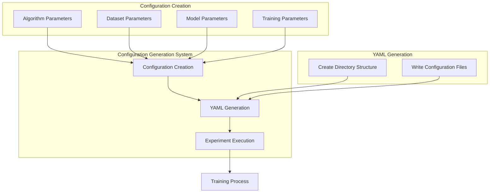
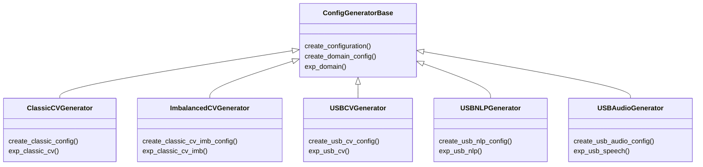
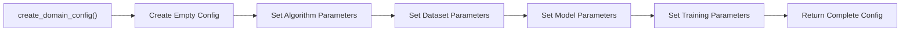
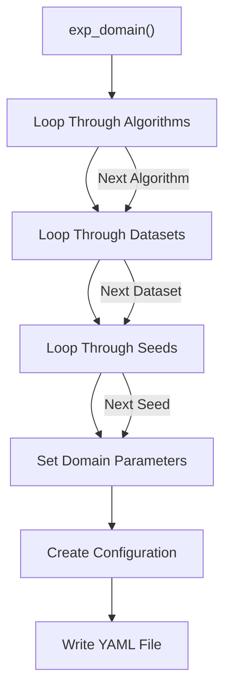
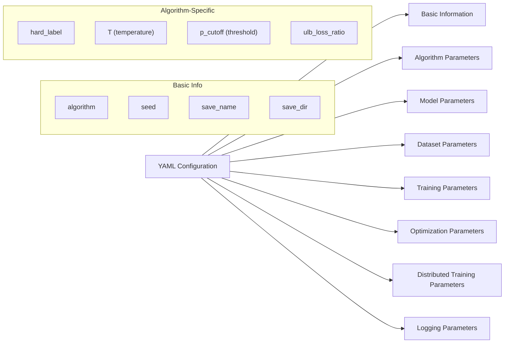

<!-- source: DeepWiki mcp.deepwiki.com · repo microsoft/Semi-supervised-learning · page 5.1 Configuration Generation · fetched 2026-10-26 -->

# Configuration Generation

<details>
<summary>Relevant source files</summary>

The following files were used as context for generating this wiki page:

- [scripts/config_generator_classic_cv.py](scripts/config_generator_classic_cv.py)
- [scripts/config_generator_classic_cv_imb.py](scripts/config_generator_classic_cv_imb.py)
- [scripts/config_generator_usb_audio.py](scripts/config_generator_usb_audio.py)
- [scripts/config_generator_usb_cv.py](scripts/config_generator_usb_cv.py)
- [scripts/config_generator_usb_nlp.py](scripts/config_generator_usb_nlp.py)

</details>


This document explains the configuration generation system in the USB (Unified Semi-supervised Learning Benchmark) framework. The system is responsible for automating the creation of experiment configuration files across multiple domains (computer vision, NLP, and audio) for various SSL algorithms, datasets, and settings.

For information on experiment tracking and monitoring, see [Experiment Tracking](#5.2).

## 1. Overview

The configuration generation system creates structured YAML configuration files that define all aspects of a semi-supervised learning experiment. These generated files serve as input to the training framework, ensuring consistent and reproducible experiments.

The system supports configuration generation for:
- Classic computer vision benchmarks (CIFAR10, CIFAR100, STL10, etc.)
- Imbalanced learning scenarios
- Advanced computer vision with transformers
- Natural language processing tasks
- Audio classification tasks



Sources: [scripts/config_generator_classic_cv.py:10-36](), [scripts/config_generator_usb_cv.py:10-36](), [scripts/config_generator_usb_nlp.py:10-36](), [scripts/config_generator_usb_audio.py:10-36]()

## 2. Configuration Generation Architecture

The configuration generation system is organized into domain-specific generators. Each generator follows a similar pattern but includes customizations for their specific domains.



Sources: [scripts/config_generator_classic_cv.py](), [scripts/config_generator_classic_cv_imb.py](), [scripts/config_generator_usb_cv.py](), [scripts/config_generator_usb_nlp.py](), [scripts/config_generator_usb_audio.py]()

## 3. Core Components and Functions

Each configuration generator consists of three main function types:

### 3.1 Configuration Creation Functions

These functions create a configuration dictionary populated with parameters specific to an algorithm, dataset, and experiment setting.



For example, the `create_classic_config()` function in the classic computer vision generator:

```python
def create_classic_config(alg, seed, dataset, net, num_classes, num_labels, img_size, port, weight_decay):
    cfg = {}
    cfg["algorithm"] = alg
    
    # Set save config
    cfg["save_dir"] = "./saved_models/classic_cv"
    
    # Set algorithm-specific parameters
    if alg == "fixmatch":
        cfg["hard_label"] = True
        cfg["T"] = 0.5
        cfg["p_cutoff"] = 0.95
        # more parameters...
    elif alg == "flexmatch":
        # flexmatch specific parameters...
    # more algorithms...
    
    # Set dataset, model, and optimization parameters
    # ...
    
    return cfg
```

Sources: [scripts/config_generator_classic_cv.py:39-255](), [scripts/config_generator_usb_cv.py:39-286](), [scripts/config_generator_usb_nlp.py:39-232](), [scripts/config_generator_usb_audio.py:39-231]()

### 3.2 Configuration Writing Function

This common function takes a configuration dictionary and writes it to a YAML file with appropriate naming and directory structure:

```python
def create_configuration(cfg, cfg_file):
    # Create a save name based on algorithm, dataset, labels, and seed
    cfg["save_name"] = "{alg}_{dataset}_{num_lb}_{seed}".format(
        alg=cfg["algorithm"],
        dataset=cfg["dataset"],
        num_lb=cfg["num_labels"],
        seed=cfg["seed"],
    )
    
    # Setup resume configuration
    cfg["resume"] = True
    cfg["load_path"] = "{}/{}/latest_model.pth".format(
        cfg["save_dir"], cfg["save_name"]
    )
    
    # Create directory if needed
    alg_file = cfg_file + cfg["algorithm"] + "/"
    if not os.path.exists(alg_file):
        os.mkdir(alg_file)
    
    # Write configuration to YAML file
    with open(alg_file + cfg["save_name"] + ".yaml", "w", encoding="utf-8") as w:
        lines = []
        for k, v in cfg.items():
            line = str(k) + ": " + str(v)
            lines.append(line)
        for line in lines:
            w.writelines(line)
            w.write("\n")
```

Sources: [scripts/config_generator_classic_cv.py:10-36](), [scripts/config_generator_usb_cv.py:10-36](), [scripts/config_generator_usb_nlp.py:10-36](), [scripts/config_generator_usb_audio.py:10-36]()

### 3.3 Experiment Functions

These functions orchestrate the generation of multiple configurations by iterating through combinations of algorithms, datasets, and seeds:



For example, the `exp_classic_cv()` function:

```python
def exp_classic_cv(label_amount):
    # Create directories
    config_file = r"./config/classic_cv/"
    save_path = r"./saved_models/classic_cv"
    
    # Define algorithms, datasets, and seeds
    algs = ["flexmatch", "fixmatch", "uda", "pseudolabel", ...]
    datasets = ["cifar100", "svhn", "stl10", "cifar10"]
    seeds = [0]
    
    # Loop through combinations
    for alg in algs:
        for dataset in datasets:
            for seed in seeds:
                # Set dataset-specific parameters
                if dataset == "cifar10":
                    num_classes = 10
                    num_labels = label_amount[0]
                    # more parameters...
                elif dataset == "cifar100":
                    # cifar100 specific parameters...
                # more datasets...
                
                # Create and write configuration
                cfg = create_classic_config(...)
                create_configuration(cfg, config_file)
```

Sources: [scripts/config_generator_classic_cv.py:258-376](), [scripts/config_generator_usb_cv.py:290-472](), [scripts/config_generator_usb_nlp.py:235-356](), [scripts/config_generator_usb_audio.py:234-351]()

## 4. Domain-Specific Configuration Generators

### 4.1 Classic Computer Vision Generator

Generates configurations for standard computer vision benchmarks with traditional models.

Key features:
- Support for CIFAR10, CIFAR100, SVHN, STL10
- Primarily uses WideResNet architectures
- Configures SGD optimizer with momentum

```python
# Example label configurations
label_amount = {
    "s": [40, 400, 40, 40],    # Small label set
    "m": [250, 2500, 250, 250], # Medium label set
    "l": [4000, 10000, 1000, 1000], # Large label set
}
```

Sources: [scripts/config_generator_classic_cv.py]()

### 4.2 Imbalanced Learning Generator

Extends the classic generator with support for class-imbalanced scenarios.

Key features:
- Configures imbalance ratios for both labeled and unlabeled data
- Supports imbalanced algorithms (CREST, DARP, ABC, etc.)
- Includes settings for different imbalance scenarios (long-tailed, reversed, etc.)

```python
# Example imbalanced settings
settings = {
    "cifar10": [
        {
            "lb_num_labels": 1500,
            "ulb_num_labels": 3000,
            "lb_imb_ratio": 100,
            "ulb_imb_ratio": 100,
        },
        # More settings...
    ],
    # More datasets...
}
```

Sources: [scripts/config_generator_classic_cv_imb.py]()

### 4.3 USB Computer Vision Generator

Generates configurations for computer vision tasks using more advanced models like Vision Transformers.

Key features:
- Support for pre-trained models
- Layer-wise learning rate decay
- More diverse set of datasets including EuroSAT, TissueMNIST, Semi-Aves

Sources: [scripts/config_generator_usb_cv.py]()

### 4.4 USB NLP Generator

Generates configurations for natural language processing tasks.

Key features:
- BERT-based models
- Text length configuration
- Support for datasets like IMDb, AG News, Amazon Review

Sources: [scripts/config_generator_usb_nlp.py]()

### 4.5 USB Audio Generator

Generates configurations for audio classification tasks.

Key features:
- Hubert and Wave2Vec models
- Audio-specific parameters (sample rate, max length in seconds)
- Support for datasets like ESC-50, FSDNoisy, UrbanSound8K

Sources: [scripts/config_generator_usb_audio.py]()

## 5. Configuration File Structure

The generated YAML configuration files follow a structured format with several key sections:



Here's an example of a generated configuration file structure:

```yaml
algorithm: fixmatch
save_dir: ./saved_models/classic_cv
save_name: fixmatch_cifar10_40_0
resume: True
load_path: ./saved_models/classic_cv/fixmatch_cifar10_40_0/latest_model.pth
overwrite: True
use_tensorboard: True
epoch: 1024
num_train_iter: 1048576
num_eval_iter: 5120
num_log_iter: 256
num_labels: 40
batch_size: 64
eval_batch_size: 256
hard_label: True
T: 0.5
p_cutoff: 0.95
ulb_loss_ratio: 1.0
uratio: 7
ema_m: 0.999
crop_ratio: 0.875
img_size: 32
optim: SGD
lr: 0.03
momentum: 0.9
weight_decay: 0.0005
layer_decay: 1.0
amp: False
clip: 0.0
use_cat: True
net: wrn_28_2
net_from_name: False
data_dir: ./data
dataset: cifar10
train_sampler: RandomSampler
num_classes: 10
num_workers: 1
seed: 0
world_size: 1
rank: 0
multiprocessing_distributed: True
dist_url: tcp://127.0.0.1:10001
dist_backend: nccl
gpu: None
```

Sources: [scripts/config_generator_classic_cv.py:10-36]()

## 6. Generating Configurations

The configuration generation process typically follows these steps:

1. Define the label amounts for each dataset:
   ```python
   label_amount = {
       "s": [40, 400, 40, 40],  # small label set
       "m": [250, 2500, 250, 250],  # medium label set
       "l": [4000, 10000, 1000, 1000],  # large label set
   }
   ```

2. Call the experiment function with the desired label amount:
   ```python
   for i in label_amount:  # iterate through small, medium, large
       exp_classic_cv(label_amount=label_amount[i])
   ```

3. The experiment function iterates through combinations of algorithms, datasets, and seeds, creating a configuration for each combination.

4. Each configuration is written to a YAML file with a name that reflects its settings.

Sources: [scripts/config_generator_classic_cv.py:362-376](), [scripts/config_generator_usb_cv.py:463-472](), [scripts/config_generator_usb_nlp.py:344-356](), [scripts/config_generator_usb_audio.py:338-351]()

## 7. Using Generated Configurations

The generated configuration files are used as input to the training script:

```bash
python train.py --c config/classic_cv/fixmatch/fixmatch_cifar10_40_0.yaml
```

The training script loads the YAML file and uses the parameters to set up the experiment, including:
- Creating the correct algorithm instance
- Loading the specified dataset
- Configuring the model and optimizer
- Setting up training and evaluation loops

Sources: [scripts/config_generator_classic_cv.py:10-36]()

## 8. Extending the Configuration System

To add support for a new algorithm or dataset, you would:

1. Add the algorithm parameters to the configuration creation function:
   ```python
   def create_classic_config(...):
       # existing code...
       elif alg == "new_algorithm":
           cfg["new_param1"] = value1
           cfg["new_param2"] = value2
       # more code...
   ```

2. Add the dataset parameters to the experiment function:
   ```python
   def exp_classic_cv(...):
       # existing code...
       elif dataset == "new_dataset":
           num_classes = X
           num_labels = label_amount[Y]
           # other dataset-specific parameters
       # more code...
   ```

3. Add the algorithm to the list of algorithms in the experiment function:
   ```python
   algs = ["flexmatch", "fixmatch", "new_algorithm", ...]
   ```

4. Add the dataset to the list of datasets in the experiment function:
   ```python
   datasets = ["cifar10", "cifar100", "new_dataset", ...]
   ```

Sources: [scripts/config_generator_classic_cv.py:39-255](), [scripts/config_generator_classic_cv.py:258-376]()

## 9. Summary

The configuration generation system in USB enables systematic experimentation with semi-supervised learning algorithms across various domains. By automating the creation of configuration files, it ensures consistency and reproducibility while allowing researchers to easily run large-scale benchmarking experiments.

The modular design allows adding new algorithms, datasets, and parameters with minimal code changes, making it a flexible foundation for semi-supervised learning research.

---

