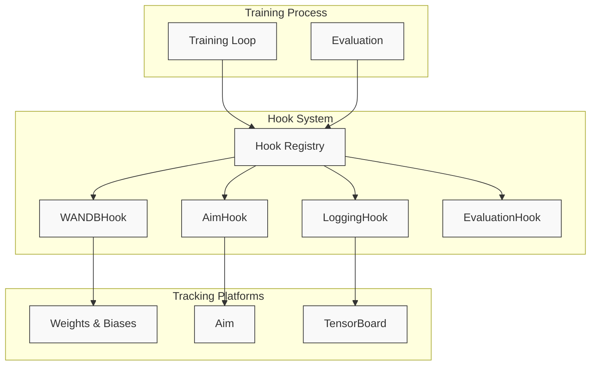
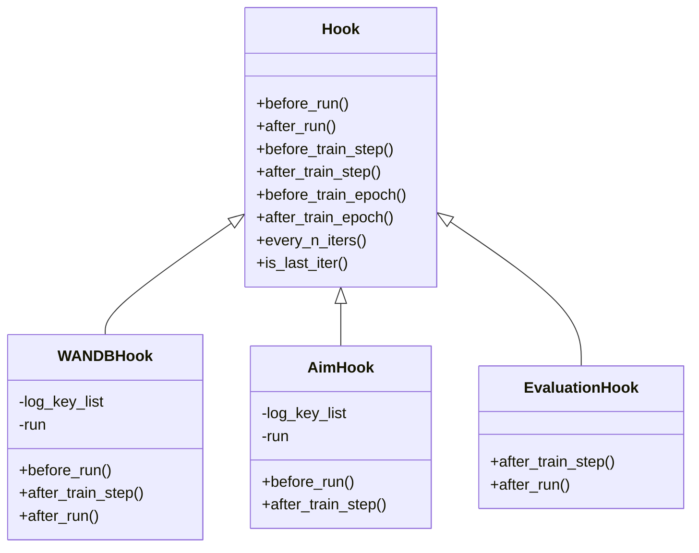
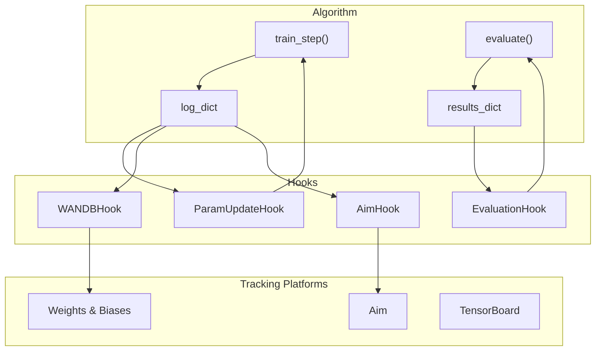

<!-- source: DeepWiki mcp.deepwiki.com · repo microsoft/Semi-supervised-learning · page 5.2 Experiment Tracking · fetched 2026-10-26 -->

# Experiment Tracking

<details>
<summary>Relevant source files</summary>

The following files were used as context for generating this wiki page:

- [CHANGE_LOG.md](CHANGE_LOG.md)
- [semilearn/core/criterions/consistency.py](semilearn/core/criterions/consistency.py)
- [semilearn/core/hooks/aim.py](semilearn/core/hooks/aim.py)
- [semilearn/core/hooks/evaluation.py](semilearn/core/hooks/evaluation.py)
- [semilearn/core/hooks/wandb.py](semilearn/core/hooks/wandb.py)
- [semilearn/imb_algorithms/cossl/cossl.py](semilearn/imb_algorithms/cossl/cossl.py)
- [semilearn/imb_algorithms/cossl/utils.py](semilearn/imb_algorithms/cossl/utils.py)
- [semilearn/imb_algorithms/saw/saw.py](semilearn/imb_algorithms/saw/saw.py)
- [semilearn/imb_algorithms/saw/utils.py](semilearn/imb_algorithms/saw/utils.py)

</details>


## Purpose and Scope

This document covers the experiment tracking capabilities within the USB (Unified Semi-supervised learning Benchmark) framework. Experiment tracking enables researchers to monitor training progress, compare algorithm performance, and visualize results. This page details the tracking system architecture, supported platforms, configurable metrics, and integration methods. For information about configuration generation, see [Configuration Generation](#5.1).

## Tracking System Architecture

The USB framework implements experiment tracking through a hook-based system, where tracking functionality is integrated into the training process as specialized hooks that capture and log metrics at specified intervals.



Sources: [semilearn/core/hooks/wandb.py](), [semilearn/core/hooks/aim.py](), [CHANGE_LOG.md]()

The experiment tracking system is responsible for:
1. Collecting metrics during training and evaluation
2. Logging these metrics to various platforms
3. Organizing experiments with appropriate tags and metadata
4. Supporting experiment resumption

## Tracking Hooks Implementation

The tracking hooks are implemented as specialized classes that inherit from the base `Hook` class. Each platform has its own dedicated hook implementation.



Sources: [semilearn/core/hooks/wandb.py](), [semilearn/core/hooks/aim.py](), [semilearn/core/hooks/evaluation.py]()

## Supported Tracking Platforms

### Weights & Biases (Wandb)

Wandb is integrated through the `WANDBHook` class, which logs metrics, configures run metadata, and organizes experiments in projects.

Key features:
- Automatic tagging of experiments with dataset, algorithm, and data distribution information
- Periodic logging of metrics at specified intervals
- Support for experiment resumption
- Organization of experiments within projects

The hook logs metrics at every `num_log_iter` iterations, with evaluation metrics logged at every `num_eval_iter` iterations.

Implementation details:
- Initializes a Wandb run with appropriate tags and configuration in `before_run()`
- Logs metrics in `after_train_step()` if the required logging interval is reached
- Finalizes the run in `after_run()`

Sources: [semilearn/core/hooks/wandb.py:9-62]()

### Aim

Aim is integrated through the `AimHook` class, offering similar functionality to Wandb but using the Aim platform.

Key features:
- Experiment organization by name and project
- Configuration storage
- Tagging system similar to Wandb
- Metric tracking at specified intervals

Recent updates include fixes for hard-coded repository paths and support for resuming tracking on the same run when resuming training.

Sources: [semilearn/core/hooks/aim.py:9-49](), [CHANGE_LOG.md:3-6]()

### TensorBoard

TensorBoard logging is also supported in the USB framework, with logging frequency configurable through the `num_log_iter` parameter.

Sources: [CHANGE_LOG.md:3]()

## Tracked Metrics

The USB framework tracks a comprehensive set of metrics during training and evaluation:

```
Training Metrics:
- train/sup_loss: Supervised loss on labeled data
- train/unsup_loss: Unsupervised loss on unlabeled data
- train/total_loss: Combined total loss
- train/util_ratio: Utilization ratio for unlabeled data
- train/run_time: Runtime per iteration
- train/prefetch_time: Data prefetching time
- lr: Current learning rate

Evaluation Metrics:
- eval/top-1-acc: Top-1 accuracy
- eval/precision: Precision
- eval/recall: Recall
- eval/F1: F1 score
- eval/best-acc: Best accuracy achieved so far
```

Some algorithms may log additional algorithm-specific metrics, such as:
- `train/tea_loss`: Teacher loss in CoSSL algorithm

Sources: [semilearn/core/hooks/wandb.py:16-18](), [semilearn/core/hooks/aim.py:16-18](), [semilearn/imb_algorithms/cossl/cossl.py:247-248]()

## Data Flow for Experiment Tracking

The following diagram illustrates the data flow during training and how metrics are captured and logged to tracking platforms:



Sources: [semilearn/core/hooks/wandb.py:50-59](), [semilearn/core/hooks/aim.py:42-49](), [semilearn/core/hooks/evaluation.py:14-22]()

## Special Tracking for Imbalanced Learning

The USB framework includes specialized tracking for imbalanced learning algorithms, which track additional metrics related to class distribution and weights:

1. For SAW (Stochastic Weight Averaging) algorithm:
   - Tracks labeled and unlabeled data class weights
   - Updates weights after each epoch based on pseudo-label distributions
   - Preserves weights when saving/loading models

2. For CoSSL (Collaboration-based Semi-Supervised Learning) algorithm:
   - Tracks teacher loss in addition to standard metrics
   - Uses custom parameter update hooks for specialized tracking

Sources: [semilearn/imb_algorithms/saw/utils.py:22-56](), [semilearn/imb_algorithms/cossl/cossl.py:50-79]()

## Configuration and Usage

To configure experiment tracking in USB, you need to:

1. Specify the tracking platform in your configuration
2. Set appropriate logging intervals
3. Configure platform-specific settings

### Example Configuration Parameters

| Parameter | Description | Default Value |
|-----------|-------------|---------------|
| `use_wandb` | Enable Weights & Biases tracking | `False` |
| `use_aim` | Enable Aim tracking | `False` |
| `num_log_iter` | Logging frequency (iterations) | `10` |
| `num_eval_iter` | Evaluation frequency (iterations) | `500` |
| `save_name` | Experiment name | `{algorithm}_{dataset}` |
| `save_dir` | Directory for saving experiment data | `./saved_models` |

### Resume Functionality

Both Wandb and Aim support resuming training from a checkpoint while continuing to track metrics in the same experiment run. This is achieved through:

1. For Wandb: Setting `resume='auto'` when `args.resume` is `True`
2. For Aim: Using the same experiment name when resuming training

Sources: [semilearn/core/hooks/wandb.py:32-36](), [CHANGE_LOG.md:4]()

## Best Practices

1. **Consistent Naming**: Use consistent experiment naming to easily group and compare related experiments.

2. **Appropriate Tagging**: The hooks automatically add tags for:
   - Benchmark (`benchmark: {project}`)
   - Dataset (`dataset: {algorithm.args.dataset}`)
   - Data setting (`setting: {dataset}_lb{num_labels}_{lb_imb_ratio}_ulb{ulb_num_labels}_{ulb_imb_ratio}`)
   - Algorithm (`alg: {algorithm.args.algorithm}`)
   - Imbalanced algorithm (`imb_alg: {algorithm.args.imb_algorithm}`)

3. **Logging Frequency**: Set appropriate logging and evaluation frequencies:
   - Lower `num_log_iter` for more detailed training curves but larger storage requirements
   - Higher `num_eval_iter` to reduce evaluation overhead during training

4. **Storage Management**: Configure appropriate save directories to organize experiment results.

Sources: [semilearn/core/hooks/wandb.py:26-31](), [semilearn/core/hooks/aim.py:31-40]()

## Conclusion

The experiment tracking system in USB provides comprehensive monitoring and visualization of training processes across multiple platforms. Through the hook-based architecture, metrics are captured at configurable intervals and organized with meaningful metadata to facilitate experiment comparison and analysis.

---

