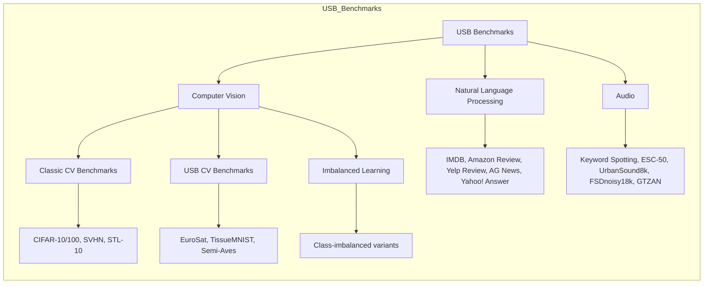
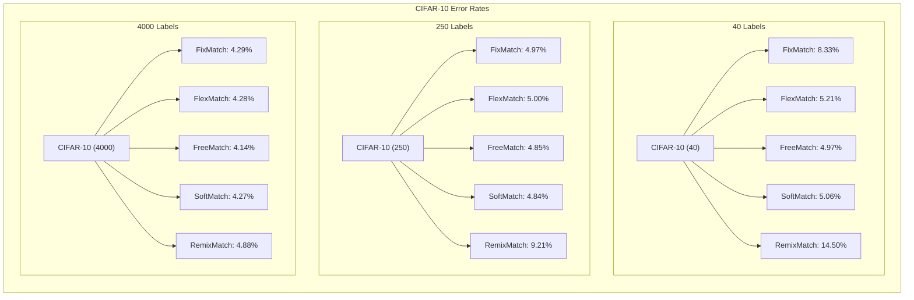
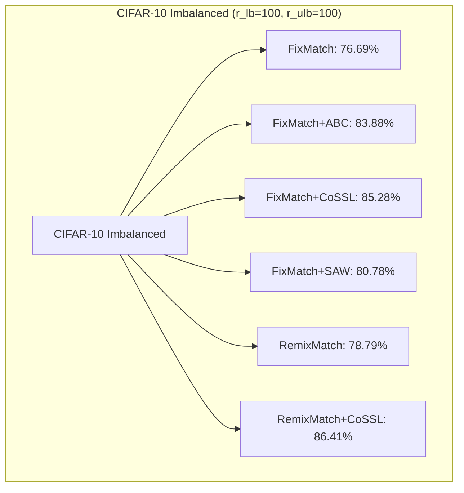
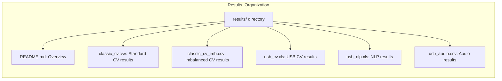
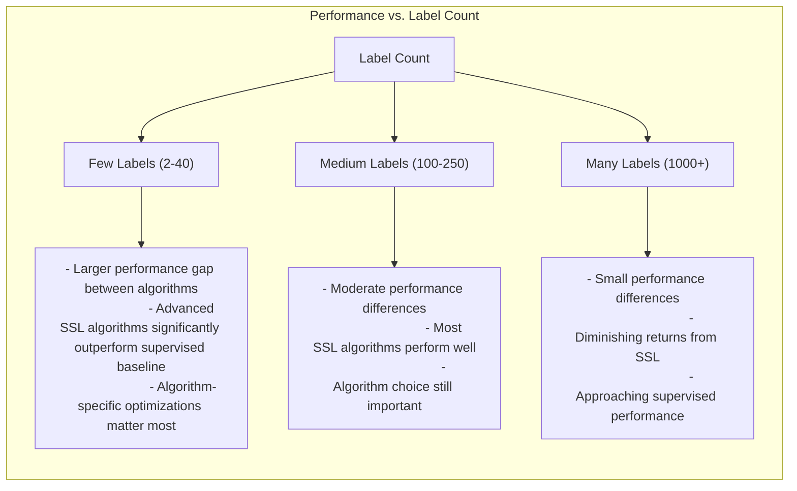

<!-- source: DeepWiki mcp.deepwiki.com · repo microsoft/Semi-supervised-learning · page 6 Benchmarking Results · fetched 2026-10-26 -->

# Benchmarking Results

<details>
<summary>Relevant source files</summary>

The following files were used as context for generating this wiki page:

- [results/README.md](results/README.md)
- [results/classic_cv.csv](results/classic_cv.csv)
- [results/classic_cv_imb.csv](results/classic_cv_imb.csv)
- [results/usb_audio.csv](results/usb_audio.csv)

</details>


## Purpose and Scope

This page documents the comprehensive benchmark results available in the USB (Unified Semi-supervised Learning Benchmark) framework. It provides an overview of performance metrics for various SSL algorithms across computer vision, natural language processing, and audio domains. The benchmarks serve as a standardized evaluation framework for comparing algorithm effectiveness under different conditions and dataset properties.

For information on how to run your own benchmark experiments, see [Configuration and Experiment Management](#5).

Sources: [results/README.md:1-3]()

## Benchmark Organization

USB provides benchmark results across three major domains, with multiple datasets and label settings for each domain. The benchmarks evaluate all implemented SSL algorithms under consistent conditions to ensure fair comparison.

### Benchmark Structure



Sources: [results/README.md:5-66]()

### Algorithm Coverage

The benchmarks include evaluation results for 14 core SSL algorithms with multiple variations for imbalanced learning scenarios:

```mermaid
classDiagram
    class "AlgorithmTypes" {
        Standard SSL Algorithms
        Imbalanced Learning Algorithms
    }
    
    class "StandardSSL" {
        FixMatch
        FlexMatch
        FreeMatch
        SoftMatch
        UDA
        PiModel
        MeanTeacher
        VAT
        MixMatch
        RemixMatch
        AdaMatch
        CoMatch
        Dash
        SimMatch
        CRMatch
    }
    
    class "ImbalancedSSL" {
        CREST
        CREST+
        DARP
        ABC
        DASO
        SAW
        ADSH
        DebiasPL
        CoSSL
    }
    
    "AlgorithmTypes" --> "StandardSSL"
    "AlgorithmTypes" --> "ImbalancedSSL"
```

Sources: [results/README.md:3](), [results/classic_cv.csv:3-19](), [results/classic_cv_imb.csv:4-24]()

## Benchmark Datasets

### Computer Vision Datasets

The CV benchmarks are divided into classic benchmarks and USB-specific benchmarks, with varying label counts to test algorithm performance under different labeled data availability.

| Dataset | Label Counts | Training Data | Test Data | Classes |
|---------|--------------|---------------|-----------|---------|
| **Classic CV** |
| CIFAR-10 | 4 / 25 / 400 / 4000 | 50,000 | 10,000 | 10 |
| CIFAR-100 | 4 / 25 / 100 / 400 / 2500 / 10000 | 50,000 | 10,000 | 100 |
| SVHN | 4 / 25 / 100 / 1000 | 604,388 | 26,032 | 10 |
| STL-10 | 4 / 25 / 100 | 100,000 | 10,000 | 10 |
| **USB CV** |
| CIFAR-100 | 2 / 4 | 50,000 | 10,000 | 100 |
| STL-10 | 4 / 10 | 5,000 / 100,000 | 8,000 | 10 |
| EuroSat | 2 / 4 | 16,200 | 5,400 | 10 |
| TissueMNIST | 10 / 50 | 165,466 | 47,280 | 8 |
| Semi-Aves | 15-53 | 3,959 / 26,640 | 4,000 | 200 |

Sources: [results/README.md:9-14](), [results/README.md:24-31]()

### NLP Datasets

| Dataset | Label Counts | Training Data | Val Data | Test Data | Classes |
|---------|--------------|---------------|----------|-----------|---------|
| IMDB | 10 / 50 | 23,000 | 2,000 | 25,000 | 2 |
| Amazon Review | 50 / 200 | 250,000 | 25,000 | 65,000 | 5 |
| Yelp Review | 50 / 200 | 250,000 | 25,000 | 50,000 | 5 |
| AG News | 10 / 50 | 100,000 | 10,000 | 7,600 | 4 |
| Yahoo! Answer | 50 / 200 | 500,000 | 50,000 | 60,000 | 10 |

Sources: [results/README.md:40-47]()

### Audio Datasets

| Dataset | Label Counts | Training Data | Val Data | Test Data | Classes |
|---------|--------------|---------------|----------|-----------|---------|
| Keyword Spotting | 5 / 20 | 18,538 | 2,577 | 2,567 | 10 |
| ESC-50 | 5 / 10 | 1,200 | 400 | 400 | 50 |
| UrbanSound8k | 10 / 40 | 7,079 | 816 | 837 | 10 |
| FSDnoisy18k | 52-171 | 1,772 / 15,813 | - | 947 | 20 |
| GTZAN | 10 / 40 | 7,000 | 1,500 | 1,500 | 10 |

Sources: [results/README.md:56-63]()

## Performance Overview

### Classic CV Benchmark Results

The following diagram illustrates the relative performance of SSL algorithms on CIFAR-10 with 40, 250, and 4000 labels, showing error rates (lower is better):



Key observations:
- FreeMatch and SoftMatch achieve the lowest error rates on CIFAR-10
- Performance gap between algorithms decreases as the number of labels increases
- Fully supervised baseline error rate is ~4.6% (with all labels)

Sources: [results/classic_cv.csv:1-19]()

### Imbalanced Learning Results

For class-imbalanced settings, specialized algorithms show significant improvements over standard SSL approaches:



Key insights:
- CoSSL achieves the best performance for both FixMatch and RemixMatch base algorithms
- ABC provides significant improvement over base FixMatch
- Other imbalanced learning approaches like SAW and CREST also improve performance

Sources: [results/classic_cv_imb.csv:4-24]()

### Audio Domain Results

The following table highlights performance on audio datasets (error rates in %):

| Algorithm | GTZAN (100) | GTZAN (400) | UrbanSound8k (100) | UrbanSound8k (400) |
|-----------|-------------|-------------|---------------------|---------------------|
| Supervised | 52.73±2.86 | 32.04±0.51 | 42.65±1.63 | 27.60±1.19 |
| FixMatch | 41.47±1.62 | 21.89±1.01 | 40.02±6.62 | 20.83±2.31 |
| SimMatch | 30.69±1.63 | 21.16±0.06 | 30.63±6.10 | 19.95±2.11 |
| SoftMatch | 32.71±2.18 | 21.24±1.02 | 35.32±6.59 | 21.43±2.37 |
| FreeMatch | 33.31±1.06 | 21.42±0.44 | 41.58±4.06 | 27.36±0.78 |

Sources: [results/usb_audio.csv:1-19]()

## Benchmark Data Organization

The benchmark results are organized in the repository as follows:



Each result file contains benchmark data in the following format:
- Row 1: Dataset names with label counts
- Row 2-N: Algorithm names followed by performance metrics (error rates with standard deviation)

Sources: [results/README.md:16-18](), [results/README.md:32-34](), [results/README.md:48-50](), [results/README.md:64-66]()

## Key Performance Trends

Based on the benchmark results, several important observations can be made about SSL algorithm performance:

### Effect of Label Count



Sources: [results/classic_cv.csv:1-19]()

### Domain-Specific Performance

Different SSL algorithms excel in different domains:

1. **Computer Vision**:
   - FreeMatch, SoftMatch, and FlexMatch perform best on CIFAR-10/100
   - For imbalanced datasets, CoSSL and ABC provide significant improvements

2. **Audio**:
   - SimMatch shows the best performance on GTZAN and UrbanSound8k
   - RemixMatch performs poorly on audio datasets (unlike in CV)

3. **NLP**:
   - Results available in the USB NLP Excel file (not shown in CSV format)

Sources: [results/classic_cv.csv:1-19](), [results/usb_audio.csv:1-19]()

## Accessing and Using Benchmark Results

The benchmark results can be used for:

1. **Algorithm Selection**: Choose the best algorithm for your specific domain and label count
2. **Performance Expectations**: Set realistic expectations for SSL performance on your dataset
3. **Baseline Comparison**: Compare your custom algorithm against established baselines
4. **Research Insights**: Identify patterns and areas for improvement in SSL algorithms

To access the complete benchmark results:
- Classic CV: [results/classic_cv.xls]()
- USB CV: [results/usb_cv.xls]()
- USB NLP: [results/usb_nlp.xls]()
- USB Audio: [results/usb_audio.xls]()

Sources: [results/README.md:16-18](), [results/README.md:32-34](), [results/README.md:48-50](), [results/README.md:64-66]()

## Reproducing Benchmark Results

To reproduce the benchmark results, you can use the configuration files provided in the repository. The reproduction process follows the standard training workflow described in [Training Framework](#2.2).

For running benchmarks with specific label counts and dataset settings, refer to the configuration generation system detailed in [Configuration Generation](#5.1).

Sources: [results/README.md:1-3]()

---

